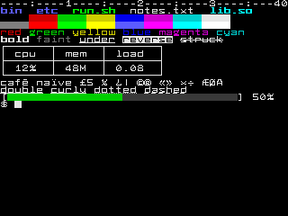

# VTium

**vtium is a terminal for the Linux console.**

To use a computer, you need a way to tell it what you want and a way to see its answer. Something goes in, the computer works on it, and something comes back out: **input**, **processing** and **output**.

On an Apple II or a Commodore 64, two of the early home computers, you typed on the keyboard and your words appeared on the screen. On an IBM PC you typed a command after the `C:\>` prompt, and on a Macintosh you moved the mouse and clicked a picture of a folder to open it. On an iPhone you touch the glass, and in VR goggles you turn your head and the world you see turns with you. The parts change shape, but the three steps never do.

A terminal is the plainest form of that idea. The keyboard is the input, a screen of text is the output, and in between sits a program that reads what you type and writes back.

Unix, and Linux after it, has always worked this way: you type text to a program called a shell, and it prints text back. The idea is older than screens. The first terminals were teletypes, electric typewriters wired to a computer, which is why Linux still calls its consoles TTYs.

Every terminal can show only what it was built to show. A teletype printed by striking metal type against paper on a roller, the platen, so it could print only the characters cast in its type, and a smiley face was never one of them. Later terminals such as DEC's VT102 drew text on a screen, but only from a fixed set of shapes stored in a chip, with room for only a small alphabet of letters, digits and line-drawing symbols.

Today's computers step around those limits once they have started. A desktop runs terminal emulators, programs that draw a terminal in a window with any font, millions of colors and emoji. Underneath the desktop, Linux still keeps several plain text terminals ready, called virtual terminals or VTs, and the desktop itself runs on one of them. Ctrl+Alt and a function key switch between them: Ctrl+Alt+F3 usually shows a text login prompt, and another function key brings the desktop back. Which key that is depends on the distribution; F1, F2 and F7 are common.

The text console on those VTs has stayed plain on purpose. It is the fallback that has to work when nothing else does, so it is kept simple, and below it a serial port can still carry a plain text terminal.

That is changing. Since Linux 6.10 the kernel can draw its own crash screen through its modern graphics drivers, and the Red Hat graphics developers behind that work call the VT console one of the [legacy parts of the kernel](https://fedoraproject.org/wiki/Changes/EnableDrmPanic), to be replaced by a console that runs as an ordinary program. vtium is a console of that kind. It takes over a VT in place of getty, the program that normally prints the login prompt, and gives it the full Unicode character set, color emoji and 24-bit color, while still answering to the escape sequences programs have sent terminals since the VT100. When vtium cannot start, getty and the kernel's console take the VT back.

vtium is written in Rust. It began as a port of `kmscon` and its library `libtsm`, which are written in C ([Provenance](#provenance)).

**Documentation:** [vtium.github.io/vtium](https://vtium.github.io/vtium/)


*A shell session as vtium draws it on a 1920x1080 display. [The showcase](docs/showcase/README.md) has more screens and says how they were captured.*

## What it does

vtium draws the console's screen itself, through [KMS/DRM](https://en.wikipedia.org/wiki/Direct_Rendering_Manager), the kernel's way of letting a program draw straight to the display, or through the older [fbdev framebuffer](https://en.wikipedia.org/wiki/Linux_framebuffer), a simpler way of doing the same that older or smaller machines offer when they have nothing newer. vtium does all of the drawing itself, so it needs no display server (the software a desktop such as GNOME or KDE runs on) and no GPU.

vtium gives the programs on the console what a terminal on a desktop gives them:

- 24-bit color and the 256-color palette, bold, faint, italic and reversed text, and five underline styles.
- Unicode, with double-width Chinese, Japanese and Korean text and color emoji, from bitmap or outline fonts.
- Mouse reporting, bracketed paste, synchronized output, OSC 8 links and OSC 52 copy.
- Scrollback with a limit in bytes, which rewraps when the screen's width changes.
- Pictures sent with sixel, the kitty graphics protocol or iTerm2's inline images, in a build with the `images` feature.

One vtium process drives every display it finds. With no configuration it shows one terminal on all of them. `/etc/vtium/vtium.conf` can split the displays and keyboards into separate terminals, which vtium calls heads, for example to run a kiosk on one monitor and an operator's shell on another ([Set up heads](docs/heads.md)).

The console process never opens a font file or a picture file. Two helper programs do that: `vtium-config serve` reads and rasterizes fonts, and `vtium-image` decodes pictures. Each runs in a sandbox and never as root, and the console checks what they send before it draws it.

The default build, called minspec, is meant for small machines. It draws on the CPU, uses bitmap fonts, and is tested on a virtual machine with one CPU, 512 MB of memory and a display as small as 320x240.



*The minspec build on a 320x240 display, in an 8x8 bitmap font.*

[What vtium does](docs/features.md) is the full list, with measured sizes and memory use. [Why vtium](docs/why-vtium.md#vtium-beside-the-alternatives) compares vtium with the kernel's own console, `kmscon`, fbterm, yaft and fbpad, including what each of them does that vtium does not.

## Status

vtium is alpha software. Its latest release is the pre-release [v0.1.0-alpha.5](https://github.com/vtium/vtium/releases).

- vtium runs as root, as a getty does, so that it can start the system's login program. Today it also opens the VT, the graphics cards and the input devices itself. Taking them from a seat manager (seatd or logind) through libseat is designed and not finished.
- The CPU renderer is the default and draws on every machine. A build with the `gpu` feature can draw through the GPU instead, on each head where the `hwaccel` setting is on.
- vtium is tested under systemd and under sysvinit. Other init systems are untested ([systemd, logind and PID 1](docs/systemd.md)).
- Not built yet: ligatures, bidirectional text, input methods, the kitty keyboard protocol, and reading a changed vtium.conf without a restart. [Status](docs/features.md#status) lists these and the rest.

## Requirements

To run vtium you need Linux with VTs enabled, a display that the kernel drives through KMS/DRM or fbdev, and libxkbcommon and libudev. A build with the `gpu` feature also needs `libEGL` and `libgbm`, which Mesa provides.

To build vtium you need Rust 1.88 or later, clang, and `tic` from ncurses. The first build downloads a Debian sysroot to link against, so the binaries run on any distribution with glibc 2.36 or newer.

## Try it

[Try vtium on one VT](docs/tutorial-try-vtium.md) walks through a first run and back again, while your desktop keeps running.

On Arch Linux, the AUR's `vtium` package installs vtium. Installing it starts nothing. To run vtium on VT 3 in place of its getty, and to give VT 3 back:

```
# vtium console enable 3
# vtium console disable 3
```

On another distribution, `make vt-shell` in a checkout of this repository builds vtium, picks a free VT, and runs your shell there until you exit it. It needs systemd and logind, asks for sudo, and installs nothing ([Without a package](docs/tutorial-try-vtium.md#without-a-package)).

[Install vtium and give it VTs](docs/install.md) covers the other packages, the build features, and installing from a checkout.

## Configuration

vtium reads `/etc/vtium/vtium.conf`, and runs with its defaults when the file is missing. The packages install `/etc/vtium/vtium.conf.example`, which lists every setting at its default. `vtium config tui` opens a full-screen tool that shows the configuration, tries each font on the live console, and keeps your changes in a draft until you install them. `vtium check-config FILE` checks a file before you install it. [Configure vtium](docs/configure.md) explains both.

## Documentation

| If you want to | Read |
|---|---|
| learn by doing | the tutorial [Try vtium on one VT](docs/tutorial-try-vtium.md) |
| get one task done | the how-to guides: [Install vtium and give it VTs](docs/install.md), [Configure vtium](docs/configure.md), [Choose a font](docs/fonts.md), [Set up heads](docs/heads.md), [Find out what went wrong](docs/troubleshooting.md) |
| look something up | the reference: [What vtium does](docs/features.md), [Keys](docs/keys.md), [Configuration keys](docs/config.md), [The head file](docs/head-file.md), [Modes](docs/modes.md), [systemd, logind and PID 1](docs/systemd.md) |
| understand why and how | the explanation: [Why vtium](docs/why-vtium.md), [Concepts](docs/concepts/index.md) |
| know why a decision was made | [the decision records](docs/architecture/INDEX.md) |
| contribute | [Architecture](docs/architecture.md), [CONTRIBUTING.md](CONTRIBUTING.md), and [AGENTS.md](AGENTS.md), which gives every gate and test command |

## Testing

vtium's tests compare its screens and its replies to programs with saved expected results, as text and pixel for pixel. They run in tiers, from unit tests up to a virtual machine that boots vtium on a real VT and captures the screen. [How vtium is judged](docs/concepts/how-vtium-is-judged.md) explains the tiers.

## Provenance

vtium began as a Rust program derived from `kmscon`, a C terminal for the Linux console written by David Herrmann and its contributors, and `libtsm`, its terminal library, by Aetf, David Herrmann and Ran Benita. vtium's console and libraries are now Rust written for vtium. [COPYING](COPYING) keeps their authors and notices.

The maintainer's code in vtium is written by large language models, under the maintainer's review, and judged by vtium's tests. [The decision records](docs/architecture/INDEX.md) keep each decision in the maintainer's words.

## Contributing

Contributions are welcome, whether written by hand or with a large language model. Each pull request says how its code was written, and every change goes through the same tests and the same review. [CONTRIBUTING.md](CONTRIBUTING.md) explains the process.

## License

vtium is under the MIT license ([LICENSE](LICENSE)). The Unifont glyphs built into the console are under the SIL Open Font License 1.1, and Unscii-8 is in the public domain. [COPYING](COPYING) gives the details, and [crates/vtium-font/README.md](crates/vtium-font/README.md) describes the built-in fonts.
