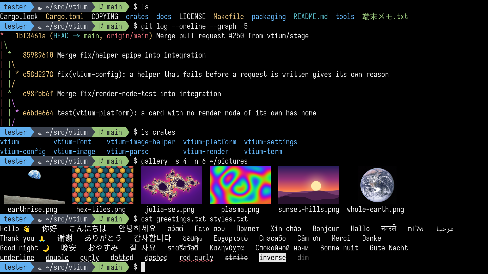

# VTium

[](https://github.com/vtium/vtium/actions/workflows/ci.yml)
[](https://vtium.github.io/vtium/)
[](https://github.com/vtium/vtium/releases)
[-informational)](docs/features.md#displays)
[](docs/features.md#small-machines)
[](Cargo.toml)
[](LICENSE)

[](https://repology.org/project/vtium/versions)

**vtium is a terminal that runs on the Linux console.**

vtium runs on a Linux virtual terminal (VT), one of the text screens you reach with Ctrl+Alt and a function key. It takes the place of getty, the program that normally shows the login prompt there. So the console your machine boots into is a full terminal, with 24-bit color, color emoji, images, mouse reporting, and text in any script your fonts cover. vtium renders through [KMS/DRM](https://en.wikipedia.org/wiki/Direct_Rendering_Manager), the modern graphics interface, on the CPU or the GPU.

A full terminal helps wherever you work at the machine's own screen: a server without a desktop, a kiosk, a small board, or the console before a desktop starts. There, editors, file managers and tmux get the color, mouse and image support they expect.

vtium is alpha software, at version 0.1.0-alpha.8. A vtium package takes every free VT when you install it, and each VT switches to vtium at its next start. So try vtium on one VT first; [Try vtium on one VT](docs/tutorial-try-vtium.md) shows how. With the default setup under systemd, a getty takes the VT back when vtium fails, so you still get a login prompt.

**Documentation:** [vtium.github.io/vtium](https://vtium.github.io/vtium/)



*A shell session rendered by vtium on a 1920×1080 display. [The showcase](docs/showcase/README.md) has more screenshots and explains how they were captured.*

## What vtium does

- [Text in any script](https://vtium.github.io/vtium/home/text/): grapheme clusters lined up in character cells, shaping for complex scripts, right-to-left text, and the fonts vtium reads.
- [A terminal on each display](https://vtium.github.io/vtium/home/displays/): one vtium drives several displays at once, each with its own independent terminal, keyboard, and mouse, for several people working at one machine.
- [Images](https://vtium.github.io/vtium/home/images/): sixel, the kitty graphics protocol, and iTerm2's inline images.
- [Keyboards and mice](https://vtium.github.io/vtium/home/input/): how vtium reads your devices, the key and mouse encodings programs receive, and the keys that act on the machine.
- [The terminal's language](https://vtium.github.io/vtium/home/language/): the specifications vtium follows, and how it settles a conflict between two of them.
- [Where vtium runs](https://vtium.github.io/vtium/home/where-it-runs/): processors, graphics, init systems, and the smallest build.
- [Security and the system](https://vtium.github.io/vtium/home/security-and-system/): sandboxed helpers for fonts and images, a reply rule that keeps output from typing into your shell, and how vtium works with systemd and logind.
- [What vtium leaves to other tools](https://vtium.github.io/vtium/home/leaves-to-other-tools/): opening links, split panes, window management, and other jobs that belong to other programs.

## Where to start

On Arch, the AUR carries `vtium`, built from the latest release, and `vtium-git`, built from the tip of `main`. The `vtium` recipe checks the maintainer's signing key, which the recipe carries:

```
$ git clone https://aur.archlinux.org/vtium.git
$ cd vtium
$ gpg --import keys/pgp/33F9B54FD2A4B6A4110749B3BA464FC9847A832A.asc
$ VTIUM_FEATURES='images logind gpu bidi libseat' makepkg -si
```

[Install vtium and give it VTs](docs/install.md) covers the other packages and building from source. [The releases](https://github.com/vtium/vtium/releases) list what changed in each version.

| If you want to | Start here |
|---|---|
| try vtium on one VT and get back to your desktop afterward | [Try vtium on one VT](docs/tutorial-try-vtium.md) |
| install vtium, configure it, choose a font, set up heads, or fix a problem | [Install vtium and give it VTs](docs/install.md), [Configure vtium](docs/configure.md), [Choose a font](docs/fonts.md), [Set up heads](docs/heads.md), or [Find out what went wrong](docs/troubleshooting.md) |
| look up a feature, a key, or a setting | [What vtium does](docs/features.md), [Keys](docs/keys.md), [Configuration keys](docs/config.md), [The head file](docs/head-file.md), [Modes](docs/modes.md), or [systemd, logind and PID 1](docs/systemd.md) |
| understand how vtium works and why | [VTium in depth](docs/vtium-in-depth.md), [Why vtium](docs/why-vtium.md), and [Concepts](docs/concepts/index.md) |
| read the reasoning behind a decision | [Decision records](docs/architecture/INDEX.md) |
| contribute | [Architecture](docs/architecture.md), [CONTRIBUTING.md](CONTRIBUTING.md), and [AGENTS.md](AGENTS.md), which lists all required checks and test commands |

## Contributing

vtium is written in Rust. Its code began as a port of two programs written in C, a history that [Provenance](docs/vtium-in-depth.md#provenance) tells in full.

The maintainer uses large language models to write code for vtium, reviews the results, and evaluates them with the project's tests. The [decision records](docs/architecture/INDEX.md) give the reasoning behind each decision in the maintainer's own words.

Contributions are welcome, whether you write them by hand or with a large language model. Each pull request must say how its code was written, and every change goes through the same tests and review. See [CONTRIBUTING.md](CONTRIBUTING.md) for details.

## License

vtium is licensed under the [MIT License](LICENSE). The bundled Unifont glyphs are licensed under the SIL Open Font License 1.1, and Unscii-8 is in the public domain.

See [COPYING](COPYING) for licensing details and [crates/vtium-font/README.md](crates/vtium-font/README.md) for information about the built-in fonts.
