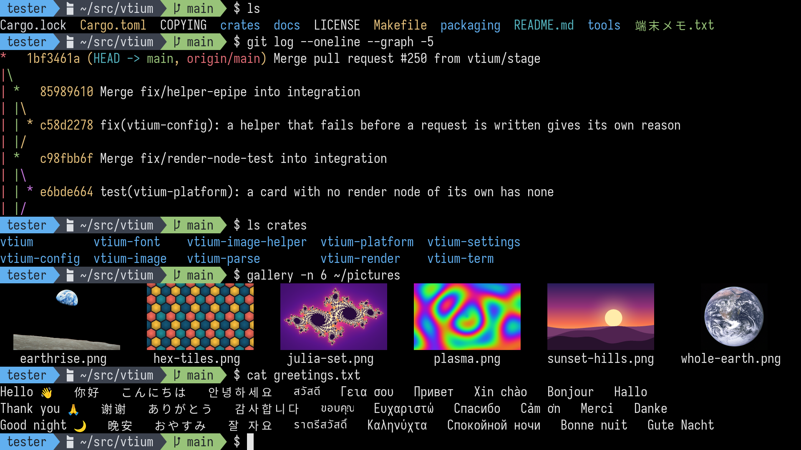

# VTium

[-informational)](docs/features.md#displays)

**vtium is a terminal for the Linux console.**

vtium runs on a Linux virtual terminal (VT)—one of the text screens you can switch to with Ctrl+Alt and a function key. It takes the place of getty, the program that normally displays the login prompt.

vtium renders each frame using either the CPU or, on supported hardware, the GPU through OpenGL ES 3.0. The kernel’s graphics driver then displays the resulting framebuffer. Programs running in vtium get the features they would expect from a desktop terminal: full Unicode support, color emoji, 24-bit color, mouse reporting, and images. That includes right-to-left scripts such as Arabic and Hebrew, with Arabic letters joined, and double-width Chinese, Japanese, and Korean text. If vtium cannot start, getty and the kernel console take over.

The kernel’s built-in console has remained simple so it can work when little else does. Since Linux 6.10, the kernel has been able to display its own crash screen through modern graphics drivers. The Red Hat graphics developers behind that work describe the VT console as one of the [legacy parts of the kernel](https://fedoraproject.org/wiki/Changes/EnableDrmPanic) and propose replacing it with a console that runs as an ordinary program. vtium is one such console.

vtium is built for hardware ranging from small boards with 512 MB of memory and a 320×240 display to desktops with several large monitors. It is written in Rust and began as a port of `kmscon` and its library, `libtsm`, both written in C. See [Provenance](docs/vtium-in-depth.md#provenance) for details.

**Documentation:** [vtium.github.io/vtium](https://vtium.github.io/vtium/)

*A shell session rendered by vtium on a 1920×1080 display. See [the showcase](docs/showcase/README.md) for more screenshots and details about how they were captured.*

[VTium in depth](docs/vtium-in-depth.md) explains what a terminal is, why the Linux console has remained simple, and how vtium fits in. It also covers vtium’s features, development status, requirements, setup, and configuration.

## Status

See [the releases](https://github.com/vtium/vtium/releases) for the latest version and what changed in it.

To try it while keeping your desktop running, follow [Try vtium on one VT](docs/tutorial-try-vtium.md). The tutorial walks you through running vtium on a spare VT and returning that VT to its previous state afterward.

## Documentation

| If you want to… | Start here |
|---|---|
| Learn by doing | [Try vtium on one VT](docs/tutorial-try-vtium.md) |
| Complete a specific task | [Install vtium and give it VTs](docs/install.md), [Configure vtium](docs/configure.md), [Choose a font](docs/fonts.md), [Set up heads](docs/heads.md), or [Find out what went wrong](docs/troubleshooting.md) |
| Look something up | [What vtium does](docs/features.md), [Keys](docs/keys.md), [Configuration keys](docs/config.md), [The head file](docs/head-file.md), [Modes](docs/modes.md), or [systemd, logind and PID 1](docs/systemd.md) |
| Understand how it works and why | [VTium in depth](docs/vtium-in-depth.md), [Why vtium](docs/why-vtium.md), and [Concepts](docs/concepts/index.md) |
| Understand a design decision | [Decision records](docs/architecture/INDEX.md) |
| Contribute | [Architecture](docs/architecture.md), [CONTRIBUTING.md](CONTRIBUTING.md), and [AGENTS.md](AGENTS.md), which lists all required checks and test commands |

## Contributing

The maintainer uses large language models to write code for vtium, reviews the results, and evaluates them with the project’s tests. [Decision records](docs/architecture/INDEX.md) document the reasoning behind each decision in the maintainer’s own words.

Contributions are welcome, whether written by hand or with a large language model. Each pull request must describe how its code was written. All changes go through the same tests and review process. See [CONTRIBUTING.md](CONTRIBUTING.md) for details.

## License

vtium is licensed under the [MIT License](LICENSE). The bundled Unifont glyphs are licensed under the SIL Open Font License 1.1, and Unscii-8 is in the public domain.

See [COPYING](COPYING) for licensing details and [crates/vtium-font/README.md](crates/vtium-font/README.md) for information about the built-in fonts.
