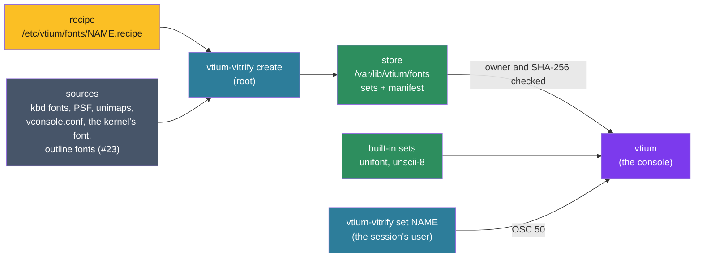

# ADR-1200: Fonts reach the console as vitrified sets from a root-owned store

## Summary

- **Decided:** every font reaches vtium as a vitrified set: a file of glyph bitmaps laid out as vtium-render stores them, with its Unicode map, cell metrics, sprite policy and provenance. A separate binary, `vtium-vitrify`, run as root, reads a recipe and its sources (kbd fonts by name, PSF, raw and CPI files in any of four compressions, unimaps, vconsole.conf, the kernel's own font, and with #23 outline fonts) and writes sets into a root-owned store with a manifest of SHA-256 hashes. The console loads a set only from that store, after checking ownership and hash, or uses one of its two built-in sets, unifont and Unscii-8. `vtium-vitrify set` switches the live console among built sets through OSC 50.
- **Trades away:** The console no longer reads font files: `font-engine=psf` with a path, which the C reference read at run time, draws the built-in font until someone runs `create` for that path. A user cannot add a font without root. Fonts are drawn only at the sizes baked, and whole multiples of them.
- **One-way?** No. Sets are derived files that `create --all` rebuilds, so the set format can change with a major version. The recipe syntax becomes expensive to change after the first release, since administrators and packages write recipes.
- **Probes:**
  - *Confident (who builds):* vtium's own unit and package run no `create`. On a machine where nobody has run it, vtium draws its built-in font and logs the command that would build the configured one.
  - *Not confident (font operations default):* `allow-font-ops` is on by default, as xterm's is, so `vtium-vitrify set` works with no configuration, and any program writing to the console can also switch it to any other built set.
- **Inversion:** Between "the console reads whatever font file it is given" (the C reference's `font-engine=psf`, fontconfig and FreeType in the root process) and "fonts exist only compiled into the binary" (#3's first idea). The answer sits between: root builds sets ahead of time from recipes, the console trusts only what root built and what it was compiled with, and every decoder and rasteriser stays out of the console.

## Context

vtium/vtium#3 proposed vitrifying fonts, baking them ahead of time into read-only glyph sets so the console carries no font discovery or rasteriser. The operator's direction on #3 settled the shape: one path for every font, a recipe, a sudo `create`, a root-owned store with a hash manifest, `set` through OSC 50, and the tool as its own binary. vtium/vtium#107 had planned to load console fonts in the console itself: kbd names resolved as `setfont` resolves them, the kernel's font read with KDFONTOP, and a bundled 8x8 font. This record moves each of those routes into `vtium-vitrify`.

vtium-font today loads PSF1 and PSF2, gzipped with `miniz_oxide`, in the console, and carries GNU Unifont compiled in as deflated 16 KiB chunks inflated on first use. vtium-render stores a glyph whose pixels are only 0 and 255 at 1 bit a pixel, rows padded to a byte, at the font's own size, and scales bitmap glyphs by whole factors while drawing (ADR-1300, D2). The console runs as root for life (ADR-1400). The minspec binary is 2,429,200 bytes against a 2.50 MiB budget.

## How the C reference and kbd did it

The C reference had no vitrify. With `font-engine=psf`, `font-name` was a PSF file's path, read and inflated with zlib when the font loaded; unifont was compiled in and inflated whole. It read no kbd name, no vconsole.conf and no kernel font.

kbd's `setfont` looked a name up in its data directory's `consolefonts/`, trying the suffixes `""`, `.psfu`, `.psf`, `.cp` and `.fnt`, each plain and with `.gz`, `.bz2`, `.xz` and `.zst`. It read PSF1, PSF2, CPI bundles (one size chosen by `-8`, `-14` or `-16`) and raw files of 256 glyphs 8 pixels wide. A font with a Unicode table loaded that table; `-u` loaded a unimap from `unimaps/`; a named font with neither left the kernel's map in place, and only its default font, with no table, took `def.uni`. The kernel gives a VT's font through KDFONTOP and its Unicode map through GIO_UNIMAP, and answers a font get only for a VT in text mode.

## Decision



### D1: the recipe

A recipe is a file `/etc/vtium/fonts/<name>.recipe`, in kmscon.conf's line syntax: one `key=value` a line, `#` comments, every line and the file bounded. Unlike kmscon.conf, an unknown key or a malformed line refuses the whole recipe, naming the file and line, since `create` runs unattended and a half-read recipe builds the wrong set.

| Key | Meaning |
|---|---|
| `name=` | The set's name; unset, the file's stem. 1 to 64 characters of `A-Z a-z 0-9 . _ + -`, not starting with `.`, matched case-sensitively, so kbd names such as `Lat2-Terminus16` stay as spelled. `unifont` and `unscii-8` are reserved. |
| `source=` | Repeatable, in order. The first source sets the cell; each later one fills only codepoints the earlier ones lack, and only where its cell equals the strike's or divides it by a whole factor, its glyphs then scaled up whole. |
| `unimap=` | The Unicode map for the `source=` line above it: a kbd unimap name, resolved under `unimaps/` as `setfont -u` resolves it, or an absolute path. |
| `cp-size=` | For a CPI source above it: `8`, `14` or `16`. |
| `style=` | For the source above it: `regular` (the default), `bold`, `italic` or `bold-italic`. A style with no source is drawn from the regular glyphs as vtium-font draws it today. |
| `size=` | Repeatable: a cell height for outline sources, one strike each. |
| `glyph-source=`, `glyph-source-<range>=` | The #85 sprite policy, with kmscon.conf's names and values. The configuration's keys override it. |
| `license=` | An SPDX identifier, recorded in the provenance. Optional. |

The source forms:

- `kbd:<name>`: resolved as `setfont` resolves it, in the kbd data directories the build names (`/usr/share/kbd`, `/usr/share`, `/usr/lib/kbd`) or `--kbd-dir`.
- `file:<absolute path>`: a PSF1, PSF2, CPI or raw font, plain or compressed with gzip, bzip2, xz or zstd.
- `vconsole`: `FONT=` and `FONT_UNIMAP=` from `/etc/vconsole.conf`, with the kernel command line's `vconsole.font=` and `vconsole.font_unimap=` over them, as systemd-vconsole-setup reads them. `FONT=` is a kbd name or a path. `FONT_SCALE=` is recorded and leaves the glyphs at their own size, since the renderer scales by whole factors.
- `console:<vt>`: the font the kernel holds for that VT (D8).
- `builtin:unifont`, `builtin:unscii-8`: a built-in set as a later source, to fill codepoints.
- `outline:<absolute path>`: an outline font, rasterised at each `size=` (#23).

A font with no Unicode table takes its recipe's `unimap=`, else kbd's `def.uni`, else the recipe is refused naming `unimap=`.

```ini
# /etc/vtium/fonts/terminus.recipe
source=kbd:ter-v16n
source=builtin:unifont
glyph-source=sprites
```

### D2: the vitrified set

A set is one file, little-endian throughout, nothing in it compressed:

- **Header:** the magic `VTGLASS\0`, a major and a minor format version (u16 each), and a table of sections, each a four-byte tag, an offset and a length.
- **`META`:** the provenance, as UTF-8 `key=value` lines: the set's name, its build key (D4), the tool's version, the format version, the recipe verbatim, and for each source its spelling, the path it resolved to, the SHA-256 of the bytes read and the format decoded, and the licence when the recipe gave one.
- **`STRK`:** the strikes, one per style and cell size: the cell's width and height, the baseline, the underline's and strike's position and thickness, the pixel format (1-bit mask, 8-bit mask or premultiplied RGBA, with ADR-1300's subpixel format reserved) and the glyph count.
- **`CMAP`:** for each strike, runs of codepoints of one width, each its first codepoint, its length, whether its glyphs are wide and its first glyph's index, sorted. Single codepoints only: PSF sequences are skipped, as vtium-font skips them today.
- **`POLY`:** the #85 sprite policy and the set's coverage of each sprite range, so the console warns of partial coverage without scanning.
- **`GLYF`:** each strike's glyphs in run order, 1 or 2 cells wide at the strike's cell, in the strike's format; a 1-bit row is padded to a byte, as vtium-render stores it. The section is chunks of at most 16 KiB, no glyph split across two, with an index at its head giving each chunk's offset and SHA-256.

A bitmap source gives one strike at its own size; the renderer scales it by whole factors (ADR-1300, D2). An outline source gives one strike per `size=`, 1-bit where every pixel is 0 or 255 and 8-bit otherwise; colour glyphs are RGBA strikes.

A set is reproducible: no timestamp, and every table sorted, so the same recipe, source bytes and format version give the same bytes, and its SHA-256 names its content.

A minor version adds sections or fields a reader skips. A major version is a change older readers cannot read: the console refuses the set and logs `vtium-vitrify create --all`, which rebuilds it because the format version is part of the build key. Every count, size and offset is bounded by a constant in vtium-font's `src/bounds.rs`, and the reader keeps the crate's no-panic lints: a set is checked before it is trusted, and parsed as untrusted input all the same.

### D3: the trusted store, and how the console checks a set

- `/var/lib/vtium/fonts/` holds the sets, each named `<sha256>.glass`, the `manifest` and a `lock` file. The prefix is set at build time. Recipes live under `/etc`, since an administrator writes them; sets live under `/var/lib`, since `create` writes them and a cache cleaner may not remove them.
- The manifest is TSV: a first line `# vtium-vitrify manifest 1`, a header row, and one row per set, sorted by name: the name, the set's SHA-256, its build key, its format version, its strikes' cell sizes, and its first source as the recipe spelled it.
- The console, as root, opens the store directory with `O_DIRECTORY | O_NOFOLLOW` and checks that it and each of its parents is owned by uid 0 and writable by neither group nor others. It opens the manifest and the set relative to that directory with `O_NOFOLLOW`, and checks each is a regular file with the same owner and mode. It reads the manifest within its bound, finds the row, and streams the set once, computing its SHA-256 and keeping the header and every section but `GLYF`. A hash that differs from the row refuses the set. Each `GLYF` chunk is read the first time a glyph is drawn from it and checked against its own hash, which the whole-file hash already covered, so the console holds only the chunks in use, as it does with unifont, and a file changed after the check is caught chunk by chunk.
- Any failure refuses the set: vtium logs the set, the reason and the command to run, and draws the next choice (D9). The owner the check expects is a parameter, root in the console, so tests run unprivileged.
- The hash is SHA-256, so `sha256sum` checks a set by hand against its row. Whether vtium-font writes it or takes a crate is the implementing issue's choice, measured against the binary's budget.
- `create` writes under the lock: the set to a temporary file in the store, synced and renamed to `<sha256>.glass`; then the manifest the same way, then the directory synced, then the set files no row names removed. A console that read the old manifest finds its old file, or, if it is gone, reads the manifest once more.

### D4: `vtium-vitrify`, its own binary in the install tree

| Command | Runs as | Does |
|---|---|---|
| `create NAME\|PATH...`, `create --all` | root | Builds each recipe named, or every recipe under `/etc/vtium/fonts/`. A set whose build key equals its manifest row is reported `current` and left alone; `--force` rebuilds it. |
| `create --kbd NAME`, `--file PATH`, `--vconsole`, `--console VT` | root | Writes the one-source recipe each implies, named for the font (`console` for `--console`), refusing to overwrite a different recipe of that name, and builds it. |
| `remove NAME` | root | Drops the set's row and file; the recipe stays. |
| `list [--json]` | anyone | Prints the manifest's rows and the built-ins as TSV with a header, or as a JSON array. |
| `verify [NAME...]` | anyone | Runs the console's check (D3) on each set and reports it. |
| `set NAME` | the session's user | D5. |

The build key is the SHA-256 of the format version, the recipe's bytes and each source's SHA-256 in order, so a set rebuilds when its recipe, any source or the format changes. `create` is non-interactive: it never prompts, refuses to run without root by naming `sudo`, prints one line a set (`built`, `current` or `failed`, the name and the reason), and exits 0 when every set built or was current, 1 when any failed and 2 on a usage error. Scripts, package triggers, daemons and previewing front ends are built on these commands by others. #112's banner shows only at an interactive terminal.

### D5: `vtium-vitrify set`, through OSC 50

- `set NAME` checks NAME against `list`, failing early and naming `list`. It then writes `OSC 50 ; NAME ST` to its controlling terminal, asks `OSC 50 ; ? ST`, and reads the reply in raw mode for at most a second, restoring the terminal's mode after. It exits 0 when the reply names NAME, and otherwise says font operations are off or the terminal is not vtium.
- vtium takes OSC 50 only with `allow-font-ops` on, a new kmscon.conf key that defaults on, as xterm's `allowFontOps` does. A `Pt` that is a set name, found in the manifest or among the built-ins, is checked as D3 checks it and switches the live console as zoom does: a new font, a new grid and a pty resize (#44). Anything else, a path, an X font name, a name not built or a set that fails its check, leaves the font as it was and logs why.
- `OSC 50 ; ?` replies `OSC 50 ; <name> ST` with the current set's name as the manifest or the built-in spells it, from vtium's own state, within the reply rule. xterm's `#` menu forms are #44's to map or ignore.
- A switch changes the live console only. `font-name` in the configuration is what persists.
- OSC 50 reaches no file but the store: ADR-1400's row that sends OSC 50 font paths through the image helper no longer applies, and that record takes a dated note citing this one.

### D6: decoders and rasterisers stay out of the console

- `vtium-vitrify` holds every decoder and reader: gzip, bzip2, xz and zstd, PSF1, PSF2, CPI, raw fonts, unimaps, kbd lookup and vconsole.conf, and with #23 the outline reader and rasteriser. Each is pure Rust with no C library; the crates for bzip2, xz and zstd are chosen by the implementing issue for their size and upkeep.
- The `vtium` binary holds the set reader, the store check, SHA-256 and the built-ins. Its inflate serves only the built-in unifont's compiled-in chunks, as today. vtium-font keeps `Psf` and its gzip framing behind a feature only `vtium-vitrify` enables, so the minspec binary loses its PSF path and gains no decoder or rasteriser.
- The full build rasterises nothing at run time either: #23's rasteriser runs in `vtium-vitrify`. Shaping across cells, such as #23's optional ligatures, needs data a set does not yet carry, and stays #23's question.

### D7: the built-in sets

- **`unifont`:** GNU Unifont 17.0.03 under the SIL Open Font License 1.1, as vtium carries it today.
- **`unscii-8`:** Unscii by Viznut, `unscii-8.hex` from <http://viznut.fi/unscii/unscii-8.hex>, SHA-256 `03094f7fbab7085cf6a6b624cee61e47e71ce5d0c2f308c2f4436afdc17f776c`, 3,190 glyphs, all 8x8. It is in the public domain: `unscii.txt` in `unscii-2.1-src.tar.gz` (<http://viznut.fi/unscii/unscii-2.1-src.tar.gz>, SHA-256 `4d1215d495e49d005ae70828ec1529e997049b9a7f152b9439d78c7e70c65b57`) says "Everything made by me (viznut) is in the Public Domain.", and only `unscii-16-full`, which vtium does not use, falls under the GPL. The `.hex` is a build output the tarball does not hold, so vtium pins the published file by hash, with its URL and `unscii.txt` beside it in vtium-font's `data/`. It is packed as unifont is; 19,836 bytes under gzip estimate its cost to the binary.
- Both are trusted by construction and never read from disk. vtium draws `unscii-8` for cells under 16 pixels high and `unifont` from 16, whenever no set is chosen or a chosen set fails.

### D8: the kernel's font

`create --console VT`, or a `console:<vt>` source, opens that VT as root, checks with KDGETMODE that it is in text mode, reads its font with KDFONTOP's `KD_FONT_OP_GET_TALL`, falling back to `KD_FONT_OP_GET` on a kernel without it, and its Unicode map with GIO_UNIMAP, and vitrifies them as a PSF with that map. A VT in graphics mode, vtium's own among them, is refused by the kernel; the tool says so and asks for a VT in text mode. The ioctls live in vtium-platform, the only crate with `unsafe`, each with the test of its request number. The provenance records the VT and the SHA-256 of the bytes the kernel returned, so a changed kernel font changes the build key. The console makes no KDFONTOP call: #107's `font-name=console` becomes a set built this way, named `console`.

### D9: choosing a set at start, and the fallback

- The font is `font-name` from the command line or kmscon.conf; unset, `vconsole.font=` from the kernel command line, then `FONT=` from `/etc/vconsole.conf`; unset, the built-in.
- A name is looked up in the manifest by set name, then by first source as spelled, so `font-engine=psf` with `font-name=/usr/share/kbd/consolefonts/ter-v16n.psf.gz` finds the set built from that path, and `FONT=ter-v16n` finds the set `create --vconsole` built.
- `font-size` picks the strike of that height, else one whose whole multiple is that height, else the tallest strike under it scaled by the largest whole factor that fits; `font-size=0` picks the height from the display as today.
- A name that matches no set, or a set refused by D3, draws the built-in and logs one line: the name, the reason and the command, `vtium-vitrify create --kbd NAME`, `--file PATH` or `--vconsole`, as the name came. A console with no font named draws the built-in and logs nothing.

### D10: how it is judged

- **vtium-font:** a set written and read back holds every field; every glyph of the four PSF fixtures drawn from its vitrified set equals the `Psf` draw, so the C reference's digests hold through vitrify; a set built twice is the same bytes; the reader refuses a whole-file hash mismatch, a chunk hash mismatch, a store, manifest or set with the wrong owner or a group- or world-writable mode, a symbolic link, an unknown major version and each bound; a fuzz target for the reader.
- **vtium-vitrify:** recipe parsing, each key and each refusal with its line; kbd lookup's order of directories and suffixes against a fixture tree; vconsole.conf and the kernel command line; each compression; PSF1, PSF2, CPI, raw fonts and unimaps; the rebuild rule (unchanged inputs are `current`; a changed recipe, source or format version is `built`); `list`'s TSV and JSON read back; the refusal without root. Fixtures are generated in Rust in vtium's tree.
- **KDFONTOP and GIO_UNIMAP:** request numbers in vtium-platform; the live read only in tier 3's guest, never on the maintainer's desktop.
- **Tier 2:** a vitrified PSF set's screens against goldens the C reference draws from the same PSF with its PSF backend; `unscii-8` screens at 320x240 and 480x320 (#75), provisional until the operator reviews them; outline sets when #23 and #24 re-baseline the C reference's outline goldens.
- **Tier 3:** the minimal variant vitrifies its PSF in the guest before vtium starts, so its screens hold; `make vt-check` covers `vtium-vitrify set` switching sets live.

### Where vtium departs

- From the C reference: `font-engine=psf` with a path loads the set built from that path, and draws the built-in with a log line where none is built; the C reference read the file. Source: the operator's direction on vtium/vtium#3.
- From `setfont`: a named font with no Unicode table and no unimap takes kbd's `def.uni`; `setfont` left the kernel's map in place, and a set has no kernel map to inherit.

## Consequences

### Positive

- The root process never decodes a compressed stream or parses a font file a user can name; the only font input it reads is what root built, checked by owner and hash.
- Every font, a kbd console font, the kernel's own and later an outline font, takes one path, judged once.
- The minspec binary loses its PSF parser and gzip framing and gains a reader of one fixed format.
- Startup loads ready glyphs: no decompression, parsing or rasterising, and only the chunks drawn are held in memory.
- `list --json` and the exit codes let others build triggers, daemons and previewers without vtium carrying them.

### Negative

- A machine where nobody runs `create` gets the built-in font, whatever vconsole.conf says.
- A font the user owns needs root to reach the console.
- Sizes other than the baked strikes and their whole multiples are unavailable: zoom steps through those heights.
- A set on disk is uncompressed: a 10,000-glyph outline strike at 16x32 in 8-bit masks is about 5 MB (estimate).
- `tier3-minimal`'s guest gains a `create` step.

### Neutral

- vtium-platform gains KDGETMODE, KDFONTOP and GIO_UNIMAP for `vtium-vitrify`'s use; the console does not call them.
- A set is a derivative of its sources, built on the machine that runs it. vtium ships no set beyond its built-ins, and a set's provenance names its sources so their licences can be found.

## Alternatives Considered

- **The console reads font files at run time,** as the C reference's `font-engine=psf` did and #107 planned. Rejected by the operator's direction: it puts every decoder and parser in the root process, facing files a user can name.
- **Fonts only compiled into the binary,** #3's first idea. Not taken: a user's font would need a rebuild, and each font costs the binary's budget.
- **A per-user store, trusted for that user's session.** Rejected by the operator: `create` is a sudo command.
- **A per-session socket for `set`.** Rejected by the operator in favour of OSC 50.
- **`create` in the unit's `ExecStartPre=`,** the recommendation on #3. Not taken: the operator left building to whoever runs `create`. The first probe checks this.
- **`create` as a `vtium` subcommand.** Rejected by the operator: the decoders and rasteriser would enter the console's binary.
- **Sets compressed in chunks,** as the built-in unifont is. Smaller on disk; not taken, since the console would then decompress files from disk, and memory holds only the chunks in use either way.
- **The whole set read into memory at load.** Simpler; not taken for its memory on large outline sets, where the chunk hashes allow reading on demand without trusting a later read.
- **Mapping the set into memory.** Not taken: `mmap` needs `unsafe` outside vtium-platform, and a file changed under the mapping changes glyphs after the check.
- **Signed sets in place of root ownership and a manifest.** Not taken: a key to manage, where root's ownership already decides who writes the store.
- **Signed distance fields in place of bitmaps,** a question on #3. Not taken: bitmaps at baked sizes need no shading at run time, and bitmap fonts gain nothing from a field.
