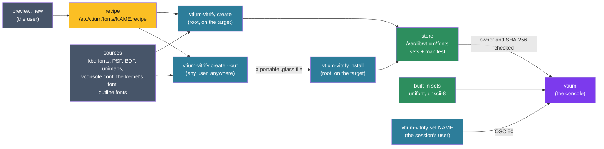

# ADR-1200: Fonts reach the console as vitrified sets from a root-owned store

## Summary

- **Decided:** every font reaches vtium as a vitrified set: a portable file of glyph bitmaps (1-bit for bitmap fonts, 8-bit coverage for outline fonts) with its Unicode map, cell metrics, sprite policy and provenance. A separate binary, `vtium-vitrify`, reads a recipe and its sources (kbd fonts by name, PSF, BDF, raw and CPI files in any of four compressions, unimaps, vconsole.conf, the kernel's own font, and outline fonts through swash), parsing them in an unprivileged child process. 8-bit and color strikes are stored deflated, decoded by the inflate the console already carries for unifont; no other decompressor enters the console. It builds a set into the root-owned store on the target, or as a portable file anywhere that `install` adds to a store. A machine holds a few sets, each one to three adjacent sizes: per locale, one bitmap set scaled by whole factors and at most one outline size for its display. The console loads a set only from the store, after checking ownership and SHA-256 hashes, or uses one of its two built-in sets, unifont and Unscii-8. Outside minspec, a size a set lacks may be rasterised in ADR-1400's unprivileged helper with the same code, into a per-boot cache; the minspec build never rasterises. `vtium-vitrify set` switches the live console among built sets through OSC 50; `preview` and `new` help the user choose and write a recipe.
- **Trades away:** The console no longer reads font files: `font-engine=psf` with a path, which the C reference read at run time, draws the built-in font until a set is built for that path. A user cannot add a font without root. Fonts are drawn only at the sizes baked and their whole multiples, and zoom stops at a set's smallest size. 1-bit strikes stay uncompressed, and outline strikes stay 8-bit even where 4-bit would halve them.
- **One-way?** No for vtium's own code. The set format becomes expensive to change once distributions ship prebuilt sets, since each needs a rebuilt package; a major format version lets `create --all` rebuild local sets. The recipe syntax becomes expensive to change after the first release, since administrators, packages and #121's templates write recipes.
- **Probes:**
  - *Confident (who builds):* vtium's own unit and package run no `create`. On a machine where nobody has run it, vtium draws its built-in font and logs the command that would build the configured one. (Answered 2026-10-28; see `considered`.)
  - *Not confident (font operations default):* `allow-font-ops` is on by default, as xterm's is, so `vtium-vitrify set` works with no configuration, and any program writing to the console can also switch it to any other built set. (Answered 2026-10-28; see `considered`.)
  - *Not confident (compressed chunks):* sets stay uncompressed, as the research recommends, so the console never decompresses a file from disk. An optional per-set deflate of 8-bit and color strikes would make them 2.2 to 4.7 times smaller (a full GBK set at 48 pixels: 49.8 MB down to 11.5 MB) for about 0.5 ms a chunk on a Cortex-A53, once, at load. Keep the console free of decompression and pay the disk, yes or no? (Answered 2026-10-28; see `considered`.)
  - *Not confident (4-bit outlines):* outline strikes stay 8-bit. A 4-bit format would halve them (a zh_CN desktop package at 24, 32 and 48 pixels: 28.6 MB down to 14.3 MB) with at most 8/255 error a pixel, and the two have not yet been compared by eye. Stay at 8-bit until that comparison is made, yes or no? (Answered 2026-10-28; see `considered`.)
- **Inversion:** Between "the console reads whatever font file it is given" (the C reference's `font-engine=psf`, fontconfig and FreeType in the root process) and "fonts exist only compiled into the binary" (#3's first idea). The answer sits between: sets are built ahead of time from recipes, on the target or anywhere, the console trusts only what root put in its store and what it was compiled with, and every decoder and rasteriser stays out of the console's root process.

> Edited 2026-10-28: the operator's direction on sizes, portable sets and the tool, relayed by the team lead, and the technical decisions on storage, the recipe, safe parsing and the built-ins that rest on the font research, revised the Summary. It read: "Decided: every font reaches vtium as a vitrified set: a file of glyph bitmaps laid out as vtium-render stores them, with its Unicode map, cell metrics, sprite policy and provenance. A separate binary, `vtium-vitrify`, run as root, reads a recipe and its sources (kbd fonts by name, PSF, raw and CPI files in any of four compressions, unimaps, vconsole.conf, the kernel's own font, and with #23 outline fonts) and writes sets into a root-owned store with a manifest of SHA-256 hashes. [...]" The trades, one-way answer and probes were extended to match; the first two probes stand as asked.

> Edited 2026-10-28: the operator answered the last two probes: "The console decompresses only with a decoder it already carries for another reason; no new decompressor enters it, and any format that would need one stays uncompressed", and outline strikes stay 8-bit. The Summary's decided line gained the deflated strikes, and its trades read: "Sets on disk are uncompressed: a desktop CJK set at 24 and 32 pixels is about 12 MB."

## Context

vtium/vtium#3 proposed vitrifying fonts, baking them ahead of time into read-only glyph sets so the console carries no font discovery or rasteriser. The operator's direction on #3 settled the shape: one path for every font, a recipe, a sudo `create`, a root-owned store with a hash manifest, `set` through OSC 50, and the tool as its own binary. vtium/vtium#107 had planned to load console fonts in the console itself: kbd names resolved as `setfont` resolves them, the kernel's font read with KDFONTOP, and a bundled 8x8 font. This record moves each of those routes into `vtium-vitrify`.

A later direction on #3 made sets portable files, built on the target or elsewhere and installed, with building on the target first-class. A research pass on 2026-10-28 surveyed prior art, per-locale defaults, disk cost, rasterisers and storage formats; its figures appear below, each marked measured, sourced or inferred there. It found that nobody ships a ladder of sizes: GRUB, yaft, the kernel, cjktty and Android pre-render one size, and fbterm, kmscon and U-Boot rasterise at run time. Debian's zhcon-data, pre-rendered bitmaps per encoding, is the nearest match to per-locale set packages.

vtium-font today loads PSF1 and PSF2, gzipped with `miniz_oxide`, in the console, and carries GNU Unifont compiled in as deflated 16 KiB chunks inflated on first use. vtium-render stores a glyph whose pixels are only 0 and 255 at 1 bit a pixel, rows padded to a byte, at the font's own size, and scales bitmap glyphs by whole factors while drawing (ADR-1300, D2). The console runs as root for life (ADR-1400). The minspec binary is 2,429,200 bytes against a 2.50 MiB budget, leaving about 192 KB.

## How the C reference and kbd did it

The C reference had no vitrify. With `font-engine=psf`, `font-name` was a PSF file's path, read and inflated with zlib when the font loaded; unifont was compiled in and inflated whole. It read no kbd name, no vconsole.conf and no kernel font.

kbd's `setfont` looked a name up in its data directory's `consolefonts/`, trying the suffixes `""`, `.psfu`, `.psf`, `.cp` and `.fnt`, each plain and with `.gz`, `.bz2`, `.xz` and `.zst`. It read PSF1, PSF2, CPI bundles (one size chosen by `-8`, `-14` or `-16`) and raw files of 256 glyphs 8 pixels wide. A font with a Unicode table loaded that table; `-u` loaded a unimap from `unimaps/`; a named font with neither left the kernel's map in place, and only its default font, with no table, took `def.uni`. The kernel gives a VT's font through KDFONTOP and its Unicode map through GIO_UNIMAP, and answers a font get only for a VT in text mode.

## Decision

The record's one figure follows a set from choosing a font to the console.



### D1: the recipe

A recipe is a file `/etc/vtium/fonts/<name>.recipe`, in kmscon.conf's line syntax: one `key=value` a line, `#` comments, every line and the file bounded. Unlike kmscon.conf, an unknown key or a malformed line refuses the whole recipe, naming the file and line, since `create` runs unattended and a half-read recipe builds the wrong set. A recipe written by hand, one written by `new` (D4) and a `new --template` file are the same format.

| Key | Meaning |
|---|---|
| `name=` | The set's name; unset, the file's stem. 1 to 64 characters of `A-Z a-z 0-9 . _ + -`, not starting with `.`, matched case-sensitively, so kbd names such as `Lat2-Terminus16` stay as spelled. `unifont` and `unscii-8` are reserved. |
| `source=` | Repeatable, in order. The first source sets the cell; each later one fills only codepoints the earlier ones lack. A later source whose cell fits inside the strike's cell is scaled by the largest whole factor at which it still fits, placed on the strike's baseline and centred across the cell; one whose cell does not fit at factor 1 fills nothing. |
| `cover=` | Repeatable, for the `source=` line above it: limits that source to a named character set (`ascii`, `latin-1`, `gb2312`, `gbk`, `big5`, `jis-x-0208`, `ks-x-1001`) or a range such as `U+4E00-U+9FFF`. Unset, every glyph the source holds is baked; Noto Sans Mono CJK holds about 44,000, about 100 MB at 48 pixels. The named sets' tables are compiled into `vtium-vitrify`. |
| `unimap=` | The Unicode map for the `source=` line above it: a kbd unimap name, resolved under `unimaps/` as `setfont -u` resolves it, or an absolute path. |
| `cp-size=` | For a CPI source above it: `8`, `14` or `16`. |
| `style=` | For the source above it: `regular` (the default), `bold`, `italic` or `bold-italic`. A style with no source is drawn from the regular glyphs as vtium-font draws it today. |
| `size=` | A cell height for outline sources, one strike each, repeatable at most three times, for one to three adjacent sizes. Unset, `create` on the target picks one from its display (D11); `create --out` and `install` have no display to read, so a recipe built for another machine names its sizes, and `create --out` refuses an outline recipe without them. |
| `compress=` | `yes`, the default, or `no`. With `yes`, `create` deflates the strikes that gain, 8-bit and color, and leaves 1-bit strikes raw (D13); with `no`, every chunk is stored raw. #121's template carries it as a field and its builder offers it as a choice. `no` exists for power draw as well as compute: on a battery- or power-limited board, a raw set avoids the inflate work at load, and the choice belongs to whoever builds the set, a package for low-power boards included. (Added 2026-10-28, the operator's decisions.) |
| `glyph-source=`, `glyph-source-<range>=` | The #85 sprite policy, with kmscon.conf's names and values. The configuration's keys override it. |
| `license=` | An SPDX identifier, recorded in the provenance. Optional. |

> Edited 2026-10-28: the font research found that a fallback had to match the cell exactly, so Unifont could not fill a 14x32 cell, and that without a limit every glyph of a CJK font is baked; the fitted fallback and `cover=` follow from it. The operator decided that "Recipes built for another machine name their sizes" and that each set has "1-3 adjacent sizes". `source=` read: "Repeatable, in order. The first source sets the cell; each later one fills only codepoints the earlier ones lack, and only where its cell equals the strike's or divides it by a whole factor, its glyphs then scaled up whole." `size=` read: "Repeatable: a cell height for outline sources, one strike each." `cover=` is new.

The source forms:

- `kbd:<name>`: resolved as `setfont` resolves it, in the kbd data directories the build names (`/usr/share/kbd`, `/usr/share`, `/usr/lib/kbd`) or `--kbd-dir`.
- `file:<absolute path>`: a PSF1, PSF2, CPI or raw font, plain or compressed with gzip, bzip2, xz or zstd.
- `bdf:<absolute path>`: a BDF bitmap font, plain or compressed, read by `vtium-vitrify`'s own BDF reader. Pixel fonts such as Fusion Pixel ship BDF and OTB, and the outline rasteriser panicked on Fusion Pixel's OTB (D14). (Added 2026-10-28, from the font research.)
- `vconsole`: `FONT=` and `FONT_UNIMAP=` from `/etc/vconsole.conf`, with the kernel command line's `vconsole.font=` and `vconsole.font_unimap=` over them, as systemd-vconsole-setup reads them. `FONT=` is a kbd name or a path. `FONT_SCALE=` is recorded and leaves the glyphs at their own size, since the renderer scales by whole factors.
- `console:<vt>`: the font the kernel holds for that VT (D8).
- `builtin:unifont`, `builtin:unscii-8`: a built-in set as a later source, to fill codepoints.
- `outline:<absolute path>`: an outline font, rasterised at each size by swash (D14), with #23.

A font with no Unicode table takes its recipe's `unimap=`, else kbd's `def.uni`, else the recipe is refused naming `unimap=`.

```ini
# /etc/vtium/fonts/zh-cn-desktop.recipe
source=outline:/usr/share/fonts/noto-cjk/NotoSansCJK-Regular.ttc
cover=ascii
cover=gb2312
source=bdf:/usr/share/fonts/fusion-pixel/fusion-pixel-12px-monospaced-zh_hans.bdf
source=builtin:unifont
size=24
size=32
```

### D2: the vitrified set

A set is one file, little-endian throughout. Nothing in it is compressed except `GLYF` chunks marked deflated:

> Edited 2026-10-28: the operator's answer on compressed chunks, recorded under `considered`. It read: "A set is one file, little-endian throughout, nothing in it compressed:"

- **Header:** the magic `VTGLASS\0`, a major and a minor format version (u16 each), and a table of sections, each a four-byte tag, an offset and a length.
- **`META`:** the provenance, as UTF-8 `key=value` lines: the set's name, its build key (D4), the tool's version, the format version, the recipe verbatim, and for each source its spelling as the recipe wrote it, the SHA-256 of the bytes read and the format decoded, and the licence when the recipe gave one.
- **`STRK`:** the strikes, one per style and cell size: the cell's width and height, the baseline, the underline's and strike's position and thickness, the pixel format and the glyph count. The formats are 1-bit masks for bitmap sources, R8 (8-bit coverage) masks for outline sources and premultiplied RGBA for color glyphs, with ADR-1300's subpixel format reserved (D13).
- **`CMAP`:** for each strike, runs of codepoints of one width, each its first codepoint, its length, whether its glyphs are wide and its first glyph's index, sorted. Single codepoints only: PSF sequences are skipped, as vtium-font skips them today.
- **`POLY`:** the #85 sprite policy and the set's coverage of each sprite range, so the console warns of partial coverage without scanning.
- **`GLYF`:** each strike's glyphs in run order, 1 or 2 cells wide at the strike's cell, in the strike's format; a 1-bit row is padded to a byte. The section is chunks of at most 16 KiB, no glyph split across two, with an index at its head giving each chunk's offset, its length as stored, its length once decoded, a flag saying whether it is stored raw or as a raw deflate stream, and the SHA-256 of its bytes as stored. Deflate is the only compression the format admits: the console decodes it with the inflate it already carries for the built-in unifont, and a format that would need any other decompressor stays uncompressed. The reader always reads both forms, chunk by chunk: every vtium build, minspec included, carries the inflate, whether or not it carries the built-in unifont, so any set loads on any build, and `compress=` changes only its size on disk and what loading it costs, never what is drawn. (Added 2026-10-28, the operator's decision.)

> Edited 2026-10-28: the operator decided "Portability (fixed byte order, reproducible bytes, nothing machine-specific) is a requirement", and the font research's storage measurements (D13) settled R8 for outline strikes and 1-bit for bitmap strikes. `META` read: "for each source its spelling, the path it resolved to, the SHA-256 of the bytes read and the format decoded"; the resolved path is a fact of the building machine and is no longer recorded. `STRK`'s formats read: "1-bit mask, 8-bit mask or premultiplied RGBA".

A bitmap source gives one strike at its own size; the renderer scales it by whole factors (ADR-1300, D2). An outline source gives one strike per size, always R8; color glyphs are RGBA strikes.

> Edited 2026-10-28, from the font research's storage measurements (D13). It read: "An outline source gives one strike per `size=`, 1-bit where every pixel is 0 or 255 and 8-bit otherwise".

A set is portable and reproducible: every field has a fixed width and byte order, no field depends on the host's pointer size or byte order, no timestamp, host path or host name is written, and every table is sorted. The same recipe, source bytes and tool version give the same bytes on every host, so its SHA-256 names its content wherever it was built.

A minor version adds sections or fields a reader skips. A major version is a change older readers cannot read: the console refuses the set and logs `vtium-vitrify create --all`, which rebuilds it because the format version is part of the build key. Every count, size and offset is bounded by a constant in vtium-font's `src/bounds.rs`, and the reader keeps the crate's no-panic lints: a set is checked before it is trusted, and parsed as untrusted input all the same.

### D3: the trusted store, and how the console checks a set

- `/var/lib/vtium/fonts/` holds the sets, each named `<sha256>.glass`, the `manifest` and a `lock` file. The prefix is set at build time. Recipes live under `/etc`, since an administrator writes them; sets live under `/var/lib`, since `create` and `install` write them and a cache cleaner may not remove them.
- The manifest is TSV: a first line `# vtium-vitrify manifest 1`, a header row, and one row per set, sorted by name: the name, the set's SHA-256, its build key, its format version, its strikes' cell sizes, and its first source as the recipe spelled it.
- The console, as root, opens the store directory with `O_DIRECTORY | O_NOFOLLOW` and checks that it and each of its parents is owned by uid 0 and writable by neither group nor others. It opens the manifest and the set relative to that directory with `O_NOFOLLOW`, and checks each is a regular file with the same owner and mode. It reads the manifest within its bound, finds the row, and streams the set once, computing its SHA-256 and keeping the header and every section but `GLYF`. A hash that differs from the row refuses the set. Each `GLYF` chunk is read the first time a glyph is drawn from it and checked against its own hash, which the whole-file hash already covered; a deflated chunk is then inflated once, refused unless it decodes to exactly the length its index gives, and kept decoded, so the console holds only the chunks in use, as it does with unifont, and a file changed after the check is caught chunk by chunk.
- Any failure refuses the set: vtium logs the set, the reason and the command to run, and draws the next choice (D9). The owner the check expects is a parameter, root in the console, so tests run unprivileged.
- The hash is SHA-256, so `sha256sum` checks a set by hand against its row. Whether vtium-font writes it or takes a crate is the implementing issue's choice, measured against the binary's budget.
- `create` and `install` write under the lock: the set to a temporary file in the store, synced and renamed to `<sha256>.glass`; then the manifest the same way, then the directory synced, then the set files no row names removed. A console that read the old manifest finds its old file, or, if it is gone, reads the manifest once more.

### D4: `vtium-vitrify`, its own binary in the install tree

| Command | Runs as | Does |
|---|---|---|
| `create NAME\|PATH...`, `create --all` | root | Builds each recipe named, or every recipe under `/etc/vtium/fonts/`, into the store, for the machine's own display. A set whose build key equals its manifest row is reported `current` and left alone; `--force` rebuilds it. |
| `create --default` | root | Builds the locale's default sets (D11). The package hook's call. |
| `create --kbd NAME`, `--file PATH`, `--vconsole`, `--console VT` | root | Writes the one-source recipe each implies, named for the font (`console` for `--console`), refusing to overwrite a different recipe of that name, and builds it. |
| `create --out FILE RECIPE` | any user | Builds a portable set into FILE, anywhere, with no store (D12). |
| `install FILE` | root | Checks a portable set and adds it to the store (D12). |
| `remove NAME` | root | Drops the set's row and file; the recipe stays. |
| `list [--json]` | anyone | Prints the manifest's rows and the built-ins as TSV with a header, or as a JSON array. |
| `verify [NAME...]` | anyone | Runs the console's check (D3) on each set and reports it. |
| `preview FONT...` | the user | Draws a sample of a font as a set would, with the same reading and rasterising code, and builds nothing (#120). |
| `new FONT`, `new --template`, `new --from FILE` | the user, with `sudo` once at the end | The guided builder and its templates, which end in a recipe of D1's format, `compress=` among its fields and the builder's choices; at the end it shows one command, run with `sudo`, that writes the recipe and runs `create` (#121). It never runs as root while it asks or previews. |
| `set NAME` | the session's user | D5. |

> Edited 2026-10-28: the operator decided the two build paths, and that "preview (#120) and new/template (#121) belong to it, as the user; sudo once at the end of new". The rows for `create --default`, `create --out`, `install`, `preview` and `new` are new, and `create` builds for the machine's own display.

The build key is the SHA-256 of the format version, the recipe's bytes and each source's SHA-256 in order, so a set rebuilds when its recipe, any source or the format changes. `create` and `install` are non-interactive: they never prompt, a command that writes the store refuses to run without root by naming `sudo`, each prints one line a set (`built`, `current`, `installed` or `failed`, the name and the reason), and each exits 0 when every set succeeded or was current, 1 when any failed and 2 on a usage error. Scripts, daemons and previewing front ends are built on these commands by others. #112's banner shows only at an interactive terminal.

> Edited 2026-10-28, the same decision. It read: "`create` is non-interactive: it never prompts, refuses to run without root by naming `sudo`, prints one line a set (`built`, `current` or `failed`, the name and the reason), and exits 0 when every set built or was current, 1 when any failed and 2 on a usage error."

vtium's own unit runs no `create`. A distribution's package (AUR, deb, rpm and the like) carries a hook that runs `create --default` at install and upgrade to build at least the default set; `vtium-vitrify` is what that hook calls, and each distribution writes its own. A distribution may also ship prebuilt per-locale set packages whose hook runs `install` (D12). Until a set is built, vtium draws its built-in set and logs the command (D9). (Added 2026-10-28: the operator's answer to the first probe, and the operator's decision on portable sets.)

### D5: `vtium-vitrify set`, through OSC 50

- `set NAME` checks NAME against `list`, failing early and naming `list`. It then writes `OSC 50 ; NAME ST` to its controlling terminal, asks `OSC 50 ; ? ST`, and reads the reply in raw mode for at most a second, restoring the terminal's mode after. It exits 0 when the reply names NAME, and otherwise says font operations are off or the terminal is not vtium.
- vtium takes OSC 50 only with `allow-font-ops` on, a new kmscon.conf key that defaults on, as xterm's `allowFontOps` does. The key's description in the key table, from which `kmscon.conf.example` and `docs/config.md` are generated, says why it is on by default (xterm's convention, and OSC 50 can only switch among built sets) and what each state does: on, OSC 50 switches among built sets and answers a query; off, vtium ignores OSC 50, the query included. (Added 2026-10-28: the operator's answer to the second probe.) A `Pt` that is a set name, found in the manifest or among the built-ins, is checked as D3 checks it and switches the live console as zoom does: a new font, a new grid and a pty resize (#44). Anything else, a path, an X font name, a name not built or a set that fails its check, leaves the font as it was and logs why.
- `OSC 50 ; ?` replies `OSC 50 ; <name> ST` with the current set's name as the manifest or the built-in spells it, from vtium's own state, within the reply rule. xterm's `#` menu forms are #44's to map or ignore.
- A switch changes the live console only. `font-name` in the configuration is what persists.
- OSC 50 reaches no file but the store: ADR-1400's row that sends OSC 50 font paths through the image helper no longer applies, and that record takes a dated note citing this one.

### D6: decoders and rasterisers stay out of the console

- `vtium-vitrify` holds every decoder and reader: gzip, bzip2, xz and zstd, PSF1, PSF2, CPI, raw fonts, BDF, unimaps, kbd lookup and vconsole.conf, and the outline reader and rasteriser (D14). Each is pure Rust with no C library; the crates for bzip2, xz and zstd are chosen by the implementing issue for their size and upkeep. With swash, the decoders and SHA-256, `vtium-vitrify` is 989 KB on aarch64 and 1.17 MB on x86_64 (measured), outside the console's budget.
- The `vtium` binary holds the set reader, the store check, SHA-256 and the built-ins. Its inflate, already there for the built-in unifont's compiled-in chunks, also decodes a set's deflated chunks; it is the console's only decompressor.

> Edited 2026-10-28: the operator's direction on #3 said the console "never decompresses"; the operator's answer on compressed chunks refines it to no decompressor the console does not already carry. This read: "Its inflate serves only the built-in unifont's compiled-in chunks, as today." vtium-font keeps `Psf` and its gzip framing behind a feature only `vtium-vitrify` enables, so the minspec binary loses its PSF path and gains no decoder or rasteriser.
- The console's process rasterises nothing in any build. The minspec build never rasterises at all. A build that is not minspec may rasterise sizes a set lacks, only in ADR-1400's L1 helper, unprivileged and sandboxed, with `vtium-vitrify`'s own code (D15). Shaping across cells, such as #23's optional ligatures, needs data a set does not yet carry, and stays #23's question.

> Edited 2026-10-28: the operator decided "A build that isn't minspec may include a rasteriser for sizes a set lacks, but only unprivileged and sandboxed, in ADR-1400's L1 helper" and "The minspec build never rasterises." It read: "The full build rasterises nothing at run time either: the rasteriser runs in `vtium-vitrify`. Shaping across cells, such as #23's optional ligatures, needs data a set does not yet carry, and stays #23's question."

### D7: the built-in sets

- **`unifont`:** GNU Unifont 17.0.03 under the SIL Open Font License 1.1, as vtium carries it today.
- **`unscii-8`:** Unscii by Viznut, `unscii-8.hex` from <http://viznut.fi/unscii/unscii-8.hex>, SHA-256 `03094f7fbab7085cf6a6b624cee61e47e71ce5d0c2f308c2f4436afdc17f776c`, 3,190 glyphs, all 8x8. It is in the public domain: `unscii.txt` in `unscii-2.1-src.tar.gz` (<http://viznut.fi/unscii/unscii-2.1-src.tar.gz>, SHA-256 `4d1215d495e49d005ae70828ec1529e997049b9a7f152b9439d78c7e70c65b57`) says "Everything made by me (viznut) is in the Public Domain.", and only `unscii-16-full`, which vtium does not use, falls under the GPL. The `.hex` is a build output the tarball does not hold, so vtium pins the published file by hash, with its URL and `unscii.txt` beside it in vtium-font's `data/`. It is packed as unifont is; 19,836 bytes under gzip estimate its cost to the binary.
- The built-in set is the template vitrified set: each built-in holds what D2's sections hold, glyphs, map, metrics, sprite policy and provenance, compiled into the binary, its glyph chunks deflated as unifont's are today to fit the binary's budget. `list` shows the built-ins beside the built sets. (Added 2026-10-28: the operator's answer to the first probe.)
- These two are the only built-ins. Both are trusted by construction and never read from disk. vtium draws `unscii-8` for cells under 16 pixels high and `unifont` from 16, whenever no set is chosen or a chosen set fails, except that `unscii-8` is never chosen in a zh, ja or ko locale (D11), since it holds no CJK; there `unifont` serves at 16 pixels and its whole multiples. On a 320x240 panel that gives 40x15, and unifont covers GB2312, GBK, Big5, JIS X 0208 and all 11,172 Hangul (measured), so a CJK board works with nothing built.
- Fusion Pixel 12 is not built in: it is 362 KB compressed against the 192 KB the budget leaves, its GB2312 subset alone (175 KB) would fill that, and one compiled-in variant would give Japanese users Chinese glyph forms. Its locale variants are sets the package hook builds (D11).

> Edited 2026-10-28, from the font research: Unscii-8 holds no CJK, and Fusion Pixel 12 would pass the budget and fix one locale's glyph forms. It read: "Both are trusted by construction and never read from disk. vtium draws `unscii-8` for cells under 16 pixels high and `unifont` from 16, whenever no set is chosen or a chosen set fails."

### D8: the kernel's font

`create --console VT`, or a `console:<vt>` source, opens that VT as root, checks with KDGETMODE that it is in text mode, reads its font with KDFONTOP's `KD_FONT_OP_GET_TALL`, falling back to `KD_FONT_OP_GET` on a kernel without it, and its Unicode map with GIO_UNIMAP, and vitrifies them as a PSF with that map. A VT in graphics mode, vtium's own among them, is refused by the kernel; the tool says so and asks for a VT in text mode. The ioctls live in vtium-platform, the only crate with `unsafe`, each with the test of its request number. The provenance records the VT and the SHA-256 of the bytes the kernel returned, so a changed kernel font changes the build key. The console makes no KDFONTOP call: #107's `font-name=console` becomes a set built this way, named `console`.

### D9: choosing a set at start, and the fallback

- The font is `font-name` from the command line or kmscon.conf; unset, `vconsole.font=` from the kernel command line, then `FONT=` from `/etc/vconsole.conf`; unset, the built-in.
- A name is looked up in the manifest by set name, then by first source as spelled, so `font-engine=psf` with `font-name=/usr/share/kbd/consolefonts/ter-v16n.psf.gz` finds the set built from that path, and `FONT=ter-v16n` finds the set `create --vconsole` built.
- `font-size` picks the strike of that height, else one whose whole multiple is that height, else the tallest strike under it scaled by the largest whole factor that fits; `font-size=0` picks the height from the display as today. Zoom steps through the set's strike heights and their whole multiples; below the set's smallest strike it stops there and logs one line naming the set and its smallest size. In a build with D15's dynamic strikes, a zoom to another size above the smallest draws at once from a baked strike scaled and then from the helper's strike.
- A name that matches no set, or a set refused by D3, draws the built-in and logs one line: the name, the reason and the command, `vtium-vitrify create --kbd NAME`, `--file PATH` or `--vconsole`, as the name came. A console with no font named draws the built-in and logs nothing.

> Edited 2026-10-28: the operator decided "Zoom below a set's smallest size stops there with a log line." The sentence on zoom is new.

### D10: how it is judged

- **vtium-font:** a set written and read back holds every field; every glyph of the four PSF fixtures drawn from its vitrified set equals the `Psf` draw, so the C reference's digests hold through vitrify; a set built twice is the same bytes; 1-bit strikes expand at load to the R8 the `Psf` draw gives; the reader refuses a whole-file hash mismatch, a chunk hash mismatch, a deflated chunk that decodes to any length but its index's, a store, manifest or set with the wrong owner or a group- or world-writable mode, a symbolic link, an unknown major version and each bound; a fuzz target for the reader.
- **vtium-vitrify:** recipe parsing, each key and each refusal with its line; kbd lookup's order of directories and suffixes against a fixture tree; vconsole.conf and the kernel command line; each compression; PSF1, PSF2, CPI, raw fonts, BDF and unimaps; `cover=` against each named set's table; a fallback scaled to fit inside the strike's cell; one recipe built with `compress=yes` and with `compress=no` drawing every glyph of every strike identically from both sets; `strike` mode's chunks for a size equal the chunks `create` builds at that size; the rebuild rule (unchanged inputs are `current`; a changed recipe, source or format version is `built`); the same set bytes from x86_64 and from aarch64 under qemu-user; `install` refusing a set with a changed byte, a changed chunk or an unknown major version; a font that panics the parser failing only its source, in the child; the default sets D11 picks for each locale and display; `list`'s TSV and JSON read back; the refusal without root. Fixtures are generated in Rust in vtium's tree.
- **KDFONTOP and GIO_UNIMAP:** request numbers in vtium-platform; the live read only in tier 3's guest, never on the maintainer's desktop.
- **Tier 2:** a vitrified PSF set's screens against goldens read from vtium's own tree (`tools/tier2/goldens`), never the fork's checkout (#111): new goldens are vtium's reviewed output, provisional until the operator reviews them, and the vtium-font test above ties the set's glyphs to the C reference's digests; `unscii-8` screens at 320x240 and 480x320 (#75) the same way; outline sets when #23 and #24 re-baseline the outline goldens vtium holds.
- **Tier 3:** the minimal variant vitrifies its PSF in the guest before vtium starts, so its screens hold; `make vt-check` covers `vtium-vitrify set` switching sets live.

### D11: the sets a machine holds, and their sizes

There is no ladder of sizes: an 18-size ladder of a full GBK set alone is 861 MB (21,886 glyphs at 39,356 bytes each, measured). A machine holds a few sets, its locale's default and a couple of favorites, each one to three adjacent sizes.

`create --default` builds the locale's default, from `LC_ALL`, `LC_CTYPE` or `LANG` in its environment, else `LANG=` in `/etc/locale.conf`:

1. **One 1-bit bitmap set,** scaled by whole factors. English and every locale not listed: nothing beyond the built-ins. zh_CN, zh_TW, ja_JP and ko_KR: the locale's variant of Fusion Pixel 12 (SIL OFL 1.1), from its installed BDF: 6x12 Latin and 12x12 CJK cells, 53x20 cells at 320x240 and 24, 36 and 48 pixels by scaling, 0.90 MB for all 37,857 glyphs (measured). Each variant draws CJK in its locale's forms.
2. **At most one outline size,** for the display the hook can see, read from sysfs without DRM master: the size that display wants, snapped down to 24, 32 or 48 pixels (1920x1080 gives 24, a grid of 160x45; 7680x2160 gives 48, 320x45), R8, limited with `cover=` to the locale's standard set (GB2312 for zh_CN, Big5 for zh_TW, JIS X 0208 for ja_JP, KS X 1001 for ko_KR), with unifont and Fusion Pixel 12, scaled, filling gaps. The outline font is the one the distribution's hook names. No display visible, as in a chroot image build: no outline size. The rule from a display's size to a pixel size is shared with #121's recommendation and set by the implementing issue.

Disk cost of the default before compression (measured; ja_JP and ko_KR within 15%; the 8-bit strikes deflate 1.5-4.7 times, D13):

| Locale | 320x240 | 1920x1080 (+24 px) | 7680x2160 (+48 px) |
|---|---|---|---|
| English (JetBrains Mono, 1,352 glyphs) | 0 | 0.36 MB | 1.43 MB |
| zh_CN, GB2312 (7,540 glyphs) | 0.90 MB | 5.1 MB | 17.8 MB |
| zh_CN, full GBK (21,886 glyphs) | 0.90 MB | 13.4 MB | 50.7 MB |
| ja_JP, JIS X 0208 (6,974 glyphs) | 0.90 MB | 4.8 MB | 16.6 MB |
| ko_KR, KS X 1001 (8,320 glyphs) | 0.90 MB | 5.5 MB | 19.4 MB |

A zh_CN machine with its default and two favorites holds about 4 MB on a 320x240 board, about 33 MB on a 1920x1080 desktop and about 120 MB at 7680x2160 (inferred from the measured sets). Color emoji, optional, add 3.4 MB at 24 pixels and 13.8 MB at 48.

### D12: portable sets, and the two ways to build them

- **On the target,** `sudo vtium-vitrify create` builds into the local store for the machine's own display, a minspec board's small panel included, so a fresh install needs no other machine. A Cortex-A53 building a default CJK set at 12 and 16 pixels spends about 1-2 s rasterising, about 1 s reading the 19.5 MB font from SD and about 0.3 s hashing it, at about 22 MB peak, mostly the font file read whole (inferred from x86 measurements by a factor of 15).
- **Elsewhere,** `vtium-vitrify create --out FILE RECIPE` builds a portable set as any user, with no store and no root, for hardware the builder cannot preview or does not have, such as an 8K desktop's large sizes built on a 320x240 machine. Its recipe names its sizes (D1).
- `sudo vtium-vitrify install FILE` on the target runs the console's check on the file: its format version, every bound, every chunk's hash and the whole file's hash, which it then writes as the row's hash, with the build key read from `META`. It copies the file into the store under the lock (D3). A set that fails is refused with the reason.
- **Distributions** may ship prebuilt per-locale sets as packages whose hook runs `install`: a zh_CN small package of Fusion Pixel 12 is 0.9 MB, and a desktop package of Noto Sans Mono CJK SC limited to GB2312 at 24, 32 and 48 pixels is 28.6 MB (measured; ja_JP 26.6 MB, ko_KR 31.4 MB).
- Portability is a requirement of the format (D2): a set built on any host is the same bytes and loads on any other.

### D13: how glyphs are stored and drawn

- Outline strikes are stored as R8, 8-bit coverage; bitmap strikes as 1-bit; color glyphs as premultiplied RGBA. A 1-bit chunk is expanded to R8 when it is loaded, so a set's glyphs in memory are R8 for every font. That one form serves the CPU path and a later GPU path (#33), which uploads it as R8 textures, native on any GPU. vtium-font hands the renderer 8-bit masks, as today, and ADR-1300's cache keeps its own 1-bit storage of masks that are only 0 and 255.
- The CPU path's blend loop is written so the compiler vectorises it, with no hand-written SIMD: NEON is always present on aarch64, and on x86_64 an AVX2 version is chosen at run time, since distribution builds target baseline x86-64. Per glyph, SSE2 against AVX2: 85 against 29 ns at 16 pixels, 597 against 264 ns at 48 (measured); a Cortex-A53 is about 20 times slower (inferred). Calling a function compiled for AVX2 after a run-time check needs `unsafe` in Rust or a crate that wraps it, and vtium-render forbids `unsafe` (ADR-1300's Context noted the limit), so the implementing issue places the dispatch in vtium-platform or takes a crate, and ADR-1300's note is updated with it.
- The formats considered, for 1,000 GB2312 ideographs (measured):

| Format | Bytes a glyph, 16 / 48 px | CPU cost a glyph | Error | GPU |
|---|---|---|---|---|
| R8, chosen | 256 / 2,304 | 85 → 29 ns; 597 → 264 ns (SSE2 → AVX2) | exact | native R8 texture |
| 4-bit | 128 / 1,152 | 45 / 397 ns with AVX2 | at most 8/255 | expanded to R8 on upload |
| BC4 | 128 / 1,152 | 361 ns / 3.2 µs | at most 25/255 | desktop GPUs; single-board GPUs usually have ETC2 or ASTC instead (inferred) |
| SDF, 32x32 | 1,024 at any size | 1.6 / 14 µs, 55 times R8 | mean 35/255 at 16 px | good on a GPU for zoom |
| Deflated R8 | 146 / 493 | 21-36 µs a 16 KiB chunk, once at load (about 0.5 ms on an A53, inferred) | exact | yields R8 |

- BC4 loses up to 25/255 and the boards minspec targets lack it. SDF and MSDF cost 55 times R8 on the CPU and blur small sizes; SDF stays a possible later strike format for the GPU path alone, for smooth zoom. 4-bit is not taken: the operator kept outline strikes at 8-bit, since displays are good enough that the quantization would likely show.
- The recipe's `compress=` (D1) defaults to `yes`, the operator's decision, under which `create` deflates 8-bit and color strikes and leaves 1-bit strikes raw, as the operator agreed; `compress=no` stores every chunk raw. Either way the glyphs drawn are the same (D2). zlib on 16 KiB chunks gave 1.5-4.7 times on 8-bit and color strikes and 1.7-3.1 times on 1-bit CJK (measured); a full GBK set at 48 pixels falls from 49.8 MB to 11.5 MB, Noto Sans Mono CJK SC with GB2312 at 24 and 32 pixels from 11.7 MB to 4.0 MB, and Fusion Pixel 12, 1-bit, from 0.90 MB to 0.36 MB. A chunk costs 21-36 µs to inflate on x86 and about 0.5 ms on a Cortex-A53 (inferred), once, when it is loaded. 1-bit strikes gain least and are small already, so they stay raw, which keeps a bitmap console's chunks free of inflate work.

### D14: building safely, and the rasteriser

- `create`, `create --out`, `preview` and `new` read each source file as themselves and hand its bytes to a child process that parses and rasterises it. Run as root, the child drops to an unprivileged account (the pre-login account, else `nobody`, as ADR-1400's image helper does), sets no-new-privileges, holds no descriptor but its pipes, and runs under a memory limit. It returns glyphs in a bounded form the parent checks. A panic, fault or timeout in the child fails that source: `create` reports the set `failed` and goes on with the others. The research found swash panicking on Fusion Pixel's OTB ("chunk size must be non-zero"), and `create` runs as root on fonts anyone may have supplied.
- The outline rasteriser is swash, the only pure-Rust candidate with hinting, which matters most at 12-16 pixels, embedded bitmaps and color (CBDT and COLR). It takes 4.0, 4.6 and 8.5 µs a glyph at 12, 16 and 48 pixels, peaks at 22 MB, 21 MB of it the font file, and adds 600 KB (measured). ab_glyph is faster (2.2 µs, 111 KB) but has no hinting, bitmaps or color and cannot read pixel fonts; fontdue processes every glyph at load, 278 MB for Noto Sans Mono CJK, which rules it out on 512 MB (measured).
- Pixel fonts are read by `vtium-vitrify`'s own BDF reader, never through swash.

> Added 2026-10-28: D11 and D12 carry the operator's direction on sizes and portable sets, relayed by the team lead; D13 and D14 are technical decisions resting on the font research.

### D15: dynamic strikes, outside minspec, in the helper

A build that is not minspec may draw sizes a set lacks by rasterising them in ADR-1400's L1 helper: a separate process running as the session's user, with no-new-privileges and the helper's sandboxing (#31). The minspec build never rasterises and leaves the helper's rasteriser out. This is decided direction, built after #31's helper and after `create` and `set` land, as a new issue.

1. At a zoom or `font-size` to a size the set lacks, above its smallest strike, the console draws at once from the nearest baked strike scaled by a whole factor (D9).
2. It asks the helper for the new size, the glyphs visible on screen first.
3. The helper runs `vtium-vitrify`'s own reader and rasteriser, the same code `create` runs (D14), so a dynamic strike draws what a built one would: a mode such as `vtium-vitrify strike` takes the set's recipe from its `META`, a size and code points, and writes glyph chunks in the set's chunk format (D2) to a pipe.
4. The console checks each chunk's bounds and dimensions, as it checks decoded images from the helper, and swaps the glyphs in as they arrive. The chunks carry no store hash: they come from a process of the session's user, and the console trusts them only to be well-formed glyphs.
5. Dynamic strikes live in a per-boot memory cache, never in the root store. Making a size permanent stays `create`'s job.

The root process parses no font file either way. The source font must be readable by the session's user. A dynamic strike covers sizes only, within the set's `cover=`; code points outside it are a possible later extension. The helper's memory while rasterising, about 22 MB for a CJK font, mostly the font file read whole (measured on x86), is why minspec leaves it out. ADR-1400 takes a dated note that its L1 helper also serves dynamic strikes, beside its OSC 50 note (D5).

> Added 2026-10-28: the operator's decision on rasterising outside minspec, replacing D6's ban on rasterising at run time.

### Where vtium departs

- From the C reference: `font-engine=psf` with a path loads the set built from that path, and draws the built-in with a log line where none is built; the C reference read the file. Source: the operator's direction on vtium/vtium#3.
- From `setfont`: a named font with no Unicode table and no unimap takes kbd's `def.uni`; `setfont` left the kernel's map in place, and a set has no kernel map to inherit.

### A direction, not decided

Later work may find the fonts installed on a machine that match chosen profiles and build more sets from them. The operator named this as a direction on 2026-10-28; it is vtium/vtium#117, decided in its own record.

## Consequences

### Positive

- The root process never parses a font file a user can name, and decodes no compression but deflate, with the inflate it carries for unifont, on chunks whose hashes it checked first; the only font input it reads is what root put in its store, checked by owner and hash. Parsing during a build runs unprivileged.
- Every font, a kbd console font, a pixel font, the kernel's own and an outline font, takes one path, judged once.
- A fresh install builds its own default on the target, and sets for other hardware are built and previewed anywhere.
- The minspec binary loses its PSF parser and gzip framing and gains a reader of one fixed format.
- Startup loads ready glyphs: no parsing or rasterising, at most one inflate per chunk, and only the chunks drawn are held in memory.
- One in-memory form, R8, serves the CPU path now and the GPU path later.
- `list --json`, the templates and the exit codes let others build triggers, daemons and previewers without vtium carrying them.

### Negative

- A machine where no package hook and nobody has run `create` gets the built-in font, whatever vconsole.conf says.
- A font the user owns needs root to reach the console.
- In the minspec build, sizes other than the baked strikes and their whole multiples are unavailable; in every build, zoom stops at a set's smallest size. A dynamic strike costs the helper about 22 MB for a CJK font while it runs.
- Sets take disk: a zh_CN desktop with its default and two favorites holds about 33 MB before compression, and about 120 MB at 7680x2160, about 25 MB with deflated chunks (inferred).
- An outline set pays an inflate per chunk when the chunk is loaded, about 0.5 ms on a Cortex-A53.
- `tier3-minimal`'s guest gains a `create` step.
- The x86_64 AVX2 dispatch needs `unsafe` or a crate outside vtium-render.

> Edited 2026-10-28: the measured figures replaced an estimate. It read: "A set on disk is uncompressed: a 10,000-glyph outline strike at 16x32 in 8-bit masks is about 5 MB (estimate)."

### Neutral

- vtium-platform gains KDGETMODE, KDFONTOP and GIO_UNIMAP for `vtium-vitrify`'s use; the console does not call them.
- A set is a derivative of its sources. vtium ships no set beyond its built-ins; distributions may ship prebuilt sets, and a set's provenance names its sources so their licences can be found.

> Edited 2026-10-28: the operator decided distributions may ship prebuilt sets. It read: "A set is a derivative of its sources, built on the machine that runs it. vtium ships no set beyond its built-ins, and a set's provenance names its sources so their licences can be found."

## Alternatives Considered

- **The console reads font files at run time,** as the C reference's `font-engine=psf` did and #107 planned. Rejected by the operator's direction: it puts every decoder and parser in the root process, facing files a user can name.
- **Fonts only compiled into the binary,** #3's first idea. Not taken: a user's font would need a rebuild, and each font costs the binary's budget.
- **A ladder of sizes per set.** Rejected by the operator: 861 MB for full GBK alone (measured), and no prior console ships one.
- **Fusion Pixel 12 built in.** Not taken: it is twice the budget left, and one variant gives other locales the wrong glyph forms (D7).
- **A per-user store, trusted for that user's session.** Rejected by the operator: `create` into the store is a sudo command; `create --out` builds anywhere, and `install` is the way in.
- **A per-session socket for `set`.** Rejected by the operator in favour of OSC 50.
- **`create` in the unit's `ExecStartPre=`,** the recommendation on #3. Not taken: the operator left building to whoever runs `create`, and on 2026-10-28 placed the default build in the distribution package's hook.
- **`create` as a `vtium` subcommand.** Rejected by the operator: the decoders and rasteriser would enter the console's binary.
- **Building only off the target.** Rejected by the operator: the tool self-bootstraps, and a board builds its own default in seconds (D12).
- **Parsing fonts in the root process.** Not taken: swash panicked on a pixel font's OTB (D14).
- **No rasterising at run time in any build,** as this record first decided. Replaced by the operator: a build that is not minspec may rasterise missing sizes in the unprivileged helper (D15); the minspec build still never rasterises.
- **Rasterising in the console's root process.** Not taken: a font file would be parsed as root, which D14's child process and D15's helper exist to avoid.

> Edited 2026-10-28: the operator's decision on D15. These two alternatives are new; the record had held "The full build rasterises nothing at run time either" (D6).

- **ab_glyph or fontdue as the rasteriser.** Not taken: ab_glyph has no hinting, embedded bitmaps or color and cannot read pixel fonts; fontdue needs 278 MB at load (D14).
- **Sets wholly uncompressed,** as the research recommended. Not taken: the operator's concern was a new library in the console, and deflate needs none; uncompressed, a full GBK set at 48 pixels is 49.8 MB against 11.5 MB.
- **Other compressions for sets,** such as zstd or xz. Rejected by the operator's rule: the console carries no decompressor but the inflate it has for unifont.

> Edited 2026-10-28: the operator's answer on compressed chunks. The alternative read: "Sets compressed in chunks, as the built-in unifont is: 2.2 to 4.7 times smaller for 8-bit and color strikes, about 0.5 ms a chunk once at load on an A53, and not worth it for 1-bit. Not taken for now: the console would decompress files from disk; the research recommends uncompressed, and the first open probe asks the operator."
- **4-bit, BC4, SDF and MSDF strikes** (D13). Not taken: the operator kept outline strikes at 8-bit, BC4 loses up to 25/255 and minspec's GPUs lack it, and SDF costs 55 times R8 on the CPU; SDF stays a possible later GPU-only strike format.

> Edited 2026-10-28: the storage decision, resting on the font research, replaced an alternative that read: "Signed distance fields in place of bitmaps, a question on #3. Not taken: bitmaps at baked sizes need no shading at run time, and bitmap fonts gain nothing from a field." The compressed-chunk entry read: "Smaller on disk; not taken, since the console would then decompress files from disk, and memory holds only the chunks in use either way."

- **The whole set read into memory at load.** Simpler; not taken for its memory on large outline sets, where the chunk hashes allow reading on demand without trusting a later read.
- **Mapping the set into memory.** Not taken: `mmap` needs `unsafe` outside vtium-platform, and a file changed under the mapping changes glyphs after the check.
- **Signed sets in place of root ownership and a manifest.** Not taken: a key to manage, where root's ownership already decides who writes the store; `install` checks a portable set's hashes before root's store takes it.
