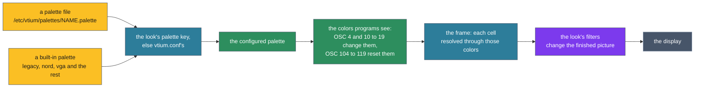

# ADR-1205: A look is assembled from the active resources, and a resource can be activated only from a root-owned folder on a filesystem that stays mounted

## Summary

- **Decided:** vtium's configuration is a graph from resources to screens. Font files, color maps, shaders and pointer themes are resources. A look is assembled from the active resources, a terminal in the Flow view takes a look, and the terminal is wired to its displays and inputs. vtium-config's tabs follow the graph: Fonts, Effects, Looks, Flow, then Settings and Help. Fonts and Effects are the two resource tabs, and they share one set of controls for activation, trust and the rows a user installed. The Fonts tab returns as a tab of its own, and finds fonts in well-known folders and sorts them with simple filters, so nobody types a raw path. The Effects tab does the same for color maps and shaders. Pointer themes have no tab of their own: the Looks tab lists them, and each look picks one. A resource can be activated only from a root-owned folder on a filesystem that stays mounted for the system's life. A file that fails that rule counts as a file that does not exist. A user's own fonts are listed and can be previewed in vtium-config's window, but cannot be activated. vtium-config can install such a font as a system font, in an explicit step that the person confirms each time. A look fills the roles of ADR-1204, now split finer: text, box drawing, symbols and icons, each script by name, emoji, and fallback. A look offers only the sizes its fonts supply. In the records, a resource is a cullet, and the batch is the file that lists the active resources. On screen, vtium says font, effect, font set and look, and a font or effect is active or not. A fresh install starts with the built-in font, Cullet Mono, Terminus, Unifont and the system's console font active, so the default font set draws with no setup.
- **Trades away:** A font that the person put in their home folder no longer draws on the console, even when a folder of `font-paths` names it. A font installed as a symbolic link, or on removable, network or automounted storage, never draws. A frit that names a font by its path draws that font only while the batch holds it, so a font now passes two gates, being installed and being active. The Flow view no longer makes a look from a font set and a size, so a person who wants a new look goes to the Looks tab first.
- **One-way?** No. The batch is one root-owned file, the trust rule is a check before a file is read, and the tabs are vtium-config's layout. A session of work can change any of them. The words cullet, batch and active are the costly part to change once code and pages use them.
- **Probes:**
  - *Settled:* every probe is settled. The maintainer answered five probes on 2026-11-18. *The tab order:* two resource tabs, Fonts and Effects, and the tabs read Fonts, Effects, Looks, Flow, Settings and Help, with vtium-config still opening on Flow (D1, D3, D8). Pointer themes are picked in the Looks tab (D6). *The words:* a chosen font or effect is active, and the actions are Activate and Deactivate (D2). *A font installed twice:* the package's copy is active, and vtium-config points out the local copy as a duplicate (D5). *Pointer themes:* a pointer theme's symbolic links pass the trust rule while every link stays inside the theme's own root-owned folder (D4). *What is active on a fresh install:* the built-in font, Cullet Mono, Terminus, Unifont, and the console font that vconsole.conf's `FONT=` names (D4).
  - *Confident (the file format):* added 2026-11-19 for D10, which is proposed. A color scheme file is read in the format Ghostty uses for its themes, exactly as people already share them, so a scheme written for Ghostty works by copying the file in. vtium takes only the colors from such a file and ignores the rest. Is that what you want? Lean: yes, because hundreds of schemes already exist in that format and it is plain text. Against: vtium then follows a format another project controls, and its rare keys, such as `cursor-text`, do nothing in vtium (D10).
  - *Not confident (the palette folders):* added 2026-11-19 for D10. The color schemes vtium ships live in `/usr/share/vtium/palettes`, and your own in `/etc/vtium/palettes`, where they win over the shipped ones on the same name. Like fonts, a scheme must be active before a look can use it. Should the shipped schemes be active from the first start, as the default fonts are? Lean: yes, because a scheme file holds only colors, so nobody gains by activating it first, and the Looks tab then offers every shipped scheme at once. Against: one rule for every resource, with no exception for a kind, is easier to explain (D10).
  - *Not confident (where palettes are managed):* added 2026-11-19 for D10. Color schemes are not effects, so they do not join the Effects tab. Should the Looks tab list them, activate them and show a sample of each, as it does for pointer themes, with each look picking one? Lean: yes, because a look is where a scheme is chosen, and the tabs stay at six. Against: a scheme is a resource like a font, and a tab of its own would follow the graph from resources to looks more strictly (D10).
  - *Not confident (Monokai):* added 2026-11-19 for D10. Dracula, Catppuccin, Tokyo Night and Gruvbox each carry a license from their authors that lets vtium ship them. Monokai's author published the original in 2006 with no license that this record's agent could find, and now sells Monokai Pro. Ports of it carry the MIT license, but a port's author can only license what they hold. Should vtium leave Monokai out of the package for now, while anyone can still import it as their own file? Lean: yes, until a license from its author turns up. Against: Monokai is one of the best known schemes, and MIT ports of it are everywhere (D10).
- **Inversion:** The decision sits between two ends. At one end, vtium draws any font that any folder holds, and a person types paths to name them. At the other, vtium draws only what it ships. vtium draws from a curated batch of resources that the system installed and the person activated, finds those resources by itself, and lets the person install a missing one as a system font.

> Note 2026-11-19: D10 joins this record as a proposal. The maintainer decided on 2026-11-19 that a palette, which sets the terminal's colors, is a resource of a different kind from a filter, which changes the finished picture, and that vtium ships common color schemes that anyone can add to (`basis`). D10 proposes the rest: the folders, the file format, which is Ghostty's theme format read as it is, how a look picks a palette, and which schemes vtium ships. Its four probes above wait for the maintainer, and the rest of this Summary describes D1 to D9, which stay accepted.

## Context

vtium-config has grown its font and look tools one view at a time. A look is a `[look NAME]` section of vtium.conf that names a font set, a size and a vtlook (ADR-1403 D1, ADR-1304 D4). The Looks tab of ADR-1201 D3 took in the Fonts view on 2026-11-16. The Flow view of ADR-1403 D7 makes a look on its own whenever a path's font set or size changes. A person names a font by its family in a frit, or by a path, and `font-paths` adds folders to search (ADR-1200 D25). A user's own font folder can be added there, and the font helper's sandbox leaves reads open, because a frit may name a font anywhere.

That leaves three gaps. First, the screens do not follow how the parts depend on each other. A person meets the font sets inside the Looks tab and the looks inside the Flow view, with no single place for the fonts themselves. Second, nothing says which files vtium may trust as resources. vtium.conf and the frits pass an ownership check (ADR-1401 D10), and so does a pointer theme (ADR-1309 D5). A font file named in a frit, a `.cube` table and a shader each pass their own checks or none. Third, the person types font names and paths without seeing what the system holds or what a look still lacks.

The maintainer decided on 2026-11-18 that the configuration is one composition graph, from resources to screens, and that activating a resource is an act of trust. This record states those decisions and amends the records they touch.

## Decision

### D1: the composition graph

vtium's configuration is a graph from resources to screens:

| Stage | What it is | Where vtium-config edits it |
|---|---|---|
| Resources | font files, effects (color maps such as `.cube` tables, and shaders), and pointer themes | the Fonts tab, for fonts; the Effects tab, for effects; the Looks tab, for pointer themes |
| A look | a font set assembled from active fonts, its sizes, the active effects, and an active pointer theme (D6, D7) | the Looks tab |
| A terminal | a head, which takes one look (ADR-1401 D1) | the Flow view |
| Displays and inputs | the devices wired to the terminal by rules (ADR-1403 D7) | the Flow view |

vtium-config's tabs follow the graph from resources to looks to terminals, in this order: Fonts, Effects, Looks, Flow, then Settings and Help. vtium-config still opens on Flow, where most configuration work happens (ADR-1201 D3).

- **Fonts** manages the font resources: it finds them, filters them, shows what each covers, activates or deactivates each, and installs a user's font as a system font (D3, D5, D8). The Fonts tab returns as a tab of its own, and it holds fonts only.
- **Effects** manages the effects, color maps and shaders today and the filters that later records add, in the same way: it finds them, shows each one's trust mark, activates or deactivates each, and previews an effect (D3, D8).
- **Looks** assembles each look by role from the active fonts, offers the sizes those fonts supply, adds the active effects, and picks the look's pointer theme (D6, D7). It keeps its form for a new font set.
- **Flow** wires terminals to displays and inputs. A terminal takes a look from the Looks tab. The Flow view no longer makes a look itself.

**The two resource tabs share their controls.** Fonts and Effects activate and deactivate a row with the same keys, show the same trust marks, and mark a row the user installed as not usable in the same way. They differ in what they find and how they preview it. The maintainer split them on 2026-11-18 because effects and filters would crowd the Fonts tab, and because a font and an effect each need a preview of their own kind.

Pointer themes have no tab of their own. The Looks tab lists the installed pointer themes, and each look picks one (D6).

### D2: the words

The backend and the records keep the glassmaking words of [Why VTium](../../why-vtium.md#why-glass). Pages for users and every string on screen use the everyday words.

| In the records and the code | On screen and in pages for users | What it means |
|---|---|---|
| cullet | font, effect, color map, shader, pointer theme | one resource: a font file, a color map such as a `.cube` table, a shader, or a pointer theme |
| batch | the active fonts and effects | the file that lists the resources vtium may draw from (D4) |
| activate, deactivate | Activate, Deactivate | the actions that add a resource to the batch or remove it |
| frit | font set | a font set file, as ADR-1200 D1 defines it |
| vitrify | (not shown) | generating glyphs from fonts |
| look | look | a `[look NAME]` section of vtium.conf |

A glassmaker's cullet is broken glass that goes back into the furnace with the raw materials ([Wikipedia, Cullet](https://en.wikipedia.org/wiki/Cullet)). A glassmaker's batch is the raw materials picked and weighed for one melt. vtium's batch likewise lists the resources picked for the console. This record defines cullet once. The word already sits in the name of vtium's outline font, Cullet Mono, and of the test set `cullet-alone`. In this record's sense, any resource is a cullet, Cullet Mono being one.

The batch of this record is not the batch of ADR-1200 D18, which is a group of 1,024 code points that the font helper fills at once. A record that means D18's batch says "a batch of code points".

The maintainer chose the words on screen on 2026-11-18. A chosen font or effect is active, on screen and in `vtium check-config`'s messages, and the actions are Activate and Deactivate. Font managers such as Adobe Fonts, Extensis Suitcase and FontBase use the same words for the same toggle. The maintainer dislikes "tag", which ADR-1403 once used for picking items with Space in the Flow view and has retired.

### D3: vtium-config finds the fonts and the effects

vtium-config finds fonts in well-known folders, so nobody types a raw path:

- **The system's folders:** `/usr/share/fonts` and `/usr/local/share/fonts`, which are fontconfig's default folders for the system, `/usr/share/vtium/fonts`, where vtium installs its own font files, and kbd's console-font folders (ADR-1200 D25).
- **The folders of `font-paths`,** where vtium.conf sets it (ADR-1200 D25).
- **The user's folders:** `~/.local/share/fonts` and `~/.fonts`, which fontconfig searches for a user's own fonts.

The Fonts tab sorts what it finds with simple filters: bitmap or outline, monospaced or not, the scripts each font covers, and other well-known groups where a font states one, such as a Nerd Fonts build or a color emoji font. vtium-config reads a font's family, coverage and sizes only through the sandboxed font helper, never in its own process (ADR-1201 D3).

**A user's own fonts** are listed and marked as not usable, because the user installed them and the system did not. The Fonts tab says so, so the person knows to install the font as a system font (D5) before activating it. vtium-config may preview such a font in its own window, because the font helper parses it in the sandbox (ADR-1201 D3, ADR-1301). Trying a font live on the console, with ADR-1201 D4's live trial, needs an active system font.

**The Effects tab** finds color maps and shaders in the folders that ADR-1304 gives them: `/etc/vtium/looks` for `.cube` tables, and `/usr/share/vtium/shaders` and `/etc/vtium/shaders` for shaders. The tab lists each one with its trust mark, and activates or deactivates it with the Fonts tab's controls. A color map or shader that the person keeps in their own folders is listed as not usable, as a user's font is. The person installs it through the draft's Install step, which ADR-1304 D11 already gives shaders and `.cube` tables, and then activates it.

### D4: activating a resource is an act of trust

vtium draws only from the active resources. A font that a frit names, by its family or by its path, draws only while the batch holds it. Otherwise it counts as missing, and its characters draw from the next source, as for any missing font (ADR-1204 D7). A color map or a shader that a vtlook names counts as missing unless the batch holds it.

**The rule.** A resource can be activated only when all of these hold:

- The file sits in a folder that root owns, and root owns the file.
- Neither the group nor other users can write the file or any folder above it, as ADR-1401 D10 asks of vtium.conf.
- The file and the folders on the way to it are not symbolic links.
- The filesystem that holds it is mounted at boot and stays mounted for the system's life. Removable media, a network filesystem and an automounted filesystem fail this rule.

A path that the person writes by hand is always allowed, in the batch or in a frit's `source=` line, and it passes the same checks. A file that fails any check counts as a file that does not exist. vtium draws without it and logs one line for it, once. `vtium check-config` and vtium-config name the file and the check it failed.

**Pointer themes.** A pointer theme (ADR-1309) is a resource too, and a desktop cursor theme's folder holds symbolic links, such as Adwaita's `xterm` to `text`. A pointer theme's links pass the rule while every link stays inside the same root-owned theme folder. A link that leaves the theme's folder fails the rule, and the file it names counts as missing. The theme's folder and its files pass every other check.

The program that reads a resource checks the rule on the file it opened, so the file cannot be swapped between the check and the read. When vtium runs unprivileged, as the tests and a run by hand do, it accepts its own effective user as the owner, as ADR-1401 D10 does for vtium.conf. These two points are this record's agent's calls. How vtium tells a filesystem that stays mounted from one that does not is left to the work that builds the rule, which reads the system's mount table.

**What is active from the start.** The built-in font (ADR-1204 D1) is always active, and the person cannot deactivate it. On a fresh install, the batch also lists Cullet Mono, Terminus, Unifont, and the console font that the system's console configuration names in vconsole.conf's `FONT=`. So the default set `terminus` draws with no setup, as it did before this rule. The person can deactivate each of these. Every other font, those of vtium-fonts included, waits until the person activates it.

**Where the batch lives.** The batch is a root-owned file under `/etc/vtium`. The name `/etc/vtium/batch.conf`, with one path to a resource on each line, is this record's agent's call. vtium-config writes the batch through its sudo-backed install, as it writes vtium.conf (ADR-1201 D5). A draft keeps its changes to the batch beside the draft, as it keeps its font set changes (ADR-1403 D8), so the changes install with the draft.

> Note 2026-11-18: the maintainer decided what vtium does when the batch file is missing (`considered`, 2026-11-18). A machine upgraded from an earlier vtium has no `/etc/vtium/batch.conf`. vtium then treats the batch as the list of a fresh install: the built-in font, Cullet Mono, Terminus, Unifont, and the console font that vconsole.conf's `FONT=` names. So the default set `terminus` still draws after the upgrade. `vtium check-config` says that the file is missing and how to create it.

**This rule sits beside ADR-1401 D10.** D10 keeps its scope: vtium.conf and the frits, which route input and choose login commands. This rule covers the resources a look draws from.

### D5: how a font reaches the machine

A font reaches the machine as a system font in one of three ways:

- **A system font package,** which installs into a root-owned folder such as `/usr/share/fonts`.
- **The person's own copy, made as root,** ideally in `/usr/local/share/fonts`.
- **vtium-config's "install as a system font" step,** for a font the Fonts tab lists from a user's folder.

The install step copies one font file into `/usr/local/share/fonts`, and never into `/usr/share/fonts`, which the packages own. It runs through vtium-config's existing sudo-backed install (ADR-1201 D5). The copy is owned by root with mode 0644, and vtium-config checks it afterwards against D4's rule. vtium-config shows the exact command before it runs it, and asks the person to confirm each time. Activating a font never installs it as a side effect. A user's font is first installed as a system font, then activated.

> Note 2026-11-18: the maintainer decided what the install step does when `/usr/local/share/fonts` already holds a file of the same name (`considered`, 2026-11-18). vtium-config shows both files, each with its size, its date, and the font's own family name and version. vtium-config then asks the person whether to replace the existing file or to cancel. When the two files are identical, vtium-config says that the font is already installed and does nothing.

**A font installed twice.** A package may later install the same font in `/usr/share/fonts` that the person installed by hand in `/usr/local/share/fonts`. The package's copy is then the active one, and the Fonts tab points out the local copy as a duplicate that the person can remove.

### D6: a look is assembled by role

A look's font set is assembled by role. The roles extend ADR-1204 D6's, with no new terms:

| Role | What fills it | Change from ADR-1204 D6 |
|---|---|---|
| Text | the text font, with its bold and italic faces | as before |
| Box drawing | vtium's own sprites by default, or a font when the look names one for this role, as `glyph-source` chooses today (ADR-1200 D1) | new |
| Symbols and icons | the icons that prompts and file listers draw | the Symbols role, named for both |
| Scripts, each by name | one font for each script the look fills: CJK, Arabic, Hebrew, Indic, Thai and Lao, and others | D6 has one generic Script role |
| Emoji | color emoji | as before |
| Fallback | every character the fonts before it lack | as before |

One font may fill every role, or several fonts may share them. The fonts keep ADR-1204 D6's order: the text font, the scripts, the symbols and icons, the emoji, the fallback, and last the built-in font. Box drawing is not a place in that order. vtium's sprites draw it whatever the order, unless the look gives the role to a font.

A look also takes active effects: the color maps and shaders that its vtlook names (ADR-1304 D4, D11).

**A look picks its pointer theme.** The Looks tab lists the installed pointer themes: vtium's own `/usr/share/vtium/pointers.svg`, and each desktop cursor theme in `/usr/share/icons` or `/usr/local/share/icons` whose folder holds a `cursors` folder (ADR-1309 D2). Those two folders are this record's agent's call. Each look picks one of them, or none for vtium's own pictures. A pointer theme follows D4's rule and is activated like any other resource, so the Looks tab offers only active themes and marks the others as not active. A look's choice takes priority over the `pointer-theme` key in vtium.conf (ADR-1309 D1). That key stays the default for a look that picks no theme, so an existing configuration keeps its pointers.

> Note 2026-11-18: the maintainer decided where a pointer theme is activated (`considered`, 2026-11-18). The Looks tab lists every installed pointer theme and marks the ones that are not active. The person activates or deactivates a pointer theme there, with Activate and Deactivate. The Looks tab shows the same trust marks as the Fonts and Effects tabs, and a look still picks only an active theme.

### D7: sizes come from the look

A look offers only the sizes its fonts supply. A bitmap font supplies its strikes, and an outline font supplies its range of sizes. The Looks tab lists those sizes and no others.

A `font-size` written in vtium.conf still works, and vtium draws it as ADR-1200 D17 decides. `vtium check-config` warns when the look's fonts cannot supply that size.

### D8: viewing a resource shows what works

The Fonts tab shows what a font covers and the sizes it supplies. Within a look, it shows what the look would still be missing, by role.

The Effects tab previews an effect as a picture of the console with the effect applied, as ADR-1201 D4 previews other changes. The preview leaves the live console alone.

Deactivating a font or an effect warns, and the warning lists the looks that use it. Those looks then draw without it: a font as a missing font (ADR-1204 D7), and an effect as a file that does not exist (D4).

### D9: what this record changes in other records

Each record below carries a dated note at the passage this record changes. No record is superseded whole.

| Record and decision | What changes |
|---|---|
| ADR-1200 D25 | vtium-config lists fonts in a user's folders but never activates them, and a user's folder in `font-paths` yields no active font. The helper's sandbox keeps reads open for a new reason. |
| ADR-1200 D17 | A look offers only the sizes its fonts supply. A configured `font-size` still works, and the check warns when the fonts cannot supply it. |
| ADR-1201 D3 and its views table | The tabs read Fonts, Effects, Looks, Flow, Settings and Help. The Fonts tab returns, its row of `ADR-1201-views.tsv` goes back to planned, and a planned Effects row joins it. The Looks tab assembles looks by role and picks each look's pointer theme. |
| ADR-1201 D5 | The install bundle carries the batch file, and the install step for a system font runs through the same privileged step. |
| ADR-1204 D6 | The roles split finer: box drawing joins, Symbols becomes symbols and icons, and each script has a role by name. |
| ADR-1204 D8 | A font reaches the machine from the person's side in the three ways of D5, and draws once it is active. A fresh install starts with the default set's fonts active. |
| ADR-1304 D11 | The Effects tab finds, activates and previews the color maps and shaders, and a look's effects come from the active ones. |
| ADR-1403 D7 and D8 | A terminal takes a look from the Looks tab, and the Flow view makes and prunes no look. |
| ADR-1309 D5 | A pointer theme passes D4's rule. Its walk follows a symbolic link only while the link stays inside the same root-owned theme folder. The Looks tab lists the installed pointer themes, and each look picks an active one. |
| ADR-1401 D10 | D4's rule sits beside D10, which keeps its scope. |

> Note 2026-11-19: D10, proposed on this date, would change two more records if the maintainer accepts it. ADR-1403 D5 gives a look the key `palette`, and ADR-1201 D3's Looks tab lists the palettes. Each carries a dated note that says the change waits on D10.

### D10: palettes are a resource kind of their own

> Proposed 2026-11-19: this section is a proposal and waits for the maintainer's reading. Nothing in it is decided until the maintainer accepts it, and D1 to D9 stand as accepted. The Summary's probes ask its open choices, each with this record's lean.

**The maintainer's decisions (2026-11-19):** a palette and a filter are different kinds of resource. In the maintainer's words, "I think filters and color schemes, while different, are different resources". Anyone can write a palette of their own, and vtium ships common color schemes, "like monokai tokyo etc (typical color schemes for konsole or ghostty etc)" (`basis`).

**What a palette is.** A palette sets what the terminal's colors are: the 16 ANSI colors, the default foreground and background, and, where the file gives them, the cursor's color and the selection's colors. Programs name those colors by number, and vtium resolves each cell through the palette when it draws (ADR-1001). A filter does something else: it changes the finished picture after the terminal has drawn it (ADR-1304). So a palette changes which colors programs get, and a filter changes how the whole picture looks. A look takes one of each, and the palette comes first.



The figure follows one head's colors from left to right. A look names a palette file or a built-in palette, and that palette becomes the head's configured palette. Programs change their copy of it and reset the copy back to it. vtium draws the frame through that copy, and only then do the look's filters change the finished picture.

**The words.** In D2's words a palette is a cullet. On screen, vtium-config calls it a color scheme, the word people who have themed Ghostty or Konsole already know, and vtium.conf keeps the key `palette`. This choice is this record's agent's.

**Where palette files live.** vtium reads palettes from two folders, as it reads shaders (ADR-1304 D15). The package installs its color schemes in `/usr/share/vtium/palettes`, and an administrator's palettes go in `/etc/vtium/palettes`, which wins over the package's on the same name. Each file is `NAME.palette`. A name follows the rule for a vtlook's name, 1 to 64 characters of `A-Z a-z 0-9 . _ + -` (ADR-1304 D4), so `Catppuccin Mocha` ships as `catppuccin-mocha`. A file may not take the name of a built-in palette or `custom`: `vtium check-config` reports such a file, and vtium treats it as missing. A file holds at most 16 KiB, a row of vtium-settings's bounds table. A file that sets all 256 colors and every other key it may set is under 7 KiB.

**Trust and activation.** A palette file is a resource under D4's rule. It draws only while the batch holds it, it must sit in a root-owned folder on a filesystem that stays mounted, and a symbolic link fails the rule. The probe *the palette folders* asks whether the palettes the package ships are active on a fresh install, as the default fonts are. This record leans yes: a palette file holds colors in a fixed grammar and can change nothing else.

**The file format.** vtium reads Ghostty's theme file format as it is, so a scheme written for Ghostty imports unchanged. Ghostty's documentation describes a theme as a Ghostty configuration file that usually sets only colors. Each setting is a `key = value` line, a line that starts with `#` is a comment, and blank lines are allowed. vtium reads these keys:

| Key | Value | What vtium does with it |
|---|---|---|
| `palette` | `N=COLOR`, N from 0 to 255 | Sets color N. A color the file leaves unset keeps the value it has in `legacy`, so colors 16 to 255 stay xterm's cube and gray ramp unless the file sets them. |
| `foreground`, `background` | `COLOR` | Set the default foreground and background, the colors OSC 10 and 11 report and change. Unset, each keeps `legacy`'s. |
| `cursor-color` | `COLOR` | Sets the cursor's color, the color OSC 12 reports and changes. |
| `selection-background`, `selection-foreground` | `COLOR` | Set the selection's colors, the colors OSC 17 and OSC 19 report and change. |

`COLOR` is `#rrggbb`, `rrggbb`, or an X11 color name, which vtium already reads in OSC 4. In the last three keys, the values `cell-foreground` and `cell-background` leave the color unset, so vtium draws the cursor or the selection by inverting the cell, as it does with no color set.

vtium ignores every other key, because a theme from Ghostty's collection may carry keys that belong to Ghostty alone, such as `cursor-text`, `split-divider-color`, `palette-generate`, `minimum-contrast`, a font or a cursor style. `vtium check-config` lists each ignored key once, as a note and not as an error. vtium never follows a `config-file` or `theme` line. Ghostty warns that a theme can set any of its options. A palette file in vtium sets colors and nothing else.

When a key appears twice, the later line wins. A line that is not `key = value`, a color vtium cannot read, an index past 255, and a file over the size limit are errors. Any error makes the whole file count as missing. The look then draws with the palette vtium.conf names, vtium logs one line for it, and `vtium check-config` names the file, the line and the reason.

vtium's console process reads a palette file itself, as it reads a vtlook. The file is data in a fixed grammar, and vtium-settings reads it with a small, strict reader of its own. Palettes work in every build, the minspec build included, because a palette needs no `filters` feature.

Ghostty can pair a light and a dark theme and switch between them with the system's appearance. That pairing belongs to Ghostty's configuration, not to a theme file, and a console has no system appearance to follow. A look names one palette.

**How a look picks a palette.** The key `palette` joins the keys a look section may set (ADR-1403 D5). Under D5's rule, the most specific level wins: a look's `palette` wins over vtium.conf's top-level `palette`, as a look's pointer theme wins over `pointer-theme` (D6). A look that names no palette takes the top level's, and with neither set, a head draws `legacy`. The value names a built-in palette, `custom`, or an active palette file. `custom` takes its colors from the top level's `palette-*` keys, as it does today. A name that matches no built-in palette and no active file is a warning in `vtium check-config`, and the look draws with the palette vtium.conf names. The key table's `palette` key then takes a name, where it now takes one of a fixed list of names.

```ini
# /etc/vtium/vtium.conf
palette = solarized

[look evening]
font-size = 14
palette = catppuccin-mocha
vtlook = amber
```

Here a head that takes the look `evening` draws Catppuccin Mocha's colors, and the vtlook `amber` then tints the finished picture. Every other head draws `solarized`.

**Where vtium-config manages palettes.** The probe *where palettes are managed* asks this. This record leans to the Looks tab, as D6 does for pointer themes. The Looks tab lists the built-in palettes and the palette files, shows each file's trust mark, activates or deactivates each with the controls of the Fonts and Effects tabs, and previews a palette as its 16 colors beside text in its foreground on its background. Each look picks one active palette.

**What stays built in.** The nine palettes that vtium-term holds stay as palettes that need no file: `legacy`, `nord`, `solarized`, `solarized-black`, `solarized-white`, `soft-black`, `base16-dark`, `base16-light` and `vga`. Like the built-in font, they are always active, and nobody can deactivate them. `custom` keeps working with the `palette-*` keys.

**Programs that change the colors.** The palette a look picks is the head's configured palette. Programs change their copy of it with OSC 4 and OSC 10 to 19, and OSC 104 to 119 return a color to the configured palette's, now the file's color. RIS and DECSTR's color reset return to the file's colors too, and XTPUSHCOLORS saves and restores the copy as before. When the look's palette changes, as when vtium rereads its configuration or a head takes another look, vtium does what it does today when the `palette` key changes. The new palette replaces the colors programs set, every cell is drawn again, and a program that asked for color scheme reports with mode 2031 hears whether the scheme turned dark or light.

**The palette and the filters.** The palette sets the colors, vtium draws the frame through them, and then the look's filters change the finished picture (ADR-1304). Under the amber tint, a Dracula palette's colors become shades of amber, each by its own brightness. A filter never changes the colors that programs see or that OSC 4 reports.

**The color schemes vtium ships.** Each scheme comes from its author's own repository. Each scheme's license is permissive: MIT, Apache-2.0, BSD, ISC, zlib, the Unlicense or CC0. The package installs each scheme's license text with its other license notices, and each file's opening comments name the scheme's source, its author and its license. Ghostty's bundled themes come from the iTerm2-Color-Schemes collection. That collection's license covers the collection and leaves each theme's copyright with its author, so the collection alone gives vtium no license for a scheme (`basis`).

| Scheme | Files | Source | License, read 2026-11-19 |
|---|---|---|---|
| Dracula | `dracula` | the `dracula` file of github.com/dracula/ghostty | MIT, "Copyright (c) 2023 Dracula Theme" |
| Catppuccin | `catppuccin-latte`, `catppuccin-frappe`, `catppuccin-macchiato`, `catppuccin-mocha` | `themes/*.conf` of github.com/catppuccin/ghostty | MIT, "Copyright (c) 2021 Catppuccin" |
| Tokyo Night | `tokyo-night`, `tokyo-night-storm`, `tokyo-night-moon`, `tokyo-night-day` | `extras/ghostty/` of github.com/folke/tokyonight.nvim | Apache-2.0, with no NOTICE file. The scheme began as Enkia's Visual Studio Code theme, which is MIT. |
| Gruvbox | `gruvbox-dark`, `gruvbox-light` | the palette in github.com/gruvbox-community/gruvbox, written out as Ghostty's format | MIT, "Copyright (c) 2018 Pavel Pertsev", the author of the original morhetz/gruvbox, whose README states MIT/X11 |
| Monokai | none, until the probe *Monokai* is answered | Wimer Hazenberg's TextMate theme of 2006 | No license found from its author, who now sells Monokai Pro. Ports such as github.com/ku1ik/vim-monokai are MIT, "Copyright (c) 2009-2016 Marcin Kulik". |

Nord and Solarized are already built-in palettes. The probe *Monokai* asks whether vtium ships Monokai. This record leans to leaving Monokai out until its author's license is found, because a port's license cannot grant more than the port's author holds. A person can still import Monokai as a file of their own.

**What D10 changes in other records.**

| Record and decision | What changes |
|---|---|
| ADR-1403 D5 | A look section may set `palette`, which wins over the top level's. |
| ADR-1201 D3 | The Looks tab lists, activates and previews palettes, as the probe *where palettes are managed* leans. |
| ADR-1304 D2 | The palette sets the colors before the frame is drawn, and the color layer maps the finished picture's colors after. ADR-1304 carries a dated note at D2. |

ADR-1000's row `color.palette.named` names ADR-1403 as its source and gains this decision once it is accepted.

## Consequences

### Positive

- The tabs follow the order in which the parts depend on each other: two tabs hold the resources, one the looks, and one the wiring.
- Fonts and effects share one set of controls, so a person who has activated a font knows how to activate an effect. Each tab keeps a preview that suits its kind.
- A person picks fonts from what the system holds instead of typing paths, and sees what a look still lacks before choosing it.
- Every file vtium draws from passes one trust rule. A font that another user, a removable disk or a network share supplies never reaches the console.
- The batch installs with the draft, so a draft carries its active fonts to another machine as it carries its font sets.

### Negative

- A font in a user's folder, which `font-paths` let vtium draw after login, no longer draws until it is installed as a system font.
- A distribution that installs a font as a symbolic link inside a system folder makes that font unusable until the person copies it.
- A frit that names a font by its path draws the font only while the batch holds it, so installing vtium-fonts no longer makes a catalog set draw by itself (D4).
- The Flow view loses its quick way to make a look from a font set and a size.

### Neutral

- vtium-config gains the batch file, its folder of draft changes, and the install step for a system font. `vtium check-config` gains the trust rule's reasons and the size warning.
- The views table, the Fonts tab's scenarios, and the Looks tab's form follow the new tab order and roles. The Effects tab is a new view with scenarios of its own.

> Note 2026-11-19: D10, proposed on this date, would add these consequences. A person picks a color scheme in a look as they pick its fonts and effects, and a scheme written for Ghostty works by copying its file in. A palette works in every build, the minspec build included. On the other side, vtium follows a file format that another project defines, and keys of that format that vtium does not implement, such as `cursor-text`, do nothing. Every scheme vtium ships needs its license checked and its notice carried, so the shipped list stays short. A tinted look turns a scheme's colors into shades of one color, so the scheme shows its colors only in a look without a tint.

## Alternatives Considered

- **Draw from any font that any searched folder holds,** as `font-paths` does today. Not taken: the maintainer decided that activating a resource is an act of trust, and a folder the user or removable media controls cannot carry it.
- **Let a user's own font draw after login,** as ADR-1200 D25 noted. Not taken: the maintainer decided that a font the user installed is listed but not usable, and that the person installs it as a system font to use it.
- **Install a font as a side effect of activating it.** Not taken: the maintainer asked for an explicit step that shows its command and is confirmed each time.
- **Keep the Fonts view inside the Looks tab,** as ADR-1201 D3 decided on 2026-11-16. Not taken: the maintainer decided that the tabs follow the composition graph, with the fonts as resources of their own.
- **Call the selection "tags", or picking "tagging".** Not taken: the maintainer dislikes the word, and ADR-1403 retired it.
- **Manage fonts and effects on one Fonts tab.** Not taken: the maintainer decided that effects and filters would make the Fonts tab too busy, and that each kind previews differently.
- **Give pointer themes a tab of their own.** Not taken: the maintainer decided that each look picks its pointer theme in the Looks tab.
- **Say "in use" on screen, toggled with Use.** Not taken: the maintainer chose active, with Activate and Deactivate, the words that font managers already use.

> Note 2026-11-19: the four alternatives below belong to D10, which is proposed.

- **Make a palette a color filter,** a look's table that maps each color to another. Not taken: the maintainer decided that palettes and filters are different resources. A filter changes the finished picture, so it cannot change the colors programs ask for and OSC 4 reports, and it would fold different colors that share a brightness into one under a tint.
- **Define a palette format of vtium's own,** in vtium.conf's syntax. Not taken: Ghostty's theme format already carries the colors a palette needs, and reading it as it is lets people use the schemes they already have.
- **Ship schemes from the iTerm2-Color-Schemes collection,** which Ghostty bundles. Not taken: the collection's license leaves each theme's copyright with its author, so each scheme still needs its author's license, which its own repository gives.
- **Keep palettes as built-in names only,** adding each new scheme to vtium-term's table. Not taken: the maintainer wants anyone to be able to write their own palette, which needs a file.
