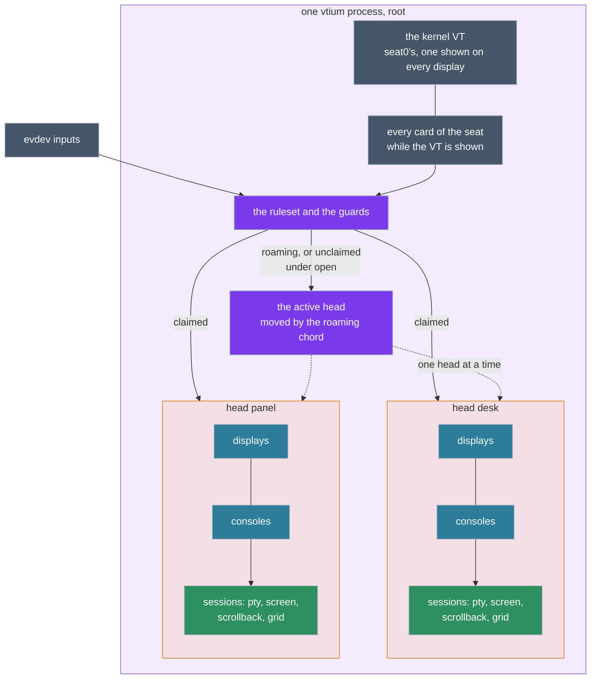
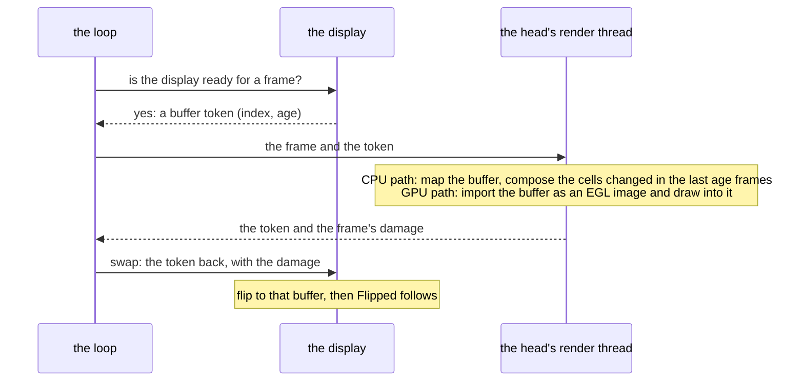
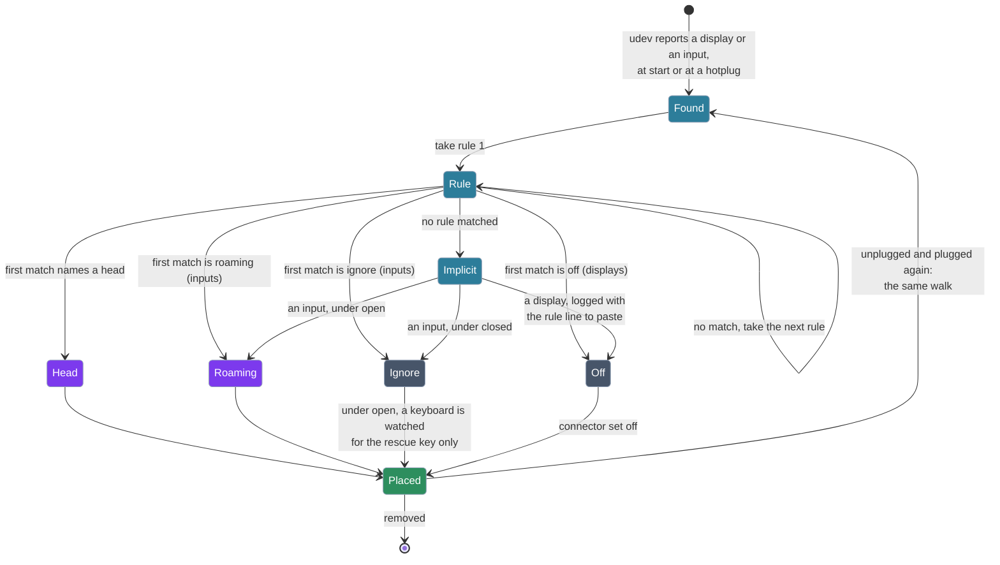
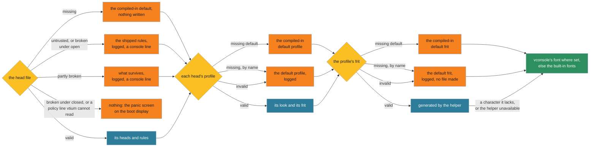
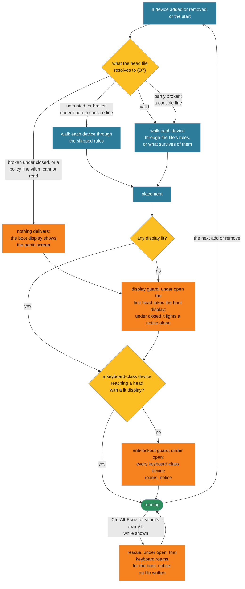
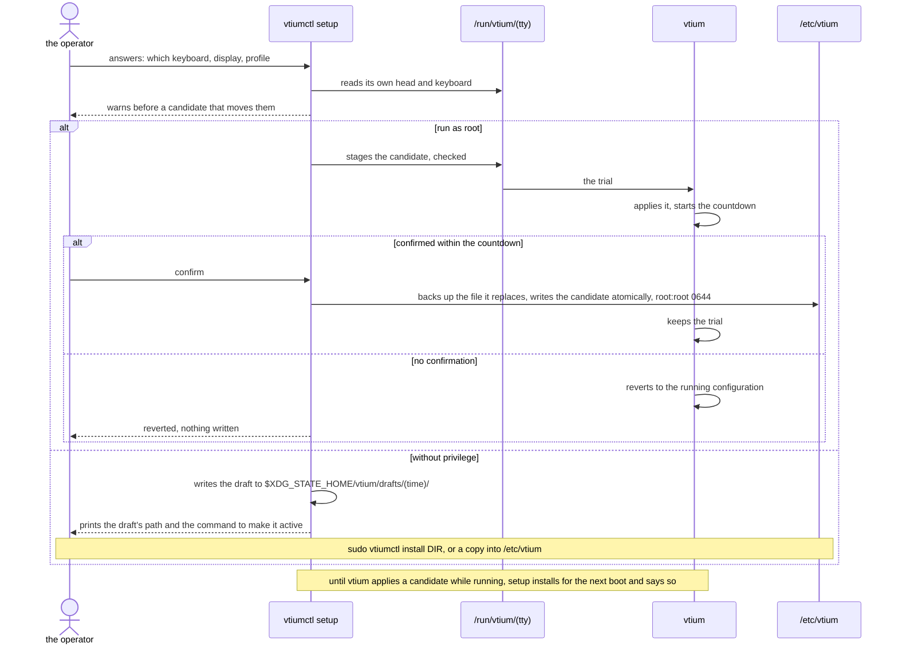

# ADR-1401: Heads: a terminal per physical display, placed by a first-match ruleset

## Summary

- **Decided:** vtium drives every display it can see from one process, as a set of **heads**. A head is a terminal for one or more displays: its displays, its inputs, a profile, and its consoles, each a session with its own pty, screen, scrollback and grid. Each head has a grid of its own, so each head draws at its own displays' density. Heads serve machines where vtium is the only thing on screen: servers, kiosks, and single-board computers with a panel and an HDMI display. One kernel VT spans every display, so a vtium console beside a running desktop on another monitor is a matter for D2's seat extension, not for heads. One optional head file, owned by root, declares the heads and an ordered list of rules. Each display and each input walks the rules on its own, top to bottom, and the first rule that matches places it: in a head, roaming, ignored, or off. The file declares a policy, as a firewall declares its default policy, and the rules mean the same under either policy (D3). Under `policy = open`, the value when the file sets none, an input that no rule matches roams, typing into the active head, and a head is isolated only where it says so, so rules take rights away. Under `policy = closed`, an input that no rule matches is ignored and every head is isolated unless it says otherwise, so rules grant rights. The shipped ruleset is today's console, with udev's input classes as its allowlist: one head for every display, with every keyboard, pointer and other key device typing into it and every other input ignored. With no file present, vtium runs its compiled-in configuration, and vtium never writes a head file. vtium reports an invalid file and never alters it. For an untrusted file, vtium runs the shipped default in memory instead. A trusted file that is invalid falls back by its policy: vtium runs what survives of it, and when nothing survives, the shipped default under open and nothing under closed (D7). A readable `policy = closed` is sticky: once vtium has read it, nothing opens the file while vtium runs (D9). In an open file, three guards keep a keyboard typing whatever the rules say, and the last of them is a key the user presses: `Ctrl-Alt-F<n>` for the VT already shown. The policy sets the guards, and the file has no switch for them: the anti-lockout guard and the rescue key are on under open and off under closed, and the display guard is always on and lights a display according to the policy. `vtiumctl`, a small binary of its own, is the configuration tool: it detects, sets up, reports and checks, with or without privilege, from the console or from a desktop. A closed file that declares every display and every input gives each head a station, so several people can work at once on one machine, each at their own display and keyboard (D5). Each route by which one input can reach another person's session has a switch of its own, and recovery from a lockout that a head file builds is outside vtium (D9). At each mode set, vtium sets every connector it lights to the default color space, with no HDR metadata and the bit depth it draws, whatever a desktop left there (D14).
> Edited 2026-10-29: the operator accepted an independent advisor's review (`considered`): the Summary names the use case heads serve. It did not say which machines they are for. The configuration tool is `vtiumctl`; the Summary read "`vtium-vitrify` becomes the configuration tool".

> Edited 2026-10-29: the operator answered C1 (`considered`): the shipped rules gain `input class:key -> focus`. The Summary read: "with every keyboard and pointer typing into it and every other input ignored".

> Edited 2026-10-30: the operator added stations, the per-route switches and recovery outside vtium (`considered`). The Summary named no stations and no routes.

> Edited 2026-10-30: the operator added the head file's posture and its key `default`, resolved an invalid file in three levels, and set the guards by the posture (`considered`). The Summary named no posture, and read: "an invalid file is reported, never altered, and replaced in memory by the shipped default; and three guards, on unless the file turns them off, keep a keyboard typing whatever the rules say,".

> Edited 2026-11-01: the maintainer let the console chords open and close consoles under an open policy (`considered`, 2026-11-01), so the Summary no longer calls a head's count of consoles fixed. It read: "a profile, and a fixed number of consoles, each a session". The earlier text is in git at 1d51e46.

> Edited 2026-10-31: the gap-check of the head-file wiring work found that the record still called a head's consoles virtual consoles, a name the operator keeps for the kernel's VTs (`considered`, 2026-10-30). The Summary read: "a stack of virtual consoles".

> Edited 2026-11-04: the maintainer decided that each mode set resets a connector's color properties (`basis`, 2026-11-03). The Summary's last sentence on D14 is new.

- **Trades away:** One process holds every display of the seat, so a fault in one head's session handling reaches every head. Several terminals share one kernel VT, which the C reference refused to do. The console takes on device routing, a ruleset parser and a notice of its own, and it opens keyboards that the rules ignore. Today's single grid mirrors across displays of different densities; with heads, that needs a head that claims both displays. A station's login has no logind seat (Context), so no seat-bound device such as audio reaches it; a fully independent station is D2's seat extension.

> Edited 2026-10-30: the operator added stations (`considered`). Trades away did not name what a station's login lacks.
- **One-way?** Expensive once a release ships the head file: its syntax, its match keys and its targets become the format that users' files are written in. Everything behind the file can change in one sitting.
- **Probes:**
  - *Not confident (losing a display):* when a head you set up for one monitor loses it, its sessions stay for 10 seconds and then hang up, as a line losing its carrier; the monitor coming back within the 10 seconds resumes them. The shipped one-head console keeps today's behaviour, running on with no display. Is a hang-up after a short wait what you want for a head whose monitor goes away? (Answered 2026-10-29: `on-loss`, `nohup` by default, renamed 2026-10-30 `when-display-lost` and `keep`; see `considered` and D8.)
  - *Confident (the rescue):* pressing `Ctrl-Alt-F<n>` for the VT you are already looking at makes that keyboard roam until the next boot, whatever the head file says, and never edits the file.
- **Pending the operator's read:** ten decisions that the amendment for the head-file wiring work and its slice S1 wrote while the operator was away: five leans and five calls. [For the operator's check](#for-the-operators-check) lists them, each with the place it changed, so the operator can confirm or overrule each one. The questions the amendments of 2026-11-01 raised, items 11 to 19, the maintainer answered the same day.
- **Inversion:** The design sits between two extremes. One is "one grid for every display", which was the C reference's `multi-monitor` and is vtium as it is today. The other is "a console process per display", which the kernel forbids, since a card has one DRM master and one VT is shown on every display. vtium keeps one process and one VT and puts the terminals inside it, placed by rules that a user writes, or that a tool writes for them.

> Note 2026-11-02 (the rename): ADR-1201 D12 renamed the font tool vtium-vitrify to vtium-config. A user runs it as `vtium config`, the console starts its glyph helper as `vtium-config serve` at `/usr/bin/vtium-config` by default, and the console's build sets that path with VTIUM_FONT_HELPER where it set VTIUM_VITRIFY. The crate this record calls vtium-config, which reads and evaluates the head file, is now vtium-settings. This record keeps the names it was written with.

> Note 2026-11-05 (one file): ADR-1403 moved the head file into vtium.conf and renamed the profile the look. Where this record says the head file, it means the sections of `/etc/vtium/vtium.conf`, everything from its first section heading on, and the two keys `version` and `policy` among vtium.conf's top-level keys (ADR-1403 D3, D4). Where it says a profile, it means a look, a `[look NAME]` section of vtium.conf, which a head names with `look =` (ADR-1403 D1). D2, D3, D6, D7, D10 and D12 are edited in place to match, each with a dated note. The figures of the layers, of no configuration, of an invalid file and of lockout and rescue are redrawn to match, each with a dated note.

> Edited 2026-11-04: the steering session's plain-language pass rewrote the prose that this record carried from before AGENTS.md's writing rules, under those rules. It changed wording only: every decision and every Summary line keeps its meaning, and it added no rule and dropped none. Where a sentence needed it, the pass added a short gloss, such as what a DRM master is, what a target is, that a keyboard with no head to ask switches nothing, and that udev reads a device's capability bitmaps. The dated notes keep the text they quote, and "customise" is spelled with z. The earlier text is in git at 17e04e56.

## Context

The kernel's VTs are one set for the whole system: one VT is shown on every display at once, and `Ctrl-Alt-F<n>` switches every display together. A card has one DRM master, the one program allowed to set its displays. So a console per display has to live inside vtium: vtium holds its one kernel VT, takes every card of its seat while that VT is shown, drives every connector on those cards, and keeps its own consoles for each display.

logind splits a machine into seats, and a seat takes whole devices, cards and inputs, never single connectors; only seat0 has kernel VTs. A machine with two GPUs can give one card and its own keyboard to seat1, so that a vtium and a desktop run side by side, but one keyboard cannot be on two seats. vtium keeps its one real VT on seat0, and it runs without a VT only on an extra seat, which has none.

A login inside vtium runs on a pty, so logind gives it a session with no seat, and the user gets no access to seat-bound devices. vtium's login works this way today, as the C reference's did, and heads change nothing in this.

A Wayland compositor holds its cards' master while it runs, and disabling an output in the desktop does not release it. A DRM lease (`wp_drm_lease_v1`) lets a compositor hand some of its connectors to a client.

vtium today lays every display out as one grid: the smallest of the grids that each display holds at the base font, with each larger display drawing at the largest height that still holds that grid (`crates/vtium/src/layout.rs`). On the operator's machine, that mirrors a large monitor (7680x2160, about 138 DPI) and a small panel (800x480, about 185 DPI) as one 66x20 grid, with letters 108 pixels tall on the large monitor. Sizes in points (ADR-1200's point rule, on `feat/deferred`) cannot be exact on both displays at once.

The kernel's marks cannot tell keyboards from other key devices: udev marks a numpad and an OTP token `ID_INPUT_KEYBOARD`, and both declare every letter, Enter, Ctrl, Alt and F1 (Evidence below). So any routing rule that a user writes can strand the real keyboard.

## Decision

The figure shows the layers this record adds to, from the kernel to the sessions, with the files and the programs beside them and who each runs as.

![The layers of interaction, bottom to top: the kernel, with card0 (the integrated GPU, HDMI-A-2), card1 (the discrete GPU, DP-8, the boot card), the evdev devices and the one set of kernel VTs; logind and its seats, seat0 holding the VT and both cards, extra seats without a VT marked as later; vtium's ruleset, which each device walks, its guards beside it (never-zero display, anti-lockout, the rescue key), and routing to a head or roaming; two heads, desk on DP-8 with keyboard A and the mouse and look desk, and panel on HDMI-A-2 with keyboard B and look small, each look naming its frit; each head's consoles, one shown per head; and sessions, whose pty, screen, scrollback and grid vtium holds as root while login, the shell and programs run as the user. Layers 3 to 5 are one vtium process running as root. Beside the stack, /etc/vtium (vtium.conf, which holds the head file and the looks, and the frits, owned by root and writable by no one else) feeds layer 3; /run/vtium/<tty>, one directory a VT (written by root, its state read by all, a staged trial) sits between vtium and vtiumctl; vtiumctl, run as the user, with detect, setup, status, check and template, and install through sudo, saves drafts to the user's $XDG_STATE_HOME/vtium/drafts; and the glyph helper, vtium-vitrify serve, runs as nobody, sandboxed, and generates the heads' frits. A legend marks root, the user, nobody, the kernel and pieces not yet built.](figures/ADR-1401-layers.svg)

> Edited 2026-11-05: ADR-1403 moved the head file into vtium.conf and renamed the profile the look (ADR-1403 D1, D3), and the figure and its alt text follow. The heads read "profile desk → its frit" and "profile small → its frit", and the `/etc/vtium` box read "heads.conf, the head file" and "profiles and frits". The earlier figure is in git at e53919ea.

The structure inside the one process: the VT and the cards, the ruleset placing each input in a head or roaming, and each head's consoles and sessions.



> Edited 2026-10-30: the operator added the posture (`considered`): an unclaimed input follows the focus only under `default = allow`. The edge to the focus read "unclaimed, or focus".

### D1: heads

- A head is a terminal for one or more physical displays: its displays, its inputs, a profile, and its consoles, each a session with its own pty, screen, scrollback and grid. Each display can be its own head, and so hold its own session.
- A head's grid is its own, so a size in points is exact on each head. Where a head claims several displays, it mirrors across them by the scaled rule of `crates/vtium/src/layout.rs`. Only there does one grid span several densities, and there the point rule converts at the lowest density among them.
- A head shows one console at a time on every display it holds. A head starts with the number of consoles its `consoles` key gives it, 1 when unset, as today's console has one session; the count and the consoles' command are set per head in the head file (D3), and the console chords switch among them (D5). A zoom changes the grid of the console shown.
- **Under `policy = closed` the count is fixed:** a head keeps the consoles it started with for as long as it runs, and no chord opens or closes one. A kiosk configured for one shell cannot gain a shell or lose one, and the closed policy is what makes a head a kiosk.
- **Under an open policy the count is where the head starts.** Ctrl+Super+Enter opens a console on the head and Ctrl+Super+Backspace closes the console the head shows (D5), up to the head's cap, `head-consoles-max`, and the cap on every head's consoles together, `consoles-max` (D10).
- A head whose displays never appear starts no sessions until one does.
- Every head's consoles keep the session rules that each session has today: its own login, the respawn limit, the reply rule (docs/architecture.md, "Determinism"), and the helper's sandbox as the session's user (ADR-1400 D2, ADR-1200 D15).
- **A session that keeps ending as soon as it starts ends the run.** When the program of any console of any head exits less than 2 s after it started, more than 5 times running, which was the C reference's limit, vtium hangs up the sessions of every head: each console's pty closes and its programs get SIGHUP. vtium logs an error that names the head and the limit. Under an open policy vtium then exits with status 1, so the unit's `OnFailure=` getty takes the VT, and it draws no notice, since it leaves the VT in the same turn. With several heads, a head that ended alone after a crash loop would sit dead while the others ran, and starting it again without end would bring the crash loop back; ending the run hands the VT to a getty and shows the failure to the system's service manager.
- **Under a closed policy the crash loop ends the run the same way,** every head's sessions hung up and no head running on alone, but vtium does not exit, since a getty's login on vtium's VT would take any keyboard (D9). vtium holds its VT, and the boot display shows a notice that a session kept ending as soon as it started, so vtium stopped every head. The notice stays as long as vtium runs, since no head lights again (D7).
- **Under respawn, the default,** a console whose program exits starts the program again in the same console, which keeps its `VTIUM_CONSOLE` id (D5), so a program's exit never closes a console: under a closed policy a head always has the consoles it started with, and under an open one only the close chord closes a console (D5).
- **Under `oneshot`,** a console whose program exits ends: it keeps its place among the head's consoles and shows that its session ended. A head ends when all its consoles have ended, and vtium exits with status 0 once every head that started has ended.
- **One glyph helper for each frit in use,** and, once a session has logged in, one for each session user of that frit, since ADR-1200 D15 runs the helper as the session's user. vtium never shares a helper between users.

> Edited 2026-11-01: the maintainer ruled that the count of consoles is fixed only under a closed policy, and that under an open policy the console chords open and close consoles up to the caps (`considered`, 2026-11-01). D1 read: "A head has exactly the number of consoles its `consoles` key gives it, 1 when unset, as today's console has one session;" and its respawn bullet ended: "so a head always has the consoles its `consoles` gives it." The earlier text is in git at 1d51e46.

> Edited 2026-10-31: the amendment for the head-file wiring work wrote two of the gap-check's leans as decisions, pending the operator's read (For the operator's check, items 1 and 2): a console under respawn starts again in place, and a crash loop under a closed policy ends every head's sessions, as under open, and then holds the VT with a notice instead of exiting; the team lead ruled that the operator's 2026-10-31 rule, a crash loop ends the run, holds under closed too. The crash-loop bullet was headed "ends vtium", counted only "the program of any head's last console" and named no policy, and the last bullet read: "Under `oneshot`, a head ends when its last console's program exits, and shows that its session ended; vtium exits with status 0 once every head that started has ended. Under respawn, the default, any other exit starts the program again." The first bullet read "a stack of virtual consoles".

> Edited 2026-10-31: the operator decided that a crash loop on any head ends vtium (`considered`). D1 had neither bullet on how a head's session ends. Under the operator's answers on the issue that tracks heads, quick exits past the limit ended that head alone, which showed the notice "The session kept ending as soon as it started, so vtium stopped starting it again.", and vtium exited with status 1 only once every head that started had ended.

> Edited 2026-10-30: the operator made `consoles` a fixed count (`considered`). The bullet read: "Its consoles start with one, as today's console has one session; the count, and each console's command, are set per head in the head file (D3)."

> Edited 2026-10-29: the team lead's correction from the heads gap-check (C5): several consoles logged in as different users cannot share one helper running as one of them, and heads with different frits need a helper each. D1 said only that each console keeps the helper's sandbox as the session's user.

### D2: one process, one VT, every card

- One vtium holds its kernel VT and, while that VT is shown, every card of its seat, and it drives every connector on those cards. A display is a head inside that process, never a second process.
- Another vtium on another VT (`vtium@tty2`) reads the same head file and does the same while its VT is shown.
- vtium serves seat0. Other seats are a later extension, which this record names and does not build: one vtium for each seat, with console switching of its own where the seat has no kernel VT. Each seat's flow then goes into vtium.conf with the rest, and no seat has a file of its own (ADR-1403 D2).
- **One render thread per head,** so one head's redraw cannot delay another head's frames or any input. Each head's frames depend only on that head's state, so determinism holds. Each render thread's stack is small and fixed. Threads do not contain a crash: under `panic=abort` a panic in any thread ends the process (D10).
- A DRM lease from a compositor is not a source of heads, unless a later decision makes it a display-only head: a lease would put a root login inside a user's graphical session, and it would need vtium to read raw input beside the compositor.

> Edited 2026-11-05: ADR-1403 put every seat's configuration in vtium.conf and removed the seat file (ADR-1403 D2). The bullet on other seats ended: "The head file then gains a file for each seat."

#### The display's buffer, lent to the render thread

A head's render thread draws each frame straight into the buffer the display will show. The loop keeps the display itself: its device, its buffers, its modesets, its flips and its cursor plane. Only the right to draw into one buffer travels to the thread and back.

- **The buffer token.** When the loop takes a frame for a display, the prepare step, the display lends the loop a buffer token. The token is an owned value that names one of the display's buffers by its index and carries that buffer's age: how many of the display's own frames ago the buffer was last drawn, 1 for the display's frame before this one, 2 for the frame before that, and 0 when its contents are unknown. Each display counts its own frames, so two displays of one head keep their ages apart, as the C reference's text layer kept an age for each display. The loop sends the token to the head's render thread with the frame. The thread draws the frame into the buffer the token names and sends the token back with the composed frame. At the swap the loop gives the token back to the display, which presents that buffer with the frame's damage.
- **Ready for a frame.** A display is ready for a frame when it can take one, whatever form the frame takes. On the CPU path a frame takes the form of a canvas: the display's buffer, mapped into memory, which the renderer draws into. On the GPU path it takes the form of a framebuffer that the head's GL context draws into. A display lends a token only while it is ready: a DRM display while its card is awake, it is on, a buffer is free to draw into, and no modeset is waiting; with two buffers, no flip may be waiting either. While its token is out it lends no other, so a display has one frame on its way at a time. With one buffer or three, a DRM display lends a token while a flip is still pending, since with one vtium draws into the buffer shown and with three the third buffer is free while the second flips; with two it lends only once the flip has completed. While a flip is pending and the display still holds a frame kept from a failed swap, it lends no token, whatever the number of buffers.
- **What keeps a lent buffer alive.** The token carries what the thread needs to draw into its buffer: on the CPU path the buffer's mapping, and on the GPU path the GBM buffer object and its framebuffer. A buffer the display replaces while its token is out, as a modeset after a hotplug gives the display new buffers, stays allocated and mapped until the token comes back, and the display then drops it, so the display's rebuild never waits on the render thread (the maintainer, 2026-11-01).
- **A token that comes back too late.** When the token comes back to a display that has gone, that has been set up again with new buffers, as after a modeset, or whose VT was released or whose displays were blanked while the frame was drawn, the display drops the token and the frame is not shown. The display draws its next frame whole. A token the owner drops without giving it back counts as one that came back too late: every buffer of the display is age 0.
- **What the display does while a token is out.** A commit while a token is out sends the cursor plane alone, keeping the front buffer on screen; a frame kept from a failed swap goes with the token's swap. A DRM display's sleep that finds the front buffer lent, as with one buffer, clears that buffer when the token comes back. A wake-up takes a new lease, so a token lent before it comes back too late, and every buffer is drawn whole, since another program held the displays meanwhile, as the C reference's bbulk drew whole after a wake-up.
- **What the render thread draws whole.** When the overlay changes, as a notice box appearing or going, its old areas are drawn again in every buffer: in the next frame and in each later frame drawn into a buffer older than it. A display that lost its picture, after a console switch, a new font or size, or a sleep while its frame was drawn, draws its next frame whole, even while a program holds the screen for a synchronized update.
- **A framebuffer's token can be revoked.** A display can revoke the token it lent, so the token draws nothing from then on. fbdev's sleep lets at most one draw finish first. If the render thread is drawing a frame into the framebuffer, the sleep waits, with the loop running, until that frame's token comes back or the flip wait, `FLIP_WAIT_MS`, has passed since the sleep began, whichever is first, as a DRM display's sleep waits for a flip; if the time runs out, it waits only for the draw in progress to end. The sleep then revokes the token lent from the framebuffer, clears the framebuffer, and only then reports the VT released, so nothing the render thread draws reaches the next VT's screen. A revoked token still out keeps the framebuffer mapped until it is dropped, and draws nothing meanwhile. A retake, setting the framebuffer up again, revokes the old token only where no frame is drawing into it; where one is, that frame lands on vtium's own screen, and the next frame draws whole. A token for fbdev's conversion copy, for a format other than XRGB8888, writes into the copy, not the framebuffer, so it needs no revoke. The C reference zeroed and unmapped the framebuffer before the release.
- **The CPU path keeps no shadow.** The token's buffer is a dumb buffer on a DRM card, and the framebuffer's mapped memory, or the copy fbdev converts from for a format other than XRGB8888, on a framebuffer. The render thread maps that buffer and composes into it directly, writing only, through ADR-1300 D5's row scratch, so device memory is still never read. No display keeps a copy of its whole frame in cached memory, and nothing copies a frame from one buffer into another at the swap, apart from fbdev's conversion copy for a format other than XRGB8888, which it converts into the framebuffer where the frame is damaged. A display at 1920x1080 saves the 8,294,400 bytes the shadow took, and each frame saves the shadow's copy. Tier 3's `potato-min` measured the saving at 4,120 KiB at 1366x768, the shadow's size.
- **The GPU path keeps no shadow either** (not built yet: its token kind, carrying the GBM buffer object, comes with the GPU renderer). The token's buffer is a GBM buffer object, which the display allocated with its framebuffer. The render thread imports it as an EGL image, binds it as the framebuffer of the head's GL context and draws into it with ADR-1300 D6's shader. A display whose card the head's GL context cannot serve is decided frame by frame (the maintainer, 2026-11-01): each frame is drawn by the path that can reach that display's buffer, and where the GPU path cannot import the buffer the token names, the frame reaches it through a staging copy. Such a display pays one staging copy of its frame every frame; a display the context can import pays none.
- **The buffer's age decides what is drawn.** The renderer draws every cell that changed in the last `age` frames, which it knows from its own record of when each cell last changed, and draws the whole frame when the age is 0. The rectangles it drew are the frame's damage, which the loop hands to the display at the swap. With two buffers the buffer the thread draws into is usually two frames old, so each frame also draws what changed in the frame before it; with three it is usually three frames old, and with one, one. The GPU path takes the same age, and it may draw the whole frame at any age, as the C reference's gltex did, since drawing more than the damage changes no pixel.
- **How many buffers a DRM display keeps, on both paths** (the maintainer, 2026-11-01). vtium.conf's `display-buffers`, and `--display-buffers`, take `1`, `2` or `3`, and the build sets the value when the key is unset, as ADR-1300 D4's `glyph-cache` takes its default from the build: `3`, triple buffering, in a build that adds features on top of minspec, which today means the `images` or `logind` feature, and a test holds that list equal to the features in `crates/vtium/Cargo.toml`, so a new feature fails it until it is named; `2`, double buffering, in the minspec build, which is vtium's default build (docs/architecture.md, "The minspec build"), as the C reference's drm2d had; and `1`, single buffering, only in a build smaller than minspec, such as the smallest-build exploration. The key lives in vtium.conf beside the other display settings, `dpms-timeout` among them, and beside D10's caps on memory, since it trades the machine's memory for a frame's wait and is the same for every display: the head file routes devices (D3) and a profile sets a head's font, and neither owns the machine's memory.

> Edited 2026-11-02: the maintainer moved vtium's configuration file to `/etc/vtium/vtium.conf` (ADR-1500 D4), so this record names it `vtium.conf` wherever it read `kmscon.conf` as vtium's file, and `vtium.conf.example` for the example vtium ships. The record's other text is unchanged.

  - *Three buffers* let the thread compose while the last flip is still pending, so no frame waits for it. They cost one more whole frame a display than two: 8,294,400 bytes at 1920x1080.
  - *Two buffers* keep memory low on minspec hardware. The thread starts a frame only once the display has a free buffer, so a frame is composed after the flip of the frame before it has completed. Composing a whole frame at minspec's 1366x768 took 0.535 ms in a release build and 0.96 ms in the minspec build, on one core of a desktop processor (ADR-1300 D5), well inside a 60 Hz display's 16.7 ms refresh; a minspec board's slower cores take longer, not yet measured.
  - *One buffer* holds the least memory and never waits for a flip, since there is none: vtium draws into the buffer being shown, so a frame can be seen half drawn. Its age is always 1, or 0 just after the display was set up.
  - A framebuffer has one buffer whatever the key says, the framebuffer itself or its conversion copy, so its age is 1, or 0 just after it was cleared.

The steps of one frame, from the loop to the render thread and back:



> Edited 2026-11-03: ADR-1303, proposed the same day from the maintainer's decision on the GPU path's pipeline, changes two bullets of D2 for the GPU path once it is accepted. "The GPU path keeps no shadow either": the GPU path keeps a whole frame for each display, upright, in GPU memory (7.9 MiB at 1920x1080), composes into it what changed, the border, the pointer and the notices included, and at present turns it and copies it into the buffer the token names, over the rectangles changed in the buffer's age; the render thread binds the imported buffer as the storage of a renderbuffer attached to a framebuffer object, and the head's one GL context lives on the render node of the card that drives the head's first display, with a staging copy as written for a display it cannot import. "What keeps a lent buffer alive": on the GPU path the token carries the buffer as a dma-buf (its descriptor, format, modifier, stride and offset), which the display exports from its GBM buffer object, in place of the GBM buffer object and its framebuffer. The CPU path still keeps no whole-frame copy. Both bullets are unchanged until ADR-1303 is accepted; ADR-1303 D3, D6 and D7 give the reasons and the cost.

> Edited 2026-11-02: the records re-check: D2's ready-for-a-frame bullet says that only with two buffers may no flip be waiting, and that a frame kept from a failed swap stops a token being lent during a flip whatever the buffers; it read "and no flip or modeset is waiting" and "A frame drawn and kept from a failed swap waits for its flip whatever the buffers." The fbdev sleep is rewritten in its order of steps. In D9, vtium's own restarts never reach the limit under an open policy, where the bullet said the limit is never reached there and then how it trips; the refused start is said once for either policy, and the minimum's sentence is split. D11's tier 3 check and the blast-radius consequence lose their not-built marks. The earlier text is in git at 7ac3b10.

> Edited 2026-11-02: the token is built on the CPU path, on the branch that builds the buffer token (`crates/vtium-platform/src/display/token.rs`, `drm2d.rs`, `fbdev.rs`; `crates/vtium/src/term.rs`, `video.rs`), and the whole-frame shadow is gone. The author's calls where D2 said nothing, checked against the code, are now decisions: when a token is lent during a flip, a dropped token, a commit while a token is out, a sleep that finds a buffer lent, a wake-up, the overlay's old areas, a display that lost its picture, the build's buffer count, and a framebuffer's revoked token. The text said "(not built yet: until the token is built, today's code keeps each display's whole-frame shadow, which the render thread composes into and the loop copies into the display's buffer at present)". The earlier text is in git at b50fd5e. Corrected the same day after the token's re-check: the sleep waits for the draw in progress to end and then revokes, and the mapping goes when a revoked token is dropped, where the bullet read "clears the framebuffer, unmaps it, and only then reports the VT released" and "waits for that one draw to finish before it takes the memory" (in git at 936b04d).

> Edited 2026-11-01: the maintainer's answer on the review of the GPU and image paths (`considered`, 2026-11-01): a display lends its buffer to the render thread as a token. D2 said nothing of how a frame reaches the display's buffer. The code had each display's drawing keep a whole-frame shadow in cached memory, which the render thread composed into and the loop copied into the display's buffer at present, a shadow ADR-1300's alternatives had rejected for minspec; that code stays until the token is built. The earlier text of D2 is in git at 1d51e46.

> Edited 2026-11-01: a fresh review of the amendment above added who keeps a lent buffer alive (pending the operator's read, item 15), that the path is chosen per display when its buffers are allocated (item 16), that the age counts the display's own frames, that a framebuffer has one buffer and its conversion copy, and that today's code keeps the shadow until the token is built. The figure's last note read "flip to that buffer; Flipped follows", whose semicolon ended the statement.

> Edited 2026-11-01: the maintainer answered items 11, 15 and 16 of the operator's check (`considered`, 2026-11-01): `display-buffers` gives two buffers or three, a replaced buffer stays alive until its token comes back, and a display the head's context cannot serve is decided frame by frame through a staging copy. D2 read "Two buffers a DRM display, on both paths", "The other way is for the display to put off its rebuild until the token comes back", and "Which path a display takes is decided per display when its buffers are allocated: a display whose card the head's GL context cannot serve gets dumb buffers and draws on the CPU path". The earlier text is in git at 292d0b5.

> Edited 2026-11-01: the maintainer's two addenda to item 11 (`considered`, 2026-11-01): three buffers by default, two in the minspec build and one in a build smaller than minspec, the build setting the default. The bullet read: "Two buffers a DRM display by default, three as an option, on both paths", with `2` as the value when unset and the minspec setting. The earlier text is in git at 54ea056.

> Edited 2026-10-29: the operator accepted an independent advisor's review (`considered`): each head renders on a thread of its own. D2 said nothing of threads.

The later extension of two seats, drawn so its boundary is clear:

![Two GPUs on two seats, marked later and not built. On the left, seat0, with the kernel VTs and Ctrl-Alt-F&lt;n&gt;: the desktop compositor, the user's graphical session, holds the master of card1, the discrete GPU, and takes the large monitor on DP-8, keyboard A and the mouse; a vtium on a seat0 VT runs there too and takes card1 only while its VT is shown. On the right, seat1, dashed as later and not built, with no kernel VT: vtium, one a seat, with its own console switching, holds the master of card0, the integrated GPU, and takes the small panel on HDMI-A-2 and keyboard B, its own; Ctrl-Alt-F&lt;n&gt; are vtium's own keys there, and the two sessions run side by side, neither switching the other. Below both, logind assigns whole devices to seats, cards and inputs, never connectors; one keyboard cannot be on two seats, and only seat0 has kernel VTs. A legend marks root, the user, a device, and later, not built.](figures/ADR-1401-two-seats.svg)

### D3: the head file

The head file is the sections of `/etc/vtium/vtium.conf`: every line from the first section heading on, which holds the looks, the heads and one ordered list of rules (ADR-1403 D3, D4). Its own two keys, `version = 1` and `policy` (below), sit at vtium.conf's top level, above the first section heading, in any order among vtium's other keys. A vtium.conf with no section heading has no head file, and vtium runs the compiled-in configuration for it (D6), unless a readable `policy = closed` among its top-level keys makes it a closed file that declares no head, which leaves every display dark (D7) and which `vtium check-config` refuses (ADR-1403 D3). A file with a section and no version, or a version vtium does not know, has every section dropped but its policy, which vtium still reads, and its top-level keys still apply: a closed file then shows the panic screen, and an open file runs the shipped default (D7). vtium reads no drop-ins and no other file for it. vtium.conf's bounds hold for the whole file (65536 bytes a file, 8192 a line); a UTF-8 byte-order mark before the first line is dropped, and counts toward the file's bound; a CRLF line ending is a newline; one comment rule serves the whole file: `#` starts a comment at the start of a line or after whitespace, a `#` inside a word is literal, and `\#` gives a literal `#` after whitespace, so a login command such as `cmd --x#1` keeps its `#`, and at the top level a `#` that opens a `#rrggbb` value is part of the value (ADR-1403 D4); spaces around `=` and between tokens are dropped.

> Edited 2026-11-05: ADR-1403 moved the head file into vtium.conf, below vtium's keys (ADR-1403 D3, D4). The paragraph began: "One file, `/etc/vtium/heads.conf`, holds the heads and an ordered list of rules. Its top-level keys, before the first section and in any order among themselves, are `version = 1` and `policy`"; a file with no version "is invalid whole but for its policy"; and "Its lines are bounded as vtium.conf's are". It named no `#rrggbb` value. The same day the maintainer decided that a closed file with no section leaves vtium dark (ADR-1403's `considered`); the clause beginning "unless" is new. The earlier text is in git at e53919ea.

> Edited 2026-10-30: the operator set the top-level keys in any order and resolved an invalid file by its posture (`considered`). The paragraph read: "Its first line that is not a comment is `version = 1`; a file with no version, or a version vtium does not know, is invalid (D7) and falls back whole.", and named no CRLF. It said only that `#` starts a comment, which left a `#` inside a value unsettled.

> Edited 2026-10-31: slice S1 of the head-file wiring work settled a case the record left open, pending the operator's read (For the operator's check, item 8): a UTF-8 byte-order mark before the first line is dropped, so `policy = closed` on that line still reads closed. The paragraph named no byte-order mark.

#### The policy: open or closed

The head file declares a policy, as a firewall declares its default policy: `policy = open` or `policy = closed`, a top-level key, and `open` when the file does not set it, which is what the shipped rules and the compiled-in configuration mean. A readable `policy = closed` wins over every other readable `policy` line. A line above the first section that begins with `policy` and that vtium cannot read, such as `policy = opne` or a `policy = closed` line holding a byte that is not UTF-8, makes the file closed and broken (D7): nothing of the file runs, and the boot display shows the panic screen. A `policy` line inside a section states no policy, and its error drops only that line (D7). Both policies run one rules engine over one rule language, and neither is a special mode. The rules read the same under either; the policy decides what happens to a device no rule matches, to a head's `isolated` when the file leaves it unset, and to the guards. Under `policy = closed` only unset values change: every rule the file writes means what it says, so `input MATCH -> roaming` is still how a closed file gives a head that is not isolated a spare port. A rule `input * -> TARGET` matches every input, so in a file that ends its rules with one the policy's input default never applies.

| | `policy = open` | `policy = closed` |
|---|---|---|
| An input no rule matches | roams | is ignored |
| A display no rule matches | is off, logged with the rule line that would claim it | the same |
| A head's `isolated`, left unset | `no` | `yes` |
| A head key the file writes | wins | wins |
| The anti-lockout guard and the rescue key (D9) | on | off |
| The display guard (D9) | lights the boot display for the first head, or the default head, when the rules light none | lights the boot display for a notice alone, when a file with heads lights none or has failed |
| What rules do | take rights away: this keyboard belongs to head A, head B is isolated | grant rights: this keyboard belongs to head A, head A is not isolated |
| How a file fails | by leaking: a forgotten rule leaves a stranger's keyboard roaming, or a head's VT keys on | by lockout: a forgotten rule leaves the author's own keyboard dead |
| The author's question | what must I stop from reaching everything? | what must I let in, so I don't shut myself out? |
| An invalid file (D7) | runs what survives of it, else the shipped rules | runs what survives of it, else nothing, with the panic screen |
| Sticky | no: a readable `policy = closed` anywhere among the top-level keys wins, and a `policy` line vtium cannot read there makes the file closed and broken | yes: once read, nothing opens it while vtium runs (D9) |
| A crash loop, a hangup, a panic or a session that cannot spawn | vtium ends with a failure, and the unit's getty takes the VT (D1) | a crash loop ends every head's sessions and vtium holds its VT with a notice; after a hangup or a panic no getty starts (D1, D9) |
| No display at start | `display-wait`, then exit 1 for the unit's getty (D8) | vtium holds its VT and waits, as under `display-wait = forever` (D8) |
| Used for | today's console, the shipped default, and heads with bound keyboards | a kiosk, and stations |

- Under both policies, every keyboard asks a head whether its VT keys switch the VT: a claimed keyboard asks its own head, a roaming keyboard asks the active head, and with no head to ask the answer is no (D5).
- Under `closed`, a head that writes `isolated = no` takes back the VT switch for its keyboards and can be the active head. An operator keeps a way in at the machine with such a head of their own and a rule that sends their keyboard to it, or roaming; otherwise the way in is out of band (D9).
- `vtium check-config` and `vtiumctl check` list what fell to the policy's defaults (D9).

> Edited 2026-10-30: the operator added the head file's posture and its key `default` (`considered`). The head file had no `default` key, and every file behaved as an allow file does.

> Edited 2026-10-30: the operator renamed the head file's names and simplified it (`considered`). `default = allow | deny` became `policy = open | closed`, and "posture" in the prose became "policy"; the head keys `vt-keys`, `focus` and `rescue` became one key, `isolated`; the rule target `focus` became `roaming`, "the focus" the active head, and the focus chord the roaming chord, while mode 1004's focus is called focus reporting; the display target `dark` became `off`; `on-loss` became `when-display-lost`, its `nohup` now `keep`; and the `[guards]` section went, `never-dark`'s switch with it. The notes in this record before this one quote the old names. This subsection was headed "The posture: `default`", and its table gave each of `focus`, `vt-keys` and `rescue` an unset value of its own.

> Edited 2026-10-31: the amendment for the head-file wiring work gave the table its row for a crash loop, a hangup or a panic, pending the operator's read (For the operator's check, item 2). The table had no such row.

> Edited 2026-11-01: the maintainer ruled that a policy line that cannot be read makes the file closed and broken (`considered`, 2026-11-01), and the maintainer's answer of the same day settled the five cases the ruling left open (`considered`, 2026-11-01). The paragraph read: "A readable `policy = closed` wins over every other `policy` line. A `policy` line vtium cannot read, misplaced inside a section or with an unknown value, counts as no policy, so open, and makes the file partly broken (D7).", and the table's row Sticky read, under open: "no: a readable `policy = closed` anywhere among the top-level keys wins".

#### Heads and rules

```ini
# The sections of /etc/vtium/vtium.conf for the machine under Evidence,
# below vtium's keys; the EDID values are illustrative
version = 1

[look desk]
font-name = monoid
font-size = 14

[look small]
font-name = dejavu

[head desk]
look = desk

[head panel]
look = small
consoles = 2
when-display-lost = hangup 30s

[rules]
display edid:AAA:0x0001:LARGE00001 -> desk
display edid:BBB:0x0002:SMALL00001 -> panel
input path:pci-0000:15:00.0-usb-0:3.3 -> desk
input path:pci-0000:15:00.0-usb-0:3.4.4 -> desk
input path:pci-0000:15:00.0-usb-0:3.2 -> panel
input path:pci-0000:15:00.0-usb-0:3.4.2 -> roaming
# needs the example udev rule that sets VTIUM_HEAD (D4)
input udev:VTIUM_HEAD=panel -> panel
display * -> desk
input class:keyboard -> roaming
input class:mouse -> roaming
# no class:key rule, unlike the shipped rules: media-key devices stay closed
input * -> ignore
```

> Edited 2026-11-05: ADR-1403 moved the head file into vtium.conf and made each look a `[look NAME]` section that a head names with `look =` (ADR-1403 D1, D4). The example's first line read "# /etc/vtium/heads.conf for the machine under Evidence; the EDID values are illustrative", it had no look sections, and each head named its profile with `profile = desk` and `profile = small`.

> Edited 2026-10-30: the operator removed the switches `anti-lockout` and `rescue-key`, which the posture sets (`considered`). The example's `[guards]` read: "# each guard is on; turning one off is a choice to risk a lockout", then `anti-lockout = on`, `rescue-key = on` and `never-dark = on`.

The example's placement: two heads, each with its own display and keyboard, and the devices no rule claims roaming.

![Two heads with bound keyboards. Head desk holds the large monitor, 7680x2160 at about 138 DPI with its own grid, on DP-8 of the discrete GPU, and two inputs its rules claim, keyboard A at path ...usb-0:3.3 and a mouse at path ...usb-0:3.4.4; it is the active head, shown by a filled mark. Head panel holds the small panel, 800x480 at about 185 DPI with its own grid, on HDMI-A-2 of the integrated GPU, and keyboard B at path ...usb-0:3.2; it shows a hollow mark, not active. Below, three devices roam: a numpad and a USB receiver by input class:keyboard -> roaming, and an OTP token sent there by its rule; they deliver to head desk, the active head, drawn as a dashed arrow. Media-key devices, drawn dashed, stay closed by input * -> ignore. The caption says displays and keyboard A, the mouse and keyboard B are placed by their rules, keyboards and pointers no rule claims roam by class, media keys stay closed, and keyboard A types into head desk alone. A legend marks vtium as root, a device, the active head and not active.](figures/ADR-1401-two-heads.svg)

- **Heads.** `[head NAME]` declares a head; a name is 1 to 64 characters of `A-Z a-z 0-9 . _ + -`, and `roaming`, `ignore` and `off` are reserved. A head's keys: `look` (the look's name, unset `default`), `consoles` (how many consoles the head starts with, from 1 to the head's cap of D10, unset 1, a fixed count under a closed policy and the starting count under an open one (D1); `0` or a value that is not a number is an error, which drops the head (D7), and a value past the cap gives the cap, with a warning), `login` (the consoles' command, as vtium.conf's `login` takes it, unset vtium.conf's), `when-display-lost` (D8), and `isolated` (D5). A head names no other head; what it names is its look, which sets its font. A head no rule names is valid: it never lights, and `check-config` notes it.
- **Rules.** Under `[rules]`, one rule a line: `display MATCH -> TARGET` or `input MATCH -> TARGET`. A match is `*`, which takes every device of that kind, or one or more `key:value` tokens, every one of which must hold (D4).
- **One of each.** A key given twice in one section, or a second `[rules]` section, is an error, which drops what D7 says. A top-level key other than `policy` given twice takes its last value, as vtium.conf's top level reads every key (ADR-1403 D3). A second `[head NAME]` of a name already declared is an error that drops that second section alone: vtium ignores its keys, and the first section and the rules that name the head run. Two readable `policy` lines make the file partly broken, and a readable `policy = closed` among them still wins (the policy, below); a `policy` line vtium cannot read makes the file closed and broken (D7). Sections come in any order, and the file has no other sections.
- **Targets.** A target is a head's name, or one of three words. `roaming`, for an input: the input roams, typing into the active head (D5). `ignore`, for an input: vtium never opens it, except that under open it opens a keyboard to watch for the rescue key and nothing else (D9). `off`, for a display: vtium sets its connector off, so it shows nothing, not even a frame that another master left, and logs it. A target of the wrong kind, `roaming` or `ignore` in a display rule or `off` in an input rule, is an error, which drops that rule (D7).
- **The first cut's names are errors.** The heads first cut read other names, and no release has shipped the format, so vtium reads none of them as another spelling of the new name. Each is an error that drops what D7 says, and its message names the word that replaced it. The targets `focus` and `dark` name `roaming` and `off`, and each drops its rule. The head keys `on-loss` and `rescue` name `when-display-lost` and `isolated`, a head's `font-name` and `font-size` name `look`, and the value `nohup` names `keep`; each drops its head. A `[guards]` section names `policy`, which sets the guards (D9), and drops that section. `focus` and `dark` stay reserved as head names, so a rule's `-> focus` always draws the message that names `roaming`.
- **First match, alone.** Each device walks the rules top to bottom and takes the first one that matches it. The walk reads only the device's own identity and the rules, never another device and never the order in which devices were reported, so a hotplugged device lands where it would have landed at start (D11's determinism row).
- **No match.** vtium sets a display off, and the log names the display with the rule line that would claim it, ready to paste. An input roams under `policy = open` and is ignored under `policy = closed`.
- **The shipped default** is one head, `[head console]` with the default profile, and the rules `display * -> console`, `input class:keyboard -> roaming` and the same for `mouse`, `touchpad`, `touchscreen`, `trackball` and `pointingstick`, then `input class:key -> roaming`, then `input * -> ignore`: one head mirroring every display, every keyboard, pointer and other key device typing into it as vtium does today, numpads and macro pads without letters and media-key devices among them, and joysticks, tablets, switches and accelerometers left closed. It is an open file, whose last rule closes the inputs no class names; [docs/heads/default.conf](../../heads/default.conf) writes it out. The shipped rules match by `class:` alone, so the compiled-in configuration means the same with or without a udev daemon: the classes come from udev's tags where udev runs and from vtium's own `input_id` rule where it does not (D4). Tokens are not ignored by default: a console login may use an OTP, so a token roams like any keyboard. The rules are the allowlist; there is no separate one. A user customizes by adding rules above them. vtium.conf's `mouse` key stays as a shorthand: `mouse` off drops the pointer rules from the shipped rules.

> Edited 2026-10-29: the operator answered (`considered`): the head file is `/etc/vtium/heads.conf`, one file with no drop-ins (probe 1); consoles and `login` are set per head in the head file (probe 2); and kmscon.conf's `mouse` key stays as a shorthand that drops the pointer rules. D3 cited probe 1 for the path, and the `mouse` key was an agent call.
> Edited 2026-10-29: the operator answered C1 (`considered`): the shipped rules gain `input class:key -> focus`. The shipped rules went from the pointer classes straight to `input * -> ignore`, which closed numpads and macro pads without letters, and the bullet ended: "A user customises by adding rules above them: `input class:key -> focus` above the last line lets media keys through."

> Edited 2026-10-30: the operator added the head keys `vt-keys` and `focus` (`considered`). A head's keys read: "`on-loss` (D8), `rescue` (D9), and the font keys".

> Edited 2026-10-30: the operator gave a head's font one path, head to profile to frit (`considered`), a second key or section became an error D7 scopes, and the rescue key follows the posture. The `ignore` target read "but for a keyboard watched for the rescue key alone (D9)." The head keys ended: "and the font keys `font-name` and `font-size`, as kmscon.conf carries them, for that head alone. A head names no other head; what it names is its profile and, with its own `font-name`, a font."; "**One of each.**" ended: "makes the file invalid (D7)." The heads first cut still parses a head's `font-name` and `font-size` and the `[guards]` keys `anti-lockout` and `rescue-key`; their removal is not built yet.

> Edited 2026-10-30: the operator added the posture (`considered`). "**No match.**" ended: "An input follows the focus."; the shipped default named no posture; and the walk's diagram below drew `Implicit --> Focus: an input`.

> Edited 2026-11-01: the maintainer ruled that `consoles` is a fixed count under a closed policy and the starting count under an open one (`considered`, 2026-11-01). The key read: "`consoles` (how many consoles the head has, a fixed count from 1 to the head's cap of D10, unset 1;". The earlier text is in git at 1d51e46.

> Edited 2026-10-30: the operator made `consoles` a fixed count (`considered`). The key read: "`consoles` (the number of virtual consoles, unset 1, at most the cap of D10)". The heads first cut opens and closes consoles by chord; a fixed count is not built yet.

> Edited 2026-10-30: the team lead's brief settled, from the heads first cut's errors (`crates/vtium-config`, `DuplicateHead`, `DuplicateKey`, `WrongKind`, `OutOfRange`, `BadValue`), what a reader of the reference head file could not tell: a top-level key given twice, a second section of one head's name, a head no rule names, a target of the wrong kind and a `consoles` value of `0` or not a number. "**One of each.**" read: "A key given twice in one section, or a second `[rules]` section, is an error, which drops what D7 says. The file has no other sections.", and the head keys, the targets and D9's exit list named none of these. That `udev:` matches inputs only is the team lead's call where D4 was silent.

> Edited 2026-10-31: the gap-check of the head-file wiring work found that "**One of each.**" said both that a second section of a head's name "drops what D7 says", which D7 reads as the whole head, and that "the first stays". The record's "the first stays" wins; the bullet read: "A key given twice, in one section or among the top-level keys, a second `[head NAME]` of a name already declared, or a second `[rules]` section is an error, which drops what D7 says. [...] A second section of a head's name is dropped, and the first stays." The model in `crates/vtium-config/src/outcome.rs` scopes `DuplicateHead` to the whole head, and changes to match in slice S1 of the head-file wiring work. The bullet on the first cut's names is new, and so is the reservation of `focus` and `dark`: the gap-check's lean, written as the decision pending the operator's read (For the operator's check, item 6).

> Edited 2026-11-01: the maintainer ruled that a policy line that cannot be read makes the file closed and broken (`considered`, 2026-11-01), and the maintainer's answer of the same day made a second readable `policy` line a key given twice (`considered`, 2026-11-01). "**One of each.**" read: "Two `policy` lines make the file partly broken, and a readable `policy = closed` among them still wins (the policy, below)."

- **A head names a look,** ADR-1200 D16's profile under its new name: a `[look NAME]` section of vtium.conf, which names a frit with `font-name` and takes the keys ADR-1403 D5 lists; the rules say where devices go. `default` names the default look. A head that names a look with no section uses the default look, and `vtium check-config` warns (ADR-1403 D5).
- **The more specific setting wins.** vtium.conf's top-level font keys, `font-name` and `font-size`, are the base for every head, and a head's look overrides them for that head. A look overrides only what it states, so a head with the default look takes the top-level keys (ADR-1200 D16, ADR-1403 D5). A single `font-size` in the configuration no longer sets every head's size.

> Edited 2026-10-29: the operator accepted an independent advisor's review (`considered`): the more specific setting wins. The bullet ended: "Keys in kmscon.conf apply to every head and win over its profile, as ADR-1200 D16 says of `font-size` and `font-name`.", and a head's keys named no font.

> Edited 2026-10-29: the team lead's correction from the heads gap-check (C3): ADR-1200 D16 defines the profile, and no profile file format exists yet for a name to resolve to. The bullet read: "**Profiles say how a head looks** (font, size, colors) and name a frit (ADR-1200 D16, D1)".

> Edited 2026-10-30: the operator gave a head's font one path, head to profile to frit (`considered`). "**The more specific setting wins.**" read: "are the base for every head; a head's profile overrides them for that head; and a font key in the head's own section overrides both."

> Edited 2026-11-05: ADR-1403 made each look a `[look NAME]` section of vtium.conf that a head names with `look =`, and made a top-level key given twice take its last value (ADR-1403 D1, D3, D5). The bullets read: "**A head names a profile,** the profile of ADR-1200 D16, which names a frit; the head file says where devices go. Until a profile file format exists, a head's `profile` resolves to the compiled-in default profile for `default`, and to the frit of that name for any other name." and "The configuration file's font keys, `font-name` and `font-size` as vtium.conf carries them, are the base for every head, and a head's profile overrides them for that head. A profile overrides only what it states, so a head with the default profile takes the configuration's keys (ADR-1200 D16)." The head key was `profile`, the first cut's font keys named `profile`, the xorg.conf bullet named the profile, and "**One of each.**" began: "A key given twice, in one section or among the top-level keys, or a second `[rules]` section is an error".

- **xorg.conf's failures, avoided by rule:** the file is optional; each head is self-contained, and the only name it refers to is its look's; a rule that matches no connected device is skipped with a log line, never treated as an error; and a tool writes the file (D12).

The walk of one device, from udev to where it lands, and the same walk again at a hotplug:



> Edited 2026-10-31: the gap-check of the head-file wiring work found that the diagram watched an ignored keyboard for the rescue key under every policy, where the targets bullet and D9 watch it only under open. The edge read: "a keyboard is watched<br>for the rescue key only".

### D4: matching

| Key | Value | Binds | Strength |
|---|---|---|---|
| `path` | udev's `ID_PATH` of the USB device or port, matching that path exactly or followed by `:` or `.`, so every interface below it and every device on a hub plugged into it (`pci-0000:15:00.0-usb-0:3.3` takes `...:3.3:1.0`, `...:3.3:1.2` and `...:3.3.2:1.0`, and never `...:3.30:1.0`) | the physical port | strong |
| `serial` | `VENDOR:PRODUCT:SERIAL`, udev's `ID_VENDOR_ID`, `ID_MODEL_ID` and `ID_SERIAL_SHORT`, matching every interface of that unit | one unit, wherever plugged; copyable | strong where the device has a serial |
| `bluetooth` | the address the device reports as its unique id | one device | strong once bonded |
| `id` | `VENDOR:PRODUCT` | every unit of a model; devices lie (keyboard B reports another maker's vendor id) | weak |
| `name` | the device's name, a glob | anything that names itself so | weakest |
| `class` | udev's input class: `keyboard` (`ID_INPUT_KEYBOARD`, every key code 1 to 31, Escape through S), `key` (`ID_INPUT_KEY`, any key: media-key devices), `mouse`, `touchpad`, `touchscreen`, `trackball`, `pointingstick`, `tablet`, `tablet-pad`, `joystick`, `accelerometer`, `switch` | what kind of device it is; the shipped allowlist | none |
| `edid` | `MAKER:PRODUCT:SERIAL`: the PNP maker id, the product code in hex, the serial string, else the serial number | one monitor; copyable by an EDID emulator | strong |
| `connector` | `CARD/CONNECTOR`, the card's udev `ID_PATH` as `mode=` names it and the kernel's connector name, globs allowed (`pci-0000:03:00.0/DP-*`) | a port of a GPU | strong |
| `connector-path` | the KMS connector's `PATH` property (`mst:...`), which a DisplayPort multi-stream connector carries, a glob (`mst:213-*`); a byte of the `PATH` that a token cannot hold reads as `_` | one port of a multi-stream hub, stable across a replug or resume | strong |
| `card` | the card's udev `ID_PATH`, a glob | every output of a GPU | strong |
| `udev` | `NAME=VALUE`: any udev property of the device, a glob on the value (`udev:VTIUM_HEAD=panel`) | whatever the administrator's udev rules and hwdb say, as `ID_SEAT` and `uaccess` do | as strong as the rule that set it |

- **The classes are udev's.** vtium reads the `ID_INPUT_*` tag udev set, so a hwdb correction (`/usr/lib/udev/hwdb.d`, `/etc/udev/hwdb.d`) applies to vtium as it does to libinput and the desktop. Without a udev daemon, vtium applies udev's `input_id` rule to the device's capability bitmaps itself, so a device's classes are the same either way. This follows the system's convention, the rule the operator set for vtium.
- **`udev:` hands the rare cases to udev.** vtium's own keys cover the common cases; anything rarer is classified with udev's own rules and hwdb and matched with `udev:`, never with a new vtium key. Without a udev daemon a device has no properties, so `udev:` matches nothing. `udev:` matches inputs only: in a display rule it matches nothing.
- **Keys that need udev's database.** `path`, `serial`, `card` and `connector` read what the udev daemon records: `ID_PATH`, and the `ID_VENDOR_ID`, `ID_MODEL_ID` and `ID_SERIAL_SHORT` of its `usb_id` builtin. Like `udev:`, they match nothing without a daemon. `id`, `name`, `bluetooth`, `class`, `edid` and `connector-path` read sysfs, the device or the KMS connector, and work either way. On a system with no udev daemon, `vtium check-config` notes each rule that uses `udev:`, `path`, `serial`, `card` or `connector`, naming the key.

> Edited 2026-10-29: the team lead's correction from the heads gap-check (C4): only `udev:` was named as matching nothing without a daemon. The `udev:` bullet ended: "`vtium check-config` notes a rule that uses it on such a system.", and D3 said: "The shipped rules carry no `udev:` line".
- **Example patterns, not installed files.** vtium installs no active udev file. It ships the patterns as examples under `/usr/share/doc/vtium/examples/` and in the template's comments: a udev rule setting `ENV{VTIUM_HEAD}`, `ENV{VTIUM_IGNORE}` or `ENV{VTIUM_ROLE}` for a device, and a small hwdb fragment marking tokens and numpads by vendor and product, each with the head-file line that uses it. An administrator copies one into `/etc/udev/rules.d` or `/etc/udev/hwdb.d` to use it, and from then on `udev:` and the guard's reading of `VTIUM_ROLE` (D9) act on it; without udev neither has any effect, and `check-config` says so.

```text
# examples/vtium.hwdb, copied to /etc/udev/hwdb.d/ to use; illustrative entries
evdev:input:b0003vBBBBp0001*
 VTIUM_ROLE=token

evdev:input:b0003vAAAAp0002*
 VTIUM_ROLE=numpad

# examples/71-vtium-local.rules, copied to /etc/udev/rules.d/ to use; illustrative
SUBSYSTEM=="input", ENV{ID_PATH}=="pci-0000:15:00.0-usb-0:3.2*", ENV{VTIUM_HEAD}="panel"
SUBSYSTEM=="input", ATTRS{name}=="Headphones (AVRCP)", ENV{VTIUM_IGNORE}="1"
SUBSYSTEM=="input", ENV{ID_VENDOR_ID}=="aaaa", ENV{ID_MODEL_ID}=="0003", ENV{VTIUM_ROLE}="numpad"

# the head-file lines that use them
input udev:VTIUM_IGNORE=1 -> ignore
input udev:VTIUM_HEAD=panel -> panel
```

The hwdb fragment uses udev's own `evdev:` prefix, which systemd's stock `60-evdev.rules` looks up for each input event node and imports, so it needs no vtium rule. A blank line separates its entries, since systemd-hwdb drops a match that directly follows a property line.

> Edited 2026-10-29: the team lead's correction from the heads gap-check: the hwdb block's matches read `vtium:input:b0003vBBBBp0001*` and `vtium:input:b0003vAAAAp0002*`, a prefix no stock rule looks up, with no blank line between the entries.

> Edited 2026-10-29: the operator corrected the shipped udev material to example patterns only (basis). This read: "vtium's udev files, package files in udev's vendor locations [...] `/usr/lib/udev/hwdb.d/70-vtium.hwdb`, a small device database setting `VTIUM_ROLE=token` [...] `/usr/lib/udev/rules.d/70-vtium.rules`, which imports that hwdb", and the shipped rules began with `input udev:VTIUM_IGNORE=1 -> ignore`.

- **`edid` is the recommended way to match a display.** A DisplayPort multi-stream connector's name, such as `DP-8`, is assigned by the driver when it detects the display, and may change after a replug or a resume; its `PATH` property (`mst:...`) stays the same across a replug or a resume, and `connector-path:` matches it. The `PATH`'s first number, the id of the card's connector the hub is plugged into, can change across a kernel or firmware update. The template warns that such a connector's name can move, and that its `PATH` can change across such an update. A USB port path through a dock or a KVM can shift in the same way.
- A card is named by its `ID_PATH`, never by `cardN`, whose number can change between boots on a machine with several GPUs.
- A rule's tokens combine: `input path:... serial:...` binds that unit in that port, the strongest binding; `display connector:... edid:...` binds that monitor on that port.
- Monitors with the same EDID, such as two of one model that report serial 0, both match one `edid:` rule; `connector:` tells them apart by the GPU port, and `card:` by the GPU.
- **A token D4 does not name, or a value its key cannot take,** such as `pth:` for `path:` or `id:` with a vendor that is not hex, is an error in that rule, which D7 drops, so the file is partly broken. A token that parses and names no device present, such as a `path:` of a port with nothing plugged in, is no error: the rule matches nothing, and the device walks on to the next rule.
- One physical keyboard may be several input devices (keyboard B is three: its keys, its media keys and a pointer); a `path` or `serial` match takes every interface of that USB device.
- The template's comments advise: `path` plus `serial` where the device has a serial; `path` alone otherwise; `id` or `name` alone only for convenience, never for a head whose sessions need protecting; `edid` for displays, with `connector-path` where a multi-stream connector must be told apart, and `connector` only where its name is stable.
- `vtium check-config` and `vtiumctl check` note a rule that sends input to a head with sessions by `id` or `name` alone: a note, never a warning, so the exit status stays 0.

> Edited 2026-10-29: the operator answered (`considered`): a weak-only match is a note with exit status 0 (probe 4). The bullet read: "note a rule that sends input to a head by `id` or `name` alone (probe 4)."

> Edited 2026-10-29: the operator accepted an independent advisor's review (`considered`): `edid` is the recommended display match, and `connector-path` joins the keys. The advice read: "`connector` plus `edid` for displays."

> Edited 2026-10-30: the team lead's brief from a cold read of the user guide asked how `path:` matches and what a misspelt key does; `path:` matching a hub on the port is the agent's call, from the stations scenario the operator read, where a hub on a station's port carries its keyboard and mouse. The `path` row read: "matching every interface below it (`pci-0000:15:00.0-usb-0:3.3` takes `...:3.3:1.0` and `...:3.3:1.2`)", and D4 named neither monitors with one EDID nor a misspelt key. The heads first cut matches a `path:` exactly or followed by `:`, so a hub on the port is not matched yet.

> Edited 2026-10-31: the `path:` matcher now takes a path that continues with `.` as well as `:`, so a port takes every device on a hub in it (the head-file wiring work, slice S2b). The note above read: "The heads first cut matches a `path:` exactly or followed by `:`, so a hub on the port is not matched yet."

> Edited 2026-11-01: the maintainer answered three questions from the work that reads a connector's `PATH` (`considered`, 2026-11-01): `connector-path:` takes globs, as `connector:` and `card:` do; the `PATH`'s first number can change across a kernel or firmware update, which D4 and the template say; and a byte a token cannot hold reads as `_`, as in an EDID serial. The `connector-path` row's value read: "the KMS connector's `PATH` property (`mst:...`), which a DisplayPort multi-stream connector carries", and the `edid` bullet read: "its `PATH` property (`mst:...`) stays stable, and `connector-path:` matches it. The template warns that such a connector's name can move."

### D5: the active head and input

- An input that a rule sends to `roaming` roams: no head owns it, and it types into the active head. So does an input that no rule claims under `policy = open`; under `policy = closed`, an input that no rule claims is ignored (D3). Every head that is not isolated (below) can be the active head, and no other head can. At start, the active head is the head that holds the boot display (D9), else the first head in the file with a lit display. The roaming chord moves the active head only to a lit head that can be the active head, and the active head never moves because a head's display left or came back (D8). Two other things move it: the anti-lockout guard, which makes a lit head active when it fires (D9), and a head that can be the active head lighting while there is none: while no lit head can be the active head there is none, and when one that can lights, it becomes the active head at once.
- A hotplug changes the active head only out of having none, and a new keyboard never makes its head active. Every head shows whether it is the active head on vtium's on-screen display (below), drawn outside the session's output, unless `osd = off`.

> Edited 2026-10-30: the operator added the posture (`considered`). The first bullet began: "An input no rule claims, or one a rule sends to `focus`, follows the focus."

> Edited 2026-10-30: the operator decided that the focus lands on a head out of having none (`considered`). The bullets read: "The one other move is the anti-lockout guard's, which takes the focus to a lit head when it fires (D9)." and "Focus moves only by the focus chord, never at a hotplug, and a new keyboard never takes it."

- A keyboard a rule sends to a head types into that head alone, and its console chords act on that head's consoles: they switch among them, and under an open policy they also open and close them (below). Only roaming keyboards take the roaming chord, and it moves only the roaming devices; pressed on a keyboard a rule sends to a head, it moves nothing and reaches that head's session as an ordinary key.
- **Isolated heads (`isolated`).** With `isolated = no`, the value when unset under `policy = open`, as in the compiled-in configuration and the template, a head behaves as every head does today. With `isolated = yes`, the value when unset under `policy = closed`, the head gives up three rights together. `Ctrl-Alt-F<n>` and `XF86Switch_VT_<n>` for another VT, pressed on the keyboards its rules claim, switch nothing: the press goes on down the key order and reaches that head's session as an ordinary key, as a serial terminal sends it. The rescue key leaves those keyboards where they are (D9). And the head is never the active head, so no input reaches it by roaming: neither a keyboard no rule claims, nor one the rescue key moves, nor those the anti-lockout guard moves. Its own claimed keyboards still type into it. A head holds all three rights or none of them. Where the active head would start on an isolated head, or the anti-lockout guard would make one active, it goes to the next head in that order that is not isolated (D9).
- **A roaming keyboard acts as a keyboard of the active head,** which is never isolated, so its VT keys switch the VT; with no active head it delivers nothing, the VT keys included. Every keyboard asks a head whether its VT keys switch the VT: a claimed keyboard asks its own head, a roaming keyboard asks the active head, and with no head to ask the answer is no. While no lit head can be the active head there is none: roaming inputs deliver nowhere, and the anti-lockout guard has nothing to move them to, until such a head lights (above). The shown VT's own key stays the rescue key, which the policy and `isolated` govern whatever else a head says (D9).
- Pointers follow the same rules: a pointer claimed by a head moves on that head's displays; one roaming moves on the active head's.
- Each keyboard's lock LEDs show that keyboard's own lock state, within its head. A program's DECLL stays ignored, and vtium-term leaves the LEDs as the user set them (ADR-1000 `ctl.decll`).
- Spreading spare keyboards one per head happens only on an explicit `input * -> HEAD` rule, never inferred; inferring would misplace an OTP token or a media-key device.
- The console chords and the roaming chord are grab keys matched after the VT's keys and the power keys and before the terminal's grabs, the C reference's place for its seat keys; their names and default chords are the ones the work on several sessions in one vtium process sets, chosen so they cannot be mistaken for the kernel's VT keys: never `Ctrl-Alt-F<n>`.
- **Opening and closing consoles.** Under an open policy two console chords change how many consoles a head has. Each acts on the head the keyboard delivers to: a claimed keyboard's own head, or the active head for a roaming keyboard, and with no active head a roaming keyboard's press does nothing. Under a closed policy vtium takes both chords and does nothing with them, logging nothing for the press, as the C reference took its session keys before it looked at whether session control was on; neither reaches the session.
  - *Ctrl+Super+Enter* opens a console just after the console the head shows (the maintainer, 2026-11-01), as the C reference placed a new session next to the current one, starts the head's `login` in it, and shows it. Where the head already has `head-consoles-max` consoles, or every head together has `consoles-max`, nothing opens, vtium logs a line naming the cap, and the OSD shows a brief line at the top of the head, such as `No more consoles: desk has 4, its most.` or `No more consoles: every head together has 8, the most.` (the maintainer, 2026-11-01). The line shows under `osd = minimal` and `osd = full` for `osd-timeout`, or 3 s where `osd-timeout = never`, since it answers one press, in the OSD's colors, and under `osd = off` only the log line is written. The press reaches no session. When a console opens but its login cannot start, the console leaves and the head shows the notice `Console not opened: login could not start.`, a notice of a problem (below), which shows whatever `osd` says (the maintainer, 2026-11-05).
  - *Ctrl+Super+Backspace* closes the console the head shows: vtium closes its pty, so its programs get SIGHUP as on a hang-up, and the console leaves the head. The head then shows the console after it, or the first console when the closed one was last. The console that closes gets no focus-out, as the C reference sent none, and the console shown next gains the focus. Under `oneshot` the chord closes a console whose session has ended as it closes a live one.
  - *The last console.* When the head has one console, Ctrl+Super+Backspace closes nothing and reaches no session, as the C reference refused to close its seat's last session, so a head never loses its last console to a key (the maintainer, 2026-11-01).
  - *The OSD.* Under `osd = full` the OSD shows on the head when a console opens or closes, with the new count, such as `● desk · console 3 of 3`, for `osd-timeout` (the maintainer, 2026-11-01).
- Focus reporting (mode 1004) tells the program in each head's shown console that it has the focus while a keyboard delivers to that head, whether the head is lit or not (D8). So several consoles have the focus at once, one for each head.
- **Switching consoles.** When a head shows another console while a keyboard delivers to the head, the console it leaves loses the focus and the console it shows gains it. A program that turned on focus reporting reads a focus-out as its console being switched away and a focus-in as its console being shown again. Focus reporting is vtium's signal to a program for a console switch.
- **What a console's programs are told.** vtium sets two variables in each console's environment when the console's session starts, as tmux sets `TMUX_PANE` and kitty sets `KITTY_WINDOW_ID`: `VTIUM_HEAD`, the head's name from the head file, and `VTIUM_CONSOLE`, the console's id. A head gives its consoles ids from 1 in the order it opens them at its start. The id belongs to the console, and a session that starts again in the same console, after a respawn (D1) or after a hang-up (D8), keeps it. Under a closed policy a head's consoles never open or close while it runs (D1), so a console's id is also its place among the head's consoles, which the OSD's full line shows (below): the console whose id is 2 reads `console 2 of 3` there. Under an open policy a console the chord opens takes the next id the head has not given in this run, and an id is never given twice within a run (the maintainer, 2026-11-01), so the id and the place part once a console opens in the middle or closes: with consoles 1, 2 and 3, closing console 2 and opening a new one gives the new console id 4, which reads `console 2 of 3` when the head showed console 1, since a new console opens right after the shown one. A restart of vtium starts the ids from 1 again. The variables are fixed when the session starts, so they say which console a program runs in, not which console the head shows now; focus reporting says that. They reach the shell only through a command that keeps the environment: vtium's default `login`, `/bin/login -p`, keeps them, while `/bin/login` without `-p`, which vtium runs with `reset-env` off, a getty's login and any command that clears the environment drop them. Such a command can take them as words, since vtium replaces a word that is exactly `$VTIUM_HEAD` or `$VTIUM_CONSOLE` with its value.
- **The on-screen display (OSD).** vtium draws its own status in one place, the top of each head, outside the session's output: which head is active and which console the head shows. vtium.conf's `osd` chooses what it draws. With `off` it draws no status. With `minimal`, the value when unset, it draws a dot in the head's top-right cell, filled on the active head and hollow on the others. With `full` it draws a line across the top of the head, such as `● desk · console 2 of 3` on the active head and `○ panel · console 1 of 1` on another: the dot, the head's name, the shown console's place among the head's consoles, and how many consoles the head has.
- **When the OSD shows.** It shows on every head with a lit display when the active head moves, by the roaming chord or the anti-lockout guard. Under `osd = full` it also shows on one head when that head shows another console by a console chord, when a console opens or closes, and when a display of the head returns after the head had none. The dot of `minimal` says nothing about consoles, so under `minimal` the OSD shows only when the active head moves, as `focus-mark` showed its mark. vtium.conf's `osd-timeout` says how long it stays: a number of seconds, 3 when unset, or `never`, which keeps it up from the start. vtium starts the time at the first frame it draws with the OSD, and the time does not start while the head has no display. vtium removes the OSD once that time has passed. A blanked display or a switch to another VT does not stop the time, so the OSD can pass unseen then. The OSD does not show when a head starts its sessions and opens its other consoles, and a head that loses its last display drops the OSD it showed.
- **`focus-mark`, the older key.** vtium.conf's `focus-mark` stays as another name for these keys, so a file that sets it keeps working: `auto` reads as `osd = minimal` with `osd-timeout` unset, `always` as `osd = minimal` with `osd-timeout = never`, and `off` as `osd = off`. Where `osd` or `osd-timeout` is set as well, that key wins. vtium logs a line naming `osd` and `osd-timeout` when it reads `focus-mark`.
- **One name for a head.** `VTIUM_HEAD` is both the udev property a device carries for D4's `udev:` match and the variable in a console's environment. The two share the name on purpose: each names the head a thing belongs to, a device in one case and a console's session in the other.
- **The key `osd` and the render timer.** The key stays `osd`, though the C reference's `render-timer` also took the value `osd` for its figures drawn on screen. When vtium builds that mode of `render-timer`, it draws its figures inside the OSD's box.
- **Notices the OSD never hides.** `osd` governs status alone. A notice that tells the person something went wrong always shows, whatever `osd` says: an invalid configuration (D7), the panic screen, `No head has a connected display.`, a session that ended for good, a console the open chord opens whose login cannot start, and the guards' notices (D9). When the full line and a notice show together, they share the box at the top of the head, the line first, and the box takes the notice's colors; the full line alone is drawn in the OSD's colors (below). Every notice is written in plain words a newcomer understands, such as `No keyboard was reaching a screen that is on, so every keyboard now types into desk.`
- **The colors of the notices and the OSD.** Six keys in vtium.conf set the colors of what vtium draws of its own, for people with color blindness and for personal preference. `notice-foreground`, `notice-background` and `notice-border` set a notice's text, its box and the box's edge. `osd-foreground`, `osd-background` and `osd-border` set the same three for the OSD's full line, and the minimal dot draws in the OSD's text color on the OSD's background. Each key takes a color as `r,g,b`, as `palette-foreground` does. Unset, a notice is dark text, `31,41,51`, in a pale red box, `254,226,226`, with a red edge, `185,28,28`; and the OSD is light text, `229,231,235`, in a dark box, `31,41,51`, with a grey edge, `97,110,124`. vtium draws whatever colors are set and checks no contrast, so text set to its own box's color cannot be read. The keys apply to every head; colors set per profile wait for the profile files (ADR-1200 D16). `vtium.conf.example` carries three other schemes for the six keys, commented out: `light`, for a light terminal background; `dark`; and `color-blind-safe`, which tells a problem from a status by brightness and by an orange box against a blue one, never by red against green.

> Edited 2026-11-05: the maintainer decided that a console the open chord opens whose login cannot start is a notice of a problem (`considered`, 2026-11-05). D5 did not name that case, and vtium showed its message as an on-screen display brief line, which `osd = off` hid. The notices bullet did not list it.

> Edited 2026-11-01: the maintainer ruled that under an open policy Ctrl+Super+Enter and Ctrl+Super+Backspace open and close consoles up to the caps, while under a closed policy the count stays fixed (`considered`, 2026-11-01). The keyboard bullet ended "which `consoles` fixes: they never open or close one."; D5 had no bullet on opening and closing; the environment bullet said only that a head's consoles never open or close while it runs; and the OSD showed under `full` on no change of the count. The rule for ids, the place of a new console and what closing the last console does are leans, pending the operator's read (For the operator's check, items 12 and 13). The earlier text is in git at 1d51e46.

> Edited 2026-11-01: a fresh review of the amendment above found that under a closed policy it let the two chords reach the session as Return and Backspace, where the C reference took its session keys whatever its settings said; under closed vtium now takes them and does nothing. The opening bullet read: "Under a closed policy neither chord is taken, and each reaches the session as the key Return or Backspace with its modifiers." The place of a new console, the log line at a cap and the OSD on a change of count are listed for the operator's check, items 17 to 19.

> Edited 2026-11-01: the maintainer answered items 12, 13 and 17 to 19 of the operator's check (`considered`, 2026-11-01): an id is never given twice within a run, the close chord does nothing on a head's last console, a new console opens right after the shown one, a cap shows a brief OSD line beside the log line, and under `osd = full` a change of count shows the full line for `osd-timeout`. The cap bullet ended "the press reaches no session, and nothing shows on the screen", and each answered passage named its item. The earlier text is in git at 292d0b5.

> Edited 2026-10-31: the amendment for the head-file wiring work made a console under respawn start again in place (D1), pending the operator's read (For the operator's check, item 1), so no console closes while its head runs. The environment bullet read: "A head gives its consoles ids in the order it opens them, starting at 1, and never reuses one, so a console keeps its id when another console closes. The id is not the console's place among the head's consoles, which shifts when one closes and which the OSD's full line shows (below): after console 1 closes, the console whose id is 2 reads `console 1 of 1` there. A session that starts again in the same console keeps the console's id."; and the OSD showed under `full` when a head's "number of consoles changes, by a console chord or a console's program exiting".

> Edited 2026-10-31: the operator added the six color keys and moved the minimal dot from the notice's colors to the OSD's (`considered`). D5 had no bullet on colors, and the notices bullet ended: "and the box takes the notice's red; the full line alone is drawn in a dark box." vtium drew the dot dark on the notice's pale red.

> Edited 2026-10-30: the operator asked for the consoles' environment, for focus reporting as the signal of a console switch, and for the on-screen display with its keys and the notices it never hides (`considered`); the team lead kept `focus-mark` as another name. D5 named neither variable nor the OSD, and its second bullet ended: "Every head shows whether it is the active head, drawn by vtium outside the session's output."

> Edited 2026-10-30: the operator ruled that `VTIUM_HEAD` names a head in both of its uses and that the key stays `osd`, with `render-timer`'s on-screen figures drawn inside the OSD's box (`considered`). D5 had neither bullet; both were agent calls in the list for the operator's check.

> Edited 2026-10-29: the operator answered C10 (`considered`): keys follow the kernel console. D5 read: "and rests only on a head with a lit display." The anti-lockout guard's move of the focus (D9) joined the focus rules later the same day., and mode 1004's focus held "while its head has a lit display and a keyboard delivering to it".

> Edited 2026-10-30: the operator settled the focus chord on a claimed keyboard and added the head keys `vt-keys` and `focus` (`considered`). The bullet ended: "The focus chord moves only the devices following the focus."; the first bullet read: "else the first head in the file with a lit display. The focus chord moves it only to a head with a lit display,"; and D5 had neither key.

> Edited 2026-10-30: the operator made `consoles` a fixed count (`considered`). The bullet read: "and its console chords switch that head's consoles." The heads first cut also has chords that open and close a console, `Ctrl-Super-Return` and `Ctrl-Super-Backspace`; their removal is not built yet.

Two layers of switching, and the active head between heads:

| Layer | Keys | Switches | Across |
|---|---|---|---|
| VT switching | `Ctrl-Alt-F<n>`, the kernel's | the kernel VT, and with it what every display shows | every display at once |
| Console switching | the console chords, set by the several-sessions work | the console a head shows | that head's displays alone |
| The active head | the roaming chord, set by the several-sessions work | which head the roaming inputs type into | the heads |

> Edited 2026-10-29: the operator accepted an independent advisor's review (`considered`): the console chords are never the kernel's VT keys, and the table shows the layers. The chord bullet ended: "their names and default chords are [the ones the work on several sessions in one vtium process sets]."

> Edited 2026-10-29: the team lead's correction from the heads gap-check (C2): ADR-1000 keeps `ctl.decll` ignored. The LED bullet read: "A program's keyboard LEDs (DECLL) reach the keyboards delivering to its head."

One roaming keyboard and two heads, before and after the roaming chord:

![One roaming keyboard, two heads, in two rows. Before the chord, head desk with the large monitor is the active head, a filled mark, and its session reads the keys typed; head panel with the small panel shows a hollow mark, its session running on with no keys reaching it; the keyboard's arrow points to head desk. Between the rows, the roaming chord, pressed on the keyboard, a grab key whose default chord the work on several sessions in one vtium process sets. After the chord, head desk is not active and head panel is the active head, and the keyboard's arrow points to head panel. The caption says the active head changes only by the chord, never at a hotplug, a new keyboard never takes it, it is only a lit head that is not isolated, and each head draws its mark outside the session's output. A legend marks vtium as root, a device, the active head and not active.](figures/ADR-1401-focus.svg)

**Stations.** A file under `policy = closed` that declares every display and input lets each head serve one person at their own display and keyboard, several at once on one machine, since every head is isolated unless it says otherwise. Stations are off by default; [heads.md](../../heads.md) carries their configuration beside the other scenarios.

> Edited 2026-10-30: the operator added stations as a scenario the user guide configures (`considered`). D5 named no stations.

### D6: defaults that always type

- With no configuration at all, vtium gives a lit console that can be typed on, through this chain: the shipped rules name the default head; the default head names the default look; the default look names the default frit; and the default frit draws vconsole's font where one is set, else the built-in fonts, which are compiled into vtium and draw with no helper and no font file (ADR-1200 D9, D7). This holds where vtium can take the card; where another display server holds it, vtium waits for its VT as it does today.
- **vtium never writes a configuration file.** With no vtium.conf, or with one that has no section and no `policy = closed` line, and no frit present, it runs the compiled-in configuration, the shipped rules, the default look and the default frit, and a missing file is neither an error nor a file to create. Root services do not write their own `/etc` configuration at run time: sshd's comes from its package, and systemd runs with `/etc` empty; the C reference's build installed its example configuration, and its program never wrote one.
- **The first default configuration is `vtiumctl`'s to write,** when asked: by `setup`, or by `template`, which writes the example vtium.conf and the default frit, under D12's privilege flow. The example vtium.conf is the key table's commented lines, then the head file's template as its sections (ADR-1403 D3). A template is every setting written as a commented line, so a file written from it changes nothing until edited; the head file's template carries `version = 1`, `[head console]` and the shipped rules as live lines, which state the compiled-in default.
- **One source for the default configuration.** The key table and the head file's template live in the shared configuration crate (D12), the example vtium.conf is generated from the two together, and vtium's compiled-in configuration is parsed from that same text (ADR-1403 D3, D9). So the built-in configuration, the file that `vtiumctl` writes and the files that a package installs are the same text.
- A distribution may ship the template as a tracked configuration file or as an example; that is its choice. It builds those files with the tool, never from a copy kept by hand (D12).
- A profile naming a frit that does not exist draws the default frit with a log line and creates no file.

> Edited 2026-10-29: the operator decided that vtium never writes a configuration file (`considered`), reversing "A missing configuration is instanced from its template" (basis). D6 read: "A missing default file is instanced from its template: the head file, the default profile and the default frit, and no other [...] vtium writes an instanced file only when it is absent (`O_CREAT | O_EXCL`), follows no symlink (`O_NOFOLLOW`), refuses when `/etc/vtium` fails the ownership check of D10, writes it `root:root 0644`, and carries the templates in its binary. Instancing is best effort: a read-only root, a missing `/etc/vtium` or a refused directory runs the compiled-in defaults with one log line. `instance-defaults`, a kmscon.conf switch on by default, turns it off for a distribution that ships the templates as files."

> Edited 2026-11-05: ADR-1403 made the head file's template the sections of the example vtium.conf (ADR-1403 D3). The bullets read: "With no head file, profile or frit present it runs the compiled-in configuration", "`template`, which writes the commented template of the head file, the default profile and the default frit", and "The commented templates live in the shared configuration crate (D12), and vtium's compiled-in configuration is parsed from that same text." The same day the maintainer decided that a vtium.conf with no section and a readable `policy = closed` leaves vtium dark (ADR-1403 D3), so the second bullet names that case; the chain and the second bullet said the default profile, now the default look.

A machine with no configuration at all:

![No configuration. On the left, /etc/vtium/vtium.conf, absent, or with no section and an open policy, drawn dashed, and nothing is written: vtium holds the compiled-in configuration in memory, the sections of the example vtium.conf, version = 1, [head console], look = default, [rules], display * -> console, input class:keyboard, mouse, touchpad, touchscreen, trackball and pointingstick -> roaming, input class:key -> roaming, and input * -> ignore. In the middle, head console holds the large monitor, 7680x2160 at about 138 DPI on DP-8 of the discrete GPU, and the small panel, 800x480 at about 185 DPI on HDMI-A-2 of the integrated GPU, as one grid mirrored by the scaled rule. Below it, head console is the active head, and keyboard A, keyboard B, a numpad, an OTP token and a mouse, all of a keyboard or pointer class, reach it through the class rules, and media keys reach it too, through input class:key -> roaming. On the right, the default chain: head console names its look; look default, compiled in when absent; frit default, compiled in when absent; and vconsole's font where set, else the built-in fonts, Unscii-8 and unifont. A legend marks vtium as root, a device, and absent; the caption says that with no file, or one with no section and no policy = closed, vtium behaves as it does today and writes no file, and that a file with no section and policy = closed leaves vtium dark and fails vtium check-config.](figures/ADR-1401-no-configuration.svg)

> Edited 2026-11-05: ADR-1403 moved the head file into vtium.conf and renamed the profile the look (ADR-1403 D1, D3), and the figure and its alt text follow. The missing file was `/etc/vtium/heads.conf`, "absent at start", and the caption named only a missing file; the compiled-in text read "# vtiumctl writes it when asked" and `profile = default`; and the chain read "names its profile" and "profile default". The earlier figure is in git at e53919ea.

### D7: an invalid configuration

- **Three levels, asked in order.** What vtium runs for its head file is resolved at three levels, each asked once the one before it has passed. In this decision the whole file means vtium.conf's sections and its policy: an error that drops the whole file never drops a top-level key, and a mistake in one of vtium's own keys at the top level, which vtium reports and passes over, never drops a section. `version` and `policy` are the head file's keys, and this decision reads them (ADR-1403 D3).
  1. **Trust.** The check covers the whole of vtium.conf, its top-level keys as well as its sections (ADR-1403 D3). A missing file is no error: the compiled-in configuration runs, silently. A vtium.conf that fails D10's ownership check, or that vtium cannot open and read as a regular file, is never read, not even its top-level keys: vtium runs its compiled-in keys and the shipped default, and the console shows `vtium.conf not used: running the built-in configuration.` The log and `vtium check-config` say why: the file or the directory that fails, its owner or its mode, and the command that mends it, `chown root:root` or `chmod go-w` with the path. This is the one path on which a present file fails open.
  2. **The policy.** vtium reads it from the top-level keys, in any order (D3). A policy line is a line above the first section heading whose bytes, after any leading spaces and tabs, begin with `policy` in any mix of upper and lower case. vtium looks at the bytes before it decodes the line as UTF-8, so a bad byte anywhere in the line still leaves it a policy line. vtium can read a policy line that says `policy = open` or `policy = closed`: the key `policy` in lower case, an `=`, and one of the two values, with spaces and a comment around them as anywhere in the file. vtium cannot read any other policy line: one that is not UTF-8, that holds a control character, that runs past 8192 bytes or that the file's 65536-byte bound cuts, or one that reads `Policy = closed`, `policy = opne`, `policyx = open` or `policy` alone. A policy line vtium cannot read makes the file closed and broken: the whole file drops, whatever heads would otherwise survive, so nothing runs and the boot display shows the panic screen, whose list of errors names that line first, with its file and line number. vtium judges a line the file bound cuts by the bytes it read before the bound, so a line cut before the sixth letter of `policy` is no policy line. A line such as `policies = open` does not begin with `policy`, so it is no policy line: it is a top-level key vtium does not know, which vtium reports and ignores, as it does any unknown key in vtium.conf (ADR-1403 D3). A file that fails the check, a misspelled key included, is already visible to its owner, and vtium does not guess what the owner meant when the file's own syntax is invalid. A line that shows as `policy = closed` but begins with a character that does not show on screen, such as a no-break space, a zero-width space or a byte-order mark past the start of the file, does not begin with `policy` either, so it is no policy line; its error quotes the line from just before the first such character, escaped, so the owner can see why vtium did not read it however long the line's key is. When every policy line is readable, the policy is closed if any of them says `closed`, and open if none does. A second readable policy line is a key given twice, an error that drops that line alone, so the file is at least partly broken; a readable `policy = closed` wins either way. A `policy` line inside a section is ignored, and its error drops only that line, never the head or the section around it; the file's policy comes from the lines above the first section. A trusted file always fails to its policy: a missing or unknown `version` is an error that drops the whole file but its policy, so a closed file shows the panic screen and an open file runs the shipped default. The error for a missing `version` names no line, since the version may sit anywhere among the top-level keys. A file over 65536 bytes, or with a line over 8192 bytes, drops whole too. vtium reads its policy from the first 65536 bytes of a file that is too large, and from every other line of a file with a line too long.
  3. **The rest.** Each error drops what it takes: an error inside a head's section drops that head, with every rule that names it, but for a second section of a head's name, which drops only itself (D3); a bad rule line drops that rule alone, and a device walks on to the next rule; an error that leaves the file's structure untrustworthy drops the whole file but its policy. A line that is not UTF-8, or that holds a control character other than a tab or a CRLF's carriage return, is a bad line, and drops what any bad line in its place drops: a top-level line or a rule alone, a section's header with its section, and a line inside a head's section with that head. A bad policy line above the first section is the second level's, which makes the file closed and broken. The file is then valid, valid but declaring nothing, partly broken with at least one usable head left, or broken with none. A rule an earlier one shadows and a profile naming a missing frit are warnings: the file applies, they are logged, and `check-config` exits 1 on them. A rule matching no connected device depends on the hardware present, so it is a note with exit status 0 (D9). A valid file unusable on the hardware present is the guards' to act on (D9).
- Missing hardware never makes a file invalid.
- **The outcomes,** by what the levels found:

| The head file | What runs | The console shows |
|---|---|---|
| missing | the compiled-in configuration | nothing |
| untrusted, or not readable as a file | the shipped default | `vtium.conf not used: running the built-in configuration.` |
| valid | the file | nothing |
| valid and declaring nothing, under open | the shipped default | nothing |
| valid, with rules and no head, under open | the file's rules, and the display guard lights the boot display for the default head (D9) | nothing |
| valid and declaring no head, under closed | nothing: every display dark, "loaded but off" | nothing |
| partly broken, under open | the surviving heads and rules, then the shipped rules' tail | `vtium.conf has errors: running the parts without errors.` |
| partly broken, under closed | the surviving heads and rules | `vtium.conf has errors: running the parts without errors.` |
| broken, under open | the shipped default | `vtium.conf not used: running the built-in configuration.` |
| broken, under closed | nothing | the panic screen, on the boot display |
| with a policy line vtium cannot read, whatever else it holds | nothing: it is closed and broken | the panic screen, on the boot display |

- **What to do next.** Each notice opens with its console line, worded exactly as the table words it, since the observables and `outcomes.tsv` quote it. The notice adds a second sentence that says what to do next, as the panic screen's last line does: after `vtium.conf not used: running the built-in configuration.` and after `vtium.conf has errors: running the parts without errors.` it reads `To see why, run vtium check-config /etc/vtium/vtium.conf.`, and after `No head has a connected display.` it says to connect a display that a head's rules name. The second sentences live in the notice catalog, and the wording here is illustrative.
- **A partly broken run** is never more open than the shipped default. Under open the surviving rules run and then the shipped rules' tail, the keyboard, pointer and key classes roaming and then `input * -> ignore`; `isolated` is ignored, so every surviving head acts as one that is not isolated, and the rescue key and the active head always have somewhere to land. Under closed the rescue key stays off and every head keeps its isolation as written, since a readable `policy = closed` is sticky (D9): a broken closed file never forces a way in. Under both, the display guard lights as D9 says.
- **The panic screen.** A broken closed file with no head left, or a file with a policy line vtium cannot read, means vtium has started correctly and can serve nothing. The boot display shows vtium's own report, in this form, the wording illustrative:

  ```text
  vtium.conf has errors and counts as closed: all input is off.
  no possible paths for terminal: no head in /etc/vtium/vtium.conf survives
  /etc/vtium/vtium.conf:40: unknown key "focs" in [head kiosk]
  nothing on this console takes input; the full report: vtium check-config /etc/vtium/vtium.conf
  ```

  with the first errors, each with its file and line, between the second line and the last. When a policy line vtium cannot read is why the file is closed and broken, that line's error comes first, and the other errors follow in the file's order. It names `check-config` because `check-config` rebuilds the report from the file itself, run over ssh or from other boot media with the disk mounted. The screen stays for as long as vtium runs, with no timeout. Separate work on the panic screen adds a picture to it alone.
- **A closed file's failure is final,** by design, as a sealed TPM's is. vtium keeps no copy and no last-known-good of any file, and still writes none (D6). A closed file is recovered out of band (D9), and is tested before it is relied on by `vtiumctl`'s staged trial (D12).
- **The fallback for looks and frits is per item:** a look section that an error drops gives the heads naming it the default look (ADR-1403 D5); an invalid frit draws the default frit, as an unreadable `cell=` or `size=` does today.
- **vtium never fixes, comments out, renames or replaces a present file,** broken or empty. A head file that declares no head and no rule, such as a lone `[rules]` heading below `version = 1`, is valid and declares nothing.
- **Every error is logged** with its file and line, and the console line of the outcome shows on the console before the login, with its next step: vtium's own message, drawn as a getty prints its banner, never written to the session's pty or kept in its scrollback. The notice lists no error; the details are left to the log and to `vtium check-config`, and only the panic screen shows errors on screen. On a display a head holds, the notice ends on any key that reaches that head, or after 30 s. On a display the display guard lit for the notice alone (D9), no head receives keys, so the notice stays until a head lights. Text the notice quotes from a file is escaped first, so a control byte or an escape sequence in the file never reaches the screen. vtium keeps running.
- **`vtium check-config`** runs the boot's parser and evaluator, lists every error with its line, and exits non-zero; given a candidate file's path, it checks that file before it is installed, as `nft -c`, `visudo -c` and `sshd -t` do. It exits 1 on an error or a warning about the file itself, as it does for vtium.conf; a finding that depends on the hardware present, such as a rule matching no connected device, is noted on standard output outside the exit status, so a file can be checked away from its machine. The one exception is the complete route of ADR-1403 D3, a display present sent to a head that a keyboard present reaches, whose absence is an error; where no display or no keyboard is present, or with `--no-devices`, the check judges it by the rules alone. It checks the installed file's ownership and mode as the start does, and exits 1 when they fail; a candidate file that fails them is checked all the same, with a note, since installing it makes it root's.
- **A reload** (not built) depends on the running policy. While a closed policy runs, a reload applies only a valid, trusted closed file; anything else, a valid open file included, leaves what is running as it is and logs why, so going from closed to open takes a restart of vtium. While an open policy runs, a reload applies any valid, trusted file, a closed one included; anything else, a missing file included, leaves what is running as it is.

> Edited 2026-10-29: the operator answered (`considered`): the notice ends on any key reaching its head or after 30 s (probe 5). It read: "(probe 5: a key ends it, or it shows for a few seconds)".

> Edited 2026-10-29: the team lead's correction from H2's questions: an empty file contradicted D3's required `version = 1`, and D3 named no rule for a key or section given twice. D7 read: "An empty head file is a valid ruleset with no rules: every display goes dark, and D9's display guard lights the boot display in a default head."

> Edited 2026-10-29: the operator accepted an independent advisor's review (`considered`): the head file carries `version = 1`, in the template too. D7's invalid outcomes began with "a syntax error", and the file carried no version.

> Edited 2026-10-29: the team lead's correction from the heads gap-check: the notice quotes a file's own text, which can carry control bytes. D7 said nothing of escaping it.

> Edited 2026-10-30: the operator resolved an invalid head file in three levels, by trust, posture and the rest (`considered`). D7's first bullet read: "**Three outcomes.** *Invalid:* a missing or unknown `version`, a syntax error, an unknown key, a rule targeting an undefined head [...] or a file that fails D10's ownership check; the file is rejected whole and no part of it applies. *Valid with warnings:* [...]"; the fallback began: "an invalid head file runs the shipped default;"; the empty-file sentences read: "An empty head file has no `version`, so it is invalid and falls back whole to the shipped rules. A file with `version = 1` and no rules is a valid ruleset with no rules: every display goes dark, and D9's display guard lights the boot display in a default head."; the notice named no console line; the reload read: "On a future live reload, an invalid new file leaves the running configuration as it is."; and the figure and the default chain's diagram below drew one outcome for an invalid head file, the shipped rules.

> Edited 2026-10-30: the team lead's brief from a cold read of the user guide found level 3 at odds with D9's "What exits 1", and asked what an unknown `version` drops and whether `check-config` checks ownership. Level 3 read: "A rule matching no connected device, a rule an earlier one shadows and a profile naming a missing frit are warnings: the file applies and they are logged."; level 2 ended: "are errors scoped so that the policy is still read."; and the `check-config` bullet named no ownership check, which the heads build already makes.

> Edited 2026-10-31: the amendment for the head-file wiring work wrote three of the gap-check's leans as decisions, pending the operator's read (For the operator's check, items 3 to 5): bad bytes drop only their line, section or head, as the model in `crates/vtium-config/src/outcome.rs` already scopes them; each console line gains a sentence that says what to do next; and a notice on a display lit for it alone stays until a head lights. Level 2 read: "bytes vtium cannot read and a missing or unknown `version` are errors that drop the whole file but its policy", and named no bound; the logging bullet ended: "the details left to the log and to `vtium check-config`: [...] it ends on any key that reaches that head, or after 30 s."; and D7 had no bullet on the next step. The gap-check also found that the outcomes table had no row for a valid open file with rules and no head, which the model runs as `Runs::NoHead`, and that the invalid-file figure draws an error inside the notice, against this bullet. The text wins, since level 1, the table and the observables all show the console line alone (For the operator's check, item 7).

> Edited 2026-10-31: slice S1 of the head-file wiring work settled two cases the record left open, pending the operator's read (For the operator's check, items 9 and 10): a `policy` line inside a section is ignored and drops only its own line, and the error for a missing `version` names no line. Level 2 said only that a misplaced `policy` line counts as no policy, and named no line for a missing `version`.

> Edited 2026-11-01: the maintainer ruled that a policy line that cannot be read makes the file closed and broken (`considered`, 2026-11-01), and the maintainer's answer of the same day settled the five cases the ruling left open (`considered`, 2026-11-01): what counts as a policy line, a line past a bound, a second readable line, a line inside a section, and what broken means, the panic screen listing the policy line's error first. Level 2 read: "A readable `policy = closed` wins over every other `policy` line. A `policy` line vtium cannot read counts as no policy, which is open, and is itself an error, so the file is at least partly broken."; level 3 named no policy line; the panic screen's bullet named only a broken closed file, and set no order for the errors it lists; the outcomes table had no row for a policy line vtium cannot read, and two of its rows read "partly broken, under open or with no readable policy" and "broken, under open or with no readable policy"; and the default chain's diagram sent only a broken closed file to the panic screen. A second answer of the same day kept `policies = open` as no policy line, since vtium does not guess what an invalid file meant (`considered`, 2026-11-01); until then it was pending the operator's read.

> Edited 2026-11-01: the fresh review of part 3 of the head-file follow-ups found that a line beginning with a character that does not show, which reads on screen as `policy = closed`, drew an error that did not show that character. The steering session directed that the error quote the line's start escaped, within the maintainer's ruling that vtium does not guess what an invalid file meant (`considered`, 2026-11-01). Level 2 named no such line.

> Edited 2026-11-05: ADR-1403 moved the head file into vtium.conf, extended the trust check to the whole file with its reasons, and gave `vtium check-config` the complete route (ADR-1403 D3, D5). Level 1 read: "A missing file is no error: the compiled-in configuration runs, silently. A file that fails D10's ownership check, or that vtium cannot open and read as a regular file, is never read: the shipped default runs, the console shows `invalid config skipped, using builtin`, and the log holds the details." Level 2 called `policies = open` "a top-level line that is neither key, an error that drops that line alone (D3)", and said "the error for such a line names the keys the top level takes, `version` and `policy`, without picking one". The first bullet did not say what the whole file means. The notice's next step and the panic screen named `/etc/vtium/heads.conf`, the fallback bullet read "**The fallback for profiles and frits is per file:** an invalid profile gives the heads naming it the default profile", the empty file was "like one with `version = 1` and nothing else", and the `check-config` bullet had no exception. The earlier text is in git at e53919ea.

> Edited 2026-11-05: the maintainer accepted new words for the four console lines (`considered`, 2026-11-05), so that each says what happened to vtium.conf in the reader's words. The lines read `invalid config skipped, using builtin`, `config partly invalid, running what's valid`, `vtium: config invalid, policy closed: input off` and `vtium: no display for any head`, and the next step after the first two read `Run vtium check-config /etc/vtium/vtium.conf to see why.`

An invalid head file at boot:

![An invalid head file. On the left, the sections of /etc/vtium/vtium.conf, seven lines numbered 40 to 46: version = 1, [head desk], look = default, [rules], display * -> desk, input path:...3.3 -> desc highlighted as the error, and input class:keyboard -> roaming; line 45 names a head no section declares, and the file is left as it is, its hash before the boot equal to its hash after. In the middle, vtium at start reads the file whole, finds the error on line 45 and drops that rule alone, logs it with file and line, runs what survives and then the shipped rules' tail, the keyboard, pointer and key classes -> roaming and input * -> ignore, shows the notice and keeps running. On the right, every display, in head desk, shows the notice in a red box, vtium.conf has errors: running the parts without errors., with its next step, To see why, run vtium check-config /etc/vtium/vtium.conf., drawn by vtium and never in the session, above the login prompt, and the session starts as before. Below, vtium check-config /etc/vtium/vtium.conf prints the same error with its line and exits 1, the boot's parser and evaluator run on a candidate before install. The caption says vtium never fixes, comments out, renames or replaces a present file, a look that an error drops gives its heads the default look, an invalid frit draws the default frit, and missing hardware never makes a file invalid; the message's wording is illustrative. A legend marks vtium as root, a device, and an error or a notice.](figures/ADR-1401-invalid-file.svg)

> Edited 2026-11-05: ADR-1403 moved the head file into vtium.conf and renamed the profile the look (ADR-1403 D1, D3), and the figure and its alt text follow. The file was `/etc/vtium/heads.conf`, its lines numbered 1 to 7 with the error on line 6 and `profile = desk` on line 3; the notice and `check-config` named `heads.conf`; and the caption read "An invalid profile gives its heads the default profile". The earlier figure is in git at e53919ea.

> Edited 2026-10-31: the gap-check of the head-file wiring work found that the figure drew an error in the notice, against D7's text, which wins (For the operator's check, item 7). The notice read "config partly invalid, running what's valid; heads.conf:6: rule names undefined head "desc"", and the alt text quoted it with a `vtium:` prefix the figure did not draw.

The default chain and each file's fallback, from the head file to the built-in fonts:



### D8: missing and changing hardware

- **No display at start:** under `policy = open`, `display-wait` as today (exit 1 for the unit's `OnFailure=` getty, or wait under `forever`). Under a closed policy vtium has read, vtium never gives up for lack of a display: it holds its VT and waits, as under `display-wait = forever`, so the getty never starts and no keyboard reaches the kernel's login on that VT. The rules are walked once a display exists.
- **No input at start:** vtium runs, and the notice says no keyboard was found; a keyboard plugged in later walks the rules.
- **Keys follow the kernel console** (fbcon) as closely as vtium's security model allows. A head whose display was lit and then left keeps its sessions under `when-display-lost = keep` (below) and keeps receiving the keys of the devices that reach it, as the kernel console's tty does when its monitor is unplugged. A head whose display never lit starts no session (D1) and receives nothing. A head with `when-display-lost = hangup` hangs up as decided below. The active head never changes to a head, or away from one, because its display left or came back (D5).
- **Every display lost mid-session:** vtium keeps running and waits for a hotplug, as the C reference did; `display-wait` governs the start only.
- **A head that loses its last display** does what its `when-display-lost` key says; a mirrored head keeps its sessions while any of its displays remains. `keep`, the default on every head, the shipped `console` head included: the sessions keep running and come back when a display of the head returns, as the kernel's VT console keeps its session through an unplugged monitor or keyboard. `hangup`: the sessions are hung up at once, as a serial line losing its carrier: the pty is closed and its processes get SIGHUP. `hangup DURATION`, such as `hangup 30s` (seconds, or with an `s`, `m` or `h` suffix): a display returning within the time resumes the sessions, and after it they are hung up. After a hang-up the head holds no session; a display of the head returning starts its consoles afresh, each at its login, as at start (D1). On Unix a hang-up belongs to lines: a serial carrier, a removed USB serial tty or a dropped ssh connection. A console is not a line, so hanging up is a choice that a head opts into.
- **A head reattaches only to a display its rules match,** so it is never looser than the kernel console, which shows its session on whatever monitor is plugged in.
- **A display plugged in may move a lit display to another CRTC.** A card drives each lit display through a CRTC (a display controller), and has only a few. Sometimes a display plugged in can be driven only by a CRTC that a lit display holds, while the lit display could move to a free one. At that hotplug vtium moves the lit display, and the new display takes the CRTC it left: the moved display blanks once while it moves, and then both light at once, as a desktop such as KWin does at a hotplug. A lit display moves only where that is the only way to light the new one, and vtium moves as few lit displays as it can. Where no arrangement of the CRTCs lights the new display, nothing moves and the new display stays dark. Where the card refuses to light the displays in their new places, as when the moved display's new CRTC is past the card's bandwidth, the moved display goes back to its own CRTC and lights there and the new display stays dark. Until that display is unplugged, no later hotplug moves a lit display for it, though a later hotplug still moves lit displays for other displays plugged in. A wake-up whose new layout the card refuses puts each display back the same way, where it can. A display whose own CRTC another display now holds, such as one whose connector the program that held the card while vtium slept left on that CRTC, stays on its new CRTC, and no two displays end on one CRTC. Where two displays were moved off one CRTC, only one can go back: the one that was lit there, and where both or neither were, the first in the card's connector order. At a wake-up the display lit there is the one the program that held the card left on that CRTC, so that CRTC is known to drive it. A failed atomic commit does not say which CRTC the card refused, so where the card refuses that choice too, the other display goes back instead. Where the card refuses every choice, vtium leaves off one display that stays on the CRTC it was moved to, or else every such display, so that the others light. A later scan places a display left off again but moves no lit display for it, so where the only CRTC left for it is one the card refuses, it stays dark while vtium runs. vtium leaves off only displays it moved: where the card refuses even the displays it did not move, the wake-up fails, and its retries try the choices again. While the displays are blanked, a hotplug moves no lit display; the input that ends the blank moves it and lights the new display.

> Added 2026-11-04: the maintainer decided that a hotplug may move a lit display to another CRTC so that a new display lights (`considered`). Before, a hotplug kept every lit display on its CRTC, and a new display that only a lit display's CRTC could drive stayed dark until the next wake-up.

> Edited 2026-11-04: the follow-ups to that work settled which display goes back where two were moved off one CRTC, and the bullet gained two sentences on it, before its last. Before, it did not say, and vtium kept both displays on their new CRTCs.

> Edited 2026-11-04: the work that keeps a failed wake-up from retrying a choice the card refused added the bullet's four sentences on a refused choice, before its last. Before, the bullet did not say, and an atomic wake-up whose card refused the choice tried it again at every retry, leaving both displays dark.

> Edited 2026-10-29: the operator answered C10 (`considered`): keys follow the kernel console. The bullet read: "**Inputs with no lit display** deliver to nothing."

> Edited 2026-10-29: the operator answered the Summary's probe (`considered`) with `on-loss`, `nohup` by default. D8 read: "keeps its sessions for `hangup-after` seconds, and then hangs them up [...] `hangup-after = 0` hangs up at once, and `never` keeps the sessions, today's behaviour, which the shipped `console` head takes. Unset, a head the file declares takes 10 seconds (probe 3).", and "vtium never reattaches a live session to whatever display next claims a lost display's identity once the time has run out."

> Edited 2026-10-30: the operator decided that under `policy = closed` vtium never gives up for lack of a display (`considered`). The first bullet read: "**No display at start:** `display-wait` as today (exit 1 for the unit's `OnFailure=` getty, or wait under `forever`); the rules are walked once a display exists." The heads first cut honours `display-wait` under every file. What a display returning after a hang-up brings is the agent's call, from D1, after the team lead's brief asked it; D8 did not say.

A boot with nothing attached, each device added after it, and the display removed:

![A timeline, left to right: boot, a display plugged in, a keyboard plugged in, the display removed. Step 1, nothing attached: no display and no keyboard; vtium holds its VT and waits display-wait, 10 s by default, from when the VT is shown, and again in full when another program takes the VT before the first frame and the VT comes back; no rule is walked yet and no session starts; a display within the wait goes on to step 2. Below step 1 the branch: with no display by then, vtium exits with status 1 and the unit's OnFailure= starts a getty on the VT; under display-wait=forever, vtium waits for the first display however long it takes, and then goes on to step 2. Step 2, a display: it walks the rules, display * -> console; the head lights and its session starts on its grid; a notice says no keyboard was found; the login prompt shows and nothing can type yet. Step 3, a keyboard: it walks the same rules, input class:keyboard -> roaming; it roams on the only lit head; the session can be typed on and the notice is gone; a new keyboard never makes its head the active head. Step 4, drawn dashed as the tail, the display goes: vtium keeps running and waits for a hotplug, display-wait being the start's alone; when-display-lost = keep, the default, keeps the sessions running, and hangup and hangup 30s are opt-ins set per head. A panel below draws a head losing its last display under each when-display-lost value: keep, the default, runs the sessions on and brings them back on a matching display; hangup sends SIGHUP at once, as a line losing carrier; hangup 30s resumes the sessions on a return within the time and then sends SIGHUP; a mirrored head keeps its sessions while any display remains. The caption says each device walks the rules when it arrives, exactly as one found at start would, and the session waits for the first display. A legend marks vtium as root, an exit or a notice, an opt-in value, and the later moment of the tail.](figures/ADR-1401-after-boot.svg)

### D9: guards against lockout

- **The classes are udev's** (D4). The anti-lockout guard counts `class:keyboard` as udev defines it: `ID_INPUT_KEYBOARD`, a device with every key code from Escape through S. A device that an administrator marks `VTIUM_ROLE=token` or `VTIUM_ROLE=numpad`, by a rule or hwdb entry copied from the examples (D4), does not count, which closes the numpad gap for the devices it marks. An unmarked numpad or token still passes as a keyboard, and the rescue key covers that case. This replaces the record's own class of 26 letters and Enter, so that vtium and the desktop agree on what a keyboard is.
- **Layer 1, findings.** `vtium check-config` and `vtiumctl check` report a head that claims only pointers while every keyboard is claimed elsewhere, every keyboard ignored, and a head whose only keyboard is one device; each names the device as reported. They depend on the devices present, so each is a note outside the exit status, under both policies, and a valid kiosk file exits 0.
- **What exits 1.** `vtium check-config` exits 1 on an error or a warning about the file itself (D7): a line it cannot parse, a missing or unknown `version`, an unknown key, match key or value, a key, a head or a `[rules]` given twice, a target of the wrong kind, a rule naming no head, a rule an earlier one shadows, a profile naming a missing frit, a `consoles` value past its cap (D10), and an installed file that fails the ownership check (D7). A head no rule names is a note (D3). Everything that depends on the devices present, a rule matching none of them, the Layer 1 findings and what fell to the default, and every guard or right a file turns off, is a note, and the status stays 0.

> Edited 2026-10-30: the operator made a head whose only keyboard is one device a note under both postures and asked that D9 say what exits 1 (`considered`). The bullet read: "**Layer 1, warnings.** `vtium check-config` and `vtiumctl check` warn of a head that claims only pointers [...]; each names the device as reported."
- **Layer 2, the anti-lockout guard,** works the way pfSense keeps its administration port open, and it is on under open and off under closed. While no keyboard-class device reaches a head with a lit display, every keyboard-class device roams, with a notice, until one does. The guard moves every stranded keyboard at once, so it chooses none and stays deterministic. When it fires, it also makes a lit head the active head, choosing one that can be (D5): the boot display's head when that head is lit and not isolated, else the first such head in file order. It logs the move with the notice. With no such head there is no active head, and the guard has nothing to move the keyboards to. Apart from the roaming chord and a head that can be the active head lighting while there is none (D5), the guard is the only thing that changes the active head, and it does so only against a lockout. A head that it leaves unlit keeps its sessions under `keep` (D8). When a lit head already holds a keyboard, the guard does not fire, and the active head stays where the chord put it, lit or not.

> Edited 2026-10-29: the team lead's answer, from the guard's stated purpose: when the anti-lockout guard fires it also moves the focus to a lit head. Under D8's keys, which follow the kernel console, the focus can rest on a head whose display left, where the stranded keyboards would type into an unlit head. The bullet ended: "It moves every stranded keyboard at once, so it chooses none and stays deterministic."

> Edited 2026-10-30: the operator added the head key `focus` and the landing out of having none (`considered`): the guard moves the focus only to a head that takes it. The sentence read: "When it fires it also moves the focus to a lit head, the boot display's head when that is lit, else the first lit head in file order, and logs the move with the notice; besides the chord, it is the only thing that moves the focus"
- **The display guard,** beside it, always on, with no switch: when the rules leave no display lit, under open the first head in the file takes the boot display, or the default head where the file has none. Under closed it never lights the default head or gives a head a display the file did not give it: when a closed file with heads has none of them lit, or has failed, it lights the boot display for a notice alone. For a valid file that notice is `No head has a connected display.`, the one notice a valid file shows; it says nothing of input, since each head's own keyboards still deliver to it unlit, as the kernel console's do (D8). A file that failed shows its console line, or the panic screen, there (D7). A closed file with no heads is dark and silent. The boot display is the connector lit at start, else the first connected display on the boot card (`boot_vga`, vtium-platform's primary card), else the first connected display on any other card, in the kernel's order, so a connected display always lights.

> Edited 2026-10-29: the team lead's correction from H2's review: a machine whose boot card has no connected display would have lit nothing. The sentence read: "The boot display is the connector lit at start, else the first connected one in the kernel's order on the boot card (`boot_vga`, vtium-platform's primary card)."

> Edited 2026-10-30: the operator made a readable deny sticky and set the anti-lockout guard and the rescue key by the posture (`considered`). Layer 2 was headed "the anti-lockout guard (`anti-lockout`)," and named no posture; the display guard read: "when the rules leave no display lit, the first head in the file takes the boot display, or the default head where the file has none.", under both postures.
- **Layer 3, the rescue key,** on under open and off under closed: `Ctrl-Alt-F<n>` for the VT vtium is on, pressed while that VT is shown, makes the keyboard that pressed it roam for the rest of the boot, with a notice, and never writes the configuration. The VT's keys come first in the key order, and the shown VT's own key does nothing today, so the press has no other meaning. vtium takes that press at the VT step, so a press that moves no keyboard, under closed or on an isolated head, is swallowed and never reaches the session. A numpad or an OTP token never sends that chord in its use, so the press shows a keyboard a person types on. From another VT it takes two presses: the switch, then the same key again. It can take a keyboard off the head a rule gave it, which grants no more than unplugging it would. On a seat without kernel VTs the same keys are vtium's own.
- So that the rescue works under open, vtium opens the keyboard-class devices the rules ignore, to watch for the rescue key alone; under closed it opens no device the rules ignore; nothing else they send is delivered or logged. Such a device is open only while vtium's VT is shown and closed at every switch away, as every input device is: opened at the wake-up, closed at the matching sleep. Other devices stay closed under `ignore`.

> Edited 2026-10-29: the operator accepted an independent advisor's review (`considered`): a device opened only for the rescue key is open only while vtium's VT is shown. D9 did not say when it was open.

> Edited 2026-10-30: the operator set the rescue key by the posture (`considered`). Layer 3 was headed "the rescue (`rescue-key`):", the press that moves nothing was not said to be swallowed, and the devices opened for the rescue were not tied to allow.

- **No switches.** The head file has no `[guards]` section: the policy sets each guard. The anti-lockout guard and the rescue key are on under open and off under closed, and the display guard is always on and lights by policy, so a closed file with no heads keeps every display dark. A file cannot keep the rescue key off under open; a closed file with an operator's head of its own does that job.

> Edited 2026-10-30: the operator removed the `[guards]` section with `never-dark`'s switch, and gave the display guard's notice under closed its text (`considered`). The bullet read: "**Turning a guard off.** A `[guards]` section in the head file holds one switch, `never-dark`, `on` in the compiled-in configuration and in the template [...] a closed file meant to keep every display dark needs it.", and the display guard was "on unless the file turns it off" and named no notice text.

- **Per head, `isolated = yes`** keeps the keyboards that head claims from being made to roam by the rescue key under open, for a kiosk. The rescue key is the only guard that also yields per head, since it is the only one that takes a keyboard from a configured head. Under closed the rescue key is off for every head.

> Edited 2026-10-30: the operator removed the switches `anti-lockout` and `rescue-key`, which the posture sets (`considered`). The bullet read: "A `[guards]` section in the head file holds three switches, each `on` [...]: `anti-lockout = off`: a ruleset may leave no keyboard reaching a lit head. `rescue-key = off`: `Ctrl-Alt-F<n>` on the shown VT moves no keyboard. `never-dark = off`: [...]", and `rescue = off` named no posture. The heads first cut still parses `anti-lockout` and `rescue-key`; their removal is not built yet.
- **The guards under each policy.** Under open the anti-lockout guard and the rescue key make keyboards roam whatever the rules say. Under closed both are off, so no keyboard goes anywhere the file did not send it, and what remains is what a head grants: an operator's way in at the machine is a head of their own with `isolated = no`, and a rule that sends their keyboard to that head, or roaming.
- **A sticky closed policy.** Once a trusted file states a readable `policy = closed`, or holds a policy line vtium cannot read, which makes the file closed and broken (D7), nothing opens anything for as long as vtium runs: no other line of the file, broken or not, and no event while vtium runs. A reload then applies only a valid closed file and logs why it refuses anything else, a valid open file included (D7); going from closed to open takes a restart. A valid closed file a reload applies runs as written, the rights it grants included, such as a head's `isolated = no`: sticky means the policy never opens, and a file its owner loads states its own grants. With no display at start, vtium holds its VT and waits rather than exit to the unit's getty (D8). It lasts no longer than vtium's run, which keeps no state across a restart; the marker file below is read only by the unit's getty fallback, never by vtium. A restart within the boot reads the file afresh, as a boot does, so a closed file deleted or made untrusted, then a restart or a reboot, starts the shipped default, with the line `vtium.conf not used: running the built-in configuration.` for an untrusted file.
- **No getty under a closed policy.** A getty's login on vtium's VT takes any keyboard, so under a closed policy no exit of vtium hands its VT to one. At start, once vtium has read a closed policy, or a policy line it cannot read, it writes a marker file, `/run/vtium/<tty>.closed` (`/run/vtium/tty1.closed`), beside the VT's run directory and never in it; under any other outcome it removes that file. The unit's `OnFailure=` starts its getty fallback, `vtium-getty@.service`, whose condition `ConditionPathExists=!/run/vtium/%i.closed` skips the getty while the file exists, so a hangup, a session that cannot spawn and a panic, each of which ends vtium with a failure, never hand the VT to a login: the unit starts vtium again a few times (the next bullet), and past its start limit leaves the VT with no login, and the machine is recovered out of band (below). A crash loop under closed ends every head's sessions as it does under open, and vtium then holds its VT with a notice instead of exiting (D1); a missing display never ends vtium under closed (D8). vtium writes the file before it opens its loop or its VT, so a failure at either still leaves it. A reload that applies a closed file while an open policy runs writes the file too, once reload is built. The VT's run directory, `/run/vtium/<tty>/`, will be the unit's `RuntimeDirectory=vtium/%i` (D10, not built yet); systemd removes only that innermost directory when vtium stops, before it checks the fallback's condition, so the marker sits one level up, in `/run/vtium/`. `/run` is cleared at every boot, so no marker outlives its boot. Without systemd, whether a getty follows an exit is the init's choice, as docs/systemd.md says.

> Edited 2026-10-31: slice S6 of the head-file wiring work settled the marker's path and the fallback unit, and that a reload applying a closed file writes the marker, pending the operator's read (For the operator's check, item 2). The bullet read: "it writes a marker file outside the unit's run directory, its path settled in slice S6 of [the head-file wiring work]; [...] The unit's getty fallback has a condition that skips the getty while the file exists", and: "systemd checks the condition after vtium has exited, and by then it has removed the unit's run directory, so the file lives elsewhere. docs/systemd.md and the unit follow this bullet in slice S6."

> Edited 2026-11-01: the maintainer ruled that a policy line that cannot be read makes the file closed and broken (`considered`, 2026-11-01). The sticky bullet began: "Once a trusted file states a readable `policy = closed`, nothing opens anything", and the getty bullet read: "once vtium has read a closed policy, it writes a marker file".

> Edited 2026-10-31: the amendment for the head-file wiring work added the bullet on the getty, the gap-check's lean written as the decision, pending the operator's read (For the operator's check, item 2). The gap-check found that the unit starts a getty on every exit with status 1, a crash loop (D1), a hangup and a session that cannot spawn among them, and on a panic, which under a closed policy handed every keyboard the kernel's login that D8's wait exists to keep away. D9 said nothing of these exits.
- Each right a head file removes from the keyboards is a note in `vtium check-config` and `vtiumctl check`, never an error, with exit status 0, and the start's log names it: a file in which every head is isolated, so no keyboard can switch the VT and no head can be the active head (D5).
- **The unit restarts vtium after a failure, with systemd's defaults.** `vtium@.service` has `Restart=on-failure` and no `RestartSec=` or `StartLimit*` of its own (the maintainer, 2026-11-01), so systemd starts vtium again after each failure: an exit with status 1, a hangup, a session that cannot spawn, a SIGKILL or a panic. An exit with status 0 is not a failure and starts nothing: under `oneshot` once every head has ended, and after SIGTERM or SIGINT, on which vtium exits 0; systemd also counts an end by SIGHUP, SIGINT, SIGTERM or SIGPIPE as clean. systemd's defaults wait `RestartSec=`'s 100 ms before a restart and allow 5 starts in a 10 s window that opens at the first start it counts (systemd-system.conf(5)'s `DefaultStartLimitIntervalSec=` and `DefaultStartLimitBurst=`, which a host may change). So under a closed policy a one-off failure brings vtium back on its VT after 100 ms, with its heads and fresh sessions, and the marker keeps the getty away meanwhile. A fault that recurs faster than 5 starts in 10 s, such as a session that cannot spawn at every start, trips the limit: systemd refuses the next start, the unit stays failed with the result `start-limit-hit`, the fallback finds the marker and skips the getty, and the VT is left with no login, to be recovered out of band (below, "Recovery is outside vtium"). A fault that recurs more slowly never trips the limit, so vtium keeps restarting, and each restart hangs up every session. Under an open policy the getty takes the VT after each failure, as before: systemd 254 and later start `OnFailure=` at each failure, since the default `RestartMode=normal` passes through the failed state (systemd.service(5)), and the fallback starts the getty. vtium's unit conflicts with the getty (`Conflicts=getty@%i.service`, which works both ways), so the getty wins whichever comes first: starting the getty stops vtium's unit and cancels a restart still waiting, and once vtium has come back after its 100 ms, the fallback's start of the getty stops it again, so the user may see vtium for a moment before the getty replaces it. On systemd 254 and later, vtium's own restarts never reach the start limit under an open policy, because the getty's start stops vtium's unit at the first failure; only starts from outside can trip it: someone or something starting vtium's unit 5 times in 10 s, such as an operator restarting it by hand while it keeps failing. Once the limit has tripped, under either policy and whatever tripped it, systemd refuses a `systemctl start vtium@ttyN`, but the unit's `Conflicts=` still stops a getty running on the VT, so the VT is left with neither vtium nor a getty; tier 3's review saw this in `heads-partly-open` with `RestartMode=direct`, which gives the timing of systemd 239 to 253. To start the unit again by hand within those 10 s, the operator therefore first runs `systemctl reset-failed vtium@ttyN`, which clears the count. Where systemd runs vtium through its units, vtium supports systemd 254 and newer (the maintainer, 2026-11-02). vtium also runs with no systemd at all. `docs/systemd.md` describes how, and tier 3's variants without systemd (`make tier3-nosystemd`) test it. Tier 3 refuses a systemd guest older than 254, so the suite tests exactly what vtium supports. systemd 239 to 253 are unsupported. They start `OnFailure=` only once a unit stops restarting (systemd's NEWS for 239 and 254), so under an open policy a failure brings vtium back instead of a getty, and a failure that repeats more slowly than 5 starts in 10 s never trips the start limit and never brings the getty at all. On a machine with no display, for example, vtium waits `display-wait`, 10 s by default, exits with status 1 and is restarted, over and over, and no login prompt ever comes. Tier 3's review reproduced this in `heads-open-nodisplay` with `RestartMode=direct`, which keeps a restarting unit out of the failed state on newer systemd too, so its `OnFailure=` waits until the unit stops restarting, as on those versions. Tier 3 checks both policies on its guest's systemd 262. In `heads-closed-broken`, `getty-fallback` fails vtium by a SIGKILL, a crash and a hangup: each failure starts `OnFailure=` once, the fallback skips itself, and vtium comes back with no getty and draws its first screen again. `start-limit` there kills each vtium the unit starts, from a cleared count: systemd restarts vtium 5 times, the restart after the sixth failure fails with `start-limit-hit`, and the VT stays blank, with no getty, until `systemctl reset-failed`. `heads-partly-open` runs both checks as the open-policy control, where the first failure gives the VT to the getty and its start stops vtium's unit.

> Edited 2026-11-02: the maintainer set systemd 254 as the minimum vtium supports where systemd runs it through its units, with no systemd at all as the other way (`basis`, 2026-11-02). The bullet said of systemd 239 to 253, as if supported: "so there a one-off failure under an open policy brings vtium back instead of a getty, and the getty takes the VT only once the start limit trips", which holds only for a failure that repeats faster than the limit. It now says those versions are unsupported and what fails on them, and it says how the limit trips under an open policy, through starts from outside, and what a `systemctl start` without `reset-failed` does then. The earlier text is in git at 6d73d59.

> Edited 2026-11-02: the units carry vtium's own names, `vtium@.service` and `vtium-getty@.service`, after the maintainer's decision that kmscon is an independent product (ADR-1500). This record named them `kmsconvt@.service` and `kmsconvt-getty@.service`, in D9, in the account of another vtium on another VT, and in the amendment note below.

> Edited 2026-11-02: the unit has `Restart=on-failure` with systemd's defaults, and tier 3 checks it, on the branch that adds the restart checks to tier 3 (`crates/vtium/install/kmsconvt@.service`, `tools/tier3/t3_heads.py`), so the bullet is built. It was marked "(not built yet: the unit has no `Restart=` today, and no tier 3 case checks it)", said nothing of the start limit under an open policy, and ended: "Tier 3's `heads-closed-broken` variant is to check both, once the unit has the line: a single SIGKILL under a closed file brings vtium back with no getty, and failures past the limit leave the unit failed with no getty." The earlier text is in git at f86dd3f.

> Edited 2026-11-01: the maintainer ruled that the unit gains `Restart=on-failure`, limited, under a closed policy, and that the marker stays with no `ExecCondition=` (`considered`, 2026-11-01). D9 had no bullet on restarts, the getty bullet said that a hangup, a session that cannot spawn and a panic "leave the VT with no login, and the machine is recovered out of band (below).", and the unit had no `Restart=`, so under closed a one-off failure left the VT with no login until the operator started the unit. The earlier text is in git at 1d51e46.

> Edited 2026-11-01: a fresh review of the bullet above marked it not built yet, counted the starts in systemd's window, named SIGKILL where it read "a kill" (vtium exits 0 on SIGTERM), stated the open-policy outcome without the timing, and named the systemd versions it holds for. It read "at most 3 times in 60 s: the first start and two restarts" and "starting the getty stops vtium's unit before its 2 s have passed and cancels the restart".

> Edited 2026-11-01: the maintainer answered item 14 of the operator's check (`considered`, 2026-11-01): the unit takes systemd's restart defaults. The bullet was headed "a few times" and set `RestartSec=2s`, `StartLimitIntervalSec=60s` and `StartLimitBurst=3`, at most 3 starts in a 60 s window, as a lean; the earlier text is in git at 292d0b5.

- **What fell to the default.** `vtium check-config` and `vtiumctl check` list, as notes with exit status 0, the inputs and the displays present that no rule matches, the same way under both policies, with what the policy does with them: under open the inputs roam, which shows where the file may leak, and under closed they are ignored, which shows what the file denies; under both the displays stay dark. Under closed a prominent note says when no keyboard present can reach any head, so a lockout is visible before the file is installed.

> Edited 2026-10-30: the operator added the notes that no keyboard can switch the VT and that no head takes the focus (`considered`), each a note with exit status 0, as a guard turned off is, so a file written for stations passes `check-config`.

> Edited 2026-10-30: the operator added the posture and made deny sticky (`considered`). D9 named no posture, `check-config` listed nothing that fell to the default, and nothing kept a deny closed.

- **Recovery is outside vtium.** The operator owns the machine: an open file gives every keyboard every right it does not take away, a closed file gives a keyboard only what it grants, and a deliberate lockout is the operator's choice. A machine its head file locks out, a broken closed file among them (D7), is recovered as any misconfigured Linux system is: over ssh, from a serial getty, through out-of-band management, or by booting other media and editing the file. vtium provides no rescue boot of its own.

> Edited 2026-10-30: the operator dropped the kernel command-line escape (`considered`): recovery from a lockout is outside vtium. The bullet read: "**The escape when they are off:** the kernel command-line parameter `vtium.heads=builtin` makes vtium ignore the head file for that boot and run the compiled-in rules with every guard on, as `systemd.unit=rescue.target` does for a system; vtium already reads the kernel command line for `vconsole.font=` (ADR-1200 D9). Physical access to the bootloader is the trust boundary, as for any rescue boot."

Each route by which one input can disturb another person's session has its switch. Under `policy = open` a route the file leaves unset is open, as on today's console; under `policy = closed` every route the policy or a head key governs is closed until the file opens it, and the anti-lockout guard and the rescue key are off. A kiosk and stations are closed files:

| Route | Disturbs | Governed by |
|---|---|---|
| The VT keys, `Ctrl-Alt-F<n>` and `XF86Switch_VT_<n>` | every display, which leaves for another VT | the `isolated` of the head that the keyboard asks: its own head, or for a roaming keyboard the active head, which is never isolated; with no active head, no head answers, so the keys switch nothing (D5); unset, `no` under open and `yes` under closed |
| The console chords | the console the head shows, and under open how many consoles it has | the policy: under closed the head's `consoles` is a fixed count the chords switch among, with 1 there is nothing to switch; under open the chords also open consoles up to the caps and close the shown one, never the last, and under closed vtium takes the two chords and does nothing (D5) |
| The roaming chord | where the roaming keyboards type | taken only from roaming keyboards (D5) |
| The rescue key | takes a keyboard off its head, or makes an ignored one roam | the policy, on under open and off under closed, and under open the head's `isolated` |
| The anti-lockout guard | makes every keyboard roam | the policy: on under open, off under closed |
| Unclaimed keyboards | type into the active head | the rules and the policy: under open they roam unless a rule such as `input * -> ignore` closes them, and under closed they are ignored (D3) |
| Arrival by roaming | the active head | the head's `isolated`: an isolated head is never the active head; unset, `no` under open and `yes` under closed (D5) |

> Edited 2026-11-01: the maintainer let the console chords open and close consoles under an open policy (`considered`, 2026-11-01). The table's console-chords row read: "the head's `consoles`, a fixed count the chords switch among: with 1 there is nothing to switch". The earlier text is in git at 1d51e46.

> Edited 2026-10-30: the operator added the routes and their switches (`considered`).

Lockout and rescue, in two cases:

![Lockout and rescue, in two rows. Row 1: every keyboard is claimed by a head with no lit display. Head panel, drawn dashed, has its small panel unplugged and a rule input * -> panel; keyboard A and keyboard B are claimed by it. The anti-lockout guard, in red, finds no keyboard-class device reaching a lit head, so every one roams until one does, and head desk, with the large monitor lit, shows the notice that no keyboard reached a lit head and every keyboard roams. The guard moves every stranded keyboard at once, choosing none, and lets go once a rule's keyboard reaches a lit head. Row 2: a head is left with only a numpad. Head desk, lit, has the rules input path:...3.4.1 -> desk and input path:...3.3 -> ignore; the numpad reaches it, and since udev tags it ID_INPUT_KEYBOARD and no hwdb entry or local rule marks it VTIUM_ROLE=numpad, it counts as a keyboard, so the guard does not act. Keyboard A, ignored by its rule, is opened only to watch for the rescue key. The rescue key, Ctrl-Alt-F&lt;n&gt; for vtium's own VT while it is shown, pressed on keyboard A, makes keyboard A roam for the boot, with a notice, and vtium.conf unchanged. A strip below names the guards: the display guard always on, and the anti-lockout guard and the rescue key on under open and off under closed, with no switch in the file, and a deliberate lockout recovered out of band, over ssh, a serial getty or other boot media. A legend marks vtium as root, a device, a guard or a notice, and a head with no lit display.](figures/ADR-1401-lockout.svg)

> Edited 2026-11-05: ADR-1403 moved the head file into vtium.conf (ADR-1403 D3), and the figure and its alt text follow. The rescue key's note read "a notice; heads.conf unchanged". The earlier figure is in git at e53919ea.

> Edited 2026-10-30: the operator removed the switches `anti-lockout` and `rescue-key` (`considered`). The figure's strip read: "anti-lockout = on, rescue-key = on, never-dark = on by default; a head's rescue = off keeps its keyboards".

> Edited 2026-10-30: the operator dropped the kernel command-line escape (`considered`), and the figure's strip with it. The strip read: "Each off is a note in check-config. vtium.heads=builtin on the kernel command line runs the compiled-in rules, every guard on.", and the alt text: "and vtium.heads=builtin on the kernel command line running the compiled-in rules with every guard on."

The guards run after every device added or removed, and the rescue key from a running console:



> Edited 2026-10-30: the operator resolved an invalid head file in three levels and set the guards by the posture (`considered`). The diagram asked "the head file valid?", its invalid branch read "no: logged, notice, file left as it is", to the shipped rules alone, and its guards named no posture.

> Edited 2026-11-01: the maintainer ruled that a policy line that cannot be read makes the file closed and broken (`considered`, 2026-11-01). The diagram's edge to the panic screen read "broken under closed".

### D10: security

- vtium.conf, whose sections hold the head file and the looks, and the frits route input and choose login commands, so vtium reads each of them only when root owns it and neither its group nor others can write it (ADR-1403 D3). The file's group may be any group, but a write bit for the group or for others fails the file, whatever the group, as `sshd`'s `StrictModes` refuses a writable file. vtium never reads a file that fails, and its compiled-in keys and the shipped default run instead, with the reasons D7 gives. The directories above the file must pass the same check. When vtium runs unprivileged, as the tests and a run by hand do, it also accepts a vtium.conf that its own effective user owns, under the same check of who else can write it (ADR-1403 D3). Run as root, the console reads no file that a user supplies.
- Each head multiplies sessions, ptys and scrollback, so the consoles of a head and of the process are bounded: 4 consoles a head and 8 in total by default, which vtium.conf's `head-consoles-max` and `consoles-max` may raise to hard maxima of 50 consoles, and at most 16 heads, a limit no setting raises. The caps bound `consoles`, and under an open policy the chord that opens a console too (D5): a head asking for more than its cap gets the cap, with a warning, and where the heads' `consoles` together pass the total, each head keeps its first console and the others are given in the file's order while the total lasts. They are rows of a bounds table the vtium crate gains with the heads build. The total scrollback budget across them is set from measurement in the heads build's slice H3b (ADR-1001).
- On a read-only root, vtium reads no writable configuration directory in place of `/etc/vtium`.
- vtium's state lives under `/run/vtium/<tty>/`, one directory a VT (`/run/vtium/tty1/`), so two vtiums never share it (D2, D12). It is written by root, readable by every user, and holds what sysfs already shows any user: device identities, the rule each matched, the guards that acted. A candidate staged there for a trial is accepted only from root.
- **No panic is reachable from pty input,** and heads raise the stakes: one process holds every head (D2), so a crash a program provokes with crafted output ends every session, not its own. Parsing is bounded, nothing unwraps untrusted bytes (docs/architecture.md, "No input-reachable panic"), and each session's output parser runs under fuzzing.
- A keyboard opened only for the rescue key is read only while vtium's VT is shown (D9), so vtium never reads what is typed on another VT.
- Each session runs its own login, the helper stays sandboxed as ADR-1400 D2 and ADR-1200 D15 say, and the reply rule holds for each terminal.

> Edited 2026-10-29: the team lead's corrections from the heads gap-check (C6, C7): two vtiums on two VTs would have shared one `/run/vtium/`, and the `vtium` crate has no bounds table yet. D10 read: "rows of the binary's bounds table" and "vtium's state under `/run/vtium/` (D12) is written by root".

> Edited 2026-10-29: the operator answered (`considered`): the caps (probe 6), and no writable configuration directory on a read-only root (probe 7). D10 said: "and part of minspec's memory bound (probe 6)", and left the read-only root open.

> Edited 2026-10-30: the operator resolved an invalid head file in three levels (`considered`): an untrusted file is never read. The bullet read: "a file that fails is invalid (D7)."

> Edited 2026-11-01: the maintainer let the console chords open consoles under an open policy (`considered`, 2026-11-01), and the caps bound them. The caps bullet read: "The caps bound `consoles`: a head asking for more than its cap gets the cap". The earlier text is in git at 1d51e46.

> Edited 2026-10-30: the operator made `consoles` a fixed count whose value the caps bound (`considered`), and the team lead's brief from a cold read of the user guide asked what the ownership check makes of the group. The caps bullet read: "which the configuration may raise to hard maxima of 50 consoles and 16 heads", and ended: "A head asking for more consoles than its cap gets the cap, with a warning." The ownership bullet named no group. Each head keeping its first console within the total is what the heads first cut builds, which opens the others by chord as well.

> Edited 2026-11-05: ADR-1403 extended the trust check to the whole of vtium.conf, with an exception for a vtium that runs unprivileged (ADR-1403 D3). The bullet began: "The head file, the profiles and the frits route input", said "and the shipped default runs instead (D7)", and ended: "The console reads no file that a user supplies."

### D11: how it is judged

- A boot with no head file lights every display and types from every keyboard, as today; this test is written first, against today's code, and pins the behaviour the shipped default keeps.
- **D7's outcomes** are proven first by the model in `crates/vtium-config`: `outcomes.tsv` lists every path through the three levels with what runs, and `outcome_table_matches_resolve` fails when the table and `resolve` differ. Boot tests then take one file for each row of D7's table, check what runs and the console line it shows, and check that the file's bytes are unchanged, by its hash before and after.
- `vtium check-config` lists every planted error with its line.
- **Determinism row** (docs/architecture.md): a property test walks a generated set of devices through a generated ruleset in every order and at every hotplug point, and the placement of each device is the same.
- The anti-lockout guard, the display guard and the rescue each have a boot test: every keyboard claimed by a head with no display types into the active head; a file whose rules leave every display dark lights the boot display; the rescue moves a claimed keyboard and an ignored one and writes nothing; and a rescue-only device is closed while another VT is shown.
- A head that loses its last display keeps its sessions under `keep` and resumes them when a matching display returns. Under `hangup` it hangs them up at once. Under `hangup 30s` it resumes them when a display returns within the time, and hangs them up after it. A mirrored head that loses one of its two displays keeps its sessions under every value.
- **udev properties:** a `udev:` match takes a device by a stand-in property; a rule using the example's `VTIUM_IGNORE=1` ignores the device; the anti-lockout guard skips a device with `VTIUM_ROLE=token`; and in tier 3, `udevadm test` runs on the example rules in the guest.
- **The classes:** every device of the Evidence table gets the same class from udev's tags as from vtium's own application of `input_id` to its capability bitmaps, and a hwdb correction changes the class vtium reads. The compiled-in configuration places the Evidence devices the same way with udev's tags and with vtium's own rule. With the shipped rules, keyboards, pointers, a numpad or macro pad without letters, and a media-key device roam, and a joystick stays closed.
- **The switches:** under closed a ruleset that strands every keyboard is left as it is, and the rescue key moves nothing and reaches no session; a closed file with no heads leaves every display dark and shows nothing; an isolated head keeps its keyboard through the rescue key under open while another head's moves.
- **The VT keys:** on an isolated head, `Ctrl-Alt-F<n>` and `XF86Switch_VT_<n>` for another VT, pressed on a keyboard that its rules claim, switch nothing and reach its session as keys. The same press on a roaming keyboard switches the VT, since the active head is never isolated, and it does nothing when there is no active head. The shown VT's own key on that keyboard acts as the policy and `isolated` say. The roaming chord pressed on a claimed keyboard moves nothing and reaches its head's session. A file in which every head is isolated draws `check-config`'s note and exits 0.
- **Isolated heads:** an isolated head is never the active head. The active head starts on the next head that is not isolated, the roaming chord never moves to an isolated head, and the anti-lockout guard makes the next lit head that is not isolated active. The isolated head's claimed keyboard still types into it. With no lit head that can be the active head, a keyboard that no rule claims, one that the rescue key moves and those that the anti-lockout guard moves deliver nowhere, the VT keys included, until such a head lights and at once becomes the active head. A file in which no head can be the active head draws `check-config`'s note and exits 0.
- **The policy:** under `policy = closed`, an input that no rule matches is ignored, a display that no rule matches is off, and a head that leaves `isolated` unset behaves as one that writes `isolated = yes`. A head that writes `isolated = no` switches the VT from its keyboards, can be the active head, and takes the keyboard on a spare port that an `input MATCH -> roaming` rule names. The same rules with `policy = open`, and with no `policy`, let the unmatched input roam. A closed file with no head left shows the panic screen on the boot display and delivers nothing from any keyboard; a partly broken closed file keeps the rescue key off; a valid closed file with no head lights nothing; and a valid closed file whose heads have no display lit shows `No head has a connected display.` on the boot display alone. A `policy` line placed after every other line, or among the other top-level keys in any order, states the same policy, and a readable `policy = closed` wins over a second `policy` line. Under a running closed policy, a reload applies a valid closed file, and for a valid open file, an invalid one or a missing one it leaves what runs as it is, with a log line; under a running open policy, a reload applies a valid closed file. `check-config` lists what fell to the policy's defaults, with the prominent note when no keyboard present can reach any head, and exits 0.
- A boot with no file present writes nothing under `/etc/vtium`, its listing the same before and after.
- **Consoles and the start:** a head with `consoles = 3` has three consoles from its start, and a value past the head's cap gives the cap and `check-config`'s warning; under a closed policy the console chords switch among them and open or close none, and Ctrl+Super+Enter and Ctrl+Super+Backspace reach no session; under an open policy Ctrl+Super+Enter opens a console after the shown one and shows it, until `head-consoles-max` or `consoles-max` stops it with a log line, Ctrl+Super+Backspace closes the shown console with SIGHUP to its programs and shows the next, closing nothing on the last console, and a console opened after one closed takes an id never given before in the run; under respawn a console whose program exits starts it again in place with the same `VTIUM_CONSOLE`, and under `oneshot` it stays ended in its place until every console of the head has ended; a closed file with no display at start waits past `display-wait` and never exits, while an open file exits 1 after it.
- **No getty under closed:** a crash loop under a closed file hangs up every head's sessions, and vtium keeps its VT with the notice and never exits; a closed file writes the marker file at start and an open one removes it; and in tier 3's `heads-closed-broken`, the `getty-fallback` check fails vtium under a closed file by a SIGKILL, a crash and a hangup, and vtium starts again on its VT each time with no getty between, while the `start-limit` check kills vtium past the unit's start limit and finds the unit failed with the result `start-limit-hit`, the marker in place and no getty; `heads-partly-open` runs both checks as the open-policy control, where the getty takes the VT.
- **Bad bytes and the first cut's names:** a line that is not UTF-8 drops its rule, its section or its head by where it sits, and a closed file whose `policy` line is readable stays closed; a policy line vtium cannot read makes the file closed and broken, with one test for each case: a policy line above the first section that is not UTF-8, that holds a control character, that runs past 8192 bytes, that the 65536-byte bound cuts, or that reads `policy = opne`, `Policy = closed`, `policyx = open` or `policy` alone; in each case the error names the policy line with its line number, and the panic screen lists that error first; a second readable `policy` line and a `policy` line inside a section each drop only their own line, and an untrusted file still runs the shipped default; a CRLF file parses as its LF copy does; and each first-cut name draws an error whose message names the new word.
- **One source** (D6): the compiled-in configuration equals the parse of the template; the file `vtiumctl template` writes is byte-identical to the template; the templates committed for cross-built images (D12) are byte-identical to what the tool writes; and docs/architecture.md's template-drift row checks the same.
- **The build order.** A first cut of heads comes first: the strong match keys (`edid`, `connector-path`, `path`, `serial`) and `class`, the focus (now the active head), and the three guards with each switch on, proven in tier 3. A VT review on the operator's two displays follows, before the rest of the head file's format is fixed; then D13's sessions that survive a restart; then `udev:`, `vtiumctl` with its trial and revert, the overlay socket and the drafts directory.
- **Consoles and the OSD:** a test reads `VTIUM_HEAD` and `VTIUM_CONSOLE` in two consoles of each of two heads and finds them distinct, and the same after a console's program exits and starts again; a test switches a head's console and finds a focus-out in the console it left and a focus-in in the one it shows; a test makes each change D5 lists and finds the OSD on the heads D5 names, then turns the loop with its clock past `osd-timeout` and finds the OSD gone, with `never` keeping it and `off` drawing none, the clock driven turn by turn and never waited on; tier 2 holds vtium's goldens of the full line and of the minimal dot.
- **The verification plan:** tier 3 proves heads before any VT review on the operator's hardware. Its QEMU guest exposes two virtual outputs (virtio-gpu's `max_outputs=2`), with a second virtio-gpu device for the case of two cards, and the guest runs two heads at two sizes against them: the ruleset placing each display and each emulated keyboard, an emulated keyboard added and removed through QEMU's monitor as the hotplug case, and each guard, with screens captured and compared as tier 3 compares them. A display unplugged on the virtual card, where QEMU cannot raise it, is left to the VT review, which then runs on the operator's two cards.
- **Follow-ups outside this record.** ADR-1000 has no row for several things this record decides, so their tests can only be tagged under `platform.heads.rules` or `platform.heads.policy` until an edit to ADR-1000 adds rows for: D7's outcomes, each with its console line and next step; the panic screen; a closed file's wait for a display (D8); no getty under a closed policy (D9); the count of consoles, fixed under a closed policy and changed by the console chords under an open one, and a console that starts again in place (D1, D5); and the head file's comment and line syntax, CRLF included (D3).
> Edited 2026-10-31: slice S6 of the head-file wiring work named a head's consoles consoles in the last text outside this record that called them virtual consoles, the feature text of ADR-1000's `platform.heads` row; `CONSOLES_MAX` and its README row already did. The follow-ups bullet ended: "Two texts outside this record still call a head's consoles virtual consoles: the feature text of ADR-1000's `platform.heads` row, and `CONSOLES_MAX` in `crates/vtium-config/src/bounds.rs` and the crate's README."

> Edited 2026-10-29: the operator accepted an independent advisor's review (`considered`): a first cut of heads gets a VT review before the rest of the format is fixed. D11 set no build order.

> Edited 2026-10-30: the operator added the head keys `vt-keys` and `focus` (`considered`), and D11 gained their tests.

> Edited 2026-10-30: the operator added the posture (`considered`), and D11 gained its tests.

> Edited 2026-10-30: the operator resolved an invalid head file in three levels, with its code model, and set the anti-lockout guard and the rescue key by the posture (`considered`). The invalid-file test read: "A boot with each kind of invalid file (each row of D7's first outcome) runs the shipped default, shows the notice, and leaves the file's bytes unchanged, by its hash before and after."; the guard tests used "a file with `version = 1` and no rules", which now runs the shipped default; and the switches test began: "with `anti-lockout = off` a ruleset that strands every keyboard is left as it is; with `rescue-key = off` the rescue key moves nothing;".

> Edited 2026-10-30: the operator dropped the kernel command-line escape (`considered`). D11 read: "**The escape:** with `vtium.heads=builtin` on the kernel command line, a head file that turns every guard off is ignored for that boot, and the compiled-in rules run with every guard on."

> Edited 2026-11-01: the maintainer ruled that the unit restarts vtium after a failure, limited, under a closed policy (`considered`, 2026-11-01), and D11's test of no getty under closed gained the restart and the start limit. It read: "and in tier 3, vtium killed under a closed file leaves its VT with no getty."

> Edited 2026-11-01: the maintainer let the console chords open and close consoles under an open policy (`considered`, 2026-11-01), and D11 gained their tests. The consoles bullet read: "a head with `consoles = 3` has three consoles from its start, the console chords switch among them and open or close none,". The earlier text is in git at 1d51e46.

> Edited 2026-10-30: the operator made `consoles` a fixed count and kept a closed file waiting for a display at start (`considered`), and D11 gained their tests.

> Edited 2026-10-30: the operator asked for the consoles' environment and the on-screen display (`considered`), and D11 gained their tests.

> Edited 2026-10-31: the amendment for the head-file wiring work gave D11 the tests of its decisions pending the operator's read, and the follow-ups outside this record. The OSD's test read: "and the same after a console closes".

> Edited 2026-11-01: the maintainer ruled that a policy line that cannot be read makes the file closed and broken (`considered`, 2026-11-01), and D11 gained the tests of that rule and of the five cases the maintainer's answer of the same day settled (`considered`, 2026-11-01). The bad-bytes test named no policy line vtium cannot read. The review of part 3 of the head-file follow-ups narrowed the bullet to what its tests check; it read: "in each case the panic screen names the line, and `check-config` reports it and exits 1;".

### D12: `vtiumctl`, the configuration tool

Hand-editing vtium.conf, its head file and looks included, and the frits stays fully supported; the tool helps, in the manner of lm-sensors. `vtiumctl` is a separate small binary, built on the shared configuration crate and vtium-platform's identity readers. `vtium-vitrify` keeps the fonts: `serve`, `set`, `new` and `preview` (ADR-1200 D4).

| Command | Runs as | Does |
|---|---|---|
| `detect` | any user | Lists every display and input with every match key filled and a rule line ready to paste, read from sysfs; writes nothing (as `sensors-detect`). |
| `setup` | any user; keypress identification needs root or the input group | Asks, per display, which keyboard and pointer, which profile and frit, and writes the strongest match each device offers (as `pwmconfig`). |
| `status` | any user | What the running console did: which rule took each device, which guard acted (as `sensors`), read from `/run/vtium/<tty>/`. |
| `check FILE` | any user | Checks any configuration file by its kind, a vtium.conf or a frit, as `vtium check-config` does; frits go through `vtium-vitrify`'s frit parser and rule checker, linked as a library (ADR-1200 D4). |
| `template` | any user; root to install | Writes the example vtium.conf, whose sections are the head file's template, and the default frit (D6): under sudo into `/etc/vtium`, never over a file present; as a user into the draft directory below, printing how to install it. |
| `install DIR` | root | Checks the vtium.conf and the frits it is given, backs up the files it replaces beside them, replaces them atomically, and stages the trial. |

- **A udev rule in place of a head-file line:** on request `setup` writes the rule that sets `VTIUM_HEAD`, `VTIUM_IGNORE` or `VTIUM_ROLE` for a device, into `/etc/udev/rules.d` under sudo or into the draft directory otherwise.
- **The tool writes the first default configuration,** by `setup` or `template`, from the templates in the shared configuration crate that vtium's compiled-in configuration is parsed from; vtium itself writes none (D6).
- **Packaging.** A native build (pacman, dpkg, rpm, Nix, or a source tree's `make install`) runs `vtiumctl`, built for the build machine, to write the templates into its staging tree, and marks them its own way (`backup=`, conffiles, `%config(noreplace)`). A cross-built image (Buildroot, Yocto, an ARM image built on x86) cannot run the target's tool, so the source tree also carries the generated templates as plain files, such as `dist/etc/vtium/`, which a test keeps byte-identical to what the tool writes (D11); every route ends in the bytes of the compiled-in configuration.
- **One crate parses and evaluates the configuration,** and `vtium` and `vtiumctl` both link it, so the verdict before install is the verdict at boot. `vtiumctl` writes vtium.conf through that crate's line editor and section writer, the writers vtium-config's flow view uses, so a change from either tool reads the same (ADR-1403 D8). Detection and setup live only in `vtiumctl`, so `vtium`'s binary stays inside its size budget.
- **It identifies a keyboard by behaviour,** asking for a keypress on it, as `pwmconfig` stops each fan; without privilege it asks the user to unplug and plug the device again, since udev's events are readable by any user.
- **It never disconnects itself.** `detect` and `setup` read inputs without a grab, take no DRM master, set no mode and switch no VT. To identify a display it asks vtium to draw an overlay that moves nothing, through a socket under `/run/vtium/<tty>/` that takes requests from root alone. `setup` finds its own head in `/run/vtium/<tty>/` and warns before any candidate that moves the keyboard it is answered from or its head's display.
- **A candidate is tried before it is kept:** vtium applies it from `/run/vtium/<tty>/` and reverts it unless it is confirmed within a countdown, as KDE's display settings do; only a confirmed candidate replaces the file in `/etc/vtium`. Until vtium can apply a candidate while running, `setup` installs for the next boot and says so, and D9's guards stand in for the revert under open. The trial is how a closed file is tested before it is relied on: a broken one fails to nothing, and vtium keeps no last-known-good (D7).
- **From a desktop terminal,** `vtiumctl detect`, `check` and `status`, and `vtium-vitrify preview`, need no privilege: they read EDIDs, connector states, input classes and USB serials from sysfs. They name displays as the desktop names them (`DP-8`, `HDMI-A-2`), since vtium is not on screen. A trial is staged, and it runs when vtium's VT is next shown.
- **On minspec, where vtium is the only terminal,** the dialog is line-oriented, fits 40 columns (320x240 at 8x8) and works over a serial line; a frit is previewed by trying it on the live console through OSC 50 under the same countdown; on a read-only root the confirm step prints the confirmed file and its target path for the image build. Its size is measured in tier 3 with the rest of the install tree.
- **Without privilege,** `vtiumctl` saves a viable frit or vtium.conf to `$XDG_STATE_HOME/vtium/drafts/<time>/`, then prints where it is and what makes it active: a copy into `/etc/vtium`, or `sudo vtiumctl install DIR`. Run under sudo, it installs after confirmation, writing `/etc/vtium` as `root:root 0644`, and writes nothing into the invoking user's home as root.

> Edited 2026-10-29: the team lead's corrections from the heads gap-check (C6, C9): the run state moved to `/run/vtium/<tty>/` as D10 now places it, and `check FILE` serves every configuration file. The table's `check FILE` row read: "Checks a candidate as `vtium check-config` does.", and the run state was `/run/vtium/`.

> Edited 2026-10-29: the operator accepted an independent advisor's review (`considered`): the configuration tool is `vtiumctl`, its own binary, and `vtium-vitrify` keeps the fonts. D12 was headed "`vtium-vitrify` as the configuration tool", its table listed "`new`, `preview` | the user | The frit builder and the preview already planned", and it said: "Detection and setup live only in `vtium-vitrify`; `vtium`'s binary stays inside its size budget, and `vtium-vitrify` ships everywhere as the glyph helper `serve` (ADR-1200 D15)."

> Edited 2026-10-30: the operator made deny's failure final, with no last-known-good (`considered`). The trial bullet ended: "and D9's guards stand in for the revert."

> Edited 2026-11-05: ADR-1403 moved the head file into vtium.conf, so `vtiumctl`'s `template` and `install` write vtium.conf, and its writes go through the writers vtium-config uses (ADR-1403 D3, D8). The intro read "Hand-editing the head file, the profiles and the frits", `check FILE` checked "a head file, a profile or a frit", `template` wrote "the commented template of the head file, the default profile and the default frit", `install DIR` read "Checks, backs up the files it replaces beside them", the crate bullet named no writer, and the last bullet read "a viable frit or head file".

`setup`'s trial, as root and without privilege:



### D13: sessions that survive a vtium restart

This work is built directly after heads themselves, ahead of `vtiumctl` (D11's build order). vtium keeps each session's pty master in systemd's file-descriptor store (`FDSTORE=1`, with the unit's `FileDescriptorStoreMax=`), or, without systemd, in a small holder process, as dtach keeps one. A restarted vtium takes the pty masters back and sends each a resize, so that its program redraws, and only the screen contents and the scrollback are lost. The work touches the unit and docs/systemd.md.

> Edited 2026-10-29: the operator accepted an independent advisor's review (`considered`): D13 moves from later to directly after heads. It was headed "D13, later" and read: "Not built here. [...] It touches the unit and docs/systemd.md, and its own probe asks whether it is wanted (12 below)."

### D14: each mode set resets the connector's color

> Added 2026-11-04: the maintainer decided that vtium resets a connector's color properties to their defaults at each mode set (`basis`, 2026-11-03).

A connector's properties keep the values that the last program to hold the card set, until another program sets them. A desktop that drives a monitor in HDR sets three of them: the color space the monitor is told to expect (`Colorspace`), the HDR metadata the monitor is sent (`HDR_OUTPUT_METADATA`), and the most bits per color the link may carry (`max bpc`). vtium draws ordinary 8-bit sRGB, so a monitor that is still told to expect HDR shows vtium's colors wrong, washed out or too bright.

- **At each mode set,** vtium sets these three properties on each connector it lights, as part of the mode set itself. A mode set is the step in which vtium gives a display its mode and its first frame: once at start, and again after each wake-up and each hotplug (D2, D8).
  - `Colorspace` to `Default`, the value 0, with which the driver picks the color space it signals, as it does for a program that never sets the property.
  - `HDR_OUTPUT_METADATA` to no metadata, the value 0, so the driver sends the monitor no HDR metadata.
  - `max bpc` to the bits per color of the format vtium draws in: 8 for XRGB8888, the only format it shows today. When the connector's range for `max bpc` does not hold 8, vtium sets the nearest value the range holds.
- **On a card with atomic commits,** the three values go into the commit that sets the mode, so the test-only commit that checks the mode set first checks them with it. **On a card without atomic commits,** vtium sets each one on the connector before it sets the mode, the way it sets the connector's power state (DPMS).
- **A connector that lacks a property keeps what it has.** A driver with no HDR support, or an older kernel, offers some or none of the three, and vtium sets only those the connector offers.
- **A driver that refuses a value never costs the display.** When the test-only commit fails with the three properties in it, vtium tests it again without `max bpc`, and then without any of the three, and sets the mode with the first commit that passes. It logs a warning that names each connector whose color properties it left as it found them, whether it tested that connector on its own or left a property off every connector in the commit, and at later mode sets of the same connector it logs the same at debug level. On a card without atomic commits, vtium sets each property on its own, logs a property the driver refuses the same way, and goes on with the mode set.

> Edited 2026-11-04: the work that resets the color properties falls back in steps after its own review, and the record follows it. The bullet read: "When the test-only commit fails with the three properties in it and passes without them, vtium sets the mode without them and logs a warning that names the connector and says that its color properties stay as it found them. On a card without atomic commits, a property the driver refuses is logged the same way, and the mode set goes on."
- **vtium restores nothing when it gives the card up** at a VT switch, as it leaves the mode it set: the next program to hold the card sets what it uses, as vtium does.
- This section decides nothing about drawing in HDR, which is a separate matter for vtium, and nothing about the other properties a desktop may leave on a connector, such as `Broadcast RGB`.

### For the operator's check

#### Pending the operator's read

The gap-check of the head-file wiring work asked the operator five questions, each with a lean, and flagged one call of its own, the amendment made one more, and slice S1, the parser, made three more. The operator was away, so the amendment of 2026-10-31 wrote each lean and each call into this record as the decision. Each line below names one; the operator confirms or overrules it, and an overruled line changes the places it names.

1. Under respawn, a console whose program exits starts again in the same console with its `VTIUM_CONSOLE` id, so a head always has its N consoles; under `oneshot`, the console ends and keeps its place, and the head ends when all its consoles have (D1, D5, D11). Since every console now starts again, a crash loop counts the quick exits of any console of any head, where it counted only a head's last console.
2. Under a closed policy, no crash loop, hangup or panic starts the getty on vtium's VT: a crash loop ends every head's sessions, as it does under open, and vtium then holds the VT with a notice instead of exiting, so no head runs on alone (the team lead's ruling, keeping the operator's rule of 2026-10-31); and a marker file, `/run/vtium/<tty>.closed`, makes the unit's getty fallback, `vtium-getty@.service`, skip the getty after a hangup, a failed spawn or a panic (D1, D9, D11). The first draft of this amendment kept the other heads running after a closed crash loop, the outcome the operator rejected on 2026-10-31; the team lead's ruling replaced it.
3. A line that is not UTF-8, or that holds a stray control character, drops only its line, section or head; a file over 64 KiB, or with a line over 8 KiB, drops whole, with its policy read from what was read (D7). A policy line above the first section is the exception: since the maintainer's ruling of 2026-11-01, one that vtium cannot read for any of these reasons makes the file closed and broken (D7).
4. Each outcome's console line keeps its first line exactly as this record words it, and gains a second sentence that says what to do next (D7).
5. A notice on a display lit for that notice alone stays until a head lights (D7).
6. The first cut's names, `focus`, `dark`, `on-loss`, `nohup`, `rescue`, a head's font keys and `[guards]`, are each an error whose message names the new word, and `focus` and `dark` stay reserved as head names (D3). The gap-check flagged this as its own call.
7. The notice of an invalid file shows its console line and next step and lists no error, which the invalid-file figure contradicted; the text wins, and the figure now draws the line and its next step (D7). This was the amendment's own call.
8. A UTF-8 byte-order mark before the first line is dropped, so `policy = closed` on that line still reads closed, and it counts toward the file's 65536-byte bound (D3). This was slice S1's call, at the team lead's ruling.
9. A `policy` line inside a section is ignored, and its error drops only that line, never the head or the section around it; the file's policy comes from the lines above the first section (D7). This was slice S1's call.
10. The error for a missing `version` names no line, since the version may sit anywhere among the top-level keys (D7). This was slice S1's call.

> Edited 2026-11-01: the maintainer accepted item 3 as built and ruled that a policy line that cannot be read makes the file closed and broken (`considered`, 2026-11-01). Item 3 named no exception for a policy line.

#### Answered on 2026-11-01

The amendments of 2026-11-01 raised these questions, and the maintainer answered each the same day (`considered`, 2026-11-01). Each answer is written into the decision it names.

11. **Buffers a display keeps (D2).** Configurable, with the build setting the default: three, triple buffering, by default, which costs one more whole frame a display, 8 MB at 1080p, so no frame waits for the last flip; two, double buffering, in the minspec build; and one, single buffering, in a build smaller than minspec. vtium.conf's `display-buffers`.
12. **The id of a console opened by the chord (D5).** Never given twice within a run: with consoles 1, 2 and 3, closing 2 and opening one gives console 4.
13. **Ctrl+Super+Backspace on a head's last console (D5).** It does nothing.
14. **How often the unit restarts vtium (D9).** systemd's defaults: the unit sets `Restart=on-failure` and no `RestartSec=` or `StartLimit*` of its own.
15. **A buffer the display replaces while its token is out (D2).** It stays allocated and mapped until the token comes back, and is then dropped.
16. **A display whose card the head's GPU context cannot serve (D2).** Decided frame by frame: each frame is drawn by the path that can reach the display, through a staging copy when the GPU path cannot import that display's buffer.
17. **Where a new console opens (D5).** Right after the shown one.
18. **Ctrl+Super+Enter at a cap (D5).** Nothing opens; vtium logs a line and shows a brief line through the OSD.
19. **The OSD when the count changes (D5).** Under `osd = full`, opening or closing a console shows the full line with the new count for `osd-timeout`.

> Edited 2026-11-01: the maintainer answered items 11 to 19 (`considered`, 2026-11-01). The section was headed "Pending the operator's read, from the amendments of 2026-11-01" and gave each item's options and lean; the earlier text is in git at 292d0b5.

#### The probes and the agent calls

The probes, in the order the record raises them:

1. The head file's path and name, `/etc/vtium/heads.conf` here, and whether drop-ins (`/etc/vtium/heads.d/`) are read. Answered 2026-10-29: `/etc/vtium/heads.conf`, one file, no drop-ins (D3, `considered`).
2. Where a head's consoles are declared, their count and each console's command: in the head file, as D3 has it, or in the profile. Answered 2026-10-29: per head, in the head file (D3).
3. A head that loses its display. Answered 2026-10-29: `on-loss`, with `nohup` the default on every head and `hangup` and `hangup DURATION` as choices (D8, `considered`), renamed 2026-10-30 `when-display-lost` with `keep`.
4. Whether `check-config` notes a rule that reaches a head with sessions by `id` or `name` alone (D4). Answered 2026-10-29: a note, not a warning, exit 0 (D4).
5. Whether the invalid-configuration notice waits for a key or shows for a few seconds (D7). Answered 2026-10-29: it ends on any key reaching that head, or after 30 s (D7).
6. The caps on consoles per head and in total, and how their scrollback fits minspec's memory figure (D10). Answered 2026-10-29: 4 a head and 8 in total by default, hard maxima of 50 consoles and 16 heads, and the scrollback budget set in H3b from measurement (D10).
7. Whether vtium also reads a writable configuration directory on a read-only root, a security decision this record leaves open. Answered 2026-10-29: it does not (D10).
8. The draft directory, `$XDG_STATE_HOME/vtium/drafts/<time>/` here, and whether OSC 50 may preview an unprivileged user's draft frit on the console during a trial, its sources read by the sandboxed helper as `nobody`. Answered 2026-10-29 for the directory, as written (D12); the OSC 50 preview is still open.
9. The team lead's proposals, written above as the design: `check-config`'s note on weak matches (D4); missing and changing hardware (D8); the active head and input (D5); the security rules (D10).
10. The kernel command-line parameter's name, `vtium.heads=builtin` here (D9). Answered 2026-10-29: `vtium.heads=builtin`. Withdrawn 2026-10-30 with the escape itself: recovery is outside vtium (D9).
11. The shape of the guard switches, the team lead's: a `[guards]` section with `anti-lockout`, `rescue-key` and `never-dark`, and the per-head `rescue` (D9). Answered 2026-10-30: the policy sets every guard, with no `[guards]` section, and a head's rights are its `isolated` (D9).
12. Whether sessions should survive a vtium restart (D13), which would make a crash cost only the screens. Answered 2026-10-29: yes, built directly after heads (D13, `considered`).
13. The property names, `VTIUM_ROLE`, `VTIUM_HEAD` and `VTIUM_IGNORE` (D4). Answered 2026-10-29: these names.

Agent calls the operator has not yet looked at: the shape of the `udev:` match and of the example udev patterns, the team lead's (D4); the head file's syntax and the target `off` setting the connector off (D3); naming cards by `ID_PATH` (D4); the head file's template carrying its two rules live, and the command name `template` (D6, D12); `check-config`'s exit status for hardware-dependent findings (D7); the form of `when-display-lost`'s duration (D8); focus reporting per head (D5); the overlay socket for root alone (D12); that the blank stays the seat's, any head's activity waking every display; that `path:` takes the devices on a hub plugged into the port (D4); that a display returning after a hang-up starts the head's consoles afresh (D8); and the team lead's call to keep `focus-mark` as another name of `osd` and `osd-timeout`, which the operator may overrule (D5).

> Edited 2026-10-30: the agent calls gained the `focus-mark` alias, the shared name `VTIUM_HEAD` and the word `osd`. The list ended: "and that a display returning after a hang-up starts the head's consoles afresh (D8)."

> Edited 2026-10-30: the operator ruled on two of the agent calls (`considered`), which left this list for D5: the shared name `VTIUM_HEAD` and the key `osd`. The list ended: "the team lead's call to keep `focus-mark` as another name of `osd` and `osd-timeout`, which the operator may overrule (D5); that `VTIUM_HEAD` names both a device's udev property and a session's environment variable, a sharing that is intended (D4, D5); and that the key `osd` shares its word with the C reference's value `render-timer = osd` (`src/config.c:297, 988`), whose figures vtium does not draw yet (tools/tier2/README.md)."

Still open: the form of `when-display-lost`'s duration, where plain seconds are the operator's lean (D8); whether OSC 50 may preview an unprivileged user's draft frit (probe 8); and the D3 example file's missing `class:key` rule.

> Edited 2026-10-30: the operator settled where a head draws its active-head mark with the on-screen display (D5, `considered`). The line began: "Still open: where a head draws its active-head mark (D5);".

> Edited 2026-10-30: the operator dropped the kernel command-line escape (`considered`), which withdraws probe 10.

> Edited 2026-10-30: the agent calls gained `path:` on a hub and the start after a hang-up, from the team lead's brief on a cold read of the user guide. The list ended: "and that the blank stays the seat's, any head's activity waking every display."

> Edited 2026-10-29: the operator answered (`considered`): probes 1, 2, 4, 5, 6, 7, 10 and 13, the first half of probe 8, and the `mouse` key, which left this list of agent calls.

## Evidence: a machine with two displays

Read on 2026-10-29 from sysfs and `udevadm info`, as any user may. The ports and the facts are as read; the identity values are illustrative:

| Device | Identity | What the kernel says |
|---|---|---|
| The large monitor on card1, the discrete GPU, DP-8 | EDID `AAA:0x0001:LARGE00001`; card1 is the boot card | 7680x2160, about 138 DPI (relayed) |
| The small panel on card0, the integrated GPU, HDMI-A-2 | EDID `BBB:0x0002:SMALL00001` | 800x480, about 185 DPI (relayed) |
| Keyboard A | `aaaa:0001`, no serial, path `...usb-0:3.3` | keyboard-class |
| A numpad | `aaaa:0002`, serial `NUMPAD0001`, path `...usb-0:3.4.1` | `ID_INPUT_KEYBOARD`; every letter, Enter, Ctrl, Alt, F1 |
| An OTP token | `bbbb:0001`, path `...usb-0:3.4.2` | `ID_INPUT_KEYBOARD`; every letter, Enter, Ctrl, Alt, F1 |
| Keyboard B | reports another maker's vendor id, `cccc:0003`, path `...usb-0:3.2`, three interfaces | keyboard-class on interface 1.0 |
| A mouse | `dddd:0001`, path `...usb-0:3.4.4` | pointer |
| A USB receiver | `dddd:0002`, no serial, path `...13:00.0-usb-0:1` | keyboard-class, with consumer and system controls that are not |
| A microphone's keys, Bluetooth headphones' media keys (AVRCP), the PC speaker | the AVRCP node has no `ID_PATH` | key devices with no letters |

Mirrored, the two displays make one 66x20 grid with 108-pixel letters on the large monitor, the case for heads. The example in D3 gives each its own head.

## C notes: the C reference's flow

- One process served one seat (`kmscon/src/main.c:58-71`). A seat held its sessions, each of them one terminal (`kmscon/src/seat.c:53-108`), with `session-control` off by default and `session-max` 50 (`kmscon/src/config.c:1357-1358`). `seat_new` turned session control off on a real VT, with a warning (`kmscon/src/seat.c:841-845`).
- `terminal_update_size` picked the grid by `multi-monitor`: `largest`, `scaled` (the default, `kmscon/src/config.c:1418`), or `clone` otherwise (`kmscon/src/terminal.c:1107-1170`); every display of a terminal took that one grid.
- `monitor_udev_add` kept a device whose `ID_SEAT` was the seat's, taking an input's `ID_SEAT` from its parent, and `seat0` where it was unset (`kmscon/src/uterm/monitor.c:387-451`).
- The fake VT served seats without kernel VTs, and its own comment called it fragile and for debugging only (`kmscon/src/uterm/vt_fake.c:25-40`).
- The font layer fixed its density at 72 DPI, so a point size was a pixel height (`kmscon/src/font/font.c:198-199`).
- The VT registered its key callback first, so its switch keys came before the seat's keys and the terminals' (`kmscon/src/uterm/vt_real.c:705`).
- `scripts/etc/kmscon.conf.example` wrote every option as a commented line.
- A session's child that exited less than 2 s (`MAX_RETRY_TIME`) after its last recorded start, in whole seconds of the wall clock, counted a quick exit; at 5 (`MAX_RETRY_COUNT`) the next exit logged an error and called the terminal's exit callback with no restart, as `oneshot` did (`kmscon/src/misc/pty.c:52-53, 737-768`). That callback, `pty_exit`, called `ev_eloop_exit` on the one loop every session shared, so one session's crash loop ended the process and every session in it (`kmscon/src/terminal.c:1856-1868`), and `main` then returned the seat's start error, 0 after a start that had succeeded (`kmscon/src/main.c:201-227`).

- The C reference drew every display on its one thread. Its GPU backend, drm3d, made a GBM surface for each display with an EGL window surface on it. Each swap called `eglSwapBuffers`, took the surface's front buffer object, made a framebuffer of it the first time it saw it, kept that framebuffer as the buffer object's user data, and presented it through the shared DRM code's `drm_display_swap`. drm3d held three buffer objects, the one on screen, the one flipping next and the one a modeset used, and gave each back to the surface when the next replaced it; a swap with no free buffer in the surface returned `-EBUSY` (`kmscon/src/video/drm3d_video.c:112-148, 382-424`). The display logic itself, the modesets, the flips and their waits, DPMS and the cursor plane, lived in `drm_shared.c`, and drm3d supplied only its buffers, through the `prepare_modeset` and `done_modeset` hooks (`kmscon/src/video/drm3d_video.c:267-342`, `kmscon/src/video/drm_shared.c:861-937, 1062-1087`). gltex cleared and redrew the whole frame every time (`kmscon/src/render/gltex.c:1372-1373`), so the GPU path used no buffer age. drm2d had two dumb buffers that it swapped in turn, and bbulk drew each frame's changes together with the frame before's, since its back buffer was two frames old (`kmscon/src/video/drm2d_video.c:212-224`, `kmscon/src/render/text.c:735-738`).
- The C reference chose a display's CRTC once, as it bound the display, and never moved a display it had bound. At a hotplug it gave each new connector the CRTC its encoder drove where no display had taken it, and else the first free CRTC one of its encoders could drive, and it bound no display where no CRTC was free (`modeset_find_crtc`, called from `bind_display` in `drm_video_hotplug`, `kmscon/src/video/drm_shared.c:172-228, 1414, 1521`, kmscon b1f7a7c5).
- The C reference set no color property on a connector. Its atomic mode set, `drm_prepare_commit`, set the connector's `CRTC_ID`, the CRTC's `MODE_ID` and `ACTIVE`, and the primary plane's framebuffer and geometry, and its legacy mode set called `drmModeSetCrtc` (`kmscon/src/video/drm_shared.c:581-690, 939-974`, kmscon b1f7a7c5). It never read or wrote `Colorspace`, `HDR_OUTPUT_METADATA` or `max bpc`, so it drew under whatever a desktop had left there. It did clean up after other programs elsewhere: `modeset_clear_cursor_and_overlays` turned off every cursor and overlay plane before each atomic mode set and before it dropped master, and its legacy mode set hid the hardware cursor, which its comment said was for display sessions that did not clean up after themselves (`kmscon/src/video/drm_shared.c:297-336, 878, 958-960, 1585`). Both its backends scanned out XRGB8888 (`kmscon/src/video/drm2d_video.c:57`, `kmscon/src/video/drm3d_video.c:109`).

## Where vtium departs from the C reference

- **Several terminals on one kernel VT.** The C reference refused session control on a real VT (`kmscon/src/seat.c:841-845`); vtium's heads and their consoles live on its one VT, since the kernel shows one VT on every display.
- **A grid per head.** The C reference had one grid for every display of its terminal; vtium has one a head, and mirrors within a head as the C reference's `scaled` did.
- **Focus reporting, one a head.** The C reference never let two terminals hold mode 1004's focus at once (`kmscon/src/seat.c:125-177`); vtium gives it to the shown console of each head that has a lit display and a keyboard.
- **A display the rules leave dark is set off,** where the C reference lit every display of its seat.
- **The configuration's files must be root's and writable by no one else;** the C reference read any file at its path.
- **The display owns its GPU buffers.** The C reference's drm3d drew into a GBM surface through an EGL window surface, whose buffers EGL rotated at each swap on the thread that drew. vtium's DRM backend allocates each display's GBM buffer objects itself, and the render thread imports the one a buffer token names as an EGL image (D2), so the loop keeps the flips and one copy of the display logic serves dumb buffers and GBM buffers alike.
- **Each head draws on a thread of its own,** into the display's buffer, where the C reference drew every display on its one thread (D2).
- **A hotplug may move a lit display to another CRTC.** The C reference never moved a display it had bound (C notes), so a display plugged in stayed dark where a lit display held the only CRTCs it could drive. vtium moves the lit display where that is the only way to light the new one (D8).
- **Each mode set resets the connector's color.** The C reference left `Colorspace`, `HDR_OUTPUT_METADATA` and `max bpc` as the last program to hold the card set them (C notes), so after a desktop in HDR it drew 8-bit sRGB to a monitor told to expect HDR. vtium sets the default color space, no HDR metadata and the bits per color it draws at each mode set (D14).

## Consequences

### Positive

- Each display draws at its own density, and a small panel and a large monitor each get a readable grid.
- The default is today's console, and every customization is a rule added above it; a machine with one display never sees heads.
- Under open, no ruleset, file or hardware change can leave the console with no keyboard typing into a lit display while a lit head can be the active head.
- A broken file is never more open than what it states: a partly broken file runs what survives, under open with the shipped rules' tail after it, a readable `policy = closed` stays closed whatever else the file or the running machine does, and a `policy` line vtium cannot read closes the file (D7, D9).
- A kiosk or stations file states its policy in one line, `policy = closed`, and what it forgets stays closed, where an open file would have to isolate each head by hand.
- A monitor that sleeps and drops off its link, a KVM switch or a pulled cable leaves every session running under the default `keep`, as on the kernel's console.
- Placement is a function of each device and the file, so tests can enumerate it and a hotplug behaves as a boot does.
- vtium writes nothing under `/etc`, so a read-only root, an image build and a package-managed `/etc` need no switch and see no file appear.
- `vtiumctl` gives a user a correct file without reading this record, from the console or a desktop, with or without privilege.
- One machine serves several stations at once, each person at their own display and keyboard, with no station's keyboard switching another's display away (D5).
- vtium's colors on a monitor are the same whether a desktop in HDR or nothing held the card before it (D14).

> Added 2026-11-04 with D14: the bullet on colors after a desktop in HDR.

> Edited 2026-10-30: the operator added stations (`considered`).

> Edited 2026-10-30: the operator added the posture (`considered`), and the bullet on deny files with it.

> Edited 2026-10-30: the operator set the guards by the posture and made a broken file never more open than what it states (`considered`). The guards' bullet read: "while the guards are on and a lit head takes the focus."

> Edited 2026-10-30: the operator dropped the kernel command-line escape and added the head key `focus` (`considered`). The guards' bullet read: "No ruleset, file or hardware change can leave the console with no keyboard typing into a lit display while the guards are on, and `vtium.heads=builtin` turns them back on for a boot."

### Negative

- Under an open policy, a session that keeps ending as soon as it starts on one head ends the sessions of every head, since vtium exits (D1). Without systemd, an inittab respawn line starts vtium again after each such exit, so every head loses its sessions on each cycle until init's own rate limit stops it.
- vtium carries a ruleset parser, a notice, the guards and the configuration crate; the parser and evaluator count against the binary's budget, which leaves less for other features.
- **A crash's blast radius.** vtium is one process for every head (D2) and is built with `panic=abort`, so a panic takes down every head and every console, closing every pty and hanging up every session. Under an open policy the unit's `OnFailure=` then starts a getty. Under a closed policy the unit starts vtium again with systemd's defaults, 5 starts in 10 s, and past that limit nothing starts on the VT; a fault that recurs more slowly keeps restarting, hanging up every session each time (D9). Today a crash costs one session; with heads it costs all of them, and a program in one session that crashes vtium with crafted output takes the others down with it, a denial of service across sessions. The C reference had the same property. A program crashing in a session costs only that session, which the respawn policy starts again, and a glyph helper crash costs nothing: it is sandboxed, restarted at most 3 times, and the built-in fonts draw meanwhile (ADR-1200 D15). D10's requirement answers it, and D13, built directly after heads, lets the sessions survive the restart, so a crash costs the screens and the scrollback.
- A guard or a right that a head file turns off, a right that a closed file does not grant, a broken closed file, and a `policy` line vtium cannot read can each lock a machine out; a `policy` line vtium cannot read does so in a file meant to be open as well as in one meant to be closed. The machine is then recovered out of band (D9). vtium keeps no last-known-good to fall back on, so a closed file is tested by `vtiumctl`'s trial before it is relied on (D12).
- The only path that fails open is a file that vtium cannot trust or open: a closed file left writable by others, or a deleted one, starts the shipped default at the next boot, loudly where the file is present (D7, D9).

> Edited 2026-10-30: the operator resolved an invalid head file in three levels and made deny's failure final (`considered`). The lockout bullet named no last-known-good, no bullet named the fail-open path, and the ignored keyboards' bullet read: "Keyboards the rules ignore are still opened, read and dropped."

> Edited 2026-10-30: the operator dropped the kernel command-line escape (`considered`). The bullet read: "A guard turned off can lock a machine out until someone with the bootloader passes `vtium.heads=builtin`."

> Edited 2026-10-31: the amendment for the head-file wiring work kept a closed machine from a getty (D9), pending the operator's read. The crash-loop bullet named no policy, and the blast-radius bullet read: "every head and every virtual console, [...] after which the unit restarts vtium or its `OnFailure=` starts a getty."

> Edited 2026-11-01: the maintainer ruled that the unit restarts vtium after a failure, limited, under a closed policy (`considered`, 2026-11-01). The blast-radius bullet read: "Under a closed policy nothing starts on the VT, because the unit has no `Restart=`; slice S6 decides whether it gains one (D9)."

> Edited 2026-11-01: the maintainer ruled that a policy line that cannot be read makes the file closed and broken (`considered`, 2026-11-01). The lockout bullet read: "A guard or a right a head file turns off, a right a closed file does not grant, or a broken closed file can lock a machine out, and it is then recovered out of band (D9).", and the positive bullet on a broken file ended: "and a readable `policy = closed` stays closed whatever else the file or the running machine does (D7, D9)."

- Under open, vtium still opens the keyboards that the rules ignore, reads them, and drops what they send.
- Under `keep`, a session whose head has lost its display keeps running unseen until a matching display returns; a head that should end it sets `hangup` or `hangup DURATION`.
- A head's consoles multiply memory; on minspec the caps bind.
- A user who wants a file to edit asks `vtiumctl` for one, or copies the example a package ships; a bare install has none.
- A user who wants one session mirrored across displays at different densities still gets one grid sized by the scaled rule.
- On a driver that refuses one of the three color values, the display keeps the color properties vtium could not set, and vtium only logs it (D14).

> Added 2026-11-04 with D14: the bullet on a driver that refuses a color value.

### Neutral

- The open question of the work on several sessions in one vtium process, whether several sessions are allowed on a kernel VT, is answered yes for heads; its chords and bound remain its own.
- The multi-monitor work's single grid stays the rule within a head.
- A login keeps logind's session without a seat, as on a pty today.
- ADR-1200 gains a home for profiles' files and the default profile and frit; ADR-1000 gains rows for the head file's capability.

## Alternatives Considered

- **A console process per display.** Not possible: a card has one DRM master, and the kernel shows one VT on every display at once.
- **One logind seat per display.** Seats split whole devices, never connectors, and seats other than seat0 have no kernel VTs. Kept as the later extension of D2, for machines with a card and a keyboard to spare.
- **A head leased from a running compositor (`wp_drm_lease_v1`).** Declined: a root login would sit inside a user's graphical session, and vtium would read raw input beside the compositor, which is a keylogger's shape. A display-only head from a lease stays open to a later decision.
- **Keys per display in vtium.conf,** as `mode=` takes `GPU[CONNECTOR]`. Rejected: keys have no order, so no first match, no routing of inputs and no default to fall through to.
- **xorg.conf's model,** sections that reference each other (devices, monitors, screens, layouts, input classes). Rejected for the failures D3 lists: a required file, cross-references that break, unmatched sections as errors, and files written by hand only.
- **Inferring placement,** spreading keyboards one per head or pairing devices by their ports. Rejected: it misplaces tokens and media-key devices, and its result depends on what is plugged in where in ways a user cannot read from a file.
- **vtium instancing missing files at run time,** the draft's design, writing each absent default file from a template compiled into it. Rejected (the operator, 2026-10-29): root services do not write their own `/etc` configuration at run time, as sshd's comes from its package and systemd runs with `/etc` empty, and the C reference shipped its example through its build's install step, never at run time. The configuration tool writes it on request instead (D6, D12).
- **A process per session for parsing,** so a crafted stream crashes only its own parser. Declined for minspec's memory and the complexity of handing screens between processes; D10's requirement and D13 bound the risk instead.
- **Repairing an invalid file in place,** or refusing to start. Rejected: repair alters a file root wrote, and a refusal leaves a dead screen; vtium runs what survives, or the shipped default under open, and says why.
- **A last-known-good copy for a broken closed file.** Declined (the operator, 2026-10-30): a closed file's failure is final by design, as a sealed TPM's is, and a copy would be a configuration vtium wrote; recovery is out of band, and `vtiumctl`'s trial tests a closed file first (D7, D12).
- **Hanging up by default,** at once or after a grace period, the draft's proposal. Rejected (the operator, 2026-10-29): a console is not a line, the kernel's VT console keeps its session through a lost monitor, and a sleeping monitor or a KVM switch would end sessions. Both stay as `when-display-lost` values.
- **Reattaching a session to any display that appears,** as the kernel console shows its session on any monitor. Narrowed: a head reattaches only to a display its rules match (D8).
- **One grid for every display,** today's layout. Kept within a head; between heads, each head has a grid of its own.
- **Leaving a connector's color properties as a desktop left them,** as the C reference did. Rejected (the maintainer, 2026-11-03): vtium's 8-bit sRGB frames then reach a monitor told to expect HDR (D14).
- **Restoring the desktop's color properties when vtium gives the card up.** Not chosen: vtium does not restore the mode either, and the next program to hold the card sets the properties it uses (D14).

> Edited 2026-10-30: the operator resolved an invalid head file in three levels and declined a last-known-good (`considered`). The repair bullet ended: "vtium runs the shipped default and says why.", and no bullet named a last-known-good.
