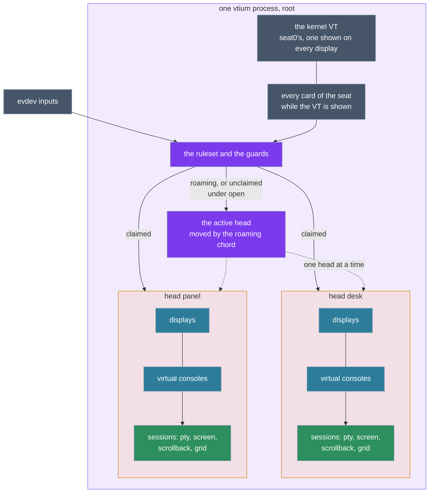
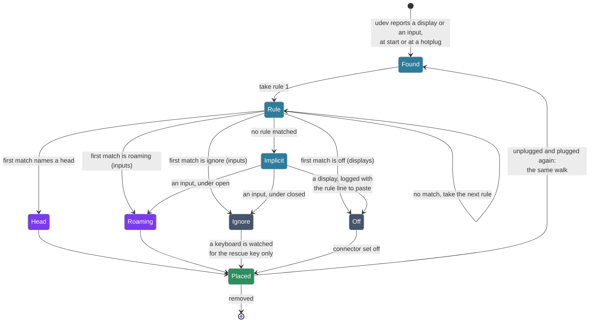
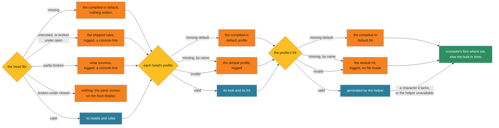
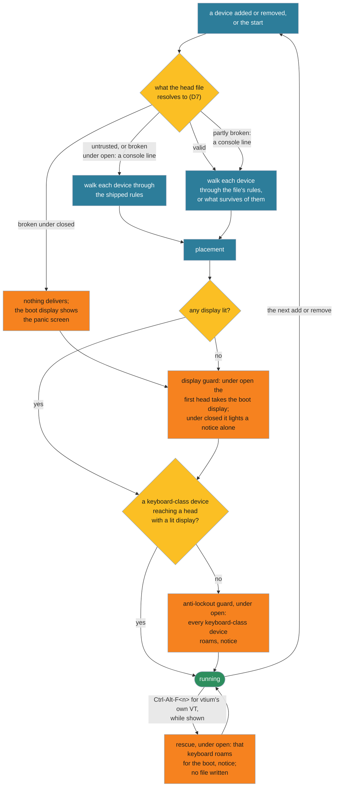
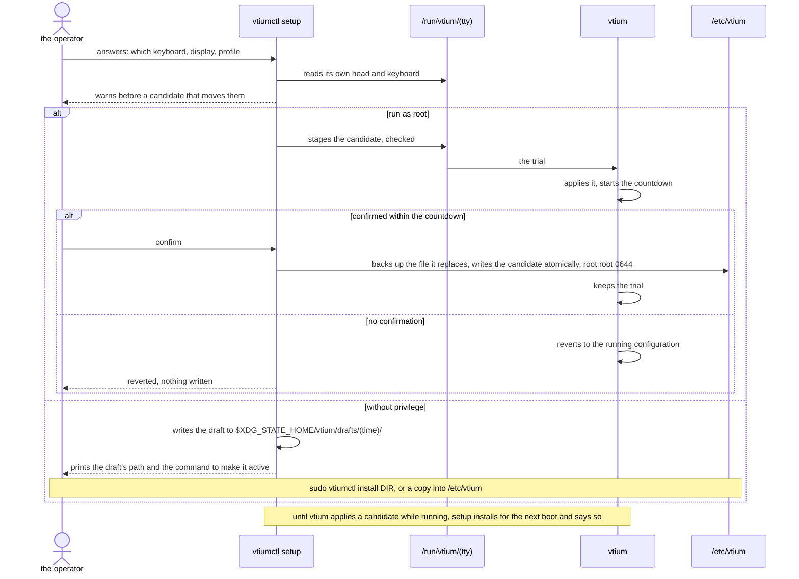

# ADR-1401: Heads: a terminal per physical display, placed by a first-match ruleset

## Summary

- **Decided:** vtium drives every display it can see from one process, as a set of **heads**. A head is a terminal for one or more displays: its displays, its inputs, a profile, and a stack of virtual consoles, each a session with its own pty, screen, scrollback and grid. A head's grid is its own, so each head draws at its own displays' density. Heads serve machines where vtium is the only thing on screen: servers, kiosks, and single-board computers with a panel and an HDMI display. One kernel VT spans every display, so a vtium console beside a running desktop on another monitor is the seat extension of D2, not heads. One optional, root-owned head file declares the heads and an ordered ruleset; each display and each input walks the rules alone, top to bottom, and the first match places it: in a head, roaming, ignored, or off. The file declares a policy, as a firewall declares its default policy, and the rules read the same under either: under `policy = open`, the value when unset, an input no rule matches roams, typing into the active head, and a head is isolated only where it says so, so rules take rights away; under `policy = closed`, an input no rule matches is ignored and every head is isolated unless it says otherwise, so rules grant rights (D3). The shipped ruleset, one head for every display with every keyboard, pointer and other key device typing into it and every other input ignored, is today's console with udev's input classes as its allowlist. With no file present vtium runs its compiled-in configuration, and it never writes one; an invalid file is reported and never altered: an untrusted one is replaced in memory by the shipped default, and a trusted one fails to its policy, running what survives of it, else the shipped default under open and nothing under closed, where a readable `policy = closed` is sticky (D7, D9); and in an open file three guards keep a keyboard typing whatever the rules say, the last of them a key the user presses: `Ctrl-Alt-F<n>` for the VT already shown. The policy sets the guards, with no switch in the file: the anti-lockout guard and the rescue key are on under open and off under closed, and the display guard is always on and lights by policy. `vtiumctl`, a small binary of its own, is the configuration tool: it detects, sets up, reports and checks, with or without privilege, from the console or a desktop. A closed file that declares every display and input gives each head a station, so several people work at once on one machine, each at their own display and keyboard (D5). Each route by which one input can reach another person's session has a switch of its own, and recovery from a lockout a head file builds is outside vtium (D9).
> Edited 2026-10-29: the operator accepted an independent advisor's review (`considered`): the Summary names the use case heads serve. It did not say which machines they are for. The configuration tool is `vtiumctl`; the Summary read "`vtium-vitrify` becomes the configuration tool".

> Edited 2026-10-29: the operator answered C1 (`considered`): the shipped rules gain `input class:key -> focus`. The Summary read: "with every keyboard and pointer typing into it and every other input ignored".

> Edited 2026-10-30: the operator added stations, the per-route switches and recovery outside vtium (`considered`). The Summary named no stations and no routes.

> Edited 2026-10-30: the operator added the head file's posture and its key `default`, resolved an invalid file in three levels, and set the guards by the posture (`considered`). The Summary named no posture, and read: "an invalid file is reported, never altered, and replaced in memory by the shipped default; and three guards, on unless the file turns them off, keep a keyboard typing whatever the rules say,".

- **Trades away:** One process holds every display of the seat, so a fault in one head's session handling reaches every head. Several terminals share one kernel VT, which the C reference refused. The console takes on device routing, a ruleset parser and a notice of its own, and opens keyboards the rules ignore. Mirroring across heads with different densities, which today's single grid gives, needs a head that claims both displays. A station's login has no logind seat (Context), so no seat-bound device such as audio reaches it; a fully independent station is D2's seat extension.

> Edited 2026-10-30: the operator added stations (`considered`). Trades away did not name what a station's login lacks.
- **One-way?** Expensive once a release ships the head file: its syntax, its match keys and its targets become the format users' files are written in. Everything behind the file changes in a session.
- **Probes:**
  - *Not confident (losing a display):* when a head you set up for one monitor loses it, its sessions stay for 10 seconds and then hang up, as a line losing its carrier; the monitor coming back within the 10 seconds resumes them. The shipped one-head console keeps today's behaviour, running on with no display. Is a hang-up after a short wait what you want for a head whose monitor goes away? (Answered 2026-10-29: `on-loss`, `nohup` by default, renamed 2026-10-30 `when-display-lost` and `keep`; see `considered` and D8.)
  - *Confident (the rescue):* pressing `Ctrl-Alt-F<n>` for the VT you are already looking at makes that keyboard roam until the next boot, whatever the head file says, and never edits the file.
- **Inversion:** Between "one grid for every display", the C reference's `multi-monitor` and today's vtium, and "a console process per display", which the kernel forbids (one DRM master per card, one VT shown on every display). vtium keeps one process and one VT and puts the terminals inside it, placed by rules a user writes or a tool writes for them.

## Context

The kernel's VTs are one system-wide set: one VT is shown on every display at once, and `Ctrl-Alt-F<n>` switches every display together. A card has one DRM master. A console per display therefore lives inside vtium: vtium holds its one kernel VT, takes every card of its seat while that VT is shown, drives every connector on them, and keeps its own consoles per display.

logind's seats split whole devices, cards and inputs, never connectors, and only seat0 has kernel VTs. A machine with two GPUs can give one card and its own keyboard to seat1, so a vtium and a desktop run side by side; one keyboard cannot be on two seats. vtium keeps its one real VT on seat0, and runs without a VT only on an extra seat, which has none.

A login inside vtium runs on a pty, so logind gives it a session with no seat and no seat-bound device access for the user, as vtium's login does today and the C reference's did; heads change nothing in this.

A Wayland compositor holds its cards' master while it runs, and disabling an output in the desktop does not release it. A DRM lease (`wp_drm_lease_v1`) can hand a client some of a compositor's connectors.

vtium today lays every display out as one grid: the smallest grid each display holds at the base font, each larger display drawing at the largest height that still holds it (`crates/vtium/src/layout.rs`). On the operator's machine that mirrors a large monitor (7680x2160, about 138 DPI) and a small panel (800x480, about 185 DPI) as one 66x20 grid, with letters 108 pixels tall on the large monitor. Sizes in points (ADR-1200's point rule, on `feat/deferred`) cannot be exact on both.

Keyboards cannot be told from other key devices by the kernel's marks: udev marks a numpad and an OTP token `ID_INPUT_KEYBOARD`, and both declare every letter, Enter, Ctrl, Alt and F1 (Evidence below). Any routing rule a user writes can therefore strand the real keyboard.

## Decision

The figure shows the layers this record adds to, from the kernel to the sessions, with the files and the programs beside them and who each runs as.

![The layers of interaction, bottom to top: the kernel, with card0 (the integrated GPU, HDMI-A-2), card1 (the discrete GPU, DP-8, the boot card), the evdev devices and the one set of kernel VTs; logind and its seats, seat0 holding the VT and both cards, extra seats without a VT marked as later; vtium's ruleset, which each device walks, its guards beside it (never-zero display, anti-lockout, the rescue key), and routing to a head or roaming; two heads, desk on DP-8 with keyboard A and the mouse and profile desk, and panel on HDMI-A-2 with keyboard B and profile small, each profile naming its frit; each head's virtual consoles, one shown per head; and sessions, whose pty, screen, scrollback and grid vtium holds as root while login, the shell and programs run as the user. Layers 3 to 5 are one vtium process running as root. Beside the stack, /etc/vtium (the head file, profiles and frits, owned by root and writable by no one else) feeds layer 3; /run/vtium/<tty>, one directory a VT (written by root, its state read by all, a staged trial) sits between vtium and vtiumctl; vtiumctl, run as the user, with detect, setup, status, check and template, and install through sudo, saves drafts to the user's $XDG_STATE_HOME/vtium/drafts; and the glyph helper, vtium-vitrify serve, runs as nobody, sandboxed, and generates the heads' frits. A legend marks root, the user, nobody, the kernel and pieces not yet built.](figures/ADR-1401-layers.svg)

The structure inside the one process: the VT and the cards, the ruleset placing each input in a head or roaming, and each head's consoles and sessions.



> Edited 2026-10-30: the operator added the posture (`considered`): an unclaimed input follows the focus only under `default = allow`. The edge to the focus read "unclaimed, or focus".

### D1: heads

- A head is a terminal for one or more physical displays: its displays, its inputs, a profile, and a stack of virtual consoles, each a session with its own pty, screen, scrollback and grid. Each display can be its own head, and so hold its own session.
- A head's grid is its own, so a size in points is exact on each head. Where a head claims several displays it mirrors across them by the scaled rule of `crates/vtium/src/layout.rs`, and there alone one grid spans several densities; the point rule's lowest density converts there.
- A head shows one console at a time on every display it holds. Its consoles start with one, as today's console has one session; the count, and each console's command, are set per head in the head file (D3). A zoom changes the grid of the console shown.
- A head whose displays never appear starts no sessions until one does.
- Every head's consoles keep the session rules each session has today: its own login, the respawn limit, the reply rule (docs/architecture.md, "Determinism"), and the helper's sandbox as the session's user (ADR-1400 D2, ADR-1200 D15).
- **One glyph helper for each frit in use,** and, once a session has logged in, for each session user of that frit, since ADR-1200 D15 runs the helper as the session's user. A helper is never shared across users.

> Edited 2026-10-29: the team lead's correction from the heads gap-check (C5): several consoles logged in as different users cannot share one helper running as one of them, and heads with different frits need a helper each. D1 said only that each console keeps the helper's sandbox as the session's user.

### D2: one process, one VT, every card

- One vtium holds its kernel VT and, while that VT is shown, every card of its seat, driving every connector on them; a display is a head inside that process, never a second process.
- Another vtium on another VT (`kmsconvt@tty2`) reads the same head file and does the same while its VT is shown.
- vtium serves seat0. Other seats, one vtium a seat with console switching of its own where the seat has no kernel VT, are a later extension this record names and does not build; the head file then gains a file per seat.
- **One render thread per head,** so one head's redraw cannot delay another head's frames or any input. Each head's frames depend only on that head's state, so determinism holds. Each render thread's stack is small and fixed. Threads do not contain a crash: under `panic=abort` a panic in any thread ends the process (D10).
- A DRM lease from a compositor is not a head source, unless a later decision makes it a display-only head: it would put a root login inside a user's graphical session and need raw input read beside the compositor.

> Edited 2026-10-29: the operator accepted an independent advisor's review (`considered`): each head renders on a thread of its own. D2 said nothing of threads.

The later extension of two seats, drawn so its boundary is clear:

![Two GPUs on two seats, marked later and not built. On the left, seat0, with the kernel VTs and Ctrl-Alt-F&lt;n&gt;: the desktop compositor, the user's graphical session, holds the master of card1, the discrete GPU, and takes the large monitor on DP-8, keyboard A and the mouse; a vtium on a seat0 VT runs there too and takes card1 only while its VT is shown. On the right, seat1, dashed as later and not built, with no kernel VT: vtium, one a seat, with its own console switching, holds the master of card0, the integrated GPU, and takes the small panel on HDMI-A-2 and keyboard B, its own; Ctrl-Alt-F&lt;n&gt; are vtium's own keys there, and the two sessions run side by side, neither switching the other. Below both, logind assigns whole devices to seats, cards and inputs, never connectors; one keyboard cannot be on two seats, and only seat0 has kernel VTs. A legend marks root, the user, a device, and later, not built.](figures/ADR-1401-two-seats.svg)

### D3: the head file

One file, `/etc/vtium/heads.conf`, holds the heads and an ordered list of rules. Its top-level keys, before the first section and in any order among themselves, are `version = 1` and `policy` (below); a file with no version, or a version vtium does not know, is invalid, and still fails to its policy (D7). vtium reads no drop-ins beside it. Its lines are bounded as kmscon.conf's are (65536 bytes a file, 8192 a line); a CRLF line ending is a newline; `#` starts a comment; spaces around `=` and between tokens are dropped.

> Edited 2026-10-30: the operator set the top-level keys in any order and resolved an invalid file by its posture (`considered`). The paragraph read: "Its first line that is not a comment is `version = 1`; a file with no version, or a version vtium does not know, is invalid (D7) and falls back whole.", and named no CRLF.

#### The policy: open or closed

The head file declares a policy, as a firewall declares its default policy: `policy = open` or `policy = closed`, a top-level key, and `open` when the file does not set it, which is what the shipped rules and the compiled-in configuration mean. A readable `policy = closed` wins over every other `policy` line. A `policy` line vtium cannot read, misplaced inside a section or with an unknown value, counts as no policy, so open, and makes the file partly broken (D7). Both policies run one rules engine over one rule language, and neither is a special mode. The rules read the same under either; the policy decides what happens to a device no rule matches, to a head's `isolated` when the file leaves it unset, and to the guards. Under `policy = closed` only unset values change: every rule the file writes means what it says, so `input MATCH -> roaming` is still how a closed file gives a head that is not isolated a spare port. A rule `input * -> TARGET` matches every input, so in a file that ends its rules with one the policy's input default never applies.

| | `policy = open` | `policy = closed` |
|---|---|---|
| An input no rule matches | roams | is ignored |
| A display no rule matches | is off, logged with the rule line that would claim it | the same |
| A head's `isolated`, left unset | `no` | `yes` |
| A head key the file writes | wins | wins |
| The anti-lockout guard and the rescue key (D9) | on | off |
| The display guard (D9) | lights the boot display for the first head, or the default head, when the rules light none | lights the boot display for a notice alone, when a file with heads lights none or has failed |
| What rules do | take rights away: this keyboard belongs to head A, head B is isolated | grant rights: this keyboard belongs to head A, head A is not isolated |
| How a file fails | by leaking: a forgotten rule leaves a stranger's keyboard roaming, or a head's VT keys on | by lockout: a forgotten rule leaves the author's own keyboard dead |
| The author's question | what must I stop from reaching everything? | what must I let in, so I don't shut myself out? |
| An invalid file (D7) | runs what survives of it, else the shipped rules | runs what survives of it, else nothing, with the panic screen |
| Sticky | no: a readable `policy = closed` anywhere among the top-level keys wins | yes: once read, nothing opens it for the boot (D9) |
| Used for | today's console, the shipped default, and heads with bound keyboards | a kiosk, and stations |

- Under both policies every keyboard asks a head: a claimed keyboard asks its own, a roaming keyboard asks the active head, and with no head to ask the answer is no (D5).
- Under `closed`, a head that writes `isolated = no` takes back the VT switch for its keyboards and can be the active head. An operator keeps a way in at the machine with such a head of their own and a rule that sends their keyboard to it, or roaming; otherwise the way in is out of band (D9).
- `vtium check-config` and `vtiumctl check` list what fell to the policy's defaults (D9).

> Edited 2026-10-30: the operator added the head file's posture and its key `default` (`considered`). The head file had no `default` key, and every file behaved as an allow file does.

> Edited 2026-10-30: the operator renamed the head file's names and simplified it (`considered`). `default = allow | deny` became `policy = open | closed`, and "posture" in the prose became "policy"; the head keys `vt-keys`, `focus` and `rescue` became one key, `isolated`; the rule target `focus` became `roaming`, "the focus" the active head, and the focus chord the roaming chord, while mode 1004's focus is called focus reporting; the display target `dark` became `off`; `on-loss` became `when-display-lost`, its `nohup` now `keep`; and the `[guards]` section went, `never-dark`'s switch with it. The notes in this record before this one quote the old names. This subsection was headed "The posture: `default`", and its table gave each of `focus`, `vt-keys` and `rescue` an unset value of its own.

#### Heads and rules

```ini
# /etc/vtium/heads.conf for the machine under Evidence; the EDID values are illustrative
version = 1

[head desk]
profile = desk

[head panel]
profile = small
consoles = 2
when-display-lost = hangup 30s

[rules]
display edid:AAA:0x0001:LARGE00001 -> desk
display edid:BBB:0x0002:SMALL00001 -> panel
input path:pci-0000:15:00.0-usb-0:3.3 -> desk
input path:pci-0000:15:00.0-usb-0:3.4.4 -> desk
input path:pci-0000:15:00.0-usb-0:3.2 -> panel
input path:pci-0000:15:00.0-usb-0:3.4.2 -> roaming
# needs the example udev rule that sets VTIUM_HEAD (D4)
input udev:VTIUM_HEAD=panel -> panel
display * -> desk
input class:keyboard -> roaming
input class:mouse -> roaming
# no class:key rule, unlike the shipped rules: media-key devices stay closed
input * -> ignore
```

> Edited 2026-10-30: the operator removed the switches `anti-lockout` and `rescue-key`, which the posture sets (`considered`). The example's `[guards]` read: "# each guard is on; turning one off is a choice to risk a lockout", then `anti-lockout = on`, `rescue-key = on` and `never-dark = on`.

The example's placement: two heads, each with its own display and keyboard, and the devices no rule claims roaming.

![Two heads with bound keyboards. Head desk holds the large monitor, 7680x2160 at about 138 DPI with its own grid, on DP-8 of the discrete GPU, and two inputs its rules claim, keyboard A at path ...usb-0:3.3 and a mouse at path ...usb-0:3.4.4; it is the active head, shown by a filled mark. Head panel holds the small panel, 800x480 at about 185 DPI with its own grid, on HDMI-A-2 of the integrated GPU, and keyboard B at path ...usb-0:3.2; it shows a hollow mark, not active. Below, three devices roam: a numpad and a USB receiver by input class:keyboard -> roaming, and an OTP token sent there by its rule; they deliver to head desk, the active head, drawn as a dashed arrow. Media-key devices, drawn dashed, stay closed by input * -> ignore. The caption says displays and keyboard A, the mouse and keyboard B are placed by their rules, keyboards and pointers no rule claims roam by class, media keys stay closed, and keyboard A types into head desk alone. A legend marks vtium as root, a device, the active head and not active.](figures/ADR-1401-two-heads.svg)

- **Heads.** `[head NAME]` declares a head; a name is 1 to 64 characters of `A-Z a-z 0-9 . _ + -`, and `roaming`, `ignore` and `off` are reserved. A head's keys: `profile` (the profile's name, unset `default`), `consoles` (the number of virtual consoles, unset 1, at most the cap of D10), `login` (the consoles' command, as kmscon.conf's `login` takes it, unset kmscon.conf's), `when-display-lost` (D8), and `isolated` (D5). A head names no other head; what it names is its profile, which sets its font.
- **Rules.** Under `[rules]`, one rule a line: `display MATCH -> TARGET` or `input MATCH -> TARGET`. A match is `*`, every device of that kind, or one or more `key:value` tokens, every one of which must hold (D4).
- **One of each.** A key given twice in one section, or a second `[rules]` section, is an error, which drops what D7 says. The file has no other sections.
- **Targets.** A head's name. `roaming`, for an input: it roams, typing into the active head (D5). `ignore`, for an input: vtium never opens it, but for a keyboard watched for the rescue key alone under open (D9). `off`, for a display: vtium sets its connector off, so it shows nothing, a frame another master left included, and logs it.
- **First match, alone.** Each device walks the rules top to bottom and takes the first that matches it. The walk reads only the device's own identity and the rules, never another device or the order devices were reported, so a hotplugged device lands where it would at start (D11's determinism row).
- **No match.** A display is set off, and the log names it with the rule line that would claim it, ready to paste. An input roams under `policy = open` and is ignored under `policy = closed`.
- **The shipped default** is one head, `[head console]` with the default profile, and the rules `display * -> console`, `input class:keyboard -> roaming` and the same for `mouse`, `touchpad`, `touchscreen`, `trackball` and `pointingstick`, then `input class:key -> roaming`, then `input * -> ignore`: one head mirroring every display, every keyboard, pointer and other key device typing into it as vtium does today, numpads and macro pads without letters and media-key devices among them, and joysticks, tablets, switches and accelerometers left closed. It is an open file, whose last rule closes the inputs no class names; [docs/heads/default.conf](../../heads/default.conf) writes it out. The shipped rules match by `class:` alone, so the compiled-in configuration means the same with or without a udev daemon: the classes come from udev's tags where udev runs and from vtium's own `input_id` rule where it does not (D4). Tokens are not ignored by default: a console login may use an OTP, so a token roams like any keyboard. The rules are the allowlist; there is no separate one. A user customises by adding rules above them. kmscon.conf's `mouse` key stays as a shorthand: `mouse` off drops the pointer rules from the shipped rules.

> Edited 2026-10-29: the operator answered (`considered`): the head file is `/etc/vtium/heads.conf`, one file with no drop-ins (probe 1); consoles and `login` are set per head in the head file (probe 2); and kmscon.conf's `mouse` key stays as a shorthand that drops the pointer rules. D3 cited probe 1 for the path, and the `mouse` key was an agent call.
> Edited 2026-10-29: the operator answered C1 (`considered`): the shipped rules gain `input class:key -> focus`. The shipped rules went from the pointer classes straight to `input * -> ignore`, which closed numpads and macro pads without letters, and the bullet ended: "A user customises by adding rules above them: `input class:key -> focus` above the last line lets media keys through."

> Edited 2026-10-30: the operator added the head keys `vt-keys` and `focus` (`considered`). A head's keys read: "`on-loss` (D8), `rescue` (D9), and the font keys".

> Edited 2026-10-30: the operator gave a head's font one path, head to profile to frit (`considered`), a second key or section became an error D7 scopes, and the rescue key follows the posture. The `ignore` target read "but for a keyboard watched for the rescue key alone (D9)." The head keys ended: "and the font keys `font-name` and `font-size`, as kmscon.conf carries them, for that head alone. A head names no other head; what it names is its profile and, with its own `font-name`, a font."; "**One of each.**" ended: "makes the file invalid (D7)." The heads first cut still parses a head's `font-name` and `font-size` and the `[guards]` keys `anti-lockout` and `rescue-key`; their removal is not built yet.

> Edited 2026-10-30: the operator added the posture (`considered`). "**No match.**" ended: "An input follows the focus."; the shipped default named no posture; and the walk's diagram below drew `Implicit --> Focus: an input`.

- **A head names a profile,** the profile of ADR-1200 D16, which names a frit; the head file says where devices go. Until a profile file format exists (#121, #136, #137), a head's `profile` resolves to the compiled-in default profile for `default`, and to the frit of that name for any other name.
- **The more specific setting wins.** The configuration file's font keys, `font-name` and `font-size` as kmscon.conf carries them, are the base for every head, and a head's profile overrides them for that head. A profile overrides only what it states, so a head with the default profile takes the configuration's keys (ADR-1200 D16). A single `font-size` in the configuration no longer sets every head's size.

> Edited 2026-10-29: the operator accepted an independent advisor's review (`considered`): the more specific setting wins. The bullet ended: "Keys in kmscon.conf apply to every head and win over its profile, as ADR-1200 D16 says of `font-size` and `font-name`.", and a head's keys named no font.

> Edited 2026-10-29: the team lead's correction from the heads gap-check (C3): ADR-1200 D16 defines the profile, and no profile file format exists yet for a name to resolve to. The bullet read: "**Profiles say how a head looks** (font, size, colors) and name a frit (ADR-1200 D16, D1)".

> Edited 2026-10-30: the operator gave a head's font one path, head to profile to frit (`considered`). "**The more specific setting wins.**" read: "are the base for every head; a head's profile overrides them for that head; and a font key in the head's own section overrides both."

- **xorg.conf's failures, avoided by rule:** the file is optional; heads are self-contained, the only reference a profile's name; a rule matching no connected device is skipped with a log line, never an error; and a tool writes the file (D12).

The walk of one device, from udev to where it lands, and the same walk again at a hotplug:



### D4: matching

| Key | Value | Binds | Strength |
|---|---|---|---|
| `path` | udev's `ID_PATH` of the USB device or port, matching every interface below it (`pci-0000:15:00.0-usb-0:3.3` takes `...:3.3:1.0` and `...:3.3:1.2`) | the physical port | strong |
| `serial` | `VENDOR:PRODUCT:SERIAL`, udev's `ID_VENDOR_ID`, `ID_MODEL_ID` and `ID_SERIAL_SHORT`, matching every interface of that unit | one unit, wherever plugged; copyable | strong where the device has a serial |
| `bluetooth` | the address the device reports as its unique id | one device | strong once bonded |
| `id` | `VENDOR:PRODUCT` | every unit of a model; devices lie (keyboard B reports another maker's vendor id) | weak |
| `name` | the device's name, a glob | anything that names itself so | weakest |
| `class` | udev's input class: `keyboard` (`ID_INPUT_KEYBOARD`, every key code 1 to 31, Escape through S), `key` (`ID_INPUT_KEY`, any key: media-key devices), `mouse`, `touchpad`, `touchscreen`, `trackball`, `pointingstick`, `tablet`, `tablet-pad`, `joystick`, `accelerometer`, `switch` | what kind of device it is; the shipped allowlist | none |
| `edid` | `MAKER:PRODUCT:SERIAL`: the PNP maker id, the product code in hex, the serial string, else the serial number | one monitor; copyable by an EDID emulator | strong |
| `connector` | `CARD/CONNECTOR`, the card's udev `ID_PATH` as `mode=` names it and the kernel's connector name, globs allowed (`pci-0000:03:00.0/DP-*`) | a port of a GPU | strong |
| `connector-path` | the KMS connector's `PATH` property (`mst:...`), which a DisplayPort multi-stream connector carries | one port of a multi-stream hub, stable across a replug or resume | strong |
| `card` | the card's udev `ID_PATH`, a glob | every output of a GPU | strong |
| `udev` | `NAME=VALUE`: any udev property of the device, a glob on the value (`udev:VTIUM_HEAD=panel`) | whatever the administrator's udev rules and hwdb say, as `ID_SEAT` and `uaccess` do | as strong as the rule that set it |

- **The classes are udev's.** vtium reads the `ID_INPUT_*` tag udev set, so a hwdb correction (`/usr/lib/udev/hwdb.d`, `/etc/udev/hwdb.d`) applies to vtium as it does to libinput and the desktop. Without a udev daemon, vtium applies udev's `input_id` rule to the device's capability bitmaps itself, so a device's classes are the same either way. This follows the system's convention, the rule the operator set for vtium.
- **`udev:` hands the rare cases to udev.** vtium's own keys cover the common cases; anything rarer is classified with udev's own rules and hwdb and matched with `udev:`, never with a new vtium key. Without a udev daemon a device has no properties, so `udev:` matches nothing.
- **Keys that need udev's database.** `path`, `serial`, `card` and `connector` read what the udev daemon records: `ID_PATH`, and the `ID_VENDOR_ID`, `ID_MODEL_ID` and `ID_SERIAL_SHORT` of its `usb_id` builtin. Like `udev:`, they match nothing without a daemon. `id`, `name`, `bluetooth`, `class`, `edid` and `connector-path` read sysfs, the device or the KMS connector, and work either way. On a system with no udev daemon, `vtium check-config` notes each rule that uses `udev:`, `path`, `serial`, `card` or `connector`, naming the key.

> Edited 2026-10-29: the team lead's correction from the heads gap-check (C4): only `udev:` was named as matching nothing without a daemon. The `udev:` bullet ended: "`vtium check-config` notes a rule that uses it on such a system.", and D3 said: "The shipped rules carry no `udev:` line".
- **Example patterns, not installed files.** vtium installs no active udev file. It ships the patterns as examples under `/usr/share/doc/vtium/examples/` and in the template's comments: a udev rule setting `ENV{VTIUM_HEAD}`, `ENV{VTIUM_IGNORE}` or `ENV{VTIUM_ROLE}` for a device, and a small hwdb fragment marking tokens and numpads by vendor and product, each with the head-file line that uses it. An administrator copies one into `/etc/udev/rules.d` or `/etc/udev/hwdb.d` to use it, and from then on `udev:` and the guard's reading of `VTIUM_ROLE` (D9) act on it; without udev neither has any effect, and `check-config` says so.

```text
# examples/vtium.hwdb, copied to /etc/udev/hwdb.d/ to use; illustrative entries
evdev:input:b0003vBBBBp0001*
 VTIUM_ROLE=token

evdev:input:b0003vAAAAp0002*
 VTIUM_ROLE=numpad

# examples/71-vtium-local.rules, copied to /etc/udev/rules.d/ to use; illustrative
SUBSYSTEM=="input", ENV{ID_PATH}=="pci-0000:15:00.0-usb-0:3.2*", ENV{VTIUM_HEAD}="panel"
SUBSYSTEM=="input", ATTRS{name}=="Headphones (AVRCP)", ENV{VTIUM_IGNORE}="1"
SUBSYSTEM=="input", ENV{ID_VENDOR_ID}=="aaaa", ENV{ID_MODEL_ID}=="0003", ENV{VTIUM_ROLE}="numpad"

# the head-file lines that use them
input udev:VTIUM_IGNORE=1 -> ignore
input udev:VTIUM_HEAD=panel -> panel
```

The hwdb fragment uses udev's own `evdev:` prefix, which systemd's stock `60-evdev.rules` looks up for each input event node and imports, so it needs no vtium rule. A blank line separates its entries, since systemd-hwdb drops a match that directly follows a property line.

> Edited 2026-10-29: the team lead's correction from the heads gap-check: the hwdb block's matches read `vtium:input:b0003vBBBBp0001*` and `vtium:input:b0003vAAAAp0002*`, a prefix no stock rule looks up, with no blank line between the entries.

> Edited 2026-10-29: the operator corrected the shipped udev material to example patterns only (basis). This read: "vtium's udev files, package files in udev's vendor locations [...] `/usr/lib/udev/hwdb.d/70-vtium.hwdb`, a small device database setting `VTIUM_ROLE=token` [...] `/usr/lib/udev/rules.d/70-vtium.rules`, which imports that hwdb", and the shipped rules began with `input udev:VTIUM_IGNORE=1 -> ignore`.

- **`edid` is the recommended way to match a display.** A DisplayPort multi-stream connector's name, such as `DP-8`, is assigned by the driver when it detects the display, and may change after a replug or a resume; its `PATH` property (`mst:...`) stays stable, and `connector-path:` matches it. The template warns that such a connector's name can move. A USB port path through a dock or a KVM can shift in the same way.
- A card is named by its `ID_PATH`, never by `cardN`, whose number can change between boots on a machine with several GPUs.
- A rule's tokens combine: `input path:... serial:...` binds that unit in that port, the strongest binding; `display connector:... edid:...` binds that monitor on that port.
- One physical keyboard may be several input devices (keyboard B is three: its keys, its media keys and a pointer); a `path` or `serial` match takes every interface of that USB device.
- The template's comments advise: `path` plus `serial` where the device has a serial; `path` alone otherwise; `id` or `name` alone only for convenience, never for a head whose sessions need protecting; `edid` for displays, with `connector-path` where a multi-stream connector must be told apart, and `connector` only where its name is stable.
- `vtium check-config` and `vtiumctl check` note a rule that sends input to a head with sessions by `id` or `name` alone: a note, never a warning, so the exit status stays 0.

> Edited 2026-10-29: the operator answered (`considered`): a weak-only match is a note with exit status 0 (probe 4). The bullet read: "note a rule that sends input to a head by `id` or `name` alone (probe 4)."

> Edited 2026-10-29: the operator accepted an independent advisor's review (`considered`): `edid` is the recommended display match, and `connector-path` joins the keys. The advice read: "`connector` plus `edid` for displays."

### D5: the active head and input

- An input a rule sends to `roaming` roams: no head owns it, and it types into the active head. So does an input no rule claims under `policy = open`; under `policy = closed` an input no rule claims is ignored (D3). The active head at start is the head holding the boot display (D9), else the first head in the file with a lit display, taking only a head that can be the active head, which is every head that is not isolated (below). The roaming chord moves it only to a lit head that can be the active head, and it never moves because a head's display left or came back (D8). The other moves are the anti-lockout guard's, which makes a lit head active when it fires (D9), and the one out of having none: while no lit head can be the active head there is none, and when one that can lights, it becomes the active head at once.
- A hotplug changes the active head only out of having none, and a new keyboard never makes its head active. Every head shows whether it is the active head, drawn by vtium outside the session's output.

> Edited 2026-10-30: the operator added the posture (`considered`). The first bullet began: "An input no rule claims, or one a rule sends to `focus`, follows the focus."

> Edited 2026-10-30: the operator decided that the focus lands on a head out of having none (`considered`). The bullets read: "The one other move is the anti-lockout guard's, which takes the focus to a lit head when it fires (D9)." and "Focus moves only by the focus chord, never at a hotplug, and a new keyboard never takes it."

- A keyboard a rule sends to a head types into that head alone, and its console chords switch that head's consoles. Only roaming keyboards take the roaming chord, and it moves only the roaming devices; pressed on a keyboard a rule sends to a head, it moves nothing and reaches that head's session as an ordinary key.
- **Isolated heads (`isolated`).** With `isolated = no`, the value when unset under `policy = open`, as in the compiled-in configuration and the template, a head behaves as every head does today. With `isolated = yes`, the value when unset under `policy = closed`, the head gives up three rights together. `Ctrl-Alt-F<n>` and `XF86Switch_VT_<n>` for another VT, pressed on the keyboards its rules claim, switch nothing: the press goes on down the key order and reaches that head's session as an ordinary key, as a serial terminal sends it. The rescue key leaves those keyboards where they are (D9). And the head is never the active head, so no input reaches it by roaming: neither a keyboard no rule claims, nor one the rescue key moves, nor those the anti-lockout guard moves. Its own claimed keyboards still type into it. A head holds all three rights or none of them. Where the active head would start on an isolated head, or the anti-lockout guard would make one active, it goes to the next head in that order that is not isolated (D9).
- **A roaming keyboard acts as a keyboard of the active head,** which is never isolated, so its VT keys switch the VT; with no active head it delivers nothing, the VT keys included. Every keyboard asks a head: a claimed keyboard its own, a roaming keyboard the active head, and with no head to ask the answer is no. With no lit head that can be the active head there is none: roaming inputs deliver nowhere, and the anti-lockout guard has nothing to move them to, until such a head lights (above). The shown VT's own key stays the rescue key, governed by the policy and `isolated` whatever else a head says (D9).
- Pointers follow the same rules: a pointer claimed by a head moves on that head's displays; one roaming moves on the active head's.
- Each keyboard's lock LEDs show that keyboard's own lock state, within its head. A program's DECLL stays ignored, and vtium-term leaves the LEDs as the user set them (ADR-1000 `ctl.decll`).
- Spreading spare keyboards one per head happens only on an explicit `input * -> HEAD` rule, never inferred; inferring would misplace an OTP token or a media-key device.
- The console chords and the roaming chord are grab keys matched after the VT's keys and the power keys and before the terminal's grabs, the C reference's place for its seat keys; their names and default chords are vtium/vtium#82's, chosen so they cannot be mistaken for the kernel's VT keys: never `Ctrl-Alt-F<n>`.
- Focus reporting (mode 1004) tells the terminal of each head's shown console that it has the focus while a keyboard delivers to its head, lit or not (D8), so several terminals have it at once, one a head.

> Edited 2026-10-29: the operator answered C10 (`considered`): keys follow the kernel console. D5 read: "and rests only on a head with a lit display." The anti-lockout guard's move of the focus (D9) joined the focus rules later the same day., and mode 1004's focus held "while its head has a lit display and a keyboard delivering to it".

> Edited 2026-10-30: the operator settled the focus chord on a claimed keyboard and added the head keys `vt-keys` and `focus` (`considered`). The bullet ended: "The focus chord moves only the devices following the focus."; the first bullet read: "else the first head in the file with a lit display. The focus chord moves it only to a head with a lit display,"; and D5 had neither key.

Two layers of switching, and the active head between heads:

| Layer | Keys | Switches | Across |
|---|---|---|---|
| VT switching | `Ctrl-Alt-F<n>`, the kernel's | the kernel VT, and with it what every display shows | every display at once |
| Console switching | the console chords, #82's | the console a head shows | that head's displays alone |
| The active head | the roaming chord, #82's | which head the roaming inputs type into | the heads |

> Edited 2026-10-29: the operator accepted an independent advisor's review (`considered`): the console chords are never the kernel's VT keys, and the table shows the layers. The chord bullet ended: "their names and default chords are vtium/vtium#82's."

> Edited 2026-10-29: the team lead's correction from the heads gap-check (C2): ADR-1000 keeps `ctl.decll` ignored. The LED bullet read: "A program's keyboard LEDs (DECLL) reach the keyboards delivering to its head."

One roaming keyboard and two heads, before and after the roaming chord:

![One roaming keyboard, two heads, in two rows. Before the chord, head desk with the large monitor is the active head, a filled mark, and its session reads the keys typed; head panel with the small panel shows a hollow mark, its session running on with no keys reaching it; the keyboard's arrow points to head desk. Between the rows, the roaming chord, pressed on the keyboard, a grab key whose default chord is vtium/vtium#82's. After the chord, head desk is not active and head panel is the active head, and the keyboard's arrow points to head panel. The caption says the active head changes only by the chord, never at a hotplug, a new keyboard never takes it, it is only a lit head that is not isolated, and each head draws its mark outside the session's output. A legend marks vtium as root, a device, the active head and not active.](figures/ADR-1401-focus.svg)

**Stations.** A file under `policy = closed` that declares every display and input lets each head serve one person at their own display and keyboard, several at once on one machine, since every head is isolated unless it says otherwise. Stations are off by default; [heads.md](../../heads.md) carries their configuration beside the other scenarios.

> Edited 2026-10-30: the operator added stations as a scenario the user guide configures (`considered`). D5 named no stations.

### D6: defaults that always type

- With no configuration at all, vtium gives a lit console that can be typed on. The chain: the shipped rules name the default head; the default head names the default profile; the default profile names the default frit; the default frit draws vconsole's font where one is set, else the built-in fonts, compiled into vtium, which draw with no helper and no font file (ADR-1200 D9, D7). This holds where vtium can take the card; where another display server holds it, vtium waits for its VT as today.
- **vtium never writes a configuration file.** With no head file, profile or frit present it runs the compiled-in configuration, the shipped rules, the default profile and the default frit, and a missing file is neither an error nor a file to create. Root services do not write their own `/etc` configuration at run time: sshd's comes from its package, and systemd runs with `/etc` empty; the C reference's build installed its example configuration (`kmscon/meson.build:409-413`), and its program never wrote one.
- **The first default configuration is `vtiumctl`'s to write,** when asked: by `setup`, or by `template`, which writes the commented template of the head file, the default profile and the default frit, under D12's privilege flow. A template is every setting written as a commented line, so a file written from it changes nothing until edited; the head file's template carries `version = 1`, `[head console]` and the shipped rules as live lines, which state the compiled-in default.
- **One source for the default configuration.** The commented templates live in the shared configuration crate (D12), and vtium's compiled-in configuration is parsed from that same text, so the built-in configuration, the file `vtiumctl` writes and the files a package installs are the same by construction.
- A distribution may ship the template as a tracked configuration file or as an example; that is its choice. It builds those files with the tool, never from a copy kept by hand (D12).
- A profile naming a frit that does not exist draws the default frit with a log line and creates no file.

> Edited 2026-10-29: the operator decided that vtium never writes a configuration file (`considered`), reversing "A missing configuration is instanced from its template" (basis). D6 read: "A missing default file is instanced from its template: the head file, the default profile and the default frit, and no other [...] vtium writes an instanced file only when it is absent (`O_CREAT | O_EXCL`), follows no symlink (`O_NOFOLLOW`), refuses when `/etc/vtium` fails the ownership check of D10, writes it `root:root 0644`, and carries the templates in its binary. Instancing is best effort: a read-only root, a missing `/etc/vtium` or a refused directory runs the compiled-in defaults with one log line. `instance-defaults`, a kmscon.conf switch on by default, turns it off for a distribution that ships the templates as files."

A machine with no configuration at all:

![No configuration. On the left, /etc/vtium/heads.conf, absent at start and drawn dashed, and nothing is written: vtium holds the compiled-in configuration in memory, version = 1, [head console], profile = default, [rules], display * -> console, input class:keyboard, mouse, touchpad, touchscreen, trackball and pointingstick -> roaming, input class:key -> roaming, and input * -> ignore, which vtiumctl writes as a file when asked. In the middle, head console holds the large monitor, 7680x2160 at about 138 DPI on DP-8 of the discrete GPU, and the small panel, 800x480 at about 185 DPI on HDMI-A-2 of the integrated GPU, as one grid mirrored by the scaled rule. Below it, head console is the active head, and keyboard A, keyboard B, a numpad, an OTP token and a mouse, all of a keyboard or pointer class, reach it through the class rules, and media keys reach it too, through input class:key -> roaming. On the right, the default chain: head console names its profile; profile default, compiled in when absent; frit default, compiled in when absent; and vconsole's font where set, else the built-in fonts, Unscii-8 and unifont. A legend marks vtium as root, a device, and absent; the caption says that with no file vtium behaves as it does today and writes no file.](figures/ADR-1401-no-configuration.svg)

### D7: an invalid configuration

- **Three levels, asked in order.** What vtium runs for its head file is resolved at three levels, each asked once the one before it has passed.
  1. **Trust.** A missing file is no error: the compiled-in configuration runs, silently. A file that fails D10's ownership check, or that vtium cannot open and read as a regular file, is never read: the shipped default runs, the console shows `invalid config skipped, using builtin`, and the log holds the details. This is the one path on which a present file fails open.
  2. **The policy.** vtium reads it from the top-level keys, in any order (D3). A readable `policy = closed` wins over every other `policy` line. A `policy` line vtium cannot read counts as no policy, which is open, and is itself an error, so the file is at least partly broken. A trusted file always fails to its policy: bytes vtium cannot read and a missing or unknown `version` are errors scoped so that the policy is still read.
  3. **The rest.** Each error drops what it takes: an error inside a head's section drops that head, with every rule that names it; a bad rule line drops that rule alone, and a device walks on to the next rule; an error that leaves the file's structure untrustworthy drops the whole file but its policy. The file is then valid, valid but declaring nothing, partly broken with at least one usable head left, or broken with none. A rule matching no connected device, a rule an earlier one shadows and a profile naming a missing frit are warnings: the file applies and they are logged. A valid file unusable on the hardware present is the guards' to act on (D9).
- Missing hardware never makes a file invalid.
- **The outcomes,** by what the levels found:

| The head file | What runs | The console shows |
|---|---|---|
| missing | the compiled-in configuration | nothing |
| untrusted, or not readable as a file | the shipped default | `invalid config skipped, using builtin` |
| valid | the file | nothing |
| valid and declaring nothing, under open | the shipped default | nothing |
| valid and declaring no head, under closed | nothing: every display dark, "loaded but off" | nothing |
| partly broken, under open or with no readable policy | the surviving heads and rules, then the shipped rules' tail | `config partly invalid, running what's valid` |
| partly broken, under closed | the surviving heads and rules | `config partly invalid, running what's valid` |
| broken, under open or with no readable policy | the shipped default | `invalid config skipped, using builtin` |
| broken, under closed | nothing | the panic screen, on the boot display |

- **A partly broken run** is never more open than the shipped default. Under open the surviving rules run and then the shipped rules' tail, the keyboard, pointer and key classes roaming and then `input * -> ignore`; `isolated` is ignored, so every surviving head acts as one that is not isolated, and the rescue key and the active head always have somewhere to land. Under closed the rescue key stays off and every head keeps its isolation as written, since a readable `policy = closed` is sticky (D9): a broken closed file never forces a way in. Under both, the display guard lights as D9 says.
- **The panic screen.** A broken closed file with no head left means vtium has started correctly and can serve nothing. The boot display shows vtium's own report, in this form, the wording illustrative:

  ```text
  vtium: config invalid, closed: input off
  no possible paths for terminal: no head in /etc/vtium/heads.conf survives
  /etc/vtium/heads.conf:4: unknown key "focs" in [head kiosk]
  nothing on this console takes input; the full report: vtium check-config /etc/vtium/heads.conf
  ```

  with the first errors, each with its file and line, between the second line and the last. It names `check-config` because `check-config` rebuilds the report from the file itself, run over ssh or from other boot media with the disk mounted. The screen stays for as long as vtium runs, with no timeout. vtium/vtium#162 adds a picture to this screen alone.
- **A closed file's failure is final,** by design, as a sealed TPM's is. vtium keeps no copy and no last-known-good of any file, and still writes none (D6). A closed file is recovered out of band (D9), and is tested before it is relied on by `vtiumctl`'s staged trial (D12).
- **The fallback for profiles and frits is per file:** an invalid profile gives the heads naming it the default profile; an invalid frit draws the default frit, as an unreadable `cell=` or `size=` does today.
- **vtium never fixes, comments out, renames or replaces a present file,** broken or empty. An empty head file, like one with `version = 1` and nothing else, is valid and declares nothing.
- **Every error is logged** with its file and line, and the console line of the outcome shows on the console before the login, the details left to the log and to `vtium check-config`: vtium's own message, drawn as a getty prints its banner, never written to the session's pty or kept in its scrollback; it ends on any key that reaches that head, or after 30 s. Text the notice quotes from a file is escaped first, so a control byte or an escape sequence in the file never reaches the screen. vtium keeps running.
- **`vtium check-config`** runs the boot's parser and evaluator, lists every error with its line, and exits non-zero; given a candidate file's path, it checks that file before it is installed, as `nft -c`, `visudo -c` and `sshd -t` do. It exits 1 on an error or a warning about the file itself, as it does for kmscon.conf; a finding that depends on the hardware present, such as a rule matching no connected device, is noted on standard output outside the exit status, so a file can be checked away from its machine.
- **A reload** (vtium/vtium#86, not built) applies only a valid, trusted file. Anything else, a missing file included, leaves what is running as it is, under both policies.

> Edited 2026-10-29: the operator answered (`considered`): the notice ends on any key reaching its head or after 30 s (probe 5). It read: "(probe 5: a key ends it, or it shows for a few seconds)".

> Edited 2026-10-29: the team lead's correction from H2's questions: an empty file contradicted D3's required `version = 1`, and D3 named no rule for a key or section given twice. D7 read: "An empty head file is a valid ruleset with no rules: every display goes dark, and D9's display guard lights the boot display in a default head."

> Edited 2026-10-29: the operator accepted an independent advisor's review (`considered`): the head file carries `version = 1`, in the template too. D7's invalid outcomes began with "a syntax error", and the file carried no version.

> Edited 2026-10-29: the team lead's correction from the heads gap-check: the notice quotes a file's own text, which can carry control bytes. D7 said nothing of escaping it.

> Edited 2026-10-30: the operator resolved an invalid head file in three levels, by trust, posture and the rest (`considered`). D7's first bullet read: "**Three outcomes.** *Invalid:* a missing or unknown `version`, a syntax error, an unknown key, a rule targeting an undefined head [...] or a file that fails D10's ownership check; the file is rejected whole and no part of it applies. *Valid with warnings:* [...]"; the fallback began: "an invalid head file runs the shipped default;"; the empty-file sentences read: "An empty head file has no `version`, so it is invalid and falls back whole to the shipped rules. A file with `version = 1` and no rules is a valid ruleset with no rules: every display goes dark, and D9's display guard lights the boot display in a default head."; the notice named no console line; the reload read: "On a future live reload, an invalid new file leaves the running configuration as it is."; and the figure and the default chain's diagram below drew one outcome for an invalid head file, the shipped rules.

An invalid head file at boot:

![An invalid head file. On the left, /etc/vtium/heads.conf with seven numbered lines: version = 1, [head desk], profile = desk, [rules], display * -> desk, input path:...3.3 -> desc highlighted as the error, and input class:keyboard -> roaming; line 6 names a head no section declares, and the file is left as it is, its hash before the boot equal to its hash after. In the middle, vtium at start reads the file whole, finds the error on line 6 and drops that rule alone, logs it with file and line, runs what survives and then the shipped rules' tail, the keyboard, pointer and key classes -> roaming and input * -> ignore, shows the notice and keeps running. On the right, every display, in head desk, shows the notice in a red box, vtium: config partly invalid, running what's valid; heads.conf:6: rule names undefined head "desc", drawn by vtium and never in the session, above the login prompt, and the session starts as before. Below, vtium check-config /etc/vtium/heads.conf prints the same error with its line and exits 1, the boot's parser and evaluator run on a candidate before install. The caption says vtium never fixes, comments out, renames or replaces a present file, an invalid profile gives its heads the default profile, an invalid frit draws the default frit, and missing hardware never makes a file invalid; the message's wording is illustrative. A legend marks vtium as root, a device, and an error or a notice.](figures/ADR-1401-invalid-file.svg)

The default chain and each file's fallback, from the head file to the built-in fonts:



### D8: missing and changing hardware

- **No display at start:** `display-wait` as today (exit 1 for the unit's `OnFailure=` getty, or wait under `forever`); the rules are walked once a display exists.
- **No input at start:** vtium runs, and the notice says no keyboard was found; a keyboard plugged in later walks the rules.
- **Keys follow the kernel console** (fbcon) as closely as vtium's security model allows. A head whose display was lit and then left keeps its sessions under `when-display-lost = keep` (below) and keeps receiving the keys of the devices that reach it, as the kernel console's tty does when its monitor is unplugged. A head whose display never lit starts no session (D1) and receives nothing. A head with `when-display-lost = hangup` hangs up as decided below. The active head never changes to a head, or away from one, because its display left or came back (D5).
- **Every display lost mid-session:** vtium keeps running and waits for a hotplug, as the C reference did; `display-wait` governs the start only.
- **A head that loses its last display** does what its `when-display-lost` key says; a mirrored head keeps its sessions while any of its displays remains. `keep`, the default on every head, the shipped `console` head included: the sessions keep running and come back when a display of the head returns, as the kernel's VT console keeps its session through an unplugged monitor or keyboard. `hangup`: the sessions are hung up at once, as a serial line losing its carrier: the pty is closed and its processes get SIGHUP. `hangup DURATION`, such as `hangup 30s` (seconds, or with an `s`, `m` or `h` suffix): a display returning within the time resumes the sessions, and after it they are hung up. On Unix a hang-up belongs to lines, a serial carrier, a removed USB serial tty or a dropped ssh connection, and a console is not one, so hanging up is the choice a head opts into.
- **A head reattaches only to a display its rules match,** so it is never looser than the kernel console, which shows its session on whatever monitor is plugged in.

> Edited 2026-10-29: the operator answered C10 (`considered`): keys follow the kernel console. The bullet read: "**Inputs with no lit display** deliver to nothing."

> Edited 2026-10-29: the operator answered the Summary's probe (`considered`) with `on-loss`, `nohup` by default. D8 read: "keeps its sessions for `hangup-after` seconds, and then hangs them up [...] `hangup-after = 0` hangs up at once, and `never` keeps the sessions, today's behaviour, which the shipped `console` head takes. Unset, a head the file declares takes 10 seconds (probe 3).", and "vtium never reattaches a live session to whatever display next claims a lost display's identity once the time has run out."

A boot with nothing attached, each device added after it, and the display removed:

![A timeline, left to right: boot, a display plugged in, a keyboard plugged in, the display removed. Step 1, nothing attached: no display and no keyboard; vtium holds its VT and waits display-wait, 10 s by default, from when the VT is first shown; no rule is walked yet and no session starts; a display within the wait goes on to step 2. Below step 1 the branch: with no display by then, vtium exits with status 1 and the unit's OnFailure= starts a getty on the VT; under display-wait=forever, vtium waits for the first display however long it takes, and then goes on to step 2. Step 2, a display: it walks the rules, display * -> console; the head lights and its session starts on its grid; a notice says no keyboard was found; the login prompt shows and nothing can type yet. Step 3, a keyboard: it walks the same rules, input class:keyboard -> roaming; it roams on the only lit head; the session can be typed on and the notice is gone; a new keyboard never makes its head the active head. Step 4, drawn dashed as the tail, the display goes: vtium keeps running and waits for a hotplug, display-wait being the start's alone; when-display-lost = keep, the default, keeps the sessions running, and hangup and hangup 30s are opt-ins set per head. A panel below draws a head losing its last display under each when-display-lost value: keep, the default, runs the sessions on and brings them back on a matching display; hangup sends SIGHUP at once, as a line losing carrier; hangup 30s resumes the sessions on a return within the time and then sends SIGHUP; a mirrored head keeps its sessions while any display remains. The caption says each device walks the rules when it arrives, exactly as one found at start would, and the session waits for the first display. A legend marks vtium as root, an exit or a notice, an opt-in value, and the later moment of the tail.](figures/ADR-1401-after-boot.svg)

### D9: guards against lockout

- **The classes are udev's** (D4). The anti-lockout guard counts `class:keyboard` as udev defines it, `ID_INPUT_KEYBOARD`, a device with every key code from Escape through S; a device marked `VTIUM_ROLE=token` or `VTIUM_ROLE=numpad`, by a rule or hwdb entry an administrator copied from the examples (D4), does not count, which closes the numpad gap for the devices it marks; an unmarked numpad or token still passes as a keyboard, and the rescue key covers that case. This replaces the record's own class of 26 letters and Enter, so vtium and the desktop agree on what a keyboard is.
- **Layer 1, findings.** `vtium check-config` and `vtiumctl check` report a head that claims only pointers while every keyboard is claimed elsewhere, every keyboard ignored, and a head whose only keyboard is one device; each names the device as reported. They depend on the devices present, so each is a note outside the exit status, under both policies, and a valid kiosk file exits 0.
- **What exits 1.** `vtium check-config` exits 1 on an error or a warning about the file itself (D7): a line it cannot parse, an unknown key or value, a rule naming no head, a rule an earlier one shadows, a profile naming a missing frit. Everything that depends on the devices present, a rule matching none of them, the Layer 1 findings and what fell to the default, and every guard or right a file turns off, is a note, and the status stays 0.

> Edited 2026-10-30: the operator made a head whose only keyboard is one device a note under both postures and asked that D9 say what exits 1 (`considered`). The bullet read: "**Layer 1, warnings.** `vtium check-config` and `vtiumctl check` warn of a head that claims only pointers [...]; each names the device as reported."
- **Layer 2, the anti-lockout guard,** as pfSense keeps its administration port open, on under open and off under closed: while no keyboard-class device reaches a head with a lit display, every keyboard-class device roams, with a notice, until one does. It moves every stranded keyboard at once, so it chooses none and stays deterministic. When it fires it also makes a lit head that can be the active head active (D5), the boot display's head when that is lit and not isolated, else the first such head in file order, and logs the move with the notice; with no such head there is no active head, and the guard has nothing to move the keyboards to; besides the chord and the landing out of having none (D5), it is the only thing that changes the active head, and it does so only for anti-lockout. A head it leaves unlit keeps its sessions under `keep` (D8). When a lit head already holds a keyboard the guard does not fire, and the active head stays where the chord put it, lit or not.

> Edited 2026-10-29: the team lead's answer, from the guard's stated purpose: when the anti-lockout guard fires it also moves the focus to a lit head. Under D8's keys, which follow the kernel console, the focus can rest on a head whose display left, where the stranded keyboards would type into an unlit head. The bullet ended: "It moves every stranded keyboard at once, so it chooses none and stays deterministic."

> Edited 2026-10-30: the operator added the head key `focus` and the landing out of having none (`considered`): the guard moves the focus only to a head that takes it. The sentence read: "When it fires it also moves the focus to a lit head, the boot display's head when that is lit, else the first lit head in file order, and logs the move with the notice; besides the chord, it is the only thing that moves the focus"
- **The display guard,** beside it, always on, with no switch: when the rules leave no display lit, under open the first head in the file takes the boot display, or the default head where the file has none. Under closed it never lights the default head or gives a head a display the file did not give it: when a closed file with heads has none of them lit, or has failed, it lights the boot display for a notice alone. For a valid file that notice is `vtium: no display for any head`, the one notice a valid file shows; it says nothing of input, since each head's own keyboards still deliver to it unlit, as the kernel console's do (D8). A file that failed shows its console line, or the panic screen, there (D7). A closed file with no heads is dark and silent. The boot display is the connector lit at start, else the first connected display on the boot card (`boot_vga`, vtium-platform's primary card), else the first connected display on any other card, in the kernel's order, so a connected display always lights.

> Edited 2026-10-29: the team lead's correction from H2's review: a machine whose boot card has no connected display would have lit nothing. The sentence read: "The boot display is the connector lit at start, else the first connected one in the kernel's order on the boot card (`boot_vga`, vtium-platform's primary card)."

> Edited 2026-10-30: the operator made a readable deny sticky and set the anti-lockout guard and the rescue key by the posture (`considered`). Layer 2 was headed "the anti-lockout guard (`anti-lockout`)," and named no posture; the display guard read: "when the rules leave no display lit, the first head in the file takes the boot display, or the default head where the file has none.", under both postures.
- **Layer 3, the rescue key,** on under open and off under closed: `Ctrl-Alt-F<n>` for the VT vtium is on, pressed while that VT is shown, makes the keyboard that pressed it roam for the rest of the boot, with a notice, and never writes the configuration. The VT's keys come first in the key order, and the shown VT's own key does nothing today, so the press has no other meaning. vtium takes that press at the VT step, so a press that moves no keyboard, under closed or on an isolated head, is swallowed and never reaches the session. A numpad or an OTP token never sends that chord in its use, so the press shows a keyboard a person types on. From another VT it takes two presses: the switch, then the same key again. It can take a keyboard off the head a rule gave it, which grants no more than unplugging it would. On a seat without kernel VTs the same keys are vtium's own.
- So that the rescue works under open, vtium opens the keyboard-class devices the rules ignore, to watch for the rescue key alone; under closed it opens no device the rules ignore; nothing else they send is delivered or logged. Such a device is open only while vtium's VT is shown and closed at every switch away, as every input device is: opened at the wake-up, closed at the matching sleep. Other devices stay closed under `ignore`.

> Edited 2026-10-29: the operator accepted an independent advisor's review (`considered`): a device opened only for the rescue key is open only while vtium's VT is shown. D9 did not say when it was open.

> Edited 2026-10-30: the operator set the rescue key by the posture (`considered`). Layer 3 was headed "the rescue (`rescue-key`):", the press that moves nothing was not said to be swallowed, and the devices opened for the rescue were not tied to allow.

- **No switches.** The head file has no `[guards]` section: the policy sets each guard. The anti-lockout guard and the rescue key are on under open and off under closed, and the display guard is always on and lights by policy, so a closed file with no heads keeps every display dark. A file cannot keep the rescue key off under open; a closed file with an operator's head of its own does that job.

> Edited 2026-10-30: the operator removed the `[guards]` section with `never-dark`'s switch, and gave the display guard's notice under closed its text (`considered`). The bullet read: "**Turning a guard off.** A `[guards]` section in the head file holds one switch, `never-dark`, `on` in the compiled-in configuration and in the template [...] a closed file meant to keep every display dark needs it.", and the display guard was "on unless the file turns it off" and named no notice text.

- **Per head, `isolated = yes`** keeps the keyboards that head claims from being made to roam by the rescue key under open, for a kiosk. The rescue key is the only guard that also yields per head, since it is the only one that takes a keyboard from a configured head. Under closed the rescue key is off for every head.

> Edited 2026-10-30: the operator removed the switches `anti-lockout` and `rescue-key`, which the posture sets (`considered`). The bullet read: "A `[guards]` section in the head file holds three switches, each `on` [...]: `anti-lockout = off`: a ruleset may leave no keyboard reaching a lit head. `rescue-key = off`: `Ctrl-Alt-F<n>` on the shown VT moves no keyboard. `never-dark = off`: [...]", and `rescue = off` named no posture. The heads first cut still parses `anti-lockout` and `rescue-key`; their removal is not built yet.
- **The guards under each policy.** Under open the anti-lockout guard and the rescue key make keyboards roam whatever the rules say. Under closed both are off, so no keyboard goes anywhere the file did not send it, and what remains is what a head grants: an operator's way in at the machine is a head of their own with `isolated = no`, and a rule that sends their keyboard to that head, or roaming.
- **A sticky closed policy.** Once a trusted file states a readable `policy = closed`, nothing opens anything for the rest of the boot: no other line of the file, broken or not, and no event while vtium runs, a reload included (D7). It lasts one boot: a closed file deleted or made untrusted, then a reboot, starts the shipped default, with the line `invalid config skipped, using builtin` for an untrusted file.
- Each right a head file removes from the keyboards is a note in `vtium check-config` and `vtiumctl check`, never an error, with exit status 0, and the start's log names it: a file in which every head is isolated, so no keyboard can switch the VT and no head can be the active head (D5).
- **What fell to the default.** `vtium check-config` and `vtiumctl check` list, as notes with exit status 0, the inputs and the displays present that no rule matches, the same way under both policies, with what the policy does with them: under open the inputs roam, which shows where the file may leak, and under closed they are ignored, which shows what the file denies; under both the displays stay dark. Under closed a prominent note says when no keyboard present can reach any head, so a lockout is visible before the file is installed.

> Edited 2026-10-30: the operator added the notes that no keyboard can switch the VT and that no head takes the focus (`considered`), each a note with exit status 0, as a guard turned off is, so a file written for stations passes `check-config`.

> Edited 2026-10-30: the operator added the posture and made deny sticky (`considered`). D9 named no posture, `check-config` listed nothing that fell to the default, and nothing kept a deny closed.

- **Recovery is outside vtium.** The operator owns the machine: an open file gives every keyboard every right it does not take away, a closed file gives a keyboard only what it grants, and a deliberate lockout is the operator's choice. A machine its head file locks out, a broken closed file among them (D7), is recovered as any misconfigured Linux system is: over ssh, from a serial getty, through out-of-band management, or by booting other media and editing the file. vtium provides no rescue boot of its own.

> Edited 2026-10-30: the operator dropped the kernel command-line escape (`considered`): recovery from a lockout is outside vtium. The bullet read: "**The escape when they are off:** the kernel command-line parameter `vtium.heads=builtin` makes vtium ignore the head file for that boot and run the compiled-in rules with every guard on, as `systemd.unit=rescue.target` does for a system; vtium already reads the kernel command line for `vconsole.font=` (ADR-1200 D9). Physical access to the bootloader is the trust boundary, as for any rescue boot."

Each route by which one input can disturb another person's session has its switch. Under `policy = open` a route the file leaves unset is open, as on today's console; under `policy = closed` every route the policy or a head key governs is closed until the file opens it, and the anti-lockout guard and the rescue key are off. A kiosk and stations are closed files:

| Route | Disturbs | Governed by |
|---|---|---|
| The VT keys, `Ctrl-Alt-F<n>` and `XF86Switch_VT_<n>` | every display, which leaves for another VT | the `isolated` of the head the keyboard asks: its own, or the active head, never isolated, for a roaming keyboard; with no active head, none (D5); unset, `no` under open and `yes` under closed |
| The console chords | the console the head shows | the head's `consoles`: with 1 there is nothing to switch |
| The roaming chord | where the roaming keyboards type | taken only from roaming keyboards (D5) |
| The rescue key | takes a keyboard off its head, or makes an ignored one roam | the policy, on under open and off under closed, and under open the head's `isolated` |
| The anti-lockout guard | makes every keyboard roam | the policy: on under open, off under closed |
| Unclaimed keyboards | type into the active head | the rules and the policy: under open they roam unless a rule such as `input * -> ignore` closes them, and under closed they are ignored (D3) |
| Arrival by roaming | the active head | the head's `isolated`: an isolated head is never the active head; unset, `no` under open and `yes` under closed (D5) |

> Edited 2026-10-30: the operator added the routes and their switches (`considered`).

Lockout and rescue, in two cases:

![Lockout and rescue, in two rows. Row 1: every keyboard is claimed by a head with no lit display. Head panel, drawn dashed, has its small panel unplugged and a rule input * -> panel; keyboard A and keyboard B are claimed by it. The anti-lockout guard, in red, finds no keyboard-class device reaching a lit head, so every one roams until one does, and head desk, with the large monitor lit, shows the notice that no keyboard reached a lit head and every keyboard roams. The guard moves every stranded keyboard at once, choosing none, and lets go once a rule's keyboard reaches a lit head. Row 2: a head is left with only a numpad. Head desk, lit, has the rules input path:...3.4.1 -> desk and input path:...3.3 -> ignore; the numpad reaches it, and since udev tags it ID_INPUT_KEYBOARD and no hwdb entry or local rule marks it VTIUM_ROLE=numpad, it counts as a keyboard, so the guard does not act. Keyboard A, ignored by its rule, is opened only to watch for the rescue key. The rescue key, Ctrl-Alt-F&lt;n&gt; for vtium's own VT while it is shown, pressed on keyboard A, makes keyboard A roam for the boot, with a notice, and heads.conf unchanged. A strip below names the guards: the display guard always on, and the anti-lockout guard and the rescue key on under open and off under closed, with no switch in the file, and a deliberate lockout recovered out of band, over ssh, a serial getty or other boot media. A legend marks vtium as root, a device, a guard or a notice, and a head with no lit display.](figures/ADR-1401-lockout.svg)

> Edited 2026-10-30: the operator removed the switches `anti-lockout` and `rescue-key` (`considered`). The figure's strip read: "anti-lockout = on, rescue-key = on, never-dark = on by default; a head's rescue = off keeps its keyboards".

> Edited 2026-10-30: the operator dropped the kernel command-line escape (`considered`), and the figure's strip with it. The strip read: "Each off is a note in check-config. vtium.heads=builtin on the kernel command line runs the compiled-in rules, every guard on.", and the alt text: "and vtium.heads=builtin on the kernel command line running the compiled-in rules with every guard on."

The guards run after every device added or removed, and the rescue key from a running console:



> Edited 2026-10-30: the operator resolved an invalid head file in three levels and set the guards by the posture (`considered`). The diagram asked "the head file valid?", its invalid branch read "no: logged, notice, file left as it is", to the shipped rules alone, and its guards named no posture.

### D10: security

- The head file, the profiles and the frits route input and choose login commands, so vtium reads each only when root owns it and neither group nor others can write it, as `sshd`'s `StrictModes` refuses a writable file; a file that fails is never read, and the shipped default runs (D7). The directories above it pass the same check. No file a user supplies is read by the console.
- Each head multiplies sessions, ptys and scrollback, so the consoles of a head and of the process are bounded: 4 consoles a head and 8 in total by default, which the configuration may raise to hard maxima of 50 consoles and 16 heads. They are rows of a bounds table the vtium crate gains with the heads build. The total scrollback budget across them is set from measurement in the heads build's slice H3b (ADR-1001). A head asking for more consoles than its cap gets the cap, with a warning.
- On a read-only root, vtium reads no writable configuration directory in place of `/etc/vtium`.
- vtium's state lives under `/run/vtium/<tty>/`, one directory a VT (`/run/vtium/tty1/`), so two vtiums never share it (D2, D12). It is written by root, readable by every user, and holds what sysfs already shows any user: device identities, the rule each matched, the guards that acted. A candidate staged there for a trial is accepted only from root.
- **No panic is reachable from pty input,** and heads raise the stakes: one process holds every head (D2), so a crash a program provokes with crafted output ends every session, not its own. Parsing is bounded, nothing unwraps untrusted bytes (docs/architecture.md, "No input-reachable panic"), and each session's output parser runs under fuzzing.
- A keyboard opened only for the rescue key is read only while vtium's VT is shown (D9), so vtium never reads what is typed on another VT.
- Each session runs its own login, the helper stays sandboxed as ADR-1400 D2 and ADR-1200 D15 say, and the reply rule holds for each terminal.

> Edited 2026-10-29: the team lead's corrections from the heads gap-check (C6, C7): two vtiums on two VTs would have shared one `/run/vtium/`, and the `vtium` crate has no bounds table yet. D10 read: "rows of the binary's bounds table" and "vtium's state under `/run/vtium/` (D12) is written by root".

> Edited 2026-10-29: the operator answered (`considered`): the caps (probe 6), and no writable configuration directory on a read-only root (probe 7). D10 said: "and part of minspec's memory bound (probe 6)", and left the read-only root open.

> Edited 2026-10-30: the operator resolved an invalid head file in three levels (`considered`): an untrusted file is never read. The bullet read: "a file that fails is invalid (D7)."

### D11: how it is judged

- A boot with no head file lights every display and types from every keyboard, as today; this test is written first, against today's code, and pins the behaviour the shipped default keeps.
- **D7's outcomes** are proven first by the model in `crates/vtium-config`: `outcomes.tsv` lists every path through the three levels with what runs, and `outcome_table_matches_resolve` fails when the table and `resolve` differ. Boot tests then take one file for each row of D7's table, check what runs and the console line it shows, and check that the file's bytes are unchanged, by its hash before and after.
- `vtium check-config` lists every planted error with its line.
- **Determinism row** (docs/architecture.md): a property test walks a generated set of devices through a generated ruleset in every order and at every hotplug point, and the placement of each device is the same.
- The anti-lockout guard, the display guard and the rescue each have a boot test: every keyboard claimed by a head with no display types into the active head; a file whose rules leave every display dark lights the boot display; the rescue moves a claimed keyboard and an ignored one and writes nothing; and a rescue-only device is closed while another VT is shown.
- A head losing its last display keeps its sessions under `keep` and resumes them when a matching display returns, hangs them up at once under `hangup`, and under `hangup 30s` resumes them on a return within the time and hangs them up after it; a mirrored head losing one of two displays keeps them under every value.
- **udev properties:** a `udev:` match takes a device by a stand-in property; a rule using the example's `VTIUM_IGNORE=1` ignores the device; the anti-lockout guard skips a device with `VTIUM_ROLE=token`; and in tier 3, `udevadm test` runs on the example rules in the guest.
- **The classes:** every device of the Evidence table gets the same class from udev's tags and from vtium's own application of `input_id` to its bitmaps, and a hwdb correction changes the class vtium reads; the compiled-in configuration places the Evidence devices the same with udev's tags and with vtium's own rule; with the shipped rules, keyboards, pointers, a numpad or macro pad without letters and a media-key device roam, and a joystick stays closed.
- **The switches:** under closed a ruleset that strands every keyboard is left as it is, and the rescue key moves nothing and reaches no session; a closed file with no heads leaves every display dark and shows nothing; an isolated head keeps its keyboard through the rescue key under open while another head's moves.
- **The VT keys:** on an isolated head, `Ctrl-Alt-F<n>` and `XF86Switch_VT_<n>` for another VT, pressed on a keyboard its rules claim, switch nothing and reach its session as keys, while the same press on a roaming keyboard switches the VT, the active head never being isolated, and does nothing with no active head; the shown VT's own key on that keyboard acts as the policy and `isolated` say; the roaming chord pressed on a claimed keyboard moves nothing and reaches its head's session; and a file in which every head is isolated draws `check-config`'s note and exits 0.
- **Isolated heads:** an isolated head is never the active head: the active head starts on the next head that is not isolated, the roaming chord never moves to it, and the anti-lockout guard makes the next lit head that is not isolated active; the head's claimed keyboard still types into it; with no lit head that can be the active head, a keyboard no rule claims, one the rescue key moves and those the anti-lockout guard moves deliver nowhere, the VT keys included, until such a head lights and becomes the active head at once; and a file in which no head can be the active head draws `check-config`'s note and exits 0.
- **The policy:** under `policy = closed`, an input no rule matches is ignored, a display no rule matches is off, and a head that leaves `isolated` unset behaves as one that writes `isolated = yes`, while a head that writes `isolated = no` switches the VT from its keyboards, can be the active head, and takes the keyboard on a spare port an `input MATCH -> roaming` rule names; the same rules with `policy = open`, and with no `policy`, let the unmatched input roam; a closed file with no head left shows the panic screen on the boot display and delivers nothing from any keyboard, a partly broken closed file keeps the rescue key off, a valid closed file with no head lights nothing, and a valid closed file whose heads have no display lit shows `vtium: no display for any head` on the boot display alone; a `policy` line placed after every other line, or among the other top-level keys in any order, states the same policy, and a readable `policy = closed` wins over a second `policy` line; a reload of anything but a valid trusted file leaves the running closed policy as it is; and `check-config` lists what fell to the policy's defaults, with the prominent note when no keyboard present can reach any head, and exits 0.
- A boot with no file present writes nothing under `/etc/vtium`, its listing the same before and after.
- **One source** (D6): the compiled-in configuration equals the parse of the template; the file `vtiumctl template` writes is byte-identical to the template; the templates committed for cross-built images (D12) are byte-identical to what the tool writes; and docs/architecture.md's template-drift row checks the same.
- **The build order.** A first cut of heads comes first: the strong match keys (`edid`, `connector-path`, `path`, `serial`) and `class`, the focus (now the active head), and the three guards with each switch on, proven in tier 3. A VT review on the operator's two displays follows, before the rest of the head file's format is fixed; then D13's sessions that survive a restart; then `udev:`, `vtiumctl` with its trial and revert, the overlay socket and the drafts directory.
- **The verification plan:** tier 3 proves heads before any VT review on the operator's hardware. Its QEMU guest exposes two virtual outputs (virtio-gpu's `max_outputs=2`), with a second virtio-gpu device for the case of two cards, and the guest runs two heads at two sizes against them: the ruleset placing each display and each emulated keyboard, an emulated keyboard added and removed through QEMU's monitor as the hotplug case, and each guard, with screens captured and compared as tier 3 compares them. A display unplugged on the virtual card, where QEMU cannot raise it, is left to the VT review, which then runs on the operator's two cards.

> Edited 2026-10-29: the operator accepted an independent advisor's review (`considered`): a first cut of heads gets a VT review before the rest of the format is fixed. D11 set no build order.

> Edited 2026-10-30: the operator added the head keys `vt-keys` and `focus` (`considered`), and D11 gained their tests.

> Edited 2026-10-30: the operator added the posture (`considered`), and D11 gained its tests.

> Edited 2026-10-30: the operator resolved an invalid head file in three levels, with its code model, and set the anti-lockout guard and the rescue key by the posture (`considered`). The invalid-file test read: "A boot with each kind of invalid file (each row of D7's first outcome) runs the shipped default, shows the notice, and leaves the file's bytes unchanged, by its hash before and after."; the guard tests used "a file with `version = 1` and no rules", which now runs the shipped default; and the switches test began: "with `anti-lockout = off` a ruleset that strands every keyboard is left as it is; with `rescue-key = off` the rescue key moves nothing;".

> Edited 2026-10-30: the operator dropped the kernel command-line escape (`considered`). D11 read: "**The escape:** with `vtium.heads=builtin` on the kernel command line, a head file that turns every guard off is ignored for that boot, and the compiled-in rules run with every guard on."

### D12: `vtiumctl`, the configuration tool

Hand-editing the head file, the profiles and the frits stays fully supported; the tool helps, in the manner of lm-sensors. `vtiumctl` is a separate small binary, built on the shared configuration crate and vtium-platform's identity readers. `vtium-vitrify` keeps the fonts: `serve`, `set`, `new` and `preview` (ADR-1200 D4).

| Command | Runs as | Does |
|---|---|---|
| `detect` | any user | Lists every display and input with every match key filled and a rule line ready to paste, read from sysfs; writes nothing (as `sensors-detect`). |
| `setup` | any user; keypress identification needs root or the input group | Asks, per display, which keyboard and pointer, which profile and frit, and writes the strongest match each device offers (as `pwmconfig`). |
| `status` | any user | What the running console did: which rule took each device, which guard acted (as `sensors`), read from `/run/vtium/<tty>/`. |
| `check FILE` | any user | Checks any configuration file by its kind, a head file, a profile or a frit, as `vtium check-config` does; frits go through `vtium-vitrify`'s frit parser and rule checker, linked as a library (ADR-1200 D4). |
| `template` | any user; root to install | Writes the commented template of the head file, the default profile and the default frit (D6): under sudo into `/etc/vtium`, never over a file present; as a user into the draft directory below, printing how to install it. |
| `install DIR` | root | Checks, backs up the files it replaces beside them, replaces them atomically, and stages the trial. |

- **A udev rule in place of a head-file line:** on request `setup` writes the rule that sets `VTIUM_HEAD`, `VTIUM_IGNORE` or `VTIUM_ROLE` for a device, into `/etc/udev/rules.d` under sudo or into the draft directory otherwise.
- **The tool writes the first default configuration,** by `setup` or `template`, from the templates in the shared configuration crate that vtium's compiled-in configuration is parsed from; vtium itself writes none (D6).
- **Packaging.** A native build (pacman, dpkg, rpm, Nix, or a source tree's `make install`) runs `vtiumctl`, built for the build machine, to write the templates into its staging tree, and marks them its own way (`backup=`, conffiles, `%config(noreplace)`). A cross-built image (Buildroot, Yocto, an ARM image built on x86) cannot run the target's tool, so the source tree also carries the generated templates as plain files, such as `dist/etc/vtium/`, which a test keeps byte-identical to what the tool writes (D11); every route ends in the bytes of the compiled-in configuration.
- **One crate parses and evaluates the configuration,** and `vtium` and `vtiumctl` both link it, so the verdict before install is the verdict at boot. Detection and setup live only in `vtiumctl`, so `vtium`'s binary stays inside its size budget.
- **It identifies a keyboard by behaviour,** asking for a keypress on it, as `pwmconfig` stops each fan; without privilege it asks the user to unplug and plug the device again, since udev's events are readable by any user.
- **It never disconnects itself.** `detect` and `setup` read inputs without a grab, take no DRM master, set no mode and switch no VT. To identify a display it asks vtium to draw an overlay that moves nothing, through a socket under `/run/vtium/<tty>/` that takes requests from root alone. `setup` finds its own head in `/run/vtium/<tty>/` and warns before any candidate that moves the keyboard it is answered from or its head's display.
- **A candidate is tried before it is kept:** vtium applies it from `/run/vtium/<tty>/` and reverts it unless it is confirmed within a countdown, as KDE's display settings do; only a confirmed candidate replaces the file in `/etc/vtium`. Until vtium can apply a candidate while running, `setup` installs for the next boot and says so, and D9's guards stand in for the revert under open. The trial is how a closed file is tested before it is relied on: a broken one fails to nothing, and vtium keeps no last-known-good (D7).
- **From a desktop terminal,** `vtiumctl detect`, `check` and `status`, and `vtium-vitrify preview`, need no privilege, reading EDIDs, connector states, input classes and USB serials from sysfs; displays are named as the desktop names them (`DP-8`, `HDMI-A-2`), since vtium is not on screen; a trial is staged and runs when vtium's VT is next shown.
- **On minspec, where vtium is the only terminal,** the dialog is line-oriented, fits 40 columns (320x240 at 8x8) and works over a serial line; a frit is previewed by trying it on the live console through OSC 50 under the same countdown; on a read-only root the confirm step prints the confirmed file and its target path for the image build. Its size is measured in tier 3 with the rest of the install tree.
- **Without privilege,** `vtiumctl` saves a viable frit or head file to `$XDG_STATE_HOME/vtium/drafts/<time>/`, then prints where it is and what makes it active: a copy into `/etc/vtium`, or `sudo vtiumctl install DIR`. Run under sudo, it installs after confirmation, writing `/etc/vtium` as `root:root 0644`, and writes nothing into the invoking user's home as root.

> Edited 2026-10-29: the team lead's corrections from the heads gap-check (C6, C9): the run state moved to `/run/vtium/<tty>/` as D10 now places it, and `check FILE` serves every configuration file. The table's `check FILE` row read: "Checks a candidate as `vtium check-config` does.", and the run state was `/run/vtium/`.

> Edited 2026-10-29: the operator accepted an independent advisor's review (`considered`): the configuration tool is `vtiumctl`, its own binary, and `vtium-vitrify` keeps the fonts. D12 was headed "`vtium-vitrify` as the configuration tool", its table listed "`new`, `preview` | the user | The frit builder and the preview already planned", and it said: "Detection and setup live only in `vtium-vitrify`; `vtium`'s binary stays inside its size budget, and `vtium-vitrify` ships everywhere as the glyph helper `serve` (ADR-1200 D15)."

> Edited 2026-10-30: the operator made deny's failure final, with no last-known-good (`considered`). The trial bullet ended: "and D9's guards stand in for the revert."

`setup`'s trial, as root and without privilege:



### D13: sessions that survive a vtium restart

Built directly after heads themselves, ahead of `vtiumctl` (D11's build order). vtium keeps each session's pty master in systemd's file-descriptor store (`FDSTORE=1`, with the unit's `FileDescriptorStoreMax=`) or, without systemd, in a small holder process, as dtach keeps one; a restarted vtium takes them back and sends each a resize, so its program redraws, and only the screen contents and the scrollback are lost. It touches the unit and docs/systemd.md.

> Edited 2026-10-29: the operator accepted an independent advisor's review (`considered`): D13 moves from later to directly after heads. It was headed "D13, later" and read: "Not built here. [...] It touches the unit and docs/systemd.md, and its own probe asks whether it is wanted (12 below)."

### For the operator's check

The probes, in the order the record raises them:

1. The head file's path and name, `/etc/vtium/heads.conf` here, and whether drop-ins (`/etc/vtium/heads.d/`) are read. Answered 2026-10-29: `/etc/vtium/heads.conf`, one file, no drop-ins (D3, `considered`).
2. Where a head's virtual consoles are declared, their count and each console's command: in the head file, as D3 has it, or in the profile. Answered 2026-10-29: per head, in the head file (D3).
3. A head that loses its display. Answered 2026-10-29: `on-loss`, with `nohup` the default on every head and `hangup` and `hangup DURATION` as choices (D8, `considered`), renamed 2026-10-30 `when-display-lost` with `keep`.
4. Whether `check-config` notes a rule that reaches a head with sessions by `id` or `name` alone (D4). Answered 2026-10-29: a note, not a warning, exit 0 (D4).
5. Whether the invalid-configuration notice waits for a key or shows for a few seconds (D7). Answered 2026-10-29: it ends on any key reaching that head, or after 30 s (D7).
6. The caps on consoles per head and in total, and how their scrollback fits minspec's memory figure (D10). Answered 2026-10-29: 4 a head and 8 in total by default, hard maxima of 50 consoles and 16 heads, and the scrollback budget set in H3b from measurement (D10).
7. Whether vtium also reads a writable configuration directory on a read-only root, a security decision this record leaves open. Answered 2026-10-29: it does not (D10).
8. The draft directory, `$XDG_STATE_HOME/vtium/drafts/<time>/` here, and whether OSC 50 may preview an unprivileged user's draft frit on the console during a trial, its sources read by the sandboxed helper as `nobody`. Answered 2026-10-29 for the directory, as written (D12); the OSC 50 preview is still open.
9. The team lead's proposals, written above as the design: `check-config`'s note on weak matches (D4); missing and changing hardware (D8); the active head and input (D5); the security rules (D10).
10. The kernel command-line parameter's name, `vtium.heads=builtin` here (D9). Answered 2026-10-29: `vtium.heads=builtin`. Withdrawn 2026-10-30 with the escape itself: recovery is outside vtium (D9).
11. The shape of the guard switches, the team lead's: a `[guards]` section with `anti-lockout`, `rescue-key` and `never-dark`, and the per-head `rescue` (D9). Answered 2026-10-30: the policy sets every guard, with no `[guards]` section, and a head's rights are its `isolated` (D9).
12. Whether sessions should survive a vtium restart (D13), which would make a crash cost only the screens. Answered 2026-10-29: yes, built directly after heads (D13, `considered`).
13. The property names, `VTIUM_ROLE`, `VTIUM_HEAD` and `VTIUM_IGNORE` (D4). Answered 2026-10-29: these names.

Agent calls the operator has not yet looked at: the shape of the `udev:` match and of the example udev patterns, the team lead's (D4); the head file's syntax and the target `off` setting the connector off (D3); naming cards by `ID_PATH` (D4); the head file's template carrying its two rules live, and the command name `template` (D6, D12); `check-config`'s exit status for hardware-dependent findings (D7); the form of `when-display-lost`'s duration (D8); focus reporting per head (D5); the overlay socket for root alone (D12); and that the blank stays the seat's, any head's activity waking every display.

Still open: where a head draws its active-head mark (D5); the form of `when-display-lost`'s duration, where plain seconds are the operator's lean (D8); whether OSC 50 may preview an unprivileged user's draft frit (probe 8); and the D3 example file's missing `class:key` rule.

> Edited 2026-10-30: the operator dropped the kernel command-line escape (`considered`), which withdraws probe 10.

> Edited 2026-10-29: the operator answered (`considered`): probes 1, 2, 4, 5, 6, 7, 10 and 13, the first half of probe 8, and the `mouse` key, which left this list of agent calls.

## Evidence: a machine with two displays

Read on 2026-10-29 from sysfs and `udevadm info`, as any user may. The ports and the facts are as read; the identity values are illustrative:

| Device | Identity | What the kernel says |
|---|---|---|
| The large monitor on card1, the discrete GPU, DP-8 | EDID `AAA:0x0001:LARGE00001`; card1 is the boot card | 7680x2160, about 138 DPI (relayed) |
| The small panel on card0, the integrated GPU, HDMI-A-2 | EDID `BBB:0x0002:SMALL00001` | 800x480, about 185 DPI (relayed) |
| Keyboard A | `aaaa:0001`, no serial, path `...usb-0:3.3` | keyboard-class |
| A numpad | `aaaa:0002`, serial `NUMPAD0001`, path `...usb-0:3.4.1` | `ID_INPUT_KEYBOARD`; every letter, Enter, Ctrl, Alt, F1 |
| An OTP token | `bbbb:0001`, path `...usb-0:3.4.2` | `ID_INPUT_KEYBOARD`; every letter, Enter, Ctrl, Alt, F1 |
| Keyboard B | reports another maker's vendor id, `cccc:0003`, path `...usb-0:3.2`, three interfaces | keyboard-class on interface 1.0 |
| A mouse | `dddd:0001`, path `...usb-0:3.4.4` | pointer |
| A USB receiver | `dddd:0002`, no serial, path `...13:00.0-usb-0:1` | keyboard-class, with consumer and system controls that are not |
| A microphone's keys, Bluetooth headphones' media keys (AVRCP), the PC speaker | the AVRCP node has no `ID_PATH` | key devices with no letters |

Mirrored, the two displays make one 66x20 grid with 108-pixel letters on the large monitor, the case for heads. The example in D3 gives each its own head.

## C notes: the C reference's flow

- One seat a process (`kmscon/src/main.c:58-71`); a seat held its sessions, each one terminal (`kmscon/src/seat.c:53-108`), with `session-control` off by default and `session-max` 50 (`kmscon/src/config.c:1357-1358`); `seat_new` turned session control off on a real VT with a warning (`kmscon/src/seat.c:841-845`).
- `terminal_update_size` picked the grid by `multi-monitor`: `largest`, `scaled` (the default, `kmscon/src/config.c:1418`), or `clone` otherwise (`kmscon/src/terminal.c:1107-1170`); every display of a terminal took that one grid.
- `monitor_udev_add` kept a device whose `ID_SEAT`, an input's from its parent, was the seat's, `seat0` when unset (`kmscon/src/uterm/monitor.c:387-451`).
- The fake VT served seats without kernel VTs, and its own comment called it fragile and for debugging only (`kmscon/src/uterm/vt_fake.c:25-40`).
- The font layer fixed its density at 72 DPI, so a point size was a pixel height (`kmscon/src/font/font.c:198-199`).
- The VT registered its key callback first, so its switch keys came before the seat's keys and the terminals' (`kmscon/src/uterm/vt_real.c:705`).
- `scripts/etc/kmscon.conf.example` wrote every option as a commented line.

## Where vtium departs from the C reference

- **Several terminals on one kernel VT.** The C reference refused session control on a real VT (`kmscon/src/seat.c:841-845`); vtium's heads and their consoles live on its one VT, since the kernel shows one VT on every display.
- **A grid per head.** The C reference had one grid for every display of its terminal; vtium has one a head, and mirrors within a head as the C reference's `scaled` did.
- **Focus reporting, one a head.** The C reference never let two terminals hold mode 1004's focus at once (`kmscon/src/seat.c:125-177`); vtium gives it to the shown console of each head that has a lit display and a keyboard.
- **A display the rules leave dark is set off,** where the C reference lit every display of its seat.
- **The configuration's files must be root's and writable by no one else;** the C reference read any file at its path.

## Consequences

### Positive

- Each display draws at its own density, and a small panel and a large monitor each get a readable grid.
- The default is today's console, and every customisation is a rule added above it; a machine with one display never sees heads.
- Under open, no ruleset, file or hardware change can leave the console with no keyboard typing into a lit display while a lit head can be the active head.
- A broken file is never more open than what it states: a partly broken file runs what survives, under open with the shipped rules' tail after it, and a readable `policy = closed` stays closed whatever else the file or the running machine does (D7, D9).
- A kiosk or stations file states its policy in one line, `policy = closed`, and what it forgets stays closed, where an open file would have to isolate each head by hand.
- A monitor that sleeps and drops off its link, a KVM switch or a pulled cable leaves every session running under the default `keep`, as on the kernel's console.
- Placement is a function of each device and the file, so tests can enumerate it and a hotplug behaves as a boot does.
- vtium writes nothing under `/etc`, so a read-only root, an image build and a package-managed `/etc` need no switch and see no file appear.
- `vtiumctl` gives a user a correct file without reading this record, from the console or a desktop, with or without privilege.
- One machine serves several stations at once, each person at their own display and keyboard, with no station's keyboard switching another's display away (D5).

> Edited 2026-10-30: the operator added stations (`considered`).

> Edited 2026-10-30: the operator added the posture (`considered`), and the bullet on deny files with it.

> Edited 2026-10-30: the operator set the guards by the posture and made a broken file never more open than what it states (`considered`). The guards' bullet read: "while the guards are on and a lit head takes the focus."

> Edited 2026-10-30: the operator dropped the kernel command-line escape and added the head key `focus` (`considered`). The guards' bullet read: "No ruleset, file or hardware change can leave the console with no keyboard typing into a lit display while the guards are on, and `vtium.heads=builtin` turns them back on for a boot."

### Negative

- vtium carries a ruleset parser, a notice, the guards and the configuration crate; the parser and evaluator count against the binary's budget, which leaves less for other features.
- **A crash's blast radius.** vtium is one process for every head (D2) and is built with `panic=abort`, so a panic takes down every head and every virtual console, closing every pty and hanging up every session, after which the unit restarts vtium or its `OnFailure=` starts a getty. Today a crash costs one session; with heads it costs all of them, and a program in one session that crashes vtium with crafted output takes the others down with it, a denial of service across sessions. The C reference had the same property. A program crashing in a session costs only that session, which the respawn policy starts again, and a glyph helper crash costs nothing: it is sandboxed, restarted at most 3 times, and the built-in fonts draw meanwhile (ADR-1200 D15). D10's requirement answers it, and D13, built directly after heads, lets the sessions survive the restart, so a crash costs the screens and the scrollback.
- A guard or a right a head file turns off, a right a closed file does not grant, or a broken closed file can lock a machine out, and it is then recovered out of band (D9). vtium keeps no last-known-good to fall back on, so a closed file is tested by `vtiumctl`'s trial before it is relied on (D12).
- The only fail-open path is a file vtium cannot trust or open: a closed file left writable by others, or deleted, starts the shipped default at the next boot, loudly where the file is present (D7, D9).

> Edited 2026-10-30: the operator resolved an invalid head file in three levels and made deny's failure final (`considered`). The lockout bullet named no last-known-good, no bullet named the fail-open path, and the ignored keyboards' bullet read: "Keyboards the rules ignore are still opened, read and dropped."

> Edited 2026-10-30: the operator dropped the kernel command-line escape (`considered`). The bullet read: "A guard turned off can lock a machine out until someone with the bootloader passes `vtium.heads=builtin`."

- Under open, keyboards the rules ignore are still opened, read and dropped.
- Under `keep`, a session whose head has lost its display keeps running unseen until a matching display returns; a head that should end it sets `hangup` or `hangup DURATION`.
- A head's consoles multiply memory; on minspec the caps bind.
- A user who wants a file to edit asks `vtiumctl` for one, or copies the example a package ships; a bare install has none.
- A user who wants one session mirrored across displays at different densities still gets one grid sized by the scaled rule.

### Neutral

- vtium/vtium#82's open question, whether several sessions are allowed on a kernel VT, is answered yes for heads; its chords and bound remain its own.
- vtium/vtium#35's single grid stays the rule within a head.
- A login keeps logind's session without a seat, as on a pty today.
- ADR-1200 gains a home for profiles' files and the default profile and frit; ADR-1000 gains rows for the head file's capability.

## Alternatives Considered

- **A console process per display.** Not possible: a card has one DRM master, and the kernel shows one VT on every display at once.
- **One logind seat per display.** Seats split whole devices, never connectors, and seats other than seat0 have no kernel VTs. Kept as the later extension of D2, for machines with a card and a keyboard to spare.
- **A head leased from a running compositor (`wp_drm_lease_v1`).** Declined: a root login would sit inside a user's graphical session, and vtium would read raw input beside the compositor, which is a keylogger's shape. A display-only head from a lease stays open to a later decision.
- **Keys per display in kmscon.conf,** as `mode=` takes `GPU[CONNECTOR]`. Rejected: keys have no order, so no first match, no routing of inputs and no default to fall through to.
- **xorg.conf's model,** sections that reference each other (devices, monitors, screens, layouts, input classes). Rejected for the failures D3 lists: a required file, cross-references that break, unmatched sections as errors, and files written by hand only.
- **Inferring placement,** spreading keyboards one per head or pairing devices by their ports. Rejected: it misplaces tokens and media-key devices, and its result depends on what is plugged in where in ways a user cannot read from a file.
- **vtium instancing missing files at run time,** the draft's design, writing each absent default file from a template compiled into it. Rejected (the operator, 2026-10-29): root services do not write their own `/etc` configuration at run time, as sshd's comes from its package and systemd runs with `/etc` empty, and the C reference shipped its example through its build's install step (`kmscon/meson.build:409-413`), never at run time. The configuration tool writes it on request instead (D6, D12).
- **A process per session for parsing,** so a crafted stream crashes only its own parser. Declined for minspec's memory and the complexity of handing screens between processes; D10's requirement and D13 bound the risk instead.
- **Repairing an invalid file in place,** or refusing to start. Rejected: repair alters a file root wrote, and a refusal leaves a dead screen; vtium runs what survives, or the shipped default under open, and says why.
- **A last-known-good copy for a broken closed file.** Declined (the operator, 2026-10-30): a closed file's failure is final by design, as a sealed TPM's is, and a copy would be a configuration vtium wrote; recovery is out of band, and `vtiumctl`'s trial tests a closed file first (D7, D12).
- **Hanging up by default,** at once or after a grace period, the draft's proposal. Rejected (the operator, 2026-10-29): a console is not a line, the kernel's VT console keeps its session through a lost monitor, and a sleeping monitor or a KVM switch would end sessions. Both stay as `when-display-lost` values.
- **Reattaching a session to any display that appears,** as the kernel console shows its session on any monitor. Narrowed: a head reattaches only to a display its rules match (D8).
- **One grid for every display,** today's layout. Kept within a head, and replaced across heads.

> Edited 2026-10-30: the operator resolved an invalid head file in three levels and declined a last-known-good (`considered`). The repair bullet ended: "vtium runs the shipped default and says why.", and no bullet named a last-known-good.
