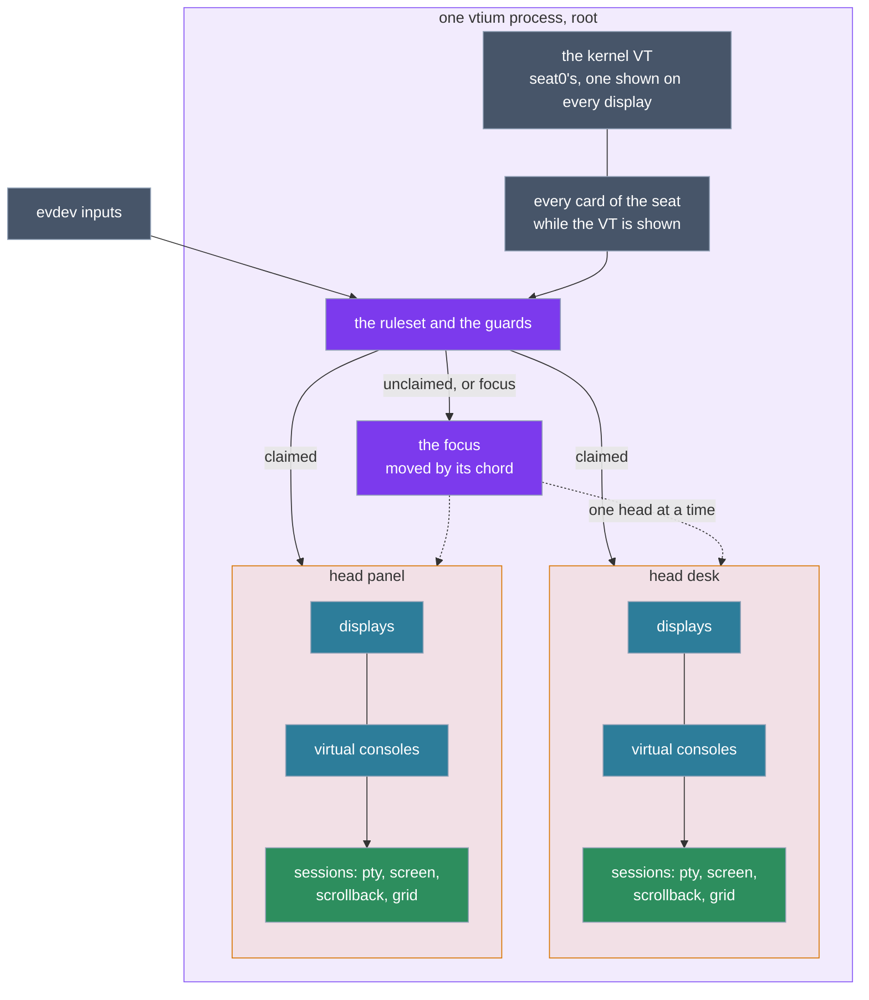
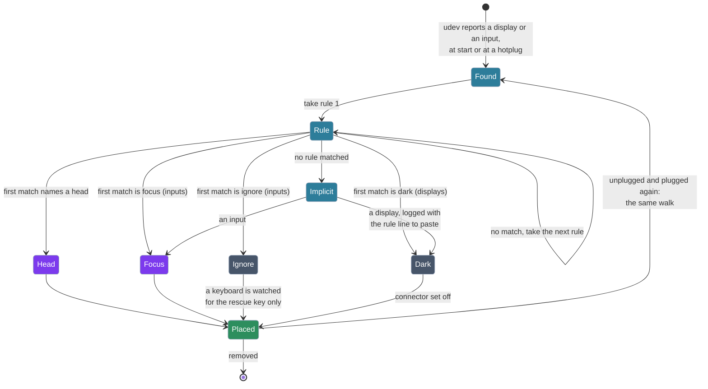
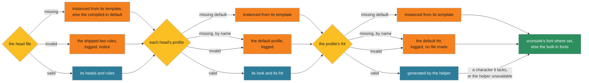
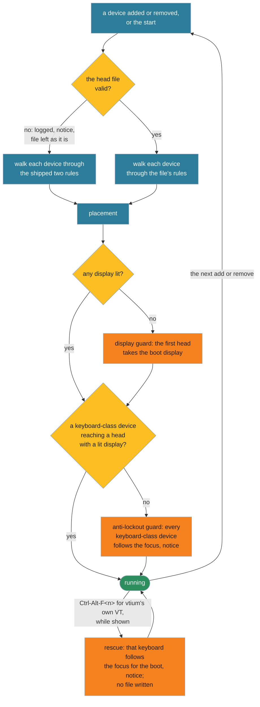
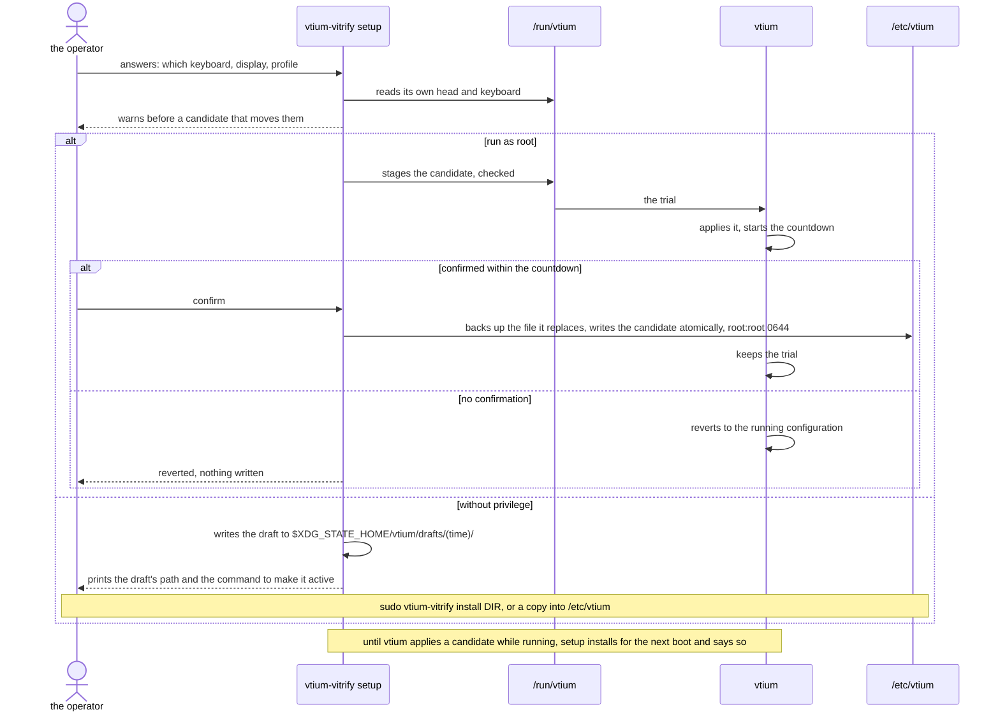

# ADR-1401: Heads: a terminal per physical display, placed by a first-match ruleset

## Summary

- **Decided:** vtium drives every display it can see from one process, as a set of **heads**. A head is a terminal for one or more displays: its displays, its inputs, a profile, and a stack of virtual consoles, each a session with its own pty, screen, scrollback and grid. A head's grid is its own, so each head draws at its own displays' density. One optional, root-owned head file declares the heads and an ordered ruleset; each display and each input walks the rules alone, top to bottom, and the first match places it: in a head, in the focus, ignored, or dark. The shipped ruleset, `display * -> console` and `input * -> focus`, is today's console. Absent files are instanced from templates that change nothing until edited; an invalid file is reported, never altered, and replaced in memory by the shipped default; and three guards keep a keyboard typing whatever the rules say, the last of them a key the user presses: `Ctrl-Alt-F<n>` for the VT already shown. `vtium-vitrify` becomes the configuration tool: it detects, sets up, reports and checks, with or without privilege, from the console or a desktop.
- **Trades away:** One process holds every display of the seat, so a fault in one head's session handling reaches every head. Several terminals share one kernel VT, which the C reference refused. The console takes on device routing, a ruleset parser and a notice of its own, and opens keyboards the rules ignore. Mirroring across heads with different densities, which today's single grid gives, needs a head that claims both displays.
- **One-way?** Expensive once a release ships the head file: its syntax, its match keys and its targets become the format users' files are written in. Everything behind the file changes in a session.
- **Probes:**
  - *Not confident (losing a display):* when a head you set up for one monitor loses it, its sessions stay for 10 seconds and then hang up, as a line losing its carrier; the monitor coming back within the 10 seconds resumes them. The shipped one-head console keeps today's behaviour, running on with no display. Is a hang-up after a short wait what you want for a head whose monitor goes away?
  - *Confident (the rescue):* pressing `Ctrl-Alt-F<n>` for the VT you are already looking at moves that keyboard to the focus until the next boot, whatever the head file says, and never edits the file.
- **Inversion:** Between "one grid for every display", the C reference's `multi-monitor` and today's vtium, and "a console process per display", which the kernel forbids (one DRM master per card, one VT shown on every display). vtium keeps one process and one VT and puts the terminals inside it, placed by rules a user writes or a tool writes for them.

## Context

The kernel's VTs are one system-wide set: one VT is shown on every display at once, and `Ctrl-Alt-F<n>` switches every display together. A card has one DRM master. A console per display therefore lives inside vtium: vtium holds its one kernel VT, takes every card of its seat while that VT is shown, drives every connector on them, and keeps its own consoles per display.

logind's seats split whole devices, cards and inputs, never connectors, and only seat0 has kernel VTs. A machine with two GPUs can give one card and its own keyboard to seat1, so a vtium and a desktop run side by side; one keyboard cannot be on two seats. vtium keeps its one real VT on seat0, and runs without a VT only on an extra seat, which has none.

A login inside vtium runs on a pty, so logind gives it a session with no seat and no seat-bound device access for the user, as vtium's login does today and the C reference's did; heads change nothing in this.

A Wayland compositor holds its cards' master while it runs, and disabling an output in the desktop does not release it. A DRM lease (`wp_drm_lease_v1`) can hand a client some of a compositor's connectors.

vtium today lays every display out as one grid: the smallest grid each display holds at the base font, each larger display drawing at the largest height that still holds it (`crates/vtium/src/layout.rs`). On the operator's machine that mirrors a large monitor (7680x2160, about 138 DPI) and a small panel (800x480, about 185 DPI) as one 66x20 grid, with letters 108 pixels tall on the large monitor. Sizes in points (ADR-1200's point rule, on `feat/deferred`) cannot be exact on both.

Keyboards cannot be told from other key devices by the kernel's marks: udev marks a numpad and an OTP token `ID_INPUT_KEYBOARD`, and both declare every letter, Enter, Ctrl, Alt and F1 (Evidence below). Any routing rule a user writes can therefore strand the real keyboard.

## Decision

The figure shows the layers this record adds to, from the kernel to the sessions, with the files and the programs beside them and who each runs as.

![The layers of interaction, bottom to top: the kernel, with card0 (the integrated GPU, HDMI-A-2), card1 (the discrete GPU, DP-8, the boot card), the evdev devices and the one set of kernel VTs; logind and its seats, seat0 holding the VT and both cards, extra seats without a VT marked as later; vtium's ruleset, which each device walks, its guards beside it (never-zero display, anti-lockout, the rescue key), and routing to a head or to the focus; two heads, desk on DP-8 with keyboard A and the mouse and profile desk, and panel on HDMI-A-2 with keyboard B and profile small, each profile naming its frit; each head's virtual consoles, one shown per head; and sessions, whose pty, screen, scrollback and grid vtium holds as root while login, the shell and programs run as the user. Layers 3 to 5 are one vtium process running as root. Beside the stack, /etc/vtium (the head file, profiles and frits, owned by root and writable by no one else) feeds layer 3; /run/vtium (written by root, its state read by all, a staged trial) sits between vtium and vtium-vitrify; vtium-vitrify, run as the user, with detect, setup, status, check, new and preview, and install through sudo, saves drafts to the user's $XDG_STATE_HOME/vtium/drafts; and the glyph helper, vtium-vitrify serve, runs as nobody, sandboxed, and generates the heads' frits. A legend marks root, the user, nobody, the kernel and pieces not yet built.](figures/ADR-1401-layers.svg)

The structure inside the one process: the VT and the cards, the ruleset placing each input in a head or the focus, and each head's consoles and sessions.



### D1: heads

- A head is a terminal for one or more physical displays: its displays, its inputs, a profile, and a stack of virtual consoles, each a session with its own pty, screen, scrollback and grid. Each display can be its own head, and so hold its own session.
- A head's grid is its own, so a size in points is exact on each head. Where a head claims several displays it mirrors across them by the scaled rule of `crates/vtium/src/layout.rs`, and there alone one grid spans several densities; the point rule's lowest density converts there.
- A head shows one console at a time on every display it holds. Its consoles start with one, as today's console has one session; the count, and each console's command, are set per head (D3; probe 2). A zoom changes the grid of the console shown.
- A head whose displays never appear starts no sessions until one does.
- Every head's consoles keep the session rules each session has today: its own login, the respawn limit, the reply rule (docs/architecture.md, "Determinism"), and the helper's sandbox as the session's user (ADR-1400 D2, ADR-1200 D15).

### D2: one process, one VT, every card

- One vtium holds its kernel VT and, while that VT is shown, every card of its seat, driving every connector on them; a display is a head inside that process, never a second process.
- Another vtium on another VT (`kmsconvt@tty2`) reads the same head file and does the same while its VT is shown.
- vtium serves seat0. Other seats, one vtium a seat with console switching of its own where the seat has no kernel VT, are a later extension this record names and does not build; the head file then gains a file per seat.
- A DRM lease from a compositor is not a head source, unless a later decision makes it a display-only head: it would put a root login inside a user's graphical session and need raw input read beside the compositor.

The later extension of two seats, drawn so its boundary is clear:

![Two GPUs on two seats, marked later and not built. On the left, seat0, with the kernel VTs and Ctrl-Alt-F&lt;n&gt;: the desktop compositor, the user's graphical session, holds the master of card1, the discrete GPU, and takes the large monitor on DP-8, keyboard A and the mouse; a vtium on a seat0 VT runs there too and takes card1 only while its VT is shown. On the right, seat1, dashed as later and not built, with no kernel VT: vtium, one a seat, with its own console switching, holds the master of card0, the integrated GPU, and takes the small panel on HDMI-A-2 and keyboard B, its own; Ctrl-Alt-F&lt;n&gt; are vtium's own keys there, and the two sessions run side by side, neither switching the other. Below both, logind assigns whole devices to seats, cards and inputs, never connectors; one keyboard cannot be on two seats, and only seat0 has kernel VTs. A legend marks root, the user, a device, and later, not built.](figures/ADR-1401-two-seats.svg)

### D3: the head file

One file, `/etc/vtium/heads.conf` (probe 1), holds the heads and an ordered list of rules. Its lines are bounded as kmscon.conf's are (65536 bytes a file, 8192 a line); `#` starts a comment; spaces around `=` and between tokens are dropped.

```ini
# /etc/vtium/heads.conf for the machine under Evidence; the EDID values are illustrative
[head desk]
profile = desk

[head panel]
profile = small
consoles = 2

[rules]
display edid:AAA:0x0001:LARGE00001 -> desk
display edid:BBB:0x0002:SMALL00001 -> panel
input path:pci-0000:15:00.0-usb-0:3.3 -> desk
input path:pci-0000:15:00.0-usb-0:3.4.4 -> desk
input path:pci-0000:15:00.0-usb-0:3.2 -> panel
input path:pci-0000:15:00.0-usb-0:3.4.2 -> focus
input name:"Headphones (AVRCP)" -> ignore
display * -> desk
input * -> focus
```

The example's placement: two heads, each with its own display and keyboard, and the devices no rule claims following the focus.

![Two heads with bound keyboards. Head desk holds the large monitor, 7680x2160 at about 138 DPI with its own grid, on DP-8 of the discrete GPU, and two inputs its rules claim, keyboard A at path ...usb-0:3.3 and a mouse at path ...usb-0:3.4.4; it holds the focus, shown by a filled mark. Head panel holds the small panel, 800x480 at about 185 DPI with its own grid, on HDMI-A-2 of the integrated GPU, and keyboard B at path ...usb-0:3.2; it shows a hollow mark, no focus. Below, four devices go to the focus: a numpad and a USB receiver that no rule claims, an OTP token sent there by its rule, and media-key devices no rule claims; the focus delivers them to head desk, drawn as a dashed arrow. The caption says displays and keyboard A, the mouse and keyboard B are placed by their rules, the rest follow the focus, and keyboard A types into head desk alone and keyboard B into head panel alone. A legend marks vtium as root, a device, holds the focus and no focus.](figures/ADR-1401-two-heads.svg)

- **Heads.** `[head NAME]` declares a head; a name is 1 to 64 characters of `A-Z a-z 0-9 . _ + -`, and `focus`, `ignore` and `dark` are reserved. A head's keys: `profile` (the profile's name, unset `default`), `consoles` (the number of virtual consoles, unset 1, at most the cap of D10), `login` (the consoles' command, as kmscon.conf's `login` takes it, unset kmscon.conf's), and `hangup-after` (D8). A head names nothing but its profile.
- **Rules.** Under `[rules]`, one rule a line: `display MATCH -> TARGET` or `input MATCH -> TARGET`. A match is `*`, every device of that kind, or one or more `key:value` tokens, every one of which must hold (D4).
- **Targets.** A head's name. `focus`, for an input: it follows the focus chord (D5). `ignore`, for an input: vtium never opens it, but for a keyboard watched for the rescue key alone (D9). `dark`, for a display: vtium sets its connector off, so it shows nothing, a frame another master left included, and logs it.
- **First match, alone.** Each device walks the rules top to bottom and takes the first that matches it. The walk reads only the device's own identity and the rules, never another device or the order devices were reported, so a hotplugged device lands where it would at start (D11's determinism row).
- **No match.** A display goes dark, and the log names it with the rule line that would claim it, ready to paste. An input follows the focus.
- **The shipped default** is one head, `[head console]` with the default profile, and two rules, `display * -> console` and `input * -> focus`: one head mirroring every display, every keyboard typing into it, as vtium does today. A user customises by adding rules above them.
- **Profiles say how a head looks** (font, size, colors) and name a frit (ADR-1200 D16, D1); the head file says where devices go. Keys in kmscon.conf apply to every head and win over its profile, as ADR-1200 D16 says of `font-size` and `font-name`.
- **xorg.conf's failures, avoided by rule:** the file is optional; heads are self-contained, the only reference a profile's name; a rule matching no connected device is skipped with a log line, never an error; and a tool writes the file (D12).

The walk of one device, from udev to where it lands, and the same walk again at a hotplug:



### D4: matching

| Key | Value | Binds | Strength |
|---|---|---|---|
| `path` | udev's `ID_PATH` of the USB device or port, matching every interface below it (`pci-0000:15:00.0-usb-0:3.3` takes `...:3.3:1.0` and `...:3.3:1.2`) | the physical port | strong |
| `serial` | `VENDOR:PRODUCT:SERIAL`, udev's `ID_VENDOR_ID`, `ID_MODEL_ID` and `ID_SERIAL_SHORT`, matching every interface of that unit | one unit, wherever plugged; copyable | strong where the device has a serial |
| `bluetooth` | the address the device reports as its unique id | one device | strong once bonded |
| `id` | `VENDOR:PRODUCT` | every unit of a model; devices lie (keyboard B reports another maker's vendor id) | weak |
| `name` | the device's name, a glob | anything that names itself so | weakest |
| `class` | `keyboard`, `pointer` or `touch` (D9's classes) | routing only | none |
| `edid` | `MAKER:PRODUCT:SERIAL`: the PNP maker id, the product code in hex, the serial string, else the serial number | one monitor; copyable by an EDID emulator | strong |
| `connector` | `CARD/CONNECTOR`, the card's udev `ID_PATH` as `mode=` names it and the kernel's connector name, globs allowed (`pci-0000:03:00.0/DP-*`) | a port of a GPU | strong |
| `card` | the card's udev `ID_PATH`, a glob | every output of a GPU | strong |

- A card is named by its `ID_PATH`, never by `cardN`, whose number can change between boots on a machine with several GPUs.
- A rule's tokens combine: `input path:... serial:...` binds that unit in that port, the strongest binding; `display connector:... edid:...` binds that monitor on that port.
- One physical keyboard may be several input devices (keyboard B is three: its keys, its media keys and a pointer); a `path` or `serial` match takes every interface of that USB device.
- The template's comments advise: `path` plus `serial` where the device has a serial; `path` alone otherwise; `id` or `name` alone only for convenience, never for a head whose sessions need protecting; `connector` plus `edid` for displays.
- `vtium check-config` and `vtium-vitrify check` note a rule that sends input to a head by `id` or `name` alone (probe 4).

### D5: focus and input

- An input no rule claims, or one a rule sends to `focus`, follows the focus. Focus starts on the head holding the boot display (D9), else the first head in the file with a lit display, and rests only on a head with a lit display.
- Focus moves only by the focus chord, never at a hotplug, and a new keyboard never takes it. Every head shows whether it holds the focus, drawn by vtium outside the session's output.
- A keyboard a rule sends to a head types into that head alone, and its console chords switch that head's consoles. The focus chord moves only the devices following the focus.
- Pointers follow the same rules: a pointer claimed by a head moves on that head's displays; one following the focus moves on the focused head's.
- A program's keyboard LEDs (DECLL) reach the keyboards delivering to its head.
- Spreading spare keyboards one per head happens only on an explicit `input * -> HEAD` rule, never inferred; inferring would misplace an OTP token or a media-key device.
- The console chords and the focus chord are grab keys matched after the VT's keys and the power keys and before the terminal's grabs, the C reference's place for its seat keys; their names and default chords are vtium/vtium#82's.
- The terminal of each head's shown console has mode 1004's focus while its head has a lit display and a keyboard delivering to it, so several terminals hold it at once, one a head.

One keyboard and two heads, before and after the focus chord:

![One keyboard, two heads, in two rows. Before the chord, head desk with the large monitor holds the focus, a filled mark, and its session reads the keys typed; head panel with the small panel shows a hollow mark, its session running on with no keys reaching it; the keyboard's arrow points to head desk. Between the rows, the focus chord, pressed on the keyboard, a grab key whose default chord is vtium/vtium#82's. After the chord, head desk shows no focus and head panel holds it, and the keyboard's arrow points to head panel. The caption says focus moves only by the chord, never at a hotplug, a new keyboard never takes it, it rests only on a head with a lit display, and each head draws its mark outside the session's output. A legend marks vtium as root, a device, holds the focus and no focus.](figures/ADR-1401-focus.svg)

### D6: defaults that always type

- With no configuration at all, vtium gives a lit console that can be typed on. The chain: the shipped head file's two rules name the default head; the default head names the default profile; the default profile names the default frit; the default frit draws vconsole's font where one is set, else the built-in fonts, compiled into vtium, which draw with no helper and no font file (ADR-1200 D9, D7). This holds where vtium can take the card; where another display server holds it, vtium waits for its VT as today.
- The compiled-in defaults are the truth. A missing default file is instanced from its template: the head file, the default profile and the default frit, and no other. A template is every setting written as a commented line, as the C reference shipped its example configuration, so an instanced file changes nothing until edited and the defaults move with vtium. The head file's template carries `[head console]` and the two shipped rules as live lines, since an empty ruleset lights no display; they state the compiled-in default, so they too change nothing.
- vtium writes an instanced file only when it is absent (`O_CREAT | O_EXCL`), follows no symlink (`O_NOFOLLOW`), refuses when `/etc/vtium` fails the ownership check of D10, writes it `root:root 0644`, and carries the templates in its binary.
- Instancing is best effort: a read-only root, a missing `/etc/vtium` or a refused directory runs the compiled-in defaults with one log line. `instance-defaults`, a kmscon.conf switch on by default, turns it off for a distribution that ships the templates as files.
- A profile naming a frit that does not exist draws the default frit with a log line and creates no file.

A machine with no configuration at all:

![No configuration. On the left, /etc/vtium/heads.conf, absent at start and drawn dashed, is written from its template: every other setting a commented line, then [head console], profile = default, [rules], display * -> console and input * -> focus, the compiled-in default written out, which changes nothing until edited. In the middle, head console holds the large monitor, 7680x2160 at about 138 DPI on DP-8 of the discrete GPU, and the small panel, 800x480 at about 185 DPI on HDMI-A-2 of the integrated GPU, as one grid mirrored by the scaled rule. Below it, the focus rests on head console, and keyboard A, keyboard B, a numpad, an OTP token and a mouse all reach it through input * -> focus. On the right, the default chain: head console names its profile; profile default, instanced if absent; frit default, instanced if absent; and vconsole's font where set, else the built-in fonts, Unscii-8 and unifont. A legend marks vtium as root, a device, and absent; the caption says that with no file vtium behaves as it does today.](figures/ADR-1401-no-configuration.svg)

### D7: an invalid configuration

- **Three outcomes.** *Invalid:* a syntax error, an unknown key, a rule targeting an undefined head or a target of the wrong kind, two heads of one name, a value out of range, or a file that fails D10's ownership check; the file is rejected whole and no part of it applies. *Valid with warnings:* a rule matching no connected device, a rule an earlier one shadows, a profile naming a missing frit; the file applies and the warnings are logged. *Valid but unusable on the hardware present:* the guards of D9 act.
- Missing hardware never makes a file invalid.
- **The fallback is per file:** an invalid head file runs the shipped default; an invalid profile gives the heads naming it the default profile; an invalid frit draws the default frit, as an unreadable `cell=` or `size=` does today.
- **vtium never fixes, comments out, renames or replaces a present file,** broken or empty. An empty head file is a valid ruleset with no rules: every display goes dark, and D9's display guard lights the boot display in a default head.
- **Every error is logged** with its file and line, and a notice shows on the console before the login: vtium's own message, drawn as a getty prints its banner, never written to the session's pty or kept in its scrollback (probe 5: a key ends it, or it shows for a few seconds). vtium keeps running.
- **`vtium check-config`** runs the boot's parser and evaluator, lists every error with its line, and exits non-zero; given a candidate file's path, it checks that file before it is installed, as `nft -c`, `visudo -c` and `sshd -t` do. It exits 1 on an error or a warning about the file itself, as it does for kmscon.conf; a finding that depends on the hardware present, such as a rule matching no connected device, is noted on standard output outside the exit status, so a file can be checked away from its machine.
- On a future live reload, an invalid new file leaves the running configuration as it is.

An invalid head file at boot:

![An invalid head file. On the left, /etc/vtium/heads.conf with six numbered lines: [head desk], profile = desk, [rules], display * -> desk, input path:...3.3 -> desc highlighted as the error, and input * -> focus; line 5 names a head no section declares, and the file is left as it is, its hash before the boot equal to its hash after. In the middle, vtium at start reads the file whole, finds the error so no part of it applies, logs it with file and line, runs the shipped rules display * -> console and input * -> focus, shows the notice and keeps running. On the right, every display as one head shows the notice in a red box, vtium: heads.conf:5: rule names undefined head "desc"; running the shipped rules, drawn by vtium and never in the session, above the login prompt, and the session starts as before. Below, vtium check-config /etc/vtium/heads.conf prints the same error with its line and exits 1, the boot's parser and evaluator run on a candidate before install. The caption says vtium never fixes, comments out, renames or replaces a present file, an invalid profile gives its heads the default profile, an invalid frit draws the default frit, and missing hardware never makes a file invalid; the message's wording is illustrative. A legend marks vtium as root, a device, and an error or a notice.](figures/ADR-1401-invalid-file.svg)

The default chain and each file's fallback, from the head file to the built-in fonts:



### D8: missing and changing hardware

- **No display at start:** `display-wait` as today (exit 1 for the unit's `OnFailure=` getty, or wait under `forever`); the rules are walked once a display exists.
- **No input at start:** vtium runs, and the notice says no keyboard was found; a keyboard plugged in later walks the rules.
- **Inputs with no lit display** deliver to nothing.
- **Every display lost mid-session:** vtium keeps running and waits for a hotplug, as the C reference did; `display-wait` governs the start only.
- **A head that loses its last display** keeps its sessions for `hangup-after` seconds, and then hangs them up, as a line losing its carrier: the session's pty is closed and its processes get SIGHUP. A display of the head returning within the time resumes them. `hangup-after = 0` hangs up at once, and `never` keeps the sessions, today's behaviour, which the shipped `console` head takes. Unset, a head the file declares takes 10 seconds (probe 3).
- vtium never reattaches a live session to whatever display next claims a lost display's identity once the time has run out.

A boot with nothing attached, each device added after it, and the display removed:

![A timeline, left to right: boot, a display plugged in, a keyboard plugged in, the display removed. Step 1, nothing attached: no display and no keyboard; vtium holds its VT and waits display-wait, 10 s by default, from when the VT is first shown; no rule is walked yet and no session starts; a display within the wait goes on to step 2. Below step 1 the branch: with no display by then, vtium exits with status 1 and the unit's OnFailure= starts a getty on the VT; under display-wait=forever, vtium waits for the first display however long it takes, and then goes on to step 2. Step 2, a display: it walks the rules, display * -> console; the head lights and its session starts on its grid; a notice says no keyboard was found; the login prompt shows and nothing can type yet. Step 3, a keyboard: it walks the same rules, input * -> focus; it follows the focus on the only lit head; the session can be typed on and the notice is gone; a new keyboard never takes the focus from another head. Step 4, drawn dashed as the tail, the display goes: vtium keeps running and waits for a hotplug, display-wait being the start's alone; the shipped head console never hangs up, as today; a head the file declares takes hangup-after. A panel below draws a declared head losing its last display, probe 3: from gone, a hangup-after period, 10 s when unset, then the hang-up; back within the time, the sessions resume; on time out the pty closes and its processes get SIGHUP; hangup-after = 0 hangs up at once and never keeps them. The caption says each device walks the rules when it arrives, exactly as one found at start would, and the session waits for the first display. A legend marks vtium as root, an exit or a notice, what is open to the operator in probe 3, and the later moment of the tail.](figures/ADR-1401-after-boot.svg)

### D9: guards against lockout

- **The classes.** An input is keyboard-class when its key bitmap declares the 26 letters and Enter; pointer-class with relative axes and a left button; touch-class with absolute axes and touch. The kernel cannot tell a keyboard from a numpad or a token, so keyboard-class covers them (Evidence below).
- **Layer 1, warnings.** `vtium check-config` and `vtium-vitrify check` warn of a head that claims only pointers while every keyboard is claimed elsewhere, of every keyboard ignored, and of a head whose only keyboard is one device; each names the device as reported.
- **Layer 2, the anti-lockout guard,** as pfSense keeps its administration port open: while no keyboard-class device reaches a head with a lit display, every keyboard-class device follows the focus, with a notice, until one does. It moves every stranded keyboard at once, so it chooses none and stays deterministic.
- **The display guard,** beside it: when the rules leave no display lit, the first head in the file takes the boot display, or the default head where the file has none. The boot display is the connector lit at start, else the first connected one in the kernel's order on the boot card (`boot_vga`, vtium-platform's primary card).
- **Layer 3, the rescue:** `Ctrl-Alt-F<n>` for the VT vtium is on, pressed while that VT is shown, makes the keyboard that pressed it follow the focus for the rest of the boot, with a notice, and never writes the configuration. The VT's keys come first in the key order, and the shown VT's own key does nothing today, so the press has no other meaning. A numpad or an OTP token never sends that chord in its use, so the press shows a keyboard a person types on. From another VT it takes two presses: the switch, then the same key again. It can take a keyboard off the head a rule gave it, which grants no more than unplugging it would. On a seat without kernel VTs the same keys are vtium's own.
- So that the rescue works, vtium opens the keyboard-class devices the rules ignore, to watch for the rescue key alone; nothing else they send is delivered or logged. Other devices stay closed under `ignore`.

Lockout and rescue, in two cases:

![Lockout and rescue, in two rows. Row 1: every keyboard is claimed by a head with no lit display. Head panel, drawn dashed, has its small panel unplugged and a rule input * -> panel; keyboard A and keyboard B are claimed by it. The anti-lockout guard, in red, finds no keyboard-class device reaching a lit head, so every one follows the focus until one does, and head desk, with the large monitor lit, shows the notice that no keyboard reached a lit head and every keyboard follows the focus. The guard moves every stranded keyboard at once, choosing none, and lets go once a rule's keyboard reaches a lit head. Row 2: a head is left with only a numpad. Head desk, lit, has the rules input path:...3.4.1 -> desk and input path:...3.3 -> ignore; the numpad reaches it, and since it declares 26 letters and Enter it is keyboard-class, so the guard does not act. Keyboard A, ignored by its rule, is opened only to watch for the rescue key. The rescue key, Ctrl-Alt-F&lt;n&gt; for vtium's own VT while it is shown, pressed on keyboard A, makes keyboard A follow the focus for the boot, with a notice, and heads.conf unchanged. A legend marks vtium as root, a device, a guard or a notice, and a head with no lit display.](figures/ADR-1401-lockout.svg)

The guards run after every device added or removed, and the rescue key from a running console:



### D10: security

- The head file, the profiles and the frits route input and choose login commands, so vtium reads each only when root owns it and neither group nor others can write it, as `sshd`'s `StrictModes` refuses a writable file; a file that fails is invalid (D7). The directories above it pass the same check. No file a user supplies is read by the console.
- Each head multiplies sessions, ptys and scrollback, so the consoles of a head and of the process are bounded, rows of the binary's bounds table and part of minspec's memory bound (probe 6). A head asking for more consoles than its cap gets the cap, with a warning.
- vtium's state under `/run/vtium/` (D12) is written by root, readable by every user, and holds what sysfs already shows any user: device identities, the rule each matched, the guards that acted. A candidate staged there for a trial is accepted only from root.
- Each session runs its own login, the helper stays sandboxed as ADR-1400 D2 and ADR-1200 D15 say, and the reply rule holds for each terminal.

### D11: how it is judged

- A boot with no head file lights every display and types from every keyboard, as today; this test is written first, against today's code, and pins the behaviour the shipped default keeps.
- A boot with each kind of invalid file (each row of D7's first outcome) runs the shipped default, shows the notice, and leaves the file's bytes unchanged, by its hash before and after.
- `vtium check-config` lists every planted error with its line.
- **Determinism row** (docs/architecture.md): a property test walks a generated set of devices through a generated ruleset in every order and at every hotplug point, and the placement of each device is the same.
- The anti-lockout guard, the display guard and the rescue each have a boot test: every keyboard claimed by a head with no display types into the focus; an empty ruleset lights the boot display; the rescue moves a claimed keyboard and an ignored one and writes nothing.
- An instanced template, read back, gives the compiled-in defaults, and a present file, a symlink and a writable `/etc/vtium` are each left untouched.
- **The verification plan:** tier 3 proves heads before any VT review on the operator's hardware. Its QEMU guest exposes two virtual outputs (virtio-gpu's `max_outputs=2`), with a second virtio-gpu device for the case of two cards, and the guest runs two heads at two sizes against them: the ruleset placing each display and each emulated keyboard, an emulated keyboard added and removed through QEMU's monitor as the hotplug case, and each guard, with screens captured and compared as tier 3 compares them. A display unplugged on the virtual card, where QEMU cannot raise it, is left to the VT review, which then runs on the operator's two cards.

### D12: `vtium-vitrify` as the configuration tool

Hand-editing the head file, the profiles and the frits stays fully supported; the tool helps, in the manner of lm-sensors.

| Command | Runs as | Does |
|---|---|---|
| `detect` | any user | Lists every display and input with every match key filled and a rule line ready to paste, read from sysfs; writes nothing (as `sensors-detect`). |
| `setup` | any user; keypress identification needs root or the input group | Asks, per display, which keyboard and pointer, which profile and frit, and writes the strongest match each device offers (as `pwmconfig`). |
| `status` | any user | What the running console did: which rule took each device, which guard acted (as `sensors`), read from `/run/vtium/`. |
| `check FILE` | any user | Checks a candidate as `vtium check-config` does. |
| `install DIR` | root | Checks, backs up the files it replaces beside them, replaces them atomically, and stages the trial. |
| `new`, `preview` | the user | The frit builder and the preview already planned (#121, #120; vtium/vtium#3 tracks them). |

- **One crate parses and evaluates the configuration,** and both binaries link it, so the verdict before install is the verdict at boot. Detection and setup live only in `vtium-vitrify`; `vtium`'s binary stays inside its size budget, and `vtium-vitrify` ships everywhere as the glyph helper `serve` (ADR-1200 D15).
- **It identifies a keyboard by behaviour,** asking for a keypress on it, as `pwmconfig` stops each fan; without privilege it asks the user to unplug and plug the device again, since udev's events are readable by any user.
- **It never disconnects itself.** `detect` and `setup` read inputs without a grab, take no DRM master, set no mode and switch no VT. To identify a display it asks vtium to draw an overlay that moves nothing, through a socket under `/run/vtium/` that takes requests from root alone. `setup` finds its own head in `/run/vtium/` and warns before any candidate that moves the keyboard it is answered from or its head's display.
- **A candidate is tried before it is kept:** vtium applies it from `/run/vtium/` and reverts it unless it is confirmed within a countdown, as KDE's display settings do; only a confirmed candidate replaces the file in `/etc/vtium`. Until vtium can apply a candidate while running, `setup` installs for the next boot and says so, and D9's guards stand in for the revert.
- **From a desktop terminal,** `detect`, `check`, `status` and `preview` need no privilege, reading EDIDs, connector states, input classes and USB serials from sysfs; displays are named as the desktop names them (`DP-8`, `HDMI-A-2`), since vtium is not on screen; a trial is staged and runs when vtium's VT is next shown.
- **On minspec, where vtium is the only terminal,** the dialog is line-oriented, fits 40 columns (320x240 at 8x8) and works over a serial line; a frit is previewed by trying it on the live console through OSC 50 under the same countdown; on a read-only root the confirm step prints the confirmed file and its target path for the image build. Its size is measured in tier 3 with the rest of the install tree.
- **Without privilege,** the tool still previews a font and saves a viable frit or head file to `$XDG_STATE_HOME/vtium/drafts/<time>/` (probe 8), then prints where it is and what makes it active: a copy into `/etc/vtium`, or `sudo vtium-vitrify install DIR`. Run under sudo, it installs after confirmation, writing `/etc/vtium` as `root:root 0644`, and writes nothing into the invoking user's home as root.

`setup`'s trial, as root and without privilege:



### For the operator's check

The probes, in the order the record raises them:

1. The head file's path and name, `/etc/vtium/heads.conf` here, and whether drop-ins (`/etc/vtium/heads.d/`) are read.
2. Where a head's virtual consoles are declared, their count and each console's command: in the head file, as D3 has it, or in the profile.
3. A head that loses its display: hang up at once, a grace period (D8's 10 seconds, the Summary's probe), or keep the sessions and require a fresh login, which needs a lock screen vtium lacks (vtium/vtium#87).
4. Whether `check-config` notes a rule that reaches a head with sessions by `id` or `name` alone (D4).
5. Whether the invalid-configuration notice waits for a key or shows for a few seconds (D7).
6. The caps on consoles per head and in total, and how their scrollback fits minspec's memory figure (D10).
7. Whether vtium also reads a writable configuration directory on a read-only root, a security decision this record leaves open.
8. The draft directory, `$XDG_STATE_HOME/vtium/drafts/<time>/` here, and whether OSC 50 may preview an unprivileged user's draft frit on the console during a trial, its sources read by the sandboxed helper as `nobody`.
9. The team lead's proposals, written above as the design: `check-config`'s note on weak matches (D4); the instanced templates as commented lines, best effort, and only the default files (D6); missing and changing hardware (D8); focus and input (D5); the security rules (D10).

Agent calls the operator has not yet looked at: the head file's syntax and the target `dark` setting the connector off (D3); naming cards by `ID_PATH` (D4); the keyboard class as 26 letters and Enter (D9); the head file's template carrying its two rules live (D6); `instance-defaults` (D6); `check-config`'s exit status for hardware-dependent findings (D7); `hangup-after`'s values and `never` for the shipped head (D8); mode 1004's focus per head (D5); the overlay socket for root alone (D12); and that the blank stays the seat's, any head's activity waking every display.

## Evidence: a machine with two displays

Read on 2026-10-29 from sysfs and `udevadm info`, as any user may. The ports and the facts are as read; the identity values are illustrative:

| Device | Identity | What the kernel says |
|---|---|---|
| The large monitor on card1, the discrete GPU, DP-8 | EDID `AAA:0x0001:LARGE00001`; card1 is the boot card | 7680x2160, about 138 DPI (relayed) |
| The small panel on card0, the integrated GPU, HDMI-A-2 | EDID `BBB:0x0002:SMALL00001` | 800x480, about 185 DPI (relayed) |
| Keyboard A | `aaaa:0001`, no serial, path `...usb-0:3.3` | keyboard-class |
| A numpad | `aaaa:0002`, serial `NUMPAD0001`, path `...usb-0:3.4.1` | `ID_INPUT_KEYBOARD`; every letter, Enter, Ctrl, Alt, F1 |
| An OTP token | `bbbb:0001`, path `...usb-0:3.4.2` | `ID_INPUT_KEYBOARD`; every letter, Enter, Ctrl, Alt, F1 |
| Keyboard B | reports another maker's vendor id, `cccc:0003`, path `...usb-0:3.2`, three interfaces | keyboard-class on interface 1.0 |
| A mouse | `dddd:0001`, path `...usb-0:3.4.4` | pointer |
| A USB receiver | `dddd:0002`, no serial, path `...13:00.0-usb-0:1` | keyboard-class, with consumer and system controls that are not |
| A microphone's keys, Bluetooth headphones' media keys (AVRCP), the PC speaker | the AVRCP node has no `ID_PATH` | key devices with no letters |

Mirrored, the two displays make one 66x20 grid with 108-pixel letters on the large monitor, the case for heads. The example in D3 gives each its own head.

## C notes: the C reference's flow

- One seat a process (`kmscon/src/main.c:58-71`); a seat held its sessions, each one terminal (`kmscon/src/seat.c:53-108`), with `session-control` off by default and `session-max` 50 (`kmscon/src/config.c:1357-1358`); `seat_new` turned session control off on a real VT with a warning (`kmscon/src/seat.c:841-845`).
- `terminal_update_size` picked the grid by `multi-monitor`: `largest`, `scaled` (the default, `kmscon/src/config.c:1418`), or `clone` otherwise (`kmscon/src/terminal.c:1107-1170`); every display of a terminal took that one grid.
- `monitor_udev_add` kept a device whose `ID_SEAT`, an input's from its parent, was the seat's, `seat0` when unset (`kmscon/src/uterm/monitor.c:387-451`).
- The fake VT served seats without kernel VTs, and its own comment called it fragile and for debugging only (`kmscon/src/uterm/vt_fake.c:25-40`).
- The font layer fixed its density at 72 DPI, so a point size was a pixel height (`kmscon/src/font/font.c:198-199`).
- The VT registered its key callback first, so its switch keys came before the seat's keys and the terminals' (`kmscon/src/uterm/vt_real.c:705`).
- `scripts/etc/kmscon.conf.example` wrote every option as a commented line.

## Where vtium departs from the C reference

- **Several terminals on one kernel VT.** The C reference refused session control on a real VT (`kmscon/src/seat.c:841-845`); vtium's heads and their consoles live on its one VT, since the kernel shows one VT on every display.
- **A grid per head.** The C reference had one grid for every display of its terminal; vtium has one a head, and mirrors within a head as the C reference's `scaled` did.
- **Mode 1004's focus, one a head.** The C reference never let two terminals hold the focus at once (`kmscon/src/seat.c:125-177`); vtium gives it to the shown console of each head that has a lit display and a keyboard.
- **A display the rules leave dark is set off,** where the C reference lit every display of its seat.
- **The configuration's files must be root's and writable by no one else;** the C reference read any file at its path.

## Consequences

### Positive

- Each display draws at its own density, and a small panel and a large monitor each get a readable grid.
- The default is today's console, and every customisation is a rule added above it; a machine with one display never sees heads.
- No ruleset, file or hardware change can leave the console with no keyboard typing into a lit display.
- Placement is a function of each device and the file, so tests can enumerate it and a hotplug behaves as a boot does.
- `vtium-vitrify` gives a user a correct file without reading this record, from the console or a desktop, with or without privilege.

### Negative

- vtium carries a ruleset parser, a notice, the guards and the configuration crate; the parser and evaluator count against the binary's budget, which leaves less for other features.
- One process holds every head, so a crash ends every head's sessions at once.
- Keyboards the rules ignore are still opened, read and dropped.
- A head's consoles multiply memory; on minspec the caps bind.
- A user who wants one session mirrored across displays at different densities still gets one grid sized by the scaled rule.

### Neutral

- vtium/vtium#82's open question, whether several sessions are allowed on a kernel VT, is answered yes for heads; its chords and bound remain its own.
- vtium/vtium#35's single grid stays the rule within a head.
- A login keeps logind's session without a seat, as on a pty today.
- ADR-1200 gains a home for profiles' files and the default profile and frit; ADR-1000 gains rows for the head file's capability.

## Alternatives Considered

- **A console process per display.** Not possible: a card has one DRM master, and the kernel shows one VT on every display at once.
- **One logind seat per display.** Seats split whole devices, never connectors, and seats other than seat0 have no kernel VTs. Kept as the later extension of D2, for machines with a card and a keyboard to spare.
- **A head leased from a running compositor (`wp_drm_lease_v1`).** Declined: a root login would sit inside a user's graphical session, and vtium would read raw input beside the compositor, which is a keylogger's shape. A display-only head from a lease stays open to a later decision.
- **Keys per display in kmscon.conf,** as `mode=` takes `GPU[CONNECTOR]`. Rejected: keys have no order, so no first match, no routing of inputs and no default to fall through to.
- **xorg.conf's model,** sections that reference each other (devices, monitors, screens, layouts, input classes). Rejected for the failures D3 lists: a required file, cross-references that break, unmatched sections as errors, and files written by hand only.
- **Inferring placement,** spreading keyboards one per head or pairing devices by their ports. Rejected: it misplaces tokens and media-key devices, and its result depends on what is plugged in where in ways a user cannot read from a file.
- **Repairing an invalid file in place,** or refusing to start. Rejected: repair alters a file root wrote, and a refusal leaves a dead screen; vtium runs the shipped default and says why.
- **Reattaching a session to whatever display next matches.** Rejected for D8's reason: the display a session shows on is part of who can read it.
- **One grid for every display,** today's layout. Kept within a head, and replaced across heads.
