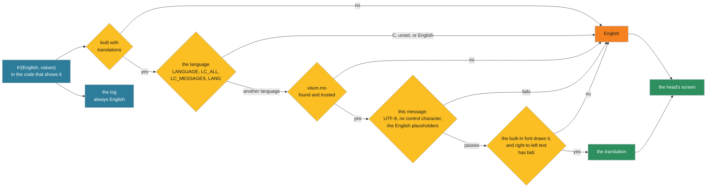

# ADR-1402: vtium's own text is translated through gettext catalogs in the system's language

## Summary

- **Decided:** vtium translates the text it shows a person on its own screen, its notices, the on-screen display's line and the panic screen, and what `vtium check-config` prints, and in a later slice vtium-config's screens and `vtium --help`. Its configuration files, the docs, the log and the VT review's scripts stay in English, and a key, value or path a translated message names stays exactly as the file has it. Each message is written in English where the code uses it, inside a marker of vtium's own, `tr!("No more consoles: {head} has its limit of {n}.", head = head, n = n)`, and that English is the key a translation is found by, as gettext does it. A translation is a gettext catalog: a `.po` file a translator edits, compiled to `/usr/share/locale/<lang>/LC_MESSAGES/vtium.mo`, which vtium reads with a small reader of its own only when root owns it and no one else can write it. Translation is a cargo feature, `translations`: the vtium package builds with it, and the minspec build leaves it out, so there every marker compiles to a plain `format!` and every message shows in English. vtium shows the system's language, from `LANGUAGE`, `LC_ALL`, `LC_MESSAGES` and `LANG` as gettext reads them, for the whole boot. A translation is shown on a head only when the built-in font for the head's cell holds every character of it; Hebrew and Arabic need the `bidi` feature as well, and then read right to left. Keys are named from the chord's definition, as `Ctrl+Super+↑`. A count is written as a label and a number, so the catalog has no plural forms.
- **Trades away:** Translations on the minspec build: the reader and the markers would take about 35 KB of its 52,768 bytes of headroom (estimated from 13 measured messages). Code vtium keeps itself where a crate such as `tr` would supply some of it: the two macros and the reader, about 200 lines, and the template tool. The catalog modules, so tier 2 and the specimens reach a message through the function that builds it beside the code that shows it. Plural forms, so a count reads `More errors: 3`. Scripts that need shaping, such as the Indic scripts, which show in English. A notice reworded in English shows in English in every language until its translator updates it.
- **One-way?** Expensive once a release ships a translation: the text domain `vtium`, the catalog's path, English text as the key, the `{name}` placeholders and the marker names `tr!` and `trc!` are what translators' files, distributions' packages and GNU's tools hold. The macro, the reader and the feature behind them change in a session.
- **Probes:**
  - *Not confident (minspec in English):* The minspec build, the smallest console, shows every message in English, and translations come with the vtium package's build, as right-to-left text does. Is an English-only minspec what you want? Confirmed by the maintainer (2026-11-06, `considered`): English-only minspec.
  - *Confident (rewording a message):* A person who changes a notice edits its English where the code shows it, and until each translator updates their file, that notice shows in English in their language. Confirmed by the maintainer (2026-11-06, `considered`): acceptable.
- **Inversion:** Between a catalog module that holds every message apart from the code that shows it, the earlier draft of this record, and a translation library that owns the lookup, the formatting and the C locale, as `gettext-rs` and `tr` do. vtium writes each message where it is used, inside a marker it defines, and reads gettext's own files with a reader of its own.

## Context

vtium shows people text of its own: the notices of ADR-1401 D5, D7, D8 and D9, the on-screen display's full line (the OSD, ADR-1401 D5), the panic screen of a broken closed head file (ADR-1401 D7), and the report `vtium check-config` prints. The maintainer wants that text translated, so a person reads vtium in their own language.

The first draft of this record, on 2026-10-31, kept every message in a catalog module of its crate, a file that holds a crate's messages apart from the code that shows them, and the tree follows it today. The notices and the OSD's line are functions in `crates/vtium/src/notice.rs`, the messages about vtium.conf and the head file are in `crates/vtium-settings/src/messages.rs`, and CONTRIBUTING.md's code rule "Shown words live in a catalog" asks for it. On 2026-11-05 the maintainer asked for gettext's model instead: a message stays in the code where it is used, wrapped in a marker, and its English text is the key a translation is looked up by. On 2026-11-06 the maintainer decided to have the record revised for that model, with its size measured again, before accepting it.

Three constraints shape how. The minspec build, vtium's default and smallest build, has a size budget of 3,670,016 bytes (`BINARY_BUDGET` in `tools/tier3/t3_impl.py`, ADR-1200 D19), and at integration 52d7d9ed it builds 3,617,248 bytes, so 52,768 bytes are left; features such as `images` and `bidi` stay out of it, and a build with features is measured but not judged. vtium runs as root for its whole life (ADR-1400), so every file it reads is held to ADR-1401 D10's rule for root's files. And a head draws in its own font, which may be a 256-glyph console font, with vtium's two built-in fonts, unifont from 16 pixels and Unscii-8 under 16, as the per-character fallback (ADR-1200 D7, D22).

The C reference translated nothing (C notes below).

## Decision

> Revised 2026-11-06: the maintainer asked on 2026-11-05 for gettext's model, with messages marked where they are used, and decided on 2026-11-06 to have the record revised before accepting it (`considered`). The earlier draft kept every message in its crate's catalog module with a table of its messages for the template, read catalogs in vtium-config, put its reader in the minspec binary against a budget of 3,145,728 bytes with 8,512 bytes left, and showed every right-to-left translation in English. D2, D3, D4, D10 and D12 are new; D5 to D9 and D11 are the earlier D2 to D7, revised where the marker, the feature and ADR-1004 change them.

A message's path from the marker to the screen and to the log:

### D1: what is translated

- **Translated:** the text vtium shows a person on its own screen: the notices, the OSD's full line, the panic screen, and the key names in them (D8). And what `vtium check-config` prints for a person, its report and its help, in the language of the shell it runs in (D7).
- **English:** the configuration files, `vtium.conf` and `heads.conf`, with their key names, values and comments; `vtium.conf.example` and the other files vtium installs; the docs; the log, so a log line reads the same on every machine and a search for its English wording finds it; and the VT review's scripts. Text a message quotes, such as a head's name, a device's path or a line of the head file, is the person's own and is drawn as it is.
- **Later:** vtium-config's screens and `vtium --help` are translated in a slice of their own after the notices (D12, slice 6), each in the language of the terminal it runs in (the maintainer, 2026-11-06, `considered`).

> Edited 2026-11-02: the maintainer moved vtium's configuration file to `/etc/vtium/vtium.conf` (ADR-1500 D4), so this record names it `vtium.conf` wherever it read `kmscon.conf` as vtium's file, and `vtium.conf.example` for the example vtium ships. The record's other text is unchanged.

> Edited 2026-11-06: the maintainer's answer of 2026-11-01 (`considered`) put `vtium check-config`'s output among the translated text and kept the VT review's scripts in English. D1 listed "everything `vtium check-config`, `vtiumctl` and `--help` print in a terminal" as English.

- **Names from the files stay as written.** Where a translated message names a configuration key, a value, a path or a command, such as `isolated`, `policy = closed`, `/etc/vtium/heads.conf` or `vtium check-config`, the name is a placeholder's value and stays exactly as the file or the shell has it, so the person can find it there and type it. A translation cannot change a placeholder (D6).

> Edited 2026-10-31: the maintainer decided the scope, relayed by the team lead: only the text vtium shows a person on screen is translated, and configuration files, their key names, values and comments, the installed examples, the docs and the log stay in English, with a key, value or path a translated message names left exactly as written. D1 read: "Translated: the text vtium draws on its own screen [...]; and the messages `vtium check-config` and `vtiumctl` print for a person, the head file's errors among them, so the console's notice and the tool's report name an error in the same words.", and D4 had the tools follow their own shell's language.
- **Whole messages.** A message is a whole sentence or a whole line, with its variable parts as named placeholders such as `{head}`. vtium never builds a sentence from pieces, since languages order a sentence's parts differently; the rescue notice, for one, is two whole messages, one for each ending.
- **No plural forms.** A count is written as a label and a number, `More errors: 3`, which reads correctly in every language, so no message's wording depends on a number and vtium evaluates no plural rule. The maintainer accepted this form on 2026-11-01 (`considered`).

### D2: a message is marked where the code uses it

- **The marker.** vtium writes each message it shows a person in English, where the code builds it, inside `tr!`: `tr!("No more consoles: {head} has its limit of {n}.", head = head, n = n)`. The first argument is a string literal holding the whole message, and that English text is also the key a translation is found by, gettext's `msgid`. Each value goes in by name, as `name = value`, the way `format!` takes named arguments. Where one English text needs two translations, `trc!("key name", "Shift")` gives it a context, gettext's `msgctxt`, as the first argument.
- **vtium's own macros,** declarative (`macro_rules!`) and with no dependency, in vtium-settings, which both the console and vtium-config link. D3 says why vtium writes its own, and D4 what each expands to.
- **Called by their bare names.** Code imports the markers (`use vtium_settings::tr;`) and calls `tr!(…)`, never `vtium_settings::tr!(…)`, because GNU xgettext does not find a macro called through a path (D5).
- **What a marker holds.** A whole message, in English that follows AGENTS.md's rules for strings on screen. Everything that is not words to translate enters as a placeholder's value: a name, a path, a number, a key's name (D8), the file's own syntax such as `[head NAME]`, or the system's error text. A choice between wordings is two markers.
- **English to the log.** vtium logs a message in English and shows it translated. Where the code does both with one message, as when it logs and shows the notice that no keyboard was found, it builds the message twice: once inside a call of vtium-settings that makes every marker run within it return its English, for the log, and once plainly, for the screen. The message's English is still written once, in its marker.
- **No catalog modules.** A message lives in the function that builds it, beside the code that decides to show it. Where two places show one message, such as a notice the console shows and tier 2 draws (D11), it stays one function, which the other place calls. The rule that every string lives in its crate's catalog module is retired (the maintainer, 2026-11-05), and D12 says how the two catalog files are taken apart.

### D3: vtium's own marker and reader, weighed against `tr`, `gettext-rs` and `gettext`

The four were weighed by license, upkeep, dependencies, size at minspec's settings, how each reads a catalog, and how its messages are extracted into a template. Sizes are from wrapping the 13 messages at the top of `crates/vtium/src/notice.rs` and building `make minspec` with the feature on (`basis`); "first" is the cost with one message wrapped, and "each further" the cost of each of the other twelve.

| | vtium's own `tr!` | `tr` 0.1.11 | `gettext-rs` 0.8.0 | `gettext` 0.4.0 |
|---|---|---|---|---|
| License | vtium's own | MIT; its extractor `xtr` is AGPL-3.0 | MIT; `gettext-sys` carries GNU gettext's source, which is LGPL | MIT |
| Last release | in vtium's tree | 2025-06-23 | 2026-08-05 | 2019-06-04 |
| Dependencies | none | none without its default features; `gettext-rs` by default | `gettext-sys`, which builds GNU gettext unless told to use the system's, and `locale_config` (2019) | `byteorder`, and `encoding` 0.2, which RustSec lists as unmaintained |
| How it reads `.mo` files | vtium's reader (D6) | a `Translator` the program supplies, here vtium's reader | the C library's `dcgettext`, after `setlocale` | its own reader |
| Size, first message | +7,144 bytes | +17,592 bytes | +7,224 bytes for all 13, measured as glibc's gettext called directly | +600,072 bytes for all 13, with `tr` |
| Size, each further message | about 157 bytes | about 435 bytes | not measured apart | not measured apart |
| Extraction | vtium's template tool; GNU xgettext 0.24 or later reads the same markers | `xtr`; xgettext reads `tr!("…")` but not its `"ctx" => "msg"` context form | xgettext | none of its own |
| Placeholders checked when compiled | yes: without the feature the marker is `format!` | no: `tr!` formats its English at run time in every build | no | no |
| Root's trust check (D6) | yes | yes, through vtium's reader | no: glibc opens the file the domain names, whoever owns it | possible, in vtium's code around it |

**vtium writes its own marker and reader,** for these reasons:

- **Size.** Per message it costs about a third of what `tr` costs, and its first message less than half, because `tr!` sends every call through a translator held in a locked map and formats at run time. Extrapolated to about 175 messages, the count of the two catalog files' `format!` and `write!` calls, vtium's own costs about 35 KB and `tr` about 94 KB; `tr`'s figure is more than the minspec binary's whole headroom. The `gettext` crate costs 600 KB, from the character-set tables of the `encoding` crate it depends on.
- **The compiler checks the placeholders.** In a build without the feature, vtium's `tr!` is `format!`, so rustc refuses a message whose placeholder has no value or whose value has no placeholder. The gates build the workspace both with and without features, so every message is checked on every change. `tr!` never gets that check, since it formats at run time in every build.
- **No C library at a boundary that needs none.** `gettext-rs` puts glibc's gettext under vtium, which needs `setlocale`, translates only when the locale has been generated on the machine, and opens a catalog as root with no ownership check. On a C library without gettext, `gettext-sys` compiles GNU gettext from the source it carries, and the vendor archive vtium publishes with each release (ADR-1500 D9) would carry that source. AGENTS.md keeps C to the places vtium must talk to a C library.
- **GNU's tools read it.** The marker's arguments are separated by commas, so xgettext reads them with two keyword options (D5). `tr`'s context form, `"ctx" => "msg"`, only its AGPL extractor reads.

The cost is code vtium keeps itself: the two macros and the reader with its language search and checks, about 200 lines, and the template tool. `tr`'s named form, `name = value`, is the same as vtium's, so moving to `tr` later, if its costs change, changes the `use` lines and not the messages.

### D4: translation is a build feature, `translations`

- **The feature.** The vtium crate's cargo feature `translations` turns on the same feature in vtium-settings, which holds the markers and the reader, as `images` and `bidi` turn on theirs (ADR-1100 D10, ADR-1004 D13). The vtium package builds with it, beside `images`, `logind`, `gpu` and `bidi`, and the minspec build leaves it out. `vtium --version` lists `translations` among a build's features when it has it.
- **Without the feature,** `tr!` expands to `format!` with the same arguments and `trc!` to its English, and vtium carries no reader and no language search. The minspec binary was the base's size with 13 messages marked (`basis`). Every message shows in English, and a `vtium.mo` on the machine is never read.
- **With the feature,** a marker looks its English up in the catalog vtium read at start (D6) and fills the placeholders of the translation, or of the English when there is none, at run time.
- **Why minspec leaves it out.** The 13 measured messages cost 9,016 bytes with the feature, and all of vtium's messages about 35 KB, of the 52,768 bytes minspec has left, before the parts the prototype left out: D6's check of the directories above the file, D9's font check, D10's isolates and the English call of D2. Translations in Hebrew and Arabic also need `bidi`, which the minspec build leaves out (D10). The maintainer chose an English-only minspec (2026-11-06, `considered`).
- **The build measures.** The build issue records `make minspec` with every message marked, which must be the base's size, and the vtium package's binary with and without `translations`, which no budget judges (`tools/tier3/README.md`, Size).

### D5: the files: `.po`, `.mo` and the template

- A translation is a gettext catalog. Its source is a `.po` file, the text format that Poedit, Weblate and the Linux distributions' translation teams work in; vtium installs it compiled, as a `.mo` file.
- **English is the key.** Each message's `msgid` is its English text as the marker holds it, flagged `rust-format`. The key names of D8 carry the context `key name`. English needs no file: it is in the code, and a message a catalog lacks or leaves empty shows in English.
- One text domain, `vtium`, holds every message of every vtium program, so a translator works in one file per language.
- **Where the sources live.** `po/` holds `vtium.pot`, the template every translation starts from, and one `<lang>.po` for each language vtium ships.
- **vtium's template tool,** a Rust program in `tools/`, reads the workspace's source for `tr!` and `trc!` and writes `po/vtium.pot`, each message with the files and lines that use it. A test fails when `po/vtium.pot` differs from what the tool writes, and `VTIUM_BLESS=1` rewrites it, as for `docs/config.md`. The same tool compiles each `.po` to a `.mo` for the install tree, and refuses a translation whose placeholders differ from its English, as `msgfmt -c` does. So neither the build nor CI needs GNU gettext, whose Ubuntu 24.04 package, on CI's runners, is older than its Rust support.
- **GNU's tools work too.** `xgettext --language=Rust --keyword='tr!' --keyword='trc!:1c,2'`, from gettext 0.24 on, extracts the same messages from vtium's source, so a translator or a distribution can use GNU's tools on it.
- **Messages built from pieces.** Each case is a whole message. A display rule's wrong target and an input rule's wrong target are two messages, whose targets, such as `dark`, `focus` and `ignore`, are placeholders and stay as written (D1). The two reasons vtium distrusts a file, its owner and its mode, are two messages. A file vtium cannot read is one message that quotes the system's own English text for the error after `The system says:`, as a placeholder drawn in English.
- Which languages ship is decided per language, each in its own issue, with a translator.

### D6: where translations live, and how vtium reads them

- **The path is gettext's:** `/usr/share/locale/<lang>/LC_MESSAGES/vtium.mo`. Distributions package such files as they package every other program's, with RPM's `%find_lang` among the tools that find them.
- **The reader is vtium's own,** in vtium-settings beside the markers: no new crate, no C library, and no call to `setlocale`.
- **Trust.** ADR-1401 D10 holds the head file, the profiles and the frits to its ownership check; this record holds the `.mo` file to the same check, as a decision of its own, since a root process reads it. vtium reads a `.mo` only when it passes: root owns it, neither its group nor others can write it, and the directories above it pass the same check. It must be a regular file of at most 256 KiB. Every offset and length in it is checked before use, and nothing in it can make vtium panic. A file that fails is not read: vtium shows English and logs one line naming the file and the reason. `vtium check-config`, run by a person who is not root, reads the same file under the same check.
- **Each translation is checked when it is used first.** It must be UTF-8, hold no control character, and use exactly the placeholders of its English. A translation that fails shows its English, and vtium logs the message's English once. vtium escapes the values it puts into placeholders, as ADR-1401 D7 escapes the text a notice quotes from a file.
- **When.** vtium reads its catalog once, at start, before its first notice; a new or changed `.mo` applies when vtium next starts, as vtium.conf does. A catalog of today's messages is tens of kilobytes at most, held in memory for the boot.

### D7: picking the language

- **vtium reads its own environment, as gettext does.** The locale for messages is the first of `LC_ALL`, `LC_MESSAGES` and `LANG` that is set and not empty. Where it is unset, `C`, `POSIX` or a `C.` locale such as `C.UTF-8`, vtium shows English. Otherwise vtium tries the languages `LANGUAGE` lists, separated by colons, or the locale alone where `LANGUAGE` is unset. Each name is tried as `ll_CC@modifier`, `ll_CC`, `ll@modifier`, then `ll`, with its codeset dropped, since vtium's catalogs are UTF-8 and vtium draws Unicode whatever the codeset. The first catalog found is used. An English name in the list ends the search with English, so `LANGUAGE=en_GB:de` shows English and never falls through to German.
- **Under the shipped unit,** `vtium@.service`, generated from `crates/vtium/install/vtium@.service`, vtium's environment is systemd's manager environment: `LANG` and any other locale variable from `/etc/locale.conf`, with the kernel command line's `locale.LANG=` and its siblings over them. The unit sets and unsets no locale variable, so vtium sees the machine's locale: on this machine `LANG=en_US.UTF-8`, the value in `/etc/locale.conf`.
- **systemd's `getty@.service` clears every locale variable but `LC_ALL`,** which `/etc/locale.conf` cannot set, before agetty runs, since the kernel console's font cannot draw many languages. vtium draws its own text through its own fonts and shows a message only where they draw it (D9), so its unit keeps the locale.
- **`reset-env`** sets what the session's environment starts from, and changes nothing in vtium's own environment, so vtium's language is the same with it on or off.
- **A command a person runs,** such as `vtium check-config` or `sudo vtium`, follows the environment it is given, so `vtium check-config` reports in the language of the shell it runs in.
- **One language for the console.** vtium shows the system's language on every head for the whole boot. A notice is about the machine and often shows before anyone logs in, and two heads can have two different people logged in, so vtium never follows a logged-in person's language. The maintainer confirmed this on 2026-11-01 (`considered`).
- **Where vtium departs from gettext.** vtium ends the search at an English entry, where gettext goes on to the next language in `LANGUAGE`. And vtium translates whether or not the locale is installed on the machine, since it reads only its own catalog, where a gettext program whose `setlocale` call fails, because the locale was never generated, shows English.
- **The VT review** already gives its session `LANG` and `LC_*` from `/etc/locale.conf` (docs/vt-review.md). It gives them to the vtium it starts as well, so a review shows the language a boot shows; that is the tool's change, made in the build.

### D8: key names

- **From the chord's definition.** A notice that names a key builds its name from the definition of the chord in code at the moment the notice is drawn. The head chords are compile-time constants in `crates/vtium/src/head/chord.rs`, `CTRL_SUPER` and the `BINDINGS` table, which the key matcher and `keys()` both read: the roaming chord is Ctrl and Super with Up, and vtium.conf has no key that binds them. A change to a chord's definition changes every notice that names it. Configurable chords (the work on several sessions in one vtium process) keep that true: the notice then builds the name from the binding in force.
- **Drawn as `Ctrl+Super+↑`.** The modifiers come first, in the order Ctrl, Alt, Shift, Super, then the key, joined by `+` with no spaces. GTK's key labels, GNOME's help, KDE and Windows all join keys with `+`, and a hyphen reads as part of a word in languages that join words with one. vtium's documents keep the console's `Ctrl-Super-Up`, and a document that quotes a notice quotes it as vtium draws it.
- **Symbols where the keycap shows one.** The arrow keys draw as `↑`, `↓`, `←` and `→`, since their names are translated in nearly every language (measured in GTK's key labels: German Hoch, French Haut, Russian Вверх, Chinese 上). The function keys draw as `F1` to `F24`, and a letter or digit as the character its keycap prints.
- **Names a translator may change.** Each modifier name and each named key, such as Enter, Backspace, Tab, Esc, Delete, Home and Page Up, is a message of its own, marked `trc!("key name", …)`, written in English as a US keycap prints it. In the eleven languages of GTK's key labels measured on 2026-10-31, Alt and Super stay the same in all of them, and Ctrl in all but German, whose keyboards print Strg; Shift is translated in five of them, as Umschalt, Maj, Mayús, Maiusc and Skift; and the named keys print differently by country, as German keyboards print Entf, Pos1 and Bild↑. The translator chooses what their readers' keycaps print.
- **The arrows need no sprite.** Unscii-8 holds U+2190 to U+2193, as unifont does, so both built-in fonts draw them. A head font that lacks an arrow, as the console font LatArCyrHeb-16 lacks U+2191, draws it from the built-in font through the per-character fallback (ADR-1200 D7, D22).

### D9: a translation the head's font cannot draw

- **The test is the built-in font for the head's cell.** A translated message is shown on a head only when the built-in font that ADR-1200 D7 gives the head's cell, Unscii-8 under 16 pixels and unifont from 16, holds every character vtium will draw for it, the values of its placeholders aside. For Arabic those are the joined forms of D10. Otherwise vtium shows that message in English on that head and logs one line for each message and head, once a boot.
- **Why the built-in font.** It is the font every head has from its first frame, compiled in and known at once. A frit's glyphs arrive later from the helper, and a notice at start, such as an invalid head file's, cannot wait for them, so the frit's wider coverage never widens what a notice can show.
- **Scripts vtium does not shape.** A message holding a character of a script whose letters change shape or order by their neighbours in ways vtium's text drawing does not perform, such as the Indic scripts, Myanmar, Khmer and Tibetan, counts as one the font cannot draw. The build issue lists the ranges, and the list shrinks as vtium's text drawing gains shaping. Right-to-left scripts follow D10.
- **Small cells.** Unscii-8 holds Latin-1 and the extended Latin letters of most European languages, Greek, and the Cyrillic letters Russian uses, but not the Cyrillic letters of Ukrainian, Belarusian, Serbian and Macedonian beyond Russian's (U+0402-U+0404, U+040A-U+040F, U+0452-U+0454, U+0459-U+045F and U+0490-U+0491), so those languages fall back to English at 8x8 wherever a message uses such a letter. It holds no kana, Hangul, CJK ideograph or Thai, and neither German's low quotation mark `„` nor every Vietnamese letter. ADR-1200 D7 never gives a Chinese, Japanese or Korean locale Unscii-8, so those languages draw at 16 pixels. A head with 8x8 cells in another language Unscii-8 cannot draw, such as Thai, shows its notices in English. The depth of the display changes nothing: both built-in fonts are bitmaps and draw the same on a 1-bit panel.
- **Never the replacement glyph.** vtium never draws its own words as U+25A1 boxes, since a notice of boxes tells its reader nothing. English always draws: vtium's English uses ASCII, the OSD's `●`, `○` and `·`, and the arrows of the chords' keys, all of which both built-in fonts hold.

### D10: right-to-left translations

A Hebrew, Arabic or Persian translation reads right to left only where vtium can order it, which ADR-1004 builds for the screen.

- **In a build with `bidi`** (ADR-1004 D13), the notice box (`crates/vtium-render/src/notice.rs`) and the OSD wrap a translated message into lines in its logical order, the order its letters are written, as they do today. Then each wrapped line goes through the bidirectional algorithm that vtium-term runs for the screen (ADR-1004 D2, D3), and vtium draws the line in the order it gives, as rule L2 asks: line breaking first, then reordering.
- **The direction is the message's own.** A message's paragraph direction is that of its first strong letter, by rules P2 and P3, so a Hebrew or Arabic message reads right to left and its lines sit against the box's right edge, and every other language is drawn as today. vtium needs no setting and no field in the catalog for it. This is the record's lean, which the maintainer has not been asked (open question 3).
- **Values stay readable.** vtium wraps each value it fills into a right-to-left message in FIRST STRONG ISOLATE (U+2068) and POP DIRECTIONAL ISOLATE (U+2069), so a path such as `/etc/vtium/heads.conf`, a head's name or `Ctrl+Super+↑` reads left to right inside the sentence, and neither takes nor gives direction to the punctuation beside it. The box draws the two marks as nothing.
- **Arabic joins** by ADR-1004 D6, through the presentation forms the built-in font holds, and brackets mirror by ADR-1004 D7. unifont holds all of the forms; Unscii-8 holds 89 of them, in U+FE70-U+FEFF, and none in U+FB50-U+FDFF, so D9's test checks the forms a message needs, and an Arabic message whose forms Unscii-8 lacks shows in English at 8x8.
- **In a build without `bidi`,** such as minspec, a translation that holds a right-to-left letter shows in English, since drawn left to right it would read backwards. The test of D9 counts it as one the font cannot draw.
- **`vtium check-config`** prints to a terminal, which orders right-to-left text itself, as vtium does in implicit mode (ADR-1004 D3), so it prints a translation as it is, with the same isolates around its values.

### D11: how translations are judged

- **The pseudo-locale** is an English made strange on purpose: each letter replaced by an accented form Unscii-8 holds, the text made about 40% longer, and each message wrapped in brackets so a cut end shows. Tests build it from the markers' English, and vtium never ships it. A string that stays plain English in it was not marked.
- **tier 2** draws every overlay screen in the pseudo-locale beside English, at 8x8 cells on the 320x240 profile and at 16-pixel cells. These goldens are vtium's own, provisional until the maintainer reviews them as pictures, and they judge truncation, layout and the drawing of accented text. The specimens' message-bar screens, which draw the notices and the OSD on each display profile (`tools/specimens/src/bars.rs`), are drawn in the pseudo-locale as well, so every profile shows a translated notice; the card's other screens gain nothing.
- **Double-width text.** The pseudo-locale holds no double-width character, so it exercises no Chinese, Japanese or Korean layout. tier 2 adds one overlay screen at 16-pixel cells whose message is CJK text from unifont. The notice box wraps a line at a space, counts each character's width in cells, and breaks a word longer than the box at the last whole character that fits (`crates/vtium-render/src/notice.rs`), so a Chinese or Japanese line, which has no spaces, breaks between any two characters and never splits one. The screen checks that. The box follows no Chinese or Japanese line-breaking rule, so a line can start with a mark such as `。`, which those languages keep off a line's start; that is a gap the record names and does not close, and the maintainer noted it for when a CJK translation exists (`considered`).
- **Right to left.** In a build with `bidi`, tier 2 adds an overlay screen at 16-pixel cells for a Hebrew message and one for an Arabic message, each naming a path, provisional until the maintainer reviews them.
- **The template.** A test checks that every marked message is in `po/vtium.pot` and nothing else is (D5).
- **Each shipped language** is checked by tests that need no golden, since a reviewer who does not read a language cannot judge its screens: its `.po` compiles; every translation passes D6's checks; at 16 pixels unifont draws every message, or the language does not ship; and at 8x8 cells the test names each message that would show in English there, and fails when that list differs from the one the test's table states for the language. A translator who reads the list can then choose a character Unscii-8 holds, such as `»…«` in place of `„…“`.
- **A planted fault** proves each check: a translation with a placeholder its English lacks, a control character, a group-writable `.mo`, a message with a character Unscii-8 lacks, and a Hebrew message in a build without `bidi` each show English, logged.

### D12: the work, in slices

1. **The markers and the feature.** vtium-settings gains `tr!`, `trc!`, the English call of D2 and the `translations` feature, with the reader stubbed to English; the vtium crate gains the feature and `vtium --version` lists it. No message moves yet. Gate: `make minspec` is the base's size.
2. **Every message marked where it is.** Each message in `crates/vtium/src/notice.rs` and `crates/vtium-settings/src/messages.rs`, and the lines `vtium check-config` prints from the configuration's reader, the frit reader and the memory budget, is wrapped in `tr!` in place. Tier 2 and the specimens keep calling the same functions, so no golden moves. In the same slice, CONTRIBUTING.md's rule "Shown words live in a catalog" becomes a rule that shown words are marked where they are used, and AGENTS.md's "Strings on screen" gains two rules: a string on screen is written in English inside `tr!` where the code shows it, with every value a named placeholder, and a log line is English and takes no marker; and rewording a message's English changes its key, so the rewording regenerates `po/vtium.pot` in the same commit. Rules 1 to 6 there apply unchanged to the English inside each marker.
3. **The reader, the template and the checks.** D5's template tool and `po/vtium.pot`, D6's reader, D7's language search, D9's font test, D11's pseudo-locale, tier 2's screens and the planted faults.
4. **The catalogs taken apart.** Each message function moves beside the code that shows it, such as the anti-lockout notice beside the guard that raises it, and each `Display` implementation of `messages.rs` beside the error type it describes. Tier 2's `tools/tier2/src/notices.rs` and the specimens' `tools/specimens/src/bars.rs` call the moved functions. The two files go when they are empty. This slice changes no behaviour and no golden.
5. **Right-to-left notices** (D10), once ADR-1004's frame work has landed on `integration`.
6. **vtium-config's screens and `vtium --help`** (the maintainer, 2026-11-06, `considered`): their messages are marked and translated in the domain `vtium`, each program in the language of the terminal it runs in. This slice amends ADR-1201 D3, whose bullet "Its words live in a catalog module of the crate's own, as the code rules ask, and are English, as ADR-1402 keeps what vtium's tools print in a terminal" then says the words are marked where they are used and translated, and the module comment of `crates/vtium-config/src/tui/words.rs` with it. ADR-1201 stays as it is until this slice.

## Open questions

Each question carries the lean this record takes as its decision. The maintainer decided the first two on 2026-11-06, with the lean; the third is the record's lean and was not asked.

1. **Translations on the minspec build.** Decided by the maintainer through probe 1 (2026-11-06, `considered`): minspec leaves them out (D4). For: the 13 measured messages cost 9,016 bytes, and all of vtium's messages an estimated 35 KB of minspec's 52,768 bytes, before the checks the prototype left out; minspec has no `bidi`, so Hebrew and Arabic would show in English there anyway; `images` and `bidi` set the pattern (ADR-1100 D10, ADR-1004 D13). Against: a minspec machine with a non-English locale shows English, and the earlier draft of this record put the reader in minspec. The alternative is the same code with the feature in minspec's default set, which the budget allows today and leaves little for later work.
2. **vtium-config's screens and `vtium --help`.** Decided by the maintainer (2026-11-06, `considered`): translated, in the domain `vtium`, in a slice of their own after the notices (D12, slice 6), each in the language of the terminal it runs in. For: the maintainer put `vtium check-config`'s output among the translated text (`considered`, 2026-11-01), and AGENTS.md's "Strings on screen" treats what vtium-config shows like what `vtium check-config` prints; vtium-config's words are already gathered in `crates/vtium-config/src/tui/words.rs`. Against: vtium-config lays its views out for a terminal of at least 100 by 30 (ADR-1403, provisionally), and a translation about 40% longer than its English may not fit; ADR-1201 D3 and the comment of `words.rs` say its words stay English, so slice 6 amends both.
3. **The direction of a right-to-left notice.** Lean, not yet put to the maintainer: the message's first strong letter, with its values isolated (D10). For: every translated message starts in its own language, the isolates keep a path or a head's name from deciding it, and no gettext tool knows a field for direction. Against: a translator who opens a message with an English word, such as a product name, turns the paragraph left to right; the alternative takes the direction from the language's code (`ar`, `he`, `fa`, `ur` and the others), which needs a table in vtium.

## C notes: the C reference's flow

- Neither kmscon nor libtsm calls `gettext` or `bindtextdomain`, or ships a `.po` file; every message is an English literal passed to the logging functions.
- kmscon read the locale only to choose its compose table: `find_locale` took the first of `LC_ALL`, `LC_CTYPE` and `LANG` through `getenv`, else `C`, without calling `setlocale`, since its comment said glibc gave no other way to query it (`kmscon/src/seat.c:639-657`); its manual page documented that order for `--xkb-compose-file` (`kmscon/docs/man/kmscon.1.xml.in:354-368`). vtium keeps that order for compose (`crates/vtium-platform/src/input/keyboard.rs`).
- libtsm called `setlocale` only in its GTK demo (`libtsm/src/gtktsm/gtktsm.c:36`).

## Where vtium departs from the C reference

- **Translated text of its own.** The C reference showed and logged English alone; vtium shows its own text in the system's language and keeps its log in English.

## Consequences

### Positive

- A person reads vtium's notices in the machine's language from the first frame, with no change to the binary.
- A person who reads or changes a notice finds its words in the code that shows it.
- Translators work in the files and tools they already use, and distributions package vtium's catalogs as they package every other program's; GNU's xgettext reads vtium's source as vtium's own tool does.
- The minspec binary carries no translation code and stays the size it is, and the compiler checks every message's placeholders in that build.
- The binary's size grows by the reader and the markers alone, whatever the number of languages.
- A notice never shows boxes, a cut placeholder or another program's words: a catalog that fails any check shows English, and the log says why.
- The log reads the same on every machine.
- Key names come from the chord's definition, so a changed chord never leaves a notice naming the old keys.

### Negative

- The minspec build shows English only.
- vtium keeps its own macros, reader and template tool.
- A count reads as a label and a number, which is plainer English than `3 more errors`.
- A message logged and shown is built twice, once in English for the log.
- A notice can mix two languages on a head with small cells, where some of its messages draw and others show in English.
- The Indic scripts and the others that need shaping show in English, and Hebrew and Arabic need the `bidi` feature.
- A notice reworded in English shows in English in every language until each translator updates it, since gettext keys a translation by its English.
- Taking the catalog files apart moves about 175 messages between files, with no change in behaviour.

### Neutral

- vtium-settings gains the markers, the reader and the language search; vtium-config gains the markers in slice 6.
- The VT review tool passes `/etc/locale.conf`'s variables to vtium as it does to the session.
- ADR-1401's notices keep their English wording, which becomes their keys; ADR-1401 D7's console lines are translated as every other message.

## Alternatives Considered

- **A catalog module per crate,** this record's earlier draft, with every message in one file and a table of them for the template. Replaced at the maintainer's direction (2026-11-05): the message sits away from the code that shows it, and the table repeats what the code says.
- **The `tr` crate.** Its `tr!` reads the same as vtium's, but it costs about 435 bytes a message against 157 and 17,592 bytes for the first, formats its English at run time in every build so no compiler checks its placeholders, and writes contexts in a form only its AGPL extractor reads (D3). Declined while vtium's own marker costs less; vtium's messages move to it by their `use` lines if that changes.
- **`gettext-rs`,** the crate GNU's manual recommends. Declined: it hands lookups to glibc's gettext, which needs `setlocale` and a generated locale and reads the catalog as root unchecked, and on another C library it compiles GNU gettext from source it carries (D3).
- **The `gettext` crate.** Declined: 600,072 bytes with `tr`, an unmaintained dependency, no `LANGUAGE` and no fallback from `de_AT` to `de`.
- **`xtr` or GNU xgettext as the build's extractor.** Declined: `xtr` is AGPL-3.0, and xgettext on CI's Ubuntu 24.04 is older than its Rust support. vtium's tool writes the template, and xgettext 0.24 or later reads the same markers (D5).
- **A procedural macro** that checks placeholders in the build with translations as well. Not needed: the build without the feature checks every message, and the gates build both.
- **Translations in the minspec build.** Declined by the maintainer (D4, open question 1): about 35 KB of 52,768 bytes, and no `bidi` there.
- **Fluent,** Mozilla's format, whose translations carry their own plural and grammatical rules. Rejected: its runtime and plural tables are far larger than the reader (not measured), and the distributions' translation teams and language packs work in gettext.
- **Translations compiled into the binary.** Rejected: every language would count against the binary's size, where a catalog on disk costs nothing.
- **A file format of vtium's own,** such as `key = text` lines. Rejected: no translator's tool reads it, and it would need its own template and merge tools.
- **Message ids as keys,** such as `notice.no-keyboard`. Rejected: the maintainer asked for English as the key, translators work from the English in their tools, and gettext marks a reworded message for review, which a reworded notice needs.
- **gettext's plural forms.** Left out: the maintainer accepted counts as a label and a number (`considered`, 2026-11-01), and the rules cost 6,216 bytes over the reader's core (`basis`). Adding them later adds a field to the reader and a form to the marker, and changes no file a translator holds.
- **Built-in sprites for the arrows,** as vtium draws box drawing. Not needed: both built-in fonts hold the arrows, and the per-character fallback reaches them from any head font (D8).
- **The replacement glyph for a character the font lacks.** Rejected: a notice drawn as boxes tells its reader nothing (D9).
- **The frit's coverage as the test** (D9). Rejected: the frit's glyphs arrive from the helper after the first frame, and a notice at start cannot wait for them.
- **Right-to-left translations drawn left to right without `bidi`.** Rejected: Hebrew and Arabic would read backwards and Arabic unjoined; English reads correctly (D10).
- **The logged-in person's language, per head.** Declined: notices are about the machine and show before anyone logs in, and two heads can hold two people. A head key choosing a language can come later, where a machine's stations serve readers of different languages.
- **Clearing the locale in vtium's unit,** as `getty@.service` does. Rejected: it would forbid every translation, and D9 already keeps vtium from showing what its fonts cannot draw.
- **Translating the log or the configuration files' names.** Declined by the maintainer (D1): administrators search the journal by its English wording, and a person must find a key, value or path a notice names in the file as it is written.
- **Specimen screens for every shipped language.** Rejected: a reviewer who does not read a language cannot judge its screens, and D11's tests check its glyphs and placeholders exactly; the pseudo-locale judges layout once for every language.
