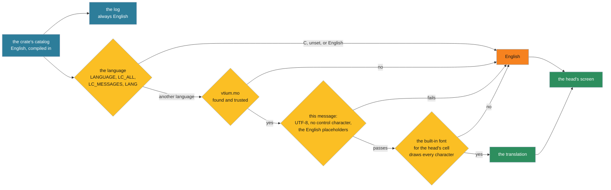

# ADR-1402: vtium's own text is translated through gettext catalogs in the system's language

## Summary

- **Decided:** vtium translates only the text it shows a person on its own screen: its notices, the on-screen display's line and the panic screen. Its configuration files, their key names, values and comments, the installed examples, the docs, the log and what its tools print in a terminal stay in English, and a key, value or path a translated message names stays exactly as the file has it. A translation is a gettext catalog: a `.po` file a translator edits, compiled to `/usr/share/locale/<lang>/LC_MESSAGES/vtium.mo`, with each message's English text as its key. vtium reads it at start with a small reader of its own in vtium-config, only when root owns it and no one else can write it, and checks each translation's placeholders before using it. The binary carries English alone. vtium shows one language, the system's, taken from its own environment as gettext takes it: `LANGUAGE`, then the first of `LC_ALL`, `LC_MESSAGES` and `LANG`; under the shipped unit that is `/etc/locale.conf`'s. A message is shown translated on a head only when the built-in font for the head's cell holds every character of it, and otherwise in English, with a log line. Keys are named from the chord's definition at the moment the notice is drawn, joined by `+`, with arrows as symbols (`Ctrl+Super+↑`) and modifier names as messages a translator may change. The catalog has no plural forms: a count is written as a label and a number. tier 2 draws every overlay screen in a pseudo-locale, an English made strange on purpose, and each shipped language is checked by tests that need no golden.
- **Trades away:** Most of the 8,512 bytes the binary has left: the reader's core measured 4,776 bytes, and the build measures the whole reader before the record is accepted. Plural forms, which do not fit in what is left, so a count reads `More errors: 3` rather than `3 more errors`. A frit's wider coverage, which a notice never relies on. Right-to-left scripts and scripts that need shaping, which show in English until vtium's text drawing orders and shapes them. A notice reworded in English shows in English in every language until its translator updates it.
- **One-way?** Expensive once a release ships a translation: the text domain `vtium`, the catalog's path, English text as the key and the `{name}` placeholders are what translators' files and distributions' packages hold. Everything behind them changes in a session.
- **Probes:**
  - *Not confident (counts):* a notice writes a count as a label and a number, such as `More errors: 3`, `More warnings: 3` and `More notes: 3`, where plain English would say `3 more errors`. Does `More errors: 3` read acceptably in the notices?
  - *Confident (whose language):* vtium shows its notices in the machine's language from `/etc/locale.conf` for the whole boot, before anyone logs in, and never switches to the language of a person who logs in at one of its heads.
- **Inversion:** Between "English only", the C reference's choice, and "every language compiled into the binary", which the size budget cannot hold. vtium carries English and reads one language's catalog from disk at start.

## Context

vtium shows people text of its own: the notices of ADR-1401 D5, D7, D8 and D9, the on-screen display's full line (the OSD, D5), the panic screen of a broken closed head file (D7), and the head file's errors that `vtium check-config` prints. The maintainer wants the text vtium shows on screen translated.

This record builds on the notice-catalog branch, `test/notice-captures`, where the catalog modules, tier 2's overlay screens and the specimens' message bars live; the record's branch has merged it at `e7b705a`, so every statement here about the tree holds on the record's branch. On that branch every string the screen shows lives in its crate's catalog module (`crates/vtium/src/notice.rs`, and `crates/vtium-config/src/messages.rs` for the head file's errors), which is what a translation replaces, but for two console lines in `crates/vtium-config/src/outcome.rs` (lines 300-304, such as `invalid config skipped, using builtin`), which move into the catalog when the head file's outcome model is wired in.

Three constraints shape how. The minspec binary has a budget of 3,145,728 bytes (`BINARY_BUDGET` in `tools/tier3/t3_impl.py`), and `make minspec` at main c86ccd3 gives 3,137,216 bytes, so 8,512 bytes are left and no translation fits inside the binary. vtium runs as root for its whole life (ADR-1400), so every file it reads is held to ADR-1401 D10's rule for root's files. And a head draws in its own font, which may be a 256-glyph console font, with vtium's two built-in fonts, unifont from 16 pixels and Unscii-8 under 16, as the per-character fallback (ADR-1200 D7, D22).

The C reference translated nothing (C notes below).

## Decision

A message's path from the catalog to the screen and to the log:

### D1: what is translated

- **Translated:** only the text vtium shows a person on its own screen: the notices, the OSD's full line, the panic screen, and the key names in them (D5).
- **English:** the configuration files, `kmscon.conf` and `heads.conf`, with their key names, values and comments; `kmscon.conf.example` and the other files vtium installs; the docs; the log, so a log line reads the same on every machine and a search for its English wording finds it; and everything `vtium check-config`, `vtiumctl` and `--help` print in a terminal. Text a message quotes, such as a head's name, a device's path or a line of the head file, is the person's own and is drawn as it is.
- **Names from the files stay as written.** Where a translated message names a configuration key, a value, a path or a command, such as `isolated`, `policy = closed`, `/etc/vtium/heads.conf` or `vtium check-config`, the name is a placeholder and stays exactly as the file or the shell has it, so the person can find it there and type it. A translation cannot change a placeholder (D3).

> Edited 2026-10-31: the maintainer decided the scope, relayed by the team lead: only the text vtium shows a person on screen is translated, and configuration files, their key names, values and comments, the installed examples, the docs and the log stay in English, with a key, value or path a translated message names left exactly as written. D1 read: "Translated: the text vtium draws on its own screen [...]; and the messages `vtium check-config` and `vtiumctl` print for a person, the head file's errors among them, so the console's notice and the tool's report name an error in the same words.", and D4 had the tools follow their own shell's language.
- Each message is written twice where it is both logged and shown: in English to the log, and in the chosen language to the screen.
- **Whole messages.** A catalog entry is a whole sentence or a whole line, with its variable parts as named placeholders such as `{head}`. The catalog never builds a sentence from pieces, since languages order a sentence's parts differently; the rescue notice, for one, is already two whole messages, one for each ending.
- **No plural forms.** A count is written as a label and a number, `More errors: 3`, which reads correctly in every language, so the catalog holds no message whose wording depends on a number and vtium evaluates no plural rule (D3).

### D2: the format, gettext

- A translation is a gettext catalog. Its source is a `.po` file, the text format that Poedit, Weblate and the Linux distributions' translation teams work in; vtium installs it compiled, as a `.mo` file.
- **English is the key.** Each message's `msgid` is its English text, as the catalog holds it. Where one English text needs two translations, a `msgctxt` tells them apart: the key names of D5 carry the context `key name`. English needs no file: it is compiled in, and a message a catalog lacks or leaves empty shows in English.
- One text domain, `vtium`, holds every message, so a translator works in one file per language.
- **Where the sources live.** `po/` holds `vtium.pot`, the template every translation starts from, and one `<lang>.po` for each language vtium ships. Each catalog module lists its messages in a table a test can read. A test fails when `po/vtium.pot` differs from those tables, and `VTIUM_BLESS=1` rewrites it, as for `docs/config.md`.
- vtium's own tools, in Rust, write the template and compile `.po` files to `.mo` for the install tree, so the build needs no GNU gettext.
- **Messages built from pieces.** The catalog writes each case as a whole message. A display rule's wrong target and an input rule's wrong target are two messages, whose targets, such as `dark`, `focus` and `ignore`, are placeholders and stay as written (D1). The two reasons vtium distrusts a file, its owner and its mode, are two messages. A file vtium cannot read is one message that quotes the system's own English text for the error after `The system says:`, as a placeholder drawn in English.
- Which languages ship is decided per language, each in its own issue, with a translator.

### D3: where translations live, and how vtium reads them

- **The path is gettext's:** `/usr/share/locale/<lang>/LC_MESSAGES/vtium.mo`. Distributions package such files as they package every other program's, with RPM's `%find_lang` among the tools that find them.
- **The reader is vtium's own,** in vtium-config, beside the head file's message catalog: no new crate, no C library, and no call to `setlocale`.
- **Trust.** ADR-1401 D10 holds the head file, the profiles and the frits to its ownership check; this record holds the `.mo` file to the same check, as a decision of its own, since a root process reads it. vtium reads a `.mo` only when it passes: root owns it, neither its group nor others can write it, and the directories above it pass the same check. It must be a regular file of at most 256 KiB. Every offset and length in it is checked before use, and nothing in it can make vtium panic. A file that fails is not read: vtium shows English and logs one line naming the file and the reason.
- **Each translation is checked when it is loaded.** It must be UTF-8, hold no control character, and use exactly the placeholders of its English. A translation that fails shows its English, and vtium logs the message's English once. vtium escapes the values it puts into placeholders, as ADR-1401 D7 escapes the text a notice quotes from a file.
- **When.** vtium reads its catalog once, at start, before its first notice; a new or changed `.mo` applies when vtium next starts, as kmscon.conf does.
- **The cost, and a gate.** The core of the reader, the `.mo` parser with contexts and the language search of D4 without its English stop, measured 4,776 bytes at minspec's settings in a test program, against the 8,512 bytes the binary has left. That leaves 3,736 bytes for what the measurement left out: the ownership check, the 256 KiB cap, the control-character and placeholder checks, the English stop, D6's font check and D5's key formatting. gettext's plural rules measured 10,992 bytes with the core, more than the whole margin, so plural forms are left out because they cannot fit. Linked into vtium, whose link-time optimization shares code differently, the cost differs from the test program's. The build measures the full reader with `make minspec` before this record is accepted, and the record is accepted only when the binary stays within its budget; otherwise it goes back to the maintainer, with the figures, to cut from the reader or to raise the budget by an ADR. A catalog of today's messages is tens of kilobytes at most, held in memory for the boot.

### D4: picking the language

- **vtium reads its own environment, as gettext does.** The locale for messages is the first of `LC_ALL`, `LC_MESSAGES` and `LANG` that is set and not empty. Where it is unset, `C`, `POSIX` or a `C.` locale such as `C.UTF-8`, vtium shows English. Otherwise vtium tries the languages `LANGUAGE` lists, separated by colons, or the locale alone where `LANGUAGE` is unset. Each name is tried as `ll_CC@modifier`, `ll_CC`, `ll@modifier`, then `ll`, with its codeset dropped, since vtium's catalogs are UTF-8 and vtium draws Unicode whatever the codeset. The first catalog found is used. An English name in the list ends the search with English, so `LANGUAGE=en_GB:de` shows English and never falls through to German.
- **Under the shipped unit,** `crates/vtium/install/kmsconvt@.service`, vtium's environment is systemd's manager environment: `LANG` and any other locale variable from `/etc/locale.conf`, with the kernel command line's `locale.LANG=` and its siblings over them. The unit sets and unsets no locale variable, so vtium sees the machine's locale: on this machine `LANG=en_US.UTF-8`, the value in `/etc/locale.conf`.
- **systemd's `getty@.service` clears every locale variable but `LC_ALL`,** which `/etc/locale.conf` cannot set, before agetty runs, since the kernel console's font cannot draw many languages. vtium draws its own text through its own fonts and shows a message only where they draw it (D6), so its unit keeps the locale.
- **`reset-env`** sets what the session's environment starts from, and changes nothing in vtium's own environment, so vtium's language is the same with it on or off.
- vtium run by hand, as `sudo vtium`, follows the environment it is given.
- **One language for the process.** vtium shows the system's language on every head for the whole boot. A notice is about the machine and often shows before anyone logs in, and two heads can have two different people logged in, so vtium never follows a logged-in person's language.
- **Where vtium departs from gettext.** vtium ends the search at an English entry, where gettext goes on to the next language in `LANGUAGE`. And vtium translates whether or not the locale is installed on the machine, since it reads only its own catalog, where a gettext program whose `setlocale` call fails, because the locale was never generated, shows English.
- **The VT review** already gives its session `LANG` and `LC_*` from `/etc/locale.conf` (docs/vt-review.md). It gives them to the vtium it starts as well, so a review shows the language a boot shows; that is the tool's change, made in the build.

### D5: key names

- **From the chord's definition.** A notice that names a key builds its name from the definition of the chord in code at the moment the notice is drawn. The head chords are compile-time constants in `crates/vtium/src/head/chord.rs`, `CTRL_SUPER` and the `BINDINGS` table, which the key matcher and the notices both read: the roaming chord is Ctrl and Super with Up, and kmscon.conf has no key that binds them. A change to a chord's definition changes every notice that names it. Configurable chords (vtium/vtium#82) keep that true: the notice then builds the name from the binding in force.
- **Drawn as `Ctrl+Super+↑`.** The modifiers come first, in the order Ctrl, Alt, Shift, Super, then the key, joined by `+` with no spaces. GTK's key labels, GNOME's help, KDE and Windows all join keys with `+`, and a hyphen reads as part of a word in languages that join words with one. vtium's documents keep the console's `Ctrl-Super-Up`, and a document that quotes a notice quotes it as vtium draws it.
- **Symbols where the keycap shows one.** The arrow keys draw as `↑`, `↓`, `←` and `→`, since their names are translated in nearly every language (measured in GTK's key labels: German Hoch, French Haut, Russian Вверх, Chinese 上). The function keys draw as `F1` to `F24`, and a letter or digit as the character its keycap prints.
- **Names a translator may change.** Each modifier name and each named key, such as Enter, Backspace, Tab, Esc, Delete, Home and Page Up, is a message of its own under the context `key name`, written in English as a US keycap prints it. In the eleven languages of GTK's key labels measured on 2026-10-31, Alt and Super stay the same in all of them, and Ctrl in all but German, whose keyboards print Strg; Shift is translated in five of them, as Umschalt, Maj, Mayús, Maiusc and Skift; and the named keys print differently by country, as German keyboards print Entf, Pos1 and Bild↑. The translator chooses what their readers' keycaps print.
- **The arrows need no sprite.** Unscii-8 holds U+2190 to U+2193, as unifont does, so both built-in fonts draw them. A head font that lacks an arrow, as the console font LatArCyrHeb-16 lacks U+2191, draws it from the built-in font through the per-character fallback (ADR-1200 D7, D22).

### D6: a translation the head's font cannot draw

- **The test is the built-in font for the head's cell.** A translated message is shown on a head only when the built-in font that ADR-1200 D7 gives the head's cell, Unscii-8 under 16 pixels and unifont from 16, holds every character of it, the values of its placeholders aside. Otherwise vtium shows that message in English on that head and logs one line for each message and head, once a boot.
- **Why the built-in font.** It is the font every head has from its first frame, compiled in and known at once. A frit's glyphs arrive later from the helper, and a notice at start, such as an invalid head file's, cannot wait for them, so the frit's wider coverage never widens what a notice can show.
- **Scripts vtium cannot yet draw as text.** A message holding a character of a script that vtium's text drawing cannot order right to left or shape, such as Hebrew, Arabic, Syriac, Thaana and N'Ko, the Indic scripts, Myanmar, Khmer and Tibetan, counts as one the font cannot draw. The build issue lists the ranges, and the list shrinks as vtium's text drawing gains bidirectional order and shaping.
- **Small cells.** Unscii-8 holds Latin-1 and the extended Latin letters of most European languages, Greek, and the Cyrillic letters Russian uses, but not the Cyrillic letters of Ukrainian, Belarusian, Serbian and Macedonian beyond Russian's (U+0402-U+0404, U+040A-U+040F, U+0452-U+0454, U+0459-U+045F and U+0490-U+0491), so those languages fall back to English at 8x8 wherever a message uses such a letter. It holds no kana, Hangul, CJK ideograph or Thai, and neither German's low quotation mark `„` nor every Vietnamese letter. ADR-1200 D7 never gives a Chinese, Japanese or Korean locale Unscii-8, so those languages draw at 16 pixels. A head with 8x8 cells in another language Unscii-8 cannot draw, such as Thai, shows its notices in English. The depth of the display changes nothing: both built-in fonts are bitmaps and draw the same on a 1-bit panel.
- **Never the replacement glyph.** vtium never draws its own words as U+25A1 boxes, since a notice of boxes tells its reader nothing. English always draws: the catalog's English uses ASCII, the OSD's `●`, `○` and `·`, and the arrows of the chords' keys, all of which both built-in fonts hold.

### D7: how translations are judged

- **The pseudo-locale** is an English made strange on purpose: each letter replaced by an accented form Unscii-8 holds, the text made about 40% longer, and each message wrapped in brackets so a cut end shows. Tests build it from the English catalog, and vtium never ships it. A string that stays plain English in it was not taken from the catalog.
- **tier 2** draws every overlay screen in the pseudo-locale beside English, at 8x8 cells on the 320x240 profile and at 16-pixel cells. These goldens are vtium's own, provisional until the maintainer reviews them, and they judge truncation, layout and the drawing of accented text. The specimens' message-bar screens, which draw the notices and the OSD on each display profile (`tools/specimens/src/bars.rs`), are drawn in the pseudo-locale as well, so every profile shows a translated notice; the card's other screens gain nothing.
- **Double-width text.** The pseudo-locale holds no double-width character, so it exercises no Chinese, Japanese or Korean layout. tier 2 adds one overlay screen at 16-pixel cells whose message is CJK text from unifont. The notice box wraps a line at a space, counts each character's width in cells, and breaks a word longer than the box at the last whole character that fits (`crates/vtium-render/src/notice.rs`), so a Chinese or Japanese line, which has no spaces, breaks between any two characters and never splits one. The screen checks that. The box follows no Chinese or Japanese line-breaking rule, so a line can start with a mark such as `。`, which those languages keep off a line's start; that is a gap the record names and does not close.
- **Each shipped language** is checked by tests that need no golden, since a reviewer who does not read a language cannot judge its screens: its `.po` compiles; every translation passes D3's checks; at 16 pixels unifont draws every message, or the language does not ship; and at 8x8 cells the test names each message that would show in English there, and fails when that list differs from the one the test's table states for the language. A translator who reads the list can then choose a character Unscii-8 holds, such as `»…«` in place of `„…“`.
- **A planted fault** proves each check: a translation with a placeholder its English lacks, a control character, a group-writable `.mo`, and a message with a character Unscii-8 lacks each show English, logged.

### For the operator's check

- **Counts as a label and a number** (D1). Probe 1 asks it.
- **The system's language for the whole boot** (D4). Probe 2 states it.
- **English per message on a head that cannot draw it** (D6), rather than English for the whole notice.

## C notes: the C reference's flow

- Neither kmscon nor libtsm calls `gettext` or `bindtextdomain`, or ships a `.po` file; every message is an English literal passed to the logging functions.
- kmscon read the locale only to choose its compose table: `find_locale` took the first of `LC_ALL`, `LC_CTYPE` and `LANG` through `getenv`, else `C`, without calling `setlocale`, since its comment said glibc gave no other way to query it (`kmscon/src/seat.c:639-657`); its manual page documented that order for `--xkb-compose-file` (`kmscon/docs/man/kmscon.1.xml.in:354-368`). vtium keeps that order for compose (`crates/vtium-platform/src/input/keyboard.rs`).
- libtsm called `setlocale` only in its GTK demo (`libtsm/src/gtktsm/gtktsm.c:36`).

## Where vtium departs from the C reference

- **Translated text of its own.** The C reference showed and logged English alone; vtium shows its own text in the system's language and keeps its log in English.

## Consequences

### Positive

- A person reads vtium's notices in the machine's language from the first frame, with no change to the binary.
- Translators work in the files and tools they already use, and distributions package vtium's catalogs as they package every other program's.
- The binary's size grows by the reader alone, whatever the number of languages.
- A notice never shows boxes, a cut placeholder or another program's words: a catalog that fails any check shows English, and the log says why.
- The log reads the same on every machine.
- Key names come from the chord's definition, so a changed chord never leaves a notice naming the old keys.

### Negative

- A count reads as a label and a number, which is plainer English than `3 more errors`.
- A head file's error reads in the system's language in its notice and in English in `vtium check-config`'s report, so a person matches the two by the file and line both name.
- A notice can mix two languages on a head with small cells, where some of its messages draw and others show in English.
- Hebrew, Arabic and the scripts that need shaping show in English until vtium's text drawing orders and shapes them.
- A notice reworded in English shows in English in every language until each translator updates it, since gettext keys a translation by its English.
- Each catalog module carries a table of its messages beside the code that uses them, and the template is regenerated when a message changes.

### Neutral

- vtium-config gains the reader and the language search.
- The VT review tool passes `/etc/locale.conf`'s variables to vtium as it does to the session.
- ADR-1401's notices keep their English wording as the catalog's keys; ADR-1401 D7's console lines, such as `invalid config skipped, using builtin`, are translated as every other message.

## Alternatives Considered

- **Fluent,** Mozilla's format, whose translations carry their own plural and grammatical rules. Rejected: its runtime and plural tables are far larger than the binary's margin (not measured), and the distributions' translation teams and language packs work in gettext.
- **Translations compiled into the binary.** Rejected: every language would count against a budget with 8,512 bytes left, which holds none.
- **A file format of vtium's own,** such as `key = text` lines. Rejected: no translator's tool reads it, and it would need its own template and merge tools.
- **Message ids as keys,** such as `notice.no-keyboard`. Rejected: translators work from the English in their tools, and gettext marks a reworded message for review, which a reworded notice needs.
- **gettext's plural forms.** Left out because they cannot fit: with the reader's core they measured 10,992 bytes against a margin of 8,512. Adding them later, after a budget change, adds a field to the reader and changes no file a translator holds.
- **Built-in sprites for the arrows,** as vtium draws box drawing. Not needed: both built-in fonts hold the arrows, and the per-character fallback reaches them from any head font (D5).
- **The replacement glyph for a character the font lacks.** Rejected: a notice drawn as boxes tells its reader nothing (D6).
- **The frit's coverage as the test** (D6). Rejected: the frit's glyphs arrive from the helper after the first frame, and a notice at start cannot wait for them.
- **The logged-in person's language, per head.** Declined: notices are about the machine and show before anyone logs in, and two heads can hold two people. A head key choosing a language can come later, where a machine's stations serve readers of different languages.
- **Clearing the locale in vtium's unit,** as `getty@.service` does. Rejected: it would forbid every translation, and D6 already keeps vtium from showing what its fonts cannot draw.
- **Translating the log, the tools' output or the configuration files' names.** Declined by the maintainer (D1): administrators search the journal and the tools' reports by their English wording, and a person must find a key, value or path a notice names in the file as it is written.
- **Specimen screens for every shipped language.** Rejected: a reviewer who does not read a language cannot judge its screens, and D7's tests check its glyphs and placeholders exactly; the pseudo-locale judges layout once for every language.
