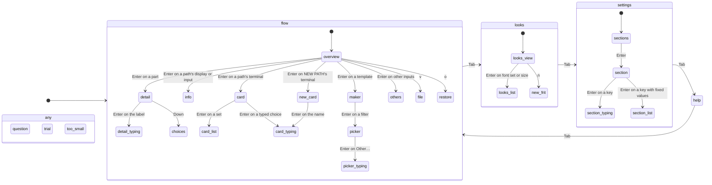
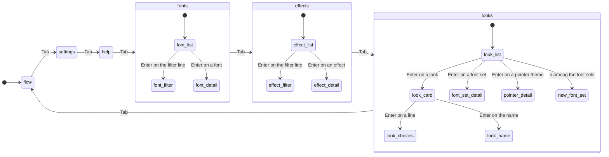

# ADR-1403: vtium.conf holds the configuration as one flow from the displays to the input devices, and vtium-config draws it

## Summary

- **Decided:** The maintainer decided on 2026-11-04 that vtium's configuration is one flow, from the displays to the input devices: the displays, the display rules that send each display to a head, the heads, each head's look (its frit and size, the fonts that frit draws with, and the vtlook that holds its filters), the input rules that send each input device to a head, and the input devices. The whole flow lives in one file, `/etc/vtium/vtium.conf`. Its flat `key=value` lines stay, and they are the defaults every head inherits, so a kmscon.conf copied in still reads. Below them come sections with names, as heads.conf writes them: a `[look NAME]` section for each look, a `[head NAME]` section for each head, and one `[rules]` list, which each device tries top to bottom across every head (D4). vtium stops reading the seat file, `seat0.seat.conf`, which is a departure from the C reference, and stops reading heads.conf, with no migration: the two installs that have either file are converted by hand (D6). vtium refuses a vtium.conf that root does not own or that others can write, and says why (D3). vtium-config gains a view, Flow, that shows the configuration as paths, each a row of bordered boxes that joins displays → a terminal ← inputs, with the terminal's font set inside it. The view builds a path in three stages: the person picks parts, made from the machine's own devices and from four templates, into a new path, then adds the path to the configuration, and vtium-config writes its head and rules, most specific first (D7, D8). A part whose device is unplugged stays on screen, greyed out, and nothing leaves the file unless the person takes it out (D7). vtium-config also gains `vtium config edit`, which works as visudo does: it opens the configuration in the user's editor and checks it with `vtium check-config` when the editor exits. Every edit, root's included, goes into the user's draft under the XDG path, `~/.config/vtium/drafts/`, which may be unfinished; only `install` needs a passing check, and installs the draft to `/etc/vtium/vtium.conf` through the privileged step `sudo vtium-config apply DIR`. The view and `vtium config flow` always say how the draft stands, and a draft can be deleted (D8). A draft keeps its font set changes, the frits it adds or replaces and the installed frits it removes, in a folder beside it, `~/.config/vtium/drafts/NAME.frits/`: they survive quitting the TUI, show in `vtium config diff`, travel with the draft to another machine, and install with it, frits before vtium.conf, so a failure part-way leaves a working system (D8). The view shows the draft as text on `v`, and the person can label a part with a name of their own, which vtium.conf keeps in a `[labels]` section. vtium shows a display's label when vtium-config identifies the displays (D4, D7). Every change the view makes is also a `vtium config` command with fixed exit codes, and `vtium config flow --json` prints the flow for scripts, so everything works without the TUI (D8). A valid configuration wires at least one complete route, a display present sent to a head that a keyboard present reaches, and `vtium check-config` refuses a file without one; Install asks before it installs a draft without one, and the shipped default always passes (D3). As soon as a new path is complete, the view asks the person to add it, and Revise takes a path back out to change it and adds it back byte for byte. D11, added on 2026-11-27, makes vtium-config work like an application, with the configuration as its one open document: every change goes into the draft as it is made, and one Save, on Ctrl+S, shows what saving changes and then installs through sudo once. File and Actions menus beside the tabs, an action bar along the bottom and the mouse reach every action, and the top row's counts open the Problems list and Show changes. When the installed file changed on disk, Save offers Update, Overwrite and Revert, where Install refused (D8, D11). Ctrl+Z and Ctrl+Y undo and redo the document's changes back to the last Save, F1 opens help for what is highlighted, Ctrl+F finds a setting or an item of any tab by name, New… starts from what is saved or from vtium's defaults, and five tabs show the highlighted item's facts beside their list. On the screens whose node of the interface tree declares it, `?` opens a search row over the action bar that filters the list on screen, and elsewhere `?` does nothing. File › Open renames and deletes the configurations, and every key a screen names for pressing is written in brackets, as `[Ctrl+S] Save` (D11). Every place a font appears marks it active, not active or missing, and Activate missing activates, as one change, each font the configuration uses that is installed and trusted but not active (D11; ADR-1205 D4). A line with choices, on a Flow card, a look's card, a setting or the form for a new font set, opens one list box under itself (D11). The rebuild builds to the mock-up catalog the maintainer accepted, which becomes a committed book of vtium-config's use under `docs/design-notes/vtium-config/`, a reference rather than a golden (D11). D10, added on 2026-11-18, extends the key table and the interface tree to the six tabs that ADR-1205 sets, so each action has one key on every tab, and Enter goes down the tree of use while Esc comes back up. The digits 1 to 6 go straight to a tab, Space activates a font, an effect or a pointer theme, and Esc keeps a card's changes (D10). This record's agent adds what the move forces: the lines above the first section keep vtium.conf's forgiving reading, and the sections keep the head file's strict one, so an error in a section never drops a top-level key (D3).
- **Trades away:** One file holds two ways of handling a mistake, a forgiving one for the flat keys and a strict one for the sections. A heads.conf or seat file left in place stops working, with no warning. A vtium.conf that root does not own, which vtium reads today, is no longer read at all. While the packaged build and the development build share `/etc/vtium/vtium.conf` (ADR-1500 D4), a build older than this change reads a head section's `login` line and a look section's font lines as if they were top-level keys. The TUI needs a terminal of at least 80 by 25 cells, so a minspec board's 40-column console is configured over ssh, with the commands, or with a draft copied in. Every draft command reads the draft's font set folder as well as its vtium.conf, and a draft carried to another machine is two paths, its file and its folder. Overwrite lets a person replace a change made to the installed file after seeing it, and History keeps the replaced file (D8).
- **One-way?** No, but expensive once a release ships it: users then write their files in the merged form, and a later change of syntax means a migration. Until that release every part of this changes in a session.
- **Probes:**
  - *Not confident (nested objects):* the recommendation keeps heads.conf's bracketed sections as they are, placed below vtium.conf's flat lines, and adds a `[look NAME]` section for each look, so a head names its look as it does today. The rules stay one ordered list in `[rules]`, outside the heads, because first match depends on their order across all heads. Is that the nesting you meant, or did you mean each head's rules written inside that head? (Answered 2026-11-04: that is the nesting meant; see `considered`.)
  - *Confident (no setup lost):* an installed heads.conf keeps working, with a warning at each start, until `vtium config fold` moves it into vtium.conf or the first beta release stops reading it. An installed `seat0.seat.conf` stops being read with this change; vtium says so at each start, and the same command folds its keys into vtium.conf. (Answered 2026-11-04: no migration, the two installs are converted by hand; see `considered` and D6.)
  - *Confident (tab keys):* Tab and Shift-Tab step through the six tabs, and the number keys 1 to 6 go straight to one while nothing is open (D10). Lean: yes to the number keys, because Flow is the fourth of six tabs and one plain digit reaches any tab, over ssh too. Should 1 to 6 go straight to a tab? (Answered 2026-11-18: yes; see `considered` and D10.)
  - *Confident (Activate):* Space activates or deactivates the highlighted font, effect or pointer theme (D10). Lean: Space, because in the Flow view Space already puts a part into the set being built, and every terminal sends it. Is Space the key for Activate? (Answered 2026-11-18: yes; see `considered` and D10.)
  - *Confident (leaving an editor):* Esc closes a card, such as a look's card or a terminal's card, and keeps each change made there; only a value being typed is dropped (D10). Lean: keep the changes, because nothing reaches the draft until Save, and a second key to confirm would slow every edit. Does Esc keep a card's changes? (Answered 2026-11-18: yes, and Revert throws them away; see `considered` and D10.)
  - *Not confident (pointer themes):* the Looks tab lists the installed pointer themes as a third group below the looks and the font sets, and Space activates them there (D10). Lean: one list, because it saves a level and the themes show where Space acts; the other end is a list of their own that opens from the tab. Should the pointer themes sit in the Looks tab's list? (Answered 2026-11-18: yes, as a third group after the looks and the font sets; see `considered` and D10.)
  - *Settled (two parked nodes, D10):* the maintainer accepted D10 on 2026-11-18 and kept `flow.info` and `flow.new-card` as nodes of their own.
- **Inversion:** Between "a file for each concern", the C reference's kmscon.conf with a seat file beside it, as vtium has today with heads.conf and planned look files, and "one document that holds everything the console reads". vtium takes the second for the flow of devices, heads and looks, and keeps frits, vtlooks and shaders as files of their own, because the glyph helper and the renderer read them and vtium-config manages them one by one.

> Edited 2026-11-04: the maintainer answered the probes and the open questions the same day (`considered`), and the record now states the answers as decisions. The Summary listed five open questions with recommendations, and its first two sentences on the move read: "The head file's sections, today in `/etc/vtium/heads.conf`, move into vtium.conf below those lines. vtium stops reading the seat file, `seat0.seat.conf`, which is a departure from the C reference." The earlier text is in git at 33ea5db0.

> Edited 2026-11-06: the maintainer decided that a draft keeps its font set changes (`considered`), and D8 says how. The Summary gained the sentence on the draft's font set folder, and Trades away its cost.

> Edited 2026-11-10: the maintainer settled the Flow view as paths built from parts (`considered`), and D4, D7 and D8 say how. The Summary read: "vtium-config gains a view that draws the flow as six columns, each in its own color, with displays, heads, looks and input devices as blocks of color joined by lines. It places the machine's real displays and input devices on the file's flow, marks each rule that matches nothing, and moves and edits by keyboard and mouse from its first build, with `new…` items that build rules, heads and looks, every change going through the checked install. A rule that names one device keeps that device on the flow when it is unplugged, marked `configured, not found`, and nothing leaves the file unless the user deletes it (D7).", "The view also edits the top-level keys, through a base card, and opens the draft in a read-only pager (D7)." and "In the view, the person tags items across the columns to build a path, and vtium-config asks to add the path as soon as it is complete."

> Edited 2026-11-09: the maintainer answered the gap-check of the Flow view against the circuit model (`considered`), and D3, D7 and D8 say how. The Summary read: "`vtium check-config` refuses a file without one, so nothing is installed that no one at the machine can type on; the shipped default always passes (D3). In the view, Install, Revert and New each ask before they act, and rules can be tagged with devices and heads (D7)."

> Edited 2026-11-27: the maintainer rearranged vtium-config's screens around one open document and one Save (`considered`, 2026-11-27), and D11 and two subsections of D8 were added. The Summary's sentence read: "The view's changes wait until Save writes them into the draft, and Install saves first (D7)." Trades away gained its sentence on Overwrite.

> Edited 2026-11-27, later the same night: the maintainer set alpha.13's scope and answered the mock-up catalog's questions (`considered`, 2026-11-27), and D11 gained undo and redo, F1, Find, New's two starting points and the tabs' layouts. Later the maintainer's notes on the catalog added the search row on `?`, managing the configurations, History's sheet and keys in brackets. The Summary gained its two sentences on them.

> Edited 2026-11-27, after the mock-up catalog was accepted: the maintainer decided where the search is offered (`considered`). The Summary's sentence on it began: "`?` opens a search row over the action bar that filters the list on screen, File › Open renames".

> Edited 2026-11-27, after the mock-up catalog was accepted: the maintainer asked for Activate missing (`considered`), and the Summary gained its sentence on the fonts' marks.

> Edited 2026-11-27, after the mock-up catalog was accepted: the maintainer took the list box (`considered`), and the Summary gained its sentence on it.

> Edited 2026-11-27, after the mock-up catalog was accepted: the Summary gained its sentence on the catalog and the book (`considered`).

## Context

vtium's configuration is spread over three files today. vtium.conf holds the keys the C reference's kmscon.conf had, plus vtium's own. `seat0.seat.conf`, beside it, holds the same keys and wins over vtium.conf, because the C reference read a file for each seat over its main file and vtium carried that over without a decision. heads.conf holds the heads and the rules that place each display and each input device (ADR-1401 D3), and looks were to get files of their own (ADR-1200 D16). A head inherits its font from vtium.conf, its frit from its look, and its devices from heads.conf's rules, so no single file shows how a display and a keyboard end up in a terminal with a font.

The maintainer gives the configuration tool as much weight as the console itself (2026-11-10): "honestly, I think the vtium-config tool, the configuration file and what can be configured, is likely as important as the entire terminal system we've built - otherwise it'll be obtuse to control and not really any better than kmscon or other terminal applications." That is why this record decides vtium.conf's shape and the view that edits it together.

The tree constrains the move in four ways, each read from the code on 2026-11-04 (`basis`). vtium reads heads.conf only when root owns it and no one else can write it, and it reads vtium.conf with no such check. The two files handle mistakes differently: vtium.conf reports an unknown key or a bad value and goes on, keeping the last value a key is given, while heads.conf drops what each error takes under ADR-1401 D7's three levels and treats a key given twice as an error. vtium.conf's line editor adds a new key at the end of the file, which in a file with sections lands inside the last section. And vtium-config draws its screens with reverse video alone, so the flow view brings the first color into it.

## Decision

D1 to D3 state the maintainer's decisions and what the move forces. D4 to D8 were the open questions of this record's draft, which the maintainer answered on 2026-11-04 (`considered`); each states the answer. D9 lists what the code changes to fit. D10, added on 2026-11-18, sets how a person moves through the six tabs of ADR-1205. D11, added on 2026-11-27, makes vtium-config work like an application, with the configuration as its one open document.

### D1: one flow, from the displays to the input devices

vtium's configuration describes one flow, and every part of it is a component with a name and a place in vtium.conf (the maintainer, 2026-11-04):

| Section of the flow | What each component is | Where it is written |
|---|---|---|
| Displays | a monitor or panel on a connector, as vtium finds it | nowhere: the machine supplies them |
| Display rules | a `display MATCH -> TARGET` line, which sends each display it matches to a head, or `off` | `[rules]` |
| Heads | a terminal and the displays that show it (ADR-1401 D1) | `[head NAME]` |
| A head's look | what the head draws with: a frit (a font set file) and a size, the fonts that frit draws with, and a vtlook, ADR-1304's file of frame filters | the `[look NAME]` section, the frit's file, the font files, the vtlook's file |
| Input rules | an `input MATCH -> TARGET` line, which sends each input device it matches to a head, to `roaming` or to `ignore` | `[rules]` |
| Input devices | a keyboard, pointer or other input, as vtium finds it | nowhere: the machine supplies them |

- **The rules filter devices, and they are components too.** Each device walks the rules of its own kind, top to bottom, and the first that matches places it, as ADR-1401 D3 decides. The rules stay one ordered list, because which rule matches first depends on their order across every head.
- **The targets that are not heads** are components as well: `roaming`, which types into the active head, `ignore` and `off` (ADR-1401 D3). So is the policy, which places a device no rule matches.
- **A look** is what a head draws with, one `[look NAME]` section of vtium.conf: its frit, its size and the other keys D5 lists, and `vtlook = FILE`, which names the vtlook of ADR-1304 that holds its filters (the maintainer, 2026-11-05). A head names its look with `look = NAME`. ADR-1304's file of frame filters is always called a vtlook here.

> Edited 2026-11-05: the maintainer renamed the profile section `[look NAME]` and put the vtlook's name in it (`considered`). Until then the look was a `[profile NAME]` section, a head named it with `profile =`, and a head named its vtlook apart with `look =`. This record's text says look throughout; its earlier text is in git at 204fbd68.

### D2: the seat file goes

The maintainer decided on 2026-11-04 that vtium stops reading `<seat>.seat.conf`, and that the seat file is removed from the console, vtium-config, the docs and the records. It came across from the C reference's setup for several seats, and no decision chose it.

- vtium reads `vtium.conf` in its configuration directory and then its command line, and nothing else.
- vtium serves seat0 alone (ADR-1401 D2), so the only seat file it read was seat0's. When the later extension for other seats is built, a seat's flow goes into vtium.conf with the rest, and ADR-1401 D2's sentence that the head file gains a file for each seat no longer holds.
- vtium does not look for a seat file, and says nothing of one left in place (D6).

This is a departure from the C reference, which read `<configdir>/<seat>.seat.conf` over kmscon.conf for each seat (C notes).

### D3: one file, vtium.conf

The maintainer decided on 2026-11-04 that vtium.conf holds the whole flow. Its flat `key=value` lines stay as the defaults every head inherits, so a kmscon.conf copied to `/etc/vtium/vtium.conf` still reads, and the head, rule and look sections come below them. heads.conf's content moves into vtium.conf, and vtium no longer reads heads.conf (D6).

- **Trust covers the whole file, and vtium says why it refuses one** (the maintainer, 2026-11-04). vtium reads vtium.conf only when root owns it and neither its group nor others can write it or a directory above it, the check ADR-1401 D7 and D10 make of heads.conf today. vtium refuses a vtium.conf that fails the check: it reads none of it, runs its compiled-in keys and flow, and every head shows `invalid config skipped, using builtin` with its next step, `Run vtium check-config /etc/vtium/vtium.conf to see why.` The log and `vtium check-config` say why: the file or directory that fails, its owner or its mode, and the command that mends it, `chown root:root` or `chmod go-w` with the path. The check covers the top level as well as the sections because vtium.conf now places keyboards, and because its `login` key already names the command vtium starts as root. A kmscon.conf copied in by root, with the usual mode 0644, passes. When vtium runs unprivileged, as the tests and a run by hand do, it also accepts a vtium.conf that its own effective user owns, under the same check of who else can write it; `run-vt.sh` installs the configuration of a review run into a root-owned directory before it starts vtium. This record's agent makes that call, on the steering session's reading of the gap-check: without it no test could hand vtium a file, since the tests cannot make files root's.

The move forces these decisions, which this record's agent makes from ADR-1401 and the tree:

- **The top level and the sections.** The top level is every line above the first section heading. It holds vtium's keys, as vtium.conf does today, and the two keys heads.conf had above its first section, `version` and `policy`. Everything from the first section heading on is the sections. A key line after a section heading belongs to that section, so the top level is written first, as heads.conf's top-level keys were.
- **A file with no section is a kmscon.conf.** It needs no `version` line, and vtium runs the compiled-in flow for it (ADR-1401 D6), as it does today when heads.conf is missing. A file with a section needs `version = 1` at the top level. A missing or unknown version is ADR-1401 D7's error that drops the whole head file but its policy; under one file it drops every section but the policy, and the top-level keys still apply. A readable `policy = closed` in a file with no section makes it a closed file that declares no head: vtium opens nothing and every display stays dark, as ADR-1401 D7 has it for a closed file that declares no head. `vtium check-config` refuses such a file, naming the missing rules, since it wires no complete route (below), so vtium-config does not install it (the maintainer, 2026-11-05).
- **Two ways of handling a mistake, one for each part.** The top level keeps vtium.conf's reading, which follows the C reference's: an unknown key is reported once and ignored, a value out of bounds is clamped, a value vtium cannot read is ignored, and a key set twice takes its last value. The sections keep ADR-1401 D7's three levels unchanged, and what ADR-1401 D7 calls the whole file is now the sections and the policy. An error in a section never drops a top-level key, and a top-level mistake never drops a section.
- **The policy line.** ADR-1401 D7's rule for a policy line holds: a line above the first section that begins with `policy`, in any mix of case, is a policy line, and one vtium cannot read makes the sections closed and broken. Among vtium's keys none begins with `policy`, so no existing key changes meaning.
- **One bound for the file.** vtium.conf keeps its bounds, 65,536 bytes a file and 8,192 a line, which heads.conf shares. The shipped example vtium.conf and the head file's template together hold 40,327 bytes. A test fails when the generated example passes 49,152 bytes, so at least 16 KiB stay for a user's own heads, looks and rules.
- **One source for the compiled-in flow.** The head file's template, `crates/vtium-settings/templates/heads.conf`, becomes the sections of the shipped example: the example vtium.conf is the key table's commented lines, then `version = 1`, then the template's sections with the shipped rules as live lines, as ADR-1401 D6 has them. vtium's compiled-in flow is still parsed from that same text.
- **`vtium check-config FILE`** checks a candidate vtium.conf, both parts in one run with one exit status, where today FILE names a candidate head file.

> Edited 2026-11-04: the maintainer decided that vtium refuses a vtium.conf it cannot trust and says why, and that heads.conf is not read (`considered`). The trust bullet was this record's agent's call among the forced decisions, and said only that every head shows `invalid config skipped, using builtin`.

> Edited 2026-11-05: the maintainer decided that a file with no section and a readable `policy = closed` leaves vtium dark and fails the check (`considered`). The bullet on a file with no section ended at "the top-level keys still apply.", which read as if such a file ran the compiled-in flow whatever its policy.

#### A valid configuration wires at least one complete route

The maintainer decided on 2026-11-04 that a valid configuration wires at least one complete route from the left of the flow to the right (`considered`). `vtium check-config` refuses a file without one, as an error with exit 1, and the message says what is missing. The draft may still lack one while the user builds it (D8), and the view's status line says so plainly until it is wired (D7). Install asks before it installs a draft whose only problem is a missing complete route, and installs it when the person answers yes (the maintainer, 2026-11-09; D7, D8).

- **A complete route** is a display present that its first matching rule sends to a head, and at least one keyboard present that reaches that head: through an input rule whose target is that head, or by roaming, from a rule whose target is `roaming` or, under `policy = open`, from no rule at all, when the head can be the active head because it is not isolated (ADR-1401 D5). A keyboard is an input device of udev's keyboard class (ADR-1401 D4), since a mouse or a media-key device types nothing.
- **What the message says** names the first thing missing along the way, in the order a person would wire it, such as `No display present is sent to a head: display DP-8 falls to rule 3, which sends it to off.`, or `Head desk shows DP-8, but no keyboard present reaches desk: add an input rule that sends a keyboard to desk or to roaming.`, or `Head desk is isolated, so roaming keyboards do not reach it.` The flow view shows the same message on its status line while the draft has no complete route.
- **With no display or no keyboard present,** as when the check runs in a container, on a build machine, or on a desktop checking a file for another machine, the devices present cannot show a path. The check then judges the rules alone: some display rule sends displays to a head that some input rule sends keyboards to, directly or by roaming as above, with a `class:keyboard`, `*` or device rule. It notes that it judged without devices. `vtium check-config --no-devices FILE` asks for that reading on any machine, so a file written for another machine, whose rules name that machine's monitor and keyboard, can be checked where those devices are absent.
- **The shipped default always passes.** Its rules, `display * -> console` and `input class:keyboard -> roaming` with a head that is not isolated, wire a complete route on every machine with a display and a keyboard, and by the rules alone where none is present. A test holds the compiled-in configuration and the shipped example to both readings. With no file at all, nothing is checked, and vtium runs the compiled-in configuration as ADR-1401 D6 has it.
- **The console does not apply this rule when it starts.** Missing hardware never makes a file invalid at start (ADR-1401 D7): a keyboard plugged in after boot is normal, and ADR-1401 D9's guards keep a keyboard typing whatever the rules say. The rule belongs to `vtium check-config` and to vtium-config's install, which installs a file without a way for someone at the machine to type only after the person answers yes to Install's question (D7).

> Edited 2026-11-09: the maintainer decided that Install asks before it installs a draft with no complete route, then installs it (`considered`, "Ask, then allow it"). This subsection's first paragraph read: "`vtium check-config` refuses a file without one, as an error, so Install fails on it with exit 1, and the message says what is missing. The draft may still lack one while the user builds it (D8); the view and `vtium config flow` list what is missing until it is wired." Its last bullet ended: "The rule belongs to `vtium check-config` and to vtium-config's checked install, so a file is not installed without a way for someone at the machine to type."

### D4: the syntax of the sections

The maintainer chose on 2026-11-04 sections with names, as heads.conf writes them (`considered`). Below the top level come a `[look NAME]` section for each look, a `[head NAME]` section for each head, one `[rules]` section after the heads, whose rules each device tries top to bottom across every head, and, when the person has labelled a part, one `[labels]` section after the rules. This is the nesting the maintainer meant: a section's heading names the object, every line below it up to the next heading belongs to it, and a deeper link is a key that names another section, as git's `[branch "main"]` names its remote with `remote = origin` and a head names its look with `look = big`. The rules stay one list outside the heads because first match depends on their order across every head (ADR-1401 D3). A vtium name holds no blank (ADR-1401 D3), so a heading needs no quotes, as git's do.

A whole vtium.conf for a machine with two displays, a large monitor and a small panel, and one keyboard that types into whichever head is active. The person has labelled the large monitor:

```ini
# /etc/vtium/vtium.conf: two displays, one keyboard.
# The top level: vtium's keys, the defaults every head inherits.
font-size=12
xkb-layout=us
mouse
version = 1
policy = open

# A head's look: the look, which names a frit with font-name.
[look big]
font-name = monoid
font-size = 14

[look small]
font-name = dejavu

[head desk]
look = big

[head panel]
look = small
consoles = 2

# Each display and each input tries these rules top to bottom,
# across every head, and the first that matches places it.
[rules]
display edid:AAA:0x0001:LARGE00001 -> desk
display edid:BBB:0x0002:SMALL00001 -> panel
display * -> desk
input class:keyboard -> roaming
input * -> ignore

# The person's own names for displays and inputs. vtium shows a
# display's label when vtium-config identifies the displays.
[labels]
display edid:AAA:0x0001:LARGE00001 = Left monitor
```

- **The `[labels]` section** names displays and inputs in the person's own words (the maintainer, 2026-11-10; D7). It comes after `[rules]`, and each line labels one part: `display MATCH = LABEL` or `input MATCH = LABEL`. The MATCH is written as a rule's MATCH, and it is the MATCH that the part's rule uses. The label is everything after the `=` that stands alone between blanks, to the end of the line, so it can hold blanks, and it holds at most 40 characters. A `#` that would start a comment is written `\#`, as the comment rule below has it. The rules do not change for a label. When two lines of the section match one device, the first line wins, as the first matching rule does (the steering session's call, 2026-11-10). vtium reads the section for its identify overlay, which names each display by its label (ADR-1401 D12). The on-screen display's line names no device, so it shows no label (ADR-1401 D5). vtium-config reads and writes the section (D8).
- **A bad label line is dropped alone.** A line that starts with neither `display` nor `input`, that has no `=` standing alone, that has nothing after its `=`, whose label is longer than 40 characters, or whose MATCH a rule could not hold, is reported with its line number and ignored. The rules and every other line still apply, as a top-level line's error drops that line alone (D3). A second `[labels]` heading is an error, as any section named twice is.

- **A head names its VTs** (the maintainer, 2026-11-10: "vt key, default every VT (Recommended)"). A `[head NAME]` section takes `vt = N`, or a list, `vt = N M`. The vtium on ttyN builds every head whose `vt` names N, and every head with no `vt`, so a head with no `vt` runs on every VT vtium runs on, as before (ADR-1401 D2). A display or an input may be in one path for each VT: two heads whose VTs differ may both take the same display and keyboard. Inside a head, vtium's own keys switch between the head's consoles, as before: a VT picks the head and its look, and the head keeps its consoles (the maintainer, 2026-11-10: "Keep both (Recommended)").
- **heads.conf's sections move in unchanged.** Its parser and ADR-1401 D7's drop rules read them, and ADR-1304's vtlook file is written in the same syntax.
- **A `[look NAME]` section is the profile's file** that ADR-1200 D16 left for later, under its new name. It takes the keys D5 lists, under the same names the top level uses.
- **One comment rule serves the whole file,** the head file's: a `#` starts a comment at the start of a line or after a blank, a `#` inside a word is part of the word, and `\#` gives a literal `#` after a blank. vtium.conf's exception is kept: a `#` that opens a `#rrggbb` value is part of the value. A value at the top level can then hold a `#` inside it, as a head's `login` command already can. In one case a top-level line reads differently from the C reference: a `#` directly after a value, with no blank before it, as in `font-size=12#big`, stays in the value, which vtium then reports as one it cannot read. This is listed as a departure.
- **Section keys always take `key = value`;** the switches `key` and `no-key` stay at the top level.

> Edited 2026-11-10: the maintainer gave parts labels, kept in vtium.conf, and tied heads to VTs with the `vt` key (`considered`, 2026-11-10). The example ended at `input * -> ignore`, and D4 named neither the `[labels]` section nor `vt`.

Blocks in braces, as sway writes them, TOML and dotted flat keys were weighed and lost; Alternatives Considered gives each one's reasons.

### D5: how a key set at two levels combines

The maintainer accepted these rules on 2026-11-04 as this record drafted them (`considered`):

- **Three levels, and the most specific wins:** a head's section, then the section of the look the head names, then the top level. The command line sets top-level keys and wins over the file's top level, as it does today, and a section still wins over both, as a head's look wins over vtium.conf's `font-name` today (ADR-1200 D16). A key the head and its look leave unset takes the top level's value, and a key the top level leaves unset takes its default.
- **Each section kind takes a fixed list of keys.** A head takes ADR-1401 D3's head keys, `look`, which names its look, `consoles`, `login`, `when-display-lost`, `isolated` and `switch-on-enter`, and `vt`, the VTs it runs on (D4; edited 2026-11-10, when the maintainer added `vt`; edited 2026-11-12, when ADR-1401 added `switch-on-enter`, which the list did not name until then). A look takes the keys ADR-1200 D16 gives a look that the key table has: `font-name`, which names the look's frit, `font-engine`, `font-size`, `font-hinting`, `font-line-spacing`, `display-depth` and `display-dpi`, `cell`, the cell in pixels as a frit's `cell=` line writes it, and `vtlook`, which names the vtlook file of ADR-1304 that holds its filters (the maintainer, 2026-11-05). The key table gains `cell`, which only a look sets; within one look, `font-size` wins over its `cell`, as ADR-1200 D16 has a level's size win over its cell. `vtlook` is also a top-level key, the vtlook of every look that names none (ADR-1304 D5). A look also takes the login picture's five keys, `login-image`, `login-image-fit`, `login-image-rows`, `login-image-position` and `login-image-scale`, which are top-level keys as well, so a head shows the picture of the look it names and a look that sets none takes the top level's (ADR-1100 D17; edited 2026-11-15, when ADR-1100 D17 added `login-image-scale`, and the list named four keys). A look also takes `smooth-scroll`, which turns smooth scrolling on or off for the heads that name the look, and `partial-row`, which sets what the pixel lines left over above the text show while smooth scrolling is on. Both are top-level keys as well, and a head's own `smooth-scroll` wins over its look's (ADR-1310 D7, D12).
- **A head that names a look with no section** uses the default look, and `vtium check-config` warns, as ADR-1200 D16 has a head that names a missing look use the default. This record's agent makes that call from ADR-1200 D16.
- **A value out of bounds in a section** is an error in that section under ADR-1401 D7's strict reading, as D3 says the sections are read, and never clamped as a top-level value is. This record's agent makes that call from D3. A head sets no font key of its own, since a head's font has one path, from the head to its look to the look's frit (ADR-1401 D3).
- **A key in a section has the top level's name, values and bounds** where the top level has the key too, as `login` and the font keys do. Inside one section a key given twice is an error, as in heads.conf today.
- **A key a section kind cannot take is an error in that section,** which drops the section under ADR-1401 D7: a head drops with its rules, and a look drops, so a head that names it takes the default look (ADR-1200 D16). The error names the levels where the key may be set.

> Note 2026-11-22: ADR-1510 D2, which the maintainer decided on 2026-11-22, amends this bullet. A key that the section kind cannot take, such as `font-name` in a head, does not drop the section: vtium reports the key with its file and line, names the levels where the key may be set, ignores the key alone, and reads the rest of the section. vtium does the same for a key that it does not know at all, such as one that a newer vtium added. A bad value of a key that the section takes still drops the section, as the bullet on a value out of bounds in a section says.
>
> Corrected later the same day: the maintainer answered that a known key in a section that does not take it counts as an unknown key (ADR-1510's `considered`). The note read: "ADR-1510 D2, which the maintainer decided on 2026-11-22, amends this bullet for a key that vtium does not know at all, such as one that a newer vtium added. vtium reports that key with its file and line, ignores the key alone, and reads the rest of the section. A key that vtium knows but that the section kind cannot take, such as `font-name` in a head, still drops the section as this bullet says."

- **The key table records where each key may be set.** Its column that says a key is set in a file or on the command line gains the values `look` and `head`, so docs/config.md lists each key's levels, and allowing one more key in a section later is an edit to one row.
- **Keys that belong to the whole process stay at the top level,** such as `display-buffers`, `consoles-max`, `hwaccel` and `sb-memory`, for the reason ADR-1401 D2 gives for `display-buffers`: they trade the machine's memory or set the process's behaviour, and are the same for every head.

> Edited 2026-11-05: the maintainer gave a look the key `cell` (`considered`), and the steering session made `vtlook` a top-level key as well, the default that a look's `vtlook =` overrides (ADR-1304 D5). A look's keys ended at `display-dpi` and `vtlook`, and the bullet named no top-level `vtlook`.

> Edited 2026-11-14: a look gains the login picture's four keys, as ADR-1100 D17 decides. The bullet's list of a look's keys ended with `cell` and `vtlook`.

> Note 2026-11-19: ADR-1205 D10, proposed on this date and not yet accepted, would add `palette` to the keys a look takes. Under this decision's rule the look's value then wins over the top level's, so a look can pick its own color scheme while vtium.conf's `palette` stays the default for the looks that pick none. The value names a built-in palette, `custom`, or an active palette file. The `palette-*` keys that `custom` reads stay at the top level. This note changes nothing until the maintainer accepts ADR-1205 D10.

> Note 2026-11-19, later the same day: the maintainer accepted ADR-1205 D10, so the change the note above describes holds.

> Note 2026-11-25: a look gains `smooth-scroll` and `partial-row`, as ADR-1310 D7 and D12 decide, with the work that builds the two keys. The bullet's list of a look's keys ended with the login picture's five keys.

> Note 2026-11-20: the maintainer decided on 2026-11-20 that a look also takes `pointer-theme`, with the top level's values (ADR-1205 D6). Under this decision's rule the look's value wins over the top level's, and a look with none takes the top-level `pointer-theme`.

The other way is to let every key be set in a head's section. It would give each head its own palette or keyboard layout, but many keys belong to the process, the seat or an input device rather than a head, and each would need a rule for what a head's value means. A key can move into the head's list later, one row at a time, when someone needs it.

### D6: no migration

There is no migration, as the maintainer decided on 2026-11-04 (`considered`). With this change vtium stops reading `/etc/vtium/heads.conf` and `seat0.seat.conf` outright: it does not look for either file, shows no warning, and has no period in which it reads either, and vtium-config has no command that folds them into vtium.conf. The only two installs that have either file are the maintainer's desktop and laptop, which the maintainer converts by hand, so the code and the docs carry no path that nobody else needs. A heads.conf or seat file left in `/etc/vtium` does nothing, and vtium never removes or changes it (ADR-1401 D6).

> Edited 2026-11-04: the maintainer decided that there is no migration (`considered`). D6 was headed "migration (open)" and recommended that vtium read heads.conf with a warning until the first beta release, that `vtium config fold` move heads.conf and the seat file's keys into vtium.conf and rename the old files to `.bak`, and that packages keep tracking heads.conf until reading stopped. The earlier text is in git at 33ea5db0.

### D7: the Flow view

> Edited 2026-11-10: the maintainer and the steering session settled a new design for the Flow view over six try-out rounds (`considered`, 2026-11-09 and 2026-11-10), and D7 is rewritten for it. The view of six columns, with rules drawn as items, tags, `c` and the route card, gives way to paths built from parts. The answers of the earlier amendments that still hold are kept, and the notes at the end of D7 name each one the new design replaces. The earlier text is in git at aca1ce30.

The figure shows the view 120 cells wide, with the `console` color set, on a machine like D4's example. It draws the whole document, as the person scrolls through it under the fixed lines at the top and the bottom. CONFIGURATION holds the path of the terminal desk, which runs on VT 3, the path of the roaming inputs, and a path to Nowhere. NEW PATH holds a path being built for a terminal on VT 4, which shares the display DP-8 with desk. PARTS shows its four groups, each led by its template.

![vtium-config's Flow view on a black console background, drawn whole, 120 cells wide. The top line holds the tabs Flow (selected), Looks, Settings and Help, and at the right the Flow view's actions: v View file, s Save, i Install, r Revert, n New. The status line reads draft workstation, then 1 keyboard and 1 display in no path yet in amber, then 2 changes, no problems. A grey line under it reads policy open: a keyboard that no rule names types into the active terminal. The first section, CONFIGURATION, has three column titles, DISPLAYS in cyan, TERMINALS in yellow and INPUTS in green, and three rows. The first row is the path of the terminal desk: a white-bordered box DP-8, LARGE00001 by EDID, with a cyan title, joined by a solid arrow to a white-bordered box desk, font set monoid · VT 3, with a yellow title. A solid arrow from the right joins the green-titled box Left keyboard, whose second line is the system's name, Logitech USB Receiver. A grey dotted line branches from that arrow and ends in the grey italic words roaming inputs. The second row is the roaming path: the word ROAMING in green and the grey sentence These inputs type into whichever terminal is active., then a box with a dotted border, Whichever terminal is active, whichever is in use, which a dotted arrow joins to the box All mice and touchpads, mouse, touchpad, trackball. The third row is the path to Nowhere: a grey-bordered box in grey italic, Nowhere, off and set aside, which a solid arrow joins to the grey box All input devices, what no other rule names. The second section, NEW PATH, has the amber status This path is complete. Press a to add it. and one row drawn with dashed borders and dotted arrows: DP-8, LARGE00001 by EDID, to terminal-1, default font set · VT 4, from 8BitDo Keyboard, USB 3.4. The display DP-8 is in both paths, because desk runs on VT 3 and terminal-1 on VT 4. The third section, PARTS, has four groups, each led by its template, which has a double border. DISPLAYS: the template Display, Add display… [Enter]; DP-8, in desk, and the new path, with a check mark and a bright magenta border; and HDMI-A-2, in no path, with an amber border. TERMINALS: the template Terminal, Add terminal… [Enter]; and Whichever terminal is active. INPUTS: the template Input, Add input… [Enter]; Left keyboard, Logitech USB Receiver, highlighted with a heavy white border and a bold underlined title; 8BitDo Keyboard, USB 3.4, in the new path, with a check mark and a bright magenta border; All mice and touchpads, roaming; and, in grey, 046d:c52b:0, Not connected; 3 other inputs, media keys, power and sleep buttons; and All input devices, in Nowhere. FONT SETS: the template Font set, Add font set… [Enter]; monoid, in the terminal desk; and dejavu, in no path. The grey key line at the bottom reads arrows move, Space pick, Enter open, a add path, e revise, v view file, Esc clear, i install, o restore, n new, q quit.](figures/ADR-1403-flow-view.svg)

> Edited 2026-11-16: the Fonts view went into the Looks view (ADR-1201 D3), so the figure's tab bar and its description name four tabs, Flow, Looks, Settings and Help. They named Fonts between Looks and Settings. The same edit took Fonts out of the tab bar's list and the list of views in **What carries over**.

#### Three stages: parts, paths and the configuration

The maintainer named the three stages of building a configuration (2026-11-09): "I like this because it's a three stage process: parts, from the system -> composed into a flow, configurable -> added to the config, to be integrated with other flows". A part is one piece that a path can hold: a display, a terminal, an input or a font set. A path joins parts the way vtium joins them when it runs: the displays show a terminal, the terminal draws with a font set, and the inputs type into it. The configuration is the set of paths that vtium.conf holds.

- **PARTS** holds the parts, made from what the system reports and from the templates (below).
- **NEW PATH** is where the person composes one path from parts.
- **CONFIGURATION** shows the paths that vtium.conf holds. Adding a path puts it there, and it then works alongside the other paths.

The view lays the three out in that order from the top: CONFIGURATION, NEW PATH, PARTS. The person works upward: they pick parts in PARTS into NEW PATH, and add the path to CONFIGURATION.

#### Why vtium-config draws the wires

vtium-config draws every line between the boxes itself, and the person never draws one. The maintainer: "right - the difference is deliberate becuase the number of ways in which it can be wired up is pretty bounded." The shape is bounded because a path follows vtium's own pipeline from keys to pixels, and one kind of part sets each stage of that pipeline (the maintainer, 2026-11-09: "if you wanted to add to d7 that it's because we have the rendering path, the glyph generation path, even the display effects path (color grading, or with the gpu, effects) and each of those is defined in one of our objects"):

| Stage of the pipeline | The kind of part that sets it |
|---|---|
| What reaches the session | the inputs |
| The console session and its grid | the terminal |
| Glyph generation, in the font helper | the font set |
| The effects: the color filters and the spatial filters | the terminal's look, drawn as the terminal's subflow |
| Output, with its depth and color handling | the display |

The effects sit inside the terminal, as its subflow (below), and the display is an output only (the maintainer, 2026-11-10: "So, this means that the terminal itself defines the effects, and the display is just a display output."). A stage gets a kind of part of its own only once vtium builds that stage, through its own record. So a path always reads displays → terminal ← inputs, with the font set inside the terminal, and vtium-config draws the lines from that shape.

#### One document with three sections

The three sections are parts of one document, which scrolls as a whole at every size (the maintainer, 2026-11-10). The tab bar, the status line, the policy line and the key line stay fixed. Each section's title scrolls with its section. Moving the highlight scrolls the document just enough to keep the highlighted box in sight, line by line, as an editor keeps its cursor visible. PgUp and PgDn scroll by a window. A line whose other end is scrolled out of sight ends at the window's edge with a short label that names its target, such as `↑ desk`.

When anything that changes the layout changes, vtium-config lays the document out again and redraws it. A device plugged in or removed changes it, and so does an edit. The highlight stays on the same box, and that box stays at the same height on screen, so the page does not jump.

#### A path

A path in CONFIGURATION is one bordered row under three column titles, DISPLAYS, TERMINALS and INPUTS. Its displays sit on the left, its terminal in the middle and its inputs on the right, and the lines run from border to border: displays → terminal ← inputs. Several boxes that join one terminal merge into one line before they reach it. The terminal's box shows the terminal's name, and its font set on the second line, `default font set` when the path names none.

A path in vtium.conf is one head with its rules (D8). It holds:

- **a terminal**: a new terminal of its own, which is a head, or one of the two special terminals, "Whichever terminal is active" and "Nowhere" (below);
- **one or more displays**, which all show the terminal. Several displays mirror it;
- **inputs**, which type into the terminal, or "Nothing (display only)";
- **one font set**, which is optional. Picking a second font set replaces the first, because a terminal draws with one font set at a time;
- **the terminal's settings**: its name, its character size in points, how many consoles it has, its login, what happens when its display is unplugged, and the VTs it runs on.

A terminal's name holds no blank, as a head's name does (ADR-1401 D3). vtium-config names a new terminal `console` when the configuration has no terminal yet, and `terminal-1`, `terminal-2` and so on after that. The person can change the name.

**Roaming is a path too.** An input that roams types into whichever terminal is active, among every terminal of the configuration (the maintainer, 2026-11-10: "Roaming means every terminal"). vtium.conf does not change for it. The configuration draws the roaming inputs once, as a path whose terminal is "Whichever terminal is active": a box with a dotted border, because the terminal it stands for changes as the person switches terminals. Its inputs sit on the right, and it has no display, since every real terminal has displays of its own. Beside it, the word ROAMING and one sentence explain it: `These inputs type into whichever terminal is active.` Each terminal that roaming inputs can reach, because it is not isolated, has a short dotted line labelled `roaming inputs` on its inputs' side. This reading is the steering session's, of the maintainer's "I think the right fit is that it's 'any display' then the terminal style and usb reciever which should fit the path I think?", which the maintainer accepted: "ok that makes sense".

**An input in two paths roams** (the maintainer, 2026-11-09: "Yes, and it roams"). When the person picks an input that another path holds on the same VT, the status line says in one sentence that it will type into whichever terminal is active. Adding the path moves that input to the roaming path. A display or an input can be in one path for each VT (the maintainer, 2026-11-10: "vt key, default every VT (Recommended)"). A terminal with `vt` (D4) shows its VTs on its box's second line, such as `font set monoid · VT 3`, and two paths may share a display or a keyboard when their terminals' VTs differ. A part already in a path can be picked again for a path whose terminal runs on another VT. vtium-config refuses it only when the two paths clash on one VT, and the sentence that refuses it names that VT (the steering session's call, 2026-11-10). The maintainer's example: "DP-8 is the display, and connected to the '8 bit do keyboard'. the terminals in the middle, are variants - they're not bound to each VT, but VT3, VT4, and VT5 - that's what allows all three flows to exist in CONFIGURATION (so they're unique)." Among terminals that share a VT, or that have no `vt`, a display is in one path only (the maintainer, 2026-11-09: "Same devices always conflict"), and a conflict names the VT where it clashes. On a VT where none of a device's terminals runs, the device stays with them and does nothing there: a keyboard types nowhere, and a display stays dark (the maintainer, 2026-11-10: "Stays with its terminals (Recommended)"; ADR-1401 D3). vtium does not hand it to the policy there. On each VT, vtium places each device by the procedure in ADR-1401 D3's table, which D7's path tests check step by step. Under the open policy, vtium still watches such a keyboard for the rescue key. The maintainer: "when a user navigates with console commands to a different terminal they're already logged into, that either means all displays get that terminal, or if they're all differentiated, the character and personality changes as the user changes focus. if the user had unique keyboards tied to each other, then that keyboard stays with it's attached terminals".

#### Composing and adding a path

Space on a part picks it into NEW PATH, and Space again takes it out. A picked part keeps its place in PARTS, with a check mark `✓` and the border color of the picked state. NEW PATH draws the path being built in the same shape as a path in CONFIGURATION, with dashed borders, and an empty place in it reads `Choose… [Enter]`. Its status line says in words what the path still needs:

- `Pick an input and a display to make a path.`, while it is empty;
- `Add a display to finish this path.`, while it has a terminal and inputs but no display;
- `This path is complete. Press a to add it.`, once it is complete.

**When a path is complete.** A path to a terminal of its own is complete with its terminal and at least one display. With no input of its own, only the roaming inputs type into it, while it is active, and the status line says so: `This path is complete. Only roaming inputs type into its terminal, while it is active. Press a to add it.` A path to "Whichever terminal is active" is complete with at least one input and no display. A path to "Nowhere" is complete with at least one display or input. As soon as the path is complete, the status line asks the person to add it (the maintainer, 2026-11-09: "I thin kit's ask when it's complete, and its possible the 5 november choice wasn't clearly asked at the time"). The whole configuration still needs a complete route from a display to a keyboard (D3), and the status line says while it has none.

**`a` adds the path** to CONFIGURATION, and vtium-config checks it there (the maintainer, 2026-11-09: "once they're satisfied (including the name of it if they'd like) they can add it back to the doc/config wher eit's validated again. if it's invalid, it doesn't get added and remains in the editor with some guidance as to what was in conflict."):

- A path with exactly the parts of a path already added changes nothing, and the status line says so.
- A display that another path holds on the same VT is a conflict. The path stays in NEW PATH, and one plain sentence names the terminal that has the display and the VT where they clash.
- A name that another path uses is refused the same way.

**A complete path can be previewed first** (the maintainer, 2026-11-09: "probably offer to preview (using our timeout delay if things go wrong)"). Where ADR-1401 D12's trial can run, the status line of a complete path reads `This path is complete. Press a to add it, or p to try it on the console for 10 seconds first.` On `p`, vtium-config hands vtium the draft with the unsaved changes and the path applied, as a trial: vtium applies it and counts down 10 s with a notice on every lit display, as ADR-1401 D12 describes. The preview always ends by going back to the configuration vtium ran before it, and the installed file never changes. The key `k`, pressed on the console during the countdown, keeps the path: vtium-config then adds it to CONFIGURATION as `a` would. Any other key, or the end of the countdown, adds nothing, and the path stays in NEW PATH so the person can change it (the maintainer, 2026-11-09: "as proposed. this is like kde display settings if you don't keep them they revert"). The trial can run when vtium-config runs on a vtium console that can apply a candidate while it runs, and the person can start a trial, which goes through the privileged step, so sudo may ask for a password (ADR-1401 D12). Elsewhere the status line does not mention a preview. `p` there says in one sentence that previewing a path needs a vtium console. The preview comes with the build of ADR-1401 D12's trial and the console's live apply.

#### Templates and the part makers

PARTS holds four groups, DISPLAYS, TERMINALS, INPUTS and FONT SETS. Each group starts with its template, one for each stage of the pipeline: Display, Input, Font set and Terminal (the maintainer, 2026-11-10). A template is never placed in a path. It is where the person makes a new part (the maintainer: "you can't actually add the template object (it could always be considered a template part) and if one enters into a part, this is where one creates a new part."). A template's box has a double border, its title in the kind's color, and the second line `Add display… [Enter]`, `Add input… [Enter]`, `Add terminal… [Enter]` or `Add font set… [Enter]`. Space on a template says what it does, as in `The Display template adds displays. Press Enter to add one.`

Enter on a template, or on an empty place in NEW PATH, opens its part maker. The part maker asks one question and lists the choices that answer it. Each choice says in plain words what it catches, and the description on its right names what it writes in vtium.conf. The words follow the settings of software people know, as the maintainer asked (2026-11-10: "think about real software that exists that sort of offers this ability. usually they're phrased pretty plain/obvious"): Windows and macOS say "Add device", Outlook's rules and Gmail's filters name each condition plainly, and a list where you can type your own value ends with "Other…", as macOS's list of Wi-Fi networks does. The maintainer accepted these strings: "I think your proposed strings already would make readability significantly better".

| Part maker | Heading, then its line | Choices, each with its description |
|---|---|---|
| Input | `ADD AN INPUT`, then `Which inputs should this include?` | `No input`, Display only, with no keyboard or mouse; `All keyboards`, Every keyboard, connected now or later; `All mice and touchpads`, Mice, touchpads and trackballs; `All input devices`, Keyboards, pointers and every other kind of input. Under the label `OR CHOOSE BY`: `USB port`, Devices plugged into one USB port; `This one device`, One device by its serial number, in any port; `Model`, Every device of one make and model; `Bluetooth device`, One paired Bluetooth device; `Device name`, Devices that report a given name; `Device type`, Touchscreens, tablets, joysticks and other kinds; `udev property`, Devices with a given udev property (advanced) |
| Display | `ADD A DISPLAY`, then `Which displays should this include?` | `All displays`, Every display, connected now or later; `This monitor`, One monitor by its EDID, on any port; `Connector`, Display on one connector, such as HDMI-A-1; `Hub port`, Display on one port of a DisplayPort hub; `Graphics card`, Every display on one graphics card |
| Terminal | `ADD A TERMINAL`, then `Where should this path go?` | `New terminal…`, Separate terminal with its own consoles and look; `Active terminal`, Terminal on screen, following you as you switch; `Nowhere`, Displays off, inputs ignored |
| Font set | `ADD A FONT SET`, then `Which font set should the terminal use?` | `default font set`, Font that vtium.conf sets; then each font set the draft defines, font set |

> Edited 2026-11-10: the maintainer's review of the try-out of the real build accepted a table of labels and descriptions for the part makers, modelled on Windows' "Add a device" dialog and Windows Defender Firewall's "New Rule" wizard: a short name for each label, and a noun phrase for each description, with no leading article, "whichever" or verb (the maintainer: "I think if we get these fixes in, I'm satisfied."). A part's box takes the label as its title and the description as its second line. The table read: Input: `Nothing (display only)`, no keyboard or mouse reaches this terminal; `All keyboards`, class keyboard; `All mice and touchpads`, mouse, touchpad, trackball; `All input devices`, everything; under `OR CHOOSE BY`: `USB port`, anything plugged into that port; `This one device`, its serial number, follows it to any port; `Model`, every unit of that make and model; `Bluetooth device`, by its address; `Device name`, the name the device reports; `Device type`, touchscreen, tablet, joystick, …; `udev property (advanced)`. Display: `All displays`, connected now or later; `This monitor`, its EDID, follows it to any port; `Connector`, whatever is plugged into HDMI-A-1, DP-2, …; `Hub port`, one port of a DisplayPort hub; `Graphics card`, every output of one card. Terminal: `New terminal…`, a terminal of its own; `Whichever terminal is active`, the inputs follow you between terminals; `Nowhere`, displays stay off; inputs are ignored. Font set: the font sets the draft defines, and the default font set.

Keyboards and pointers are choices inside the Input template, not templates of their own. `New terminal…` asks for the terminal's name, font set and size, as the terminal's card does (below).

**A choice that filters opens a picker.** The picker lists every value the connected devices give for that match, each with the devices it matches now. Its heading is the choice's label in capitals, such as `USB PORT`, and its line reads `Each port lists what is plugged into it now.`, or for another picker `Each <value> lists what matches it now.`, such as `Each model lists what matches it now.`. The last item is `Other…`, `type a value`, where the person types a value, and the key line reads `type a value  Enter add  Esc cancel`. vtium-config checks a typed value as vtium.conf's parser checks a rule's match. A value that fails gets one sentence, topic first, such as `This USB port is not a valid port path. A port path looks like pci-0000:00:14.0-usb-0:3.4.`

**A choice makes a part.** The part joins its group in PARTS, named by what it matches: a device's own name, the value typed, or the choice's own words. The status line then says, for example, `Added DP-9. Press Space to put it in the new path.` When the part maker was opened from NEW PATH, the new part is also picked into the new path. The maintainer chose that the whole-kind choices and the nothing choices live inside the templates (2026-11-10: "inside the templates. then when the template is instanced, as a device or a special device (no input, every keyboard, etc) the part gets the name displayed."). So the parts they make carry the same words as the choice: `All keyboards`, `All mice and touchpads`, `All input devices`, `All displays`, `Nothing (display only)`, `Whichever terminal is active` and `Nowhere`.

**An exception needs no new syntax** (the maintainer, 2026-11-10: "the exception goes elsewhere"). A device placed in a path of its own gets a rule above the broad rule, most specific first (D8), so the broad rule never reaches it. For example, with All keyboards in the path of desk, a keypad picked into a path of its own types into that path's terminal and not into desk. The device stays free to place anywhere. Only a device that no rule matches falls to the policy.

#### The nothing choices

The maintainer asked for a way to say "nothing" in a path (2026-11-10: "for a terminal with displays and no inputs like a kiosk screen, can we use a null definition? this could be used for displays and inputs, and allow flexibility while evaluating the rules consistently"). Each nothing choice writes vtium.conf's own words (D8), so every rule reads back as a path:

- **Nothing (display only)** stands in the inputs' place. Nothing types into the terminal, roaming inputs included. The box draws with no line to the terminal. A kiosk's screen is the example.
- **Nowhere** stands in the terminal's place. A display in a path to Nowhere stays off, and an input in it is ignored. Its box is drawn as set aside.
- **No display** is not a choice. Every path to a terminal has at least one display, connected or not.

#### Parts from the devices present

When the view opens, vtium-config makes parts from three sources (the maintainer, 2026-11-10: "on opening a flow, we enumerate all the candidate devices and create parts based on whats found. if the state changes, we rerun this same process, diff against the objects found, and only create new objects. if a device is removed, we don't delete the part but ghost the part to indicate it's not connected any more, but still recognized."):

- every connected display, keyboard and pointer;
- every device or match that the draft's rules or its `[labels]` lines name;
- the special parts the draft uses, such as All keyboards or Nowhere.

vtium-config reads the devices from sysfs and udev's database, without privilege and opening nothing under `/dev`, as `vtium check-config` reads them (ADR-1401 D7). While the view is open, it follows hotplug through the udev monitor vtium-platform gives the console (the maintainer, 2026-11-04). When a device comes or goes, vtium-config reads the devices again and compares the result with its parts by each part's match. It adds a part only for a device that is new. A part whose device leaves goes grey, its second line reads `Not connected`, and it stays for as long as the view is open. A device that comes back makes its grey part normal again, with no second part. A part that a rule names is grey and `Not connected` from the start when nothing matches it. Parts the person made stay until the view closes. vtium-config stores nothing new for the parts: they are made again from the draft and the devices each time the view opens (the maintainer, 2026-11-10). `d` reads every device again from the start, for an event the view missed. With no udev daemon no events arrive, so the status line says that the view cannot follow hotplug, and `d` brings it up to date. A part that matches by `udev:`, `path`, `serial`, `card` or `connector` then shows the words `needs udev`, the note `vtium check-config` gives.

Unplugging a device never removes it from the configuration (the maintainer, 2026-11-04). Its rule goes only when the person takes its part out of a path, through Revise (below).

**The inputs that can be part of a path** (the maintainer, 2026-11-09). An input can be part of a path when udev, or vtium's own copy of udev's `input_id` rule where no udev daemon runs, gives it the keyboard class or a pointer class: `mouse`, `touchpad`, `touchscreen`, `trackball`, `pointingstick`, `tablet` or `tablet-pad` (ADR-1401 D4). Every other input folds into one grey box at the end of the INPUTS group, such as `3 other inputs`, whose second line names what they are, such as `media keys, power and sleep buttons` (the maintainer, 2026-11-09: "Fold them into one block"). The box cannot be picked. Enter on it lists each of its devices with the rule that catches it. A device of this kind that a rule names by a match for one device, such as `name:Power Button`, is a part of its own, since the person chose a rule for it (the maintainer, 2026-11-09: "Accept all").

#### Boxes that reflow

Boxes flow like words, at every size (the maintainer, 2026-11-10: "I guess by 'on a small terminal let's make it...' I actualy mean, we always make it reflowable - regardless of size"). In each group of PARTS, the template comes first and the parts follow. A box is the unit that wraps (the maintainer: "if we can only fit a few boxes before running out of columns, it's a 'newline' (but an entire box in a newline) (so we just treat the box as the composable element). if I shrink it down very narrow, then we only get one or two boxes and it stretches out."). Each box takes the width its text needs, up to a limit. A box that does not fit on the line starts the next line, whole. When a line holds one or two boxes because the terminal is narrow, those boxes stretch to share the line's width. Several boxes on one side of the path in NEW PATH flow the same way. The rows of CONFIGURATION keep their three columns, because the lines between the boxes depend on them. On a narrow terminal their boxes narrow and their second lines shorten.

#### The terminal's subflow: font set and effects

The maintainer placed the effects inside the terminal (2026-11-10: "in our configuration, where do we represent post filters (color filters, effects shaders) - I think they're 'inside' the terminal", then "maybe as their own subflow"), and asked for the subflow to be drawn now ("Draw it now"). The maintainer: "This means that the TERMINALS part is where we keep our subflow."

The figure shows the card of the terminal desk, which runs on VT 3, with its subflow: the font set monoid, one spatial filter, two color filters, and the display DP-8. A second line shows what the CPU path draws.

![A terminal's card on a black console background. The heading reads TERMINAL desk, followed in yellow by VT 3, and under it, in grey, look amber, size 14 pt, 1 console. Below, under the title WHAT THIS TERMINAL DRAWS, a row of boxes joined left to right by solid arrows: a magenta-titled box Font set, monoid; a box Spatial filters, scanlines; a box Color filters, tint, contrast; and a cyan-titled box DP-8, LARGE00001. Under the row, a grey line reads Requires: gpu any. On the CPU path, vtium draws the color filters and skips the spatial filters. A key line reads arrows move, Enter open, e revise this path, Esc back.](figures/ADR-1403-terminal-subflow.svg)

- **What the subflow shows.** Enter on a terminal's box, in CONFIGURATION or in NEW PATH, opens the terminal's card, and the card draws the terminal's subflow as a small path, left to right: the font set → the spatial filters → the color filters → the terminal's displays. The card's heading names the VTs the terminal runs on, such as `TERMINAL desk · VT 3`. The order of the filters is the one ADR-1303 D1 and ADR-1304 D4 decide: the spatial filters, then the color filters. On 2026-11-10 the steering session corrected the figure to follow those records, since an earlier note had the order the other way round (the steering session's call). The subflow draws what ADR-1304 decides. The terminal's look names a vtlook (ADR-1304 D5). The vtlook's color layer is one table built from its color filters (ADR-1304 D2), and its spatial layer is a chain of shaders that run as the frame is presented (ADR-1304 D3, D15). Each filter box names its filters in their order. A look with no vtlook draws one box, `default look (built in)`, between the font set and the displays.
- **The display is an output only, and it decides what can be drawn on it.** A display part carries no effects. A terminal's look and effects apply on each of its displays as far as that display can draw them: its color depth, and whether the GPU path is available (ADR-1304 D7). The maintainer: "the TERMINAL is still bound to a display, and the display dictates what can be rendered (colors (or not), hardware (or not)". Two terminals on different VTs that share a display (D4) each draw it with their own look.
- **Requirements.** Under the subflow, one grey line gives the vtlook's `[requires]` section (ADR-1304 D7) and what follows from it. With `gpu = any`, a terminal drawn on the CPU path draws the color filters and skips the spatial filters (ADR-1304 D3, D7), and the line says so. A display that does not meet the look's requirements draws the default look alone, while the terminal's other displays keep the look, and vtium's log names the display and the requirement it misses (ADR-1304 D7). The subflow draws that display's box in grey with the same words. A look that fails puts the terminal on the default look (ADR-1304 D6), and the card shows the error's report.
- **Editing the effects is the Looks view's job** (ADR-1201 D3, ADR-1304 D11). Enter on a filter box opens the Looks view on the terminal's look.

> Edited 2026-11-10: the maintainer placed the effects inside the terminal, as its subflow, and asked for it to be drawn now (`considered`, 2026-11-10). D7's first version of this rewrite said that the display effects would arrive as a kind of part of their own, through their own record.

#### Path tests

Each of these worked examples is a scenario the build tests, from vtium.conf through the Flow view to what vtium does on each VT (the maintainer, 2026-11-10, who imagined the fourth of them as "another 'path test'"). vtium places each device on the VT shown by the procedure in ADR-1401 D3's table, which has four steps. Each test names the steps it checks:

1. **One display, one keyboard, three terminals.** Terminals A, B and C run on VT 3, VT 4 and VT 5, and each one's path holds the same display and keyboard. Ctrl-Alt-F4 shows terminal B, with B's look and effects, and the keyboard types into B. It checks steps 3 and 2: on VT 4, vtium notes the rules of A and reads past them, and B's rules place the display and the keyboard.
2. **Two displays, a terminal for each on each VT.** Each display has its own terminal on VT 3 and another on VT 4. A switch to VT 4 changes both displays at once, each to its own VT 4 terminal. It checks steps 1, 3 and 2: the rules of one display do not match the other, the rules of the VT 3 terminals are noted, and the rules of the VT 4 terminals place the displays.
3. **A terminal with no `vt` on both displays.** Every VT shows it, as before `vt` existed. It checks step 2 for a terminal with no `vt`, which runs on every VT.
4. **Two keyboards, each tied to its own terminals.** After a switch, each keyboard types into its own terminal on the new VT. It checks steps 1, 3 and 2, as test 2 does for displays.
5. **A keyboard whose only terminal runs on VT 3.** On VT 4 it types nowhere, and under the open policy its rescue key still works. It checks step 4 after step 3: the keyboard stays with its terminal, and the policy does not place it.
6. **A display whose terminals run on VT 3 only.** On VT 4 no terminal shows on it. Under the open policy it shows its notice, "DP-8 is not configured for VT 4. It is configured for terminal desk, on VT 3.", and under the closed policy it stays blank (ADR-1401 D3). It checks step 4 after step 3, for a display.
7. **A keyboard tied to VT 3, and a broad rule after it.** The keyboard is in a path whose terminal runs on VT 3, and the file's last input rule is All keyboards → Whichever terminal is active. On VT 4 the keyboard types nowhere. It checks the exception in step 2: once step 3 has tied the keyboard to the VT 3 terminal, the broad rule leaves it alone (the maintainer, 2026-11-10: "Stays with its terminal (Recommended)").
8. **Two terminals that share a display and a keyboard.** Terminals on VT 3 and VT 4 each hold DP-8 and the same keyboard in their paths. Each VT shows its own terminal on DP-8, and the keyboard types into the terminal of the VT shown. It checks steps 3 and 2 for two terminals that share both devices, as the first figure's two paths do.

> Edited 2026-11-10: the maintainer decided that a device stays with its terminals on a VT where none of them runs, and that the display decides what a terminal's look can draw on it (`considered`, 2026-11-10); the path tests were added with it.

> Edited 2026-11-10: each path test now names the steps of ADR-1401 D3's table that it checks, and tests 7 and 8 were added, after the maintainer accepted the placement procedure and settled the exception in its step 2 (`considered`, 2026-11-10). The first sentence said the maintainer imagined "the last of them" as a path test.

> Edited 2026-11-10: the maintainer's table in ADR-1401 D3 decided what a display with no path shows (`considered`, 2026-11-10). Test 6 read: "On VT 4 it stays dark."

#### Labels

The person can give a part a label, a name of their own (the maintainer, 2026-11-10: "I'd like to be able to add a label to each part, which is just a name attached to the part. This sort of follows the TERMINALS convention where the name of it is cusomizable. These names actually could make it all the way to the OSD to show what path is what. If there is no customizable name then the OSD just displays what was picked up by the system.").

- Enter on a part opens its detail, which has the field `Label`. For a display, the field is described as `shown on the display when you identify the displays`. For an input, it is described as `shown in vtium-config`. The field takes up to 40 characters, spaces included, and does not take a `#` as its first character. Clearing the field removes the label. The detail also lists the rules that name the part, for each VT (the maintainer, 2026-11-10: "Drop both (Recommended)").
- A labelled part shows its label as its box's title, and what the system calls the device on the second line, such as `Left keyboard` over `Logitech USB Receiver`. A part with no label shows what it shows today.
- A part made from a whole-kind choice, such as All keyboards, can carry a label. Nothing (display only), Whichever terminal is active and Nowhere cannot. A terminal has its name instead.
- vtium-config writes each label into vtium.conf's `[labels]` section (D4, D8). A label belongs to its part, not to a path, so revising a path leaves it as it is.
- vtium shows a display's label on the identify overlay, and the display's connector when it has no label (ADR-1401 D12). The on-screen display's top line stays as it is, and shows no device's label (ADR-1401 D5). This is the steering session's call (2026-11-10), made on the maintainer's wish that labels "could make it all the way to the OSD". An input's label shows in vtium-config's views only.

#### Colors, borders and lines

Color tells two things apart, and every state also has its words, so the view works without color.

- **The kind's color is on the title.** Each box's title, and each column and group title, takes its kind's color: displays cyan, terminals yellow, font sets magenta, inputs green (the maintainer, 2026-11-10: "we could almost use some of the categorical colors from rules view in the flow view").
- **The border shows the state.** A white border is a part placed in a path, or free to pick. A part in a path stays free to pick, since a path whose terminal runs on another VT can share it (D7, "A path"). An amber border is a connected device in no path yet. A grey border, with its text in italic, is a part that cannot be picked: a part in a path to Nowhere, a part whose device is not connected, or the folded other inputs. A picked part has a border in a color no other state uses, and a check mark.
- **The kind of border shows the kind of box.** A template has a double border. A box in NEW PATH has a dashed border, because the path is not added yet. Whichever terminal is active has a dotted border, because it stands for a terminal that changes.
- **The highlight** is a heavy border, `┏━┓┃┗━┛`, in bold, which keeps the border's state color, and a bold, underlined title.
- **Each kind of line means one thing.** A solid line is a connection in force in the configuration. A dotted line is a connection that is not in force all the time: a path still being composed in NEW PATH, or a roaming input's line, which holds only while its terminal is active. A heavy line is a connection of the highlighted box.

vtium-config takes these colors by role from a file of the person's own, `$XDG_CONFIG_HOME/vtium/vtium-config.conf`, which holds four sets of colors and can fill each kind's boxes (ADR-1201 D13). With `NO_COLOR` set or on a terminal without color, the view draws the same text and borders with no color.

#### The keys

The key line shows only the keys that fit what the person is doing now (the maintainer, 2026-11-09). It is one row, and it shows the keys in pages (the maintainer, 2026-11-17). With nothing open, its first page reads `↑↓←→ move  Space pick  Enter open  a add path  e revise  q quit  . more 1/5`. Its four later pages hold the other keys of the Flow view: Home, End, PgUp and PgDn, the actions, `v`, `o`, `d`, `t`, Esc, Tab, Shift-Tab and Ctrl-C (below).

- **Moving.** The arrow keys move the highlight from box to box in reading order. Left and Right move along a line of boxes and on to the next line. Up and Down move to the box above or below that is nearest in column. Home and End go to the first and the last box. PgUp and PgDn scroll by a window. Tab moves to the next view of the TUI and Shift-Tab to the view before, wherever the highlight is, as in every other view (the maintainer, 2026-11-07). While a detail, a part maker, a picker, the file view or a question is open, Tab and Shift-Tab do nothing, and Esc closes it. Coming back to the Flow view keeps the box that was highlighted.
- **Space** picks the highlighted part into NEW PATH, or takes it out.
- **Enter** opens the highlighted box's detail: a part's detail with its label, a template's part maker, a path's card in CONFIGURATION, or the folded other inputs' list.
- **`a`** adds the path in NEW PATH. **`e`** revises the highlighted path in CONFIGURATION. **Esc** clears NEW PATH.
- **`v`** views the file (below).
- **`s`** saves, **`i`** installs, **`r`** reverts, **`o`** restores and **`n`** starts a new configuration (below). **`d`** reads the devices again.
- **`p`** previews a complete path (above), and **`t`** tries a font on the live console (ADR-1201 D4). The notice that the live trial is off shows only when the person presses `t`.
- **`q`** quits, or asks first (below).

The mouse selects a box with a click and opens it with a second click, and a click on a view's name in the tab bar switches to that view while nothing is open (the maintainer, 2026-11-04). The view turns on mouse reporting, modes 1000 and 1006, which vtium supports (ADR-1000 `DEC-1000`, `DEC-1006`), and turns it off when the TUI leaves the view. In a terminal without mouse reporting, the keys do everything.

> Note 2026-11-27: D11 changes this subsection once its work lands. The key line becomes the action bar. `s` and `i` give way to Ctrl+S, and `r`, `n`, `v` and `o` move into the File menu. `d` and `t` stay, and join the Actions menu. `q` quits at once, and mouse reporting is on for every screen.

#### The same keys in every view

> Edited 2026-11-16: the maintainer set four rules for the keys of every view (`considered`, 2026-11-16), in answer to the work that drives vtium-config's TUI by script and checks how it responds after each key. That work found the same key doing different things in different places: `q` quit from a card but went back from the file view, and the three questions took three sets of answer keys. This subsection and the key table were added. The key line's paragraph above ended "and `PgUp PgDn scroll` where there is room.", the bullet on `q` read "**`q`** quits.", and the file view's paragraph read "and `q` or Esc go back to the configuration with the same box highlighted."

> Edited 2026-11-16: the maintainer answered the questions that the first amendment of this subsection left open, after research into the keys of other terminal programs and of the desktop guidelines (`considered`, 2026-11-16). The answer rule for questions changed: Esc and Ctrl-C cancel a question, and a key a question does not offer does nothing, where every key but `y` answered no. `q` never quits without asking while changes are not saved, the screen below the minimum size included. The action keys do nothing while something is open over a view, `o` means only Restore, and Up and Down do nothing while a Settings value is typed. The second rule read: "- **Every question takes `y` for yes, and Esc or any other key for no.** No closes the question and changes nothing. The leave question names the changes that are not saved beside the font set changes. Its `y` saves those changes into the draft before the TUI quits, as the quit question's `y` does. The font set changes it names are then lost. `i` and `l` no longer answer it. The quit question also offers `n`, which quits without saving. Whether `n` keeps that meaning, or answers no as every other key does, is open, and the maintainer settles it." The paragraph on Ctrl-C began "Ctrl-C and the signals keep the meaning that **What carries over** gives them in every state", and ended "where only `q`, `u` and Ctrl-C act (ADR-1201 D3)."

These rules hold in every view of the TUI (the maintainer, 2026-11-16):

- **`q` always quits or asks, and Esc always goes back.** `q` quits from a view and from anything open over it: a card, a detail, a part maker, a picker, the new-frit form, the file view and Restore's list. Where changes are not saved, it asks the quit question first. While new or removed font sets wait in memory for an install, it asks the leave question instead. The TUI asks that question until it keeps font set changes in the draft's folder, as D8 decides. Esc closes what is open and goes back to what is under it. The file view and Restore's list go back on Esc alone, where `q` closed them before. A value being typed takes `q` as a letter, as it takes every letter. `q` never quits without asking while changes are not saved, in any state, and with nothing unsaved it quits at once, without a question. The maintainer: "if there's any unsaved changes q at least gets an 'there are unsaved changes'. tools that are passive tui tools (like btop, for example) don't need to offer that friction".

  > Note 2026-11-21: the leave question is gone. A draft keeps its font set changes in its folder, as D8 decides, so quitting loses none of them. `q` asks only the quit question, and only while changes are not saved; with nothing unsaved it quits at once, whatever font set changes wait for an install. The leave question's node and its `y`, `n`, `i` and `l` rows are gone from the interface tree and the key table.

- **At a question, `y` answers yes, and `n` answers no where the question offers it.** Esc and Ctrl-C cancel the question: it closes, and nothing changes. Every other key does nothing, and the question stays until it is answered or cancelled. The quit question offers `n`, which quits without saving, and the question says so in words. The leave question offers `n` as the quit question does. Its `y` installs the draft, which saves the changes that are not saved first, and then leaves. Its `n` saves the changes that are not saved into the draft and leaves without installing. Until a draft keeps its font set changes (D8), the question says in words that the new and removed font sets are lost. Once a draft keeps them, they stay in the draft, uninstalled. Esc and Ctrl-C go back. `i` and `l` no longer answer it.

  > Edited 2026-11-16: the steering session decided what the leave question's `n` does with the changes that are not saved, and what the question says while font set changes live only in memory. The sentence read: "Its `n` leaves without installing, and the question says that the font set changes stay uninstalled."

  > Edited 2026-11-16: the maintainer answered the three points the second amendment left open and added a rule for lists (`considered`, 2026-11-16). The leave question's sentences read: "The leave question names the changes that are not saved beside the font set changes. Its `y` saves those changes into the draft before the TUI quits, as the quit question's `y` does, and the font set changes it names are then lost. `i` and `l` no longer answer it."
- **The action keys act only in the views whose tab bar shows them.** `s` saves only where the tab bar shows Save, and `i` installs only where it shows Install. Help's tab bar shows no action, so neither key acts there. The file view saves and installs as the Flow view does (below). Restore, on `o`, belongs to the Flow view, whose key line names it beside the tab bar's actions. A view's own key on the same letter is that view's, as `r` marks a font set for removal in the Looks view, and the view's key line names it. `o` has the one meaning, Restore, and does nothing in the other views. While a card, a detail, a part maker, a picker or a form is open, the action keys do nothing. The file view is the one exception, where `s` and `i` act.
- **Every key line is one row, and shows its keys in pages.** The first page holds the keys a person uses most: in the Flow view, move, pick, open, add path, revise and quit. When a node's keys do not fit on one row at 80 columns, the key line ends with a more item and the page number, as in `. more 1/3`. `.` (period) shows the next page, and the first page again after the last. A key line whose keys fit on one row shows no more item, and `.` does nothing there. While a value is typed, `.` is a character like any other, and a question's keys always fit on one row. The pages are the same at every width from 80 columns up, so a wider screen shows the same first page and drops no key. The first page shows again whenever the person moves to another node of the tree. The Help tab still lists every key of the node with what it does.

  The pages come from the contract, so they stay true as keys change. The key table's `page` column marks the keys of the first page with `1`. The generator puts the other keys on the later pages in the key line's order, as many as fit on a row of 80 columns with the more item. It refuses a first page that does not fit.

  > Edited 2026-11-17: the maintainer decided that the key line is one row that shows its keys in pages (`considered`, 2026-11-17), after the key lines generated from the contract wrapped the Flow view's key line onto four rows at 80×25. This rule read: "- **Every key line shows every key it lists.** When the keys do not fit on one row, the key line wraps onto a second row before it drops a key. This holds at the minimum size of 80×25 too." The paragraph under **The keys** read, from its second sentence: "With nothing open, it reads `↑↓←→ move  Space pick  Enter open  a add path  e revise  v view file  Esc clear  i install  o restore  n new  q quit`, and it adds `p preview` where a preview can run, and `PgUp PgDn scroll`. When the keys do not fit on one row, the key line wraps onto a second row (below)." The key table gained its `page` column and the rows for `.`.
- **While a Settings value is typed,** Enter keeps the value and Esc drops it. Up and Down do nothing. A field of the new-frit form follows the same rule: Enter keeps the value and goes to the next field, Esc closes the form, and the keys that move do nothing.

  > Edited 2026-11-16: the maintainer reviewed the differences between the walk of the code and the hand-built tree (`considered`, 2026-11-16). The new-frit form's fields were added to this rule. Until then Up and Down moved to another field while a value was typed.

Ctrl-C and the signals keep the meaning that **What carries over** gives them: they save the changes that are not saved and leave, without a question. At a question, Ctrl-C cancels the question instead, as Esc does. The live trial's countdown keeps its own keys, which ADR-1201 D4 decides: `k` keeps the font, and any other key puts it back. So does the screen below the minimum size, where only `q`, `u` and Ctrl-C act (ADR-1201 D3). There `q` asks the quit question on one row while changes are not saved, and `u` puts back both the start font and the start grid.

> Note 2026-11-27: D11 changes four of these rules once its work lands. `q` quits at once, because the draft keeps every change, and the quit question goes. The action keys `s`, `i`, `r`, `n`, `v` and `o` give way to Ctrl+S and the File menu, and the file view's exception goes with the file view. The key line becomes the action bar, which shows its buttons in pages as the key line does. Ctrl-C and the signals quit as `q` does, since nothing is left to save.

#### One list for every set of items

> Edited 2026-11-16: the maintainer answered the three points the second amendment left open and added a rule for lists (`considered`, 2026-11-16). This subsection was added.

The maintainer asked on 2026-11-16 for one kind of list wherever the TUI shows a set of items. The maintainer's words: "for certain elements we need to stop providing long serialized lists that end up taking a whole row or two, and offer a consistent list box or pop up list dialog". This decision holds the rule because D7 already decides what opens over a view, the picker among them, and the key table that says what each key does there.

- **One shared list.** Wherever vtium-config shows a set of items or asks the person to pick one, it uses one list component. The list is either a list box inside a card or a pop-up list over the view. vtium-config never shows such a set as items joined with commas that wrap across rows.
- **Its keys** are the keys of the Flow view's picker today. Up and Down move the highlight by one item, Home and End go to the first and the last item, and PgUp and PgDn move by a page. Enter picks the highlighted item and closes the list. Esc closes the list without picking. Where a list also takes a typed value, its last item is `Other…`, and Enter on it opens the value for typing. The rules above hold in a list as in every layer: `q` quits or asks, Tab does nothing, and the action keys do nothing.
- **Where it is used.** The maintainer named these sets, and the key table has a row for each:
  - a key's allowed values in the Settings view;
  - the lists in the Flow view's cards, such as a terminal's or a display's displays, devices and VTs;
  - the device lists in the filter picker;
  - the font set choices and the font sizes in the Looks tab;
  - the font set files to choose from;
  - the defined terminals.

The list's look is the picker's, and this decision designs no other.

> Note 2026-11-27, after the mock-up catalog was accepted: D11's "The list box" builds the list box inside a card as one widget, and the lines of a Flow card, a look's card, a setting with fixed values and the form for a new font set open it under the line. The other sets above keep the shared list.

#### The key table

The key table, `ADR-1403-keys.tsv` beside this record, says what each key means in each kind of state, and names each exception. It is laid out as ADR-1000's tables are, one row for a key in a state:

| Column | What it holds |
|---|---|
| `id` | the key and the state, such as `q.layer.file-view`. An id does not change once it is committed. |
| `key` | the key or the mouse action, or `key line` for a row about the key line |
| `state` | the kind of state, below |
| `means` | what the key does in that state |
| `status` | `supported` where vtium-config does this now; `planned` where it will, and the issue says how; `weighed` where the issue decides what the key does |
| `note` | what vtium-config does today where that differs, or why the row is an exception |
| `decided` | the decisions that set the meaning |
| `issue` | the issue that carries a planned or weighed row |
| `label` | the short word or two a key line shows for the key, or `-` where the key does nothing and the key line leaves it out |
| `page` | `1` where a paged key line shows the key on its first page; empty where the generator places the key on a later page |

The kinds of state:

- `view`: a view with nothing open over it.
- `layer`: something open over a view that Esc closes, such as a card, a picker, a list, the new-frit form, the file view or Restore's list. `layer:list` is the shared list of **One list for every set of items**.
- `typing`: a value being typed.
- `question`: a question that waits for an answer.
- `trial`: the live trial's countdown (ADR-1201 D4).
- `too-small`: the screen below 80×25 (ADR-1201 D3).
- `any`: every state.

A name after a colon narrows a state to one view, layer or question, as in `view:flow`, `layer:file-view` or `question:leave`. Where several rows match, the row with the narrowest state decides.

A change to what a key means edits this record and the table in one commit. The scenarios that drive the TUI by script read the table and check every key against it. They check a planned row in reverse: they expect what vtium-config does today, so the check fails once the work lands and the row still says `planned`.

> Note 2026-11-26: the row `window-ops.view.looks` changes. `w` on the Looks tab asks whether to let programs resize the console's grid only while the draft leaves `allow-window-ops` off. When the draft already turns it on, `w` asks nothing and says so, because a yes would change nothing. This follows the fix that makes vtium-config count no change when an edit leaves the draft's text as it was.

#### The interface tree

> Edited 2026-11-16: the maintainer asked for the TUI's keys to be mapped to its interface tree before the build starts (`considered`, 2026-11-16), and this subsection and the tree were added.

The maintainer asked for the tree to be built by hand as well as walked from the code (2026-11-16): "before we begin building, I'd like to make sure we have keypresses mapped to the application interface tree. I think this is the thing we earlier said would be derived from walking the code, but I also think that 'hand building' this allows the walk and the hand build to meet in the middle and compromise".

The interface tree, `ADR-1403-tree.tsv` beside this record, lists every place the person can be in the TUI as decided: the views, what opens over them, the typing fields, the questions, the live trial and the screen below the minimum size. Each row is one node:

| Column | What it holds |
|---|---|
| `id` | the node's id, dotted by its parent, such as `flow.card.list`. The views use the views table's ids, and an id does not change once it is committed. |
| `parent` | the node it opens from |
| `node` | what the node is, in plain words |
| `reach` | the keys that open it from its parent |
| `leave` | the keys that leave it, and where each one goes |
| `keys` | the ids of the key table's rows that apply there |
| `status` | `supported` where the code has the node now, and `planned` where it will |
| `issue` | the issue that carries a planned node |
| `now` | on a planned node, what the code does today |
| `search` | the fields that the `?` search matches on the node's items, such as `family, file`, or `-` where the node offers no search (D11, "Search, on ?") |

> Note 2026-11-27, after the mock-up catalog was accepted: the maintainer decided that a screen offers the `?` search only where its node declares it (`considered`), so the tree gains the `search` column. The work that builds the search adds the column to `ADR-1403-tree.tsv`, with each node's value as D11's "The keys and nodes these add" lists them, in one change with the code.

Every row of the key table applies to at least one node, and every key a node names is a row of the key table. A script checks both directions. The contract covers the mouse as well as the keys: a click and the wheel have rows in each node where the TUI reads them. The TUI reads the mouse only while the Flow view is in front, where mouse reporting is on.

> Edited 2026-11-16: the maintainer reviewed the differences between the walk of the code and the hand-built tree (`considered`, 2026-11-16). A part's narrowing choices became a node of their own under a part's detail, and the mouse joined the contract. The paragraph ended at "A script checks both directions."

> Note 2026-11-27: with D11, the TUI reads clicks on every screen, and the work that builds D11 adds their rows to the tables.

> Edited 2026-11-18: the code review of the work that generates the key lines from the contract found key lines that offered keys that did nothing. The detail of a path's display or input offered Up, Down and Enter, NEW PATH's terminal card offered `e`, a card offered `t`, and a question before an action offered `n`. The review's fix round split three nodes so that each key line names only keys that act there. `flow.info` is the read-only detail of a box of a path, `flow.new-card` is NEW PATH's terminal card, and `flow.detail` is a part's detail while its label line is under the cursor, with `flow.detail.choices` below it. `t` on a card became a planned row, which its key line leaves out until the work on the live preview builds it, and a question before an action no longer lists `n`. The scenario test checks that every key a key line names changes something in its node.

> Note 2026-11-18: D10 extends the tree to the six tabs of ADR-1205 and draws them in a diagram of its own. The diagram below shows the tabs in the order they had before.

The diagram shows the tree's top levels, with the Flow, Looks and Settings views opened one level or more:



The tree is the hand-built half of the map. The scenarios that drive the TUI by script explore the code from its start states and name each state they reach with a tree id. A test checks both directions. Every state the explorer reaches is a node of the tree. Every supported node is reached by the keys its `reach` column gives. A planned node is checked in reverse, against its `now` column. A difference is either a defect in the code or a change to the tree, and the maintainer decides which.

**The contract.** Once the maintainer has decided the differences between the walk and the hand-built tree, the tree, the key table and the views table are the TUI's contract, and the scenario test enforces it. The maintainer: "the result of this compromise is the contract that we can then use moving forward. altering the contract allows us to 'break' the code, allowing us to update the code to again be conforming of the contract". So a change to the TUI starts as a change to the contract. The work's first commit moves the rows it delivers to `supported`, or edits a supported row, and the scenario test turns red. The code then changes until the test passes again. A planned row records what the code does today and is checked in reverse, so the contract can describe future work while the test stays green, until a change claims the row.

**Help that matches the code.** The Help tab and every view's key line are generated from the contract. The maintainer: "this also makes it possible to offer a help interface that is honest". For the node the person is on, the tree and the key table give the keys that act there and what each does. So help says only what the contract says, and the scenario test proves that the code does the same. The key table's `means` column is therefore the help text a person reads: whole short sentences that follow the rules for strings on screen. Its `label` column is the shorter name a key line shows. The hand-written help and key lines in vtium-config's word catalog go once the generated ones are built, which the key table's row `help.generated` tracks.

The site's reference page for people who use vtium-config, "vtium-config's screens and keys", is generated from the tree and the key table too (the maintainer, 2026-11-16). The page opens with the tree as a Mermaid diagram. Then it has one section for each node, with how you reach and leave the node, and each key's label and meaning. A test fails when the page is stale, as ADR-1507 decides for the reference pages on escape sequences. docs/configure.md keeps a short introduction to the TUI and links to that page, where it listed keys by hand before. The row `help.generated` tracks this page with the generated help.

> Edited 2026-11-16: the maintainer asked that the tree and its diagram go into vtium-config's docs for its users, not only into this record (`considered`, 2026-11-16). The paragraph above was added. In the same round every key that acts gained a row in the key table: the Flow view's movement keys, Enter, Space, `a`, `e`, `d`, `p` and `t`; the movement keys of the other views, of each card, detail, part maker and form, and of the file view, `j`, `k`, `h`, `l`, `g`, `G`, Ctrl-D and Ctrl-U included; and the keys of typing. Every row's `label` is filled, with `-` where the key does nothing.

> Edited 2026-11-16: the maintainer made the tree and the two tables the TUI's contract, and had help and the key lines generated from it (`considered`, 2026-11-16). The two paragraphs above were added, and the key table gained its `label` column. Its `means` column was rewritten as text a person reads on screen, with the same meaning in each row.

#### `v` views the file

`v` shows the draft's vtium.conf as text, read-only, with the unsaved changes applied, exactly what Install would write (the maintainer, 2026-11-10: "we could drop the rules view and use the same key (v) to view the configuration file. (I don't see an obvious way to just view the file as it is configured)"). It opens at the line of the highlighted box's rule and marks each line the check complains about. `j` and `k` or Up and Down scroll by lines, `h` and `l` or Left and Right scroll sideways, `g` and `G` go to the top and the bottom, Ctrl-d and Ctrl-u move half a page, and Esc goes back to the configuration with the same box highlighted. `q` quits or asks, as it does everywhere (above). The file view saves and installs too (the maintainer, 2026-11-10: "in the viewing config file, we should allow to install/save as well."): `s` and `i` act as they do in the configuration, and the file view then stays open and shows the file as it now stands. The view of six columns, which drew each rule as an item, is gone. The rule order shows in the file, and vtium-config sets that order itself (D8).

> Note 2026-11-27: D11's Show changes takes the place of this view, on File › Show changes. Its Whole file reads as this view does, and `s` and `i` give way to Ctrl+S.

#### Editing an added path, and Revise

**Enter on a path in CONFIGURATION opens its card,** which changes in place what allocates nothing (the maintainer, 2026-11-09: "I think the main reason to restrict changes in the config doc has more to do with resource allocation (displays, input devices, available font resources) than anything else. so altering the default character size in points, or the name of the flow, or the font used (only pickable from defined fonts) when pressing 'enter' (entering into a flow in the doc) maintains the stability of resource conflicts."). The card changes the path's name, which is refused when another path has it; its font set, chosen from the font sets the draft defines and never typed; its character size in points; and the terminal's consoles, login and what happens when its display is unplugged. The card does not change the VTs the terminal runs on. A path's `vt` changes only through Revise, so that vtium-config checks each VT for clashes when the path is added again (the steering session's call, 2026-11-10). The card says in one line how to change the rest: `Which displays and inputs this path joins change only when you revise it: press e.` The same card serves NEW PATH, where it also connects and disconnects parts (the maintainer, 2026-11-09: "and obviously, if it's a net new path never added to the doc, the user has a chance to name it and set those same properties in the pre-document editor before sending it to the config doc"). Enter on a font set opens its preview, the Fonts view's picture of the console in that font set.

**Revise, on `e`,** takes the highlighted path out of CONFIGURATION and puts it into NEW PATH with its parts picked, ready to change (the maintainer, 2026-11-09: "one of the things the user can do is revise it for editing, (some sort of wording like that) which actually removes it from the doc."). While NEW PATH already holds parts, `e` asks the person to add them or clear them first. Esc on a revised path takes it out of the configuration, which is how a path is removed, and the status line says so: `Took the path you were revising out of the configuration.`

**Revise comes back unchanged.** Whatever Revise takes out of CONFIGURATION can be added straight back, and adding it back leaves the draft's text byte for byte as it was, its labels included. The maintainer found the fault this rule closes (2026-11-10: "I was able to edit a roaming relationship between a terminal and a device (logitech usb reciever by id) but once in edit mode was unable to add it back until I also added a display. so there's a fault in the logic to round trip that sort of configuration"). The build keeps a test that revises and adds back each kind of path the configuration shows: one display and several, a font set and a size, the shipped default, the roaming path, a path with a narrowed input, a path with Nothing (display only), both kinds of path to Nowhere, the catch-all ignore, and a terminal with displays and no input rule.

#### The shipped default as it reads

The shipped configuration is the smallest one a person can pick (the maintainer, 2026-11-09: "due to this known path bound, it's easy for a user to pick the most minimum of config: any keyboard, any display, no font selection, all VT slots. this basically matches the default VT experience"). With no vtium.conf, or after New, CONFIGURATION shows the shipped rules (D3) as three rows, under one grey line, `This is vtium's built-in default: every display shows the terminal console, and every keyboard and pointer types into it.`:

- All displays → console, with the default font set and the roaming inputs' short line;
- Whichever terminal is active ← All keyboards and All mice and touchpads;
- Nowhere ← All input devices, the catch-all `input * -> ignore`.

On a configuration with no terminal and no rule, the first path's inputs roam, as the shipped default's do. So picking All displays and All keyboards, and nothing else, writes exactly the shipped default's rules, pointers included, and reads back as the same rows. Adding that path to a configuration that already holds it changes nothing.

#### What carries over

- **The configuration shown.** CONFIGURATION shows the draft being edited, with its unsaved changes, and the top line names it, as `draft north` (D8). The drafts, New and Restore reach another configuration, and Install installs it, through the flows that exist (the maintainer, 2026-11-09).
- **Changes wait for Save** (the maintainer, 2026-11-09: "the user can add paths and edit, and when done, save. if the operator/user elects to install, the config goes through the save path first then installs. either way the configuration file is validated."). The TUI keeps the changes from every view as one set of unsaved changes (the maintainer, 2026-11-09: "Accept all"). After each change, the view runs `vtium check-config` on the draft with the changes applied, shows each problem in place on the box it concerns, and redraws. A configuration can be built in any order and left unfinished.
  - **Save**, on `s`, runs `vtium check-config` on the draft with the unsaved changes applied, and writes the result into the draft, and the font set changes into the draft's font set folder (D8). It writes whatever the check finds, since a draft may be unfinished, and asks nothing (the maintainer, 2026-11-09: "Accept all").

    > Note 2026-11-21: the TUI writes each font set change into the draft's folder when the change is made, as D8's "Every font set change is kept at once" decides. Save therefore has no font set change left to write, and writes only the unsaved changes to vtium.conf into the draft.

  - **Moving to another view** keeps the unsaved changes.
  - **Quitting with `q`** while changes are unsaved asks `2 changes are not saved. Save them before you quit? y saves them and quits, n quits without them, and Esc goes back.` (the maintainer, 2026-11-09: "As proposed").

    > Note 2026-11-25: the quit question ends with one more sentence, because a draft saved on `y` reaches the console only once it is installed. It now reads `2 changes are not saved. Save them before you quit? y saves them and quits, n quits without them, and Esc goes back. The console then shows what is installed until you install the draft, with i or vtium-config install.`
  - **When the TUI stops for another reason,** by Ctrl-C, by SIGINT, SIGTERM, SIGQUIT or SIGHUP, or because its terminal closed, it saves the unsaved changes into the draft before it leaves (the maintainer, 2026-11-09: "As proposed"). A panic and SIGKILL lose them. At a question, Ctrl-C cancels the question instead, as **The same keys in every view** says.
  - **Revert, Restore and New** throw the unsaved changes away with what they replace, and their questions count the unsaved changes among what is lost.
- **Each view shows its own controls** (the maintainer, 2026-11-09: "this sounds like contextual controls (by tab) and I think it makes more sense to declutter"). Beside the views' names, the tab bar shows only the actions of the view in front, each with its key. In the Flow view they are View file (`v`), Save (`s`), Install (`i`), Revert (`r`) and New (`n`), and Restore is on `o`. In the Looks and Settings views they are Save and Install, and Help shows none (the maintainer, 2026-11-09: "Accept all"; the Fonts view went into the Looks view on 2026-11-11, ADR-1201 D3). The view has no Delete draft: `vtium config draft rm` deletes a draft (D8). Each action but View file and Save asks before it acts:
  - **Install** saves first, then installs the draft, as `vtium config install` does (D8). When the check finds a problem other than a missing complete route, Install refuses and lists what fails. When the only problem is that no complete route exists (D3), it asks `This draft has no complete path: no connected display is sent to a head that a connected keyboard reaches. After the install, nobody at this machine may be able to type into vtium. Install it anyway? 3 lines added, 1 removed.` and installs only on yes (the maintainer, 2026-11-09: "Ask, then allow it"). When the check passes, it asks `Install the draft? 3 lines added, 1 removed.` and installs only on yes.
  - **Revert** asks `Throw away the draft's changes? 3 lines added and 1 removed are lost.`, then copies the installed file back over the draft. The installed file is untouched.
  - **Restore** lists the installed history (D8), newest first, and copies the chosen file into the draft after asking `Replace the draft with installed file 3? 2 lines added and 5 removed are lost.` Nothing but Install writes `/etc/vtium/vtium.conf` (the maintainer, 2026-11-05).
  - **New** asks `Start a new configuration? The draft's heads, rules and looks are lost.`, then empties the draft to vtium-config's short header, `version = 1` and one look, `[look default]`, with no keys, so that the draft sets no setting and vtium uses every default.
  An installed change takes effect when vtium next reads its configuration.
- **The status line is minimal** (the maintainer, 2026-11-04). It names the draft, then what is not placed yet, then how many changes the draft holds against the installed file, how many are not saved, and how many problems the check finds, as in `draft north · 1 keyboard and 1 display in no path yet · 2 changes · 1 not saved · no problems`. Under it, one grey line says what the policy gives a device no rule names, such as `policy open: a keyboard that no rule names types into the active terminal`. A connected display is placed when any rule sends it to a head, and a keyboard or pointer when it reaches a head, through a rule or, under `policy = open`, through no rule at all (the maintainer, 2026-11-09: "Any rule that reaches a head"). A display that a rule naming that one display sends to off, and an input that a rule naming that one device ignores, count as placed too (the maintainer, 2026-11-09: "Accept all"). When everything connected is placed, the status line says `complete`. While no complete route exists (D3), the status line says so plainly and names what is not placed (the maintainer, 2026-11-09: "allow while building, with a status line that clearly states the path isn't complete"), as in `No complete path yet: no connected display is sent to a head that a connected keyboard reaches. Not placed yet: HDMI-A-2, keyboard at usb-0:3.4.` Every message about a problem names a key that fixes it. The configuration's purpose is at least one working path (the maintainer, 2026-11-09: "the config's main purpose is to maintain at least one valid path, all the way to all paths the hardware could support. (the user doesn't have to define every path)").
- **A rule that fits no path.** Every rule in `[rules]` reads as a path, the catch-all included. A rule that does not, such as one that sends to a head that does not exist, is counted in a grey line in CONFIGURATION, `1 rule belongs to no path. v shows it in the file.`, and the check lists it.
- **A draft with no sections** runs the shipped rules (D3), and the view shows them as the shipped default. The first change to such a draft first adds the shipped sections to the draft's unsaved changes, written as the fewest lines that run them: `version = 1`, the template's head and its rules, with none of the template's comments. Then it makes the change (the steering session's call, 2026-11-09; the maintainer, 2026-11-11: a vtium.conf that vtium-config writes holds a short header, then only what is set).
- **This screen** (the maintainer, 2026-11-09: "we need to be able to remain on the display we're editing ( like a, 'this screen' or 'this display path')"). vtium-config learns the head it runs on from `VTIUM_HEAD` (ADR-1401 D5, D12). The view writes the words `this screen` on the box of that head's terminal and on the box of each display the head shows, and it opens with the highlight on the first of those displays. The highlight stays there while devices come and go and while vtium-config identifies a device (ADR-1401 D12), until the person moves it. When `VTIUM_HEAD` is unset, as over ssh or in a terminal that is not a vtium console, the view marks no terminal, says nothing about it, and opens with the highlight on the first box of CONFIGURATION (the maintainer, 2026-11-09: "As proposed").
- **The terminal's minimum size** is 80 by 25 cells (the maintainer, 2026-11-05). It stays 80×25 now that the view is one document that reflows (the steering session's call, 2026-11-10). The minimum applies to the terminal vtium-config runs in, not to the machine or its console: a minspec board with a 40-column console is configured over ssh from a terminal at 80 by 25 or larger, with the commands of D8 at any size, or with a draft built on another machine and copied over, since a draft is a complete vtium.conf (D8). Below the minimum, the TUI draws no view: it shows one screen with the size it needs, the `vtium config` commands, and the keys to leave and to undo a font preview that made the grid too small.
- **How to reach it.** Flow is the first of vtium-config's views, Flow, Looks, Settings and Help, and the one vtium-config opens on (ADR-1201 D3). `vtium config flow` prints the flow as text, or as JSON with `--json`, and exits. Every change the view makes is also a command (D8), and the view is a front end over the same operations. The view reads vtium.conf, the frits and the devices as the user, with no privilege; only Install asks for sudo.

> Note 2026-11-27: D11 changes three of these bullets once its work lands. Under **Changes wait for Save**, every change goes into the draft as it is made, so the save into the draft, the quit question, and the save on Ctrl-C and the signals go. Revert, Restore and New become File › Revert to saved…, File › History › and File › New…, as D11 says. Under **Each view shows its own controls**, the tab bar's actions move into the File menu, and Install gives way to Save and its review (D8). Under **The status line is minimal**, the draft's name and its counts move to the right of the top row, and the facts about what is placed, the complete route and the policy stay in the Flow view's viewer.

#### The words

The view and the docs use these words for one thing each. The maintainer fixed seven of them on 2026-11-10, part, template, path, pick, add, revise and label ("Accept all seven (Recommended)"). The words draft, save, install and restore come from the maintainer's earlier lists of 2026-11-05 and 2026-11-09. A **part** is one display, terminal, input or font set that a path can hold. A **template** is the box that makes parts of one kind. A **path** is a terminal with its displays, inputs and font set. To **pick** is what Space does: it puts a part into NEW PATH. To **add** is what `a` does: it puts the new path into CONFIGURATION. To **revise** is what `e` does: it takes a path out of CONFIGURATION into NEW PATH. A **label** is the person's own name for a part. The **draft** is the user's copy of vtium.conf, which Save writes. To **save** is to write the TUI's unsaved changes into the draft. To **install** is the one action that writes `/etc/vtium/vtium.conf`, through sudo. To **restore** is to copy a file from the installed history into the draft. The word configuration means the paths of the draft and of the installed file. The rule of D3 that a valid file lets a keyboard reach a head with a display is called a complete route, and the match key `path:` of ADR-1401 D4 keeps its name, since it names a USB port's path.

> Note 2026-11-27: D11's words replace draft, save, install and restore on the TUI's screens. The draft stays the word of D8 and of the command line.

#### What the new design replaces

> Edited 2026-11-10: the new design replaces these answers. Each stays in `considered` as it was said.
>
> - The six columns with rules drawn as text, the blocks of color, the rule numbers, the lanes and arrows between columns, and the `↓ 4 more` counts (the maintainer, 2026-11-04 and 2026-11-05) give way to the rows of paths, because vtium-config now draws the lines from a path's fixed shape.
> - The `new…` items at the foot of the columns (the maintainer, 2026-11-04) give way to the four templates in PARTS.
> - Tagging with Space and connecting with `c`, rules and looks among the tagged items (the maintainer, 2026-11-04 and 2026-11-05), give way to picking parts into NEW PATH and adding the path with `a`.
> - `Add this path? … (y/n)` (the maintainer, 2026-11-09) gives way to the status line of a complete path, which names `a`, and the preview's `n` that kept the tags now keeps the path in NEW PATH.
> - A complete path needed one head, a display and a keyboard (the agent's call, 2026-11-09). A path now needs no keyboard of its own, so that a terminal with displays and no input rule can be revised and added back.
> - Deleting a head, a look or a rule in the view (the maintainer, 2026-11-04 and 2026-11-05) gives way to revising a path and clearing it, and `head rm`, `look rm` and `rule rm` stay on the command line (D8).
> - The `configured, not found` block marked with an asterisk (the maintainer, 2026-11-04) gives way to a grey part whose second line reads `Not connected`.
> - The two cards above the columns and on `?` (the maintainer, 2026-11-04 and 2026-11-05) go (the maintainer, 2026-11-10: "Drop both (Recommended)"). The paths show each route, the Settings view edits every top-level key (ADR-1201 D3), and a part's detail lists the rules that name the part, for each VT. The command that printed a route goes with them, and so does the figure that drew one.
> - `f`, which followed a line toward the heads (the maintainer, 2026-11-04), goes, since the arrow keys reach every box of a row.
> - The seven words, with tag and connect (the maintainer, 2026-11-05 and 2026-11-09), give way to the words above.
> - "any display", "any keyboard" and "any pointer" as standing parts (the maintainer, 2026-11-09) become choices inside the templates (the maintainer, 2026-11-10: "we need to rename the 'any display' or 'any pointer' or 'any keyboard' to just mean display, pointer, keyboard (and maybe font set).").

> Note 2026-11-18: ADR-1205, accepted on this date, changes this decision. A terminal takes a look from the Looks tab, and the Flow view no longer makes one (ADR-1205 D1). A path holds one look in place of a font set and the terminal's size. In PARTS, the FONT SETS group and its template give way to the draft's looks, and the part maker lists them, with the default look first. `New terminal…` asks for the terminal's name and its look. The terminal's subflow draws the look's font set and effects as before.

### D8: what vtium-config writes

> Edited 2026-11-05: the term was unified under the maintainer's six words (D7): this record says draft wherever it said working copy, the user's copy of vtium.conf that every edit changes. The considered entries keep the words that were said.

vtium-config wrote vtium.conf, heads.conf and frits through install bundles that `sudo vtium-config apply DIR` checks and installs (ADR-1201 D5, D6). The maintainer decided on 2026-11-04 that vtium-config keeps one draft of the configuration, which every edit changes and `install` installs, added the edit command and the commands for scripts, and accepted the rest as this record drafted it (`considered`).

#### The draft and the installed file

- **One known state, the draft** (the maintainer, 2026-11-04). vtium-config keeps the user's draft of vtium.conf in vtium-config's store, `$XDG_CONFIG_HOME/vtium/drafts/NAME.conf`, the current one named in the status line (below). Every edit, from the TUI, a command or `vtium config edit`, changes the draft. Drafts live only under the XDG path, never in `/etc`, which holds only the installed file that root manages, `/etc/vtium/vtium.conf`. vtium reads only the installed file, so nothing the user edits reaches the console until it is installed.
- **Where the draft comes from.** When there is none, vtium-config makes it as a copy of the installed file, every line and comment kept. When no vtium.conf is installed, it makes the draft from vtium-config's short header alone. The header says what the file is, and that /etc/vtium/vtium.conf.example and vtium --help describe every setting. Each change then adds only the lines it sets (the maintainer, 2026-11-11). The shipped example stays whole, with every comment, and vtium installs it as /etc/vtium/vtium.conf.example (the maintainer: "we still want to keep the maximal configuration file (with all the comments) though").

> Edited 2026-11-11: the maintainer chose that a vtium.conf vtium-config writes holds a short header and only what is set, and that an existing file keeps every line (`considered`). The bullet on where the draft comes from read: "or of the shipped example when no vtium.conf is installed." Beside it, under `$XDG_STATE_HOME/vtium/`, vtium-config keeps the SHA-256 of the installed file the draft was last made from or applied as, its base.
- **The draft may be unfinished** (the maintainer, 2026-11-04). vtium-config writes every change to the draft whatever the check says, when a command runs or when the person saves in the TUI (D7), so New can start empty and a configuration can be built in any order. The view and `vtium config flow` run `vtium check-config` on the draft and list what fails, the complete route of D3 among it. Only Install needs the check to pass, and it accepts a missing complete route once the person confirms it (below).
- **Which state is shown.** The flow view's status line and the first line of `vtium config flow` always say how the draft stands against the installed file: `draft same as installed`, `draft: 3 lines added, 1 removed`, or `draft made before the installed file changed` when the installed file's hash is no longer the base, and how many problems the check finds. When the draft holds font set changes (below), the line counts them too, as in `draft: 3 lines added, 1 removed, 2 font set changes`. A draft is the same as installed only when its text is the installed file's and it holds no font set change. `vtium config diff` prints the difference between the draft and the installed file, its font set changes included.
- **`install` installs the draft.** Install in the TUI saves first (D7). `vtium config install`, and Install in the TUI, check the draft with `vtium check-config FILE`, one run for both parts, refuse it when the installed file is no longer the base, and install it through `sudo vtium-config apply DIR`, as ADR-1201 D5 has it: owned by root with mode 0644, in one rename, keeping the old file as `vtium.conf.bak`. vtium-config builds the install bundle that `sudo vtium-config apply DIR` takes from the draft and its base, so the privileged step stays the one that `crates/vtium-config/src/apply.rs` already has. The install bundle carries the draft's font set changes too, and the privileged step writes the frits first, then vtium.conf, then removes the frits the draft removes, so vtium.conf never names a frit that is not there ("A draft's font set changes", below). After a successful install the base is the new installed file, the draft holds no font set change, and the draft and the installed file are the same. A draft whose only problem is a missing complete route (D3) installs only after the person confirms it: in the TUI by answering yes to Install's question (D7), and on the command line by answering the same question at a terminal, or with `vtium config install --force`, which asks nothing (the maintainer, 2026-11-09: "ask at a terminal no flag, with force flag (that is common, if we have one) to avoid the interactive approach ( you just have to know what you're doing because it will accept the config)"). `--force` is the word vtium-config already uses for `look rm`. It skips that one question and installs the draft, and the person answers for what it accepts. It skips none of the check's other refusals, and never the refusal of a draft made before the installed file changed. Without a terminal and without `--force`, `vtium config install` refuses with exit 1 and says how to install the draft anyway: `This draft has no complete path: no connected display is sent to a head that a connected keyboard reaches. To install it anyway, run vtium config install --force.` The install bundle's `MANIFEST` records the confirmation or the `--force`, and `apply` then accepts that one problem from `vtium check-config` and refuses every other, as it does today (the maintainer, 2026-11-09).

> Edited 2026-11-09: the maintainer chose `--force` for the command line and kept the bundle's record of the confirmation (`considered`). The passage read: "and on the command line by answering the same question at a terminal, or with `--no-complete-path` where no terminal can ask; without either, `vtium config install` exits 1 (the agent's call). The install bundle's `MANIFEST` then records the confirmation, and `apply` accepts that one problem from `vtium check-config` and refuses every other, as it does today (the agent's call)."
- **Root works on a draft too** (the maintainer, 2026-11-04). A user who runs vtium-config as root keeps a draft under root's own XDG config path, `/root/.config/vtium/drafts/` by default, and installs it through `install` like anyone else, without sudo. ADR-1201 D5 says vtium-config writes nothing into the invoking user's home as root; that rule keeps root-owned files out of another user's home, which `sudo` can leave in `$HOME`. This record reconciles the two this way: run as root, vtium-config finds root's home from the password database, never from `$HOME` or `$XDG_CONFIG_HOME` inherited through `sudo`, so a root draft lands only in root's own home, which is root's to write.
- **Deleting a draft.** `vtium config draft rm` removes the draft, its font set folder and its base. The next edit starts a new draft from the installed file (the maintainer, 2026-11-04).
- **Editing by hand stays possible.** Root can still edit `/etc/vtium/vtium.conf` with any editor. vtium then reads it as D3 says. A draft made before that edit shows that the installed file changed since, and Install refuses it until the user reverts or merges by hand.

> Edited 2026-11-06: a draft keeps its font set changes in a folder beside it (`considered`; "A draft's font set changes", below). The bullet on install read: "It writes the frits first and vtium.conf after them, so vtium.conf never names a frit that is not there. After a successful install the base is the new installed file, and the draft and the installed file are the same." The status line counted no font set changes, `vtium config diff` showed vtium.conf alone, and deleting a draft removed "the draft and its base".

> Note 2026-11-27: D11 changes two bullets of this list for the TUI. Install becomes Save, on Ctrl+S, after a review, and a draft made before the installed file changed gets Update, Overwrite and Revert in place of a refusal. "Save: the review, then sudo once" and "When the installed file changed on disk", below, say how.

#### Save: the review, then sudo once

> Note 2026-11-27: this subsection was added on this date with D11, which makes Save, on Ctrl+S, the TUI's one step to `/etc/vtium/vtium.conf`. It changes the bullet on `install` above for the TUI: Install no longer saves first, because the draft already holds every change, and its question gives way to the review below. `vtium config install` stays as the bullet says.

The research behind D11 found the preview on the same key as the apply in aptitude, whose `g` first shows the pending changes and then, pressed again, performs them, and in Junos, whose `show | compare` shows the difference before `commit`. Save follows them. Pressing Ctrl+S, choosing File › Save…, or clicking the action bar's Save opens the review screen, titled `Save to /etc/vtium/vtium.conf`. It shows, in order:

- the lines of the document's vtium.conf that differ from the installed file, as a diff with a few lines of context, or the whole file after `w`;
- the font sets and active fonts the save changes, or `fonts unchanged`;
- the problems the check reports, one line each, and whether saving still works with them;
- where the change takes effect: each terminal uses it at its next login;
- that sudo asks for the password once.

Ctrl+S again, Enter, or a click on Save saves, through the same steps as `vtium config install`: the check, the install bundle built from the draft and its base, and `sudo vtium-config apply DIR` (ADR-1201 D5). Esc cancels and changes nothing. When the check refuses the document, Save on the review screen is greyed out with the reason, and the problems list says what to fix. When the only problem is a missing complete route (D3), the second Ctrl+S asks the question of D7 before it saves, and the install bundle records the answer as it does today. After a save, the document and the installed file are the same, the top row's ● goes, and History holds the file the save replaced.

The figure shows the review screen on the Looks tab, for the look My-Look changed from 10 pt to 11 pt, as in the mock-up the maintainer approved. The title row reads `Save to /etc/vtium/vtium.conf`, and at its right `1 change · fonts unchanged`. Below it, five lines of the file: `[look My-Look]` and `palette = vga` as context, `font-size = 10` removed in red, `font-size = 11` added in green, and `font-name = cullet-mono` as context. Then an amber line, 3 problems the check reports (saving still works), and the three problems, each on a grey line of its own. The last line says that each terminal uses the change at its next login and that sudo asks for the password once. The action bar reads Ctrl+S Save, w Whole file and Esc Cancel.

```text
 File ▾  Actions ▾ │ Fonts  Effects  Looks  Flow  Settings  Help        ● 35 not saved · 3 problems
────────────────────────────────────────────────────────────────────────────────────────────────────
 Save to /etc/vtium/vtium.conf                                  1 change · fonts unchanged

   [look My-Look]
   palette = vga
  -font-size = 10
  +font-size = 11
   font-name = cullet-mono

 3 problems the check reports (saving still works):
   · the layer nerd-symbols names Symbols Nerd Font Mono, which is not installed
   · Noto Color Emoji is installed but not active
   · 1 keyboard and 2 pointers are in no path

 Each terminal uses the change at its next login. sudo asks for your password once.


────────────────────────────────────────────────────────────────────────────────────────────────────
 Ctrl+S Save  w Whole file  Esc Cancel                                           F10 Menu  q Quit
```

On screen, the title is bold, the problems' heading amber, and the top row's letters bold and underlined as in D11's figure of the frame.

#### When the installed file changed on disk

> Note 2026-11-27: this subsection was added on this date with D11. It changes the bullet on `install` above, which refuses a draft made before the installed file changed, and the bullet **Editing by hand stays possible**, which says that Install refuses such a draft until the person reverts or merges by hand. In the TUI, the refusal gives way to the choices below. `vtium config install` keeps refusing such a draft, with its message, and the command line gains the choices' own forms (below).

The maintainer met the refusal on 2026-11-27 while setting a font size on the test laptop. The draft there had only activated a font, and `/etc/vtium/vtium.conf` was missing, because vtium had been installed again that day. Its base was the hash of a file that existed on 2026-11-12. So the "changed" installed file was a missing one, and saving the draft would have overwritten nothing. The maintainer chose through the question tool, after the mock-ups, that a draft made before the installed file changed gets a way through ("Update, Overwrite, Revert"). Every editor has this case, a file changed on disk while the person edited it. vim warns and asks before it writes, and Junos's private mode merges the other change in with `update`.

- **What counts as a change on disk.** The installed file changed when its hash is no longer the draft's base. A missing installed file is no conflict, since saving overwrites nothing, and the review shows as above. Two more cases need no choice, because no change of the person's meets the other change. The draft's vtium.conf may still be its base's text, as when only font sets or active fonts changed, or it may already be the installed file's text. In both, vtium-config takes the installed file as the new base, says so in one line of the review, and the review shows as above.
- **The choices.** Otherwise the review shows the installed file's own change, its difference from the draft's base, beside the person's change, the draft's difference from its base. A line says whether the two touch the same lines. Four choices follow, each a button of the action bar:
  - **Update,** on `[u]`, merges the installed file's change into the document, three ways, from the base, the draft and the installed file, and then shows the review again. Where both sides changed the same lines, the review lists those lines one by one, each with the person's text beside the installed file's. `[m]` keeps the person's lines and `[i]` keeps the installed file's, and the review moves to the next. Save appears on the action bar once every one is settled, and Esc cancels the update and leaves the document as it was. The merge is one step of the undo history.
  - **Overwrite,** on `[o]`, saves the document knowingly over the installed file's change. The replaced file stays in History, so File › History brings it back. `w` keeps meaning Whole file on every screen, Save's review included.

  > Edited 2026-11-27, at the end of the night: the steering session made two calls in the maintainer's absence, for the morning list. Overwrite moved from `w` to `o`, so one key keeps one meaning, as D10 asks. The lines both sides changed are settled one at a time on `m` and `i`. The two bullets read: "**Update,** on `u`, merges the installed file's change into the document, three ways, from the base, the draft and the installed file, and then shows the review again. Lines that both sides changed are listed first, each with the choice of keeping the person's line or the installed file's, and Save appears once each is settled. **Overwrite,** on `w`, saves the document knowingly over the installed file's change. The replaced file stays in History, so File › History brings it back."
  - **Revert,** on `r`, asks first, then starts the document again from the installed file and drops the person's changes, as Revert to saved does.
  - **Cancel,** on Esc, changes nothing.
- **Each choice records the installed file as the person saw it.** The draft's base becomes the hash of the installed file the review showed, or a record that there was none. `apply`'s check as root stays as it is, so it still refuses a file that changed after the person looked (ADR-1201 D5).
- **The command line has the same choices.** `vtium config update` merges the installed file's change into the current draft, three ways, as Update does. Where both sides changed the same lines it changes nothing, lists those lines, and exits 1, so the person settles them in the TUI or with `vtium config edit`. `vtium config install --overwrite` installs the draft over a file changed on disk, and the installed history keeps the file it replaces. `vtium config revert` already starts the draft again from the installed file. These forms are the steering session's call in the maintainer's absence, for the morning list.
- **Overwrite relaxes a rule.** Until now an install never replaced a change someone else made to the installed file: `apply` refuses, and the message says that installing would undo that change. With Overwrite the person replaces that change, but only after the review has shown it, and the replaced file stays in History. The maintainer chose it through the question tool ("Update, Overwrite, Revert"), on an option that said Overwrite installs the draft knowingly, with the replaced file kept in Earlier installs, History's earlier name.
- **The draft keeps the text it started from.** Update needs the base's text, and the draft keeps only its hash today. So vtium-config keeps the base's text beside its hash, under `$XDG_STATE_HOME/vtium/`, and writes both whenever it writes the base. For a draft made before this change, which has only the hash, vtium-config looks for the base's text in the installed history by its hash. When it finds none, Update is greyed out with the reason, and Overwrite and Revert remain.

The figure shows the review when the installed file changed on disk, on the Looks tab, as in the mock-up the maintainer approved. Under the title, an amber line says that the file changed on disk since it was opened, and its change follows: `osd=full` removed, `osd=minimal` added. A line says that the person's changes do not touch those lines. Then the person's change: in `[look My-Look]`, `font-size = 10` removed and `font-size = 11` added. Three choices follow, each with a line on what it does: Update brings that change into yours, then reviews again; Overwrite saves yours, and the version it replaces stays in History; Revert reloads the file from disk and drops your changes. The action bar reads [u] Update, [o] Overwrite, [r] Revert and [Esc] Cancel, in the brackets of "The action bar" (D11); the approved mock-up had Overwrite on `w`.

```text
 File ▾  Actions ▾ │ Fonts  Effects  Looks  Flow  Settings  Help        ● 35 not saved · 3 problems
────────────────────────────────────────────────────────────────────────────────────────────────────
 Save to /etc/vtium/vtium.conf

 The file changed on disk since you opened it. Its change:
  -osd=full
  +osd=minimal
 Your changes do not touch those lines.

 Your change:
   [look My-Look]
  -font-size = 10
  +font-size = 11

   Update      bring that change into yours, then review again
   Overwrite   save yours; the version it replaces stays in History
   Revert      reload the file from disk and drop your changes


────────────────────────────────────────────────────────────────────────────────────────────────────
 [u] Update  [o] Overwrite  [r] Revert  [Esc] Cancel                           [F10] Menu  [q] Quit
```

On screen, the lines with `-` are red and the lines with `+` green.

#### The writers

- **One configuration file.** vtium-config writes vtium.conf and the frits, and, under ADR-1304 once it is built, vtlooks.
- **One reading of the file for every writer.** vtium-settings reads vtium.conf into its top level and its sections, and each writer works from that reading, so they agree where the top level ends. The line editor of ADR-1201 D5 changes only the top level: a key is replaced on the top-level line vtium takes it from, never on a section's line of the same name; a commented line such as `#font-size=0` counts only at the top level; a new key goes after the last top-level line, never at the end of the file; a key the file does not set goes in as its own `key=value` line, with no description and no commented-out default; and `--unset` comments out top-level lines alone. The section writer, which sets a head's look today (ADR-1201 D6), keeps one rule for every section it edits: it finds what it edits by its lines and changes only the lines it needs, and it never refuses an edit because the file or the result fails the check, since a draft may be unfinished. vtium-config unsets a key of a section by taking the key's line out, with any comment on that line, so a key set and unset over and over leaves no line behind and the draft holds only what is set (the maintainer: "only what's set"). It refuses only an edit it cannot place: a section or rule that is missing, a section named twice, or text it cannot write as one line. The check guards install and `vtium check-config`.

  > Edited 2026-11-05: the steering session made the writer edit any draft, as D8's unfinished draft needs (`considered`). The bullet read: "it edits only a file vtium reads whole, changes only the lines it needs, and parses its result before handing it back."

  > Edited 2026-11-12: the sentence on unsetting a key is new (`considered`, 2026-11-12). Until then vtium-config unset a key of a section by commenting its line out, so each time a person turned a key on and off, such as a head's `isolated` or `switch-on-enter`, the draft gained one more commented line.
- **What each part of the TUI writes,** all into the draft. The Flow view writes heads, looks, rules and labels through the section writer, as "What the Flow view writes" (below) says. The Settings view writes any top-level key. The Looks view writes looks, their look sections and, once ADR-1304 is built, their vtlooks. The Fonts view writes `font-paths` (ADR-1200 D25), and writes the frits it adds, replaces and removes into the draft's font set folder (below). In every view a change waits with the TUI's other unsaved changes until Save writes it into the draft, and Save, Install, Revert and New act as in the flow view (D7).

  > Edited 2026-11-10: with D7's rewrite around paths, the Flow view writes labels too, and its writes are listed below. The sentence read: "The Flow view writes rules, heads and looks through the section writer, and the common top-level keys through its base card."

  > Note 2026-11-27: with D11, every view writes each change into the draft as it is made, and Save, on Ctrl+S, installs it.

> Edited 2026-11-09: the maintainer brought in Save, took Delete draft off the view's screen, and decided that Install asks, then allows a draft with no complete route (`considered`). The bullet on an unfinished draft read: "vtium-config writes every change to the draft whatever the check says, so New can start empty and a configuration can be built in any order. … Only Install needs the check to pass." The install bullet did not save first and accepted no draft that failed the check. Deleting a draft read: "`vtium config draft rm`, and Delete draft in the view after a confirmation, remove the draft, its font set folder and its base." This bullet ended: "In every view a change goes into the draft as it is made, and Install, Revert and New act as in the flow view (D7)."

#### What the Flow view writes

> Edited 2026-11-10: this subsection was added with D7's rewrite around paths (`considered`, 2026-11-09 and 2026-11-10). Until then the Flow view wrote one change at a time, from a card or from connected tags, and the placement of a new rule was stated in D7's bullet on new items.

A path in the Flow view (D7) is one head of vtium.conf and the rules that send devices to it. When the person adds, changes or revises a path, vtium-config works out the draft's sections and rules from the paths in CONFIGURATION, and writes the difference through the section writer above. It reads every rule back as a path, so the person sees in the view exactly what the file holds.

- **A path to a terminal of its own** is a `[head NAME]` section with the terminal's settings, `consoles`, `login`, `when-display-lost`, `switch-on-enter` and `vt`, and one rule for each part: `display MATCH -> NAME` for each display, and `input MATCH -> NAME` for each input. The path's font set and size are the head's look (D1). vtium-config sets `look =` to a look of the draft that names that frit at that size, and makes a new look named for the frit when the draft has none, such as `[look monoid-16]` with `font-name = monoid` and `font-size = 16`. A path with no font set leaves `look` out, so the head draws with the default look. When the person changes a path's font set or its size, vtium-config picks a look of the draft that names the new frit at the new size and the same `vtlook` as the head's old look. When the draft has none, it makes one, with the old look's `vtlook =` line. So the path's effects survive the change (the steering session's call, 2026-11-10). When the change leaves the old look unused by every head, vtium-config removes the old look's section and the comments in it, because otherwise each font set or size the person tries leaves another look behind in the draft (the maintainer, 2026-11-11: "New look, prune old").

  > Edited 2026-11-11: the maintainer chose that a change of a path's font set or size removes the look it leaves once no head uses it (`considered`). Until then the bullet ended at "So the path's effects survive the change", and every size the person tried stayed in the draft as a look of its own.

  > Edited 2026-11-12: the maintainer chose that vtium-config sets a head's `switch-on-enter`, the key that lets Enter on the head's own keyboard switch to its VT (ADR-1401, "Enter on a head's own keyboard"), so that the release does not ship a key its own configuration tool cannot set (`considered`, 2026-11-12). The terminal's card in the Flow view sets it on its line Switch on Enter. The bullet's list of the terminal's settings read "`consoles`, `login`, `when-display-lost` and `vt`".
- **Nothing (display only)** writes no input rule that names the head, and writes `isolated = yes` in the head's section, so roaming inputs stay out of it too (ADR-1401 D5). A head with no input rule and `isolated = yes` reads back as a path with Nothing (display only). A head with displays, no input rule and no `isolated` reads back as a path that only the roaming inputs reach.
- **Nowhere** writes `input MATCH -> ignore` for each input in the path and `display MATCH -> off` for each display, so the catch-all `input * -> ignore` reads back as the path Nowhere ← All input devices.
- **Whichever terminal is active** writes exactly its `input MATCH -> roaming` rules, one for each input, and nothing else. An input that two paths hold is written once, `-> roaming`, since it types into whichever terminal is active (D7).
- **The whole-kind parts** write the rules the shipped default writes for them. All displays is `display *`. All keyboards is `input class:keyboard` and `input class:key`. All mice and touchpads is one rule for each pointer class the shipped default lists: `mouse`, `touchpad`, `touchscreen`, `trackball` and `pointingstick`. All input devices is `input *`. Reading the file back gathers those rules into the same parts again.
- **Rules go most specific first.** vtium-config places every rule it writes, and the person never orders rules in the view (`v` shows the order). vtium still reads the rules in file order, top to bottom (ADR-1401 D3). vtium-config keeps the file in an order of rank, from the rule that names one device to the catch-alls, so that a device placed in a path of its own is matched before a broad part reaches it (D7). The maintainer chose the order (2026-11-10: "Port before model (Recommended)"), and gave the reason for it with a firewall's rules: "if we say 'all devices' and then also specifically say a device, the broad rules are applied after specific rules (thinking like firewall policy order)". The places of the graphics card and of a udev property in the order are the steering session's call (2026-11-10): the graphics card goes right after the port, because it is a physical place, and a udev property goes with the device type, just before the catch-alls.

  | Rank | What the rule's match names | Its keys (ADR-1401 D4) |
  |---|---|---|
  | 1 | one device, wherever it is plugged in | `serial`, `edid`, `bluetooth` |
  | 2 | a port: a USB port, or a graphics card's connector | `path`, `connector`, `connector-path` |
  | 3 | a graphics card | `card` |
  | 4 | a model | `id` |
  | 5 | a device name | `name` |
  | 6 | a device type, or a udev property | `class`, `udev` |
  | 7 | every device of its kind: the catch-all | `*` |

  vtium-config writes a new rule just before the first rule of its kind whose rank is lower, and after the last rule when there is none. The same placement serves `vtium config rule add` without `--before`.

  > Edited 2026-11-10: the maintainer chose the order of ranks, and the steering session placed the graphics card and the udev property in it (`considered`, 2026-11-10). The bullet read: "A rule that names one device, by `edid`, `connector`, `connector-path`, `serial`, `path`, `bluetooth` or `name`, goes before the first general rule of its kind, one that names a kind of device, by `class`, `id`, `card`, `udev` or `*`. A general rule goes before the first rule of its kind whose match is `*`. Any other rule, and any rule with nothing of the sort to go before, goes after the last rule (the maintainer, 2026-11-04). So a device placed in a path of its own is matched before a broad part reaches it (D7)."
- **Labels** go into a `[labels]` section after `[rules]` (D4): one line for each labelled part that has a match, `display MATCH = LABEL` or `input MATCH = LABEL`, with exactly the MATCH its rule uses. The lines follow the order of the rules, and a label for a part that no rule uses comes after them. vtium-config writes the section's comment in the style of the shipped vtium.conf, wrapped at 78 columns, saying what a label is and that vtium shows a display's label when vtium-config identifies the displays.
- **Revise and add back write nothing new.** Adding a path that Revise took out leaves the draft's text byte for byte as it was (D7). Removing a path, by clearing it after Revise, removes its head's section and its rules, and leaves its parts' labels.
- **The rules that fit no path** are rules vtium-config does not write itself, such as a rule that sends to a head that does not exist. vtium-config keeps them where they are, and D7 counts them.

> Note 2026-11-18: ADR-1205, accepted on this date, changes this decision. The first bullet's look writing changes. A path names a look that the draft already holds, and vtium-config writes that look's name as the head's `look =` line. vtium-config makes no look named for a frit, and prunes no look when a path's look changes, because the Looks tab creates and deletes looks (ADR-1201 D3, ADR-1205 D1). A path with no look still leaves `look` out.

#### `vtium config edit`, the way visudo edits sudoers

visudo copies `/etc/sudoers` to a temporary file, opens it in the user's editor, checks the copy's syntax when the editor exits, and installs it only when it parses, asking whether to edit again otherwise; `crontab -e` and `systemctl edit` work the same way. `vtium config edit` brings that to vtium.conf, for a user who prefers vim or any other editor to the TUI:

1. It copies the draft to a temporary file under `$XDG_STATE_HOME/vtium/`, and opens it in the editor `$VISUAL` names, else `$EDITOR`, else `vi`.
2. When the editor exits with the copy unchanged, it says so and changes nothing.
3. Otherwise the copy becomes the draft, and vtium-config runs `vtium check-config` on it. When the check fails, with an error or a warning, it prints each problem with its line and asks whether to edit again. Notes, which do not fail the check, are printed and do not ask.
4. With `--install`, it then installs the draft as `install` does, which installs it only when the check passes. Unlike visudo, it offers no way to install a draft that fails.

> Edited 2026-11-04: the maintainer allowed deleting heads and looks in the TUI and from the command line, for the full lifecycle (`considered`). This read: "Removing a whole head or a profile is done here, and has no command of its own (the maintainer, 2026-11-04)." `vtium config edit` stays the way to edit the whole file; `head rm` and `look rm` delete one item, and the profile commands are named `look` to fit the Looks view.

#### Commands for scripts

Everything the TUI does works without it, so it can be scripted (the maintainer, 2026-11-04). Each change the flow view makes is also a `vtium config` command, and the view and the commands call one set of operations in vtium-config, each of which takes vtium.conf's text and gives back the edited text through the writers above. Every command that changes the configuration reads the draft and the devices present afresh, makes its change, writes the draft, and prints what `vtium check-config` finds in the result. With `--install` it then installs the draft, as `vtium config install` does, which installs it only when the check passes. A command asks nothing but sudo's password, and that only when it installs. A rule's `N` is its number in `[rules]`, counted from 1, as `vtium config flow` prints it.

| Command | What it does |
|---|---|
| `vtium config flow [--json]` | Prints the flow of the draft with the devices present placed on it, as the view draws it, under a first line that says which state it shows (above): as text, or as JSON whose top level carries `"version": 1` and the state, so a script can rely on its fields |
| `vtium config diff` | Prints the difference between the draft and the installed file, then each font set change the draft holds (below) |
| `vtium config install [--force]` | Installs the draft, as above; with `--force` it installs a draft whose only problem is a missing complete route without asking (edited 2026-11-09; the row read "`vtium config install` \| Installs the draft, as above") |
| `vtium config update` | Merges the change made to the installed file since the draft's base into the draft, three ways; where both changed the same lines it changes nothing, lists them and exits 1 (added 2026-11-27 with D11) |
| `vtium config install --overwrite` | Installs the draft over an installed file changed since the draft's base; the installed history keeps the replaced file (added 2026-11-27 with D11) |
| `vtium config set KEY VALUE`, or `set --unset KEY` | Sets a top-level key, as the Settings view does, or leaves it at its default, through the line editor (edited 2026-11-10: the row named "the base card's (D7)") |
| `vtium config get KEY` | Prints a top-level key's value in the draft, and its default when the draft leaves it unset; it changes nothing (the maintainer, 2026-11-05) |
| `vtium config draft rm` | Removes the draft and its font set folder; the next edit starts a new one from the installed file |
| `vtium config revert` | Throws away the draft's changes, its font set changes among them, and copies the installed file back over it; the installed file is untouched |
| `vtium config new` | Empties the draft to the top level at its defaults and one look, `[look default]`, as New does (D7), and throws away its font set changes |
| `vtium config rule add [--before N] 'KIND SELECTOR -> TARGET'` | Adds a rule, such as `'input path:pci-0000:15:00.0-usb-0:3.3 -> desk'`, before rule N, or where "What the Flow view writes" places it (edited 2026-11-10: the row read "where the view's `new rule…` puts it (D7)") |
| `vtium config rule set N 'KIND SELECTOR -> TARGET'`, or `rule set N [--selector S] [--target T]` | Replaces rule N, or changes its selector or its target |
| `vtium config rule move N --before M`, or `rule move N --last` | Moves rule N, since a rule's place decides what it matches first |
| `vtium config rule rm N` | Removes rule N, the only way, with the view's remove, that a rule leaves the file |
| `vtium config head add NAME [--look L]` | Adds a `[head NAME]` section, with the look L, or the default look when `--look` is left out |
| `vtium config head set NAME [--name NEW] [--look L] [--consoles N] [--login CMD] [--when-display-lost V] [--isolated yes\|no] [--switch-on-enter yes\|no]` | Changes a head's keys. `--name` renames the head and every rule that names it, in one change. `--switch-on-enter no` takes the key's line out, since `no` is its value when unset (edited 2026-11-12: the form ended at `[--isolated yes\|no]`) |
| `vtium config head active NAME` | Asks the vtium running on this VT to make NAME the active head, as the roaming chord does (ADR-1401 D5). It changes no file. It sends `head active NAME` over vtium's control socket, `/run/vtium/<tty>/control`, which takes it from root, from the user vtium runs as and from a user logged in on one of that vtium's consoles (ADR-1401 D12), and it shows vtium's answer as a sentence in the user's language. No head key sets the head that is active at start (the maintainer, 2026-11-04) |
| `vtium config look add NAME [--frit F] [--size PT]` | Adds a `[look NAME]` section with its `font-name` and `font-size`; a key left out is inherited from the top level (D5) |
| `vtium config look set NAME [--name NEW] [--frit F] [--size PT] [--engine E] [--hinting H] [--line-spacing PCT]` | Changes a look's keys: `--frit` sets its `font-name`, `--size` its `font-size`, and so on through the keys D5 lists. `--name` renames the look and every head that names it |
| `vtium config look rm NAME [--force]` | Deletes a look. While a head uses it, it refuses and names the heads, exit 2; with `--force` it sets those heads to the default look |
| `vtium config head rm NAME` | Deletes a head. The rules that send to it stay, broken, and the command names them; the check lists them until each is pointed elsewhere or deleted |
| `vtium config edit [--install]` | Edits the whole draft in the user's editor, as above, and stays the way to edit the whole file |

> Edited 2026-11-09: the maintainer decided who may use vtium's control socket, "Root + console users", and that vtium answers with codes that vtium-config shows as translated sentences, "Codes, translated sentences" (ADR-1401 D12 and its `considered`, 2026-11-09). The `head active` row read: "It changes no file; it needs the control socket under `/run/vtium/<tty>/` that ADR-1401 D12 plans, and comes with it."

Each command that changes the configuration also takes `--dry-run`, which prints the change as a diff and the check's verdict and writes nothing; for `revert` and `new` it prints what would be lost, each font set change among it. A command asks no confirmation: running it is the confirmation, and `install`, `revert` and `new` act at once. The exit codes are fixed, so a script can tell the outcomes apart:

| Exit code | Meaning |
|---|---|
| 0 | Done: the draft is written, whatever the check finds, which the command prints; or the flow or the difference is printed; or the draft is installed. `vtium config flow` exits 0 whenever it prints, whatever problems it lists; `vtium check-config` is the command whose status judges a file |
| 1 | The check failed where it must pass: `install`, or a command's `--install`, found an error or a warning, each printed with its line, and nothing is installed; the draft keeps the change |
| 2 | The command could not be used: an unknown option, a rule number or a head or look that does not exist, or a value its key cannot take |
| 3 | The installed vtium.conf changed since the draft was made from it, so nothing is installed; the draft keeps the change, and `diff` and `revert` show the way on |
| 4 | Nothing could be installed without privilege: sudo was refused or is missing. The draft keeps the change, and the command prints how to install it |
| 5 | A file could not be read or written, and the message names its path (the maintainer, 2026-11-05) |

#### vtium-config's store: drafts and the library

vtium-config keeps a store of its own under the user's XDG paths, which holds the drafts and a library of nodes the user keeps outside any draft (the maintainer, 2026-11-05):

| Path | What it holds |
|---|---|
| `$XDG_CONFIG_HOME/vtium/drafts/NAME.conf` | Each draft, a whole vtium.conf, named by the user. vtium-config offers the machine's hostname as the name, with `-2`, `-3` and so on appended when that name exists, and never overwrites a draft; the first draft, which vtium-config makes on its own from the installed file, takes that name too |
| `$XDG_CONFIG_HOME/vtium/drafts/NAME.frits/` | Each draft's font set changes: `FRIT.vtfrit` for a frit the draft adds or replaces, and an empty `FRIT.removed` for an installed frit it removes ("A draft's font set changes", below) |
| `$XDG_CONFIG_HOME/vtium/library.conf` | The library: looks, heads and rules the user saved from a draft, written in vtium.conf's section syntax, `[look NAME]`, `[head NAME]` and a `[rules]` list |
| `$XDG_CONFIG_HOME/vtium/vtium-config.conf` | The tool's own settings, `key = value`, among them `draft = NAME`, the current draft |
| `$XDG_CONFIG_HOME/vtium/installed/DRAFT-N.conf` | The installed history: each install saves the file it replaces here, numbered from 1 for each draft, and vtium-config keeps the 10 newest, a count the tool's settings change with `history = N` (the maintainer, 2026-11-05) |
| `$XDG_STATE_HOME/vtium/` | Each draft's base, the hash of the installed file it was made from or applied as |

`XDG_CONFIG_HOME` is `~/.config` and `XDG_STATE_HOME` is `~/.local/state` when unset. Root's store lives under root's own home, found from the password database (above).

> Note 2026-11-27: a draft's base under `$XDG_STATE_HOME/vtium/` holds the base's text beside its hash, so Update can merge a change made on disk ("When the installed file changed on disk", above).

- **A draft is a complete vtium.conf,** and can be carried between machines (the maintainer, 2026-11-05). A configuration built in vtium-config on one machine is copied to another, a small board among them, and installed there with `install`. Where the draft's devices are absent, as on the machine that built it, `vtium check-config --no-devices` checks it by its rules alone (D3).
- **One draft is current.** Every edit, from the TUI, a command or `vtium config edit`, changes the current draft, and the Flow view's status line and the first line of `vtium config flow` name it. `install` installs the current draft.
- **Nodes move between a draft and the library.** Saving a look, a head or a rule into the library copies it there under its name; taking one from the library copies it into the current draft, where it is checked as any change is.

| Command | What it does |
|---|---|
| `vtium config draft list` | Lists the drafts, marking the current one, each with its state against the installed file |
| `vtium config draft new [NAME] [--from installed\|empty\|DRAFT]` | Makes a draft, from the installed file unless told otherwise, and makes it current. From another draft it copies that draft's font set folder too. Without a name it takes the hostname, with an increment when that name exists (the maintainer, 2026-11-05) |
| `vtium config draft switch NAME` | Makes another draft current |
| `vtium config draft rename NAME NEW` | Renames a draft, with its font set folder and its base (added 2026-11-27 with D11, for File › Open's Manage configurations) |
| `vtium config draft rm [NAME]` | Deletes a draft and its font set folder, the current one when no name is given; the next edit starts a new draft from the installed file, named as above, when none is left |
| `vtium config history` | Lists the installed history, newest first, each file with its number, its draft and when it was replaced |
| `vtium config restore [N]` | Copies installed-history file N, the newest when no number is given, into the current draft, where the check runs and the user installs it as usual |
| `vtium config library list` | Lists the library's looks, heads and rules |
| `vtium config library add look\|head NAME`, or `library add rule N` | Copies a look, a head or rule N of the current draft into the library |
| `vtium config library take look\|head NAME`, or `library take rule NAME` | Copies a node from the library into the current draft |
| `vtium config library rm look\|head\|rule NAME` | Deletes a node from the library; drafts are untouched |

The maintainer settled the store's three questions on 2026-11-05 (`considered`):

1. **Copied, not linked.** A node is copied when it moves, either way. A card marks a draft's copy that differs from its library node, and the user can push the change into the library or pull the library's version into the draft.
2. **No draft per machine.** The user names drafts; vtium-config offers the hostname, with an increment so nothing is overwritten (above). A draft whose rules name devices not present shows them as configured, not found (D7).
3. **The format.** The library is written in vtium.conf's section syntax, so a node reads the same in the library and in a draft and one parser reads both; the tool's settings are `key = value` lines.

#### A draft's font set changes

The maintainer decided on 2026-11-06 that a draft keeps its font set changes (`considered`). A font set change is a frit (a font set file, `NAME.vtfrit`) that the draft adds or replaces, or an installed frit that the draft removes. vtium.conf only names frits by their names. Their files live in the frits' directory, `/etc/vtium/fonts` unless `font-frits` names another (ADR-1200 D1), so a draft's vtium.conf cannot hold them, and vtium-config keeps them in a folder beside the draft.

- **The folder.** The draft `NAME.conf` keeps its font set changes in `$XDG_CONFIG_HOME/vtium/drafts/NAME.frits/`. A frit the draft adds or replaces is there as `FRIT.vtfrit`, with its whole text. A frit the draft removes is there as an empty file, `FRIT.removed`. Each change is one file, so adding or removing a frit writes or deletes one file and never rewrites a shared list, and listing the folder shows the changes. The folder never holds both files for one frit: writing `FRIT.vtfrit` deletes `FRIT.removed`, and writing `FRIT.removed` deletes `FRIT.vtfrit`. vtium-config makes the folder with the draft's first font set change and deletes it when it is empty, so a draft with no font set change has no folder. vtium-config reads only regular files whose names are a frit's name followed by one of those two endings, each no larger than the largest frit the glyph helper reads, and the check lists anything else in the folder as a problem, which Install refuses.

  > Note 2026-11-21: vtium-config keeps the folder when the last change in it is taken back, and an install that settles every change leaves the folder empty. Another vtium-config may have just made the folder to keep a change of its own and not yet written it, and removing the folder then would make that write fail. An empty folder holds no change wherever vtium-config reads it, so a draft with an empty folder counts as a draft with no folder, and `revert`, `new` and `draft rm` still delete the folder. The folder reader also skips each temporary file, `.NAME.new-PID`, that vtium-config writes before it renames the file into place, and does not list it as a problem. A write cut short leaves such a file behind, and another vtium-config's write under way shows one, so neither blocks an install.

- **The frits a draft sees.** Every command that reads the draft reads its folder too. The frits a draft sees are the installed frits, plus each `FRIT.vtfrit` in the folder, minus each `FRIT.removed`. The Fonts view lists them, marking each frit the draft adds, replaces or removes, and a look card offers them for `font-name`. A `FRIT.vtfrit` whose text is the installed frit's is no change: the view does not mark it, `diff` does not print it, and `install` does not write it.
- **The check sees the same frits.** The check warns when a look's `font-name` names a frit that is not installed (ADR-1401 D7). vtium-config passes `vtium check-config` one `--with-frit FRIT` for each frit the folder adds or replaces and one `--without-frit FRIT` for each frit it removes. The console's check counts a frit as installed when the frits' directory holds it or a `--with-frit` names it, and not when a `--without-frit` names it. A look that names a frit the draft adds therefore passes, and a look that names a frit the draft removes gets the warning, which Install refuses. vtium-config also reads each frit in the folder with the frit reader, strictly, as the glyph helper reads it, and the check lists each frit the reader refuses, by its path, as a problem.

  > Note 2026-11-21: vtium-config passes the check only the font set changes that `install` makes, the same ones `flow`, `diff` and the TUI's status line count. A `FRIT.vtfrit` whose text is the installed frit's, and a `FRIT.removed` whose frit the frits' directory itself does not hold, pass neither option, since neither changes what the console finds. A removal that removes nothing therefore never makes a look's check fail.

  > Note 2026-11-21: `--with-frit` takes the path of a frit file, not a frit's name. `vtium check-config --with-frit PATH` reads the file at PATH, which is named `NAME.vtfrit`, and counts it as the installed frit NAME. The check therefore reads the draft's own text for the frit's layers, the fonts it misses and the trust rule. vtium-config passes the path of each `FRIT.vtfrit` in the draft's folder, and `--without-frit` still takes a frit's name.

- **Every font set change is kept at once.** vtium-config writes a font set change into the folder the moment it is made, whatever the check says, as it writes every change to a draft. In the TUI, the Fonts view's new frit writes `FRIT.vtfrit`. `r` on a frit only the draft adds deletes its `FRIT.vtfrit`, `r` on an installed frit writes `FRIT.removed`, and `r` on a removed frit takes the removal back. On the command line, `new-frit` and `remove-frit` write the current draft's folder and install nothing, as ADR-1201 D2 has every command that writes do. `vtium config install` installs the draft. A removal is written even when the draft's looks name the frit, and the check then lists each of those looks (the maintainer, 2026-11-06). vtium-config refuses only a change it cannot make: a built-in font's name, a name a frit cannot have, a frit the frit reader refuses, and the removal of a frit that is neither installed nor in the folder.

  > Note 2026-11-21: `remove-frit` and `r` also refuse the removal of a set of vtium's catalog, which only a category folder of the frits' directory holds. An install removes a frit only from the frits' directory itself, so that removal would remove nothing. Both use one check, so `r` refuses what `remove-frit` refuses, in the same words.

  > Edited 2026-11-21: the maintainer decided that `new-frit` and `remove-frit` take no `--install`, since a command that writes installs nothing and `vtium config install` installs. The sentence on the command line ended: "and with `--install` they then install the draft as `install` does."

- **Quitting loses nothing.** The TUI keeps no font set change in memory, since each is in the folder, so `q` and Ctrl-C leave at once, and the TUI no longer asks whether to install or lose new font sets before it leaves. The status line still counts the font set changes that wait to be installed.

  > Note 2026-11-21: the TUI does this now. `q` asks only the quit question, while changes are not saved, and the leave question is gone, as the note in D7's "The same keys in every view" says.

- **The live trial.** The live trial of ADR-1201 D4 asks the console to switch to a frit by name, and the console reads frits only from the frits' directory. `t` therefore tries an installed frit, and on a frit that only the draft holds the TUI says that the font set can be tried once it is installed.

Each draft command, and each action of the TUI that does the same, does this with the folder:

| Command | What it does with the folder |
|---|---|
| `draft new NAME`, with `--from installed` or `--from empty` | Makes a draft with no folder |
| `draft new NAME --from DRAFT` | Copies DRAFT's folder with its file |
| `draft switch NAME` | Makes NAME's folder the one the Fonts view, the check and `install` read |
| `draft rm [NAME]` | Deletes the folder with the draft and its base |
| `revert` and Revert | Deletes the folder: the draft becomes the installed file, which holds no font set change |
| `new` and New | Deletes the folder too, since New starts the draft over (the maintainer, 2026-11-06) |
| `restore [N]` | Leaves the folder as it is, since the installed history holds vtium.conf alone |
| `diff` | After vtium.conf's difference, prints each font set change under the frit's path in the frits' directory: a frit the folder adds as added lines, a frit it replaces as its difference from the installed frit, and a frit it removes as removed lines |
| `flow` | Counts the font set changes in its first line, as above, and with `--json` lists them under `"frits"`, each a name with `"add"`, `"replace"` or `"remove"` |
| `install` and Install | Installs the folder's changes with vtium.conf, below |
| `edit`, `library`, `history`, `set`, `get` and the `rule`, `head` and `look` commands | Leave the folder as it is |

vtium-config has no command that renames, exports or imports a draft. `draft new NAME --from DRAFT` is the copy. `--dry-run` on `revert` and `new`, and the question Revert and New ask in the TUI, name each font set change that would be lost.

- **Carrying a draft to another machine.** A user carries a draft by copying its file and its folder, `NAME.conf` and `NAME.frits/`, into the other machine's drafts directory. There, a removal of a frit that machine does not have removes nothing, and `install` notes it. A frit in the folder with the text that machine already has is no change. A draft copied without its folder keeps its vtium.conf, and the check warns about each look whose frit that machine does not have, so Install refuses the draft and never installs a look with no font set.
- **What `install` does.** `install` checks the draft with the folder's changes as above. It then builds the install bundle of ADR-1201 D5 from the draft and the folder: vtium.conf, each frit the folder adds or replaces whose text differs from the installed frit, and a removal for each removed frit that is installed. `apply DIR` checks every file before it writes any, and its run of `vtium check-config` passes `--with-frit` and `--without-frit` for the bundle's frits, so its verdict is the draft's. It writes in this order: the frits the draft adds or replaces, into the frits' directory the installed vtium.conf names; then vtium.conf; then the removals, each frit renamed to `FRIT.vtfrit.bak`, as `apply DIR` keeps every file it replaces. A failure stops at the file that failed, and every stop leaves a working system. Before vtium.conf is written, the installed vtium.conf names only frits that are still there, since nothing has been removed yet. Once it is written, the new vtium.conf names only frits already in place, and a removal that fails leaves behind a frit that nothing names. A draft that changes `font-frits` and also holds font set changes is refused at install, as `apply DIR` refuses it, until the move of the frits' directory is installed on its own (ADR-1201 D5).

  > Note 2026-11-21: `install` refuses the removal of a frit that the draft's top-level `font-name` names before the privileged step starts, in the words `apply DIR` uses for that refusal. The check does not catch that line, because the console reads a top-level `font-name` as a font family once no frit has that name.
  >
  > The check that `apply DIR` runs reads root's copies of the bundle's frits from a new private folder under `/run` (the maintainer, 2026-11-21). Root makes the folder with mode 0700 under a random name that nothing holds yet, writes each copy there with mode 0600 from the bytes it checked and installs, and removes the folder whatever the check says. Root owns `/run` and nobody else can write it, so the copies pass the ownership check the console makes of every frit, and the system empties `/run` at boot. When `apply DIR` runs as an ordinary user, it makes the folder in the user's runtime folder, `$XDG_RUNTIME_DIR`, and refuses the install when that is not set. Before it writes or removes a frit, `apply DIR` checks the frits' directory with the walk the console reads every frit through, whether or not the bundle holds vtium.conf. That walk checks every folder it crosses, each folder that holds a symbolic link included. `apply DIR` refuses the install when one fails. Otherwise it writes and removes each frit through a descriptor it holds on that directory, so a link swapped after the check cannot move the writes.

- **After the privileged step,** whether it finished or stopped, vtium-config compares the system with the draft and records what is now true. When the installed vtium.conf is the draft's text, it keeps the file that was replaced in the installed history and makes the draft's base the new installed file. Each `FRIT.vtfrit` whose text the frits' directory now holds, and each `FRIT.removed` whose frit is gone, leaves the folder. A finished install leaves the draft the same as the installed file, with no folder. A stopped install leaves the draft holding what is still to do, and running `install` again does only that. The installed history keeps vtium.conf alone; a frit that an install replaced or removed is kept beside its path as `FRIT.vtfrit.bak`.
- **No base for a frit** (the maintainer, 2026-11-06). vtium-config records no hash of an installed frit when the draft changes it, so it does not notice when root edits that frit by hand afterwards. `diff` shows the draft's frit against the frit installed now, before an install, and the install keeps the frit it replaces as `FRIT.vtfrit.bak`. vtium.conf keeps its base and the refusal that comes with it (above).
- **The hand conversion of D6 does not change.** The two installs that have heads.conf or a seat file keep the frits already in their frits' directory, which no draft needs to list, and a converted vtium.conf copied in as a draft installs with `install` like any other draft.

> Edited 2026-11-06: the maintainer decided that a draft keeps its font set changes (`considered`), and this section was added. Until then no record said where a font set change waits before it is installed; the TUI held new frits and removals in memory until Install, and lost them, after a question, when the user left.

> Edited 2026-11-05: the maintainer gave vtium-config a store of its own, with named drafts and a library of nodes (`considered`). The draft was one file, `$XDG_CONFIG_HOME/vtium/vtium.conf`.

> Edited 2026-11-04: the maintainer added the edit command, the commands for scripts and the working copy, and accepted the rest (`considered`). D8 was headed "what vtium-config writes (open)" and had none of them; until the working copy, each change went into a new draft under `$XDG_STATE_HOME/vtium/drafts/`, and each command and `vtium config edit` installed its change at once. The earlier text is in git at e5308782.

### D9: what the code changes to fit

These follow from D1 to D8 and the tree:

- vtium.conf's reader stops at the first section heading and hands the rest to vtium-settings's head-file reading, through one function that splits the file, so the console, `vtium check-config` and vtium-config agree where the top level ends.
- The trust check vtium-settings makes of heads.conf applies to vtium.conf, with the reasons and the mending commands of D3.
- heads.conf's reading goes from the console's start and from `vtium check-config`, and `install` no longer takes heads.conf in a draft.
- The seat file's code goes: the seat's path in `files`, the seat's name check and its report in `crates/vtium/src/config/mod.rs`, the seat's argument to `load` in `main.rs`, and `SEAT` in `crates/vtium-config/src/switch.rs`.
- The mapping from a listed device to the identity the rules match moves out of the console binary into a crate that vtium and vtium-config both link, so the flow view and `vtium check-config` place each device by one function. The work that builds the view chooses the crate.
- The TUI gains color, through the sixteen-color SGR codes alone, and reads `NO_COLOR`. Its input decoder binds nothing to a lone ESC today, since a lone ESC cannot be told from the start of a sequence without waiting; for the flow view's Esc it reads an ESC as the key when it is the last byte of a read, since a terminal writes each sequence it sends whole, and no timer is involved. It decodes no mouse input today, so its input decoder (`crates/vtium-config/src/tui/input.rs`) gains SGR mouse reports for the flow view.
- vtium-config's TUI watches device events through vtium-platform's udev monitor (`crates/vtium-platform/src/udev.rs`, `Udev`), the console's own, on the event loop it already runs.
- vtium-config gains the commands of D8 and `flow`, over one set of operations that the view calls too, and a JSON form of the flow with a version field.
- vtium-config keeps the draft and its base's hash under the user's XDG directories, and `install` builds the install bundle that `sudo vtium-config apply DIR` takes (`crates/vtium-config/src/apply.rs`) from the draft, so the privileged step is unchanged. The TUI's Install action shows the difference between the draft and the installed file and installs it, in place of a new install bundle for each save.
- New rules are placed by the rank of what they name (D8), with one function that the Flow view and `rule add` share.
- vtium-config's TUI gains the Flow view of D7, with the read-only file view on `v` and Save; the draft's path comes from the XDG variables for a user and from the password database for root.

> Edited 2026-11-10: the maintainer dropped the Flow view's two cards and took Delete draft off the screen (D7, `considered`, 2026-11-09 and 2026-11-10). The two bullets read: "New rules are placed by what they name, with one function the view, connecting and `rule add` share." and "vtium-config's TUI gains the read-only pager of D7, the base card over the key table, and Delete draft".
- The complete-route rule of D3 is one function in vtium-settings, which takes the rules and either the devices present or none, so `vtium check-config`, its `--no-devices` reading and vtium-config judge a file alike; the console's start does not call it.
- The example vtium.conf is generated from the key table and the sections template together, with the size test of D3.
- The ten goldens that show heads.conf change in a commit of their own, which the maintainer reviews in the golden pass (the maintainer, 2026-11-05; AGENTS.md's rule for goldens).
- vtium-config keeps each draft's font set changes in its folder, `drafts/NAME.frits/`, and reads them with the draft (D8, "A draft's font set changes"). The TUI's list of font set changes held in memory goes, and with it the question it asked before leaving. `new-frit` and `remove-frit` write the current draft's folder and install nothing. `vtium check-config` takes `--with-frit` and `--without-frit`, and both vtium-config's check of a draft and `apply DIR`'s check pass them. `install` builds the install bundle from the draft and its folder, and after the privileged step records what the system now matches, whether the step finished or stopped.

> Edited 2026-11-06: the bullet on the draft's font set folder was added when the maintainer decided that a draft keeps its font set changes (`considered`).

> Edited 2026-11-21: the maintainer decided that `new-frit` and `remove-frit` take no `--install` (D8, "Every font set change is kept at once"). The bullet said that they "take `--install`".

### D10: one way to move through the six tabs

> Note 2026-11-18: this section was added on this date, after ADR-1205 gave vtium-config six tabs. The section extends D7's key table and interface tree from the Flow view to every tab. D7 keeps its meaning for the Flow view. Where this section changes a row of the two tables, the row's note or this section says what the row read before.

The maintainer reviewed vtium-config's TUI on 2026-11-17 and 2026-11-18. The way it looks is acceptable, but its navigation is "super clunky", most of all when moving through consoles and looks. The maintainer asked for an interface driven by "following the tree of use", and for the scenario walk to check that the tabs behave alike. The maintainer works over ssh at times, so every action has a plain key that any terminal sends.

ADR-1205 sets the tabs and their order: Fonts, Effects, Looks, Flow, Settings and Help, opening on Flow. ADR-1201's views table holds that order, what each tab bar shows and what each tab writes. This section decides how a person moves through the tabs and what each key does there. The interface tree and the key table beside this record hold the decision row by row.

#### The tree of use

Every tab is built the same way. The tab shows one list, or the Flow view's boxes, and each item opens one level down. Enter goes down a level, and Esc comes back up to the same item. The interface tree lists every level, and each level is one node.

| Level | What it holds | How you reach it | How you leave it |
|---|---|---|---|
| The tab | a list of items in groups, or the Flow view's boxes | Tab and Shift-Tab, a digit from 1 to 6, or the start for Flow | Tab, Shift-Tab or a digit to another tab; `q` quits or asks |
| A detail or a card | one item: a detail you read, or a card whose lines you change | Enter on the item | Esc, back to the item |
| A list or a typed value | a line's choices as the shared list, or a value being typed | Enter on the line | Enter keeps the choice and Esc drops it, both back to the line |
| A question | a question over everything, from the questions of D7 | the key that asks it | `y` answers, and Esc and Ctrl-C cancel |

Tab, Shift-Tab and the digits act only on a tab with nothing open, as D7 decides for Tab. Each tab keeps its highlight while vtium-config runs, so coming back to a tab finds the item you left. D7 says this of the Flow view, and it now holds for every tab.

A card keeps each change as you make it. Esc closes the card and keeps those changes, which wait for Save to write them into the draft, as every change does. Revert throws them away with the draft's other changes. Esc drops only a value being typed, and the card's other lines keep what they were given.

> Note 2026-11-25: the key line now says that Esc keeps the changes. On a look's card, an added path's terminal card, a part's detail in the Flow view and a section of the Settings tab, Esc's label reads `back, keep changes`, and its help says that the changes stay until `s` saves them into the draft. Those key lines read `Esc back` before, which reads as if Esc dropped the changes. The key table's rows `esc.layer.look`, `esc.layer.flow-card` and `esc.layer.flow-detail` are new, and `esc.layer.settings-section` changed its label and its help.

#### The same key for the same action

| Action | Key | Where it acts |
|---|---|---|
| Go to the next tab, or the tab before | Tab, Shift-Tab | a tab with nothing open |
| Go straight to a tab | `1` Fonts, `2` Effects, `3` Looks, `4` Flow, `5` Settings, `6` Help | a tab with nothing open |
| Move | the arrow keys, Home, End, PgUp, PgDn | every list, card and detail; in the Flow view, from box to box |
| Open | Enter | the highlighted item's detail or card; on a card's line, its choices as a list, or the value for typing |
| Go back | Esc | anything open |
| Step a line through its choices | Left, Right | a card's line: the Flow view's terminal card and a look's card |
| Activate or deactivate | Space | a font, an effect or a pointer theme |
| Try on this console for 10 seconds | `t` | a font, a look or a font set, and a Flow card's look |
| Switch the preview | `p` | the Fonts and Looks tabs |
| Make a new item | `n` | the looks and the font sets of the Looks tab |
| Remove an item | `r` | a look, which asks first, and a font set, which is marked for the next install |
| Save, Install | `s`, `i` | every tab but Help |
| Quit | `q`, and Ctrl-C saves and quits | everywhere, as D7 decides |
| Show the key line's next page | `.` | everywhere but typing |

> Note 2026-11-27: D11 changes this table once its work lands. Save and Install on `s` and `i` give way to Save on Ctrl+S, on every tab but Help, and `q` quits at once. D11 adds Alt and a letter for each tab and each menu, F10 for the menu bar, and `?` for every key of the screen, which later moved to F1 while `?` opens the search row ("Search, on ?"). A card's changes go into the draft as they are made, where the paragraph above has them wait for Save.

Space puts the highlighted item into the set that the tab builds, or takes it out. In the Flow view that set is NEW PATH's parts. In the Fonts and Effects tabs it is the active fonts and effects, and among the Looks tab's pointer themes it is the active themes. So Space keeps one meaning on every tab. The key line shows it as `Space activate`, and deactivating an item that a look uses asks first, listing those looks.

Two letters mean something else in the Flow view, as D7 decides. There `n` starts a new configuration and `r` reverts the draft, and both ask first. In the Looks tab, `n` and `r` act on the highlighted look or font set. The key table names each meaning in its own row.

The details are read-only. Up and Down scroll a detail, and Esc goes back. A font's detail adds one action for a font from your own folders. Enter asks whether to install the font as a system font, and shows the exact command first (ADR-1205 D5).

#### What each tab holds

- **Fonts** (`fonts`): a filter line, then the fonts found on this system, with a preview of the highlighted font. Each font shows whether it is active and its trust mark. Enter on the filter line opens the filters as the shared list (`fonts.filter`). Enter on a font opens its detail (`fonts.font`). Space activates, `t` tries the font and `p` switches the preview.
- **Effects** (`effects`): a filter line, then the color maps and shaders found on this system, each with its marks. The preview is a picture of the console with the highlighted effect applied. Enter opens the filters (`effects.filter`) or the effect's detail (`effects.effect`), and Space activates. The preview leaves the console alone, so `t` does nothing here.
- **Looks** (`looks`): one list in three groups: the looks, then the font sets, then the installed pointer themes. The preview shows the highlighted look or font set. Enter on a look opens its card (`looks.look`). The card holds the look's name, font set, size, color map, shader and pointer theme, and below them what the look still misses, by role. Enter on a line of the card opens its choices (`looks.look.list`), and Enter on the name lets you type it (`looks.look.typing`). Enter on a font set or a pointer theme opens its detail (`looks.font-set`, `looks.pointer`). Space activates a pointer theme. Among the font sets, `n` opens the form for a new font set (`looks.new-frit`), whose fields are the roles of ADR-1205 D6.
- **Flow** (`flow`): as D7 decides. A terminal's card holds a look in place of a font set and a size (ADR-1205 D1). Enter on the card's look line opens the looks as a list, and `t` tries that look.
- **Settings** (`settings`): as D7 decides, with the sections of vtium.conf's keys.
- **Help** (`help`): as D7 decides, with the help that the contract generates for the node you came from.

> Note 2026-11-27: D11's "The tabs' layouts" rearranges five of these tabs once its work lands. Fonts, Looks and Effects show the highlighted item's facts beside the list, Settings shows its sections and their keys in two panes, and Help lists its topics beside their text. The levels and keys above stay, except the Help tab's Up and Down, which move through the topics.

This section adds two questions, which open over any tab. One comes before deactivating an item that a look uses (`any.question.deactivate`). The other comes before installing a font as a system font (`any.question.system-font`). Each takes the answer keys of every other question.



#### The number keys

Tab steps through six tabs, and vtium-config opens on Flow, the fourth. So the digits go straight to a tab: `1` to Fonts, `2` to Effects, `3` to Looks, `4` to Flow, `5` to Settings and `6` to Help. A digit acts only while nothing is open. In an editor, a list or a question it does nothing, and in a value being typed it is typed. Tab and Shift-Tab still step through the tabs. One plain digit reaches any tab, over ssh too.

The key table has a row for each digit. Each tab lists the rows of the five other tabs' digits, so its key line never offers its own digit, which does nothing there. The rows for `1`, `3`, `4`, `5` and `6` are supported, since vtium-config has those tabs. The row for `2` stays planned until the Effects tab exists. The scenario walk presses every digit and checks each row.

> Note 2026-11-19: the Effects tab now exists as a tab of the bar, so the row for `2` is supported and `2` opens it. The tab's own rows, its list of color maps and shaders, its detail and its keys, stay planned until the work that builds the Effects tab.

> Edited 2026-11-18: the work that builds the navigation module made the digits work for the tabs vtium-config has, and the steering session decided that each tab lists only the other tabs' digits, by the rule that a key line never offers a key that does nothing there. The paragraph read: "The key table has a planned row for each digit, and each of the six tabs lists the six rows. The TUI does not read the digits yet, so the scenario walk's alphabet leaves them out and the walk skips their rows. The digits join the alphabet when the TUI reads them."

> Edited 2026-11-18: the maintainer answered the section's four probes the same day (`considered`), each as the draft leaned. The digits go to a tab, Space activates, Esc keeps a card's changes, and the pointer themes are the Looks list's third group. This subsection read: "Tab steps through six tabs, and vtium-config opens on Flow, the fourth. This section's agent proposes that the keys 1 to 6 go straight to a tab while nothing is open. The probe in the Summary asks the maintainer. Until the maintainer answers, the key table has no rows for them. Once the maintainer agrees, the key table gains a row for each, and the scenario walk's alphabet gains the digits." The card paragraph under **The tree of use** ended "which wait to be saved as every change does.", and neither table named the digits.

#### How the tables carry this section

The rows and nodes this section adds are planned, each with the issue that builds its tab. The scenario walk checks a planned row and a planned node in reverse, against what vtium-config does today. So the walk passes until the work that builds a tab moves its rows to supported. The walk keeps a verdict for each planned node: whether it reaches the node today. A new node needs that verdict when it joins the tree.

Each node gives the walk what it needs to generate scenarios. The node is a state, and its `reach` and `leave` columns give the keys that enter and leave it. Each key row gives what the key means there. A row that several nodes share, such as Space's, is checked in each of them, so the tabs cannot drift apart.

The tables changed in these ways:

- The supported Flow, Settings and Help nodes say that Tab and Shift-Tab follow the views table's order, where they named their neighbours. The order itself changes when the work that sets ADR-1205's order lands.
- The node `fonts` read "The Fonts tab, which goes into the Looks tab", as ADR-1201 D3 decided on 2026-11-16. Its rows for Enter and `t` now act on a font. Its `n` and `r` do nothing, because font sets moved to the Looks tab.
- The node `looks.list` was the shared list of the font sets or the sizes, opened from the Looks tab. That list is now `looks.look.list`, which opens from a look's card. The rows `list.font-sets` and `list.font-sizes` moved with it, and their state became `layer:look`.
- The row `list.font-set-files` keeps its id and now lists the looks, because a terminal's card picks a look (ADR-1205 D1). The row `t.layer.flow-card` tries the card's look.
- The new-frit form's fields are the roles of ADR-1205 D6, and its list offers the active fonts that can fill a role.

The two nodes that the code review of the generated key lines split out of the Flow view stay as they are. `flow.info` is the read-only detail of a box of a path, where only Esc and `e` act. `flow.new-card` is NEW PATH's terminal card, which offers no `e` because the path is already in NEW PATH. Each split keeps a key line from offering a key that does nothing.

> Note 2026-11-19: the two tables follow three decisions of this date. ADR-1205 D10 makes a color scheme a resource of its own, which the Looks tab lists, activates and previews, and which each look picks. ADR-1304 D4's note has the Effects tab list the vtlooks: the built-in vtlook first as "No filter", then the presets, then the administrator's vtlooks. ADR-1205 D4's note has a pointer theme activated by its folder. The rows changed in these ways, and every row they touch stays planned.
>
> - The Looks tab's list has four groups: the looks, the font sets, the color schemes and the pointer themes. A new node, `looks.palette`, is a color scheme's read-only detail, which Enter opens. Space activates or deactivates a scheme file, and does nothing on a built-in scheme, which is always active. `n`, `r`, `t` and `p` do nothing among the color schemes, and the deactivate question covers a scheme that a look uses.
> - A look's card names one vtlook where it named a color map and a shader. A look section names its effects only through `vtlook =` (D5), and ADR-1205 D6 has a look take the color maps and shaders that its vtlook names. The row `list.look-effects` keeps its id and lists the vtlooks in the Effects tab's order, and a new look starts on No filter. The card gains a color scheme line before the vtlook, since a look's palette comes before its filters. That line's list is the new row `list.palettes`: first the scheme vtium.conf sets, which leaves the look's own unset, then the built-in schemes, then the active scheme files.
> - The Effects tab shows one list in three groups, as every tab shows one list: the vtlooks, the color maps and the shaders. Its filter line shows one group or all three. Enter on a vtlook opens its detail in `effects.effect`. Space does nothing on a vtlook, because the batch lists the color maps and shaders that a vtlook names, not the vtlook. When an administrator's vtlook takes a preset's name, the tab marks the preset as hidden, as ADR-1304 D11 lists a packaged shader that a local one hides.
> - Space activates a pointer theme by its folder, with every file in it.
>
> Two points wait for the maintainer, and the rows follow the lean of each until the maintainer answers. First, a look can pick a vtlook that does not read, such as one that names a color map that is not active, and the list shows why it does not read. The lean is yes, because the person can activate the color map afterwards, and until then the look draws the built-in vtlook, as any vtlook that fails does. Second, `p` does nothing on a color scheme, because a scheme's preview is its 16 colors beside text, which has no second form. The lean is to keep it so until someone asks for a picture of the console in the scheme's colors.

> Note 2026-11-19, later the same day: the maintainer answered the two questions the rows left open (`considered`). A look may pick a vtlook that has an error: the card shows the reason beside the choice, and the head draws "No filter" until the file is fixed, because blocking the pick would stop the person mid-task, and showing the reason points to the fix. The key `p` does nothing on a color scheme, since a scheme's preview is already its 16 colors beside text.

### D11: vtium-config works like an application, with the configuration as its one open document

> Note 2026-11-27: this section was added on this date, for an interlude between 0.1.0-alpha.12 and alpha.13 that rearranges vtium-config's screens. It changes D7's Save, Install, Revert, New, View file and Restore, D8's install of a draft made before the installed file changed, and D10's table of keys. Each passage it changes carries a note that points here. The last subsection lists the rows and nodes this section adds to the interface tree and the key table, ready to copy. The work that builds this section adds them to the two tables as supported, in one commit with the code that reads the new keys. ADR-1206 says how the TUI's code draws the frame, the menus and the action bar, and ADR-1201 D5 how the privileged step treats a file that changed on disk.

> Note 2026-11-27, later the same night: the maintainer set what 0.1.0-alpha.13, the vtium-config release, holds, and answered the questions of the mock-up catalog of every screen (`considered`). So this section gained "Undo and redo", "F1, help for what is highlighted", "Find, on Ctrl+F", "New…: what is saved, or vtium's defaults", "The tabs' layouts" and "The keys and nodes these add", and the File menu gained Undo and Redo. ADR-1206 D2 and D3 say how the TUI's code reads the new keys and where the undo history lives.

> Note 2026-11-27, at the end of the night: the maintainer's notes on the mock-up catalog (`considered`) added "Search, on ?" and "Managing configurations", History's sheet, keys written in brackets on the action bar and in hints, and `?` as the search's key in place of the list of every key, which moves to F1. Four calls the steering session made in the maintainer's absence, which wait for the maintainer's morning list, are marked where they stand: the command line's forms of Update and Overwrite and the Overwrite key (D8), the settling of lines both sides changed (D8), and the order of the Problems list ("The frame").

> Note 2026-11-27, after the mock-up catalog was accepted: the maintainer decided where the search is offered (`considered`), so "Search, on ?" offers it only on the screens whose node declares it, and the interface tree gains a `search` column.

> Note 2026-11-27, after the mock-up catalog was accepted: the maintainer asked for fonts that a configuration uses but has not activated to be shown and activated in one step (`considered`), so this section gained "Fonts the configuration uses but has not activated". ADR-1205 D4 says which fonts count.

> Note 2026-11-27, after the mock-up catalog was accepted: the maintainer took the list box that the tree planned for a Flow card (`considered`), so this section gained "The list box", one widget for every line with choices. ADR-1206 D8 says how the code builds it.

> Note 2026-11-27, after the mock-up catalog was accepted: the maintainer accepted the catalog as the rebuild's target and asked for it as a committed book (`considered`), so this section gained "The book the screens are built to".

The maintainer tried to set Cullet Mono at 11 pt on the test laptop on 2026-11-27, and found the draft's life the broken part of vtium-config: "the actual screens we have: fonts, effects, looks, flow, settings, help - they're fine. but there's something broken in the way that we save install revert, new view etc." Today a change passes through three places: the TUI's memory, where it is "not saved", then the draft, which `s` writes, then `/etc/vtium/vtium.conf`, which `i` installs. Each of the six actions has a letter and a question of its own, and Install refuses a draft made before the installed file changed and sends the person to shell commands. The maintainer asked for vtium-config to behave like a familiar application ("treating vtium-config tui as more of a typical 'application' inside of it would be likely a good direction"), and then set the rule this section follows: "too many differing processes for updating, saving, reverting etc cause confusion. one flow for all changes basically - if someone can use ms word or photoshop or emacs, then they should be comfy with this".

A research report for the steering session on 2026-11-27 compared how well-known terminal programs and system-configuration tools keep, preview, apply, discard and roll back changes: menuconfig and nconfig, aptitude, nmtui, YaST, htop, Midnight Commander, vim, nano, visudo, `crontab -e`, `systemctl edit`, Junos, Cisco IOS XR, `netplan try`, KDE's and GNOME's settings, and lazygit. Every one of them but lazygit keeps one layer of pending changes between the person's edits and the applied state. Where a tool has a second layer, the layer adds something: git's index chooses which changes go into a commit, and visudo's check and `commit check` validate. None of the tools has a Save that only copies the same edits to disk before the real apply, and vtium-config's Save is such a step. The report also found that a tool shows the changes themselves before it applies them (aptitude's `g`, Junos's `show | compare`), and that the tools that meet a target changed underneath either lock it, warn and let the person write anyway (vim), or merge the other change in (Junos's `update`). None of them only refuses and sends the person to another program.

#### One flow for every change

- **The configuration is the one open document.** Every change edits it, whatever its kind: a font set or a size, a look, a path, a setting, a font's activation, an edit as text, or an earlier version brought back from History. While the document holds changes that are not saved, the top row marks it with ●, as in `north ● 35 not saved · 3 problems`. The count is the number of changes the document holds against the installed file, which is the count Save's review shows, so it falls to nothing after a save.
- **One Save makes it real.** Save, on Ctrl+S, opens a review of what saving changes, and a second Ctrl+S saves through sudo, which asks for the password once (D8). Nothing in the TUI reaches `/etc/vtium` another way.
- **The draft is invisible.** vtium-config writes each change into the draft as the person makes it, as it already writes each font set change into the draft's folder (D8). The draft keeps the work across a quit, as a word processor's AutoRecover file or Emacs's auto-save file does, and has no step of its own. So Save in today's sense goes, and so do the words "not saved" for changes kept only in memory. The screens say "draft" only where a person keeps several and names one, under File › Open.
- **Revert to saved** drops every change since the last save: the document becomes the installed file again, font set changes included. It asks first, and its question counts what is lost.
- **History is the version history.** File › History lists the versions installed before, newest first. Choosing one opens a sheet that offers two buttons, each a key as well: `[v] View changes` shows that version against the open document in Show changes' form, read-only, with Changes only and Whole file, and `[a] Use this version` loads it into the document as one change, which Undo takes back and Save makes real. The sheet counts nothing, and Esc closes it (the maintainer: "history, when opening a version, we should just offer to preview the diff, and not count the lines and tell").

> Edited 2026-11-27, at the end of the night: the maintainer asked for History's sheet (`considered`). The bullet's last two sentences read: "Opening one loads it into the document as a change, which is saved like any other. When the document holds changes that are not saved, a question first counts the changes that the version replaces."
- **A changed installed file is the familiar "changed on disk" case.** When `/etc/vtium/vtium.conf` changed after the document was opened, Save's review says so and offers Update, Overwrite, Revert and Cancel (D8).
- **The live trial is a preview, never a change.** Try live, on `t`, tries a font set or a look on the console for ten seconds and puts it back unless the person keeps it (ADR-1201 D4). A kept font set or look stays on the console until the TUI leaves, as ADR-1201 D4 decides, and changes nothing in the document.
- **Actions act at once,** outside the document, so they never wait for Save (the maintainer: "this also means we can have an actions command like install etc."). They live in the Actions menu, below.
- **The command line keeps its own verbs.** `vtium config install`, `revert`, `restore`, `draft new` and the rest of D8's commands stay as they are. Only the TUI's words change.

#### The frame

Every screen of the TUI has three regions, as the maintainer asked: "the menu bar across the top, the actions on the bottom , and the viewer panel in the middle (which may get it's own subdivision)".

- **The top row** holds the File and Actions menus, each marked ▾, then a bar, then the six tabs (the maintainer: "I see draft is on a line above the other menu items, but I think it was intended to all be on the same line?"). At the right it holds the open document's facts: its name, ● while it holds changes that are not saved, the count of those changes, and the count of problems the check finds. On a narrow screen the facts shorten: the name goes first, then the words, down to `● 35 · 3 problems`. Each count opens what it counts (the maintainer: "'n problems' should be clickable and enumerate what those problems are … otherwise it's just there to mock the user lol"). A click on the count not saved opens Show changes. A click on the problems count, or Alt+P, opens the Problems list: each problem the check finds, on one line with where it is, as its tab and item or its line of vtium.conf. Enter or a click on a problem goes to that place, so the person can fix it, and Esc closes the list. The list puts the problems that stop Save first, then the warnings, and each group in the tabs' order: Fonts, Effects, Looks, Flow, then Settings. That order is the steering session's call in the maintainer's absence, for the morning list. A count that cannot be opened is not shown.
- **The viewer** fills the rows between a rule under the top row and a rule over the bottom row, and each tab divides it as it needs. A message, such as what the last action did, takes the viewer's last row, one line long.
- **The bottom row is the action bar** (below).

The screens stay as they are inside the viewer: the six tabs, their lists, cards and details, and the Flow page's construction (D7). Their words get shorter, by the rule for strings on TUI screens in `crates/AGENTS.md`, and the draft's letters leave their key lines.

The figure shows the frame on the Flow tab, 100×30, on the test laptop's configuration, as the maintainer approved the mock-up on 2026-11-27. The top row reads File ▾ and Actions ▾, a bar, the tabs Fonts, Effects, Looks, Flow, Settings and Help, and at the right `● 35 not saved · 3 problems`, because the name does not fit at this width. A rule runs under it. The viewer shows the Flow page: CONFIGURATION with the display eDP-1 joined to the terminal console, which the keyboard AT Translated Set 2 types into, the grey line that one keyboard and two pointers are in no path yet, NEW PATH with its three empty places, and PARTS with its display template and two displays. A rule runs over the bottom row, which reads Space Pick, Enter Open, a Add path, e Revise and Ctrl+S Save, with F10 Menu and q Quit at the right.

```text
 File ▾  Actions ▾ │ Fonts  Effects  Looks  Flow  Settings  Help        ● 35 not saved · 3 problems
────────────────────────────────────────────────────────────────────────────────────────────────────
 CONFIGURATION
 DISPLAYS                     TERMINALS                                  INPUTS
 ┏━━━━━━━━━━━━━━━━━━┓         ┌──────────────────────────────┐           ┌────────────────────────┐
 ┃ eDP-1            ┃━━━━━━━━▶│ console                      │◄──────────│ AT Translated Set 2 k… │
 ┃ by its connector ┃         │ look My-Look · every VT      │           │ id 0001:0001           │
 ┗━━━━━━━━━━━━━━━━━━┛         └──────────────────────────────┘           └────────────────────────┘
 1 keyboard and 2 pointers are in no path yet.
 ──────────────────────────────────────────────────────────────────────────────────────────────────
 NEW PATH     Pick an input and a display.
 ╔═════════════════╗          ╔══════════════════════════════╗           ╔═════════════════╗
 ║ Display         ║          ║ Terminal                     ║           ║ Input           ║
 ║ Choose… [Enter] ║          ║ new: terminal-1              ║           ║ Choose… [Enter] ║
 ╚═════════════════╝          ╚══════════════════════════════╝           ╚═════════════════╝
 ──────────────────────────────────────────────────────────────────────────────────────────────────
 PARTS
 DISPLAYS
 ╔══════════════════════╗  ┌─────────────────────────┐  ┌─────────────────────────┐
 ║ Display              ║  │ eDP-1                   │  │ eDP-1                   │
 ║ Add display… [Enter] ║  │ in the terminal console │  │ in the terminal console │
 ╚══════════════════════╝  └─────────────────────────┘  └─────────────────────────┘


────────────────────────────────────────────────────────────────────────────────────────────────────
 Space Pick  Enter Open  a Add path  e Revise  Ctrl+S Save                       F10 Menu  q Quit
```

On screen, these letters of the top row are bold and underlined: F of File, A of Actions, N of Fonts, E of Effects, L of Looks, O of Flow, S of Settings and H of Help. On the action bar each key is bold and each action's name is a button in reverse video.

#### The menus

The menus follow IBM's Common User Access conventions, as the maintainer saw in the frame's mock-up ("it's following the CUA pattern pretty well which I think is pretty intuitive"): F10 opens the menu bar, a menu pulls down from its name, Esc closes it, each item's shortcut sits at its right, and "…" marks an item that asks for more before it acts. The menus are named for vtium-config's own work, not by CUA's list of File, Edit and View (the maintainer: "we don't necessarily need \"File, Edit, View...\" etc in that order though"). The maintainer chose File for the document's menu through the question tool, so Alt+F opens File and the Fonts tab takes Alt+N.

- **Opening a menu.** Alt and the menu's letter opens it, F10 opens File, and a click on a menu's name opens that menu. Left and Right move to the next menu while one is open, Up and Down move through the items, Enter or a click chooses the highlighted item, and Esc or a click outside the menu closes it.
- **What an item shows.** A submenu opens to the right of its item, which ends with ›. An item that turns something on or off carries a check mark while it is on. Separators group the items. Each shortcut sits right-aligned in a column of its own, and the highlighted item is a bar across the menu's whole width. An item that cannot act here is greyed out, with the reason beside it.
- **Each item's own letter.** Inside an open menu each item has a letter of its own, bold and underlined, which chooses the item while the menu is open (the maintainer: "perhaps in the menus, highlighting keys that can be pressed in those menus would be good"). The letter is separate from the shortcut in the right-hand column, which works with no menu open. Each letter is unique inside its menu.

The File menu holds what a person does with the configuration as a document:

| Item | Its letter in the menu | Shortcut | What it does |
|---|---|---|---|
| New… | N | | Asks for a name, offers the machine's hostname as D8 says, and asks where the new document starts: from what is saved, or from vtium's defaults (below). The document that was open stays under Open. |
| Open › | O | | Lists the configurations, the open one marked, and opens the one chosen. Its last item, Manage configurations…, renames and deletes them (below). |
| Undo | U | Ctrl+Z | Undoes the last change since the last save, and names it, as in "Undo font-size = 11 in My-Look" (below). |
| Redo | D | Ctrl+Y | Makes again the change the last Undo took back, and names it (below). |
| Save… | S | Ctrl+S | Opens Save's review, then saves through sudo (D8). |
| Show changes | C | | Shows the document's changes against the installed file (below). |
| Edit as text… | E | | Opens the document in the person's editor (below). |
| Revert to saved… | R | | Asks, then drops every change since the last save. |
| History › | H | | Lists the versions installed before, newest first, and loads the one chosen into the document as a change. |
| Quit | Q | q | Quits at once (below). |

Separators sit after Open, after Redo, after Edit as text and after History.

> Edited 2026-11-27, later the same night: the maintainer asked for undo and redo over the one document, and chose that New offers what is saved or vtium's defaults (`considered`). The table gained Undo and Redo, and the separator after Redo. New's row read: "Asks for a name, offers the machine's hostname as D8 says, and opens a new document that holds vtium-config's short header and one look, as New does today. The document that was open stays under Open." Open's row read: "Lists the drafts, the current one marked, and opens the one chosen.", and gained Manage configurations… with the maintainer's notes on the catalog. The figure below shows the menu as it was before Undo and Redo; "Undo and redo" has a figure of the menu with them.

The figure shows the File menu open over the Flow tab, with History highlighted and its submenu open, as in the mock-up the maintainer approved. The menu hangs from File at the top left. Its items read New…, Open ›, a separator, Save… with Ctrl+S at the right, Show changes, Edit as text…, a separator, Revert to saved…, History ›, a separator, and Quit with q at the right. To the right of History, the submenu lists three installed versions by date and time: 2026-11-27 20:24, marked current, 2026-11-22 08:23 and 2026-11-12 08:53. The action bar reads Enter Pick, → Submenu and Esc Close.

```text
 File ▾  Actions ▾ │ Fonts  Effects  Looks  Flow  Settings  Help        ● 35 not saved · 3 problems
────────────────────────────────────────────────────────────────────────────────────────────────────
┌──────────────────────────────┐
│ New…                         │
│ Open                     ›   │
├──────────────────────────────┤
│ Save…                 Ctrl+S │
│ Show changes                 │
│ Edit as text…                │
├──────────────────────────────┤
│ Revert to saved…             │┌──────────────────────────────┐
│ History                  ›   ││ 2026-11-27 20:24  current    │
├──────────────────────────────┤│ 2026-11-22 08:23             │
│ Quit                       q ││ 2026-11-12 08:53             │
└──────────────────────────────┘└──────────────────────────────┘
 ──────────────────────────────────────────────────────────────────────────────────────────────────
 PARTS
 DISPLAYS
 ╔══════════════════════╗  ┌─────────────────────────┐  ┌─────────────────────────┐
 ║ Display              ║  │ eDP-1                   │  │ eDP-1                   │
 ║ Add display… [Enter] ║  │ in the terminal console │  │ in the terminal console │
 ╚══════════════════════╝  └─────────────────────────┘  └─────────────────────────┘


────────────────────────────────────────────────────────────────────────────────────────────────────
 Enter Pick  → Submenu  Esc Close                                                F10 Menu  q Quit
```

On screen, the File menu's item letters are bold and underlined: N of New, O of Open, S of Save, c of Show changes, E of Edit as text, R of Revert to saved, H of History and Q of Quit. History's bar is highlighted across the menu and across its submenu's first entry.

The Actions menu holds what acts at once on the machine or the console, outside the document:

| Item | Its letter in the menu | Shortcut | What it does |
|---|---|---|---|
| Try live | T | t | Tries the highlighted font set or look on the console for ten seconds (ADR-1201 D4). |
| Read devices again | R | d | Reads the connected displays and input devices again (D7). |
| Install as a system font… | I | | Copies the highlighted font from the person's own folders into `/usr/local/share/fonts`, after it shows the sudo command and asks (ADR-1205 D5). |

Try live is greyed out where it cannot run, with the reason beside it, such as "not a vtium console" or "allow-font-ops is off". So the sentence that says the live trial is off leaves every screen, and shows once, where the person looks for the action. Install as a system font is greyed out unless the highlighted item is a font from the person's own folders.

#### Alt letters

Each menu and each tab has an Alt letter, which acts while nothing is open over a tab. The letters are unique across the top row: Alt+F File, Alt+A Actions, Alt+N Fonts, Alt+E Effects, Alt+L Looks, Alt+O Flow, Alt+S Settings and Alt+H Help (the maintainer: "'alt-f' for fonts 'alt-o' for flow etc"; File then took F). Alt+P opens the Problems list, and P is free across the row. The digits 1 to 6 keep going to the tabs (D10). Each Alt letter and each menu's item letter is drawn bold and underlined. Italic is left out, because the kernel's own console, where vtium-config may run before vtium is set up, shows italic as a color change rather than as slanted letters. Bold and underline are attributes, not colors, so they stay under `NO_COLOR`. ADR-1206 D2 says how the key decoder reads Alt and a letter.

#### The action bar

The bottom row is one action bar, which replaces today's key line and status line and the buttons inside sheets (the maintainer: "perhaps we can combine the buttons and the actions in one row along the bottom? this way they can be both clickable and also serve as what to press, on a keyboard"). Each action of the open screen is a button that names its key, such as `[Ctrl+S] Save` or `[Esc] Cancel`, and a click on the button or its key does the same thing, as the bottom bars of Midnight Commander and htop work. `[F10] Menu` and `[q] Quit` sit at the right of the bar on every screen. The keys that move the highlight stay off the bar. F1 lists every key of the screen where nothing more specific is highlighted ("F1, help for what is highlighted"), and `?` opens the search row ("Search, on ?"). The buttons come from the key table's labels, as the key line's items do today (D7, "The contract"). Each screen's buttons are in an order of priority. Where they do not fit on one row at 80 columns, the bar leaves out the lowest first and keeps `[Ctrl+S] Save`, `[F10] Menu` and `[q] Quit`, and F1's list still names every key.

**Keys are written in brackets.** Every key a screen names for pressing is written in square brackets, on the action bar and in a one-line hint, as in `[Space] Pick  [Enter] Open  [t] Try live  [Ctrl+S] Save` (the maintainer: "could we use [] around key press hints?"). A chord is one bracket, `[Ctrl+S]`, not `[Ctrl]+[s]`, because it is one press and costs fewer columns, and a letter after a modifier is a capital, as CUA writes it. The brackets keep a key apart from its label where no color shows, under `NO_COLOR` or on a monochrome console. The right-hand column of shortcuts in a menu stays without brackets, as CUA's menus write it. The figures in this record show the bar as the approved mock-ups drew it, before the brackets, except where a figure says otherwise.

> Edited 2026-11-27, at the end of the night: the maintainer asked for keys in brackets and moved `?` to the search (`considered`). The paragraph read: "Each action of the open screen is a button that names its key, such as `Ctrl+S Save` or `Esc Cancel`, and a click on the button or its key does the same thing, as the bottom bars of Midnight Commander and htop work. `F10 Menu` and `q Quit` sit at the right of the bar on every screen. The keys that move the highlight stay off the bar, and `?` opens the Help tab on every key of the screen it was pressed on. The buttons come from the key table's labels, as the key line's items do today (D7, "The contract"). Where a screen's buttons do not fit on one row at 80 columns, the bar shows them in pages, as the key line does today."

#### The mouse

Every screen takes clicks (the maintainer: "since we have a mouse, let's make it mouseable"). A click on a menu's or a tab's name opens it, a click on a menu item or a list's row picks it, a click on a button acts, and a click outside an open menu, or on a sheet's close mark, closes it. The maintainer kept it to that ("I think we can keep it to picking items, closing, clicking essentially ok or cancel etc."): the TUI reads no wheel, dragging or other gesture beyond what the Flow view reads today, which stays as it is. So the TUI turns mouse reporting on, modes 1000 and 1006, for every screen, where D7 turns it on for the Flow view alone. It turns reporting off before it runs the person's editor or sudo, and when it leaves. The work that builds this checks how a person selects text to copy while reporting is on, such as whether vtium passes Shift and a drag to its own selection, and the Help tab says how. The keys keep doing everything, so a terminal without mouse reporting loses nothing.

#### Show changes and Edit as text

The maintainer asked for both on 2026-11-27: "viewing the config file could show the diffs (because we technically have the original) and using typical nice tui diff engine (git has a good one for example). there's probably no reason to not allow it to be fully edited in an editor too."

- **Show changes** replaces the file view of D7, on `v`. It shows the document's vtium.conf against the installed file as hunks, each with its line numbers and a little context. Removed lines are red, added lines green, and the words that changed inside a line are marked. The font set changes and the active fonts the document changes follow the hunks. A checked pair at the top right, Changes only and Whole file, switches to the whole file, which reads as D7's file view does, with each line the check complains about marked; `w` or a click toggles the pair. The view scrolls with D7's file-view keys. Its action bar holds `w Whole file`, `e Edit as text`, `Esc Back` and `Ctrl+S Save`. The diff engine is the build's choice between the crates `similar` and `imara-diff`, each checked against `deny.toml`. This record picks neither.
- **Edit as text** runs the path `vtium config edit` already has (D8): it opens a copy of the document in the editor `$VISUAL` names, else `$EDITOR`, else `vi`, and runs `vtium check-config` on the copy when the editor exits. While the editor runs, the TUI steps aside: it turns mouse reporting off, leaves its alternate screen and gives the terminal its own mode back, as it does for sudo (ADR-1201 D5). When the copy has problems, the TUI asks whether to edit again, and the document keeps the text either way, since it may be unfinished. An editor widget inside the TUI waits unless this path falls short.

The figure shows Show changes on the Looks tab, with Changes only checked, as in the mock-up the maintainer approved. Its title row reads "Changes not saved", then "against /etc/vtium/vtium.conf", and at the right the checked pair, ✓ Changes only and Whole file. Three hunks follow, each headed by `@@` and the part of the file it is in. The settings hunk adds lines 7 to 9, `font-size=11`, `font-name=unifont` and `osd=full`. The `[look My-Look]` hunk shows lines 13, 14 and 16 as context, with line 15 changed from `font-size = 10` to `font-size = 11`. The `[head console]` hunk adds lines 18 and 19. Under the hunks, Active fonts adds the JetBrains Mono file. The action bar reads w Whole file, e Edit as text, Esc Back and Ctrl+S Save.

```text
 File ▾  Actions ▾ │ Fonts  Effects  Looks  Flow  Settings  Help        ● 35 not saved · 3 problems
────────────────────────────────────────────────────────────────────────────────────────────────────
 Changes not saved  against /etc/vtium/vtium.conf                 ✓ Changes only    Whole file

 @@ settings
   7 +font-size=11
   8 +font-name=unifont
   9 +osd=full

 @@ [look My-Look]
    13  [look My-Look]
    14  palette = vga
  15 -font-size = 10
  15 +font-size = 11
    16  font-name = cullet-mono

 @@ [head console]
  18 +[head console]
  19 +look = My-Look

 Active fonts
     +/usr/share/fonts/TTF/JetBrainsMono-Regular.ttf


────────────────────────────────────────────────────────────────────────────────────────────────────
 w Whole file  e Edit as text  Esc Back  Ctrl+S Save                             F10 Menu  q Quit
```

On screen, the lines with `-` are red and the lines with `+` green, and the top row's letters are bold and underlined as in the frame's figure.

#### Quitting, Ctrl-C and the signals

Nothing is lost on a quit, because the draft holds every change as it is made. So `q` quits at once, from anywhere but a value being typed, and asks no question. File › Quit does the same. When the document holds changes that are not saved, the TUI prints one line on leaving, which says how many changes wait and that vtium-config opens them again. Ctrl-C and the signals that D7 names quit the same way, since there is nothing left to save. At a question, Ctrl-C still cancels the question, as Esc does. The quit question and its `y` and `n` go.

#### The words

These replace D7's words draft, save, install and restore on the TUI's screens. The **document** is the configuration open in vtium-config, which the screens call by its name. To **save** is the one step that writes `/etc/vtium/vtium.conf`, after Save's review and through sudo. A change is **not saved** while the document holds it and the installed file does not. To **revert to saved** is to drop every change since the last save. **History** is the list of versions installed before. An **action** acts at once on the machine or the console, outside the document. The draft stays the word of D8 and of the command line, for the file under `~/.config/vtium/drafts/` that holds the document. The command line keeps `install`, since the step it names copies a checked file into the system, as visudo and crontab say.

#### What stays

The six tabs, their order and the screens inside them stay as D10 and ADR-1205 set them, and so does the Flow page's construction: its three sections, its paths and parts, its keys, and the mouse it reads today. Their descriptions get shorter, and the draft's letters leave their key lines. The maintainer split the Flow tab's three sections into three screens in an earlier mock-up, then kept them together ("our flow page is well constructed at this point, even if it too, could benefit from shorter descriptions").

> Note 2026-11-27, later the same night: five tabs change how their viewer is divided, as "The tabs' layouts" below decides. Each keeps every fact and every level it has, and only the Help tab's Up and Down change what they do.

#### The keys that change

| Today | With this section |
|---|---|
| `s` saves the changes into the draft, on every tab but Help | goes: every change is in the draft as it is made |
| `i` saves, then asks whether to install | Ctrl+S opens Save's review, and Ctrl+S again saves |
| `r` reverts, in the Flow view | File › Revert to saved… |
| `n` starts a new configuration, in the Flow view | File › New… |
| `v` views the file, in the Flow view | File › Show changes |
| `o` lists the installed history, in the Flow view | File › History › |
| `d` reads the devices again, in the Flow view | stays, and Actions › Read devices again |
| `t` tries live, or says why it cannot | stays, and Actions › Try live, greyed out with its reason where it cannot |
| `q` asks the quit question while changes are not saved | quits at once |
| the key line and the status line | the action bar and the top row's facts |
| mouse reporting on the Flow view alone | mouse reporting on every screen |
| Ctrl+Z and Ctrl+Y do nothing | Ctrl+Z undoes the last change since the last save, and Ctrl+Y redoes it |
| F1 does nothing | F1 opens help for what is highlighted |
| Ctrl+F does nothing | Ctrl+F opens Find |
| Up and Down scroll the Help page | Up and Down move through the Help tab's topics |
| `?` does nothing | `?` opens the search row over the list on screen |
| keys written bare on the key line, as `s save` | keys in brackets on the action bar and in hints, as `[Ctrl+S] Save` |

> Note 2026-11-27, later the same night: the table's last six rows were added with "Undo and redo", "F1, help for what is highlighted", "Find, on Ctrl+F", "The tabs' layouts", "Search, on ?" and "The action bar".

In the Looks tab, `n` and `r` keep their meanings, a new look or font set and removing one, because they act on the highlighted item rather than on the document. The letters the Flow view frees, `r`, `n`, `v` and `o`, do nothing there.

#### Undo and redo

Ctrl+Z undoes the last change to the open document, and Ctrl+Y redoes it. The maintainer put undo and redo into alpha.13 (`considered`), They are the keys that a person who uses a word processor or an image editor already knows, as the rule at the top of this section asks.

- **One change is one step.** Each change that edits the document is one step of the undo history: a value kept with Enter, a choice picked from a list, a line stepped with Left or Right, a font, an effect or a color scheme activated or deactivated with Space, a look or a font set made or removed, a path added or taken out to revise, a label typed, and the text that Edit as text brings back. Revert to saved is one step, and so is loading a version from History, so Ctrl+Z after either brings back the changes it replaced. Update on the changed-on-disk form (D8) is one step too.
- **Undo stops at the last Save.** Save writes `/etc/vtium/vtium.conf` through sudo, so the machine already runs what was saved, and Ctrl+Z never takes the document back past it. Save empties the undo and redo history. To go back past a save, the person loads an earlier version from File › History, which is a change like any other and is saved like any other. Ctrl+Z with nothing to undo leaves the document as it is, and the message line says so. Where a save is what stops it, the line names File › History.
- **Redo** makes again the change that the last Ctrl+Z took back, one step at a time. A new change after an undo empties the redo history, as a word processor's does.
- **Undo acts on the document alone.** Where the person is, what is open, and what NEW PATH holds before it is added are not changes to the document, so undo leaves them alone. An action, such as a live trial or a font installed as a system font, acts outside the document, and undo never reaches it either. The screen stays where it is wherever it can, and shows the value that undo brought back. When undo removes the highlighted item, such as a look it unmakes, the highlight moves to the item before it.
- **Each step has a name.** The message line says what each Ctrl+Z or Ctrl+Y did, in one line, as in "Undid font-size = 11 in My-Look. Ctrl+Y redoes it." The File menu names the step each item would take, as in "Undo font-size = 11 in My-Look", and greys out an item with nothing to act on, with the reason "nothing to undo" or "nothing to redo". The action bar shows `[Ctrl+Z] Undo` while there is a step to undo, and `[Ctrl+Y] Redo` while there is one to redo. The bar's buttons name only the action, because one row at 80 columns has no room for a step's name, and the menu and the message line carry it.
- **The top row follows.** Undo and redo change the document, so the count of changes not saved and its ● follow them, and the draft keeps each undo and redo as it keeps every change. Undoing every step since the last save brings the count to nothing, and ● goes.
- **The history lasts while vtium-config runs.** The draft keeps the document across a quit, but vtium-config keeps no undo history across a quit, and each start begins with an empty one. The command line edits the same draft between runs of the TUI, with `vtium config set`, `vtium config edit` and the rest of D8's commands. A history kept across a quit could then undo onto text that is no longer the text it recorded. The applications the rule names also forget a document's undo history when it closes. Revert to saved and History still reach every saved state. While vtium-config runs, each document under File › Open keeps its own history, and New and Open switch between documents without a step of their own.
- **Where the keys act.** Ctrl+Z and Ctrl+Y act on a tab and on whatever is open over it: a detail, a card, a list, the Flow page's layers, and Show changes, whose diff then shows one change fewer. While a value is typed they do nothing, and Esc drops what was typed. They also do nothing in an open menu, at a question and in Save's review, which shows one fixed set of changes until it closes. vtium-config's raw mode turns off the terminal's signal keys, so Ctrl+Z reaches it as a key and never suspends it (ADR-1206 D2).

The figure shows the File menu open over the Looks tab after a change to My-Look's size, 100×30. The menu hangs from File at the top left. Its items read New…, Open ›, a separator, Undo font-size = 11 in My-Look with Ctrl+Z at the right, Redo greyed out with "nothing to redo" and Ctrl+Y, a separator, then Save… with Ctrl+S, Show changes and Edit as text…, a separator, Revert to saved… and History ›, a separator, and Quit with q. Undo is highlighted. Behind the menu the Looks tab's list and preview show through, and the action bar reads [Enter] Pick, [→] Submenu and [Esc] Close, with [F10] Close at the right, in the brackets of "The action bar". This figure is drawn with the mock-up catalog's own helpers, as a proposal for the maintainer to read, since the catalog has no screen of Undo.

```text
 File ▾  Actions ▾ │ Fonts  Effects  Looks  Flow  Settings  Help   north ● 35 not saved · 3 problems
┌────────────────────────────────────────────┐──────────────────────────────────────────────────────
│ New…                                       │nsole draws it ─────────────────────────────────────┐
│ Open                                     › │tes$ ls -l                                          │
├────────────────────────────────────────────┤ user  4096 Nov 27 drafts                           │
│ Undo font-size = 11 in My-Look    Ctrl+Z   │ user  1823 Nov 27 plan.txt                         │
│ Redo · nothing to redo            Ctrl+Y   │tes$ colors                                         │
├────────────────────────────────────────────┤lue magenta cyan white                              │
│ Save…                             Ctrl+S   │ic text beside plain.                               │
│ Show changes                               │───┐                                                │
│ Edit as text…                              │iB │                                                │
├────────────────────────────────────────────┤───┘                                                │
│ Revert to saved…                           │m Straße žluťoučký                                  │
│ History                                  › │─│┌┐└┘ ▀▄█▌▐░▒▓                                     │
├────────────────────────────────────────────┤                                                    │
│ Quit                                   q   │────────────────────────────────────────────────────┘
└────────────────────────────────────────────┘ at 10 pt, color scheme vga · used by console
 Pointer themes           9×20 px cells, 213×54 characters on eDP-1 · a size applies at restart
   vtium's own
   Adwaita


────────────────────────────────────────────────────────────────────────────────────────────────────
 [Enter] Pick  [→] Submenu  [Esc] Close                                                 [F10] Close
```

On screen, the File menu's item letters are bold and underlined, U of Undo and d of Redo among them, and the greyed Redo is drawn in the `menu-greyed` look.

#### F1, help for what is highlighted

F1 opens help for what is highlighted, since F1 is context help in IBM's Common User Access. The maintainer chose this reading through the question tool ("Both, by context"):

- **The full text behind a line.** The rule for strings on TUI screens in `crates/AGENTS.md` cuts a paragraph to one line and moves the rest behind a key, and F1 is that key. On a highlighted line that the screen cut, F1 opens the full text as a sheet over the screen, and Esc closes the sheet. In the Settings tab, F1 on a key opens the key's whole help as vtium.conf's own reference gives it, with its default and its value now, as the catalog's screen "Settings: F1, all about a key" shows. In the form for a new font set, F1 opens what a font set and each of its roles are, as the button `F1 About font sets` says on the catalog's screen "Looks: the form for a new font set".
- **The rest of a message.** A message on the viewer's last row that the rule cut ends with "(F1)", as on the catalog's screen "Try live: the console refused the font": "The console refused DejaVuSansMono.ttf: it takes only fonts root installed and trusts (F1)." While such a message shows, F1 opens the rest of it first, because the message is the newest thing on the screen.
- **Otherwise, every key of the screen.** Where the highlighted line shows all it has and no message waits, F1 opens the list of every key of the screen the person is on, then the keys that work everywhere, as a sheet over the screen. The list is the Help tab's topic for that tab (see "The tabs' layouts"), so the two never differ. Esc closes the sheet, and the person is back where they were. On the Help tab itself F1 does nothing, since the topics are already in view. The list of every key was `?`'s, which now opens the search row (the maintainer's notes on the catalog, `considered`).
- **Where F1 acts.** F1 acts on a tab and on anything open over it. It does nothing while a value is typed, in an open menu and at a question. The action bar shows F1 where it opens a full text, with the text's name, as in `[F1] About this key`. Elsewhere F1's own list names it.

#### Search, on ?

`?` opens a search row that filters the list on screen, as the maintainer asked on the mock-up catalog: "we should make sure we can filter fonts. perhaps using '?' to add a filter box." The row is built once and serves every list and Find.

- **Where it sits.** The search row is one row stacked on the action bar, as the search prompts of less and vim sit at the bottom (the maintainer: "it might be something that stacks along the bottom row, to avoid trampling on the display"). The viewer gives up that one row while the row is open, so nothing covers the list being filtered. The entry sits at the left, after a `?` prompt. The syntax help sits right-justified on the same row, as `^start  $end  *anywhere · case ignored`, and names the fields the screen matches when there is room.
- **The patterns.** The pattern language is small and always ignores case. `^mono` matches what starts with "mono", `$vga` what ends with "vga", and `*nerd` or a plain `nerd` what holds "nerd" anywhere. Words separated by spaces each have to match, each with its own mark, so `^dejavu mono` finds DejaVu Sans Mono. An item matches when one of its fields matches every word.
- **Where the search is offered.** A screen offers the search only where its node of the interface tree declares it, in the tree's `search` column, which names the fields its items match on (D7, "The interface tree"). Only such a screen shows `[?] Search` on its action bar and answers `?`, and everywhere else `?` does nothing. The maintainer asked for this control: "while it technically could be used on any screen it might get confusing. this way we can control where it actually shows up". The first screens to declare it are these, and the choice of them is the steering session's call:
  - the Fonts list, which matches a font's family and file name;
  - the Effects list, which matches the names of its vtlooks, color maps and shaders;
  - the Looks tab's lists, which match the names of its looks, font sets, color schemes and pointer themes;
  - Settings, which matches a key and its description, so a setting is found by what it does as well as by its name;
  - the Help tab, which matches its topics.

  The Flow page does not offer it, so the page stays uncluttered, and neither do the menus. A list box offers it where its line has more choices than the box shows at once ("The list box"). Ctrl+F's Find searches every tab, Flow's parts included, and stays on every tab.
- **Its keys.** On a screen that offers the search, `?` opens the row with the cursor in the entry, and the list filters as the person types. Up and Down move the list's highlight while the cursor stays in the entry. Enter keeps the filter and returns to the list, with the row still showing the pattern, and `?` puts the cursor back in the entry. Esc closes the row and clears the filter, and so does Backspace on an empty entry. With the filter kept, the list's first Esc does the same before it does anything else. While a value is typed, `?` is typed like any other character.
- **Built once.** One search component in the TUI owns the row, the entry, the help and the keys, and one function turns the entry into a matcher. Each list hands it the items and the fields to match, and no screen draws or parses a search of its own, as the maintainer asked: "I'd like to build the code for that once and not multiple times". ADR-1206 D3 and D4 say how.

> Edited 2026-11-27, after the mock-up catalog was accepted: the maintainer decided that a screen offers the search only where its node declares it (`considered`). The bullet "Each screen says what it matches" read: "The Fonts tab matches a font's family and file name, and the Settings tab a key and its description, so a setting is found by what it does as well as by its name. The Looks tab matches the names of its looks, font sets, color schemes and pointer themes, and the Effects tab the names of its vtlooks, color maps and shaders. The Flow page matches its parts' names and labels in PARTS, and the configuration's own paths stay in view. The shared list matches the text of its items, the Problems list each problem's line, and the Help tab its topics." "Its keys" began: "`?` opens the row with the cursor in the entry, on any screen that shows a list".

The figure shows the Fonts tab, 100×30, filtered by `*mono`, as a proposal for the maintainer to read, drawn with the mock-up catalog's helpers. The filter line reads "3 of 8 fonts match · 3 active", and the list holds DejaVuSansMono.ttf, highlighted, and JetBrainsMono-Regular.ttf under System fonts, and cullet-mono.otf under vtium's own fonts. The picture of the console sits under the list. Above the action bar, the search row reads `? *mono` at the left and `^start  $end  *anywhere · case ignored · family, file` at the right. The action bar reads [Enter] Keep, [↑↓] Move and [Esc] Clear.

```text
 File ▾  Actions ▾ │ Fonts  Effects  Looks  Flow  Settings  Help   north ● 35 not saved · 3 problems
────────────────────────────────────────────────────────────────────────────────────────────────────
 Show: All fonts ▾                                                  3 of 8 fonts match · 3 active

 System fonts
   DejaVuSansMono.ttf        DejaVu Sans Mono Regular     outline  active · trusted
   JetBrainsMono-Regular.ttf JetBrains Mono Regular       outline  active · trusted
 vtium's own fonts
   cullet-mono.otf           Cullet Mono Regular          outline  active · trusted


 ┌ picture of the console ────────────────────────────────────┐
 │ user@north:~/notes$ ls -l                                  │
 │ drwxr-xr-x 2 user  user  4096 Nov 27 drafts                │
 │ -rw-r--r-- 1 user  user  1823 Nov 27 plan.txt              │
 │ user@north:~/notes$ colors                                 │
 │ red green yellow blue magenta cyan white                   │
 │ Bold text and italic text beside plain.                    │
 │ ┌──────────┬─────────┐                                     │
 │ │ plan.txt │ 1.8 KiB │                                     │
 │ └──────────┴─────────┘                                     │
 │ café naïve Ångström Straße žluťoučký                       │
 └────────────────────────────────────────────────────────────┘


────────────────────────────────────────────────────────────────────────────────────────────────────
 ? *mono_                                     ^start  $end  *anywhere · case ignored · family, file
 [Enter] Keep  [↑↓] Move  [Esc] Clear                                          [F10] Menu  [q] Quit
```

#### Find, on Ctrl+F

Ctrl+F opens Find, which finds an item of any tab by its name, as the maintainer asked for alpha.13 (`considered`). Find is the search row with the prompt `Find` and the same patterns, and its matches take the rows just above it.

- **What Find searches.** It searches every tab's items by the fields each tab matches for `?`: the settings by key and description, the fonts by family and file name, the font sets, looks, color schemes, pointer themes and effects by name, and the Flow page's displays, terminals and inputs by name and label.
- **Its matches.** Up to eight rows above the search row list what matches, and the viewer gives up those rows while Find is open. Each row shows the item, where it lives, such as `Settings › Fonts and text` or `Looks › Font sets`, and one fact about it. The rows follow the tabs' order, and the last row counts what was found. With nothing typed, the rows are empty, and the last row says what Find searches.
- **Enter goes to the item.** Enter, or a click on a row, closes Find, opens the item's tab and highlights the item there, as if the person had moved to it. A setting opens its section with the key highlighted, and a part of the Flow page highlights its box. Where the tab's filter hides the item, the filter is cleared. Up and Down, PgUp and PgDn move the highlight through the matches. Esc closes Find, and nothing moves, and so does Backspace on an empty entry.
- **Where Ctrl+F acts.** Ctrl+F acts on a tab with nothing open over it, as the Alt letters do. Inside Find, letters, digits, `q` and `?` are typed into the entry, and Ctrl+F does nothing.

The figure shows Find open over the Looks tab, 100×30, as a proposal for the maintainer to read, drawn with the mock-up catalog's helpers. The search row above the action bar reads `Find *mono` at the left and the syntax help at the right. Above it, under a rule, four matches: DejaVu Sans Mono in Fonts, its file DejaVuSansMono.ttf and active; JetBrains Mono in Fonts, JetBrainsMono-Regular.ttf and active; Cullet Mono in Fonts, cullet-mono.otf and vtium's own; and the font set cullet-mono in Looks › Font sets, used by My-Look. The first is highlighted, and the last row reads "4 found among the settings, fonts, font sets, looks, color schemes, effects and parts". The Looks tab's list and preview fill the rows above. The action bar reads [Enter] Go, [↑↓] Match and [Esc] Close.

```text
 File ▾  Actions ▾ │ Fonts  Effects  Looks  Flow  Settings  Help   north ● 35 not saved · 3 problems
────────────────────────────────────────────────────────────────────────────────────────────────────
 Looks                    ┌ My-Look, as the console draws it ─────────────────────────────────────┐
   My-Look                │ user@north:~/notes$ ls -l                                             │
   default                │ drwxr-xr-x 2 user  user  4096 Nov 27 drafts                           │
 Font sets                │ -rw-r--r-- 1 user  user  1823 Nov 27 plan.txt                         │
   cullet-mono            │ user@north:~/notes$ colors                                            │
   jetbrains              │ red green yellow blue magenta cyan white                              │
   terminus               │ Bold text and italic text beside plain.                               │
   unifont                │ ┌──────────┬─────────┐                                                │
 Color schemes            │ │ plan.txt │ 1.8 KiB │                                                │
   legacy                 │ └──────────┴─────────┘                                                │
   vga                    │ café naïve Ångström Straße žluťoučký                                  │
   nord                   │ → ← ↑ ↓ ● ○ ✓ ✗ … ─│┌┐└┘ ▀▄█▌▐░▒▓                                     │
   solarized              │                                                                       │
   dusk                   └───────────────────────────────────────────────────────────────────────┘
   paper                  My-Look: cullet-mono at 10 pt, color scheme vga · used by console
 Pointer themes           9×20 px cells, 213×54 characters on eDP-1 · a size applies at restart
   vtium's own

────────────────────────────────────────────────────────────────────────────────────────────────────
  DejaVu Sans Mono       Fonts                DejaVuSansMono.ttf · active
  JetBrains Mono         Fonts                JetBrainsMono-Regular.ttf · active
  Cullet Mono            Fonts                cullet-mono.otf · vtium's own
  cullet-mono            Looks › Font sets    used by My-Look

 4 found among the settings, fonts, font sets, looks, color schemes, effects and parts
────────────────────────────────────────────────────────────────────────────────────────────────────
 Find *mono_                                                 ^start  $end  *anywhere · case ignored
 [Enter] Go  [↑↓] Match  [Esc] Close                                           [F10] Menu  [q] Quit
```

#### New…: what is saved, or vtium's defaults

File › New… asks for a name and for where the new document starts. The maintainer chose through the question tool that it offers both starting points ("Offer both"), as the catalog's screen "File › New…" shows:

- **From what is saved,** the first choice and the one chosen at first: a copy of `/etc/vtium/vtium.conf` as installed, with no font set changes. The new document holds no changes, so the top row shows its name without ●.
- **From vtium's defaults:** vtium-config's short header and one look, named default, with every setting at its default, as New does today. Its changes count against the installed file, as every document's do.

When nothing is installed yet, the first choice is greyed out with the reason "nothing is saved yet", and the second is chosen. The document that was open keeps its changes under File › Open, so New never asks whether to throw them away. On the sheet, Up and Down move between the name and the two choices, Enter makes the document, and Esc cancels, as the catalog's action bar reads.

#### Managing configurations

File › Open › lists the configurations the person keeps, such as north, travel and kiosk-test, and its last item, Manage configurations…, opens a sheet that renames and deletes them. The maintainer asked for it on the mock-up catalog: "while we can create them, we should be able to remove them."

- **The sheet** lists each configuration with its state against the installed file, as `vtium config draft list` prints it, the open one marked. Its buttons are `[Enter] Open`, `[r] Rename…`, `[Del] Delete…` and `[Esc] Close`.
- **Rename** asks for the new name on the sheet, refuses a name another configuration has, and renames the configuration with its font set folder and its base, as `vtium config draft rename` does (D8).
- **Delete** asks once, and the question names what is lost: the configuration's changes not saved and its font set changes. `/etc/vtium/vtium.conf` and the installed history stay as they are, since deleting a configuration never touches `/etc`. The command line's form is `vtium config draft rm` (D8).
- **The open configuration cannot be deleted.** Delete is greyed out on it, with the reason "open now: open another first", so the TUI always has a document open.

A sheet rather than items in Open's submenu, because a submenu item opens one thing, and a sheet can show each configuration's state beside the actions and name what a delete loses.

#### Fonts the configuration uses but has not activated

A font draws on the console only while the batch, the file that lists the active resources, holds it (ADR-1205 D4). A look whose font set names a font that is installed but not active therefore draws without that font, and the maintainer found that frustrating: "we need to be way more supportive and indicative of 'activated' fonts, and if any look or config has fonts defined that are not activated. it's frustrating to hit that." So vtium-config shows each font's state wherever the font appears, and activates the missing ones in one step. ADR-1205 D4 says which fonts count and how vtium-config finds them.

- **Three marks, the same everywhere.** Every place a font appears marks it `active`, `not active` or `missing`, in those words: the Fonts list, a font set's detail, a look's card and the Flow page's look line. `active` means the batch holds the font, `not active` means it is installed and trusted but the batch does not hold it, and `missing` means no file of it passes the trust rule. Each mark is drawn in one color role, `active`, `inactive` or `missing`, the same on every screen (ADR-1206 D4). The words carry the meaning, so the marks read the same without color.
- **A look's and the configuration's own mark.** A look whose fonts are not all active says so in its own row of the Looks list and on its card, as in `My-Look · 2 fonts not active`. The configuration says so in its row under File › Open and on the Manage configurations sheet. So the gap shows before the console draws without the fonts.
- **Activate missing.** The Fonts tab's action bar shows `[A] Activate missing (3)`, with the count, while the configuration uses a font that is installed and trusted but not active. The Fonts list shows the same action as its first item, `Activate missing fonts (3)`, and Enter on that item does what `A` does. Activate missing puts every such font into the document's batch as one change, through the normal path of activation, which Undo takes back and Save makes real. Nothing is activated outside Save. The message line says what it did, as in "Activated 3 fonts the configuration uses. [Ctrl+Z] undoes it."
- **On a look's card.** A look's card whose fonts are not all active shows a line `2 fonts not active · [A] Activate`. `A` there activates that look's fonts only, as one change.
- **In the Problems list.** A configuration that uses fonts that are not active shows one warning line, such as "3 fonts the configuration uses are not active". Enter on that line activates them as one change, and the line leaves the list. A warning does not stop Save.
- **Fonts that cannot be activated.** An installed font that fails the trust rule is never activated by this action. The Fonts list marks it `missing` with its reason, such as "on removable storage", and the Problems list gives it a warning line of its own with the reason, where Enter goes to the font in the Fonts tab. When Activate missing leaves such fonts behind, its message ends "2 more cannot be activated (F1)", and F1 lists each one with its reason.

#### The list box

A line that holds one of several choices opens a list box under itself, inside the card or the pane that holds the line. The interface tree planned this for a Flow card as `flow.card.list`, and the maintainer, shown it on the mock-up catalog's screen "Flow: a card's list box", answered "ooh I like the list box idea!" So alpha.13 builds it, as one widget in vtium-config-widgets that every line with choices uses (ADR-1206 D8):

- a line of a Flow card: its displays, devices, VTs, font set files or terminals (`flow.card.list`);
- a line of a look's card: its font set, size, color scheme, vtlook or pointer theme (`looks.look.list`);
- a setting with a fixed set of values (`settings.section.list`);
- a role in the form for a new font set (`looks.new-frit.list`).

The list box replaces the separate list screens these lines open today, which the screen map shows as screens of their own.

- **Its keys and clicks.** Enter or a click on the line opens the list box under it, with the highlight on the line's choice now. Up and Down, or a click on a choice, pick a choice. Enter, or a click on the choice already picked, keeps the pick as one change, which Undo takes back, and closes the list box. In the form for a new font set the pick fills the role, and the form makes the font set as one change. Esc closes the list box and changes nothing.
- **A long list.** A list box shows as many choices as its place allows and scrolls the rest, with Home, End, PgUp and PgDn. While its line has more choices than the box shows at once, the list box offers the `?` search on the choices' text, and `[?] Search` shows on the action bar ("Search, on ?").
- **The tree keeps the four nodes.** A list box open under a line is a level open over the card, with keys of its own, so each of the four keeps its node and its id. Each node's text now names a list box under its line, and the map of screens draws the list box inside its parent's screen.

The other sets of items that "One list for every set of items" names, such as the filter picker's devices, keep the shared list as it is.

#### The tabs' layouts

The maintainer took the mock-up catalog's proposals that change only layout and wording ("Layout-only proposals"), and took all five of them (`considered`). Each tab keeps every fact it shows and every level of D10's tree of use, and only the place where the facts sit changes. The catalog names each proposal by a title, given here with each.

- **Fonts shows the highlighted font's facts beside the list** ("Proposal: Fonts list and detail side by side"). The right of the list holds the font's file, folder, kind, coverage, sizes, state, the looks that use it, and the cell and grid at the look's size. Moving through the fonts shows each one's facts without Enter, and Enter still opens the full detail (`fonts.font`). The picture of the console stays under the list.
- **Looks shows the look's card beside the list, above the preview** ("Proposal: the look's card beside the list"). The highlighted look's card fills the right of the list: its font set, size, color scheme, vtlook, pointer theme and the roles it still misses. The preview sits under the card. Enter still edits the card (`looks.look`). On a font set, a color scheme or a pointer theme, the same place shows the facts its detail lists.
- **Settings shows its sections at the left and their keys at the right** ("Proposal: sections beside their keys"). The sections stay at the left, and the highlighted section's keys show at the right, each with its value and whether it is changed. So moving between sections shows their keys without Enter and Esc, as the settings apps of desktop systems arrange it. Enter still moves into the keys (`settings.section`), and Esc back to the sections. The highlighted key's one-line description sits at the foot of the right pane, and F1 opens its whole help.
- **Help shows its topics at the left and the topic's keys at the right** ("Proposal: Help by topic"). The topics are the six tabs, then Menus and Save, Mouse, Commands and About. Up and Down move through the topics, and the right shows the highlighted topic, for a tab its keys and what each does, so the page needs no long scroll. PgUp and PgDn scroll the right where a topic is longer than the pane. Left and Right still switch between the Help and About pages, and the About topic shows the About page at the right. Help opens on the topic of the tab the person came from, as D10 has it open on the help for the node they came from.
- **Effects shows the highlighted vtlook's filter chain beside the list, left to right** ("Proposal: a vtlook's filter chain beside the list"). The chain reads left to right in the order vtium runs it, as in `frame → spatial: none → turn → tint → contrast → screen`. Under the chain, one line for each filter gives its settings, and the picture of the sample screen follows. On a color map or a shader, the same place shows the facts its detail lists. Enter still opens the detail (`effects.effect`).

The five figures follow, each 100×30 as the catalog draws it, with the test laptop's name and the person's name in the previews replaced.

The first figure shows the Fonts tab. At the left are the filter line, Show: All fonts, and the fonts in three groups, System fonts, vtium's own fonts and Your own fonts, each row with its kind and state, with DejaVuSansMono.ttf highlighted. A bar divides the viewer at column 62. At its right, DejaVu Sans Mono Regular heads its facts: file, folder, kind, covers, sizes, state and used by, then the cell and grid at 10 pt. The picture of the console sits under the list. The action bar reads Space Activate, Enter Full detail, t Try live and Ctrl+S Save.

```text
 File ▾  Actions ▾ │ Fonts  Effects  Looks  Flow  Settings  Help   north ● 35 not saved · 3 problems
────────────────────────────────────────────────────────────────────────────────────────────────────
 Show: All fonts ▾                           8 fonts · 4 activ│ DejaVu Sans Mono Regular
                                                              │
 System fonts                                                 │ file    DejaVuSansMono.ttf
   DejaVuSansMono.ttf          outline  active                │ folder  /usr/share/fonts/TTF
   JetBrainsMono-Regular.ttf   outline  active                │ kind    outline, monospaced
   NotoColorEmoji.ttf          color    not active · trust    │ covers  Latin, Greek, Cyrillic,
   ter-u16n.otb                bitmap   not active            │         box drawing
 vtium's own fonts                                            │ sizes   any
   cullet-mono.otf             outline  active                │ state   active · trusted
   unifont                     bitmap   always active         │ used by My-Look's fallback
 Your own fonts                                               │
   MyMono-Regular.ttf          outline  not usable yet        │ 10 pt: 9×20 px cells,
                                                              │ 213×54 characters
                                                              │
 ┌ picture of the console ──────────────────────────────────┐ │
 │ user@north:~/notes$ ls -l                                │ │
 │ drwxr-xr-x 2 user  user  4096 Nov 27 drafts              │ │
 │ -rw-r--r-- 1 user  user  1823 Nov 27 plan.txt            │ │
 │ user@north:~/notes$ colors                               │ │
 │ red green yellow blue magenta cyan white                 │ │
 │ Bold text and italic text beside plain.                  │ │
 │ ┌──────────┬─────────┐                                   │ │
 │ │ plan.txt │ 1.8 KiB │                                   │ │
 │ └──────────┴─────────┘                                   │ │
 │ café naïve Ångström Straße žluťoučký                     │ │
 └──────────────────────────────────────────────────────────┘ │
────────────────────────────────────────────────────────────────────────────────────────────────────
 Space Activate  Enter Full detail  t Try live  Ctrl+S Save                       F10 Menu  q Quit
```

The second figure shows the Looks tab. At the left is the list in four groups, Looks, Font sets, Color schemes and Pointer themes, with My-Look highlighted. At the right, the card reads My-Look, used by console, then Font set cullet-mono, Size 10 pt, Color scheme vga, vtlook No filter, Pointer theme vtium's own pictures and Missing 2. The preview, "as the console draws it", sits under the card. The action bar reads Enter Edit, n New, r Remove, t Try live, p Picture and Ctrl+S Save.

```text
 File ▾  Actions ▾ │ Fonts  Effects  Looks  Flow  Settings  Help   north ● 35 not saved · 3 problems
────────────────────────────────────────────────────────────────────────────────────────────────────
 Looks                   │ My-Look                          used by console
   My-Look               │
   default               │ Font set       cullet-mono
 Font sets               │ Size           10 pt
   cullet-mono           │ Color scheme   vga
   jetbrains             │ vtlook         No filter
   terminus              │ Pointer theme  vtium's own pictures
   unifont               │ Missing        2
 Color schemes           │
   legacy                │ ┌ as the console draws it ─────────────────────────────────────────────┐
   vga                   │ │ user@north:~/notes$ ls -l                                            │
   nord                  │ │ drwxr-xr-x 2 user  user  4096 Nov 27 drafts                          │
   solarized             │ │ -rw-r--r-- 1 user  user  1823 Nov 27 plan.txt                        │
   dusk                  │ │ user@north:~/notes$ colors                                           │
   paper                 │ │ red green yellow blue magenta cyan white                             │
 Pointer themes          │ │ Bold text and italic text beside plain.                              │
   vtium's own           │ │ ┌──────────┬─────────┐                                               │
   Adwaita               │ │ │ plan.txt │ 1.8 KiB │                                               │
                         │ │ └──────────┴─────────┘                                               │
                         │ │ café naïve Ångström Straße žluťoučký                                 │
                         │ │ → ← ↑ ↓ ● ○ ✓ ✗ … ─│┌┐└┘ ▀▄█▌▐░▒▓                                    │
                         │ │                                                                      │
                         │ └──────────────────────────────────────────────────────────────────────┘
                         │
                         │
                         │
────────────────────────────────────────────────────────────────────────────────────────────────────
 Enter Edit  n New  r Remove  t Try live  p Picture  Ctrl+S Save                  F10 Menu  q Quit
```

The third figure shows the Settings tab. At the left, under Settings, are the twelve sections, from Fonts and text to Running vtium, with Fonts and text highlighted. At the right are its keys in three headed groups, Font, Font size and spacing, and Box drawing and block characters. Each key shows its value and whether it is changed or the default, with font-name highlighted and changed. The foot of the right pane reads "font-name: the console's font, a font set, a kbd font or a file." The action bar reads Enter Change, F1 About this key and Ctrl+S Save.

```text
 File ▾  Actions ▾ │ Fonts  Effects  Looks  Flow  Settings  Help   north ● 35 not saved · 3 problems
────────────────────────────────────────────────────────────────────────────────────────────────────
 Settings                       │ Font
                                │   font-name           cullet-mono       changed
   Fonts and text               │   font-frits          /etc/vtium/fonts  default
   Colors                       │   font-paths          unset             default
   Keyboard and mouse           │   font-engine         unset             default
   Key bindings                 │   font-ligatures      off               default
   Session and terminal         │ Font size and spacing
   Consoles and the VT          │   font-size           0                 default
   On-screen display and notic… │   font-hinting        unset             default
   Displays                     │   font-line-spacing   unset             default
   Power and blanking           │ Box drawing and block characters
   Images                       │   glyph-source        unset             default
   Running vtium                │   glyph-source-box    unset             default
                                │   glyph-source-block  unset             default
                                │
                                │
                                │
                                │
                                │
                                │
                                │
                                │
                                │
                                │
                                │
                                │font-name: the console's font, a font set, a kbd font or a file.
────────────────────────────────────────────────────────────────────────────────────────────────────
 Enter Change  F1 About this key  Ctrl+S Save                                     F10 Menu  q Quit
```

The fourth figure shows the Help tab. At the left are the topics Fonts, Effects, Looks, Flow, Settings, Menus and Save, Mouse, Commands and About, with Looks highlighted. At the right, under the heading Looks, are its keys in two columns: the movement keys and Enter, `n` and `r`, `t` and `p`, and `w` and Space, each with what it does. The action bar reads ←→ Help, About.

```text
 File ▾  Actions ▾ │ Fonts  Effects  Looks  Flow  Settings  Help         ● 35 not saved · 3 problems
────────────────────────────────────────────────────────────────────────────────────────────────────
                     │ Looks
  Fonts              │
  Effects            │   ↑ ↓ Home End PgUp PgDn   move                Enter   open the look's card
  Looks              │   n      new look or font set                  r       remove a look, or mar
  Flow               │   t      try live for 10 s (Actions)           p       picture or sample
  Settings           │   w      let programs resize the grid          Space   activate a color sche
  Menus and Save     │
  Mouse              │
  Commands           │
  About              │
                     │
                     │
                     │
                     │
                     │
                     │
                     │
                     │
                     │
                     │
                     │
                     │
                     │
                     │
                     │
                     │
────────────────────────────────────────────────────────────────────────────────────────────────────
 ←→ Help, About                                                                   F10 Menu  q Quit
```

The fifth figure shows the Effects tab. At the left are the filter line, Show: All, then the vtlooks from No filter to white, with amber highlighted, then the color maps and the shaders. At the right, "amber, preset · used by no look" heads the chain `frame → spatial: none → turn → tint → contrast → screen`. Under it, tint reads color 255,176,0, amount 1.0 and floor 0.0, and contrast reads contrast 1.15 and brightness 0.0. The sample screen in amber follows. The action bar reads Space Activate, Enter Detail and Ctrl+S Save.

```text
 File ▾  Actions ▾ │ Fonts  Effects  Looks  Flow  Settings  Help   north ● 35 not saved · 3 problems
────────────────────────────────────────────────────────────────────────────────────────────────────
 Show: All ▾                 │ amber  preset · used by no look
                             │
 vtlooks                     │ frame  →  spatial: none  →  turn  →  tint  →  contrast  →  screen
   No filter                 │
   amber                     │ tint       color 255,176,0 · amount 1.0 · floor 0.0
   deuteranopia              │ contrast   contrast 1.15 · brightness 0.0
   green                     │
   green  admin's            │ ┌ amber, on the sample screen ───────────────────────────────────┐
   night  admin's            │ │ user@north:~/notes$ ls -l                                      │
   protanopia                │ │ drwxr-xr-x 2 user  user  4096 Nov 27 drafts                    │
   tritanopia                │ │ -rw-r--r-- 1 user  user  1823 Nov 27 plan.txt                  │
   white                     │ │ user@north:~/notes$ colors                                     │
 Color maps                  │ │ red green yellow blue magenta cyan white                       │
   panel.cube                │ │ Bold text and italic text beside plain.                        │
   warm.cube                 │ │ ┌──────────┬─────────┐                                         │
 Shaders  none               │ │ │ plan.txt │ 1.8 KiB │                                         │
                             │ │ └──────────┴─────────┘                                         │
                             │ │ café naïve Ångström Straße žluťoučký                           │
                             │ └────────────────────────────────────────────────────────────────┘
                             │
                             │
                             │
                             │
                             │
                             │
                             │
────────────────────────────────────────────────────────────────────────────────────────────────────
 Space Activate  Enter Detail  Ctrl+S Save                                        F10 Menu  q Quit
```

#### The book the screens are built to

The maintainer accepted the mock-up catalog of every screen with the adjustments of the notes on it ("ok. I'm accepting those mockups if it's possible to edit them with the adjustments I shared"). The catalog is the target the alpha.13 rebuild builds to. Where a screen of the catalog and this record differ, the record holds, and the difference goes to the maintainer.

The catalog becomes a book of how vtium-config is used, committed as [the vtium-config book](../../design-notes/vtium-config/index.md), so every worktree reads the same reference. The maintainer: "they have a reference - not goldens, but a coherent narrative … I kind of like to think about it as chapters in a book. structured, but the content itself also has to have continuity".

> Edited 2026-11-28: the book exists now, so its folder became a link. The sentence read: "The catalog becomes a book of how vtium-config is used, committed under `docs/design-notes/vtium-config/`, so every worktree reads the same reference."

- **Its chapters.** A contents page, then one chapter for each thing a person does with vtium-config, in the order a person meets them: opening it on a first run, choosing a font and its size, saving, a file changed on disk, looks and effects, wiring displays and inputs in Flow, settings, finding things, history and several configurations, problems and fonts not yet active, and the macro player and the live run.
- **Its continuity.** One person on one machine keeps one configuration from chapter to chapter. Each chapter opens on the state the chapter before it left, and names that state in a line at its top.
- **Its form.** Each chapter is prose in the docs' writing rules, with its screens as text blocks of 100×30. Later each chapter also carries the macro that plays it, so the real screens can be set beside the book's for review.
- **A reference, not a golden.** A golden is a saved result that a test compares the output with. Nothing fails when the TUI differs from the book. A difference is reviewed, and either the book or the code changes.

The book is a design note, a page for contributors, and this record links it. It does not exist yet, and its own change writes it. Until then the catalog stays the target. The HTML catalog stays a local view drawn from the same screens and is not committed.

#### The keys and nodes these add

The rows below join the lists in "How the tables carry this section", in the same columns and on the same terms: the work that builds this section adds them to the two tables as supported, with `status` and `issue` filled, in one change with the code that meets them. The table spells keys as the key table does, as in `Ctrl-Z`. Today's question, live trial and screen below the minimum size need no new rows, because their `any other key` rows cover the new keys.

| id | key | state | means | today | decided | label |
|---|---|---|---|---|---|---|
| `ctrl-z.view` | Ctrl-Z | `view` | Undoes the last change since the last save, and says what it undid. With nothing to undo, says so. | the TUI drops Ctrl-Z | ADR-1403 D11; ADR-1206 D2, D3 | Undo |
| `ctrl-z.layer` | Ctrl-Z | `layer` | Undoes the last change since the last save, and says what it undid. What is open stays open. | the TUI drops Ctrl-Z | ADR-1403 D11; ADR-1206 D3 | Undo |
| `ctrl-z.typing` | Ctrl-Z | `typing` | Does nothing while you type. Esc drops what you typed. | the TUI drops Ctrl-Z | ADR-1403 D11 | - |
| `ctrl-z.layer.menu` | Ctrl-Z | `layer:menu` | Does nothing while a menu is open. File › Undo undoes. | no menu opens | ADR-1403 D11 | - |
| `ctrl-z.layer.save` | Ctrl-Z | `layer:save` | Does nothing in Save's review. Esc goes back, and Ctrl-Z then undoes. | the TUI drops Ctrl-Z | ADR-1403 D11 | - |
| `ctrl-z.layer.save-changed` | Ctrl-Z | `layer:save-changed` | Does nothing here. Esc cancels, and Ctrl-Z then undoes. | the TUI drops Ctrl-Z | ADR-1403 D11 | - |
| `ctrl-z.layer.save-settle` | Ctrl-Z | `layer:save-settle` | Does nothing while you settle the lines both of you changed. | the TUI drops Ctrl-Z | ADR-1403 D11 | - |
| `ctrl-y.view` | Ctrl-Y | `view` | Redoes the change the last undo took back, and says what it redid. With nothing to redo, says so. | the TUI drops Ctrl-Y | ADR-1403 D11; ADR-1206 D2, D3 | Redo |
| `ctrl-y.layer` | Ctrl-Y | `layer` | Redoes the change the last undo took back, and says what it redid. What is open stays open. | the TUI drops Ctrl-Y | ADR-1403 D11; ADR-1206 D3 | Redo |
| `ctrl-y.typing` | Ctrl-Y | `typing` | Does nothing while you type. | the TUI drops Ctrl-Y | ADR-1403 D11 | - |
| `ctrl-y.layer.menu` | Ctrl-Y | `layer:menu` | Does nothing while a menu is open. File › Redo redoes. | no menu opens | ADR-1403 D11 | - |
| `ctrl-y.layer.save` | Ctrl-Y | `layer:save` | Does nothing in Save's review. | the TUI drops Ctrl-Y | ADR-1403 D11 | - |
| `ctrl-y.layer.save-changed` | Ctrl-Y | `layer:save-changed` | Does nothing here. | the TUI drops Ctrl-Y | ADR-1403 D11 | - |
| `ctrl-y.layer.save-settle` | Ctrl-Y | `layer:save-settle` | Does nothing while you settle the lines both of you changed. | the TUI drops Ctrl-Y | ADR-1403 D11 | - |
| `f1.view` | F1 | `view` | Opens help for what is highlighted: the full text of a line the screen cut to one line, or of a message that ends with (F1). Otherwise lists every key of this screen. | the TUI drops F1 | ADR-1403 D11; ADR-1206 D2, D3 | Help |
| `f1.layer` | F1 | `layer` | Opens help for what is highlighted: the full text of a line the screen cut to one line, or of a message that ends with (F1). Otherwise lists every key of this screen. | the TUI drops F1 | ADR-1403 D11; ADR-1206 D3 | Help |
| `f1.layer.settings-section` | F1 | `layer:settings-section` | Opens the highlighted key's whole help, with its default and its value now. | the section's foot shows four lines of the key's help | ADR-1403 D11 | About this key |
| `f1.layer.new-frit` | F1 | `layer:new-frit` | Opens what a font set is and what each role holds. | the form shows this as a paragraph | ADR-1403 D11 | About font sets |
| `f1.view.help` | F1 | `view:help` | Does nothing here: the topics are in view. | the TUI drops F1 | ADR-1403 D11 | - |
| `f1.typing` | F1 | `typing` | Does nothing while you type. | the TUI drops F1 | ADR-1403 D11 | - |
| `f1.layer.menu` | F1 | `layer:menu` | Does nothing while a menu is open. | no menu opens | ADR-1403 D11 | - |
| `f1.layer.about` | F1 | `layer:about` | Does nothing: the help is open. | no help opens | ADR-1403 D11 | - |
| `scroll.layer.about` | Up, Down, PgUp, PgDn, Home, End | `layer:about` | Scroll the help. | no help opens | ADR-1403 D11 | move |
| `esc.layer.about` | Esc | `layer:about` | Closes the help, back where you were. | no help opens | ADR-1403 D11 | Close |
| `question.layer` | ? | `layer` | Where what is open offers the search, such as a section's keys or a list box with many choices, opens the search row on it. Elsewhere does nothing. | ? does nothing | ADR-1403 D11; ADR-1206 D3 | Search |
| `question.view.flow` | ? | `view:flow` | Does nothing here. Ctrl+F finds a part by its name. | ? does nothing | ADR-1403 D11 | - |
| `question.layer.menu` | ? | `layer:menu` | Does nothing while a menu is open. | no menu opens | ADR-1403 D11 | - |
| `char.typing.search` | any letter | `typing:search` | Types the character, and the list keeps only what matches. | no search row opens | ADR-1403 D11; ADR-1206 D3 | type |
| `updown.typing.search` | Up, Down | `typing:search` | Move the list's highlight, and the cursor stays in the entry. | no search row opens | ADR-1403 D11 | move |
| `enter.typing.search` | Enter | `typing:search` | Keeps the filter and goes back to the list, with the row still showing the pattern. | no search row opens | ADR-1403 D11 | Keep |
| `esc.typing.search` | Esc | `typing:search` | Closes the search row and clears the filter. | no search row opens | ADR-1403 D11 | Clear |
| `backspace.typing.search` | Backspace | `typing:search` | Deletes the character before the cursor. On an empty entry, closes the search row and clears the filter. | no search row opens | ADR-1403 D11 | - |
| `question.layer.filter` | ? | `layer:filter` | Puts the cursor back in the search row's entry. | no filter is kept | ADR-1403 D11 | Search |
| `esc.layer.filter` | Esc | `layer:filter` | Clears the filter and closes the search row. A second Esc does what Esc does on this screen. | no filter is kept | ADR-1403 D11 | Clear |
| `ctrl-f.view` | Ctrl-F | `view` | Opens Find in the search row: what matches in every tab, listed above it. | the TUI drops Ctrl-F | ADR-1403 D11; ADR-1206 D2, D3 | Find |
| `ctrl-f.layer` | Ctrl-F | `layer` | Does nothing here. Esc goes back to the tab, where Ctrl-F opens Find. | the TUI drops Ctrl-F | ADR-1403 D11 | - |
| `ctrl-f.typing` | Ctrl-F | `typing` | Does nothing while you type, in Find too. | the TUI drops Ctrl-F | ADR-1403 D11 | - |
| `char.typing.find` | any letter | `typing:find` | Types the character, and the list keeps only what matches. | no Find opens | ADR-1403 D11 | type |
| `move.typing.find` | Up, Down, PgUp, PgDn | `typing:find` | Move the highlight through the matches. | no Find opens | ADR-1403 D11 | Match |
| `enter.typing.find` | Enter, Click on a match | `typing:find` | Goes to the highlighted item in its tab, and closes Find. With nothing found, does nothing. | no Find opens | ADR-1403 D11 | Go |
| `esc.typing.find` | Esc | `typing:find` | Closes Find. Nothing moves. | no Find opens | ADR-1403 D11 | Close |
| `backspace.typing.find` | Backspace | `typing:find` | Deletes the character before the cursor. On an empty entry, closes Find. | no Find opens | ADR-1403 D11 | - |
| `updown.layer.manage` | Up, Down | `layer:manage` | Moves through the configurations. | no such sheet opens, and vtium config draft list lists them from a shell | ADR-1403 D11 | move |
| `enter.layer.manage` | Enter | `layer:manage` | Opens the highlighted configuration, and keeps the one that was open. | vtium config draft switch does it from a shell | ADR-1403 D11 | Open |
| `r.layer.manage` | r | `layer:manage` | Asks for a new name for the highlighted configuration. | no command renames a draft | ADR-1403 D8, D11 | Rename… |
| `d.layer.manage` | d | `layer:manage` | Asks once, naming what is lost, then deletes the highlighted configuration. /etc is untouched. On the open configuration it is greyed out, with the reason. | vtium config draft rm does it from a shell | ADR-1403 D8, D11 | Delete… |
| `esc.layer.manage` | Esc | `layer:manage` | Closes the sheet. | no such sheet opens | ADR-1403 D11 | Close |
| `v.layer.history-version` | v, Click on View changes | `layer:history-version` | Shows this version against the configuration, read-only, as Show changes does. | Restore's question counts the lines it changes | ADR-1403 D11 | View changes |
| `a.layer.history-version` | a, Click on Use this version | `layer:history-version` | Loads this version into the configuration as one change, which Undo takes back and Save makes real. | Enter on Restore's list copies the file into the draft after a question | ADR-1403 D11 | Use this version |
| `esc.layer.history-version` | Esc | `layer:history-version` | Closes the sheet. Nothing changes. | Esc closes Restore's question | ADR-1403 D11 | Close |
| `w.layer.history-view` | w, Click on the checked pair | `layer:history-view` | Switches between the changes only and the whole file. | no such view opens | ADR-1403 D11 | Whole file |
| `scroll.layer.history-view` | Up, Down, PgUp, PgDn, Home, End | `layer:history-view` | Scrolls the changes. | no such view opens | ADR-1403 D11 | move |
| `esc.layer.history-view` | Esc | `layer:history-view` | Goes back to the version's sheet. | no such view opens | ADR-1403 D11 | Back |
| `m.layer.save-settle` | m | `layer:save-settle` | Keeps your lines here, and goes to the next lines both of you changed. After the last, shows the review with Save. | i refuses the draft | ADR-1403 D8 | Mine |
| `i.layer.save-settle` | i | `layer:save-settle` | Keeps the installed file's lines here, and goes to the next. After the last, shows the review with Save. | i refuses the draft | ADR-1403 D8 | Installed |
| `esc.layer.save-settle` | Esc | `layer:save-settle` | Cancels the update, and leaves the configuration as it was. | i refuses the draft | ADR-1403 D8 | Cancel |
| `shift-a.view.fonts` | A | `view:fonts` | Activates the fonts the configuration uses that are installed and trusted but not active, as one change, which Undo takes back and Save makes real. Says what it activated. | no such action, and Space activates one font at a time | ADR-1403 D11; ADR-1205 D4 | Activate missing |
| `shift-a.layer.look` | A | `layer:look` | Activates this look's fonts that are installed and trusted but not active, as one change. | no such action | ADR-1403 D11; ADR-1205 D4 | Activate |
| `click-choice.layer.list` | Click on a choice | `layer:list` | Picks the choice. A click on the choice already picked keeps it, as Enter does. | the list reads no clicks | ADR-1403 D11; ADR-1206 D8 | - |
| `question.layer.list` | ? | `layer:list` | While the line has more choices than the list box shows, opens the search row on them. Otherwise does nothing. | ? does nothing | ADR-1403 D11; ADR-1206 D3, D8 | Search |

Six rows of the Help tab change their meaning with "The tabs' layouts", and the build rewrites them in the same change:

| id | Today | Once the work lands |
|---|---|---|
| `up.view.help` | Scrolls the page up by a line. | Moves to the topic above. |
| `down.view.help` | Scrolls the page down by a line. | Moves to the topic below. |
| `home.view.help` | Goes to the top of the page. | Goes to the first topic. |
| `end.view.help` | Goes to the bottom of the page. | Goes to the last topic. |
| `pgup.view.help` | Scrolls the page up by a window. | Scrolls the topic up by a window. |
| `pgdn.view.help` | Scrolls the page down by a window. | Scrolls the topic down by a window. |

Two rows gain a sentence with "Fonts the configuration uses but has not activated", and the build adds it in the same change. `enter.view.fonts` gains "On Activate missing fonts, activates them as A does." `enter.layer.problems`, in "How the tables carry this section", gains "On the line of fonts that are not active, activates them as one change." The node `fonts` gains `shift-a.view.fonts`, and the node `looks.look` gains `shift-a.layer.look`.

"The list box" changes one row and four nodes, and the build changes them in the same change:

| id | Today | Once the work lands |
|---|---|---|
| `enter.layer.list` | Picks the highlighted item and closes the list. In a list that ends with Other…, picking Other… lets you type a value instead. | Keeps the highlighted choice as one change and closes the list box. On Other…, lets you type a value instead. |
| `flow.card.list` | The shared list, as a list box inside the card: its displays, devices, VTs, font set files or terminals | The list box under a line of the card: its displays, devices, VTs, font set files or terminals |
| `looks.look.list` | The shared list of the choices for a line of the look's card: font sets, the sizes the fonts supply, color schemes, vtlooks or active pointer themes | The list box under a line of the look's card: font sets, the sizes the fonts supply, color schemes, vtlooks or active pointer themes |
| `settings.section.list` | The shared list of a key's allowed values | The list box under a key, with its allowed values |
| `looks.new-frit.list` | The shared list of the active fonts that can fill a role | The list box under a role, with the active fonts that can fill it |

The four nodes gain `click-choice.layer.list` and `question.layer.list`,.

The interface tree's new nodes, in its columns:

| id | parent | node | reach | leave | keys | now |
|---|---|---|---|---|---|---|
| `any.about` | `any` | The help F1 opens over a screen: the full text of a line the screen cut to one line or of a message, or every key of the screen | F1 | Esc, back where F1 was pressed | f1.layer.about, scroll.layer.about, esc.layer.about, ctrl-c.any | F1 does nothing |
| `any.search` | `any` | The search row over a list: the entry after a `?` prompt, and the syntax help at the right | ? on a screen that shows a list | Enter to any.filter; Esc, or Backspace on an empty entry, closes it and clears the filter | char.typing.search, updown.typing.search, enter.typing.search, esc.typing.search, backspace.typing.search, tab.typing, q.typing, ctrl-z.typing, ctrl-y.typing, f1.typing, ctrl-f.typing, ctrl-c.any | ? does nothing |
| `any.filter` | `any` | A list with a filter kept: the list's own keys act on what matches, and the search row shows the pattern | Enter in any.search | Esc clears the filter and goes back to the list; ? goes back to any.search | question.layer.filter, esc.layer.filter, and the rows of the list it filters | no filter is kept |
| `any.find` | `any` | Find: the search row with the prompt Find, and the matches from every tab in the rows above it | Ctrl-F on a tab with nothing open | Enter or a click goes to the item; Esc, or Backspace on an empty entry, closes Find | char.typing.find, move.typing.find, enter.typing.find, esc.typing.find, backspace.typing.find, tab.typing, q.typing, ctrl-z.typing, ctrl-y.typing, f1.typing, ctrl-f.typing, ctrl-c.any | Ctrl-F does nothing |
| `any.menu.file.manage` | `any.menu.file.open` | Manage configurations: each configuration with its state, the open one marked, with Open, Rename and Delete | Enter on Manage configurations… | Esc to the tab | updown.layer.manage, enter.layer.manage, r.layer.manage, d.layer.manage, esc.layer.manage, click-row.view, click-button.any, ctrl-c.any | vtium config draft list, draft switch and draft rm do it from a shell |
| `any.menu.file.manage.typing` | `any.menu.file.manage` | A configuration's new name being typed | r on a configuration | Enter keeps the name, and Esc drops it | char.typing, backspace.typing, enter.typing, esc.typing, ctrl-c.any | no command renames a draft |
| `any.history.version` | `any.menu.file.history` | The sheet of a version chosen from History, with View changes and Use this version | Enter on a version in History's submenu | a loads it and goes back to the tab; v to any.history.view; Esc closes it | v.layer.history-version, a.layer.history-version, esc.layer.history-version, click-button.any, ctrl-c.any | Enter on Restore's list asks whether to copy the file into the draft |
| `any.history.view` | `any.history.version` | A version against the configuration, read-only, as Show changes shows it | v on the version's sheet | Esc to any.history.version | w.layer.history-view, scroll.layer.history-view, esc.layer.history-view, click-button.any, ctrl-c.any | no such view |
| `any.save.settle` | `any.save.changed` | The lines both you and the change on disk changed, one at a time, each with yours beside the installed file's | u on the changed-on-disk form, when both changed some of the same lines | m or i on the last goes to any.save; Esc cancels the update | m.layer.save-settle, i.layer.save-settle, esc.layer.save-settle, scroll.layer.save, click-button.any, ctrl-c.any | i refuses the draft |

The tabs' nodes gain `ctrl-z.view`, `ctrl-y.view`, `f1.view` and `ctrl-f.view`, the Help node `f1.view.help` in place of `f1.view`. Each level open over a tab gains `ctrl-z.layer`, `ctrl-y.layer`, `f1.layer`, `ctrl-f.layer` and `question.layer`, or the narrower row of each. The menus' nodes gain `question.layer.menu`.

The interface tree's new `search` column, for the nodes that offer the search. Every other node's value is `-`:

| Node | `search` |
|---|---|
| `fonts` | family, file |
| `effects` | name |
| `looks`, `looks-resources` | name |
| `settings`, `settings.section` | key, description |
| `help` | topic |
| `flow.card.list`, `looks.look.list`, `settings.section.list`, `looks.new-frit.list` | choice, offered only while the line has more choices than the list box shows at once |

> Edited 2026-11-27, after the mock-up catalog was accepted: the maintainer decided that a screen offers the search only where its node declares it (`considered`). The `search` column's table and the rows `question.view.flow` and `question.layer.menu` were added. `question.layer` read: "Opens the search row on the list open here, such as a card's list of choices or a section's keys. Where what is open shows no list, does nothing." This paragraph said that a level gained `question.layer` "where it shows a list". The delete question of `d.layer.manage` is `any.question.confirm`, whose `node` text gains "deleting a configuration".

#### How the tables carry this section

The interface tree and the key table stay as they are until the work that builds this section, because the code does what they say today. The new keys cannot be checked before then: the TUI's key decoder has no Alt chord, F10 or Ctrl+S yet, so the scenario walk cannot press them, and a planned row it cannot press would loosen the walk's checks in between. So the build card adds the key decoder's new keys, the rows and nodes below as supported, and the code that meets them, in one change. In the same change it takes out the rows that go: `s.view`, `s.view.fonts`, `s.layer.file-view`, `i.view`, `i.layer.file-view`, `action.layer`, `r.view.flow`, `n.view.flow`, `v.view.flow`, `o.view.flow`, `y.question.quit` and `n.question.quit`, with the nodes `flow.file`, `flow.restore` and `any.question.quit`. It rewrites `q.view`, `ctrl-c.any` and the three `key-line` rows for the quit at once and the action bar. The scenario test turns red until the code follows, as D7's "The contract" decides. The build fills each new row's `issue` column with the issue that tracks this interlude.

The key table's new rows, in its columns, with `status` and `issue` left for the build to fill:

| id | key | state | means | today | decided | label |
|---|---|---|---|---|---|---|
| `alt-f.view` | Alt-F | `view` | Opens the File menu, which holds what you do with the configuration as a document. | the TUI drops Alt and a key | ADR-1403 D11; ADR-1206 D2 | File |
| `alt-a.view` | Alt-A | `view` | Opens the Actions menu, which holds what acts at once on this machine or on the console. | the TUI drops Alt and a key | ADR-1403 D11; ADR-1206 D2 | Actions |
| `alt-tab.view` | Alt-N, Alt-E, Alt-L, Alt-O, Alt-S, Alt-H | `view` | Goes straight to the tab whose letter is underlined: Fonts, Effects, Looks, Flow, Settings or Help. | the TUI drops Alt and a key, and the digits go to the tabs | ADR-1403 D11; ADR-1206 D2 | go to tab |
| `f10.view` | F10 | `view` | Opens the menu bar on the File menu. | the TUI ignores F10 | ADR-1403 D11; ADR-1206 D2 | Menu |
| `ctrl-s.view` | Ctrl-S | `view` | Opens Save's review of what saving changes in /etc/vtium/vtium.conf. Ctrl-S there saves. | the TUI drops Ctrl-S, and s saves the changes into the draft | ADR-1403 D8, D11; ADR-1206 D2 | Save |
| `ctrl-s.view.help` | Ctrl-S | `view:help` | Does nothing here. | the TUI drops Ctrl-S | ADR-1403 D11 | - |
| `question.view` | ? | `view` | Opens the search row, which filters the list on this screen as you type. | ? does nothing | ADR-1403 D11; ADR-1206 D3 | Search |
| `click-menu.view` | Click on a menu's name | `view` | Opens that menu. | only the Flow view reads clicks | ADR-1403 D11 | - |
| `click-tab.view` | Click on a tab's name | `view` | Goes to that tab. | only the Flow view reads clicks | ADR-1403 D11 | - |
| `click-row.view` | Click on a row of a list | `view` | Highlights the row. A click on the highlighted row opens it, as Enter does. | only the Flow view reads clicks | ADR-1403 D11 | - |
| `click-button.any` | Click on a button of the action bar | `any` | Does what the button's key does. | the bottom row is a key line, and only the Flow view reads clicks | ADR-1403 D11 | - |
| `alt-p.view` | Alt-P | `view` | Opens the Problems list: each problem the check finds, in one line with where it is. | the TUI drops Alt and a key | ADR-1403 D11; ADR-1206 D2 | Problems |
| `click-facts.view` | Click on the top row's counts | `view` | A click on the problems count opens the Problems list, and a click on the count not saved opens Show changes. | only the Flow view reads clicks | ADR-1403 D11 | - |
| `updown.layer.menu` | Up, Down | `layer:menu` | Moves through the menu's items, past the separators and the items that are greyed out. | no menu opens | ADR-1403 D11; ADR-1206 D3 | move |
| `leftright.layer.menu` | Left, Right | `layer:menu` | Opens the menu beside this one. On an item marked ›, Right opens its submenu, and Left closes it again. | no menu opens | ADR-1403 D11; ADR-1206 D3 | menus |
| `enter.layer.menu` | Enter | `layer:menu` | Chooses the highlighted item. | no menu opens | ADR-1403 D11; ADR-1206 D3 | Pick |
| `enter.layer.menu.open` | Enter | `layer:menu-open` | Opens the draft you chose as the configuration, and keeps the one that was open. On Manage configurations…, opens the sheet that renames and deletes them. | the TUI lists no drafts, and vtium config draft switch does it from a shell | ADR-1403 D11; ADR-1206 D3 | Pick |
| `enter.layer.menu.history` | Enter | `layer:menu-history` | Opens a sheet for the version you chose, with View changes and Use this version. | o in the Flow view lists the installed history, and Enter copies one into the draft after a question | ADR-1403 D11; ADR-1206 D3 | Pick |
| `esc.layer.menu` | Esc | `layer:menu` | Closes the menu, or only its submenu when one is open. | no menu opens | ADR-1403 D11; ADR-1206 D3 | Close |
| `f10.layer.menu` | F10 | `layer:menu` | Closes the menu bar. | no menu opens | ADR-1403 D11; ADR-1206 D3 | Menu |
| `letters.layer.menu.file` | n o u d s c e r h q | `layer:menu-file` | Chooses the item whose letter is underlined: New, Open, Undo, Redo, Save, Show changes, Edit as text, Revert to saved, History or Quit. | no menu opens | ADR-1403 D11; ADR-1206 D3 | - |
| `letters.layer.menu.actions` | t r i | `layer:menu-actions` | Chooses the item whose letter is underlined: Try live, Read devices again, or Install as a system font. | no menu opens | ADR-1403 D11; ADR-1206 D3 | - |
| `click-item.layer.menu` | Click on a menu item | `layer:menu` | Chooses the item. | no menu opens | ADR-1403 D11; ADR-1206 D3 | - |
| `click-outside.layer.menu` | Click outside the menu | `layer:menu` | Closes the menu. | no menu opens | ADR-1403 D11; ADR-1206 D3 | - |
| `ctrl-s.layer.save` | Ctrl-S, Enter | `layer:save` | Saves. vtium-config checks the configuration, and sudo asks for your password once before it writes /etc/vtium/vtium.conf. | i saves into the draft, then asks whether to install it | ADR-1403 D8; ADR-1201 D5 | Save |
| `w.layer.save` | w | `layer:save` | Shows the whole file, or only the changes again. | Install's question shows only how many lines it adds and removes | ADR-1403 D8 | Whole file |
| `esc.layer.save` | Esc | `layer:save` | Cancels, and changes nothing. | Esc cancels Install's question | ADR-1403 D8 | Cancel |
| `scroll.layer.save` | Up, Down, PgUp, PgDn, Home, End | `layer:save` | Scrolls the review. | Install's question has nothing to scroll | ADR-1403 D8 | move |
| `u.layer.save-changed` | u | `layer:save-changed` | Brings the change made on disk into yours, then shows the review again. Where both of you changed the same lines, it lists them one by one, for you to settle with m or i. | i refuses the draft and names two commands to run in a shell | ADR-1403 D8 | Update |
| `o.layer.save-changed` | o | `layer:save-changed` | Saves yours over the change made on disk. History keeps the version it replaces. | i refuses the draft and names two commands to run in a shell | ADR-1403 D8; ADR-1201 D5 | Overwrite |
| `r.layer.save-changed` | r | `layer:save-changed` | Asks, then reloads the file from disk and drops your changes. | vtium config revert does it from a shell | ADR-1403 D8 | Revert |
| `w.layer.changes` | w, Click on the checked pair | `layer:changes` | Switches between the changes only and the whole file. | v in the Flow view shows the whole file, with no changes marked | ADR-1403 D11 | Whole file |
| `e.layer.changes` | e | `layer:changes` | Opens the configuration in your editor, and checks it when you return. | the TUI has no way to edit the file as text, and vtium config edit does it from a shell | ADR-1403 D11 | Edit as text |
| `ctrl-s.layer.changes` | Ctrl-S | `layer:changes` | Opens Save's review. | s and i act in the file view | ADR-1403 D11 | Save |
| `scroll.layer.changes` | Up, Down, PgUp, PgDn, Home, End, j, k, g, G, Ctrl-D, Ctrl-U | `layer:changes` | Scrolls, as the file view's keys do. | the file view's keys scroll the file view | ADR-1403 D11 | move |
| `move.layer.problems` | Up, Down, PgUp, PgDn, Home, End | `layer:problems` | Moves through the problems. | no Problems list opens | ADR-1403 D11 | move |
| `enter.layer.problems` | Enter, Click on a problem | `layer:problems` | Goes to the place of the problem: its tab and item, or its line of vtium.conf in Show changes' whole file, so you can fix it. | no Problems list opens | ADR-1403 D11 | Go to |
| `esc.layer.problems` | Esc | `layer:problems` | Closes the list. | no Problems list opens | ADR-1403 D11 | Close |

The interface tree's new nodes, in its columns. The `now` column of each says what the TUI does today:

| id | parent | node | reach | leave | keys | now |
|---|---|---|---|---|---|---|
| `any.menu.file` | `any` | The File menu: New, Open, Undo, Redo, Save, Show changes, Edit as text, Revert to saved, History and Quit, with each item's letter and shortcut | Alt-F or F10 on a tab with nothing open, or a click on File | Esc, F10 or a click outside it closes it; Left and Right go to the Actions menu; Enter or an item's letter chooses an item | updown.layer.menu, leftright.layer.menu, esc.layer.menu, click-item.layer.menu, click-outside.layer.menu, enter.layer.menu, f10.layer.menu, letters.layer.menu.file, tab.layer, shift-tab.layer, ctrl-c.any | the tab bar shows the draft's actions, and s, i, r, n, v and o act on their own |
| `any.menu.file.open` | `any.menu.file` | Open's submenu: the configurations, the open one marked, and Manage configurations… last | Right or Enter on Open | Left or Esc to any.menu.file; Enter opens the draft chosen and closes the menu | updown.layer.menu, leftright.layer.menu, esc.layer.menu, click-item.layer.menu, click-outside.layer.menu, enter.layer.menu.open, q.layer, tab.layer, shift-tab.layer, ctrl-c.any | the TUI lists no drafts, and vtium config draft list and draft switch do it from a shell |
| `any.menu.file.history` | `any.menu.file` | History's submenu: the versions installed before, newest first | Right or Enter on History | Left or Esc to any.menu.file; Enter loads the version chosen and closes the menu | updown.layer.menu, leftright.layer.menu, esc.layer.menu, click-item.layer.menu, click-outside.layer.menu, enter.layer.menu.history, q.layer, tab.layer, shift-tab.layer, ctrl-c.any | o in the Flow view lists the installed history (flow.restore) |
| `any.menu.actions` | `any` | The Actions menu: Try live, Read devices again, and Install as a system font, each greyed out with its reason where it cannot run | Alt-A on a tab with nothing open, or a click on Actions | Esc, F10 or a click outside it closes it; Left and Right go to the File menu; Enter or an item's letter chooses an item | updown.layer.menu, leftright.layer.menu, esc.layer.menu, click-item.layer.menu, click-outside.layer.menu, enter.layer.menu, f10.layer.menu, letters.layer.menu.actions, q.layer, tab.layer, shift-tab.layer, ctrl-c.any | t and d act on their own in the tabs that have them, and Enter on a font of your own asks whether to install it as a system font |
| `any.problems` | `any` | The Problems list: each problem the check finds, in one line with where it is, as its tab and item or its line of vtium.conf | Alt-P on a tab with nothing open, or a click on the top row's problems count | Esc goes back; Enter or a click on a problem goes to its place | move.layer.problems, enter.layer.problems, esc.layer.problems, click-button.any, q.layer, tab.layer, shift-tab.layer, ctrl-c.any | the top row counts the problems, and each tab shows its own problems in place |
| `any.save` | `any` | Save's review: the lines of vtium.conf that saving changes, the font sets and active fonts it changes, the problems the check reports, and where the change takes effect | Ctrl-S on a tab but Help, File › Save, or Ctrl-S in any.changes | Ctrl-S or Enter saves through sudo and goes back to the tab; Esc goes back without saving | ctrl-s.layer.save, w.layer.save, esc.layer.save, scroll.layer.save, click-button.any, q.layer, tab.layer, shift-tab.layer, ctrl-c.any | i saves, then asks whether to install the draft, with how many lines it adds and removes |
| `any.save.changed` | `any.save` | Save's review when /etc/vtium/vtium.conf changed on disk after the configuration was opened: that change beside yours, with Update, Overwrite and Revert | Ctrl-S while the installed file is no longer the draft's base, and the draft's text is neither its base's nor the installed file's | u merges and goes to any.save, or to any.save.settle where both changed the same lines; o goes to any.save to save over the change; r asks any.question.confirm; Esc goes back to the tab | u.layer.save-changed, o.layer.save-changed, r.layer.save-changed, esc.layer.save, scroll.layer.save, click-button.any, q.layer, tab.layer, shift-tab.layer, ctrl-c.any | i refuses the draft and names vtium config diff and vtium config revert |
| `any.changes` | `any` | Show changes: the configuration's changes against /etc/vtium/vtium.conf as hunks with line numbers, or the whole file | File › Show changes | Esc to the tab; e to any.editor; Ctrl-S to any.save | w.layer.changes, e.layer.changes, ctrl-s.layer.changes, esc.layer, scroll.layer.changes, click-button.any, q.layer, tab.layer, shift-tab.layer, ctrl-c.any | v in the Flow view shows the draft's whole vtium.conf, read-only, with no changes marked (flow.file) |
| `any.editor` | `any` | Edit as text: your editor runs on a copy of the configuration while the TUI steps aside | File › Edit as text, or e in any.changes | when the editor exits, vtium-config checks the copy, asks any.question.edit-again if it finds problems, and goes back | - | the TUI has no such step, and vtium config edit runs it from a shell |
| `any.question.edit-again` | `any` | The question after your editor left problems in the configuration: edit it again? | the editor exits and the check finds problems | y goes to any.editor; Esc and Ctrl-C keep the text and go back | y.question, esc.question, ctrl-c.question, q.question, tab.question, shift-tab.question, other.question, key-line.any | the TUI has no such question, and vtium config edit asks it in a shell |

The tabs' nodes list the new rows that act on a tab with nothing open:

| Node | Rows it gains |
|---|---|
| `fonts` | alt-f.view, alt-a.view, alt-tab.view, f10.view, ctrl-s.view, question.view, click-menu.view, click-tab.view, click-row.view, click-button.any, alt-p.view, click-facts.view |
| `effects` | alt-f.view, alt-a.view, alt-tab.view, f10.view, ctrl-s.view, question.view, click-menu.view, click-tab.view, click-row.view, click-button.any, alt-p.view, click-facts.view |
| `looks` | alt-f.view, alt-a.view, alt-tab.view, f10.view, ctrl-s.view, question.view, click-menu.view, click-tab.view, click-row.view, click-button.any, alt-p.view, click-facts.view |
| `looks-resources` | alt-f.view, alt-a.view, alt-tab.view, f10.view, ctrl-s.view, question.view, click-menu.view, click-tab.view, click-row.view, click-button.any, alt-p.view, click-facts.view |
| `settings` | alt-f.view, alt-a.view, alt-tab.view, f10.view, ctrl-s.view, question.view, click-menu.view, click-tab.view, click-row.view, click-button.any, alt-p.view, click-facts.view |
| `help` | alt-f.view, alt-a.view, alt-tab.view, f10.view, ctrl-s.view.help, question.view, click-menu.view, click-tab.view, click-button.any, alt-p.view, click-facts.view |
| `flow` | alt-f.view, alt-a.view, alt-tab.view, f10.view, ctrl-s.view, question.view.flow, click-menu.view, click-button.any, alt-p.view, click-facts.view |

> Edited 2026-11-27, at the end of the night: the maintainer's notes on the catalog and the steering session's calls changed seven rows and three nodes of these lists. `question.view` read "Opens the Help tab on every key of this screen.", with the label keys. `enter.layer.menu.history` read "Loads the version you chose into the configuration as a change, which you save like any other. If the configuration holds changes that are not saved, it asks first." `enter.layer.menu.open` ended at "keeps the one that was open." `letters.layer.menu.file` had the letters n o s c e r h q, without Undo and Redo. `u.layer.save-changed` read "Lines that both of you changed come first, for you to settle." `o.layer.save-changed` was `w.layer.save-changed`, on `w`. The node `any.menu.file` listed no Undo or Redo, `any.menu.file.open` read "Open's submenu: the drafts, the current one marked", and `any.save.changed` sent `w` to any.save.

> Edited 2026-11-27, after the mock-up catalog was accepted: the maintainer decided that a screen offers the search only where its node declares it (`considered`). `question.view` ended "Where the screen shows no list, does nothing.", and the node `flow` gained `question.view`, where it now gains `question.view.flow`.

## The maintainer's answers

The maintainer answered the draft's open questions on 2026-11-04 (`considered`):

1. **The syntax (D4):** sections with names, with a `[look NAME]` section for each look and one `[rules]` list after the heads, tried top to bottom across every head.
2. **Two levels (D5):** as drafted: a head's section over its look over the top level, with a fixed list of keys for each section kind.
3. **Migration (D6):** none; the two installs that have heads.conf or a seat file are converted by hand.
4. **The view (D7):** as drafted, navigable by keys and mouse, with a minimal status line, editing through the checked install from the first build, and hotplug followed live, with `d` for a full re-read. The maintainer later replaced its columns with paths built from parts (2026-11-09 and 2026-11-10), and D7's notes on what the new design replaces name each part of this answer that went.
5. **Writes (D8):** as drafted, with a valid file needing one complete route (D3), with `vtium config edit` added, a command for every change the view makes, `head add` and `look add` among them, with fixed exit codes, `head rm` and `look rm` (the maintainer reversed the earlier ruling that only `edit` removes them), `head active` as a request to the running vtium, every edit going into the user's draft under `~/.config/vtium/drafts/`, root's under root's own XDG path, unfinished if need be, with only `install` needing a passing check, `set` for top-level keys and `draft rm`, and vtium refusing an untrusted vtium.conf with its reasons (D3).

> Edited 2026-11-10: item 4 follows D7's rewrite around paths. It read: "**The view (D7):** as drafted, then navigable by keys and mouse (Left and Right across the columns, Up and Down within one, Tab and Shift-Tab between the views, Enter to edit, Space to tag rules, devices, heads and looks, `c` to connect), with View, Install, Revert, New and Delete draft, each confirmed but View, a base card for the top-level keys, a minimal status line, editing through the checked install from the first build, with objects drawn as blocks of color, hotplug followed live, with `d` for a full re-read, a device that is configured but not found kept on the flow until its rule is deleted, `new…` items at the foot of the rules, heads and look columns, so the whole configuration can be built in the view, and tagging with Space and connecting the tags with `c`."

## Passages this record changes

Once the maintainer accepts this record, each passage below is edited in place with a dated note that cites ADR-1403:

- ADR-1401 D3: the head file is the sections of `/etc/vtium/vtium.conf`, and its top-level keys sit among vtium's keys. D2: a later seat's flow goes into vtium.conf, not a file of its own. D6: the template is the sections of the example vtium.conf. D7: the trust check covers vtium.conf and says why it refuses one, and "the whole file" means the sections and the policy. D12: `vtiumctl template` and `install` write vtium.conf.
- ADR-1200 D16: a look is a `[look NAME]` section of vtium.conf.
- ADR-1201 D2: the commands of D8 and `flow`. D3: the Flow tab, and Install, Revert and New in every view. D5: the draft in place of an install bundle for each save, `install` building its install bundle from the draft, the line editor's top level, and the check every change goes through. D6: the section writer edits vtium.conf. D2 and D9 also: `new-frit` and `remove-frit` write the current draft's font set folder (D8), and the new frit ends in that folder, not in an install bundle of its own.
- ADR-1500 D4: the rows for the seat file and for heads.conf, and the shared-head-file probe and answer, which now concern vtium.conf.
- ADR-1304 D4 and D5, accepted: a vtlook uses vtium.conf's section syntax, and a head's `look` is set in its section of vtium.conf; its author changes them before acceptance.
- docs/config.md, docs/configure.md, docs/head-file.md, docs/heads.md and the files under docs/heads/, the READMEs of the vtium, vtium-config and vtium-settings crates, and the configuration example and template.

> Edited 2026-11-07: the maintainer decided that vtium-config takes over the job ADR-1401 D12 planned for `vtiumctl`, a separate binary, and vtium does not build `vtiumctl` (ADR-1401 D12). The ADR-1401 D12 passage above names `vtiumctl template` and `install`; ADR-1401 D12 now gives those jobs to the example vtium.conf a package installs and to `vtium config install`.

## C notes: the C reference's flow

- `kmscon_conf_load_main` parsed the command line, then `<configdir>/kmscon.conf`, then set the log level again so that the file's `debug` and `verbose` took effect (`kmscon/src/config.c:1500-1552`).
- `kmscon_conf_load_seat` copied the main configuration and parsed `<configdir>/<seat>.seat.conf` over it, with the flag `seat_config` set (`kmscon/src/config.c:1554-1575`). The seat called it once as it was made (`kmscon/src/seat.c:786`).
- `parse_line` read one key a line: up to a `=`, a `#` or the end of the line, then a value up to a `#` or the end, where a `#` that began a `#rrggbb` value was part of it. A line with no `=` was a switch. It knew no sections (`kmscon/src/misc/conf.c:402-500`).
- The C reference read its files with no check of their owner or mode.

## Where vtium departs from the C reference

- **No seat file.** The C reference read `<seat>.seat.conf` over kmscon.conf for each seat. vtium reads vtium.conf and its command line alone, and its configuration for every seat it will serve lives in vtium.conf (D2).
- **Sections below the keys.** The C reference's file held keys alone. vtium.conf holds the flow's sections below them, and a kmscon.conf with no section reads as it did (D3, D4).
- **Root's file.** The C reference read its file whoever owned it. vtium refuses a vtium.conf that root does not own or that others can write, and says why (D3).
- **A `#` glued to a value.** The C reference ended a value at any `#` that did not open a `#rrggbb` value. vtium keeps a `#` with no blank before it in the value (D4).

## Consequences

### Positive

- One file shows how each display and each keyboard reaches a terminal and what that terminal draws with, and the flow view draws it with the machine's own devices on it.
- A head's inheritance is written where it happens: the keys a head inherits sit above its section in the same file.
- vtium.conf gains the trust check heads.conf had, which also closes the path by which a vtium.conf that root does not own could name the command vtium starts as root.
- The flow view edits from its first build and redraws each change at once with the devices present placed on it, so a user sees where each device goes before saving.
- Every change has a command with fixed exit codes, and the flow prints as JSON, so a script can do what the view does.
- No file reaches `/etc/vtium/vtium.conf` through vtium-config or passes `vtium check-config` unless someone at the machine can type into a head with a display, while the shipped default and a machine with no devices present are never refused for it.
- Unplugging a device never costs its rule: the view keeps the device on the flow as configured but not found.
- Picking parts into a new path and pressing `a` makes the head, look and rule changes the path describes, and Revise brings a path back unchanged (edited 2026-11-10: the bullet read "Tagging a device, a head and a look and pressing `c` makes the rule and look changes they describe, shown as commands before they are applied.").
- The view follows hotplug while it is open, so a user plugs a keyboard in and sees at once which rule takes it, and keeps their place on screen while devices come and go.
- Install, Revert, Restore and New each ask first and count what changes, and only Install touches the installed file. A configuration can be built in any order, since the draft may be unfinished, and View shows it as text with each problem marked.
- `vtium config edit` lets a user edit the whole configuration in their own editor with the same check the TUI's changes get.
- One draft holds every change the user makes, whichever tool made it, and the view and `vtium config flow` say how it stands against the installed file, so the user always knows which configuration they are looking at and what `install` will install.
- The seat file's second layer of the same keys goes, so a key has one place at each level.
- One flow takes every change, of whatever kind, to `/etc/vtium/vtium.conf`: the draft holds it at once, Save's review shows it, and sudo asks once. A person who knows a word processor or an editor knows the steps (added 2026-11-27, D11).
- A file changed on disk no longer stops a save in the TUI: the review shows the other change and offers Update, Overwrite or Revert (added 2026-11-27, D8).

### Negative

- Deleting a head leaves its rules broken, and the draft fails the check until each is pointed elsewhere or deleted; deleting a look moves its heads to the default look. The question before each delete lists what it leaves broken or changes.
- A user who is not root has two files to keep in mind, the draft and the installed file, and a change made directly to the installed file, as by root or a package, makes `install` refuse the draft until it is reset or merged by hand.
- `vtium check-config` refuses a file the console would still run, since the console does not apply the complete-route rule at start. A file written for another machine has to be checked with `--no-devices` where its devices are absent.
- One file mixes a forgiving reading at the top level with a strict one in the sections, and a reader has to know which part a line is in. The flow view and `vtium check-config` say which.
- A user who runs vtium with a vtium.conf root does not own loses that file's settings until it is root's.
- A heads.conf or seat file left in place stops working without a word. The maintainer converts the two installs that have one by hand.
- While two builds share `/etc/vtium/vtium.conf`, a build older than this change misreads a section's `login` and a look's font lines.
- The view watches device events while it is open, so vtium-config gains an event source of its own, and what it shows can move while the user reads it; the selection and the opened component stay put, and the status line names each change.
- The flow view brings color into vtium-config, which needs a rule for terminals without color and one screen for a terminal below its minimum.
- Overwrite lets a person replace a change someone else made to the installed file, once the review has shown it. History keeps the replaced file (added 2026-11-27, D8).
- A half-finished change sits in the draft on disk, where Save once kept it in memory until the person chose. A person who wants it gone reverts to saved (added 2026-11-27, D11).
- Alt and a letter reach the menus and the tabs only in a terminal that sends Alt as ESC and the key. Elsewhere F10, a click and the digits reach them (added 2026-11-27, D11).
- Each draft keeps its base's text as well as its hash, a second copy of an installed file in the person's home (added 2026-11-27, D8).

### Neutral

- Frits, vtlooks, shaders and fonts stay files of their own, which the flow names and the view draws.
- `vtiumctl`, not built yet, writes vtium.conf where ADR-1401 D12 has it write heads.conf.
- The flow view edits rules, heads and looks, which overlaps what ADR-1401 D12 plans for `vtiumctl setup`; both write through the same section writer and the same check, and a change applies at vtium's next reading of its configuration until the trial of ADR-1401 D12 is built.

> Edited 2026-11-07: the maintainer decided that vtium-config takes over the job ADR-1401 D12 planned for `vtiumctl`, a separate binary, and vtium does not build `vtiumctl` (ADR-1401 D12). vtium-config writes vtium.conf for every job of ADR-1401 D12, and the flow view and ADR-1401 D12's setup are one tool, so the overlap the second bullet names is gone. The trial of ADR-1401 D12 is staged by `vtium config install` once it is built.

## Alternatives Considered

- **Blocks in braces, as sway, i3, Hyprland and nginx write them.** sway is the closest program to vtium, since it matches displays and input devices by a selector at the head of each block, as in `output eDP-1 { mode 1920x1080 }` and `input type:keyboard { xkb_layout us }`. vtium's form would write `head desk { look big { font-name = monoid } }` and a `rules { ... }` block. It writes the nesting most literally, and it costs a new parser, a missing brace that swallows every line after it so that ADR-1401 D7 has no single line to drop, and a second way to write a look two heads share. sway also applies every block whose selector matches a device and merges their settings, where vtium places a device by the first rule that matches, so the rules would stay one ordered block in any case. The maintainer chose sections with names (`considered`).
- **Dotted flat keys,** as sysctl writes them, such as `head.desk.look=big` and `rule=display * -> desk`. Every line stays a flat key, which an older vtium ignores as unknown, but the structure is invisible: a head is spread over lines that only share a prefix, and `rule` would keep every value it is given, where every other key keeps its last.
- **TOML or YAML for the whole file.** TOML nests with existing parsers, but a text value must be quoted, as `xkb-layout = "us"`, and every key needs a value, so a switch alone on its line, such as `hwaccel` or `mouse`, is invalid, and a kmscon.conf would not parse. YAML fails the same way and makes indentation carry meaning. vtium's parsers are also written to bound untrusted input (ADR-1401 D10).
- **A migration:** vtium reading heads.conf with a warning until the first beta, and `vtium config fold` moving heads.conf and the seat file's keys into vtium.conf. The only two installs that need it are the maintainer's, converted by hand, so the maintainer chose no migration (D6).
- **Delete a head or a look only with `vtium config edit`.** It keeps the view from removing what other parts of the flow still use. The maintainer chose the full lifecycle in the TUI instead, since the TUI is how people are likely to edit the configuration, and without delete they would edit the file by hand (`considered`, 2026-11-04).
- **Keep heads.conf beside vtium.conf, and draw the flow from both files.** The view could join two files, and nothing would move. The maintainer decided on one file, and two files keep the inheritance split from what it inherits.
- **Keep the seat file.** It is a second layer of the same keys, which no decision chose, and vtium serves seat0 alone. The maintainer removed it.
- **A new file for the flow, such as `flow.conf`, with vtium.conf left as it is.** It keeps kmscon.conf untouched, and it keeps the split the maintainer decided to end.
