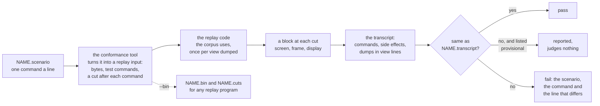

# ADR-1504: Tier 1 scenarios: readable files that each check one behaviour, played through the replay interface and judged by a transcript

## Summary

- **Decided (proposed):** tier 1 gains scenarios beside the replay corpus and the capability probes. A scenario is a short text file under tools/conformance/scenarios/ that names the specification or decision it checks, sets up one case, sends the program's bytes and the user's keys, mouse, paste, selection and scrollback moves, and asks for dumps of the screen. Its golden is a transcript: each command echoed, then what vtium wrote back, copied or rang for that command, then each dump, printed in the replay interface's own view lines. A scenario has no runner of its own: the conformance tool turns it into a replay input (the program's bytes, a test command for each user action and a cut after each command), plays it through the same replay code the corpus uses, and prints the transcript from the blocks. Actions the interface lacks today (selecting, copying, jumping between prompts, the BackSpace setting, a dump of the screen's state, the bell) join the interface as vtium's additions, so the corpus and the probes can use them too. A new transcript is provisional until the maintainer reviews it, and the replay corpus stays the primary judge.
- **Trades away:** tier 1's interface grows by five commands and three kinds of line, which every implementation of the interface owes once it claims them. Each scenario replays once for each view it dumps, so one that dumps the screen and the frame costs twice a corpus case of its length, and a cut after every command prints a block the transcript mostly discards. Scenarios reach only what vtium-term does behind the replay interface; the vtium binary's own bindings (Shift+PageUp, a double click, the Shift override, natural scrolling) stay in the booted binary's tests.
- **One-way?** No. Scenarios are files added beside the corpus, and the interface additions raise its minor version, which changes no existing golden. Removing them later deletes files and commands.
- **Probes:** *Confident (one judge, one program):* a scenario runs through the same replay program and the same reference host as the corpus, so a scenario and a corpus case that feed vtium the same input cannot disagree about what vtium did. *Not confident (how the maintainer reviews a new transcript):* the maintainer reviews a new scenario by playing it in a terminal with `conformance scenarios --play NAME`, which steps through its commands and draws each dumped screen with its colors and attributes, rather than by reading the transcript file.
- **Inversion:** Between "a behaviour is checked by a Rust test inside the crate" (exact and quick, but readable only as Rust, and judged by assertions instead of a reviewed golden) and "a behaviour is checked by a case in the replay corpus" (judged by a golden, but one long stream whose failure points at a block). A scenario is a corpus case cut down to one behaviour and written as text, with a readable golden, and it shares the corpus's runner and output format instead of standing beside it as a third harness.

## Context

Tier 1 judges vtium-term through the replay interface: a program plays a byte stream into the terminal and prints the screen as text, in the screen view (rows and attribute runs), the frame view (each cell as drawn) and, for pictures, placement and image lines. The corpus, about 190 cases, holds long streams, and it has to: vtium checks picture placement, picture layers and every drawn text effect through the frame view, which a text-only dump cannot show. When a long case fails, the runner reports the case and the block that differs. A reader then has to find which of the tens of events in the stream before that block caused the difference.

The interface already lets a stream carry user actions as test commands: `key`, `mouse`, `paste`, `focus`, `palette`, `resize`, the scrollback view's `sb-up`, `sb-down` and `sb-reset`, and vtium's `clipboard`. The corpus uses each of them in one long case, and about fifteen probes check single replies with assertions. The probes are written in a small readable language (`size`, `send "..."`, `cmd TEXT`, `check`, `want`, `reply`), and each judges one capability for the capability list.

A gap-check (the second evidence entry) read what vtium tests today for keys, the mouse, paste, the selection and copy, the scrollback view, the palette, resets and replies. vtium-term's own integration tests cover nearly all of it, and they go through the terminal as a host does: they press keys, click and paste through the terminal's calls and read back the bytes the program would read. What they lack is a golden. Each asserts the values its author thought to check, and a change it does not assert passes. Tier 1, which does have goldens, reaches none of the selection, copy or prompt jumps, because the interface has no command for them and no view shows a selection. Nothing tests the kitty keyboard protocol (planned, not built), the selection on the alternate screen, or the full table of keys across their modifiers and modes. ADR-1004's right-to-left work needs cursor, selection, mouse and arrow-key cases that tier 1 can judge.

The pattern this record takes came from a Rust port of the screen library proposed to `kmscon/kmscon` (the upstream entry in the basis): small scenario files of one command a line, and a transcript that echoes each command and prints its side effects and the dumps it asks for. vtium takes that pattern and nothing else. Its language, its commands and its transcript are vtium's own, fitted to vtium's replay interface, and every scenario is written from a specification or a vtium decision.

Terms used below. The replay interface is the command line and output contract of `vtium-replay`, written in tools/conformance/corpus/INTERFACE.md with vtium's additions in tools/conformance/INTERFACE-vtium.md. A test command is the interface's way of putting a host action into a stream: `ESC _ tsm-test;NAME;KEY=VALUE... ESC \`. A cut is a byte offset at which the replay prints a block, the screen at that point. A view is the form a block takes: screen, frame, or, once ADR-1004's frame slice lands, display. A transcript is a scenario's golden. A provisional golden is one the maintainer has not reviewed yet, and it judges nothing.

## Decision

### D1: three kinds of tier 1 test

Tier 1 holds three kinds of test, each with its own job:

- **The corpus** (tools/conformance/corpus/ and vtium/) is the primary judge. Its long streams, recorded from programs or generated, are judged by their goldens in the screen and frame views, and pictures are judged only there.
- **The probes** (tools/conformance/probes/) say whether a capability works, for the capability list. A probe asserts the lines it names and nothing else.
- **The scenarios** (tools/conformance/scenarios/) each check one behaviour, and the whole transcript is the golden, so any change in what vtium sent back, copied or showed fails the scenario that saw it.

A scenario does not replace a corpus case. When a corpus case and a scenario both cover a behaviour, both judge it.

### D2: the scenario language

A scenario is a UTF-8 text file with one command a line. Blank lines are ignored. A `#` at the start of a line, or after a space outside a string, starts a comment that runs to the end of the line. A command is a name, then arguments separated by spaces: bare words, `KEY=VALUE` pairs, `COL,ROW` cell positions after the word `at`, and strings in double quotes. Inside a string, `\e`, `\a`, `\b`, `\t`, `\n`, `\r`, `\\` and `\"` stand for one byte each, `\xHH` for the byte HH, `\u{HEX}` for the UTF-8 of the code point HEX, and every other character for its UTF-8. The probe files and the interface's worked examples read their `send` strings with the same parser, so the three take one string syntax; `\a`, `\b` and `\u{HEX}` are new to the probes and change no existing probe.

Every scenario starts with a header of comments. One of them is `# spec: TEXT`, naming the specification or the vtium decision its expected output follows, such as `# spec: ctlseqs, PC-Style Function Keys` or `# spec: ADR-1004 D10`. The runner refuses a scenario without one. A `# covers: ID...` line in the header names the ADR-1000 rows the scenario checks (D7).

The first command is `size COLS ROWS`, the screen the replay starts with. The reference host's other settings are those of the interface's "Reference host" table, and a scenario changes one with a command.

The commands:

| Command | What it does | Becomes in the replay input |
|---|---|---|
| `size COLS ROWS` | The starting screen. First, and only once. | the command line's size |
| `needs FEATURE...` | The interface features the scenario needs beyond those its commands imply, as a probe's `needs` line. | nothing; the runner checks `--describe` |
| `send "..."` | The program writes these bytes. | the bytes |
| `key NAME [mods=M+M] [ascii=NAME] [char="c"\|none]` | The user presses a key. NAME is an X11 keysym name (`Up`, `KP_Enter`, `F5`, `BackSpace`, `space`, `Cyrillic_es`), one printable ASCII character, or `0x` and a keysym in hex. Modifiers are `shift`, `lock`, `ctrl`, `alt` and `logo`. The runner fills `ascii` and the character from the name, and the key says them only to differ, as a key on a non-ASCII layout does. | `key;sym=...;ascii=...;unicode=...;mods=...` |
| `type "..."` | The user types each character of the string, one key each. | one `key` for each character |
| `mouse press\|release BUTTON at COL,ROW [px=X,Y] [mods=M+M]` | A button goes down or up over a cell. BUTTON is `left`, `middle` or `right`. | `mouse;...;event=press` or `release` |
| `mouse move [BUTTON] at COL,ROW [px=X,Y] [mods=M+M]` | The pointer moves, with a button held or none. | `mouse;...;event=move` |
| `wheel up\|down at COL,ROW [mods=M+M]` | One step of the wheel. | `mouse;...;button=wheel-up` or `wheel-down;event=press` |
| `paste "..."` | The user pastes the text. | `paste;hex=...` |
| `focus in\|out` | The terminal gains or loses focus. | `focus;in=1` or `0` |
| `select start\|to\|word\|line\|output at COL,ROW` | The host starts a selection, extends it, or selects a word, a line or a command's output at a cell of the view. | `select;how=...;col=...;row=...` (D4) |
| `select clear` | The host clears the selection. | `select;how=clear` (D4) |
| `copy` | The host copies the selection. | `copy` (D4) |
| `clipboard` | The host takes what OSC 52 set. | `clipboard` |
| `view up N\|down N\|bottom` | The host moves the view through the scrollback. | `sb-up`, `sb-down`, `sb-reset` |
| `view prompt-up\|prompt-down` | The host moves the view to the previous or next marked prompt. | `prompt;dir=up` or `down` (D4) |
| `scrollback N` | The host sets the most lines the scrollback holds. | `sb-max;n=N` |
| `resize COLS ROWS` | The host resizes the screen. | `resize;c=...;r=...` |
| `palette NAME` | The host chooses a named palette. | `palette;name=...` |
| `backspace bs\|del` | The host chooses what BackSpace sends. | `backspace;del=0` or `1` (D4) |
| `cmd TEXT` | Any other test command, written as the interface writes it, for an action the language has no word for yet, such as the image commands. | `TEXT` |
| `dump [screen] [frame] [display] [state]` | Print the screen in each view named, and the screen's state. With no word, `screen`. | `state` for the state (D4), and a cut |

A selection, a mouse event and a view move name cells of the view, counted from 0 at the top left of what the screen shows, as a host names the cell under the pointer. With right-to-left text that is the cell as drawn, and vtium-term maps it to the logical cell (ADR-1004 D10).

An example, whose expected values the transcript in D3 shows:

```
# Cursor keys in normal and application mode, with Shift.
# spec: ctlseqs, PC-Style Function Keys; DECCKM
# covers: DEC-1
size 10 2
key Up
send "\e[?1h"
key Up
key Up mods=shift
send "\e[?1$p"
dump
```

### D3: the transcript

A scenario's transcript, its golden, is a text file printed from the replay's output in this order:

- Each command, as written with its comments removed and its spaces collapsed, after `> `. The header's comments are not echoed.
- After each command, its side effects, each on a line after `< `, in the order the replay reported them for that command:
  - `< reply "..."`: the bytes vtium wrote back to the program, as one string for each run of replies between two image host requests, with printable ASCII as itself, `\e`, `\a`, `\b`, `\t`, `\n`, `\r`, `\\` and `\"` for those bytes, and `\xhh` for every other byte;
  - `< host: ...`: an image host request, as the interface prints it;
  - `< copy "..."` or `< copy none`: what `copy` copied, as the interface's `test copy` line says;
  - `< clipboard "..."` or `< clipboard none`: what `clipboard` took;
  - `< bell N`: the bells the command rang, when it rang any;
  - `< error N`: the refusal of a command that sets something, as the interface's `test NAME error N` line says.
- After a `dump`, the dump, its lines unindented: for each view it names, the lines of that view's block at the dump's cut, in the order the interface prints them, without the `reply` and `host:` lines, which the side effects already printed; then, for `state`, the `test state` lines.

The dumps reuse the views' formats exactly. A dump's screen is the screen view's `size`, `cursor`, `flags`, `row` and `attr` lines, its frame the frame view's, and with pictures the `placement` and `image` lines. The interface check reads every dump line of every transcript against the grammar, as it reads the corpus's goldens. A reader who knows one format reads both, and a dump that differs from a corpus golden's block differs in the same words.

Side effects keep their order across commands, since each command has its own cut. Within one command, replies and image host requests keep their order in the stream, and the bells follow them. A scenario that needs a bell's order against a reply puts the BEL in a `send` of its own.

The transcript of the example in D2:

```
> size 10 2
> key Up
< reply "\e[A"
> send "\e[?1h"
> key Up
< reply "\eOA"
> key Up mods=shift
< reply "\e[1;2A"
> send "\e[?1$p"
< reply "\e[?1;1$y"
> dump
size 10x2
cursor 0,0
flags AUTO_WRAP
row 0 ||
row 1 ||
```

### D4: one runner, through the replay interface

The conformance tool runs scenarios. It turns each one into a replay input in memory: `send` strings go in as their bytes, every other action becomes its test command, and the input has a cut after each command. It plays the input through the same replay code that `vtium-replay` and the corpus use, at the scenario's size and with the reference host, once for each view the scenario's dumps name (the screen view when none does). It then prints the transcript from the blocks: the replies, host requests and `test` lines of every block between two commands' cuts belong to the later command, and a dump takes the block at its own cut in the view it names.

Since a scenario is a replay input, everything the runner checks for a corpus case it checks for a scenario. The chunking check replays each scenario with extra cuts at random offsets outside its test commands, and the transcript must come out the same, because the runner joins every block between two commands' cuts. The interface check reads every dump line against the grammar. `conformance scenarios --bin NAME DIR` writes the input as `NAME.bin` and `NAME.cuts`, so another implementation of the interface, or a person with `vtium-replay`, can play the scenario directly. No `.bin` of a scenario is committed: the scenario file is its only source.

The actions the interface lacks join it as vtium's additions in tools/conformance/INTERFACE-vtium.md, as interface 1.3. Each is a command, a feature, or a line that only a new command or feature prints, so it raises the minor version and changes no golden:

| Addition | Feature | What it does |
|---|---|---|
| `select` with `how` (`start`, `to`, `word`, `line`, `output`, `clear`), `col` and `row` | `selection` | Selects as the host does at a cell of the view, through vtium-term's selection calls. |
| `copy` | `selection` | Prints `test copy HEX`, the selection's text as UTF-8 in two lowercase hex digits a byte, or `test copy none`. |
| `prompt` with `dir` (`up`, `down`) | `marks` | Moves the view to the previous or next marked prompt. |
| `backspace` with `del` (flag) | `backspace` | Chooses whether BackSpace sends 0x08 or 0x7f. |
| `state` | `state` | Prints the screen's state as `test state` lines (below). |
| a `bell N` line among a block's replies | `bell` | N bells reached the host since the previous block. |

The `state` lines name what no view shows and a host or a reviewer needs to see: the scroll margins, the tab stops, the DEC private and ANSI modes that are set (by number, as DECRQM numbers them), the mouse tracking mode and encoding, the scrollback's line count, view position and limit, the pen, and the default and cursor colors. Their exact forms and grammar land with the build, in INTERFACE-vtium.md.

The figure shows the flow from a scenario file to its verdict.



### D5: where scenarios live and how they are named

Scenarios live in tools/conformance/scenarios/, each as `NAME.scenario` beside its transcript `NAME.transcript`, so a reviewer reads the two side by side. A name is lowercase words joined by hyphens, starting with its area: `key-`, `keypad-`, `mouse-`, `paste-`, `focus-`, `select-`, `view-`, `palette-`, `reset-`, `reply-`, and `bidi-` for ADR-1004's cases, then what it checks, as in `key-cursor-decckm` or `select-word-across-wrap`. One scenario checks one behaviour, so its name says which.

`make conformance` runs every scenario after the corpus and before the probes, in the build with images, and CI's conformance job runs it. A scenario that needs a feature the build does not declare is reported as not run, and the run fails on it, as a probe that needs one does. `cargo test -p vtium-conformance` runs the language's own tests: the parser on good and bad files, the compiler's replay input for each command, and the transcript printer on blocks written in the tests.

### D6: a new transcript is provisional, then judges

A transcript is vtium's own golden. The author of a new scenario writes its transcript with `conformance scenarios --write NAME`, which plays the scenario and writes `NAME.transcript`, and refuses when the file exists. The new scenario's name goes into tools/conformance/scenarios/provisional.tsv, in the format of vtium/provisional.tsv (`NAME`, a tab, the reason), in the same commit. A provisional scenario runs on every `make conformance` and a difference is reported, but it fails nothing.

The maintainer reviews provisional transcripts in a pass of their own. `conformance scenarios --play NAME...` plays each in the reviewer's terminal one command at a time: it shows the command, prints its side effects, draws each dumped screen in the terminal with its colors and attributes, and waits for a key. A transcript the maintainer accepts leaves the provisional list in a commit of its own, and from then on it judges. After that, a transcript changes only in a golden commit, which lists each scenario whose transcript moved and the lines that moved; `--write --replace NAME` writes it, and the author of the change it judges never runs that.

### D7: coverage tags

A scenario names the ADR-1000 rows it checks in a `# covers: ID...` line of its header, as a replay file names them outside a probe stanza. docs/scripts/coverage reads `*.scenario` files as it reads `*.replay` files, and a tag names the file, `tools/conformance/scenarios/NAME.scenario`, in the row's `tests` column. The tag goes on a scenario only when the scenario drives the row's behaviour and its transcript shows the result, as AGENTS.md asks of a test.

### D8: the right-to-left cases

ADR-1004 decides that vtium-term computes the order a paragraph is drawn in, and that the selection, the mouse, the cursor and the arrow keys all use it (ADR-1004 D9 to D11). Its tier 1 work adds a display view, under the interface feature `bidi`, that prints each row in visual order. Scenarios are how tier 1 judges D9 to D11 one rule at a time:

- `dump display` prints the display view's block, so a scenario shows a mixed line as drawn beside `dump screen`'s logical order.
- `select ... at COL,ROW` and the mouse commands name cells as drawn, as a host does. A scenario selects across a mixed row and its `copy` shows the logical text (D10); a mouse report's `< reply` shows the logical column (D10).
- The cursor's cell and side show in the frame and display dumps (D9).
- `key Left` and `key Right` show their sequences with mode 1243 set and reset, in a right-to-left and a left-to-right paragraph (D11).

The `bidi-` scenarios land with ADR-1004's frame slice, and the feature `bidi` in their `needs` line keeps them from running in a build without it.

### D9: the work, in slices

1. **This record**, read by the maintainer.
2. **The runner and the language over today's interface:** the parser, the string syntax shared with the probes, the compiler, the transcript printer, `--write`, `--bin`, `--play`, the provisional list, the chunking and interface checks over scenarios, `make conformance`, coverage's reading of `*.scenario`, and a section in tools/conformance/README.md. The first scenarios use only today's commands, taken from the gap-check: the cursor keys, the editing pad and the function keys F1 to F12 with each modifier and under DECCKM; the keypad under DECKPAM, DECNKM and NumLock; Alt under 1036 and 1034; modifyOtherKeys; each mouse tracking mode with each encoding and each button, wheel down included; bracketed and plain paste with each filtering rule; focus; the palette choice; DA, DSR and DECRQM; DECSTR and RIS. Each transcript is provisional.
3. **Interface 1.3:** `select`, `copy`, `prompt`, `backspace`, `state` and the `bell` line in vtium-replay and INTERFACE-vtium.md, with their grammar, worked examples and probes; then the selection, copy and view scenarios, the selection on the alternate screen among them, and `dump state` in the scenarios that need it.
4. **Right-to-left:** with ADR-1004's frame slice, `dump display` and the `bidi-` scenarios for D9 to D11.
5. **The maintainer's review** of the provisional transcripts through `--play`, which may run after each of slices 2 to 4.

Each slice lands through the working loop in AGENTS.md. Slices 2 and 3 are one owner each, in tools/conformance; slice 4 belongs to the owner of ADR-1004's frame slice.

## Consequences

### Positive

- A failure names one behaviour: the scenario's name, the command, and the line of the transcript that differs.
- A reviewer reads a scenario and its transcript as text, with the replies spelled out and the screen in the same lines the corpus uses, and can play it in a terminal.
- Keys, the mouse, paste and replies, which vtium-term tests only with assertions, gain goldens that catch a change nobody thought to assert.
- The selection, copy and prompt jumps reach tier 1 for the first time, and the corpus and probes can use the new commands too.
- One runner, one reference host and one output format serve the corpus and the scenarios, so they never drift apart.
- ADR-1004's cursor, selection, mouse and arrow-key rules each get a case tier 1 judges.

### Negative

- The interface grows by five commands and three kinds of line, and every implementation that claims their features owes them.
- A scenario replays once for each view it dumps, and prints a block at every command that the transcript mostly discards; for a scenario of a few dozen commands on a small screen this is milliseconds, but a scenario on a large screen with many commands costs more than a corpus case of the same length.
- Many small transcripts mean many small golden reviews. A change to a common reply, such as DA1's, moves every transcript that asks for it, and its golden commit lists each.
- The bell's order within one command is not recorded; a scenario that needs it splits the command.
- The vtium binary's own bindings stay outside tier 1, in crates/vtium/tests/boot.rs.

### Neutral

- vtium-term's integration tests stay. A scenario and a Rust test can check the same behaviour, the one by its golden and the other by its assertions.
- The capability list keeps judging capabilities through the probes. A scenario never sets a capability's status.
- The draw2 view, which vtium does not owe, has no dump.

## Open questions

1. **Does a provisional scenario's `covers:` tag count toward its row's coverage?** A provisional golden judges nothing, so a scenario on the provisional list checks nothing yet. Lean: no; coverage reads scenarios/provisional.tsv and leaves out the tags of the scenarios it lists, and `--update` adds them once a scenario leaves it. Evidence: AGENTS.md says a provisional golden judges nothing and that a tag goes on a test that checks the result; against it, coverage then reads one more file.
2. **Should the probes become scenarios with assertions?** The two languages share their string syntax and the commands `size`, `send` and `cmd` (D2). Lean: keep them apart for now, since a probe judges a capability by named lines and a scenario judges a behaviour by its whole transcript; look again once the scenarios of slice 2 exist, when it is clear how many probes are scenarios in all but name. Evidence: the probe runner's checks (a `missing` probe must fail, every probe must be in the capability list) have no meaning for a scenario.
3. **Which state lines does `dump state` print?** D4 names what they cover. Lean: decide their exact forms in slice 3 from the first scenarios that need them, and print only what neither view nor a program's own query shows, so that a state dump does not duplicate DECRQM's answers. Evidence: the gap-check found margins, tab stops, the mouse mode and the scrollback position visible to tier 1 only through queries or not at all.

## Prior art

The C reference's tier 1 was its replay program, with the corpus and the capability probes that vtium copied and made its own (ADR-1503). It had no scenario files: its keys, mouse and paste were judged by one long corpus case each and by single-reply probes.

A Rust port of the screen library proposed to `kmscon/kmscon` (the upstream entry in the basis) judged its screen library with scenario files and transcripts. vtium takes from it the pattern of one command a line with quoted escaped strings, and of a transcript that echoes each command, prints its side effects in order and then the dumps a scenario asks for. vtium does not take its runner, which drove the screen library directly from a cargo test; its dump formats, which were its own; its fresh 80 by 24 screen; or its way of rewriting failing transcripts by setting an environment variable. vtium copies no scenario, transcript or code from it.

## Alternatives Considered

- **A runner of its own in vtium-term's tests, driving the terminal directly as the port did.** It is quick to build and needs no interface change, but it is a second host beside the replay's, with its own copy of the reference host's settings and of the key and mouse mapping, and it would skip the chunking check and the grammar. A scenario could then pass while the same input failed in a corpus case. Rejected for one runner.
- **Write each behaviour as a probe.** Probes already have a readable language. But a probe asserts only the lines its author named, so it misses every change it did not name, and probes belong to the capability list, whose rules (a `missing` probe must fail) do not fit a behaviour check. Rejected; the languages share their syntax instead (D2).
- **Commit each scenario's compiled `.bin` and cuts beside it, as a corpus case.** Any replay program could play it without the conformance tool, but every scenario would have two sources that must agree. Rejected for `--bin`, which writes them on demand.
- **Use the replay's own output, its blocks with replies in hex, as the transcript.** It needs no printer, but a reply in hex is not readable, and a block at every command repeats the whole screen. Rejected for D3, which keeps the view lines for dumps and spells replies out.
- **Dump formats of the scenarios' own, as the port's were.** They could be tidier for a reader, but tier 1 would then have two ways of printing one screen, and the grammar would not check them. Rejected.
- **Let scenarios replace the long corpus cases for keys, mouse and paste.** Rejected by the maintainer's reasoning: the corpus stays the primary judge, and its pictures and drawn effects need its views.
- **Cover the vtium binary's bindings in scenarios too.** The Shift override, click counts, natural scrolling and the host's key chords live in the vtium binary, not behind the replay interface; bringing them in would need the binary in the replay. Rejected; crates/vtium/tests/boot.rs tests them through the booted binary.
