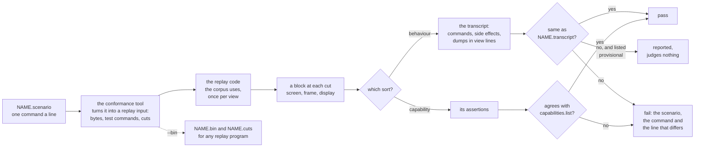

# ADR-1504: Tier 1 scenarios: readable files that each check one behaviour, played through the replay interface and judged by a transcript

## Summary

> Edited 2026-11-06: the maintainer chose to merge the capability probes into the scenarios (the third `considered` entry), so tier 1 has one readable test format beside the binary corpus. The earlier draft kept the probes as a third kind of test with a language of their own; git keeps that text.

- **Decided (proposed):** tier 1 holds two kinds of test: the replay corpus, which stays the primary judge, and scenarios. A scenario is a short text file under tools/conformance/scenarios/ that names the specification or decision it checks, sets up one case, sends the program's bytes and the user's keys, mouse, paste, selection and scrollback moves, and asks for dumps of the screen or makes assertions about it. A behaviour scenario checks one behaviour, and its golden is a transcript: each command echoed, then what vtium wrote back, copied or rang for that command, then each dump, printed in the replay interface's own view lines. A capability scenario names a capability of tools/conformance/capabilities.list in its header and is judged by its assertions, in the forms the capability probes used, and `make conformance-probes` judges the capability list through these scenarios with the probe runner's rules. Each stanza of the two probe files becomes one capability scenario, and tools/conformance/probes/ goes. Scenarios have no runner of their own: the conformance tool turns each into a replay input (the program's bytes, a test command for each user action, and its cuts), plays it through the same replay code the corpus uses, and prints the transcript or judges the assertions from the blocks. Actions the interface lacks today (selecting, copying, jumping between prompts, the BackSpace setting, a dump of the screen's state, the bell) join the interface as vtium's additions. A new transcript is provisional until the maintainer reviews it by playing it in a terminal.
- **Trades away:** tier 1's interface grows by five commands and three kinds of line, which every implementation of the interface owes once it claims them. Each behaviour scenario replays once for each view it dumps, so one that dumps the screen and the frame costs twice a corpus case of its length, and a cut after every command prints a block the transcript mostly discards. The probe files, their reader and the rule that let a probe of vtium's replace a copied placeholder go; 58 small files take the place of two. Scenarios reach only what vtium-term does behind the replay interface; the vtium binary's own bindings (Shift+PageUp, a double click, the Shift override, natural scrolling) stay in the booted binary's tests.
- **One-way?** No. Scenarios are files added beside the corpus, and the interface additions raise its minor version, which changes no existing golden. The conversion deletes the probe files, and git keeps them; it is checked to change no capability's verdict.
- **Probes:** *Confident (one judge, one program):* a scenario runs through the same replay program and the same reference host as the corpus, so a scenario and a corpus case that feed vtium the same input cannot disagree about what vtium did. *Not confident (how the maintainer reviews a new transcript):* the maintainer reviews a new scenario by playing it in a terminal with `conformance scenarios --play NAME`, which steps through its commands and draws each dumped screen with its colors and attributes, rather than by reading the transcript file.
- **Inversion:** Between "a behaviour is checked by a Rust test inside the crate" (exact and quick, but readable only as Rust, and judged by assertions instead of a reviewed golden) and "a behaviour is checked by a case in the replay corpus" (judged by a golden, but one long stream whose failure points at a block). A scenario is a corpus case cut down to one behaviour and written as text, judged by a readable golden or by assertions, and it shares the corpus's runner and output format. With the probes folded in, tier 1 has the binary corpus and one readable format.

## Context

Tier 1 judges vtium-term through the replay interface: a program plays a byte stream into the terminal and prints the screen as text, in the screen view (rows and attribute runs), the frame view (each cell as drawn) and, for pictures, placement and image lines. The corpus, about 190 cases, holds long streams, and it has to: vtium checks picture placement, picture layers and every drawn text effect through the frame view, which a text-only dump cannot show. When a long case fails, the runner reports the case and the block that differs. A reader then has to find which of the tens of events in the stream before that block caused the difference.

The interface already lets a stream carry user actions as test commands: `key`, `mouse`, `paste`, `focus`, `palette`, `resize`, the scrollback view's `sb-up`, `sb-down` and `sb-reset`, and vtium's `clipboard`. The corpus uses each of them in one long case. The capability probes, 59 stanzas in tools/conformance/probes/probes.replay and probes/vtium.replay, are written in a small readable language (`size`, `send "..."`, `cmd TEXT`, `check`, `want`, `reply`), and each judges one of the 58 capabilities in tools/conformance/capabilities.list, 52 listed `works` and 6 `missing`. One stanza of vtium's file takes the place of a placeholder of the same name in the copied file, and three placeholders remain. No stanza carries a `# covers:` tag: each capability's ADR-1000 rows are in the list's ROWS column, and tools/conformance/COVERAGE.md is generated from the list and ADR-1000's tables.

A gap-check (the second evidence entry) read what vtium tests today for keys, the mouse, paste, the selection and copy, the scrollback view, the palette, resets and replies. vtium-term's own integration tests cover nearly all of it, and they go through the terminal as a host does: they press keys, click and paste through the terminal's calls and read back the bytes the program would read. What they lack is a golden. Each asserts the values its author thought to check, and a change it does not assert passes. Tier 1, which does have goldens, reaches none of the selection, copy or prompt jumps, because the interface has no command for them and no view shows a selection. Nothing tests the kitty keyboard protocol (planned, not built), the selection on the alternate screen, or the full table of keys across their modifiers and modes. ADR-1004's right-to-left work needs cursor, selection, mouse and arrow-key cases that tier 1 can judge.

The pattern this record takes came from a Rust port of the screen library proposed to `kmscon/kmscon` (the upstream entry in the basis): small scenario files of one command a line, and a transcript that echoes each command and prints its side effects and the dumps it asks for. vtium takes that pattern and nothing else. Its language, its commands and its transcript are vtium's own, fitted to vtium's replay interface, and every scenario is written from a specification or a vtium decision.

The maintainer answered the draft's questions on 2026-11-06 (the `considered` entries): a new transcript is reviewed by playing it, a provisional scenario's coverage tag does not count yet, and the probes merge into the scenarios now, so that tier 1 has one readable test format beside the binary corpus.

Terms used below. The replay interface is the command line and output contract of `vtium-replay`, written in tools/conformance/corpus/INTERFACE.md with vtium's additions in tools/conformance/INTERFACE-vtium.md. A test command is the interface's way of putting a host action into a stream: `ESC _ tsm-test;NAME;KEY=VALUE... ESC \`. A cut is a byte offset at which the replay prints a block, the screen at that point. A view is the form a block takes: screen, frame, or, once ADR-1004's frame slice lands, display. A transcript is a behaviour scenario's golden. A provisional golden is one the maintainer has not reviewed yet, and it judges nothing. A capability is a line of capabilities.list: a name, whether vtium has it (`works` or `missing`), the issue that owes it or the build feature it needs, and its ADR-1000 rows.

## Decision

### D1: two kinds of tier 1 test

Tier 1 holds two kinds of test:

- **The corpus** (tools/conformance/corpus/ and vtium/) is the primary judge. Its long streams, recorded from programs or generated, are judged by their goldens in the screen and frame views, and pictures are judged only there.
- **The scenarios** (tools/conformance/scenarios/) are short and readable, and each checks one thing. A scenario is one of two sorts, which its header says:
  - A **behaviour scenario** checks one behaviour. Its whole transcript is its golden, so any change in what vtium sent back, copied or showed fails the scenario that saw it. It may also carry assertions, which judge even while its transcript is provisional.
  - A **capability scenario** names one capability of capabilities.list in a `# capability: NAME` header line, and is judged by its assertions alone, against the list, as a probe was (D4). It has no transcript.

A scenario does not replace a corpus case. When a corpus case and a scenario both cover a behaviour, both judge it.

### D2: the scenario language

A scenario is a UTF-8 text file with one command a line. Blank lines are ignored. A `#` at the start of a line, or after a space outside a string, starts a comment that runs to the end of the line. A command is a name, then arguments separated by spaces: bare words, `KEY=VALUE` pairs, `COL,ROW` cell positions after the word `at`, and strings in double quotes. Inside a string, `\e`, `\a`, `\b`, `\t`, `\n`, `\r`, `\\` and `\"` stand for one byte each, `\xHH` for the byte HH, `\u{HEX}` for the UTF-8 of the code point HEX, and every other character for its UTF-8. The interface's worked examples read their `send` strings with the same parser, so the two take one string syntax.

Every scenario starts with a header of comments. One of them is `# spec: TEXT`, naming the specification or the vtium decision its expected output follows, such as `# spec: ctlseqs, PC-Style Function Keys` or `# spec: ADR-1004 D10`. The runner refuses a scenario without one. A behaviour scenario may have a `# covers: ID...` line naming the ADR-1000 rows it checks (D7). A capability scenario has a `# capability: NAME` line and no `# covers:` line, since the list's ROWS column names its rows.

The first command is `size COLS ROWS`, the screen the replay starts with. The reference host's other settings are those of the interface's "Reference host" table, and a scenario changes one with a command.

The commands that set up the case and act on it:

| Command | What it does | Becomes in the replay input |
|---|---|---|
| `size COLS ROWS` | The starting screen. First, and only once. | the command line's size |
| `view screen\|frame\|display` | The view the assertions judge, the screen view when not given. Once, before any action. | the command line's view flag for the run the assertions read |
| `needs FEATURE...` | The interface features the scenario needs beyond those its commands and view imply. | nothing; the runner checks `--describe` |
| `fixture NAME` | A file in tools/conformance/fixtures/ that the scenario's fixture directory holds, as XTGETTCAP's table for `termcap`. | the fixture directory |
| `send "..."` | The program writes these bytes. | the bytes |
| `key NAME [mods=M+M] [ascii=NAME] [char="c"\|none]` | The user presses a key. NAME is an X11 keysym name (`Up`, `KP_Enter`, `F5`, `BackSpace`, `space`, `Cyrillic_es`), one printable ASCII character, or `0x` and a keysym in hex. Modifiers are `shift`, `lock`, `ctrl`, `alt` and `logo`. The runner fills `ascii` and the character from the name, and the key says them only to differ, as a key on a non-ASCII layout does. | `key;sym=...;ascii=...;unicode=...;mods=...` |
| `type "..."` | The user types each character of the string, one key each. | one `key` for each character |
| `mouse press\|release BUTTON at COL,ROW [px=X,Y] [mods=M+M]` | A button goes down or up over a cell. BUTTON is `left`, `middle` or `right`. | `mouse;...;event=press` or `release` |
| `mouse move [BUTTON] at COL,ROW [px=X,Y] [mods=M+M]` | The pointer moves, with a button held or none. | `mouse;...;event=move` |
| `wheel up\|down at COL,ROW [mods=M+M]` | One step of the wheel. | `mouse;...;button=wheel-up` or `wheel-down;event=press` |
| `paste "..."` | The user pastes the text. | `paste;hex=...` |
| `focus in\|out` | The terminal gains or loses focus. | `focus;in=1` or `0` |
| `select start\|to\|word\|line\|output at COL,ROW` | The host starts a selection, extends it, or selects a word, a line or a command's output at a cell of the view. | `select;how=...;col=...;row=...` (D4) |
| `select clear` | The host clears the selection. | `select;how=clear` (D4) |
| `copy` | The host copies the selection. | `copy` (D4) |
| `clipboard` | The host takes what OSC 52 set. | `clipboard` |
| `scroll up N\|down N\|bottom` | The host moves the view through the scrollback. | `sb-up`, `sb-down`, `sb-reset` |
| `scroll prompt-up\|prompt-down` | The host moves the view to the previous or next marked prompt. | `prompt;dir=up` or `down` (D4) |
| `scrollback N` | The host sets the most lines the scrollback holds. | `sb-max;n=N` |
| `resize COLS ROWS` | The host resizes the screen. | `resize;c=...;r=...` |
| `palette NAME` | The host chooses a named palette. | `palette;name=...` |
| `backspace bs\|del` | The host chooses what BackSpace sends. | `backspace;del=0` or `1` (D4) |
| `cmd TEXT` | Any other test command, written as the interface writes it, for an action the language has no word for yet, such as the image commands. | `TEXT` |
| `dump [screen] [frame] [display] [state]` | In a behaviour scenario: print the screen in each view named, and the screen's state. With no word, `screen`. | `state` for the state (D4), and a cut |

The assertions are the forms the probes used, with their meanings unchanged. `check` marks a point in the scenario. The assertions after it judge the block at the latest cut, in the view the `view` line names, together with the replies and `test` lines since the previous `check`, or since the start.

| Assertion | Meaning |
|---|---|
| `check` | The point the assertions that follow judge. In a capability scenario it is also where a cut goes (D4). |
| `want LINE` | The block holds LINE. |
| `want-re REGEX` | A line of the block matches REGEX whole. |
| `reject LINE` | The block does not hold LINE. |
| `reject-re REGEX` | No line of the block matches REGEX whole. |
| `reply "..."` | The replies since the previous `check`, joined, are these bytes. |
| `reply-re "..."` | The replies match these bytes, read as a regular expression over bytes, whole. A metacharacter meant literally takes a backslash, written `\\`. |
| `example "..."` | Follows a `want-re` or `reply-re`: a line or reply, written as for `send`, that the expression must match. Required in the scenario of a `missing` capability. |
| `placeholder REASON` | In a capability scenario only: the scenario has nothing to run, and fails with REASON. |

The `want` and `want-re` assertions on `test` lines take them in order: each matches a line after the one the assertion before it matched. A regular expression uses no backreference or lookaround. Every line the replay prints must parse under the interface's grammar for the view. Unless the scenario needs `damage-exact` and the replay declares it, the output and the `want` and `reject` lines are masked as the interface's "Comparing with the goldens" says, and an expectation writes a nonzero count as `N`.

A behaviour scenario, whose expected values the transcript in D3 shows:

```
# Cursor keys in normal and application mode, with Shift.
# spec: ctlseqs, PC-Style Function Keys; DECCKM
# covers: DEC-1
size 10 2
key Up
send "\e[?1h"
key Up
key Up mods=shift
send "\e[?1$p"
dump
```

A capability scenario, as the conversion writes the probe `bracketed-paste`:

```
# spec: ADR-1000 DEC-2004
# capability: bracketed-paste
size 80 4
send "\e[?2004h"
check
paste "x"
check
reply "\e[200~x\e[201~"
```

### D3: the transcript

A behaviour scenario's transcript, its golden, is a text file printed from the replay's output in this order:

- Each command, as written with its comments removed and its spaces collapsed, after `> `. The header's comments, `check` and the assertions are not echoed.
- After each command, its side effects, each on a line after `< `, in the order the replay reported them for that command:
  - `< reply "..."`: the bytes vtium wrote back to the program, as one string for each run of replies between two image host requests, with printable ASCII as itself, `\e`, `\a`, `\b`, `\t`, `\n`, `\r`, `\\` and `\"` for those bytes, and `\xhh` for every other byte;
  - `< host: ...`: an image host request, as the interface prints it;
  - `< copy "..."` or `< copy none`: what `copy` copied, as the interface's `test copy` line says;
  - `< clipboard "..."` or `< clipboard none`: what `clipboard` took;
  - `< bell N`: the bells the command rang, when it rang any;
  - `< error N`: the refusal of a command that sets something, as the interface's `test NAME error N` line says.
- After a `dump`, the dump, its lines unindented: for each view it names, the lines of that view's block at the dump's cut, in the order the interface prints them, without the `reply` and `host:` lines, which the side effects already printed; then, for `state`, the `test state` lines.

The dumps reuse the views' formats exactly. A dump's screen is the screen view's `size`, `cursor`, `flags`, `row` and `attr` lines, its frame the frame view's, and with pictures the `placement` and `image` lines. The interface check reads every dump line of every transcript against the grammar, as it reads the corpus's goldens. A reader who knows one format reads both, and a dump that differs from a corpus golden's block differs in the same words.

Side effects keep their order across commands, since each command has its own cut. Within one command, replies and image host requests keep their order in the stream, and the bells follow them. A scenario that needs a bell's order against a reply puts the BEL in a `send` of its own.

The transcript of the behaviour scenario in D2:

```
> size 10 2
> key Up
< reply "\e[A"
> send "\e[?1h"
> key Up
< reply "\eOA"
> key Up mods=shift
< reply "\e[1;2A"
> send "\e[?1$p"
< reply "\e[?1;1$y"
> dump
size 10x2
cursor 0,0
flags AUTO_WRAP
row 0 ||
row 1 ||
```

### D4: one runner, through the replay interface

The conformance tool runs scenarios. It turns each one into a replay input in memory: `send` strings go in as their bytes, and every other action becomes its test command. A behaviour scenario's input has a cut after each command; a capability scenario's input has a cut at each `check` and nowhere else, exactly as a probe's had, so a frame view's `changed` count and the replies an assertion reads cover the same span they covered in the probe. The tool plays the input through the same replay code that `vtium-replay` and the corpus use, at the scenario's size and with the reference host, once for each view the scenario's dumps and its `view` line name (the screen view when none does).

For a behaviour scenario it then prints the transcript from the blocks: the replies, host requests and `test` lines of every block between two commands' cuts belong to the later command, and a dump takes the block at its own cut in the view it names. Its assertions, if any, are judged as well, and they fail the run even while the transcript is provisional.

For a capability scenario it judges the assertions, and `conformance probes`, which `make conformance-probes` runs, judges the capability list through them with the rules the probe runner applied:

- A capability listed `works` fails the run when an assertion of its scenario fails, and one listed `missing` fails the run when every assertion passes, so the change that builds a capability also sets its line to `works` and closes its issue. A placeholder counts as failing.
- A capability listed with a build feature (`-Dimages`) passes in a build with that feature and fails, as absent, in one without; the runner reports the build vtium-replay was made with, and a feature the build does not name fails the run.
- A capability scenario whose capability the list does not name, a name in the list that no scenario declares, and two scenarios that declare one capability each fail the run.
- A scenario whose fixture is missing is not judged, and that fails the run.
- Before anything runs, each capability scenario is checked: each `want` and `reject` line, and each `want-re` example, parses under the grammar for the scenario's view, with the interface's reserved keys allowed only in the scenario of a `missing` capability; each `want-re` and `reply-re` matches its example; the scenario of a `missing` capability gives every expression an example; a nonzero count or a placement's `changed` flag is refused with the advice to write `N` unless the scenario needs `damage-exact`; each assertion follows a `check` with no input between; and the scenario has a `want`, `want-re`, `reply` or `reply-re`, or is a placeholder.

`conformance issues` keeps reading capabilities.list as it does, and COVERAGE.md stays generated from the list and ADR-1000's tables. The rule that let a probe of vtium's file take the place of a copied placeholder goes, since each capability then has one file.

Since a scenario is a replay input, everything the runner checks for a corpus case it checks for a scenario. The chunking check replays each behaviour scenario with extra cuts at random offsets outside its test commands, and the transcript must come out the same, because the runner joins every block between two commands' cuts. The interface check reads every dump line and every assertion's expected line against the grammar. `conformance scenarios --bin NAME DIR` writes the input as `NAME.bin` and `NAME.cuts`, so another implementation of the interface, or a person with `vtium-replay`, can play the scenario directly. No `.bin` of a scenario is committed: the scenario file is its only source.

The actions the interface lacks join it as vtium's additions in tools/conformance/INTERFACE-vtium.md, as interface 1.3. Each is a command, a feature, or a line that only a new command or feature prints, so it raises the minor version and changes no golden:

| Addition | Feature | What it does |
|---|---|---|
| `select` with `how` (`start`, `to`, `word`, `line`, `output`, `clear`), `col` and `row` | `selection` | Selects as the host does at a cell of the view, through vtium-term's selection calls. |
| `copy` | `selection` | Prints `test copy HEX`, the selection's text as UTF-8 in two lowercase hex digits a byte, or `test copy none`. |
| `prompt` with `dir` (`up`, `down`) | `marks` | Moves the view to the previous or next marked prompt. |
| `backspace` with `del` (flag) | `backspace` | Chooses whether BackSpace sends 0x08 or 0x7f. |
| `state` | `state` | Prints the screen's state as `test state` lines (below). |
| a `bell N` line among a block's replies | `bell` | N bells reached the host since the previous block. |

The `state` lines name what no view shows and a host or a reviewer needs to see: the scroll margins, the tab stops, the DEC private and ANSI modes that are set (by number, as DECRQM numbers them), the mouse tracking mode and encoding, the scrollback's line count, view position and limit, the pen, and the default and cursor colors. Their exact forms and grammar land with the build, in INTERFACE-vtium.md.

The figure shows the flow from a scenario file to its verdict.



### D5: where scenarios live and how they are named

Scenarios live in tools/conformance/scenarios/. A behaviour scenario is `NAME.scenario` beside its transcript `NAME.transcript`, so a reviewer reads the two side by side. Its name is lowercase words joined by hyphens, starting with its area: `key-`, `keypad-`, `mouse-`, `paste-`, `focus-`, `select-`, `view-`, `palette-`, `reset-`, `reply-`, and `bidi-` for ADR-1004's cases, then what it checks, as in `key-cursor-decckm` or `select-word-across-wrap`. A capability scenario is named for its capability, `NAME.scenario` with NAME the capability's name in capabilities.list, since the list, COVERAGE.md and `conformance issues` already use those names; a new capability takes a name with an area prefix. No two scenarios share a name.

`make conformance` runs every behaviour scenario after the corpus, in the build with images, and `make conformance-probes` runs every capability scenario. Both targets keep their names and their jobs: the first judges vtium's output against goldens, the second judges the capability list. CI's conformance job runs both, as it does today, and neither AGENTS.md's gate line nor CI changes. A behaviour scenario that needs a feature the build does not declare is reported as not run, and the run fails on it. `cargo test -p vtium-conformance` runs the language's own tests: the parser on good and bad files, the compiler's replay input for each command, the transcript printer and the assertion judge on blocks written in the tests, and the capability rules of D4 on lists and scenarios written in the tests.

### D6: who judges, and when a scenario changes

A transcript is vtium's own golden. The author of a new behaviour scenario writes its transcript with `conformance scenarios --write NAME`, which plays the scenario and writes `NAME.transcript`, and refuses when the file exists. The new scenario's name goes into tools/conformance/scenarios/provisional.tsv, in the format of vtium/provisional.tsv (`NAME`, a tab, the reason), in the same commit. A provisional scenario runs on every `make conformance`, and a difference in its transcript is reported but fails nothing.

The maintainer reviews provisional transcripts by playing them (the first `considered` entry). `conformance scenarios --play NAME...` plays each in the reviewer's terminal one command at a time: it shows the command, prints its side effects, draws each dumped screen in the terminal with its colors and attributes, and waits for a key. A transcript the maintainer accepts leaves the provisional list in a commit of its own, and from then on it judges. After that, a transcript changes only in a golden commit, which lists each scenario whose transcript moved and the lines that moved; `--write --replace NAME` writes it, and the author of the change it judges never runs that.

A capability scenario has no transcript and never goes on the provisional list: its assertions and its line in capabilities.list judge from the commit that adds them, as a probe's did. Its assertions are expected results, so the author of a change never loosens the assertions that judge that change. A change to an existing capability scenario's assertions lands in a commit of its own that says what moved and why, and the maintainer reviews it as a golden commit; moving a capability from `missing` to `works` in the list is the one change the building commit makes itself, as today.

### D7: coverage tags

A behaviour scenario names the ADR-1000 rows it checks in a `# covers: ID...` line of its header. docs/scripts/coverage reads `*.scenario` files, and a tag names the file, `tools/conformance/scenarios/NAME.scenario`, in the row's `tests` column. The tag goes on a scenario only when the scenario drives the row's behaviour and its transcript or its assertions show the result, as AGENTS.md asks of a test.

A provisional scenario's tag does not count yet (the second `considered` entry). Coverage reads tools/conformance/scenarios/provisional.tsv and leaves out the tags of the scenarios it lists, so a row is not counted as tested by a golden that judges nothing. When a scenario leaves the list, `docs/scripts/coverage --update` adds its tag to the row's `tests` column.

A capability scenario carries no `# covers:` line, and coverage refuses one there: its rows are in capabilities.list's ROWS column, which COVERAGE.md reads, and saying them twice would let the two drift. No probe stanza carries a tag today, so no tag moves in the conversion. Coverage's rule for a tag above a `probe NAME` line, and its reading of `*.replay` files, go with the probe files, since no other replay file exists.

### D8: the right-to-left cases

ADR-1004 decides that vtium-term computes the order a paragraph is drawn in, and that the selection, the mouse, the cursor and the arrow keys all use it (ADR-1004 D9 to D11). Its tier 1 work adds a display view, under the interface feature `bidi`, that prints each row in visual order. Scenarios are how tier 1 judges D9 to D11 one rule at a time:

- `dump display` prints the display view's block, so a scenario shows a mixed line as drawn beside `dump screen`'s logical order.
- `select ... at COL,ROW` and the mouse commands name cells as drawn, as a host does. A scenario selects across a mixed row and its `copy` shows the logical text (D10); a mouse report's `< reply` shows the logical column (D10).
- The cursor's cell and side show in the frame and display dumps (D9).
- `key Left` and `key Right` show their sequences with mode 1243 set and reset, in a right-to-left and a left-to-right paragraph (D11).

ADR-1004's probe `bidi` is the capability scenario `bidi` after the conversion, with `view display`. The `bidi-` behaviour scenarios land with ADR-1004's frame slice, and the feature `bidi` in their `needs` line keeps them from running in a build without it.

### D9: the work, in slices

1. **This record**, read by the maintainer.
2. **The runner and the language over today's interface, for both sorts of scenario:** the parser, the string syntax shared with the interface's worked examples, the compiler and its cuts, the transcript printer, the assertion judge, the capability rules of D4, `--write`, `--bin`, `--play`, the provisional list, the chunking and interface checks over scenarios, `make conformance`, coverage's reading of `*.scenario` with the provisional rule of D7, and a section in tools/conformance/README.md. The probe runner keeps judging the capability list through the probe files during this slice. The first behaviour scenarios use only today's commands, taken from the gap-check: the cursor keys, the editing pad and the function keys F1 to F12 with each modifier and under DECCKM; the keypad under DECKPAM, DECNKM and NumLock; Alt under 1036 and 1034; modifyOtherKeys; each mouse tracking mode with each encoding and each button, wheel down included; bracketed and plain paste with each filtering rule; focus; the palette choice; DA, DSR and DECRQM; DECSTR and RIS. Each transcript is provisional.
3. **The conversion of the probes.** A converter writes one capability scenario for each probe, 58 files: the probe's name is the file's name and its `# capability:` line; the comments above the stanza become the header, with `# spec: ADR-1000 ROWS` taken from the list's ROWS column; every other line is copied, except that a `cmd` line for which the language has a word (`key`, `mouse`, `paste`, `focus`, `palette`, `resize`, the `sb-` commands, `clipboard`) becomes that word when the word compiles to the same bytes, and stays a `cmd` line otherwise; a placeholder's reason that describes the C reference is rewritten to say what vtium lacks. vtium's probe `osc-52-clipboard` is converted in place of the copied placeholder it replaced. The branch shows that each converted scenario's replay input equals its probe's, bytes and cuts, and that `conformance probes` gives every capability the verdict it gave before. In the same branch `conformance probes` switches to the capability scenarios; tools/conformance/probes/, the probe reader, the replacement rule and coverage's probe-stanza rule go; the converter is deleted after its run, and git keeps it; the README and AGENTS.md's tier table name tools/conformance/scenarios/ where they named the probe files, as the smallest edit ADR-1503 allows; and the records that name tools/conformance/probes/probes.replay as a path (ADR-1002, ADR-1003, ADR-1004) name the scenario instead, a stale path that needs no dated note. The conversion comes after slice 2 because it needs the runner to play the converted files and to prove the inputs equal, and before slice 3 so that the interface's new commands are written once, as scenario words, and the probe runner judges the list until the moment its replacement is proven.
4. **Interface 1.3:** `select`, `copy`, `prompt`, `backspace`, `state` and the `bell` line in vtium-replay and INTERFACE-vtium.md, with their grammar, worked examples and capability scenarios; then the selection, copy and view behaviour scenarios, the selection on the alternate screen among them, and `dump state` in the scenarios that need it.
5. **Right-to-left:** with ADR-1004's frame slice, `dump display`, the capability scenario `bidi` and the `bidi-` behaviour scenarios for D9 to D11.
6. **The maintainer's review** of the provisional transcripts through `--play`, which may run after each of slices 2, 4 and 5.

Each slice lands through the working loop in AGENTS.md. Slices 2, 3 and 4 are one owner each, in tools/conformance, one after another; slice 5 belongs to the owner of ADR-1004's frame slice.

## Consequences

### Positive

- A failure names one behaviour or one capability: the scenario's name, the command, and the line of the transcript or the assertion that differs.
- Tier 1 has one readable test format beside the binary corpus. A person who can read a capability scenario can read a behaviour scenario, and an assertion can be added to either.
- A reviewer reads a behaviour scenario and its transcript as text, with the replies spelled out and the screen in the same lines the corpus uses, and plays it in a terminal to review it.
- Keys, the mouse, paste and replies, which vtium-term tests only with assertions, gain goldens that catch a change nobody thought to assert.
- The selection, copy and prompt jumps reach tier 1 for the first time, and the corpus and the capability scenarios can use the new commands too.
- One runner, one reference host and one output format serve the corpus and the scenarios, so they never drift apart.
- ADR-1004's cursor, selection, mouse and arrow-key rules each get a case tier 1 judges.

### Negative

- The interface grows by five commands and three kinds of line, and every implementation that claims their features owes them.
- A behaviour scenario replays once for each view it dumps, and prints a block at every command that the transcript mostly discards; for a scenario of a few dozen commands on a small screen this is milliseconds, but a scenario on a large screen with many commands costs more than a corpus case of the same length.
- Many small transcripts mean many small golden reviews. A change to a common reply, such as DA1's, moves every transcript that asks for it, and its golden commit lists each.
- The bell's order within one command is not recorded; a scenario that needs it splits the command.
- The 58 capability scenarios replace two files a person could read top to bottom; reading every capability at once means reading capabilities.list and opening the files it names.
- The conversion is one more slice before interface 1.3, and it touches the README, AGENTS.md's tier table and three records' paths.
- The vtium binary's own bindings stay outside tier 1, in crates/vtium/tests/boot.rs.

### Neutral

- vtium-term's integration tests stay. A scenario and a Rust test can check the same behaviour, the one by its golden or assertions and the other by its assertions.
- The capability list stays one file, with its columns and its rules, and only the files it points at change.
- The draw2 view, which vtium does not owe, has no dump and no `view` value.
- The interface's worked examples in INTERFACE.md and INTERFACE-vtium.md keep their own `example` and `output` blocks, which the interface check reads.

## Open questions

1. **Which state lines does `dump state` print?** D4 names what they cover. Lean, which stands as the lean and not as the maintainer's answer: decide their exact forms in slice 4 from the first scenarios that need them, and print only what neither view nor a program's own query shows, so that a state dump does not duplicate DECRQM's answers. Evidence: the gap-check found margins, tab stops, the mouse mode and the scrollback position visible to tier 1 only through queries or not at all.
2. **Should capabilities.list fold into the capability scenarios' headers?** Each scenario could carry its status, issue and rows in its header, and the list would go. Lean: keep the list, since `conformance issues`, COVERAGE.md and a person reading every capability's status at once all read one table, and a header line in 58 files would scatter it. Evidence: the list's 58 lines are read today by `conformance probes`, `conformance issues` and the coverage map's test.

## Prior art

The C reference's tier 1 was its replay program, with the corpus and the capability probes that vtium copied and made its own (ADR-1503). It had no scenario files: its keys, mouse and paste were judged by one long corpus case each and by single-reply probes.

A Rust port of the screen library proposed to `kmscon/kmscon` (the upstream entry in the basis) judged its screen library with scenario files and transcripts. vtium takes from it the pattern of one command a line with quoted escaped strings, and of a transcript that echoes each command, prints its side effects in order and then the dumps a scenario asks for. vtium does not take its runner, which drove the screen library directly from a cargo test; its dump formats, which were its own; its fresh 80 by 24 screen; or its way of rewriting failing transcripts by setting an environment variable. vtium copies no scenario, transcript or code from it.

## Alternatives Considered

- **Keep the probes as a third kind of test, in their own language, and look again later.** This was the draft's lean: a probe judges a capability by named lines and a scenario a behaviour by its transcript, and keeping them apart needed no conversion. Rejected by the maintainer (the third `considered` entry), so that tier 1 has one readable format; the two jobs stay apart as the two sorts of scenario instead of two formats.
- **Judge every scenario by assertions alone, as the probes did.** It needs no transcripts and no golden review, but an assertion catches only the change its author named, so a behaviour scenario keeps its transcript. Rejected for behaviour scenarios; capability scenarios keep it, since the list judges a capability by whether named lines hold.
- **Give capability scenarios transcripts too.** One judging rule would serve every scenario, but a `missing` capability's transcript would record output vtium should not have, and every capability would wait on a golden review that its assertions already make. Rejected.
- **Convert the probes into one scenario file per group, as the probe files group them by comment headings.** It keeps the files few, but one file would then hold several capabilities and a failure would name a file of several things, which is what scenarios exist to stop. Rejected for one file per capability.
- **Rename `make conformance-probes` to a name about capabilities.** The name would match the files, but AGENTS.md's gate line, CI and the docs name the target, and ADR-1503 keeps AGENTS.md as it is until its revisit. Rejected; the target keeps its name and its job.
- **A runner of its own in vtium-term's tests, driving the terminal directly as the port did.** It is quick to build and needs no interface change, but it is a second host beside the replay's, with its own copy of the reference host's settings and of the key and mouse mapping, and it would skip the chunking check and the grammar. A scenario could then pass while the same input failed in a corpus case. Rejected for one runner.
- **Commit each scenario's compiled `.bin` and cuts beside it, as a corpus case.** Any replay program could play it without the conformance tool, but every scenario would have two sources that must agree. Rejected for `--bin`, which writes them on demand.
- **Use the replay's own output, its blocks with replies in hex, as the transcript.** It needs no printer, but a reply in hex is not readable, and a block at every command repeats the whole screen. Rejected for D3, which keeps the view lines for dumps and spells replies out.
- **Dump formats of the scenarios' own, as the port's were.** They could be tidier for a reader, but tier 1 would then have two ways of printing one screen, and the grammar would not check them. Rejected.
- **Let scenarios replace the long corpus cases for keys, mouse and paste.** Rejected by the maintainer's reasoning: the corpus stays the primary judge, and its pictures and drawn effects need its views.
- **Cover the vtium binary's bindings in scenarios too.** The Shift override, click counts, natural scrolling and the host's key chords live in the vtium binary, not behind the replay interface; bringing them in would need the binary in the replay. Rejected; crates/vtium/tests/boot.rs tests them through the booted binary.
