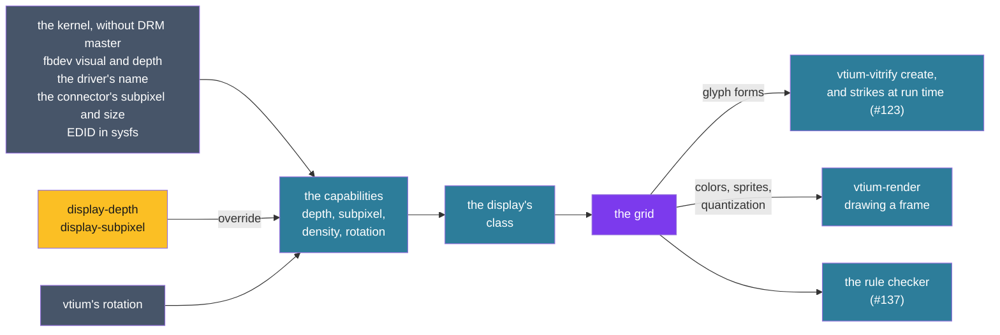

# ADR-1301: Glyphs and sprites are drawn for the display's capabilities

## Summary

- **Decided:** vtium reads four capabilities of each display without DRM master: its depth, its subpixel geometry, its density and the rotation vtium draws it in, with `display-depth` and `display-subpixel` overriding detection. They place the display in one of eight classes, and one grid of classes against render options says how glyphs and vtium's own sprites are drawn there. Outline glyphs draw crisp where pixels are scarce and with whole-pixel grayscale antialiasing elsewhere; gray panels take that antialiasing quantized to their levels; a 1-bit display maps each cell's colors to lit or unlit by cell; color glyphs on 1-bit and gray displays fall back to a bitmap glyph for the same character. Subpixel rendering and dithering are options, never defaults, and never offered where they cannot work. One table of rules lints poor combinations at build, at load and in `vtium check-config`. The same grid governs sets `vtium-vitrify` builds and strikes rasterised at run time (#123).
- **Trades away:** The sharper horizontal edges subpixel rendering gives a desktop LCD, until a set is built for it. Smooth outline glyphs at cells of 12 pixels or less. Color emoji on 1-bit and gray displays, unless a frit asks for them dithered. A display detected wrongly draws wrongly until a key names it.
- **One-way?** No for drawing: the grid lives in vtium-render and vtium-vitrify and changes in a session. Expensive once sets ship: a set's strikes are baked for its target, so changing what a class gets rebuilds every set built for it. The two keys' names and values become expensive after the first release.
- **Probes:**
  - *Not confident (the crisp cut-off):* the crisp rule follows the cell, not the display: an outline font at 12 pixels or less draws crisp on any display, a desktop monitor at a small zoom included, and at 13 pixels or more draws smooth even on a 320x240 panel. Is that the line you meant?
  - *Confident (gray panels):* only a 1-bit display maps colors by cell. A gray panel shows each pixel's color as the nearest gray by its brightness, so red text on black reads as dark gray, and a color that is dark on a color display stays dark there. Right?
- **Inversion:** Between "draw every display as true color and let the kernel convert", which the C reference did and vtium does today, and "a renderer for each display technology". The answer is one renderer and one set of glyph forms, with the display's class choosing among a few options when a set is built and among a few color mappings when a frame is drawn.

## Context

vtium draws into XRGB8888 and nothing else. minspec's machines bring the displays where that fails: a 1-bit OLED or memory LCD behind a DRM driver that thresholds each frame, gray panels, and small 16-bit color LCDs, often mounted rotated (#75). On a 1-bit panel antialiased coverage breaks into gaps and a color below the threshold vanishes: red text on black is about 30% bright (#135). Outline fonts (#23) now need a rasterising mode chosen for each display, ADR-1300 reserved a subpixel format with no rule for when it is used, and ADR-1200's sets are portable, so a set built for one display can be loaded on another.

## The C reference's flow

The C reference drew every glyph the same way: FreeType with light hinting, rendered to one gray byte a pixel, with no pixel order read from anywhere (`kmscon/src/font/font_freetype.c:119`, `kmscon/src/font/font_freetype.c:123`). Its fbdev backend refused a framebuffer that was not true color at 32, 24 or 16 bits (`kmscon/src/video/fbdev_video.c:199-247`), and its DRM backends drew XRGB8888 with no knowledge of a panel's depth. Everything in this record past whole-pixel grayscale glyphs on a true-color display is vtium's own.

## Decision

The figure follows a display from what vtium reads to how a glyph reaches it: the class picks a set's glyph forms when the set is built, and the colors and sprites when a frame is drawn.

### D1: the capabilities vtium reads

One reader in vtium-platform serves the console, `vtium-vitrify create` and `new` (#121). It reads only what needs no DRM master: `DRM_IOCTL_VERSION`, `DRM_IOCTL_MODE_GETCONNECTOR`, `FBIOGET_VSCREENINFO` and `FBIOGET_FSCREENINFO`, and files in sysfs.

| Axis | Values | Read from | Overridden by |
|---|---|---|---|
| Depth | `1`; `gray-N`, N levels; `565`; `color` | fbdev: a visual of `FB_VISUAL_MONO01` or `FB_VISUAL_MONO10` is `1`; `grayscale` set to 1 at `bits_per_pixel` b is `gray-N` with N = 2^b; 16 bits of true color is `565`; more is `color`. DRM: a driver in #135's table of panel drivers takes the depth the table gives, `1`, `gray-4` or `gray-16`, and any other driver is `color`. | `display-depth` |
| Subpixel | `rgb`, `bgr`, `vrgb`, `vbgr`, `none`, `unknown` | DRM: the connector's `subpixel`, in the kernel's numbering. fbdev: `unknown`. | `display-subpixel` |
| Density | pixels per inch, or unknown | The mode's size over the connector's `mm_width` and `mm_height`; where those are 0, the physical size in the connector's EDID in sysfs; fbdev's `width` and `height` in mm. | `font-size`, which sets the cell the density would choose |
| Rotation | normal, a quarter either way, half | vtium's own orientation, which the rotation steps set (`crates/vtium/src/layout.rs`) | |

- `display-depth` takes `auto`, the default, or a depth from the table. `display-subpixel` takes `auto`, the default, or a value from the table but `unknown`. A key applies to every display of the seat; a key per display waits for a seat with mixed displays to need one.
- The subpixel value is the panel's own order, as the connector reports it. vtium turns it by its rotation: a quarter turn makes a horizontal stripe vertical, and a half turn reverses its order. Every rule below reads the order after the turn.
- #135's table lists the drivers of 1-bit panels, each with its source line in Linux. It gains the gray panels its sources already name, each with its levels: st7586's 2-bit gray, the SSD132x panels' 4-bit gray, and st7571's gray mode. The SSD1331's RGB332 is `565`'s class: a color panel of fewer bits than true color. How the kernel converts XRGB8888 to a gray panel's levels is to be confirmed by #135.
- A 16-bit DRM panel behind a driver that converts XRGB8888 is not told apart: it reads as `color`. Whether a plane's format list tells it apart is to be confirmed by #136; until then `display-depth=565` names it. Read as `color`, such a panel loses only what its driver's conversion loses.
- Which DRM drivers fill the connector's `subpixel` is unchecked (vtium/vtium#23's comment of 2026-10-27), and no source vtium reads says a panel is PenTile, WOLED RGBW or QD-OLED. Such a panel is known only through `display-subpixel=none`.
- A reading that fails leaves its axis at the safe end: depth `color`, subpixel `unknown`, density unknown. A display read as `1` or `gray-N` is logged once with the source that said so.

### D2: the render options

| Option | What it is | Where it is made |
|---|---|---|
| Bitmap glyphs | 1-bit glyphs at the font's own size, scaled by whole factors (ADR-1200 D2, ADR-1300 D2) | the set |
| Crisp outline glyphs | An outline glyph rasterised hinted to the pixel grid, every pixel 0 or 255 | the set, or a strike at run time |
| Whole-pixel grayscale antialiasing | One coverage value a pixel, R8 (ADR-1200 D13) | the set, or a strike at run time |
| Subpixel strikes and subpixel antialiasing | Coverage computed for each color channel of a stripe; a subpixel strike stores it in ADR-1300's reserved per-channel format for one order, and subpixel antialiasing draws it, for glyphs and possibly vtium's sprites (#134) | the set; vtium-render |
| Dithering | A frit's option that takes color glyphs to the target's gray levels, or to 1 bit, with a dither pattern; the pattern is #136's to choose | the set |
| Color glyphs | Premultiplied RGBA strikes (ADR-1200 D13) | the set |
| vtium's own sprites | Underlines, the curl, the strike, box drawing, blocks, shades and Legacy Computing, drawn for the cell (`crates/vtium-render/src/deco.rs`, `crates/vtium-font/src/sprite.rs`): as coverage, or as 1-bit shapes | vtium-render, vtium-font |
| Color mapping | How a composed pixel reaches the panel: as it is; quantized to 16 bits; to the nearest gray level; or by cell to lit and unlit | vtium-render, as each row is copied out (ADR-1300 D5) |

### D3: the display classes

The first class whose test holds is the display's class.

| Class | Recognised by | Examples |
|---|---|---|
| 1-bit | depth `1` | SSD130x OLEDs, memory LCDs, e-paper, a mono fbdev |
| Gray panel | depth `gray-N` | st7586, SSD132x, st7571 in its gray mode, a gray fbdev |
| Virtual or captured | a virtual GPU's driver, listed beside #135's table with its source; tier 2's in-memory canvas | QEMU, VNC, screenshots, the tier goldens |
| Non-stripe | subpixel `none` | PenTile, WOLED RGBW, QD-OLED, a projector |
| Small color LCD | depth `565` or `color`, a mode of at most 800x480 | the minspec class: 320x240 and 480x320 SPI panels, often mounted rotated |
| HiDPI | density of 192 pixels per inch or more, twice a 96 DPI monitor | a laptop panel at 2x, a 4K panel of 22 inches or less |
| Known stripe | subpixel `rgb`, `bgr`, `vrgb` or `vbgr` | a desktop LCD at about 100 DPI that reports its order |
| Order unknown | anything else | most monitors, and every display whose connector reports nothing |

The list of virtual drivers is to be confirmed by #136 against the Linux source, as #135's table was.

### D4: the grid

Each cell gives the default, then what else is allowed. "Never" is explained below the table.

| Class | Outline glyphs | Subpixel | Dithering | Color glyphs | vtium's sprites | Colors |
|---|---|---|---|---|---|---|
| 1-bit | crisp, always | never | allowed for color glyphs, flagged | a bitmap glyph for the same character; dithered to 1 bit if the frit asks, flagged | 1-bit shapes | by cell, lit or unlit |
| Gray panel | crisp at 12 px or less; grayscale above | never | allowed for color glyphs | a bitmap glyph for the same character; grayscale with dithering if the frit asks | coverage | nearest gray level |
| Virtual or captured | crisp at 12 px or less; grayscale above | never | flagged | RGBA | coverage | as drawn |
| Non-stripe | crisp at 12 px or less; grayscale above | never | flagged | RGBA | coverage | as drawn |
| Small color LCD | crisp at 12 px or less; grayscale above | allowed, not default, once #134 judges it at 320x240 | flagged | RGBA | coverage | as drawn, at 16 bits for `565` |
| HiDPI | crisp at 12 px or less; grayscale above | allowed, not default | flagged | RGBA | coverage | as drawn |
| Known stripe | crisp at 12 px or less; grayscale above | allowed, not default | flagged | RGBA | coverage | as drawn |
| Order unknown | crisp at 12 px or less; grayscale above | only once `display-subpixel` names the order | flagged | RGBA | coverage | as drawn |

- **Where pixels are scarce, outline glyphs draw crisp** (the operator, 2026-10-28): on a 1-bit display at every size, and in the 8 to 12 pixel cells of a low-resolution display. vtium draws crisp in every cell 12 pixels tall or less, whatever the display, so the rule follows the cell. Bitmap glyphs are 1-bit already and take no option.
- **Subpixel is never** used on a 1-bit or gray display, which has no color channels; on a non-stripe panel, whose channels do not lie in the stripe the format assumes, so it draws color fringes; or on a virtual or captured display, whose pixels are scaled, compressed or compared, and whose viewer's panel is unknown. Elsewhere it is an option and never the default: most of the time vtium aims for full pixels (the operator, 2026-10-28). It draws only where the strike's order matches the display's after rotation; #134 decides whether a strike for one order draws another by swapping channels.
- **Dithering is never a default.** It is the frit's option (the operator, 2026-10-28), for color glyphs going to a gray or 1-bit target. A dithered set on a display with color draws, and the rule checker warns.
- **Color glyphs on a 1-bit or gray display** fall back to a bitmap glyph for the same character, within the set's glyph mapping: the next source in the frit's order that has a bitmap glyph for that codepoint, within its `cover=` and the #85 sprite policy (the operator, 2026-10-28). With no such source, the codepoint is left out of the strike and drawn as any codepoint the set lacks. A frit may instead take color glyphs to grayscale with dithering, for a gray display; for a 1-bit display it may too, at the risk of unreadable shapes, and the checker flags it.
- **On a 1-bit display** each cell's colors map to lit or unlit by cell, never by brightness: the default background is unlit; a cell whose background differs from the default, as reverse video, a selection or a colored background, is lit and its glyph unlit; a foreground equal to its background stays invisible (#135). Coverage is thresholded at half, and each sprite thresholding would break is drawn as a 1-bit shape: the curl as a one-pixel wave, the shades as fixed patterns of lit pixels. A DRM panel gets pure black and white, which the kernel's conversion keeps exact; a 1-bit fbdev is packed from the XRGB8888 copy (#135).
- **On a gray panel** each composed pixel goes to the nearest of the panel's levels by its BT.601 luma, with no dither, as its row is copied out (ADR-1300 D5). vtium quantizes so that a driver's own conversion has nothing left to decide; that the kernel's gray conversions keep vtium's levels exact is to be confirmed by #135.
- **vtium's sprites** follow the display's class at draw time: they are drawn for the cell, not baked into a set, so a set built for one display draws correct sprites on another.
- **1-bit and gray displays draw on the CPU path.** The GPU path (#33) draws the CPU path's pixels (ADR-1300 D6) on the color classes only.

### D5: where the grid applies

- **When a set is built.** `vtium-vitrify create` on the target builds for the display it reads; a frit's glyph forms (crisp or grayscale for each size, subpixel strikes, dithered or fallback color glyphs) follow the grid for that display's class. Until ADR-1200's edit gives the frit a target (D7), `create --out` and a `create` that sees no display build for the class "order unknown": crisp at 12 pixels or less, grayscale above, no subpixel strikes and no dithering.
- **When a strike is rasterised at run time** outside minspec (ADR-1200 D15, #123), the helper builds for the display the console reads, under the same grid.
- **When a frame is drawn.** vtium-render maps colors, draws sprites and quantizes for the display's class, whatever the set was built for.
- A crisp strike's pixels are all 0 or 255. ADR-1300's cache stores such a mask at 1 bit; how a set stores it, R8 as ADR-1200 D2 says of outline strikes or 1-bit, is ADR-1200's edit's to decide (D7).

### D6: the rule checker

One table of rules, each with an id, its reason, a severity (note, warning or refusal) and a test, serves three places (#137): `vtium-vitrify create` and `new`, which check a frit against its target before building; vtium, which checks a loaded set against each display it reads; and `vtium check-config`, which prints the same findings without starting a session. The table lives in a crate both binaries link, chosen by #137.

| Combination | At build | At load and in `check-config` |
|---|---|---|
| Subpixel strikes for a 1-bit, gray, non-stripe or virtual target | refusal | warning; drawn with the channels averaged to one coverage |
| A subpixel strike whose order differs from the display's after rotation | | warning; drawn averaged unless #134 decides a swap |
| Grayscale-antialiased strikes on a 1-bit display | warning | warning; thresholded at half |
| Color glyphs dithered into a 1-bit strike | warning | warning |
| A dithered set on a display with color | | warning (the operator, 2026-10-28) |
| Color glyphs with no bitmap fallback in the frit, for a 1-bit or gray target | note, naming the codepoints left out | |
| A grayscale strike at 12 pixels or less, or a crisp strike above, against the grid | note | note |
| A set's target depth, density or subpixel order that differs from the display's | | warning; #136's second question decides what is drawn |
| A cell size that leaves fewer than 80x25 cells, or 40x30 at the 320x240 floor (#118) | note | note |

A combination never refuses a set at load: vtium draws it as the table says and logs the finding. Refusal is a build's answer, before anything is stored.

### D7: what ADR-1200's edit holds (#136)

The frit's `target=` key and the target a set records in `META` are ADR-1200's, in the edit #136 makes after #23 merges. This record gives that edit its grid: a target is the capabilities of D1, and a set is built for the class they place it in. #136's three questions stay open:

1. Are the target's four fields (resolution, density, depth and subpixel order) right?
2. When a set's target differs from the display: warn and draw, or prefer a set in the store that matches?
3. Does vtium ship a small table of named targets (a 320x240 panel, a 24-inch 1080p monitor, 4K, a 128x64 1-bit OLED), or only `target=display` and explicit fields?

### Beyond the C reference

- vtium draws 1-bit and gray displays, which the C reference refused on fbdev and drew blind on DRM.
- Outline glyphs draw crisp at small cells, where the C reference drew every glyph with light hinting in gray.
- Subpixel strikes are an option on displays with a stripe; the C reference read no pixel order.
- Color glyphs fall back to bitmap glyphs on displays without color, and a rule checker names poor combinations; the C reference had neither.

## Verification

- **The reader:** each axis against stand-in replies to each ioctl and stand-in sysfs trees, the keys over each, and a failed read leaving the safe end. A depth table row with a planted wrong driver name fails its test.
- **The grid:** a test per cell of D4 builds a strike or draws a cell for that class and checks the option chosen. A planted rule that offers subpixel on a gray display fails.
- **Crisp strikes:** every pixel of a crisp strike is 0 or 255, at every size of 12 pixels or less.
- **1-bit drawing:** tier 2 screens drawn in 1-bit mode, vtium's own goldens, provisional until the operator reviews them, with every pixel black or white; a red-on-black line lit; reverse video and a selection lit with their glyphs unlit; the curl unbroken.
- **Gray drawing:** tier 2 screens at 4 and 16 levels, with every pixel on a level.
- **The checker:** each rule's test, seen red on its planted combination and green without it, in all three places.
- **A real panel:** a VT review step on a 1-bit or gray panel, when the operator has one.

## Consequences

### Positive

- 1-bit and gray panels draw legibly, with no color lost to a brightness threshold.
- Small cells on small panels draw crisp, as bitmap fonts do beside them.
- Subpixel rendering, when it is wanted, has a defined place, and stays off wherever it would draw fringes.
- A setup that draws badly says so, at build, at load and from `check-config`, from one table.
- Sprites are drawn for the display at hand, so a set built for one display draws correct sprites on another.

### Negative

- A desktop LCD draws whole-pixel glyphs unless someone builds a subpixel set for it.
- Color emoji are gone from 1-bit and gray displays by default.
- A non-stripe panel, a 16-bit DRM panel and a virtual GPU outside the list are recognised only through a key or a table vtium keeps current.
- vtium-render gains three color mappings and a set of 1-bit sprite shapes, each with its goldens.
- Gray fbdev devices need packing at their depth, which fbdev does not yet do.

### Neutral

- #135 builds the 1-bit path and the depth table; #134 judges subpixel at 320x240; #136 edits ADR-1200 with the target; #137 builds the checker; #123's strikes follow the grid.
- The reader in vtium-platform gains the connector's subpixel, its physical size and EDID, beside #135's driver table.

## Alternatives Considered

- **Whole-pixel grayscale everywhere,** as the C reference drew. Rejected: on a 1-bit panel the coverage breaks into gaps, and at 8 to 12 pixels gray edges blur strokes a pixel wide.
- **Subpixel by default where the order is known,** as desktop font stacks do. Rejected by the operator: vtium aims for full pixels; a portable set built for one order lands on displays of another, rotation turns the stripe, which drivers report the order is unchecked, and its look at 320x240 is not yet judged (#134).
- **Colors to 1 bit by brightness,** the kernel's own conversion. Rejected: a dark color vanishes, red text on black among them (#135).
- **Dithering by default on 1-bit and gray displays.** Rejected by the operator: dithering a glyph of 8 to 16 pixels turns its strokes to noise; it is the frit's option.
- **Gray levels quantized in the strike.** Not taken: a strike's coverage blends between any two colors, so only the composed pixel can be put on a level.
- **A renderer for each display technology.** Not taken: one renderer with three color mappings and one sprite variant covers every class, and the GPU path stays on the color classes.
- **Recognising non-stripe panels from what the kernel reports.** Not taken: no source vtium reads without DRM master says a panel is PenTile, RGBW or QD-OLED, so the key names them.
