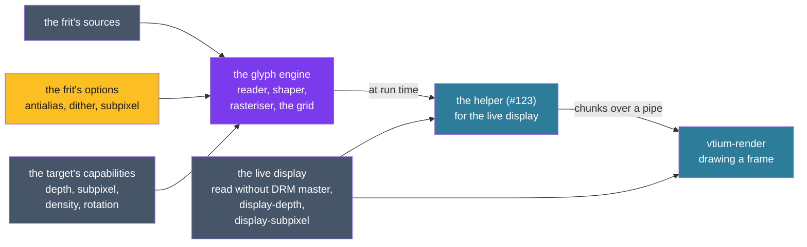

# ADR-1301: One glyph engine draws at run time for the display's capabilities

## Summary

- **Decided:** vtium has one glyph engine. It takes a frit, the capabilities of the display it draws for, and the clusters to cover; it reads the font, shapes each cluster with HarfRust, rasterises the glyphs, picks each one's form from the grid, and gives strikes keyed by codepoint or by cluster in the glyph chunk format. It runs on one schedule, at run time: ADR-1200's sandboxed helper generates for the live display, on every build, minspec included, and respects every frit option (#123). Nothing is built ahead of time. The console looks a cell's cluster up in its per-boot store, then by its precomposed form, its base with the mark overstruck, the built-in font, the helper, and last the replacement glyph, and never parses a font. A display's capabilities are its depth, subpixel geometry, density and the rotation vtium draws it in, read without DRM master and overridden by `display-depth` and `display-subpixel`. They place it in one of eight classes, and one grid of classes against options says how glyphs and vtium's own sprites are drawn. Outline glyphs draw crisp below a cell size with no room for antialiasing and antialias above it; that figure is measured, not yet set, and `font-antialias=no` or a frit's `antialias=no` turns antialiasing off at any size. A 1-bit display maps each cell's colors to lit or unlit by cell, its polarity following the default background. A gray panel is drawn as a color display and converts the pixels itself. Color glyphs on 1-bit and gray displays fall back to a bitmap glyph for the same character. Subpixel rendering and dithering are options, never defaults. One table of rules lints poor combinations when `vtium-vitrify` checks a profile, when glyphs are generated, and in `vtium check-config`. The helper starts on the first request and exits after an idle interval. A character no font holds draws as the font's replacement glyph, U+FFFD where the font has it, else U+25A1, at every size.
- **Trades away:** The sharper edges subpixel rendering gives a desktop LCD, unless a frit asks for it. Smooth outline glyphs below the crisp boundary. Color emoji on 1-bit and gray displays, unless a frit asks for them dithered. Any tuning for a gray panel's levels, until a real panel shows the need. A display detected wrongly draws wrongly until a key names it.
- **One-way?** No for drawing: the engine and the grid live in vtium-vitrify and vtium-render and change in a session, and glyphs are generated each boot, so a change to what a class gets takes effect at the next start. The keys' names and values become expensive after the first release.
- **Probes:**
  - *Not confident (the crisp cut-off):* the crisp rule follows the cell, not the display: an outline font at 12 pixels or less draws crisp on any display, a desktop monitor at a small zoom included, and at 13 pixels or more draws smooth even on a 320x240 panel. Is that the line you meant? (Answered 2026-10-28; see `considered`.)
  - *Confident (gray panels):* only a 1-bit display maps colors by cell. A gray panel shows each pixel's color as the nearest gray by its brightness, so red text on black reads as dark gray, and a color that is dark on a color display stays dark there. Right? (Answered 2026-10-28; see `considered`.)
- **Inversion:** Between "draw every display as true color, rasterise in the root process, and let the kernel convert", which the C reference did, and "a renderer and a rasteriser for each display technology". The answer is one engine and one renderer, with the display's class choosing among a few glyph forms when a strike is made and among a few cell mappings when a frame is drawn.

> Edited 2026-10-28: the operator's answers on the first draft and the operator's framing of the record around one engine with two schedules, relayed by the team lead. The Summary read: "Decided: vtium reads four capabilities of each display without DRM master [...] Outline glyphs draw crisp where pixels are scarce and with whole-pixel grayscale antialiasing elsewhere; gray panels take that antialiasing quantized to their levels [...]" The probes stand as asked.

> Edited 2026-10-28: the operator decided that a set does not have to be built, that both schedules respect every frit option, that a minspec machine may generate at run time, and that a target mismatch falls back to generation from the same frit (#136). The decided line read, in part: "dynamic, when ADR-1200's sandboxed helper rasterises a missing size for the live display (#123) [...] a dynamic strike, made for the live display, needs no check at load." The trades read, first: "The sharper edges subpixel rendering gives a desktop LCD, until a set is built for it." The one-way answer read: "Expensive once sets ship: a prerendered set's strikes are baked for its target, so changing what a class gets rebuilds every set built for it; a dynamic strike is rebuilt each boot and costs nothing to change."

> Edited 2026-10-28: the operator decided the helper's lifetime, the polarity of a 1-bit display and the replacement glyph. The decided line read: "How long the helper lives is proposed here, not decided."; the 1-bit sentence ended "by cell."

> Edited 2026-10-28: the operator's decisions on #144 put shaping in the engine, and corrected the replacement glyph. The decided line opened: "vtium has one glyph engine. It takes a frit's sources, the capabilities of the display it draws for, and the frit's options, and gives strikes in the set's chunk format." and its last sentence read "[...] draws as the font's replacement glyph, U+FFFD, at every size."

> Edited 2026-10-28: the operator replaced the prerendered store with run-time generation (vtium/vtium#145: "the prerendered store is replaced by deferred rendering"), and this record now describes one schedule, run-time generation in ADR-1200's helper. It was titled "One glyph engine draws for the display's capabilities, ahead of time or at run time", and decided two schedules: ahead of time, `vtium-vitrify create` building a set into the store for a declared or read target, checked against the display at load, and at run time, the helper; a built set was a cache of the frit's output, and a minspec install preferred built sets. The Summary, the figure, D1 to D4, D6 to D9, Beyond the C reference, Verification, Consequences and Alternatives Considered drop the built sets, and the prerendered schedule is under Alternatives Considered. The earlier text is in git at 4477806.

## Context

vtium draws into XRGB8888 and nothing else. minspec's machines bring the displays where that fails: a 1-bit OLED or memory LCD behind a DRM driver that thresholds each frame, gray panels, and small 16-bit color LCDs, often mounted rotated (#75). On a 1-bit panel antialiased coverage breaks into gaps and a color below the threshold vanishes: red text on black is about 30% bright (#135). Outline fonts (#23) need a rasterising mode chosen for each display, ADR-1300 reserved a subpixel format with no rule for when it is used, and ADR-1200 rasterises in the helper at run time (D15) and in `preview`'s child (D14), which must draw alike.

## The C reference's flow

The C reference rasterised every glyph at run time, in its root process. Its font backends were modules loaded at start, each registering itself (`kmscon/src/font/mod_freetype.c:39-51`, `kmscon/src/font/mod_pango.c:39-51`, `kmscon/src/shl/module.c:195-239`). A font was found by name and pixel height, trying the configured engine and then freetype, pango, unifont, psf and 8x16 in turn (`kmscon/src/font/font.c:124-167`, `kmscon/src/font/font.c:203-232`).

A glyph was drawn the first time a frame needed it: the renderer looked it up under its glyph key, and on a miss asked the font for it 1 or 2 cells wide, rotated it once and kept it in its LRU (`kmscon/src/render/bbulk.c:540-573`). Box drawing, blocks, Braille and the mosaics were drawn by the C reference itself in place of the font's glyph, sized to the cell (`kmscon/src/font/font.c:343-355`, `kmscon/src/font/font_box.c:27-51`). A cluster of several codepoints was shaped with HarfBuzz on the face that covered its first codepoint and drawn into one bitmap, marks placed under or over the base (`kmscon/src/font/font_freetype.c:506-636`). A codepoint the main face lacked came from the next face in fontconfig's list, opened on demand and sized to the cell (`kmscon/src/font/font_freetype.c:691-767`). An emoji cluster came from a color face, scaled into its cells with a box filter, or as the mask of its alpha when color emoji were off (`kmscon/src/font/font_colour.h:69-89`, `kmscon/src/font/font_colour.c:348-354`, `kmscon/src/font/font_freetype.c:769-816`).

FreeType drew with light hinting and in gray, one byte a pixel, reading no pixel order (`kmscon/src/font/font_freetype.c:117-128`), and Pango drew into a 256-level gray bitmap (`kmscon/src/font/font_pango.c:136-235`). A zoom stepped the size by a pixel, found a new font at the new size and handed it to each screen's renderer, which emptied its glyph cache (`kmscon/src/terminal.c:921-955`, `kmscon/src/terminal.c:1325-1355`, `kmscon/src/render/text.c:271-323`, `kmscon/src/render/bbulk.c:468-480`). Its fbdev backend refused a framebuffer that was not true color at 32, 24 or 16 bits (`kmscon/src/video/fbdev_video.c:199-247`), and its DRM backends drew XRGB8888 with no knowledge of a panel's depth.

## Decision

The figure follows a glyph from its inputs through the engine, run by the helper for the live display, over the helper's pipe to the frame.

### D1: the glyph engine

**Inputs:** the frit, its sources with their `cover=`, sizes and styles (ADR-1200 D1) and its options (D4); the capabilities of the display the strikes are for (D3); and the clusters to cover: those an ask names, or the frit's coverage in the fill (ADR-1200 D18).

1. **Read:** the font is parsed in the helper (D2) or in the child `preview` and `new` hand it to (ADR-1200 D14), never in the console.
2. **Shape:** HarfRust turns each cluster into glyph ids with their positions: marks placed, emoji ZWJ sequences and flags collapsed to one glyph, Arabic joining forms chosen. HarfRust is the HarfBuzz project's Rust port, under the MIT licence, parsing through `read-fonts` (#144).
3. **Rasterise:** each glyph id is rasterised, and a shaped cluster is composed into one bitmap fitted to its 1 or 2 cells.
4. **The grid:** the engine places the target in its class (D5) and picks each glyph's form from the grid (D6): bitmap, crisp or antialiased outline, subpixel, color, dithered, or a fallback to another source's bitmap glyph.
5. **Output:** strikes in the glyph chunk format, the helper's wire format (ADR-1200 D2), 1-bit, R8, a subpixel format or RGBA, keyed by codepoint or by cluster.

vtium's own sprites are not the engine's: vtium-render draws them for the cell and the live display when a frame is drawn (D7).

> Edited 2026-10-28: the operator's decisions on #144 put shaping in the engine; international text does not work without it. D1 read: "Inputs: a frit: its sources with their `cover=`, sizes and styles (ADR-1200 D1), and its options (D4); and the capabilities of the display the strike is for (D3). Output: strikes in the set's chunk format (ADR-1200 D2): 1-bit, R8, a subpixel format or RGBA glyphs, 1 or 2 cells wide, in a size's cell. The engine is `vtium-vitrify`'s reader and rasteriser (ADR-1200 D14) with this record's grid. [...]"

#### Three kinds of coverage

| Kind | Examples |
|---|---|
| Codepoints | a letter, a CJK ideograph, a symbol |
| Listable clusters | emoji ZWJ sequences, flags, keycaps, Arabic joining forms and lam-alef, a base with marks that precompose |
| Open clusters | syllabic scripts such as the Indic ones, contextual ligatures |

- The helper generates all three at run time (D2), and the console keeps them in its per-boot store (ADR-1200 D19).
- Where the helper is unavailable, clusters draw unshaped, one glyph per codepoint, and the console logs one line; the rule checker flags the setup (D8).
- How a shaped cluster in a syllabic script maps onto cells, and bidirectional text, stay open in #144.

#### The console's lookup for a cell

The console finds a cell's glyph, its cluster or single codepoint, in this order, and parses no font at any step:

1. the cluster's glyph in the per-boot store (ADR-1200 D19);
2. the cluster's NFC form, where it precomposes to one codepoint the store holds;
3. the base's glyph with each mark's glyph overstruck on it;
4. the built-in font for the cell size (ADR-1200 D7, #141);
5. a request to the helper (D2), drawn from step 4 or 6 until its glyph arrives;
6. the replacement glyph: U+FFFD where the font has it, else U+25A1, the C reference's replacement (D7).

#### Text from the terminal reaches the shaper

A cluster the helper shapes is text a program wrote to the terminal, so HarfRust and the font parser behind it face input anyone with the terminal can choose. That is attack surface. It runs only in the helper, never as root and under its sandbox, its answers are checked like any glyph chunk (ADR-1200 D15), and the shaping path takes a fuzz target that drives clusters through it (#144).

### D2: one schedule, at run time

The engine runs at run time, in ADR-1200's sandboxed helper (D15, #123), on every build, minspec included, and respects every option of the frit. The helper runs `vtium-vitrify`'s own reader, shaper and rasteriser, the code `preview` runs, so a frit draws the same wherever it is drawn. It generates for the live display, as the console reads it (D3), and the profile's cell (ADR-1200 D17): the characters the screen shows first, then the rest of the frit's coverage (ADR-1200 D18). The console checks each frame for bounds and dimensions and keeps its glyphs in a per-boot memory store (ADR-1200 D15, D19). Nothing is built ahead of time.

- **A change of display,** as a hotplug or a rotation, starts a new strike for the new class, as a zoom does.
- **The schedule follows the C reference's flow,** which rasterised every glyph at run time, on its renderer's first miss, at the size in force (`kmscon/src/render/bbulk.c:540-573`, `kmscon/src/font/font.c:331-368`), and made a new font at each zoom (`kmscon/src/terminal.c:921-955`). It carries forward: glyphs made as the screen needs them, at the size in force and fitted to 1 or 2 cells; a codepoint the first source lacks taken from the next one in order; color glyphs fitted into their cells; box drawing and its kin drawn by vtium itself, chosen by the #85 sprite policy; and a size change making a new strike while the renderer's cache of the old size empties (ADR-1300).
- **What vtium adds** to that flow: the display's capabilities and the grid, where the C reference drew every display in gray; parsing and rasterising out of the root process, in a sandboxed helper that never runs as root, where the C reference parsed fonts as root (a listed departure, ADR-1200 D14 and D15); the font's sources fixed by the frit and its `cover=`, where the C reference took whatever fontconfig listed; and the built-in font drawn at once in the profile's cell while the helper works (ADR-1200 D7).

#### The helper's lifetime

- The helper starts on the console's first request for glyphs or an image, and exits after `HELPER_IDLE_MS`, 60,000 ms, with no request (the operator, 2026-10-28). A console that never asks runs none. The next request starts it again, at the cost of its start and its read of the font file.
- On first use the console generates from the frit ADR-1200 D9 chooses, drawing the built-in font until the first glyphs arrive (the operator, 2026-10-28). Where `vtium-vitrify` is not installed, the built-in font draws (ADR-1200 D7).
- ADR-1400 D2 and ADR-1200 D9 take dated notes.

> Edited 2026-10-28: the operator decided the lifetime this section proposed. Its heading read "Proposed, not decided: the helper's lifetime", and it opened: "This proposal waits for the operator; until it is decided, ADR-1400 D2's lifetime holds, a helper started on the first request and stopped at the session's end."

### D3: the target's capabilities

One reader in vtium-platform serves the console and `vtium-vitrify new` (#121), and the helper is handed what the console read. It reads only what needs no DRM master: `DRM_IOCTL_VERSION`, `DRM_IOCTL_MODE_GETCONNECTOR`, `FBIOGET_VSCREENINFO` and `FBIOGET_FSCREENINFO`, and files in sysfs.

| Axis | Values | Read from | Overridden by |
|---|---|---|---|
| Depth | `1`; gray at N levels; 16-bit color (`565`); `color` | fbdev: a visual of `FB_VISUAL_MONO01` or `FB_VISUAL_MONO10` is `1`; a gray fbdev is refused until a real panel shows how to drive it; 16 bits of true color is `565`, drawn through fbdev's packing; more is `color`. DRM: a driver in #135's table of panel drivers takes the depth the table gives, `1`, gray at 4 or 16 levels, and any other driver is `color`. | `display-depth`: `auto`, `1`, `gray4`, `gray16` or `color` |
| Subpixel | `rgb`, `bgr`, `vrgb`, `vbgr`, `none`, `unknown` | DRM: the connector's `subpixel`, in the kernel's numbering. fbdev: `unknown`. | `display-subpixel` |
| Density | pixels per inch, or unknown | The mode's size over the connector's `mm_width` and `mm_height`; where those are 0, the physical size in the connector's EDID in sysfs; fbdev's `width` and `height` in mm. | `font-size`, which sets the cell the density would choose |
| Rotation | normal, a quarter either way, half | vtium's own orientation, which the rotation steps set (`crates/vtium/src/layout.rs`) | |

- `display-depth` takes `auto`, the default, or a depth from the table. `display-subpixel` takes `auto`, the default, or a value from the table but `unknown`. A key applies to every display of the seat; a key per display waits for a seat with mixed displays to need one.
- The subpixel value is the panel's own order, as the connector reports it. vtium turns it by its rotation: a quarter turn makes a horizontal stripe vertical, and a half turn reverses its order. Every rule below reads the order after the turn.
- #135's table lists the drivers of 1-bit panels, each with its source line in Linux. It gains the gray panels its sources already name, each with its levels: st7586's 2-bit gray, the SSD132x panels' 4-bit gray, and st7571's gray mode. The SSD1331's RGB332 is `565`'s class: a color panel of fewer bits than true color.
- A 16-bit DRM panel behind a driver that converts XRGB8888 is not told apart: it reads as `color`. Whether a plane's format list tells it apart is to be confirmed by #136. Read as `color`, such a panel loses only what its driver's conversion loses, so `display-depth` has no `565` value.
- Which DRM drivers fill the connector's `subpixel` is unchecked (vtium/vtium#23's comment of 2026-10-27), and no source vtium reads says a panel is PenTile, WOLED RGBW or QD-OLED. Such a panel is known only through `display-subpixel=none`.
- A reading that fails leaves its axis at the safe end: depth `color`, subpixel `unknown`, density unknown. A display read as `1` or gray is logged once with the source that said so: the driver's name and device-tree node, or the fbdev visual.

### D4: the options

| Option | What it is | Set by |
|---|---|---|
| Bitmap glyphs | 1-bit glyphs at the font's own size, scaled by whole factors (ADR-1200 D2, ADR-1300 D2) | the source |
| Crisp outline glyphs | An outline glyph rasterised hinted to the pixel grid, every pixel 0 or 255 | the grid, or `antialias=no` |
| Whole-pixel grayscale antialiasing | One coverage value a pixel, R8 (ADR-1200 D13) | the grid |
| `antialias=` | `auto`, the default, follows the grid; `no` makes every outline glyph crisp at any size | the frit |
| `font-antialias=` | The same, `auto` or `no`, for the console, over the frit's | the configuration |
| Subpixel strikes and subpixel antialiasing | Coverage computed for each color channel of a stripe; a subpixel strike holds it in ADR-1300's reserved per-channel format for one order, and subpixel antialiasing draws it, for glyphs and possibly vtium's sprites (#134) | the frit; never a default |
| Dithering | Color glyphs taken to the target's gray levels, or to 1 bit, with a dither pattern; the pattern is #136's to choose | the frit; never a default |
| Color glyphs | Premultiplied RGBA strikes (ADR-1200 D13) | the source |

### D5: the display classes

The first class whose test holds is the display's class.

| Class | Recognised by | Examples |
|---|---|---|
| 1-bit | depth `1` | SSD130x OLEDs, memory LCDs, e-paper, a mono fbdev |
| Gray panel | depth gray at 4 or 16 levels | st7586, SSD132x, st7571 in its gray mode, a gray fbdev |
| Virtual or captured | a virtual GPU's driver, listed beside #135's table with its source; tier 2's in-memory canvas | QEMU, VNC, screenshots, the tier goldens |
| Non-stripe | subpixel `none` | PenTile, WOLED RGBW, QD-OLED, a projector |
| Small color LCD | depth `565` or `color`, a mode of at most 800x480 | the minspec class: 320x240 and 480x320 SPI panels, often mounted rotated |
| HiDPI | density of 192 pixels per inch or more, twice a 96 DPI monitor | a laptop panel at 2x, a 4K panel of 22 inches or less |
| Known stripe | subpixel `rgb`, `bgr`, `vrgb` or `vbgr` | a desktop LCD at about 100 DPI that reports its order |
| Order unknown | anything else | most monitors, and every display whose connector reports nothing |

The list of virtual drivers is to be confirmed by #136 against the Linux source, as #135's table was.

### D6: the grid

Each cell gives the default, then what else is allowed. "Crisp, then antialiased" means crisp below the boundary and whole-pixel grayscale at or above it. "Never" is explained below the table.

| Class | Outline glyphs | Subpixel | Dithering | Color glyphs |
|---|---|---|---|---|
| 1-bit | crisp at every size | never | allowed for color glyphs, flagged | a bitmap glyph for the same character; dithered to 1 bit if the frit asks, flagged |
| Gray panel | crisp, then antialiased | never | allowed for color glyphs | a bitmap glyph for the same character; grayscale with dithering if the frit asks |
| Virtual or captured | crisp, then antialiased | never | flagged | RGBA |
| Non-stripe | crisp, then antialiased | never | flagged | RGBA |
| Small color LCD | crisp, then antialiased | allowed, not default, once #134 judges it at 320x240 | flagged | RGBA |
| HiDPI | crisp, then antialiased | allowed, not default | flagged | RGBA |
| Known stripe | crisp, then antialiased | allowed, not default | flagged | RGBA |
| Order unknown | crisp, then antialiased | only once `display-subpixel` names the order | flagged | RGBA |

- **The crisp boundary is a cell size** below which a glyph has no room for antialiasing, so it draws crisp, and above which it antialiases (the operator, 2026-10-28). It follows the cell on every display; a 1-bit display draws crisp at every size. The figure is open: it is measured once #23's outline strikes draw, on outline fonts at 320x240 and on a desktop panel, comparing crisp and antialiased strikes at each cell height around the 8 to 12 pixels the operator named for low-resolution displays, and set here with the measurement. Until then the engine draws crisp at 12 pixels or less. `antialias=no` and `font-antialias=no` draw crisp at every size. Bitmap glyphs are 1-bit already and take no option.
- **Subpixel is never** used on a 1-bit or gray display, which has no color channels; on a non-stripe panel, whose channels do not lie in the stripe the format assumes, so it draws color fringes; or on a virtual or captured display, whose pixels are scaled, compressed or compared, and whose viewer's panel is unknown. Elsewhere it is an option and never the default: most of the time vtium aims for full pixels (the operator, 2026-10-28). It draws only where the strike's order matches the display's after rotation; #134 decides whether a strike for one order draws another by swapping channels.
- **Dithering is never a default.** It is the frit's option (the operator, 2026-10-28), for color glyphs going to a gray or 1-bit display. A frit with dithering on draws on a display with color, and the rule checker warns.
- **Color glyphs on a 1-bit or gray display** fall back to a bitmap glyph for the same character, within the frit's glyph mapping: the next source in the frit's order that has a bitmap glyph for that codepoint, within its `cover=` and the #85 sprite policy (the operator, 2026-10-28). With no such source, the codepoint is left out of the strike and drawn as any character no font holds: as the font's replacement glyph, U+FFFD, at every size (the operator, 2026-10-28). A frit may instead take color glyphs to grayscale with dithering, for a gray display; for a 1-bit display it may too, at the risk of unreadable shapes, and the checker flags it.

> Edited 2026-10-28: the operator said the rule is "a figure, a cell size below which there is no room for antialiasing, so glyphs draw crisp, and above which they antialias", left open to be worked out, with an option that turns antialiasing off regardless. It read: "Where pixels are scarce, outline glyphs draw crisp (the operator, 2026-10-28): on a 1-bit display at every size, and in the 8 to 12 pixel cells of a low-resolution display. vtium draws crisp in every cell 12 pixels tall or less, whatever the display, so the rule follows the cell."

### D7: drawing a frame

vtium-render draws for the live display's class.

- **On a 1-bit display** each cell's colors map to lit or unlit by cell, never by brightness, and the polarity follows the default background (the operator, 2026-10-28). A light default background, one whose BT.601 luma is at least half, makes the screen lit and default text unlit; a dark one makes the screen unlit and default text lit. A cell whose background differs from the default, as reverse video, a selection or a colored background, flips from it, with its glyph flipped again; a foreground equal to its background stays invisible (#135). The border outside the grid follows the default background. Coverage is thresholded at half, and each sprite thresholding would break is drawn as a 1-bit shape: the curl as a one-pixel wave, the shades as fixed patterns of lit pixels. A DRM panel gets pure black and white, which the kernel's conversion keeps exact; a 1-bit fbdev is packed from the XRGB8888 copy (#135).
> Edited 2026-10-28: the operator decided the polarity. This read: "the default background is unlit; a cell whose background differs from the default, as reverse video, a selection or a colored background, is lit and its glyph unlit".

- **A character no font holds** draws as the font's replacement glyph at every size, on every class: U+FFFD where the font has it, else U+25A1, the C reference's replacement character; Unscii-8 has no U+FFFD (the operator, 2026-10-28).

> Edited 2026-10-28: the operator corrected the replacement glyph. This read: "draws as the font's replacement glyph, U+FFFD, at every size, on every class (the operator, 2026-10-28)."
- **On a gray panel** vtium draws as for a color display and leaves the mapping to the panel's own conversion, which differs from panel to panel. vtium adds no quantization, contrast rule or color mapping of its own; those come only if a real panel shows the need, in an edit to this record (the operator, 2026-10-28). A gray fbdev, whose memory holds gray values, is written at its depth from the XRGB8888 copy as #135 packs 1 bit; how a DRM gray panel's driver converts is to be confirmed by #135.
- **Elsewhere** colors are drawn as they are, and a `565` panel's driver or fbdev's packing takes them to 16 bits.
- **vtium's sprites** (underlines, the curl, the strike, box drawing, blocks, shades and Legacy Computing, `crates/vtium-render/src/deco.rs`, `crates/vtium-font/src/sprite.rs`) are drawn as coverage on every class but 1-bit.
- **The GPU path** (#33) draws the CPU path's pixels on any class where it is a working display path, 1-bit and gray included, though such a display is rarely driven by a GPU; the cell mapping is part of the pixels it matches (ADR-1300 D6).

> Edited 2026-10-28: the operator's answers. Gray panels read: "each composed pixel goes to the nearest of the panel's levels by its BT.601 luma, with no dither, as its row is copied out (ADR-1300 D5)." The GPU path read: "1-bit and gray displays draw on the CPU path. The GPU path (#33) draws the CPU path's pixels (ADR-1300 D6) on the color classes only."

### D8: the rule checker

One table of rules, each with an id, its reason, a severity (note or warning) and a test, serves three places (#137): `vtium-vitrify`, which lints a profile and its frit against a display (ADR-1200 D4); vtium, which checks the frit it draws against each display it reads; and `vtium check-config`, which prints the same findings without starting a session. The table lives in a crate both binaries link, chosen by #137. A choice such as `antialias=no` is never flagged as a poor combination (the operator, 2026-10-28, #136).

| Combination | Finding |
|---|---|
| Subpixel strikes for a 1-bit, gray, non-stripe or virtual display | warning; drawn with the channels averaged to one coverage |
| A subpixel strike whose order differs from the display's after rotation | warning; drawn averaged unless #134 decides a swap |
| Color glyphs dithered into a 1-bit strike | warning |
| A frit with dithering on, on a display with color | warning (the operator, 2026-10-28) |
| Color glyphs with no bitmap fallback in the frit, for a 1-bit or gray display | note, naming the codepoints left out |
| A frit with no helper to draw it | warning; the built-in font draws, and clusters draw unshaped, one glyph per codepoint, with one log line (D1) |
| A cell size that leaves fewer than 80x25 cells, or 40x30 at the 320x240 floor (#118) | note |

A combination never refuses a frit: vtium draws it as the table says and logs the finding.

> Edited 2026-10-28: the operator's decisions on #136, that a mismatched set falls back to the same frit generated at run time and that `antialias=no` is a choice, not a poor combination. The mismatch row read: "warning; #136's second question decides what is drawn". Two rows are gone: "Antialiased strikes on a 1-bit display, or with `font-antialias=no`", which read "warning" and "note; thresholded at half, and a set rebuilt with `antialias=no` draws better", and "A strike crisp or antialiased against the boundary".

### D9: profiles (#136)

A target is a profile (ADR-1200 D16): a display's four capabilities of D3, named freely, with the frit, the cell and the options that suit it. This record gives profiles their engine and grid: `vtium-vitrify` lints a profile's frit for the class its capabilities place it in (D8), and `antialias=` joins the frit's keys. The operator answered #136's questions on 2026-10-28:

1. The four fields stand: resolution, density, depth (`1`, gray at N levels, `565`, `color`) and subpixel order, with rotation folded into the order.
2. Profiles are named freely, a name being the user's, such as a display's model, and vtium ships example profiles with descriptive names, each expanding to the four fields (ADR-1200 D16).

#136's answer on a set built for another display is retired with the built sets (Alternatives Considered).

> Edited 2026-10-28: the operator answered #136's questions, which this section listed as open.

### For the operator's check

These are agent calls the operator has not yet looked at: a combination never refuses a frit (D8); the HiDPI class starts at 192 DPI and the small color LCD class covers modes of 800x480 or less (D5); a light default background as BT.601 luma of at least half (D7); and the `observable` lines.

### Beyond the C reference

- vtium rasterises outside the root process, in the sandboxed helper, and in `vtium-vitrify`'s child for `preview` and `new`; the C reference parsed and rasterised fonts as root.
- vtium draws 1-bit and gray displays, which the C reference refused on fbdev and drew blind on DRM.
- A character no font holds draws as U+FFFD where the font has it, else U+25A1; the C reference drew U+25A1, then `?` (`kmscon/src/font/font.h:50`, `kmscon/src/font/font.c:356-366`).
- vtium shapes clusters in the sandboxed helper and composes a mark on its base in the console without a font; the C reference shaped with HarfBuzz in its root process.
- Outline glyphs draw crisp below the boundary or on request, where the C reference drew every glyph with light hinting in gray.
- Subpixel strikes are an option on displays with a stripe; the C reference read no pixel order.
- Color glyphs fall back to bitmap glyphs on displays without color, and a rule checker names poor combinations; the C reference had neither.

## Verification

- **One engine:** the same frit, cell and display give the same strike bytes from a minspec build and a full one, for each class and every option of D4.
- **Shaping:** a ZWJ sequence, a flag, a keycap, an Arabic word and a base with marks, each shaped by the helper, give one glyph fitted to its 1 or 2 cells; the console's lookup takes each step of D1 in order, with a stand-in store lacking each earlier step; a fuzz target drives arbitrary clusters through the helper's shaping (#144).
- **The reader:** each axis against stand-in replies to each ioctl and stand-in sysfs trees, the keys over each, and a failed read leaving the safe end. A depth table row with a planted wrong driver name fails its test.
- **The grid:** a test per cell of D6 generates a strike for that class and checks the form chosen. A planted rule that offers subpixel on a gray display fails.
- **Crisp strikes:** every pixel of a crisp strike is 0 or 255, below the boundary and at every size with `antialias=no`.
- **1-bit drawing:** tier 2 screens drawn in 1-bit mode, vtium's own goldens, provisional until the operator reviews them, with every pixel black or white; a dark and a light default background, each with its border; a red-on-black line lit; reverse video and a selection lit with their glyphs unlit; the curl unbroken; the same on the GPU path under llvmpipe.
- **The checker:** each rule's test, seen red on its planted combination and green without it, in all three places.
- **A real panel:** a VT review step on a 1-bit or gray panel, when the operator has one; a gray panel's step is what would show a need for quantization.

## Consequences

### Positive

- A frit draws alike on every build, from one engine and one grid, for whatever display it lands on.
- 1-bit panels draw legibly, with no color lost to a brightness threshold.
- Small cells draw crisp, and anyone who prefers crisp glyphs at every size has a key and a frit option for it.
- Subpixel rendering, when it is wanted, has a defined place, and stays off wherever it would draw fringes.
- A setup that draws badly says so, at build, at load and from `check-config`, from one table.
- Sprites are drawn for the display at hand.

### Negative

- The crisp boundary is provisional until the measurement sets it.
- Every boot generates its glyphs again, at the memory and time ADR-1200's evidence measures, which a minspec machine feels.
- A desktop LCD draws whole-pixel glyphs unless a frit asks for subpixel strikes.
- Color emoji are gone from 1-bit and gray displays by default.
- A gray panel draws only as well as its own conversion does.
- A non-stripe panel, a 16-bit DRM panel and a virtual GPU outside the list are recognised only through a key or a table vtium keeps current.
- vtium-render gains a 1-bit cell mapping and 1-bit sprite shapes, each with its goldens.
- Gray fbdev devices need writing at their depth, which fbdev does not yet do.

### Neutral

- #144 builds shaping and cluster asks (ADR-1200 D21), and keeps the cell mapping of syllabic scripts and bidirectional text open; #141 builds the console's fallback to the built-in font.
- #135 builds the 1-bit path and the depth table; #134 judges subpixel at 320x240; #136 gives profiles their fields and `antialias=`; #137 builds the checker; #123 runs the engine at run time; #23's strikes give the measurement that sets the crisp boundary.
- The reader in vtium-platform gains the connector's subpixel, its physical size and EDID, beside #135's driver table.

## Alternatives Considered

- **Whole-pixel grayscale everywhere,** as the C reference drew. Rejected: on a 1-bit panel the coverage breaks into gaps, and in small cells gray edges blur strokes a pixel wide.
- **A prerendered schedule beside the run-time one,** as this record first decided: `vtium-vitrify create` building a frit's strikes ahead of time into ADR-1200's root-owned store, for a target declared in the frit or read from the display, each set checked against the display at load and a mismatch falling back to generation from the same frit, a built set being a cache of the frit's output and a minspec install preferring built sets. Before that, ADR-1200 required built sets, generating only a size a set lacked and never on minspec. Replaced by the operator with run-time generation alone (vtium/vtium#145; ADR-1200, Alternatives Considered).
- **A rasteriser of the helper's own,** apart from `preview`'s, for speed. Rejected by the operator: one engine, so a frit draws alike wherever it is drawn and the grid is stated once.
- **Rasterising in the console's root process at first use,** as the C reference did. Not taken: a font file would be parsed as root (ADR-1200 D14, D15).
- **Subpixel by default where the order is known,** as desktop font stacks do. Rejected by the operator: vtium aims for full pixels; rotation turns the stripe, which drivers report the order is unchecked, and its look at 320x240 is not yet judged (#134).
- **Colors to 1 bit by brightness,** the kernel's own conversion. Rejected: a dark color vanishes, red text on black among them (#135).
- **Gray panels quantized or color-mapped by vtium.** Not taken for now, by the operator: each panel converts differently, so vtium drives it as simply as possible and adds rules only when a real panel shows the need.
- **Dithering by default on 1-bit and gray displays.** Rejected by the operator: dithering a glyph of 8 to 16 pixels turns its strokes to noise; it is the frit's option.
- **A fixed crisp boundary of 12 pixels,** as first drafted. Not taken: the operator left the figure to be measured.
- **1-bit and gray displays held to the CPU path,** as first drafted. Reversed by the operator: the GPU path is not barred where it is a working display path.
- **Recognising non-stripe panels from what the kernel reports.** Not taken: no source vtium reads without DRM master says a panel is PenTile, RGBW or QD-OLED, so the key names them.
