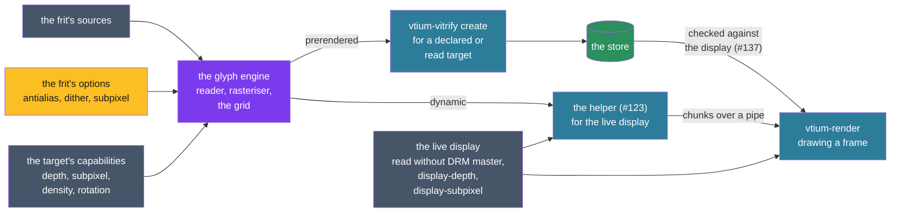

# ADR-1301: One glyph engine draws for the display's capabilities, ahead of time or at run time

## Summary

- **Decided:** vtium has one glyph engine. It takes a font's sources, the capabilities of the display it draws for, and the frit's options, and gives strikes in the set's chunk format. It runs on two schedules with the same reader, rasteriser and rules: prerendered, when `vtium-vitrify create` builds a set for a target declared or read at build time, and dynamic, when ADR-1200's sandboxed helper rasterises a missing size for the live display (#123). A display's capabilities are its depth, subpixel geometry, density and the rotation vtium draws it in, read without DRM master and overridden by `display-depth` and `display-subpixel`. They place it in one of eight classes, and one grid of classes against options says how glyphs and vtium's own sprites are drawn. Outline glyphs draw crisp below a cell size with no room for antialiasing and antialias above it; that figure is measured, not yet set, and `font-antialias=no` or a frit's `antialias=no` turns antialiasing off at any size. A 1-bit display maps each cell's colors to lit or unlit by cell. A gray panel is drawn as a color display and converts the pixels itself. Color glyphs on 1-bit and gray displays fall back to a bitmap glyph for the same character. Subpixel rendering and dithering are options, never defaults. One table of rules lints poor combinations at build, at load and in `vtium check-config`; a dynamic strike, made for the live display, needs no check at load.
- **Trades away:** The sharper edges subpixel rendering gives a desktop LCD, until a set is built for it. Smooth outline glyphs below the crisp boundary. Color emoji on 1-bit and gray displays, unless a frit asks for them dithered. Any tuning for a gray panel's levels, until a real panel shows the need. A display detected wrongly draws wrongly until a key names it.
- **One-way?** No for drawing: the engine and the grid live in vtium-vitrify and vtium-render and change in a session. Expensive once sets ship: a prerendered set's strikes are baked for its target, so changing what a class gets rebuilds every set built for it; a dynamic strike is rebuilt each boot and costs nothing to change. The keys' names and values become expensive after the first release.
- **Probes:**
  - *Not confident (the crisp cut-off):* the crisp rule follows the cell, not the display: an outline font at 12 pixels or less draws crisp on any display, a desktop monitor at a small zoom included, and at 13 pixels or more draws smooth even on a 320x240 panel. Is that the line you meant? (Answered 2026-10-28; see `considered`.)
  - *Confident (gray panels):* only a 1-bit display maps colors by cell. A gray panel shows each pixel's color as the nearest gray by its brightness, so red text on black reads as dark gray, and a color that is dark on a color display stays dark there. Right? (Answered 2026-10-28; see `considered`.)
- **Inversion:** Between "draw every display as true color, rasterise in the root process, and let the kernel convert", which the C reference did, and "a renderer and a rasteriser for each display technology". The answer is one engine and one renderer, with the display's class choosing among a few glyph forms when a strike is made, ahead of time or at run time, and among a few cell mappings when a frame is drawn.

> Edited 2026-10-28: the operator's answers on the first draft and the operator's framing of the record around one engine with two schedules, relayed by the team lead. The Summary read: "Decided: vtium reads four capabilities of each display without DRM master [...] Outline glyphs draw crisp where pixels are scarce and with whole-pixel grayscale antialiasing elsewhere; gray panels take that antialiasing quantized to their levels [...]" The probes stand as asked.

## Context

vtium draws into XRGB8888 and nothing else. minspec's machines bring the displays where that fails: a 1-bit OLED or memory LCD behind a DRM driver that thresholds each frame, gray panels, and small 16-bit color LCDs, often mounted rotated (#75). On a 1-bit panel antialiased coverage breaks into gaps and a color below the threshold vanishes: red text on black is about 30% bright (#135). Outline fonts (#23) need a rasterising mode chosen for each display, ADR-1300 reserved a subpixel format with no rule for when it is used, and ADR-1200 rasterises in two places, `create` ahead of time (D14) and the helper at run time outside minspec (D15), which must draw alike.

## The C reference's flow

The C reference rasterised every glyph at run time, in its root process. Its font backends were modules loaded at start, each registering itself (`kmscon/src/font/mod_freetype.c:39-51`, `kmscon/src/font/mod_pango.c:39-51`, `kmscon/src/shl/module.c:195-239`). A font was found by name and pixel height, trying the configured engine and then freetype, pango, unifont, psf and 8x16 in turn (`kmscon/src/font/font.c:124-167`, `kmscon/src/font/font.c:203-232`).

A glyph was drawn the first time a frame needed it: the renderer looked it up under its glyph key, and on a miss asked the font for it 1 or 2 cells wide, rotated it once and kept it in its LRU (`kmscon/src/render/bbulk.c:540-573`). Box drawing, blocks, Braille and the mosaics were drawn by the C reference itself in place of the font's glyph, sized to the cell (`kmscon/src/font/font.c:343-355`, `kmscon/src/font/font_box.c:27-51`). A codepoint the main face lacked came from the next face in fontconfig's list, opened on demand and sized to the cell (`kmscon/src/font/font_freetype.c:691-767`). An emoji cluster came from a color face, scaled into its cells with a box filter, or as the mask of its alpha when color emoji were off (`kmscon/src/font/font_colour.h:69-89`, `kmscon/src/font/font_colour.c:348-354`, `kmscon/src/font/font_freetype.c:769-816`).

FreeType drew with light hinting and in gray, one byte a pixel, reading no pixel order (`kmscon/src/font/font_freetype.c:117-128`), and Pango drew into a 256-level gray bitmap (`kmscon/src/font/font_pango.c:136-235`). A zoom stepped the size by a pixel, found a new font at the new size and handed it to each screen's renderer, which emptied its glyph cache (`kmscon/src/terminal.c:921-955`, `kmscon/src/terminal.c:1325-1355`, `kmscon/src/render/text.c:271-323`, `kmscon/src/render/bbulk.c:468-480`). Its fbdev backend refused a framebuffer that was not true color at 32, 24 or 16 bits (`kmscon/src/video/fbdev_video.c:199-247`), and its DRM backends drew XRGB8888 with no knowledge of a panel's depth.

## Decision

The figure follows a glyph from its inputs through the engine on either schedule to the frame: the prerendered schedule reaches the console through the store and the check at load, the dynamic one through the helper's pipe for the live display.

### D1: the glyph engine

- **Inputs:** a font's sources, as the frit lists them with their `cover=` (ADR-1200 D1); the capabilities of the display the strike is for (D3); and the frit's options (D4).
- **Output:** strikes in the set's chunk format (ADR-1200 D2): 1-bit, R8, a subpixel format or RGBA glyphs, 1 or 2 cells wide, in a size's cell.
- **The engine** is `vtium-vitrify`'s reader and rasteriser (ADR-1200 D14) with this record's grid. It places the target in its class (D5), and for each glyph picks its form from the grid (D6): bitmap, crisp or antialiased outline, subpixel, color, dithered, or a fallback to another source's bitmap glyph.
- vtium's own sprites are not the engine's: vtium-render draws them for the cell and the live display when a frame is drawn (D7), so they are right on any display whatever a set was built for.

### D2: two schedules

The engine runs on two schedules, with the same code and the same rules. ADR-1200 D15 already has the helper run `vtium-vitrify`'s own reader and rasteriser, the code `create` runs, so a dynamic strike draws what a built one would.

| | Prerendered | Dynamic |
|---|---|---|
| Caller | `vtium-vitrify create`, on the target or with `--out` elsewhere (ADR-1200 D4, D12) | ADR-1200's L1 helper, as the session's user, sandboxed (ADR-1200 D15, #123) |
| When | ahead of time, at install or by hand | at run time, at a zoom or `font-size` to a size the set lacks |
| Builds | every glyph the frit covers, at its sizes | the glyphs on screen first, then the rest of the set's coverage at that size |
| Its target | declared in the frit, or read from the display `create` runs on, at build time (#136) | the live display, as the console reads it |
| Where it goes | the root-owned store, checked by owner and hash (ADR-1200 D3) | a per-boot memory cache, checked for bounds and dimensions (ADR-1200 D15) |
| Runs in | every build | builds that are not minspec |

- A prerendered set knows its target only as declared or read when it was built, and the display it lands on can differ, so vtium checks the set against the display at load and the rule checker reports a mismatch (D8, #136, #137).
- A dynamic strike reads the live display when it is made, so it needs no such check. A change of display, as a hotplug or a rotation, starts a new strike for the new class, as a zoom does.
- **Carried forward from the C reference** into the dynamic schedule: glyphs are made as the screen needs them, at the size in force and fitted to 1 or 2 cells; a codepoint the first source lacks comes from the next one in order; color glyphs are fitted into their cells; box drawing and its kin are vtium's own drawing, chosen by the #85 sprite policy; and a size change makes a new strike while the renderer's cache of the old size empties (ADR-1300).
- **What vtium adds:** the display's capabilities and the grid, where the C reference drew every display in gray; parsing and rasterising out of the root process, in a sandboxed helper of the session's user, where the C reference parsed fonts as root (a listed departure, ADR-1200 D14 and D15); the strike format shared with prerendered sets, so a dynamic strike is the same bytes `create` would build; the font's sources fixed by the set's frit and `cover=`, where the C reference took whatever fontconfig listed; and the nearest baked strike, scaled by a whole factor, drawn at once while the helper works (ADR-1200 D9).

### D3: the target's capabilities

One reader in vtium-platform serves the console, `vtium-vitrify create` and `new` (#121), and the helper is handed what the console read. It reads only what needs no DRM master: `DRM_IOCTL_VERSION`, `DRM_IOCTL_MODE_GETCONNECTOR`, `FBIOGET_VSCREENINFO` and `FBIOGET_FSCREENINFO`, and files in sysfs.

| Axis | Values | Read from | Overridden by |
|---|---|---|---|
| Depth | `1`; `gray-N`, N levels; `565`; `color` | fbdev: a visual of `FB_VISUAL_MONO01` or `FB_VISUAL_MONO10` is `1`; `grayscale` set to 1 at `bits_per_pixel` b is `gray-N` with N = 2^b; 16 bits of true color is `565`; more is `color`. DRM: a driver in #135's table of panel drivers takes the depth the table gives, `1`, `gray-4` or `gray-16`, and any other driver is `color`. | `display-depth` |
| Subpixel | `rgb`, `bgr`, `vrgb`, `vbgr`, `none`, `unknown` | DRM: the connector's `subpixel`, in the kernel's numbering. fbdev: `unknown`. | `display-subpixel` |
| Density | pixels per inch, or unknown | The mode's size over the connector's `mm_width` and `mm_height`; where those are 0, the physical size in the connector's EDID in sysfs; fbdev's `width` and `height` in mm. | `font-size`, which sets the cell the density would choose |
| Rotation | normal, a quarter either way, half | vtium's own orientation, which the rotation steps set (`crates/vtium/src/layout.rs`) | |

- `display-depth` takes `auto`, the default, or a depth from the table. `display-subpixel` takes `auto`, the default, or a value from the table but `unknown`. A key applies to every display of the seat; a key per display waits for a seat with mixed displays to need one.
- The subpixel value is the panel's own order, as the connector reports it. vtium turns it by its rotation: a quarter turn makes a horizontal stripe vertical, and a half turn reverses its order. Every rule below reads the order after the turn.
- #135's table lists the drivers of 1-bit panels, each with its source line in Linux. It gains the gray panels its sources already name, each with its levels: st7586's 2-bit gray, the SSD132x panels' 4-bit gray, and st7571's gray mode. The SSD1331's RGB332 is `565`'s class: a color panel of fewer bits than true color.
- A 16-bit DRM panel behind a driver that converts XRGB8888 is not told apart: it reads as `color`. Whether a plane's format list tells it apart is to be confirmed by #136; until then `display-depth=565` names it. Read as `color`, such a panel loses only what its driver's conversion loses.
- Which DRM drivers fill the connector's `subpixel` is unchecked (vtium/vtium#23's comment of 2026-10-27), and no source vtium reads says a panel is PenTile, WOLED RGBW or QD-OLED. Such a panel is known only through `display-subpixel=none`.
- A reading that fails leaves its axis at the safe end: depth `color`, subpixel `unknown`, density unknown. A display read as `1` or `gray-N` is logged once with the source that said so.

### D4: the options

| Option | What it is | Set by |
|---|---|---|
| Bitmap glyphs | 1-bit glyphs at the font's own size, scaled by whole factors (ADR-1200 D2, ADR-1300 D2) | the source |
| Crisp outline glyphs | An outline glyph rasterised hinted to the pixel grid, every pixel 0 or 255 | the grid, or `antialias=no` |
| Whole-pixel grayscale antialiasing | One coverage value a pixel, R8 (ADR-1200 D13) | the grid |
| `antialias=` | `auto`, the default, follows the grid; `no` makes every outline glyph crisp at any size | the frit, for a prerendered set |
| `font-antialias=` | The same, `auto` or `no`, for the console: with `no`, a dynamic strike is made crisp, and a prerendered set's antialiased strike is drawn with its coverage thresholded at half | the configuration |
| Subpixel strikes and subpixel antialiasing | Coverage computed for each color channel of a stripe; a subpixel strike stores it in ADR-1300's reserved per-channel format for one order, and subpixel antialiasing draws it, for glyphs and possibly vtium's sprites (#134) | the frit; never a default |
| Dithering | Color glyphs taken to the target's gray levels, or to 1 bit, with a dither pattern; the pattern is #136's to choose | the frit; never a default |
| Color glyphs | Premultiplied RGBA strikes (ADR-1200 D13) | the source |

### D5: the display classes

The first class whose test holds is the display's class.

| Class | Recognised by | Examples |
|---|---|---|
| 1-bit | depth `1` | SSD130x OLEDs, memory LCDs, e-paper, a mono fbdev |
| Gray panel | depth `gray-N` | st7586, SSD132x, st7571 in its gray mode, a gray fbdev |
| Virtual or captured | a virtual GPU's driver, listed beside #135's table with its source; tier 2's in-memory canvas | QEMU, VNC, screenshots, the tier goldens |
| Non-stripe | subpixel `none` | PenTile, WOLED RGBW, QD-OLED, a projector |
| Small color LCD | depth `565` or `color`, a mode of at most 800x480 | the minspec class: 320x240 and 480x320 SPI panels, often mounted rotated |
| HiDPI | density of 192 pixels per inch or more, twice a 96 DPI monitor | a laptop panel at 2x, a 4K panel of 22 inches or less |
| Known stripe | subpixel `rgb`, `bgr`, `vrgb` or `vbgr` | a desktop LCD at about 100 DPI that reports its order |
| Order unknown | anything else | most monitors, and every display whose connector reports nothing |

The list of virtual drivers is to be confirmed by #136 against the Linux source, as #135's table was.

### D6: the grid

Each cell gives the default, then what else is allowed. "Crisp, then antialiased" means crisp below the boundary and whole-pixel grayscale at or above it. "Never" is explained below the table.

| Class | Outline glyphs | Subpixel | Dithering | Color glyphs |
|---|---|---|---|---|
| 1-bit | crisp at every size | never | allowed for color glyphs, flagged | a bitmap glyph for the same character; dithered to 1 bit if the frit asks, flagged |
| Gray panel | crisp, then antialiased | never | allowed for color glyphs | a bitmap glyph for the same character; grayscale with dithering if the frit asks |
| Virtual or captured | crisp, then antialiased | never | flagged | RGBA |
| Non-stripe | crisp, then antialiased | never | flagged | RGBA |
| Small color LCD | crisp, then antialiased | allowed, not default, once #134 judges it at 320x240 | flagged | RGBA |
| HiDPI | crisp, then antialiased | allowed, not default | flagged | RGBA |
| Known stripe | crisp, then antialiased | allowed, not default | flagged | RGBA |
| Order unknown | crisp, then antialiased | only once `display-subpixel` names the order | flagged | RGBA |

- **The crisp boundary is a cell size** below which a glyph has no room for antialiasing, so it draws crisp, and above which it antialiases (the operator, 2026-10-28). It follows the cell on every display; a 1-bit display draws crisp at every size. The figure is open: it is measured once #23's outline strikes draw, on outline fonts at 320x240 and on a desktop panel, comparing crisp and antialiased strikes at each cell height around the 8 to 12 pixels the operator named for low-resolution displays, and set here with the measurement. Until then the engine draws crisp at 12 pixels or less. `antialias=no` and `font-antialias=no` draw crisp at every size. Bitmap glyphs are 1-bit already and take no option.
- **Subpixel is never** used on a 1-bit or gray display, which has no color channels; on a non-stripe panel, whose channels do not lie in the stripe the format assumes, so it draws color fringes; or on a virtual or captured display, whose pixels are scaled, compressed or compared, and whose viewer's panel is unknown. Elsewhere it is an option and never the default: most of the time vtium aims for full pixels (the operator, 2026-10-28). It draws only where the strike's order matches the display's after rotation; #134 decides whether a strike for one order draws another by swapping channels.
- **Dithering is never a default.** It is the frit's option (the operator, 2026-10-28), for color glyphs going to a gray or 1-bit target. A dithered set on a display with color draws, and the rule checker warns.
- **Color glyphs on a 1-bit or gray display** fall back to a bitmap glyph for the same character, within the set's glyph mapping: the next source in the frit's order that has a bitmap glyph for that codepoint, within its `cover=` and the #85 sprite policy (the operator, 2026-10-28). With no such source, the codepoint is left out of the strike and drawn as any codepoint the set lacks. A frit may instead take color glyphs to grayscale with dithering, for a gray display; for a 1-bit display it may too, at the risk of unreadable shapes, and the checker flags it.

> Edited 2026-10-28: the operator said the rule is "a figure, a cell size below which there is no room for antialiasing, so glyphs draw crisp, and above which they antialias", left open to be worked out, with an option that turns antialiasing off regardless. It read: "Where pixels are scarce, outline glyphs draw crisp (the operator, 2026-10-28): on a 1-bit display at every size, and in the 8 to 12 pixel cells of a low-resolution display. vtium draws crisp in every cell 12 pixels tall or less, whatever the display, so the rule follows the cell."

### D7: drawing a frame

vtium-render draws for the live display's class, whatever a prerendered set was built for.

- **On a 1-bit display** each cell's colors map to lit or unlit by cell, never by brightness: the default background is unlit; a cell whose background differs from the default, as reverse video, a selection or a colored background, is lit and its glyph unlit; a foreground equal to its background stays invisible (#135). Coverage is thresholded at half, and each sprite thresholding would break is drawn as a 1-bit shape: the curl as a one-pixel wave, the shades as fixed patterns of lit pixels. A DRM panel gets pure black and white, which the kernel's conversion keeps exact; a 1-bit fbdev is packed from the XRGB8888 copy (#135).
- **On a gray panel** vtium draws as for a color display and leaves the mapping to the panel's own conversion, which differs from panel to panel. vtium adds no quantization, contrast rule or color mapping of its own; those come only if a real panel shows the need, in an edit to this record (the operator, 2026-10-28). A gray fbdev, whose memory holds gray values, is written at its depth from the XRGB8888 copy as #135 packs 1 bit; how a DRM gray panel's driver converts is to be confirmed by #135.
- **Elsewhere** colors are drawn as they are, and a `565` panel's driver or fbdev's packing takes them to 16 bits.
- **vtium's sprites** (underlines, the curl, the strike, box drawing, blocks, shades and Legacy Computing, `crates/vtium-render/src/deco.rs`, `crates/vtium-font/src/sprite.rs`) are drawn as coverage on every class but 1-bit.
- **The GPU path** (#33) draws the CPU path's pixels on any class where it is a working display path, 1-bit and gray included, though such a display is rarely driven by a GPU; the cell mapping is part of the pixels it matches (ADR-1300 D6).

> Edited 2026-10-28: the operator's answers. Gray panels read: "each composed pixel goes to the nearest of the panel's levels by its BT.601 luma, with no dither, as its row is copied out (ADR-1300 D5)." The GPU path read: "1-bit and gray displays draw on the CPU path. The GPU path (#33) draws the CPU path's pixels (ADR-1300 D6) on the color classes only."

### D8: the rule checker

One table of rules, each with an id, its reason, a severity (note, warning or refusal) and a test, serves three places (#137): `vtium-vitrify create` and `new`, which check a frit against its target before building; vtium, which checks a loaded prerendered set against each display it reads; and `vtium check-config`, which prints the same findings without starting a session. A dynamic strike is made for the live display under the same rules, so nothing is left to check at load. The table lives in a crate both binaries link, chosen by #137.

| Combination | At build | At load and in `check-config` |
|---|---|---|
| Subpixel strikes for a 1-bit, gray, non-stripe or virtual target | refusal | warning; drawn with the channels averaged to one coverage |
| A subpixel strike whose order differs from the display's after rotation | | warning; drawn averaged unless #134 decides a swap |
| Antialiased strikes on a 1-bit display, or with `font-antialias=no` | warning | note; thresholded at half, and a set rebuilt with `antialias=no` draws better |
| Color glyphs dithered into a 1-bit strike | warning | warning |
| A dithered set on a display with color | | warning (the operator, 2026-10-28) |
| Color glyphs with no bitmap fallback in the frit, for a 1-bit or gray target | note, naming the codepoints left out | |
| A strike crisp or antialiased against the boundary | note | note |
| A set's target depth, density or subpixel order that differs from the display's | | warning; #136's second question decides what is drawn |
| A cell size that leaves fewer than 80x25 cells, or 40x30 at the 320x240 floor (#118) | note | note |

A combination never refuses a set at load: vtium draws it as the table says and logs the finding. Refusal is a build's answer, before anything is stored.

### D9: what ADR-1200's edit holds (#136)

The frit's `target=` key and the target a set records in `META` are ADR-1200's, in the edit #136 makes after #23 merges. This record gives that edit its engine and grid: a target is the capabilities of D3, a set is built for the class they place it in, and `antialias=` joins the frit's keys. Until that edit, `create` on the target builds for the display it reads, and `create --out` or a `create` that sees no display builds for the class "order unknown". #136's three questions stay open:

1. Are the target's four fields (resolution, density, depth and subpixel order) right?
2. When a set's target differs from the display: warn and draw, or prefer a set in the store that matches?
3. Does vtium ship a small table of named targets (a 320x240 panel, a 24-inch 1080p monitor, 4K, a 128x64 1-bit OLED), or only `target=display` and explicit fields?

### For the operator's check

These are agent calls the operator has not yet looked at: a combination never refuses a set at load (D8); `create --out` builds for "order unknown" until #136 (D9); the HiDPI class starts at 192 DPI and the small color LCD class covers modes of 800x480 or less (D5); the key names `font-antialias` and `antialias=` (D4); and the `observable` lines.

### Beyond the C reference

- vtium rasterises outside the root process, in `vtium-vitrify`'s child at build and the sandboxed helper at run time; the C reference parsed and rasterised fonts as root.
- vtium draws 1-bit and gray displays, which the C reference refused on fbdev and drew blind on DRM.
- Outline glyphs draw crisp below the boundary or on request, where the C reference drew every glyph with light hinting in gray.
- Subpixel strikes are an option on displays with a stripe; the C reference read no pixel order.
- Color glyphs fall back to bitmap glyphs on displays without color, and a rule checker names poor combinations; the C reference had neither.

## Verification

- **One engine:** a strike the helper makes for a display and the same size `create` builds for that display are the same bytes, for each class.
- **The reader:** each axis against stand-in replies to each ioctl and stand-in sysfs trees, the keys over each, and a failed read leaving the safe end. A depth table row with a planted wrong driver name fails its test.
- **The grid:** a test per cell of D6 builds a strike for that class and checks the form chosen. A planted rule that offers subpixel on a gray display fails.
- **Crisp strikes:** every pixel of a crisp strike is 0 or 255, below the boundary and at every size with `antialias=no`.
- **1-bit drawing:** tier 2 screens drawn in 1-bit mode, vtium's own goldens, provisional until the operator reviews them, with every pixel black or white; a red-on-black line lit; reverse video and a selection lit with their glyphs unlit; the curl unbroken; the same on the GPU path under llvmpipe.
- **The checker:** each rule's test, seen red on its planted combination and green without it, in all three places.
- **A real panel:** a VT review step on a 1-bit or gray panel, when the operator has one; a gray panel's step is what would show a need for quantization.

## Consequences

### Positive

- Glyphs made ahead of time and at run time draw alike, from one engine and one grid.
- 1-bit panels draw legibly, with no color lost to a brightness threshold.
- Small cells draw crisp, and anyone who prefers crisp glyphs at every size has a key and a frit option for it.
- Subpixel rendering, when it is wanted, has a defined place, and stays off wherever it would draw fringes.
- A setup that draws badly says so, at build, at load and from `check-config`, from one table.
- Sprites are drawn for the display at hand, so a set built for one display draws correct sprites on another.

### Negative

- The crisp boundary is provisional until the measurement sets it, and sets built before then may need rebuilding.
- A desktop LCD draws whole-pixel glyphs unless someone builds a subpixel set for it.
- Color emoji are gone from 1-bit and gray displays by default.
- A gray panel draws only as well as its own conversion does.
- A non-stripe panel, a 16-bit DRM panel and a virtual GPU outside the list are recognised only through a key or a table vtium keeps current.
- vtium-render gains a 1-bit cell mapping and 1-bit sprite shapes, each with its goldens.
- Gray fbdev devices need writing at their depth, which fbdev does not yet do.

### Neutral

- #135 builds the 1-bit path and the depth table; #134 judges subpixel at 320x240; #136 edits ADR-1200 with the target and `antialias=`; #137 builds the checker; #123 runs the engine at run time; #23's strikes give the measurement that sets the crisp boundary.
- The reader in vtium-platform gains the connector's subpixel, its physical size and EDID, beside #135's driver table.

## Alternatives Considered

- **Whole-pixel grayscale everywhere,** as the C reference drew. Rejected: on a 1-bit panel the coverage breaks into gaps, and in small cells gray edges blur strokes a pixel wide.
- **A rasteriser for each schedule,** the helper with its own code for speed. Rejected by the operator: one engine, so a dynamic strike and a built one draw alike and the grid is stated once.
- **Rasterising in the console's root process at first use,** as the C reference did. Not taken: a font file would be parsed as root (ADR-1200 D14, D15).
- **Subpixel by default where the order is known,** as desktop font stacks do. Rejected by the operator: vtium aims for full pixels; a portable set built for one order lands on displays of another, rotation turns the stripe, which drivers report the order is unchecked, and its look at 320x240 is not yet judged (#134).
- **Colors to 1 bit by brightness,** the kernel's own conversion. Rejected: a dark color vanishes, red text on black among them (#135).
- **Gray panels quantized or color-mapped by vtium.** Not taken for now, by the operator: each panel converts differently, so vtium drives it as simply as possible and adds rules only when a real panel shows the need.
- **Dithering by default on 1-bit and gray displays.** Rejected by the operator: dithering a glyph of 8 to 16 pixels turns its strokes to noise; it is the frit's option.
- **A fixed crisp boundary of 12 pixels,** as first drafted. Not taken: the operator left the figure to be measured.
- **1-bit and gray displays held to the CPU path,** as first drafted. Reversed by the operator: the GPU path is not barred where it is a working display path.
- **Recognising non-stripe panels from what the kernel reports.** Not taken: no source vtium reads without DRM master says a panel is PenTile, RGBW or QD-OLED, so the key names them.
