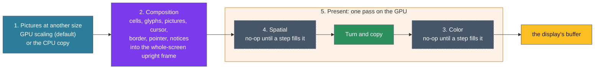

# ADR-1303: The GPU path draws each frame through a fixed pipeline of slots and turns it at present

## Summary

- **Decided by the maintainer (2026-11-03):** vtium's GPU path draws every frame through the same five stages, called slots: pictures at another size, composition into an upright frame off screen, color, spatial effects, and present, which turns the frame for a turned display and copies it to the screen. A slot that has nothing to do holds a no-op. The color and spatial steps that are switched on fold into the present pass, so an empty slot adds no pass. Pictures drawn at another size are scaled on the GPU by default, judged against the CPU path within a stated tolerance, and can instead be drawn from the CPU path's scaled copy, byte for byte. The CPU path is the standard and is judged exactly; the GPU path is judged against the CPU path's drawing within a stated tolerance, written in the sidecars tier 2 and tier 3 already read (D1). The CPU path reserves the color slot too, as a lookup table. The first work, slice 0, reserves the slots with their no-ops and builds both picture steps; each later step comes in its own issue. GL is reached through glow over EGL and GBM. Answering this record on 2026-11-03, the maintainer also decided four of its questions: the upright frame is the whole screen, since the spatial slot is a whole-screen pass, with the grid at the CPU path's own offsets and the border, the pointer and the notices composed into it (D3); the color step runs last, after the spatial step, over everything the frame holds (D1, D6); a head whose GPU path fails badly stays in software until vtium restarts (D9); and the binary implements vtium-render's `Gl` trait with an adapter over a safe GL type of vtium-platform's (D7). In a second round the same day the maintainer took six more of its recommendations: OpenGL ES 3.0 is required (D8); `hwaccel` stays off in every build until tier 3's GL variant passes on vtium (D9); GPU-scaled pictures stay within 1 level in any channel of any pixel against the CPU path (D2); libEGL and libgbm are loaded when the GPU path starts, libgbm through a small loader of its calls in vtium-platform (D8); the log names the paths `cpu` and `gpu` (D10); and tier 3's GL variant is judged against the re-baselined 2D goldens (D11). Last, the maintainer decided what a large picture does: a picture past the GPU's largest texture is tiled across several textures and still scaled on the GPU, and the GPU's picture textures count against the same budget as the CPU path's, ADR-1100 D5's bound for each display (D2). Asked about a display larger than the GPU's limits, the maintainer decided that the GPU path tiles first: an upright frame past the GPU's largest texture is held in several tiles, and a frame of one tile, the common case, takes the same path (D3). Software is the last resort, for a display whose own buffer the GPU cannot draw into: it is checked when the display appears and at every change of its mode, puts only its own head on the CPU path while that mode lasts, and the head goes back to the GPU path when a later mode fits; software until restart stays for serious GPU failures alone (D9). Once tier 2 had measured the GPU path under llvmpipe byte-identical to the CPU path, the maintainer decided to judge it exactly for now, a looser tolerance waiting for a real GPU that differs (D1).
- **Proposed by this record's agent, for the maintainer to confirm:** the CPU path's color slot sits on its last write before the depth reduction (D4); all unsafe GL code lives in vtium-platform behind a safe `Gl` trait (D7); khronos-egl beside glow (D8); one counter for both picture steps, the GPU path's cache holding textures only (D2); a head draws on the GPU path only in a `gpu` build with `hwaccel` on, falls back to the CPU path at start, and sorts failures during a run into kinds: a staging copy, a draw outside vtium's own budgets, one dropped frame, or, for an out-of-memory error from the driver, a lost context or repeated errors, the CPU path (D9); the log names the path that draws (D10). No open question remains.
- **Trades away:** The GPU path keeps a whole frame for each display, upright, in GPU memory: 7.9 MiB at 1920x1080 and 63.3 MiB at 7680x2160; under a look with a feedback shader it also keeps that shader's history, two textures for each tile (ADR-1305 D2). ADR-1300 and ADR-1401 D2 had it keep none. One more pass a frame, the present copy, which the C reference's gltex did not have. Byte-for-byte agreement between the two paths: the GPU path is judged within a tolerance.

> Edited 2026-11-03: ADR-1305, the frame clock, accepted the same day, adds the history a feedback shader reads. The sentence read: "The GPU path keeps a whole frame for each display, upright, in GPU memory: 7.9 MiB at 1920x1080 and 63.3 MiB at 7680x2160."
- **One-way?** No. Everything is behind the `gpu` feature, with no stored data and no protocol. It is reversible now, and costs days of rework once the composition and picture slices are built on the upright frame.
- **Probes:**
  - *Confident (the off-screen frame):* the GPU path keeps one picture of the screen's text in the graphics card's memory, about 8 MB at 1920x1080 and 66 MB at 7680x2160, so turning, color and effects happen in one place and the turned screen sits on exactly the pixels the software path draws. Earlier records said neither path keeps such a copy; this changes that for the GPU path only, and the software path still keeps none. Is that what you meant by the off-screen frame?
  - *Not confident (giving up on the GPU):* when the GPU path fails badly partway through a session, its context lost or its errors repeating, vtium moves that head to software drawing for the rest of the run and says so once in the log. A smaller failure, such as a picture too large for vtium's own texture budget, only slows that picture down. Is giving up for the run what you want, or should vtium try the GPU again, for example after the next VT switch?
- **Inversion:** Between "port gltex as it was" (every quad turned in the vertex shader and drawn straight into the window surface, the screen cleared and redrawn each frame, pictures sampled bilinear at any scale) and "a general GPU compositor" (a render graph, any number of passes, a portable API such as wgpu). The answer is a fixed pipeline of five slots on OpenGL ES, with the turn in one place and the CPU path as the judge of every pixel.

## Context

vtium's GPU path takes the place of the C reference's GPU renderer, gltex, which drew through GL on the C reference's drm3d display backend, and goes past it. gltex is the record of how the C reference set up EGL and GBM, what failed and how it fell back; it is not a limit on the pipeline, and no slot is narrowed to fit what gltex did. ADR-1300 D6 already decides how the GPU path stores glyphs and blends a cell: gltex's four pools, under the CPU path's budgets, and a shader that does the CPU path's integer arithmetic so both paths draw the same bytes. ADR-1401 D2 decides how a frame reaches a display: the display lends its buffer to the head's render thread as a token, and on the GPU path the thread imports that buffer as an EGL image and draws into it.

The maintainer decided on 2026-11-03 how a frame flows through the GPU path, as a pipeline of slots, so that later work, such as color correction or a CRT look, fills a slot without changing the frame's structure. ADR-1304 defines what fills the color and spatial slots, and ADR-1305 the frame clock on which a spatial step that reads the time or its previous frame runs. This record writes the pipeline down with each slot's inputs and its no-op, and sets out what the pipeline needs around it: where unsafe GL code lives, which crates bind EGL and GBM, how vtium chooses between the CPU and GPU paths, and what vtium calls each path in its log. The maintainer decided part of each of these on 2026-11-03, and each heading names the parts decided; the rest is this record's agent's proposal. Nothing of the GPU path is built yet, and the section on the starting state lists what the code holds today.

> Edited 2026-11-03: ADR-1304 and ADR-1305, accepted the same day, are the records this sentence waited on. It read: "The frame shader's record, which waits on this one, defines what fills the color and spatial slots."

A slot is one stage of the pipeline. A step is the work that fills a slot. A no-op is the step a slot holds when it has nothing to do: the frame leaves the slot as it came in. The upright frame is the whole display as the text sees it, unturned: the display's size, with its width and height swapped for a display mounted on its side, its rows running across, and the grid at the CPU path's place on the display mapped back into it, held in one texture or, past the GPU's largest texture, in several tiles (D3). The border is the strip of display pixels around the grid that no cell covers.

## C notes: the C reference's flow

drm3d, the C reference's GPU display backend, set up GL once for each card. It made a GBM device on the card's descriptor, an EGL display on that device, and required `EGL_KHR_surfaceless_context`. It bound OpenGL ES, chose a config whose native format was XRGB8888 or ARGB8888, made an OpenGL ES 2 context and made it current with no surface, and noted whether `GL_EXT_unpack_subimage` was there for faster uploads (`kmscon/src/video/drm3d_video.c:480-646`). For each display it made a GBM surface of XRGB8888 at the mode's size and an EGL window surface on it (`kmscon/src/video/drm3d_video.c:150-233`). A swap called `eglSwapBuffers`, locked the surface's front buffer object, made a framebuffer of it the first time it saw it, and presented it through the DRM code all backends shared (`kmscon/src/video/drm3d_video.c:382-424`).

The C reference chose its path in two places. The seat tried drm3d for a card when `hwaccel` was on, which it was not by default, and fell back to drm2d on the same descriptor when drm3d failed (`kmscon/src/config.c:1413`, `kmscon/src/seat.c:960-1008`). The terminal then chose gltex for a display with GL and bbulk for any other, for each display when it appeared, so a display plugged in during a run got a choice of its own; when the text renderer could not be made, the display got no screen at all (`kmscon/src/terminal.c:1252-1260`). It logged the choice as `Display ... with backend [...] text renderer [...]` (`kmscon/src/terminal.c:1272-1275`).

gltex compiled its shaders when it was set up (`kmscon/src/render/gltex.c:503-608`), and capped a glyph atlas at the smaller of `GL_MAX_TEXTURE_SIZE` and 2048 pixels a side and an image's texture at `GL_MAX_TEXTURE_SIZE` (`kmscon/src/render/gltex.c:582-586`). It kept no copy of the whole screen on the GPU, so a display's size never met a GPU limit there. It asked for `highp` floats in the fragment shader where the GPU had them and took `mediump` where it did not (`kmscon/src/render/gltex.c:457-474`). It drew a turned display by rotating every quad in its vertex shader (`kmscon/src/render/gltex.c:419-425`, `kmscon/src/render/gltex_atlas.vert`). It computed a turned grid's margins in the display's axes and swapped them into the rotated axes as fractions of the screen (`kmscon/src/render/gltex.c:427-448`), where bbulk placed the grid in the display's own pixels. At 1280x800 turned right, gltex's whole grid sat one pixel right of bbulk's. The C fork's issue on a turned grid one pixel off recorded the offset and named the two margins as its likely cause; the code above confirms that the two placed a turned grid by different arithmetic. A turn dropped all of gltex's GL state and built it again (`kmscon/src/render/gltex.c:1316-1322`); a set-up that failed during a run was tried again every frame, and nothing drew meanwhile (`kmscon/src/render/gltex.c:1333-1350`). A set-up that failed during a turn left a quiet screen frozen until some other redraw came, as the C fork's issue on a failed set during a rotation recorded.

gltex uploaded each picture as a texture of its own: the whole image, scaled down to fit `GL_MAX_TEXTURE_SIZE`, or, when the whole image did not fit the textures' budget, the image at the size the placement drew it (`kmscon/src/render/gltex.c:1679-1700`, `kmscon/src/render/gltex.c:1880-1890`). It sampled a picture nearest where one texel met one pixel and bilinear where the picture was scaled (`kmscon/src/render/gltex.c:2262-2302`). bbulk shrank a picture with a box filter, which averages every source pixel a drawn pixel covers. Bilinear sampling reads only the four texels nearest a pixel, so gltex's picture shrunk past 2:1 skipped texels and aliased, and even at 1.6:1 it differed from bbulk's by up to 41 levels in a channel, as the C fork's issue on pictures shrunk past 2:1 recorded.

Each frame gltex cleared the screen (`kmscon/src/render/gltex.c:1372-1373`) and drew everything in passes: pictures below the backgrounds, the backgrounds, pictures below the text, the text, pictures above the text, and the pointer. It checked for GL errors once, after the frame's draws; an error was logged and the frame reported as failed, and the next frame drew as usual (`kmscon/src/render/gltex.c:2337-2396`).

## Decision

D1 to D6 write down the maintainer's pipeline; where they go past what the maintainer said, the text says the detail is proposed. D7 to D10 set out what the pipeline needs around it: each heading names the parts the maintainer decided on 2026-11-03, and the rest is this record's agent's proposal. D11 sets out the work.

### D1: a fixed pipeline of five slots

Every frame the GPU path draws passes through five slots. The slots and their number never change, and a configuration or a later step changes only what a slot holds. The order is the maintainer's, pictures, composition, color, spatial, present, but for one decision the maintainer made on 2026-11-03: the color step runs last, inside present's one pass, after the spatial step, over everything the frame holds.

> Edited 2026-11-03: the maintainer decided open question 11, color last (`considered`). The paragraph read: "The order is the maintainer's, pictures, composition, color, spatial, present, with one exception that open question 11 decides: this record proposes that the color step run last, inside present's one pass, after the spatial step and after the pointer and the notices."

The figure shows the slots left to right, from the picture textures to the display's buffer. Composition draws everything the display shows into the upright frame, the size of the whole screen. Slot 5, present, is the box: one pass on the GPU that runs the spatial step on the upright frame, turns it into the display's buffer, and runs the color step last on every pixel it writes. Slots 3 and 4, dashed, hold no-ops until a later step fills them, and keep the maintainer's numbers.

> Edited 2026-11-03: the figure follows the maintainer's decisions on open questions 9 and 11. Its composition box drew cells, glyphs, pictures and the cursor into the upright frame, and its present box placed and turned the frame, filled the border and drew the pointer and the notices; the earlier figure is in git at d1e76dc5.

| Slot | Its inputs | What it gives the next slot | Its no-op | Paths | Damage |
|---|---|---|---|---|---|
| 1. Pictures at another size | A placement's picture, named by its image key, frame and pixel revision (ADR-1102 D3); the part of it the placement shows; the size it is drawn at | A texture the composition samples at the drawn size | A picture drawn at its own size is sampled as it is, one texel a pixel. In a build without `images` the slot is empty | GPU (the CPU path scales in its compositor, ADR-1100 D5) | None of its own: the cells a picture covers are already damaged when it changes |
| 2. Composition | The frame (cells, styles, the frame's placements in their order, the cursor), the glyph pools and decoration sprites of ADR-1300 D6, slot 1's textures, the border's color, which each redrawn rectangle is cleared to, the pointer's arrow, and the console's notices and focus mark, drawn upright by notice.rs | The upright frame: the whole display, turned upright, in RGBA8, in one tile or, past the GPU's largest texture, several (D3) | None: composition always runs, and draws only what changed since it last ran | GPU | Draws the cells that changed since the upright frame was last drawn, the pointer's old and new areas when it moves, and the notices over what it redrew; draws the whole frame on the changes D3 lists |
| 3. Color | One pixel's color and the color table, into which every color filter of the look is merged (ADR-1304 D2) | The same pixel, recolored | The identity, which the present pass leaves out | GPU, last in present; CPU, a lookup table on the renderer's last write before the depth reduction (D4) | None: each pixel's new color depends only on its old one |
| 4. Spatial | The whole upright frame, the border, the pointer and the notices included, its size, the panel's turn (ADR-1304 D15), ADR-1305's two values of the time for a step that declares it reads them, and its own previous output for a step that declares it (ADR-1305 D1, D2) | One pixel for each pixel of the upright frame | The identity, which the present pass leaves out | GPU only, folded into present | A step whose output pixel reads any other pixel, or reads the time or its previous frame while the clock runs, makes every present a whole one (ADR-1305 D6) |
| 5. Present | The upright frame, the display's orientation and depth, the enabled spatial and color steps, the buffer the token names, its age, and the rectangles changed over that age | The display's buffer | None: present always runs; with slots 3 and 4 empty and the display upright it is a copy | GPU | Draws the rectangles changed in the last `age` frames, and the whole buffer at age 0 |

> Edited 2026-11-03: ADR-1304, the record of the frame filters, accepted the same day, and ADR-1305, the frame clock, accepted the same day, fill the color and spatial rows. The color row's inputs read "One pixel's color and the step's parameters"; the spatial row's inputs read "The whole upright frame, the border, the pointer and the notices included, its size, and the time for a step that reads it", and its damage "A step whose output pixel reads any other pixel, or reads the time, makes every present a whole one".

#### How the GPU path is judged

The CPU path is the standard. It is judged exactly against its own goldens, as it is today. The GPU path is judged against the CPU path's drawing of the same screen within a stated tolerance, because every GPU may round a little differently, and vtium trusts Mesa and the driver for most of the consistency (the maintainer, 2026-11-03, `considered`). The C fork's tier 3 judged its GL path the same way: it compared exactly unless a sidecar `golden/<variant>/<screen>.tol` beside a golden held `max_delta`, the largest difference allowed in any channel of a pixel, `max_pixels`, how many pixels may differ, and masks, with the example "antialiasing differs by one level on the GL path" (`kmscon/fork/tier3/README.md` at b1f7a7c5, "Goldens, tolerances and masks"). vtium's tier 3 reads the same sidecars (`tools/tier3/README.md`, the same section; `tools/tier3/t3_evaluate.py`), and tier 2 judges images with tier 3's comparison and the same sidecars (`tools/tier2/README.md`). The GPU path's tolerance is written in those sidecars, so no new kind of judging enters either tier.

The GPU path is judged exactly for now (the maintainer, 2026-11-03: "exact for now", `considered`). Tier 2 under Mesa's llvmpipe measured all 72 screens the GPU path draws byte-identical to the CPU path's, and a planted rounding error of one level in the cell shader passed under the starting values this record first proposed, a `max_delta` of 1 and a `max_pixels` of 3 per cent of the screen's pixels. So the GPU path's sidecars hold a `max_delta` of 0 and a `max_pixels` of 0 while tier 2 measures no difference. A looser tolerance is set for a screen by a later decision, when a real GPU, tier 3 under virgl or hardware, shows a difference there. The reasoning for the starting values stays the guide for that decision: each place where the GPU path may part from the CPU path, a blend the GPU rounds itself, a conversion to 8 bits, a filter's weights in floating point, moves a channel by at most one level when its arithmetic is right, while a wrong formula or a misplaced pixel moves it by far more. The C fork's turned grid one pixel off differed at 11,440 pixels of 1280x800, about 1.1 per cent, and at most of them by much more than one level, and the maintainer's words allow a one-level drift across "a few per cent" of a screen. The 1-level figure the maintainer set for GPU-scaled pictures (D2, open question 3) is unchanged; that step is not built yet, and the part of slice 0 that builds it measures its largest difference and share and reports them for the maintainer.

> Edited 2026-11-03: the maintainer decided to judge the GPU path exactly for now, after tier 2's measurement on llvmpipe (`considered`). The paragraph read: "This record proposes starting values: a `max_delta` of 1, and a `max_pixels` of 3 per cent of the screen's pixels, 30,720 at 1280x800. Each place where the GPU path may part from the CPU path, a blend the GPU rounds itself, a conversion to 8 bits, a filter's weights in floating point, moves a channel by at most one level when its arithmetic is right. A wrong formula or a misplaced pixel moves it by far more: the C fork's turned grid one pixel off differed at 11,440 pixels of 1280x800, about 1.1 per cent, and at most of them by much more than one level. So a `max_delta` of 1 catches the defects that matter, and the share bounds a one-level drift that spreads across the screen at "a few per cent", the maintainer's words. The slice that builds each step measures the largest difference and the share on tier 2's and tier 3's screens and reports them, and the maintainer confirms the values then. The 1-level tolerance the maintainer set for GPU-scaled pictures (D2, open question 3) is this rule's `max_delta` for the picture step, and the share of differing pixels follows the general rule. A large scaled picture may differ by one level at more pixels than that share allows; if the slice measures that, it reports it for the maintainer rather than raising the share itself."

The tolerance judges the GPU path only. A sidecar that judges the GPU path belongs to the GPU path's own variant or case, and the CPU path's comparison with the same golden stays exact; where a harness reads only a sidecar beside the golden, the slice that builds the comparison gives the GPU path a sidecar of its own. No mask hides a GPU difference. Exact comparisons stay where they are natural: the CPU path against its goldens, and a picture drawn through the CPU copy step, whose texture holds the CPU path's pixels byte for byte and is drawn one texel a pixel (D2). ADR-1300 D6's cell shader does the CPU path's integer arithmetic and writes each channel as `(c + 0.25) / 255`; that record decides it and this one does not change it. While the GPU path is judged exactly, the comparison depends on that exactness.

> Edited 2026-11-03: follows the decision to judge the GPU path exactly for now. The paragraph ended: "Under this rule its exactness is margin that the comparison no longer depends on."

### D2: slot 1, pictures at another size

Two steps can fill slot 1, and they give the composition the same thing: a texture it samples at the drawn size.

- **GPU scaling, the default.** The GPU path uploads each picture's own pixels once, as a texture keyed by the image key, the frame and the pixel revision, and scales it as it draws. The step owns the filtering of a picture shrunk past 2:1, so the picture does not alias the way gltex's did, and tests compare its output with the CPU path's within a stated tolerance: at most 1 level in any channel of any pixel, which the part of slice 0 that builds the step confirms by measurement (the maintainer, 2026-11-03, open question 3). It is the `max_delta` of the general rule for this step (D1). The maintainer fixed the result and left the method open. This record proposes that the step compute the CPU path's own filter weights in the shader: the box filter where a picture shrinks and the bilinear blend where it grows (`crates/vtium-render/src/picture/scale.rs`).
- **The CPU copy.** The GPU path makes the CPU path's copy of the picture with the CPU path's own scaling, upright, at the drawn size (`scale::turned_copy` with `Orientation::Normal`, `crates/vtium-render/src/picture/scale.rs`), uploads it, and the composition samples it one texel a pixel. The picture's texture then holds the CPU path's pixels byte for byte, and tests select this step when they want a picture's pixels exact on the GPU path.

The renderer's configuration chooses the step, GPU scaling unless a test asks for the CPU copy, and nothing else in the frame changes with it; no key in vtium.conf sets it.

A picture is never refused for its size, and never drawn from the CPU copy because it is wider or taller than the GPU's largest texture (the maintainer, 2026-11-03, open question 4). The GPU's largest texture, `GL_MAX_TEXTURE_SIZE`, is a fixed limit that more memory does not lift, 2048 pixels a side at least under OpenGL ES 3.0. A picture wider or taller than that is tiled: its own pixels go into several textures, each within the limit, and the GPU-scaling step draws each tile over its part of the drawn picture, within the 1-level tolerance. Neighbouring tiles overlap, so that every drawn pixel reads all the source pixels its filter needs from one tile and the filter leaves no seam. Along an axis where `s` source pixels are drawn as `d` pixels, the CPU path's filter reads at most `s / d + 2` neighbouring source pixels for each drawn pixel where the picture shrinks, the division rounded down, and 2 where it grows (`Taps::new`, `crates/vtium-render/src/picture/scale.rs:46-52`). That run holds the source pixel under the drawn pixel's centre, so it reaches at most `s / d + 1` source pixels past it on either side where the picture shrinks, and 1 where it grows: the filter's reach. A drawn pixel is drawn from the tile that owns the source pixel under its centre, and a tile owns its pixels up to the middle of each overlap it shares (D6), so a tile holds the reach on each side of every pixel it owns when neighbouring tiles overlap by twice the reach: `2 × (s / d + 1)` source pixels where the picture shrinks, and 2 where it grows. This sizing is this record's agent's, for the filter D2 proposes above; the maintainer's answer said the tiles overlap "by a pixel or two" in the team lead's paraphrase (`considered`). The tiler is one function: given a size, the largest tile and an overlap, it gives the tiles. The upright frame uses the same function with twice the spatial step's reach as its overlap (D3). gltex instead scaled a picture past its largest texture down to fit (`kmscon/src/render/gltex.c:1679-1700`).

> Edited 2026-11-03: the work that builds the composition found that tiles overlapping by one reach, each owning its pixels up to the middle of the overlap, leave only half the reach of neighbours at a seam, so the overlap is twice the reach. The paragraph read: "A run of that many pixels always lies whole in one tile when neighbouring tiles share one pixel fewer than it, so the overlap is `s / d + 1` source pixels where the picture shrinks and 1 where it grows." and "The upright frame uses the same function with the spatial step's reach as its overlap (D3)."

The GPU path's picture textures count against the same budget as the CPU path's scaled copies: ADR-1100 D5's bound for each display, twice the display's screen in RGBA, one limit for both paths (the maintainer, 2026-11-03, open question 4). The textures sit in a cache of the renderer's own, outside the image store's budget, so no texture ever evicts a stored picture. A texture of a picture's own pixels counts the bytes it holds, its tiles' overlap included; a texture of a CPU copy counts the copy's bytes at the drawn size, as the CPU path counts a copy (`Key::bytes`, `crates/vtium-render/src/picture/copies.rs`). The cache makes room by the CPU path's whole rule (`Copies::room` and `Copies::drop_older`, the same file). It first drops the textures of the same image and animation frame at an older pixel revision that no placement in this frame shows. If the new texture still does not fit, it evicts nothing unless evicting every texture no placement in this frame shows would make room; when that would, it evicts those textures least recently placed first, ties broken by their keys, until the new one fits.

This record proposes that one counter serve both steps on the GPU path, as the maintainer's one limit asks. The GPU path's cache holds textures only, of a picture's own pixels or of a CPU copy. A CPU copy lives in memory only until it is uploaded, and the CPU path's own cache of copies stays empty while the head draws on the GPU path, so no picture is counted twice.

Where the budget has no room for a picture's own pixels, the GPU path draws that picture as the CPU path draws every picture (`Pictures::ready`, `crates/vtium-render/src/picture/mod.rs`). First it takes the CPU copy step for it: the copy at the drawn size, upright, counted against the same budget and kept while there is room, as the CPU path keeps it. A 3000x2000 photo holds 24 MB of its own pixels; drawn at 960x640 on a 1920x1080 display, whose bound is 16.6 MB, it keeps a copy of 2.5 MB on both paths, and the GPU path uploads that copy once. Only where the drawn copy has no room either does the GPU path scale the part of the picture the frame draws for that frame alone, without keeping it, as the CPU path does then. It uploads those pixels into one scratch texture of the display's, made the first time a picture needs it, at most the upright frame's size (7.9 MiB at 1920x1080), and counted in no budget. A display under a look with a feedback shader also holds that shader's history, two textures for each tile of the upright frame, counted in no budget either, since the display fixes its size and it holds nothing vtium could drop and draw again (ADR-1305 D2). Each such picture in a frame uses the same scratch texture in turn, drawn before the next is uploaded, so a display never holds more than one. Either way the picture's texture holds the CPU path's pixels byte for byte.

> Edited 2026-11-03: ADR-1305, the frame clock, accepted the same day, adds the feedback history's budget; the paragraph ended at "and counted in no budget."

> Edited 2026-11-03: a review of this record found that the paragraph above misread the CPU path's fall-back. The CPU path counts a copy at its drawn size and keeps it whenever the budget has room for that copy, and scales a picture for one frame only when the drawn copy has no room. The text in git at d2c83cee had the GPU path scale for one frame every picture whose own pixels had no room, so a photo the CPU path keeps would have been scaled and uploaded again for every frame that redraws it. It also had "never drawn from the CPU copy, for its size alone", which this paragraph narrows to the GPU's largest texture. The maintainer's decision, one budget for both paths and no picture refused for its size, is unchanged.

> Amended 2026-11-03, by the work that builds the picture steps: the GPU-scaling step computes the CPU path's own weights in whole numbers, each weight 16-bit fixed point as `scale.rs` makes it, each channel's sum kept in two 32-bit parts and rounded once, so its pixels are the CPU path's byte for byte. Tier 2's six picture screens on Mesa's llvmpipe, at shrink factors from 1.25 to 8, growth of 2 and 3, tiles of 64 pixels, a turned display and a selection, measured 0 differing pixels and a largest difference of 0, by GPU scaling and by the CPU copy alike; the 1-level tolerance stays unused, and the sidecars stay exact. Two corners take the CPU copy in place of GPU scaling, and then the scratch texture where the copy has no room, though this section says a picture is never drawn from the CPU copy for its size; the maintainer agreed on 2026-11-04: "those are extreme cases, let's be realistic" (`considered`). The first is a picture drawn wider or taller than 32,767 pixels, or from more than 65,535 source pixels across or down, past what the shader's 32-bit integers hold. The second is a picture whose tiles cannot overlap by twice the filter's reach, because that overlap is at least the largest texture, such as an image 10,000 pixels wide shrunk into one 8-pixel cell. Both are bounds of the step, not of the GPU's largest texture: only a picture drawn wider or taller than any display, or shrunk by more than about half the largest texture, meets them. A cell that pictures reach is composed in ADR-1100 D4's layers: its background as a cell, each picture from its textures, the cell's text layer premultiplied and blended over the pictures beneath with the GPU's `GL_ONE`, `GL_ONE_MINUS_SRC_ALPHA`, and its mark the same way. The selection's tint over such a cell is the CPU path's `mask` at `SELECTION_TINT`, which a blend cannot round as the CPU path does, so the composition copies the selected cells out of the upright frame and draws them back tinted from the copy, since no draw reads the target it draws into.

### D3: slot 2, composition into the upright frame

The composition draws everything the display shows into an off-screen texture, the upright frame. The frame has the display's size, with its width and height swapped for a display turned on its side, whatever slot is filled, because the spatial slot is a whole-screen pass (the maintainer, 2026-11-03). The maintainer's words tied the frame's size to the effect pass: the whole screen for a whole-screen pass, the grid for a pass per character (`considered`); the spatial slot is defined as a whole-screen pass (D5), so this record resolves that condition as the whole screen in every configuration. It takes the frame's simplest form, so that one code path serves every configuration (the maintainer asked that the code stay simple, 2026-11-03). Each rectangle the composition redraws, the whole frame when it is new, is first cleared to the border's color with a scissored clear, so the border needs no pass of its own. Into it the composition then draws, in the order and with the arithmetic ADR-1300 decides, each cell's background, underline, glyph and strike, the frame's placements in the bands and order of ADR-1100 D4, and the cursor, as quads; then the pointer's arrow; then the console's notices and the focus mark. Each display the GPU path draws keeps its own upright frame, since its age, its damage and its size are its own: 4.0 MiB at 1366x768, 7.9 MiB at 1920x1080 and 63.3 MiB at 7680x2160.

The upright frame is a grid of tiles, each a texture within the GPU's largest texture and its largest viewport, the smaller of `GL_MAX_TEXTURE_SIZE` and `GL_MAX_VIEWPORT_DIMS`. A 4K display fits in 4096, and GPUs that drive 5K and 8K displays allow 8192 to 16384, so the common frame is one tile; a 7680x2160 display on a GPU whose largest texture is 4096 takes two. One tile and many take the same path, so tiling adds no second one (the maintainer, 2026-11-03, after the team lead explained that compositors tile an oversized frame, as Xorg's glamor tiles large pixmaps). D2's tiler makes the tiles, with an overlap of twice the spatial step's reach, where the reach is how many pixels away from the pixel it writes the step reads, which ADR-1304 D3 states for each filter, a chain's reach being the sum of its filters'. A tile owns its pixels up to the middle of each overlap it shares (D6), so twice the reach leaves the reach of neighbours on each side of every pixel it owns. With no spatial step the reach is 0, and the tiles meet edge to edge. The composition draws each redrawn rectangle into each tile it meets, the overlaps included, with the tile's offset subtracted from every quad, and does the same for the border's clear, the arrow's quads and the notices' uploads. Present draws each tile into its part of the display's buffer (D6), so the spatial step reads every neighbour it needs from the tile it runs on, and a seam shows nothing. With more than one tile, the overlap leaves each tile pixels of its own while the reach stays under half the tile; ADR-1304 D3 caps a chain's reach at 256 pixels, below that. A feedback shader's history is tiled as the upright frame, with the same tiles and overlaps, and its reads stay at the pixel being written, so the overlap of twice the reach serves it unchanged (ADR-1305 D2). A change of the spatial step changes the reach, so it makes the frame anew and draws it whole.

> Edited 2026-11-03: ADR-1304, the record of the frame filters, accepted the same day, states and caps the reach, and ADR-1305, the frame clock, accepted the same day, tiles the feedback history. The paragraph read "where the reach is how many pixels away from the pixel it writes the step reads, which the frame shader's record states for each step." and "the frame shader's record bounds each step's reach below that."

> Edited 2026-11-03: the overlap is twice the reach, for the reason D2 gives, and the arrow is drawn as quads (the paragraph below). The paragraph read: "D2's tiler makes the tiles, with an overlap of the spatial step's reach: how many pixels away from the pixel it writes the step reads, which the frame shader's record states for each step. With no spatial step the reach is 0, and the tiles meet edge to edge.", and named "the arrow's quad".

Memory is not what limits the frame. The only GPU limits in play are fixed widths and heights: the largest texture, the largest render target and the largest viewport, which more memory does not lift. On an ARM SoC the GPU shares system RAM, and the whole-screen frame, whose sizes the paragraph above gives, 31.6 MiB at 3840x2160 among them, is small next to the 1 to 8 GB such boards carry (the maintainer, 2026-11-03: "Even very small arm soc with GPU have sufficient vram for this", `considered`). Tiling, and the last resort in D9, answer a size the GPU cannot address, never a shortage of memory. The only fallback that memory drives is the driver's own `GL_OUT_OF_MEMORY`, which D9 sorts with the serious failures.

The grid sits in the upright frame where the CPU path puts it on the display, mapped back into upright coordinates, so the turned frame puts it on the CPU path's pixels. The CPU path centres the grid in the display's own pixels, with an odd margin's spare pixel on the right or the bottom (`Layout::grid_for`, `crates/vtium-render/src/renderer.rs:205-225`). Centring the grid in the upright frame instead would put the spare pixel on the other side once the frame is turned, which is the C fork's one-pixel offset again: at 1280x800 turned right with a 10x19 cell, 67 rows take 1273 pixels across and leave 7, and the CPU path puts 3 on the left where a frame centred upright and then turned puts 4. One small function maps each rectangle the CPU path places on the display back into upright coordinates, so the grid's cells, the border's pieces and the arrow's place land in the upright frame where the turned frame puts them on the CPU path's pixels, and tests check it at all four turns with odd margins. Two other parts of the GPU path depend on the orientation: present's turn (D6), and the turn of the composition's damage, which the composition records in upright coordinates, into the display's coordinates for the swap (ADR-1401 D2). The pointer's tip is a pixel of the grid, so it maps through the same offset, and the arrow is drawn upright with its hot spot there; the CPU path turns the same arrow by a plain permutation of its pixels (`Arrow::turned`, `crates/vtium-render/src/arrow.rs`). arrow.rs keeps the upright arrow private today (`Arrow::upright`), and exposes it for the GPU path (D11, part 3).

> Edited 2026-11-03: the work that builds the turn found that the renderer's front end places every rectangle in the display's pixels, as on the CPU path, so the function maps each one, the grid's offset with it. The sentence read: "One small function maps the CPU path's turned grid offset back into upright coordinates, and a unit test checks it at all four turns with odd margins."

The arrow is one texture, drawn with the GPU's ordinary blending of a premultiplied picture over the frame (`GL_ONE`, `GL_ONE_MINUS_SRC_ALPHA`), which is the arithmetic the CPU path's `Over` does with `over_bg` as it writes each run (`crates/vtium-render/src/renderer.rs:665`, `crates/vtium-render/src/blend.rs:53-64`). The GPU rounds that blend itself, so an outline pixel, black at 220 of 255 (`crates/vtium-render/src/arrow.rs:24-28`), may land one level from the CPU path's, within the tolerance (D1). It draws only over the pixels this composition drew beneath it, as quads cut to them a line at a time, lines alike joined into one quad, so no pixel takes the arrow twice, as the CPU path's `Over` blends only the runs it writes. A scissor to the frame's damage rectangles would not do: the renderer joins cells up to three apart into one damage rectangle, and the border's areas may overlap, so a scissored quad would blend the arrow again over pixels the upright frame kept from an earlier frame, which hold it already.

> Edited 2026-11-03: the work that builds the composition found that a scissor to the damage rectangles blends the arrow twice where nothing was redrawn. The paragraph began "The arrow is drawn as one textured quad, with the GPU's ordinary blending", and ended: "The quad draws only over the rectangles this composition redrew that the arrow meets, scissored to them, so no pixel takes the arrow twice, as the CPU path's `Over` blends only the runs it writes."

The notices and the focus mark need no blend. notice.rs draws each into an opaque picture of its own, in the text's unturned view of the whole display (`Picture`, `Notice::draw` and `Mark::draw`, `crates/vtium-render/src/notice.rs`), and the CPU path writes that picture over the buffer without blending, turned and reduced to the display's depth pixel by pixel (`Surface::put`, `crates/vtium-render/src/notice.rs:93-113`). The GPU path uploads the picture straight into the upright frame at its place in the view with `glTexSubImage2D`, with no quad and no shader, and present's depth reduction does what notice.rs's own `Threshold` does. notice.rs today keeps the picture private and writes only turned pixels, so it exposes the upright picture and its place in the view for the GPU path (D11, part 3).

The upright frame outlives a frame, so the composition draws only what changed since it last drew, whatever the age of the display's buffer: the cells that changed, and, when the pointer moves, its old and new areas and the cells they touch, as the CPU path marks them (`stamp_pointer`, `crates/vtium-render/src/renderer.rs`), each cleared to the border's color and redrawn. A notice is uploaded again over each frame that redraws beneath it. The composition draws the upright frame whole when the frame is new, after a display is set up, a font or size change, a turn or a wake-up. It also draws it whole on each change the CPU path answers by drawing whole: a change of the grid's size or place; and a change of the border's color, through the palette or OSC 11, since the CPU path resets its damage and marks its border stale when the grid or the background changes (`Renderer::draw`, `crates/vtium-render/src/renderer.rs:633-636`; `Cells::reset`, `crates/vtium-render/src/damage.rs:77-91`). It draws it whole too after a frame dropped for a GL error (D9), since what that frame left in the upright frame is unknown. A notice ending redraws only the area it covered, the cells and the border beneath it, as the console does on the CPU path, where it hands that area to `Renderer::redraw_area` (`crates/vtium/src/term.rs:452-459`); the GPU path finds each notice the last frame drew that this one does not draw as it was, and redraws its area the same way.

> Edited 2026-11-03: the console on the CPU path redraws only the area a notice covered when it ends, and the GPU path does the same. The paragraph ended: "...the grid or the background changes (`Renderer::draw`, `crates/vtium-render/src/renderer.rs:633-636`; `Cells::reset`, `crates/vtium-render/src/damage.rs:77-91`); and a notice ending, as the console does on the CPU path (`crates/vtium-render/src/notice.rs`). It draws it whole too after a frame dropped for a GL error (D9), since what that frame left in the upright frame is unknown."

Glyphs on the GPU path are stored upright and never turned, because the composition works on the upright frame. A turn of the display keeps every glyph and picture texture; it changes the present pass and draws the upright frame whole, since the grid's place in it moves. ADR-1300's "Carried forward" says a glyph is rotated once when cached, and a change of orientation empties the cache; on the GPU path the orientation half of that no longer holds, and the CPU path keeps it.

#### What the whole-screen frame costs, against a frame of the grid alone

The maintainer chose the whole screen because the spatial slot is a whole-screen pass, and then asked that the code stay simple. The table sets the whole-screen frame against the grid-only frame in the form this record first proposed (in git at d1e76dc5). There the upright frame held the grid alone, and present ran one pass over each pixel of the display: the border's color or the grid's texel, then the arrow blended over it from the arrow's texture, then at most two notice pictures over that, then color and the depth reduction, with no second buffer and no further pass. With the GPU path judged within a tolerance (D1), the arrow is one quad with the GPU's own blending, and the whole-screen frame is the slightly simpler of the two: it keeps the orientation in fewer places and has the simpler present shader. It costs a whole recomposition when a notice ends and a small change to notice.rs, which the grid-only frame does without. The difference is small either way, and the choice rests on what the spatial step reaches.

| | Whole-screen frame, as decided | Grid-only frame, as first proposed |
|---|---|---|
| Textures for each display | One upright frame, the display's size; the arrow | One frame, the grid's size, smaller by the border alone: 61,440 bytes less at 1920x1080 in 8x16 cells; the arrow; at most two notice pictures |
| Passes each frame | Composition, then present | Composition, then present |
| The border | A scissored clear to its color before each redrawn rectangle | A test in present's shader on every pixel: the grid's texel or the border's color |
| The pointer's arrow | One texture, upright, in composition, with the GPU's ordinary blending, drawn as quads cut to the pixels the frame drew beneath it | Blended in present's shader, which already holds the pixel beneath it, with `over_bg`'s arithmetic; the arrow comes turned and placed by the CPU path's own code (`Arrow::new`, `Renderer::place_pointer`) |
| The notices and the focus mark | Uploaded upright into the frame with `glTexSubImage2D`; notice.rs exposes its upright picture and its place in the view | Sampled by present's shader from at most two textures, filled through notice.rs's own turned writes (`Surface::put`); notice.rs unchanged |
| A notice ending | The cells and the border beneath it drawn again | Present runs again over the notice's area; the grid's frame beneath it is intact |
| Code that knows the orientation | The function mapping the grid offset back, present's turn, and the turn of the composition's damage into display coordinates | Present's placement of the grid, the arrow and the notices in display coordinates, present's turn, and the turn of the composition's damage into display coordinates |
| Shaders | The cell shader, the picture shader, a textured-quad shader for the arrow, and present's | The cell shader, the picture shader and present's, which also fills the border and blends the arrow and the notices |
| A frame past the GPU's largest texture, a limit of size, not of memory | Tiles made by D2's picture tiler, overlapping by twice the spatial step's reach; one tile in the common case, on the same path | The same, since a frame of the grid is nearly the display's size |
| What the spatial step reaches | The whole display, the pointer bent with the cell it selects | The grid only |
| Tests beyond tier 2's comparison | The mapping function at four turns with odd margins; a notice ending redraws the cells beneath it | The grid's placement in present at four turns with odd margins |

> Edited 2026-11-03: four rows of the whole-screen column follow the edits to D2 and D3 above. They read: "One textured quad, upright, in composition, with the GPU's ordinary blending, scissored to the redrawn rectangles it meets"; "The whole frame recomposed, every cell drawn again"; "Tiles made by D2's picture tiler, overlapping by the spatial step's reach"; and "a notice ending recomposes the whole frame".

> Edited 2026-11-03: the maintainer decided open question 9, the whole screen, against this record's recommendation of the grid alone (`considered`). D3 said the upright frame held the grid alone, "its columns times the cell's width, by its rows times the cell's height, at most the display's size", that "the border, the pointer and the notices are drawn at present, in the display's own pixels (D6)", and that a turn changed "the present pass alone"; the earlier text is in git at d1e76dc5.

### D4: slot 3, color

The color slot holds a step that maps each pixel's color to a new one: gamma, color space mapping, display compensation, contrast or a color-blind filter. ADR-1304 defines what fills the color and spatial slots: how a filter is named in a vtlook, its inputs, its cost bound, and how a failure falls back to the built-in default look, as the maintainer's decision on the frame shader asked. Each step then comes in an issue of its own. Because a color step reads only the pixel it writes, damage tracking holds on both paths.

On the GPU path the step runs last inside the present pass, after the spatial step and the turn, on every pixel present writes, so it reaches everything the frame holds: the cells, the border, the pointer and the notices (the maintainer, 2026-11-03). On the CPU path the slot sits on the renderer's last write to the display's buffer before the depth reduction: between `Over`, which blends the pointer on the way out, and `Threshold`, which reduces a pixel to 1 bit for a 1-bit panel (`crates/vtium-render/src/renderer.rs:664-665`). So the border, which the renderer fills straight into the target, the cells and the pointer all pass through it. The console's notices, which reach the buffer through their own `Threshold` (`crates/vtium-render/src/notice.rs`), pass through the same slot there. No part of slice 0 (D11) builds the CPU path's color slot: ADR-1304's color slice builds it, with the first color filters. Every color filter is a table, and a look's color filters are merged into one table of 33 a side, which the CPU path looks each pixel up in and the GPU samples as a texture, so both paths take their colors from one source, and the GPU path is judged against the CPU path as D1 judges it (ADR-1304 D2, the maintainer's decision); no color step that cannot be a table exists.

> Edited 2026-11-03: ADR-1304, the record of the frame filters, accepted the same day, decides what fills the slot. The first paragraph's sentence read: "The frame shader's record defines what fills the color and spatial slots: how a step is named in the configuration, its inputs, its cost bound and how it falls back to the no-op when it fails, as the maintainer's decision on the frame shader asks." The second paragraph's end read: "No part of slice 0 (D11) builds the CPU path's color slot: the vtlook record builds it, with the first color step. This record proposes that a color step both paths run use one table, which the GPU samples as a texture, so both paths take their colors from one source, and the GPU path's result is judged within the tolerance (D1); the frame shader's record decides whether a step that cannot be a table may exist, and how it is judged."

> Edited 2026-11-03: a review of slice 0 found that none of its parts builds the CPU path's color slot, so the paragraph now says so. Its text is otherwise unchanged.

### D5: slot 4, spatial effects

The spatial slot holds a step that reads the upright frame around a pixel or reads the time: a CRT look, scanlines or sharpening. It exists on the GPU path only, and ADR-1304 D3 and D15 define what fills it: shader files, chained in one pass under a declared reach and reads. A step that reads any pixel other than the one it writes, or reads the time, makes every present a whole one; the composition still draws only what changed. A step that reads the time also needs frames drawn on a clock, which vtium does not draw today, and a new place where time enters (docs/architecture.md, "Determinism"); ADR-1305 names both, the frame clock (its D3 and D4) and its row in the determinism table (its D5), and never lets the time reach the screen's state.

The spatial step runs on the whole upright frame, the border, the pointer and the notices included (D3), so a step that bends the picture, such as a CRT's curvature, bends the pointer with the cell it selects. A pointer on the display's cursor plane (`crates/vtium-platform/src/display/drm2d.rs`) is not in the frame and skips the color and spatial steps; ADR-1304 D7 decides that a look holding any filter, a color-only look included, takes the pointer off the cursor plane into the frame, so both steps reach it, and that on the built-in default look the pointer stays on the cursor plane where the display has one.

> Edited 2026-11-03: ADR-1304, the record of the frame filters, accepted the same day, and ADR-1305, the frame clock, accepted the same day, answer what this section left to them. It read "It exists on the GPU path only, and the frame shader's record defines what fills it, as for the color slot.", "that step's record names both, and never lets the time reach the screen's state." and "the frame shader's record decides whether a spatial step takes the pointer off the cursor plane."

> Edited 2026-11-03: follows the maintainer's decision on open question 9. The paragraph said the spatial step ran on the grid alone, before present drew the border, the pointer and the notices, so that a curvature step left the pointer still while its cell moved; the earlier text is in git at d1e76dc5.

### D6: slot 5, present

Present turns the upright frame for the display and copies it into the buffer the display lent. It is the only place on the GPU path that turns the frame. On the GPU it is one textured quad for each tile of the upright frame, one in the common case, covering the part of the display that tile owns, its texture coordinates turned, scissored to the rectangles to be drawn. A tile owns its pixels up to the middle of each overlap it shares (D3). Each pixel of the display's buffer reads its texel of the upright frame, turned as the CPU path turns a pixel, by integer coordinates with no filtering, after the spatial step. The color step runs last, over everything the frame holds (the maintainer, 2026-11-03). After the color step the display's depth reduction runs (ADR-1301), as the CPU path's `Threshold` does after its color slot. No part of slice 0 builds the depth reduction yet, and until it is built the renderer refuses a 1-bit display on the GPU path.

> Edited 2026-11-03: a review of slice 0 found that none of its parts builds the depth reduction. The paragraph ended: "The color step runs last, over everything the frame holds (the maintainer, 2026-11-03). Then the display's depth reduction runs (ADR-1301), as the CPU path's `Threshold` does."

The enabled steps are compiled into the present shader when the configuration changes, never per frame, so an empty slot adds no pass and no instruction. Present draws the rectangles that changed in the last `age` frames of the buffer the token names, and the whole buffer at age 0, when a spatial step asks for it, or while the display draws on the frame clock (ADR-1305 D6). Under a look with a feedback shader, a draw for each tile before present writes that shader's history, and present reads the history as the input of the filters after the feedback shader (ADR-1305 D2); that draw is the one pass a frame that a slot adds, and only while a feedback shader is in force, which "an empty slot adds no pass" still allows. On a display that does not meet a look's requirements both optional slots hold their no-ops, and a 1-bit display that meets them takes the look before the depth reduction, once the depth reduction is built (ADR-1304 D7). The rectangles it drew are the frame's damage, which the loop hands to the display at the swap (ADR-1401 D2).

> Edited 2026-11-03: ADR-1304, the record of the frame filters, accepted the same day, and ADR-1305, the frame clock, accepted the same day, add the clock's whole presents, the feedback draw and the display requirements. The sentence read: "Present draws the rectangles that changed in the last `age` frames of the buffer the token names, and the whole buffer at age 0 or when a spatial step asks for it."

The CPU path keeps its own shape: it composes each pixel already turned, through the row scratch, into the display's buffer (ADR-1300 D5), and has no separate present step. The two paths agree within the tolerance because the composition puts the grid, the pointer and the notices where the CPU path puts them, mapped back into upright coordinates (D3), and present turns each pixel as the CPU path does, which tier 2 checks by comparing the GPU path's buffer with the CPU path's at each orientation (Verification).

> Edited 2026-11-03: follows the maintainer's decisions on open questions 9 and 11. Present placed the grid at the CPU path's offsets, filled the border and drew the pointer and the notices, in five numbered steps, before the color step; the composition now does all but the turn (D3). The earlier text is in git at d1e76dc5.

### D7: the safe `Gl` trait, and where unsafe code lives (proposed; the adapter in the binary decided)

Only vtium-platform may use `unsafe` (docs/architecture.md). vtium-render keeps `#![forbid(unsafe_code)]` and draws through a safe trait, `Gl`, which it defines behind its `gpu` feature. vtium-platform holds every `unsafe` site of GL, EGL and GBM behind its `gpu` feature. vtium-platform exposes a safe GL type of its own, and the binary implements `Gl` over it with a newtype adapter, so docs/architecture.md's arrows still point one way and vtium-platform builds without vtium-render (the maintainer, 2026-11-03, open question 10). The minspec build links neither and no GL library.

The trait speaks vtium-render's terms, not GL's: create, fill and free a texture of a stated format and size; the upright frame and an imported display buffer as targets to draw into; a program compiled from vtium-render's own shader source, with named inputs; a draw of a batch of quads; the GPU's limits, such as the largest texture and whether fragment shaders have `highp`; and a read of a rectangle back to memory, for tests. Every handle the trait gives out is an owned value tied to the context that made it, and a call with a handle that is freed or belongs to another context returns an error, so nothing the renderer does through the trait is undefined behaviour. GL errors are checked once after each batch of allocations and uploads, kept apart from the draws, so an out-of-memory error is known for what it is and which batch raised it; a first frame or a font change uploads many glyph slots, and a check after each one would stall the driver. They are checked once after the composition's draws and once at the end of each frame, which covers present's draws, as gltex checked them once a frame, or reported as they happen through `KHR_debug` where the driver has it. A check after every draw would make a threaded driver wait on the GPU. Each error is reported with its kind, which D9 then sorts. The GLSL source lives in vtium-render beside the CPU path's arithmetic it mirrors.

> Edited 2026-11-03: the check for each batch of draws is one check after the composition, and the end of the frame's check covers present's draws. The sentence read: "They are checked once for each batch of draws and at the end of each frame, as gltex checked them once a frame, or reported as they happen through `KHR_debug` where the driver has it."

vtium-platform's GL code holds the EGL display, the context and the GL function table on the head's render thread, which owns the context for as long as it runs. Each `unsafe` site carries an `#[expect]` with its reason, as the crate's rule asks, and its README lists them.

A head has one GL context (ADR-1401 D2), made on the render node of the card that drives the head's first display, the first in the order the head file's rules light them, so it needs no DRM master. Each display allocates its buffers as GBM buffer objects on its own card (ADR-1401 D2), and the token carries each buffer as a dma-buf: its descriptor, format, modifier, stride and offset. The render thread imports it as an EGL image and binds it as the storage of a renderbuffer, attached to a framebuffer object that present draws into. A display on another card is imported the same way where the driver allows it, and otherwise reached through a staging copy, frame by frame, as ADR-1401 D2 decides.

A stand-in GL in vtium-render's tests implements the trait and checks what vtium-platform's GL type checks: each handle is live and its own, a texture's format and size are within the limits it reports, an upload lies inside its texture, a program's inputs exist. It records the calls and draws no pixels. Pixels are judged on a real GL, Mesa's llvmpipe, which runs headless on EGL's surfaceless platform with no device. That platform has no GBM device and no dma-buf, so tier 2 sets up the GPU path without GBM, presents into an off-screen texture and reads it back; only tier 3 proves the dma-buf import. Every machine that runs tier 2, CI's runners included, `arm-native` among them, needs Mesa's llvmpipe and its EGL.

### D8: the binding crates (proposed; the OpenGL ES version and the loading decided)

vtium binds GL with glow, as the maintainer named, and EGL with khronos-egl, inside vtium-platform under `gpu`. glow is maintained (0.18.0, 2026-07), has no native dependency on Linux and loads its function table through `eglGetProcAddress`. khronos-egl (6.0.0) either links libEGL or loads it at run time. vtium loads libEGL and libgbm when the GPU path starts, so a `gpu` build also starts on a machine without them and draws on the CPU path there (the maintainer, 2026-11-03, open question 5): khronos-egl through its `dynamic` feature, and libgbm through a small loader of its few calls in vtium-platform, in place of the gbm crate, which links libgbm.

The GPU path targets OpenGL ES, as gltex did, and requires version 3.0 (the maintainer, 2026-11-03, open question 1), which D6's integer texel reads and ADR-1300 D6's single-channel glyph masks assume. A GPU that offers only 2.0 draws on the CPU path.

### D9: choosing the path, at start and on failure (proposed; `hwaccel`'s default, no retry within the run and the check of the GPU's limits decided)

A head draws on the GPU path when the build has the `gpu` feature and `hwaccel` is on. Otherwise it draws on the CPU path, and `vtium check-config` says so when `hwaccel` is set in a build without `gpu`. `hwaccel` stays off by default in every build, as the C reference's was, until tier 3's GL variant passes on vtium; a fresh decision then says whether a `gpu` build turns it on (the maintainer, 2026-11-03, open question 2).

At start, the head's render thread sets up the GPU path in order: the render node, the GBM device, the EGL display and its extensions, the context and its version, OpenGL ES 3.0 at least, `highp` in fragment shaders (ADR-1300 D6), and the shaders. The first step that fails ends the attempt. A filter's piece the driver refuses to compile is not a failed set-up: the head draws ADR-1304's built-in default look, present is compiled again without filter pieces, and only a failure without them counts here (ADR-1304 D6). vtium logs the step that failed, and the head draws on the CPU path, its displays taking dumb buffers as they do today. Where the C reference left a display with no screen when gltex could not be made, vtium always draws.

Software is the last resort for a display's size, never for memory (D3), and the GPU path reaches it only when the GPU cannot draw into the display's buffer itself: the buffer is wider or taller than the GPU's largest renderbuffer, `GL_MAX_RENDERBUFFER_SIZE`, or its largest viewport, `GL_MAX_VIEWPORT_DIMS`. An upright frame past the GPU's largest texture never comes here, because it is tiled (D3). A display controller rarely offers a mode its own GPU cannot render. A display on another card, whose controller the head's GPU does not share, is the likelier case, and it already reaches the screen through ADR-1401 D2's staging copy where the head's GPU cannot import its buffer; the check applies to the buffer the head's GPU draws into for that copy the same way. vtium checks each display when the display appears, at start or during a run, and again at every change of its mode (the maintainer, 2026-11-03). A head's displays share one context and one path, so a display past these limits puts its own head on the CPU path, and every other head stays on the GPU path. The head draws on the CPU path while that mode lasts, and goes back to the GPU path when a later mode change fits. This is no failure, and the rule below that keeps a head on the CPU path until vtium restarts does not apply to it: nothing failed, and a mode change already makes the frame anew. This record proposes that the head keep its context and its compiled shaders while it draws on the CPU path, and empty its texture caches, so that going back runs no set-up and fills the caches again as frames need them, with a new upright frame drawn whole. It also proposes that a display leaving a head be checked the same way, so a head whose too-large display leaves goes back to the GPU path. The C reference never met this case: it chose the renderer for each display when the display appeared, and kept no whole-screen copy on the GPU (C notes).

During a run, vtium sorts a GPU failure by its kind, and only the last kind leaves the GPU path:

- **A buffer the render thread cannot import.** The frame reaches that display through a staging copy (ADR-1401 D2).
- **vtium's own budgets saying no:** a glyph pool full under ADR-1300 D3 and D4's budgets, or a picture texture past ADR-1100 D5's bound for its display. The GPU still has memory then. The glyph is drawn uncached from a slot held for that frame, as ADR-1300 D3 draws a glyph past a full cache, and its pixels do not change. A picture whose own pixels have no room is drawn from the CPU copy at its drawn size, kept under the same budget, and one whose drawn copy has no room either is scaled for that frame alone into the display's one scratch texture (D2); either way its texture holds the CPU path's pixels byte for byte. A pool its budget refused grows once the budget allows.
- **A GL error in a frame, other than out of memory.** The frame is dropped, as a token that came back too late, as gltex treated an error as one failed frame. The next frame recomposes the upright frame whole (D3) and presents it whole. A GL error that the GPU path traces to a filter's step, raised by the color table's upload or by present's draw while a look's pieces are in it, also puts the head on ADR-1304's default look, and does not count toward the errors in two frames running below (ADR-1304 D6).
- **An out-of-memory error from the driver, a lost context, or a GL error in two frames running.** The head moves to the CPU path. After `GL_OUT_OF_MEMORY` the state of the GL is undefined, except for its error flags (the OpenGL ES 3.0 reference page for `glGetError`), so nothing the context holds can be trusted, and an uncached slot or a CPU copy's upload would need more GPU memory anyway. The head's displays take dumb buffers through a modeset, and the next frame draws whole. vtium logs it once, and the head stays on the CPU path until vtium restarts, with no retry within the run (the maintainer, 2026-11-03, the second probe and open question 6).

A turn of the display runs no set-up on the GPU path: it changes the present pass, keeps every glyph and picture texture and every program, and draws the upright frame whole (D3). A quarter turn of a display that is not square swaps the upright frame's sides, so it frees the frame's tiles and makes them anew at the new shape, one batch of allocations checked once and sorted by the kinds above, and a turn whose allocation fails leaves the pipeline as it was. That meets the lesson of the C fork's issue on a failed set during a rotation, where a set-up run by a turn failed and left the screen frozen. A display's feedback history (ADR-1305 D2) is freed at a VT release, at a blank and when the head's look changes, and a mode change or a turn frees it and makes it anew for the new tiles, empty.

> Edited 2026-11-03: ADR-1304, the record of the frame filters, accepted the same day, and ADR-1305, the frame clock, accepted the same day, add how a filter's failure and the feedback history meet this section. The set-up paragraph ended "and the shaders. The first step that fails ends the attempt."; the GL-error item ended "presents it whole."; the turn paragraph ended "That meets the lesson of the C fork's issue on a failed set during a rotation, where a set-up run by a turn failed and left the screen frozen."

> Edited 2026-11-03: the work that builds the turn found that a quarter turn of a display that is not square cannot keep the upright frame, whose sides it swaps. The paragraph began: "A turn of the display runs no set-up on the GPU path: it changes the present pass and keeps every texture (D3)."

> Amended 2026-11-03, by the work that builds the picture steps, for the issue on GPU texture garbage collection: a head whose VT is released gives back its GPU memory for the session that takes the VT. vtium-render's `Pipeline::release` frees every glyph texture, every picture texture, the arrow's texture, the scratch texture and the upright frame's tiles, keeps the context and the compiled programs, as a mode change keeps them above, and makes the next frame draw whole: that frame makes the upright frame again at the display's size, and fills the glyphs and the pictures again as it needs them. The maintainer decided on 2026-11-04 that a release frees the upright frame too (`considered`). The binary does not call it yet; the part of slice 0 that chooses the path adds the call, for each of a head's displays, when its VT is released. While a head draws, the GPU path gives back what it no longer uses, counting frames and never wall time: a glyph pool's last texture once no glyph has held a slot there for `GPU_IDLE_FRAMES` frames, the pools handing out their lowest free slot so their glyphs gather in their first textures, and a picture's texture no placement showed for as many frames. A display's glyph pools and sprites never hold more than `GLYPH_TEXTURE_CEILING` bytes of textures, gltex's hard stop of twice its 256 MiB: past it a pool takes no new texture, and a glyph it has no free slot for is drawn blank, as gltex drew one, until the budget's evictions free a slot, and the pipeline gives the head a line for its log at most once in `GPU_IDLE_FRAMES` frames, as gltex logged its hard stop at most once in 600. Both bounds are rows of vtium-render's bounds table. The blank glyph is the one exception to the kinds of failure above: vtium's own budgets change no pixel there, and the CPU path draws every glyph, but past the ceiling the GPU path draws a glyph blank rather than grow without bound; the maintainer agreed on 2026-11-04: "again, extreme cases" (`considered`). Only cells far larger than any font's reach it.

### D10: the renderer's name in the log (proposed; the names decided)

The line vtium logs for each display it draws names the path that draws it, which the head knows once it has chosen. vtium logs the line again when a head moves from one path to the other. Today the line names `bbulk` whatever happens (`crates/vtium/src/app.rs:1195`). The line names the paths `cpu` and `gpu` (the maintainer, 2026-11-03, open question 7), so tier 3's variants look for `text renderer [cpu]` and `text renderer [gpu]`. Any later report of a display's state, such as a status command, uses the same name.

### D11: slice 0, and its parts

The maintainer named the GPU path's first work slice 0: it builds the pipeline with every optional slot holding its no-op, and both picture steps. Each step that later fills the color or spatial slot comes in an issue of its own, against ADR-1304, and, for a step that reads the time or its previous frame, ADR-1305 (D4, D5).

> Edited 2026-11-03: the frame shader's record is ADR-1304, with ADR-1305 beside it. The sentence read: "Each step that later fills the color or spatial slot comes in an issue of its own, against the frame shader's record (D4, D5)."

Slice 0 is built in seven parts. Parts 1 to 6 build and test on their own, and part 7 waits for the work that builds outline-font text and re-baselines its goldens. The content of parts 1 to 6 is this record's agent's proposal; the maintainer and the steering session set the final order.

1. **The trait and the skeleton.** vtium-render's `gpu` feature, the `Gl` trait, the stand-in GL, and the five slots wired with their no-ops.
2. **EGL and GBM.** vtium-platform's `gpu` feature and its safe GL type: the render node, GBM, EGL, the context, glow, the GPU kind of buffer token and the dma-buf import; and the binary's adapter that implements `Gl` over it.
3. **Composition and present.** The tiler of D2, and the upright frame in tiles, one in the common case; the glyph pools as textures and ADR-1300 D6's shader drawing into the upright frame, with the border; the arrow as one texture with the GPU's blending, drawn over the pixels the frame drew beneath it, and arrow.rs exposing the upright arrow; the notices uploaded into the frame, and notice.rs exposing each notice's and the focus mark's upright picture and its place in the view; present at the upright orientation; a glyph the font cannot draw not asked for again every frame; a pool refused growth growing once its budget does. Tier 2 draws its screens on both paths under llvmpipe and compares them within the tolerance (D1), through sidecars of the GPU path's own.

   > Edited 2026-11-03: the arrow is drawn as quads cut to the pixels the frame drew (D3). Part 3 read "the arrow as one quad with the GPU's blending".
4. **The turn.** The upright frame and present at all four orientations, the grid, the pointer and the notices at the CPU path's places mapped back, an odd margin among the screens, and the composition's damage turned into the display's coordinates. A turn keeps every glyph and picture texture and every program, and runs no set-up; a quarter turn of a display that is not square makes only the upright frame anew (D9).

   > Edited 2026-11-03: the work that builds the turn found that a quarter turn of a display that is not square makes the upright frame anew (D9). Part 4 ended: "A turn keeps every texture and runs no set-up."
5. **Pictures.** Both picture steps, the CPU copy matched byte for byte, GPU scaling within the tolerance at every scale, a picture shrunk past 2:1 among them; a picture past the GPU's largest texture tiled by part 3's tiler; and the picture textures under ADR-1100 D5's bound, a picture whose own pixels pass it drawn from the CPU copy, kept, and one whose copy passes it too scaled for that frame alone into the display's one scratch texture.
6. **Choosing the path.** `hwaccel` acted on, the fall-back at start, a display whose buffer passes the GPU's largest renderbuffer or viewport checked when it appears and at each mode change, and the head's way back to the GPU path, the kinds of failure during a run, the staging copy, and the renderer's name in the log.
7. **Tier 3's GL variant.** The `gl-1280x800` variant passes on vtium under virgl. It waits for the outline-font work because its goldens are outline-font text: the C reference drew them with gltex and the pango engine in DejaVu Sans Mono at 16 (`tools/tier3/guest/kmscon-gl.conf:4-6`, the goldens copied from the C fork's `fork/tier3/golden/gl-1280x800/` at b1f7a7c5 in `tools/tier3/provenance.tsv`), and vtium's text screens fail the C reference's outline-font goldens on the font until that work re-baselines them (`tools/tier3/README.md`, the paragraph on `make tier3`). The GL variant is then judged against `2d-1280x800`'s re-baselined goldens, and the C reference's GL goldens stay as the record of what gltex drew (the maintainer, 2026-11-03, open question 8).

## The starting state

This record's agent checked each line against integration at 6d706694 on 2026-11-03.

- No crate has a `gpu` feature. vtium-render's features are `performance-cache` and `images`; vtium-platform's are `logind` and `images`; the binary's are `images` and `logind`.
- No manifest and no line of `Cargo.lock` names glow, an EGL binding or a GBM binding.
- vtium-render forbids unsafe code (`crates/vtium-render/src/lib.rs:1`), and keeps doing so under D7.
- The scaled-copy cache's key names a picture's pixels by its image, its frame and its pixel revision (`crates/vtium-render/src/picture/copies.rs:21-31`), as ADR-1102 D3 decides. The gap check before this record found the key at an older path without the frame and the pixel revision; commit 51a4d284 closed that gap, and the GPU path's textures key on the same three values.
- The log line for each display hard-codes `text renderer [bbulk]` (`crates/vtium/src/app.rs:1195`).
- The `hwaccel` key exists, off by default, among the keys not built yet (`crates/vtium/src/config/keys.rs:565-574`, `crates/vtium/src/config/keys.rs:1510`), and `vtium check-config` warns "hwaccel is not built yet; vtium draws in software" (`crates/vtium/src/notice.rs:180`).
- The display's buffer token has its CPU kind only; its comment says the GPU kind, carrying the GBM buffer object, is not built (`crates/vtium-platform/src/display/token.rs:17-19`). D7 proposes a dma-buf in its place.
- Tier 3's `gl-1280x800` variant expects the log to name `gltex` and fails on vtium today (`tools/tier3/t3_scenario.py:171-180`).

## Where vtium departs from the C reference

The pipeline goes past gltex in each item below. The first four have no counterpart in gltex at all.

- **A color slot and a spatial slot,** reserved on the GPU path and folded into its one present pass, and a color slot on the CPU path too. gltex had nowhere to put a color correction or an effect.
- **Two picture steps,** one of them drawing the CPU path's scaled copy so a picture's pixels can be checked exactly on the GPU path; gltex had one way to draw a picture, and its pixels were never compared with bbulk's.
- **The CPU path judges the GPU path's pixels,** within a stated tolerance (D1), and the cells blend with the CPU path's integer arithmetic (ADR-1300 D6); gltex's float blend could differ from bbulk's by rounding, and its pixels were never compared with bbulk's.
- **Composition draws only what changed,** into an upright frame kept between frames; gltex cleared and redrew the whole screen every frame.
- **The turn happens once, at present,** over a frame whose composition put the grid at the CPU path's offsets mapped back, where gltex rotated every quad and computed the turned grid's margins its own way, a pixel away from bbulk's.
- **A turn keeps the GPU's glyphs and pictures, and runs no set-up.** gltex dropped and rebuilt all its GL state on a turn, and a turn whose set-up failed left the screen frozen.
- **A scaled picture is filtered as the CPU path filters it,** within a tolerance, a picture shrunk past 2:1 included; gltex sampled every scaled picture bilinear and skipped texels past 2:1.
- **A display always draws.** A failed GPU set-up puts the head on the CPU path, and a failure during a run costs speed, one frame, or the GPU path, by its kind (D9); the C reference gave a display no screen when gltex could not be made, and a failed gltex set-up drew nothing until it succeeded.
- **The render thread draws through a render node** into buffers the display lends, imported as dma-bufs, where drm3d drew through EGL window surfaces on the card itself.
- **No `mediump` fall-back.** A GPU without `highp` in fragment shaders draws on the CPU path (ADR-1300 D6); gltex drew with `mediump`.

## Verification

- **The GPU path draws what the CPU path draws, within the tolerance.** Tier 2 draws every screen on both paths, the GPU path under llvmpipe with the CPU copy step, and compares the GPU path's buffer with the CPU path's turned drawing within the tolerance (D1) at all four orientations, the comparison ADR-1300's Verification asks for, extended here to the turns. Each picture drawn through the CPU copy step matches the CPU path's pixels exactly. The screens include a display with an odd margin, 1280x800 turned right with a 10x19 cell, the pointer reaching into the border, and a notice. A planted composition that centres the grid in the upright frame, in place of the CPU path's offsets mapped back, fails at the odd margin, by far more than one level at the glyphs' edges, and so does an arrow drawn turned in the frame.
- **The tolerance judges the GPU path only.** Tier 2 and tier 3 check that every sidecar for a GPU comparison belongs to the GPU path's own variant or case, and a planted sidecar that loosens the CPU path's own comparison with a golden fails that check. A planted one-pixel shift of the grid on the GPU path fails tier 2 even with the tolerance in force.
- **GPU scaling stays within the tolerance.** Tier 2's picture screens, at shrink factors from 1.5 to 8 and growth factors of 2 and 3, compared with the CPU path's within D2's tolerance of 1 level. A planted bilinear sampler in place of the filter fails it.
- **No seam where tiles meet.** Tier 2 draws a picture wider and taller than a largest texture set small for the test, so that it splits into four tiles, at a growth of 2 and at shrink factors of 1.5 and 4, and compares it with the CPU path's within D2's tolerance, with one tile's corner on screen. A planted tiling with no overlap fails along the seams.
- **Empty slots cost nothing.** With slots 3 and 4 empty, the present shader holds no instruction of theirs, and a frame's GL calls are the same as with the slots left out of the source, which a test on the stand-in GL compares.
- **Damage holds.** Counted by the stand-in GL: a frame that changes one cell composes that cell alone and presents the rectangles changed over the buffer's age; the same frame with a spatial step that reads its neighbours presents the whole buffer; a pointer move composes only the pointer's old and new areas and the cells they touch; a notice ending composes only the cells and the border beneath it; and a change of the border's color and a change of the grid's size or place each compose the whole frame. Tier 2 includes a screen that changes the border's color between two frames, and a planted composition that redraws only the changed cells after that change fails it, the old color left in the border.

> Edited 2026-11-03: a notice ending redraws only its area, as D3 now says. The item read: "...a pointer move composes only the pointer's old and new areas and the cells they touch; and a notice ending, a change of the border's color and a change of the grid's size or place each compose the whole frame."
- **Each kind of failure lands where D9 puts it.** The stand-in GL, made to fail each set-up step in turn, leaves the head on the CPU path with one log line naming the step. Refused by vtium's own budgets, it draws glyphs unchanged; a picture whose own pixels have no room is drawn from the CPU copy at its drawn size, its texture byte for byte the CPU path's copy, and kept, so a 3000x2000 picture drawn at 960x640 on a 1920x1080 display uploads nothing on the next frame that redraws it; a picture whose drawn copy has no room either is drawn from the display's one scratch texture, which holds the CPU path's pixels byte for byte, and two such pictures in a frame make no second scratch texture; made to report `GL_OUT_OF_MEMORY` on an allocation, it leaves the head on the CPU path; made to raise one GL error, it drops one frame and draws the next whole; made to lose its context or raise errors in two frames running, it leaves the head on the CPU path.
- **A turn runs no set-up.** On the stand-in GL, a turn compiles no shader and creates, fills and frees no glyph or picture texture. A half turn, and any turn of a square display, creates and frees nothing; a quarter turn of a display that is not square frees and makes the upright frame's tiles alone.

> Edited 2026-11-03: the work that builds the turn found that a quarter turn of a display that is not square makes the upright frame anew (D9). The item read: "On the stand-in GL, a turn creates and frees no texture and compiles no shader."
- **A frame past the GPU's largest texture is tiled, on the same path.** Tier 2, with the largest texture the renderer uses set to 4096 for the test, composes and presents a 7680x2160 display through two tiles under llvmpipe, and compares it with the CPU path within the tolerance at all four turns. With a test spatial step that copies each pixel from a neighbour several pixels away, the two-tile frame matches the same frame drawn in one tile within the tolerance. A planted tiling with no overlap fails at the seam, where the missing neighbours differ by far more than one level. On the stand-in GL, a one-tile frame and a two-tile frame run the same calls, repeated for each tile.
- **Only a display the GPU cannot draw into goes to software, while its mode lasts.** The stand-in GL reports a largest renderbuffer of 4096. A head whose display changes to a mode of 7680x2160 draws on the CPU path, with one log line naming the limit, while another head on the same GPU stays on the GPU path; a later change to 3840x2160 puts the head back on the GPU path, with a log line, compiles no shader, and draws a new upright frame whole. A 7680x2160 display that appears during a run puts only its own head on the CPU path. A planted defect that leaves the head on the CPU path after the mode that fits fails the test.
- **Tier 3** runs `gl-1280x800` on vtium under virgl, the only tier that proves the dma-buf import.

## Open questions

Every item was decided on 2026-11-03 and says so.

1. **Which OpenGL ES version the GPU path needs.** Version 3.0 has `highp` in every fragment shader, single-channel textures for the glyph masks, and `texelFetch` for present's exact reads. Version 2.0 has them only through extensions, and is what older single-board GPUs offer, such as the Raspberry Pi 3's and the Mali-400. *Recommendation:* 3.0. Those older GPUs then always draw on the CPU path, which minspec targets anyway. **Decided 2026-11-03:** OpenGL ES 3.0, as recommended (`considered`); D8 applies it.
2. **`hwaccel`'s default in a build with `gpu`.** The C reference kept it off. ADR-1300 D4 and ADR-1401 D2 let the build set a default for `glyph-cache` and `display-buffers`. *Recommendation:* off in every build until tier 3's GL variant passes on vtium, then a fresh decision on whether a `gpu` build turns it on. **Decided 2026-11-03:** off in every build until tier 3's GL variant passes on vtium, then a fresh decision, as recommended (`considered`); D9 applies it.
3. **The tolerance for GPU-scaled pictures.** *Recommendation:* at most 1 level in any channel of any pixel against the CPU path, which a shader that uses the CPU path's own filter weights in `highp` can meet. The slice that builds the step reports the largest difference it sees on tier 2's picture screens, and the maintainer confirms the figure there. **Decided 2026-11-03:** at most 1 level per channel against the CPU path, confirmed by measurement in the part of slice 0 that builds the step, as recommended (`considered`); D2 applies it.
4. **How large the picture textures may grow, and what a picture too large for a texture does.** *Recommendation:* the textures of both picture steps count against ADR-1100 D5's bound for each display, twice the display's screen in RGBA, and a picture whose own pixels pass that bound or the GPU's largest texture is drawn from the CPU copy, at its drawn size, as gltex fell back to a texture at the drawn size. That one picture then matches the CPU path byte for byte. **Decided 2026-11-03,** after the maintainer asked why a picture would be too large: a picture past the GPU's largest texture is tiled and scaled on the GPU, never drawn from the CPU copy for its size; the GPU's picture textures count against ADR-1100 D5's bound, the same budget as the CPU path's; and where the budget has no room for a picture's own pixels, the GPU path draws it as the CPU path does: from the copy at the drawn size, kept under the same budget, or, where that copy has no room either, scaled for that frame alone (`considered`). D2 applies it, against the recommendation's fall-back to the CPU copy for the GPU's largest texture.
5. **Linking the GPU libraries or loading them at start.** Linked, a `gpu` build does not start on a machine without libEGL and libgbm. Loaded when the GPU path starts, the same build runs there on the CPU path, at the cost of a small loader for libgbm's few calls in place of the gbm crate, and more unsafe code. *Recommendation:* load them at start, so a packager ships one `gpu` build to every machine. **Decided 2026-11-03:** load libEGL and libgbm at start, as recommended (`considered`); D8 applies it.
6. **Trying the GPU again after a head has left it.** *Recommendation:* not within the run. A lost context or errors in two frames running point to a driver fault that a retry is likely to meet again, and flipping between paths would show the user two renderers. The second probe asks the maintainer. **Decided 2026-11-03:** software until restart, no retry within the run, as recommended (`considered`); D9 applies it.
7. **The renderer's names in the log.** The C reference's names, `bbulk` for the CPU path and `gltex` for the GPU path, are what tier 3's variants look for and what the C reference's logs show. vtium's own names, such as `cpu` and `gpu`, say plainly what draws, and need the `renderer` field of tier 3's variants changed in one place (`tools/tier3/t3_scenario.py`). *Recommendation:* vtium's own names. vtium's GPU path draws the CPU path's pixels through a pipeline gltex never had, so a log that says `gltex` tells its reader something false. **Decided 2026-11-03:** `cpu` and `gpu`, as recommended (`considered`); D10 applies it.
8. **Which goldens judge tier 3's GL variant.** The C reference's GL goldens carry two defects that vtium fixes by decision. `sixel-evict-rotated` draws the turned grid one pixel right of the 2D golden, 11 440 pixels differing and 270 at 1 level once shifted; a comment of 2026-10-25 on the C fork's issue on a turned grid one pixel off, posted from the maintainer's account, said the GL golden, once fixed and read beside the 2D golden, "should then match within 1 level". And tier 3's kitty screens show a 320x240 picture gltex shrank 1.6:1 bilinear, up to 41 levels from bbulk's box filter (the C fork's issue on pictures shrunk past 2:1). gltex's float blend could also round away from bbulk's (ADR-1300 D6), where vtium's GPU path draws the CPU path's pixels. The GL variant's configuration differs from `2d-1280x800`'s only by `hwaccel` (`tools/tier3/guest/kmscon.conf`, `kmscon-gl.conf`), at the same size. The outline-font work's scope names the goldens of tier 3's 2D variants and not the GL one's. *Recommendation:* judge `gl-1280x800` against `2d-1280x800`'s re-baselined goldens, which the maintainer's comment already expects within 1 level, and keep the C reference's GL goldens as the record of what gltex drew; the maintainer decides it with the outline-font work's re-baseline. **Decided 2026-11-03:** the re-baselined 2D goldens, as recommended (`considered`); D11 applies it.
9. **How large the upright frame is.** Holding the grid alone, present draws the border, the pointer and the notices in the display's own pixels, and a spatial step reaches only the grid. Holding the whole display, with the grid placed at the CPU path's turned offsets mapped back into upright coordinates, a spatial step reaches the border too, and the pointer and notices could be composed into the frame; the frame costs the border's pixels more, and the pointer's arrow, which turns with the display, must be drawn upright in the frame, so that present's turn turns it. *Recommendation:* the grid alone. It keeps the turn and the placement in one place, present, and leaves the border to the frame shader's record. **Decided 2026-11-03:** the whole screen, against the recommendation, since the spatial slot is a whole-screen pass (`considered`); D3 applies it, with the grid, the pointer and the notices at the CPU path's places mapped back into upright coordinates.
10. **What joins vtium-render's `Gl` trait to vtium-platform's GL.** vtium-platform can implement `Gl` itself, taking vtium-render as a dependency under `gpu`, which reverses the one-way arrows docs/architecture.md describes and builds vtium-term and vtium-font with vtium-platform. Or vtium-platform exposes a safe GL type of its own, and the binary implements `Gl` over it with a newtype adapter, which keeps the arrows, at the cost of a safe surface in vtium-platform that mirrors the trait's dozen or so calls. *Recommendation:* the adapter in the binary; the mirrored surface is small, and docs/architecture.md stays true. **Decided 2026-11-03:** the adapter in the binary, as recommended (`considered`); D7 applies it.
11. **Where the color step runs.** The maintainer's numbers put color (3) before the spatial step (4), on the upright frame. This record proposes that color run last inside present's one pass, after the spatial step and after the pointer and the notices. With no spatial step the two orders give the same pixels only where the pointer and the notices are opaque, and only if the color step also reaches the border, the pointer and the notices, which it must for the CPU path's bytes, since the CPU path's color slot sits on its last write (D4). Where a notice's glyph or the pointer's arrow blends over the frame through its coverage mask, a color step applied before the blend gives other pixels at the edges than one applied after it, so only color last matches the CPU path there. With a spatial step they differ, because a per-pixel color step and a step that reads neighbours do not commute: gamma applied before sharpening is not gamma applied after it. Color last treats color as the final mapping of what the panel shows, which display compensation and a color-blind filter describe, and colors the pointer and the notices in the same pass. Color first keeps the numbers' order and lets a spatial step work on corrected colors, and needs present to color the border, the pointer and the notices separately. *Recommendation:* color last, so every pixel the display shows passes through it once, in one place, as on the CPU path. **Decided 2026-11-03:** color last, as recommended (`considered`). With the whole-screen frame of item 9, color is the last per-pixel mapping inside present, after the spatial step, over everything the frame holds; D1 and D6 apply it.

## Consequences

### Positive

- Color correction, display compensation, accessibility filters and a CRT look each fill a slot without touching the rest of the frame, and the color slot works without a GPU.
- A turned display puts the grid where the CPU path puts it, and a turn keeps every glyph and picture texture and every program, and runs no set-up.
- A spatial step reaches the whole screen, and a curvature step bends the pointer with the cell it selects.
- With every optional slot empty, the GPU path pays one extra copy a frame, inside the one present pass.
- The GPU path is judged with the sidecars tier 2 and tier 3 already read, and tests can still check a picture's pixels exactly on the GPU path by choosing the CPU copy step.
- A display larger than the GPU's largest texture still draws on the GPU path, through the same tiled path as any other.
- One budget bounds pictures on both paths, and any picture the store holds is drawn whatever the GPU's largest texture.
- No GL call is reachable from safe code without the trait's checks, and vtium-render stays free of unsafe code.
- No display goes dark because the GPU path failed, and a refusal by vtium's own budgets or a single GL error costs speed or one frame, never the GPU path.

### Negative

- The GPU path's drawing may come to differ from the CPU path's within a tolerance that a later decision sets for a screen where a real GPU shows a difference; until then it is judged exactly, and the CPU path stays the standard.

> Edited 2026-11-03: follows the decision to judge the GPU path exactly for now (D1). The item read: "The GPU path's drawing may differ from the CPU path's within the tolerance, by one level in a channel at up to a few per cent of the pixels by the proposed values; the CPU path stays the standard." The Summary's list of proposals also named "the tolerance's starting values, a `max_delta` of 1 and 3 per cent of the screen's pixels (D1)".
- Each display on the GPU path keeps a whole upright frame in GPU memory: 4.0 MiB at 1366x768, 7.9 MiB at 1920x1080, 63.3 MiB at 7680x2160. ADR-1300's alternatives and ADR-1401 D2 said the GPU path keeps no whole frame; dated notes in both point here, and they take effect when this record is accepted.
- A head that leaves the GPU path for a serious GPU failure during a run stays on the CPU path until vtium restarts.
- Two picture steps, and the fall-back from one to the other, share one cache under one budget, which tests must cover in each combination.
- Composition draws the whole upright frame again when a notice ends, where a frame of the grid alone would only present again, and the arrow takes a copy of its rectangle and a draw of its own wherever a redrawn rectangle meets it.
- A frame of several tiles costs a draw for each tile a rectangle meets, and the overlap's pixels in each tile.
- A head with a display whose buffer passes the GPU's largest renderbuffer or viewport draws on the CPU path while that display's mode lasts.
- A picture past the GPU's largest texture is drawn from several overlapping textures, and the overlap counts in the budget.
- vtium-platform carries its own loader of libgbm's calls, which is more unsafe code than the gbm crate would need, so that a `gpu` build starts where libgbm is missing.
- A spatial step that reads the time or its previous frame brings a frame clock and a new place where time enters, which ADR-1305 justifies: a display under such a look redraws whole at its refresh while the clock runs, and under a feedback look also keeps that shader's history, two textures for each tile.

> Edited 2026-11-03: ADR-1305, the frame clock, accepted the same day, is the record this item waited on. It read: "A spatial step that reads the time brings a frame clock and a new place where time enters, which its own record must justify."
- Tier 2's GPU screens need Mesa's llvmpipe on every machine that runs them, CI's runners included.

### Neutral

- The CPU path changes in two places, each reserving the color slot as a no-op before a depth reduction: the renderer's write chain, between `Over` and `Threshold`, and the notices' own `Threshold` (`crates/vtium-render/src/notice.rs:102`).
- Adding `gpu` to the binary's features makes ADR-1401 D2's test of the build's buffer count fail until `gpu` is named in its list.
- ADR-1300 D6's shader, pools and budgets are unchanged; they now draw into the upright frame.
- ADR-1304 fills slots 3 and 4 against this one, and ADR-1305 gives slot 4 its frame clock and feedback history.

> Edited 2026-11-03: ADR-1304, the record of the frame filters, accepted the same day, and ADR-1305, the frame clock, accepted the same day, are the frame shader's record. The item read: "The frame shader's record fills slots 3 and 4 against this one."

## Alternatives Considered

- **gltex's flow: turn every quad in the vertex shader and draw straight into the display's buffer.** Rejected by the maintainer's decision to turn at present. Each renderer placed a turned grid by its own arithmetic, which put gltex's a pixel away from bbulk's; a turn rebuilt all GL state; and each color or spatial step would need to know the orientation.
- **An upright frame of the grid alone,** with the border, the pointer and the notices drawn at present in the display's own pixels. Rejected by the maintainer (2026-11-03): the spatial slot is a whole-screen pass, and with the grid alone a spatial step could not reach the border, the pointer or the notices, so a curvature step would leave the pointer still while the cell it selects moved. In code the whole screen is the slightly simpler of the two (D3, the table of costs): it keeps the orientation in fewer places and has the simpler present shader, and the grid alone only presents again when a notice ends and leaves notice.rs unchanged.
- **The grid centred in the upright frame, and the frame turned whole.** Rejected: with an odd margin the spare pixel lands on the other side from the CPU path's, which is the one-pixel offset the C fork recorded (D3).
- **Color first, in the order of the slots' numbers,** on the upright frame before the spatial step. Rejected by the maintainer (2026-11-03): where a glyph or the arrow blends through its coverage mask, a color step before the blend gives other pixels at the edges than the CPU path, whose color slot sits on its last write, and color is the final mapping of what the panel shows.
- **Software at the GPU's largest texture:** a display whose upright frame passes `GL_MAX_TEXTURE_SIZE` drawn on the CPU path. Rejected by the maintainer (2026-11-03): "Tiling is usually the way it's done i agree. I just didn't want it written like 'we tried nothing, and fell back to cpu render'". The frame is tiled by D2's tiler instead, on the same path as a frame of one tile, and software waits for a buffer the GPU cannot draw into at all (D3, D9).
- **No upright frame when every optional slot is empty and the display is upright,** composing straight into the display's buffer. Not taken: it gives the pipeline two shapes that tests must cover separately, for one copy a frame that costs the GPU little, and a change of configuration would switch shapes at run time.
- **A pass for each step,** each reading the last one's output. Not taken: a pass reads and writes the whole frame, and folding the color and spatial steps into present keeps an empty slot free.
- **A picture past the GPU's largest texture drawn from the CPU copy, or scaled down to fit as gltex did.** Rejected by the maintainer (2026-11-03): vtium can allocate what a picture needs, so tiling keeps such a picture on the GPU-scaling step, within the tolerance, and a fixed texture limit never decides how a picture looks.
- **GPU picture textures under a budget of their own,** as gltex kept its textures apart from bbulk's pictures under the same limit. Rejected by the maintainer (2026-11-03): one limit for both paths.
- **unsafe GL calls inside vtium-render,** allowed module by module. Rejected: docs/architecture.md confines unsafe code to vtium-platform, and a trait lets the stand-in GL run the renderer's tests with no GPU.
- **vtium-platform implementing `Gl` with vtium-render as its dependency.** Rejected by the maintainer's choice of the adapter (2026-11-03): it reverses the one-way arrows docs/architecture.md describes and builds vtium-term and vtium-font with vtium-platform.
- **The `Gl` trait in a crate of its own,** which vtium-render and vtium-platform both depend on. Not taken: the trait's types, a frame's quads and the shader source, belong to vtium-render, and the adapter in the binary keeps the arrows without a third crate.
- **The GPU path judged byte for byte against the CPU path,** with an exact blend for the arrow through a copy of its rectangle and each channel written as `(c + 0.25) / 255` at present. Rejected by the maintainer (2026-11-03): "Remember we can have a few percentage of pixel differential. We had that wiggle room in the c fork. Cpu rendering is the standard but we accept that every GPU could be slightly different, but we trust the underlying libraries to help us with most consitiency". The arrow is one quad with the GPU's blending, and the GPU path is judged within the tolerance (D1).
- **A GL error check after every call.** Rejected: on a threaded driver each check makes the CPU wait for the GPU; a check for each batch, or `KHR_debug`, reports the same errors for the frame (D7).
- **wgpu.** Rejected: a large dependency for one pipeline, built for Vulkan and Metal first, with no hold on how its GL backend rounds or imports a dma-buf.
- **glutin.** Not taken: it provides contexts for windowing systems, and vtium needs only EGL on GBM, which khronos-egl gives directly.
- **Raw bindings to libEGL, libGLESv2 and libgbm.** Not taken for GL and EGL: glow and khronos-egl are those bindings already, maintained. A small loader of libgbm's few calls is how vtium loads GBM at start (D8).
- **Importing the display's dumb buffers** through PRIME, with no GBM. Not taken: drivers differ in whether they render into an imported dumb buffer, a dumb buffer is linear only, and the maintainer named GBM.
- **`mediump` where a GPU lacks `highp`, as gltex did.** Rejected by ADR-1300 D6: `mediump` cannot hold its integer arithmetic exactly. OpenGL ES 2.0 with `highp` through its extension is not taken either: the maintainer requires 3.0 (D8).
