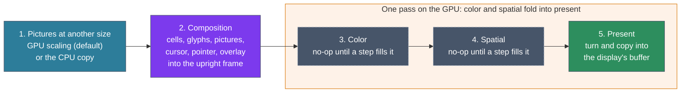

# ADR-1303: The GPU path draws each frame through a fixed pipeline of slots and turns it at present

## Summary

- **Decided:** vtium's GPU path draws every frame through the same five stages, called slots: pictures at another size, composition into an upright frame off screen, color, spatial effects, and present, which turns the frame for a turned display and copies it into the display's buffer. A slot that has nothing to do holds a no-op, and the color and spatial steps fold into the present pass, so an empty slot costs no pass. The first work builds the pipeline with both picture steps and every other optional slot empty. All GL calls sit behind a safe `Gl` trait that vtium-render defines and vtium-platform implements over glow, EGL and GBM. The GPU path runs only in a build with the `gpu` feature and with `hwaccel` on; any failure to set it up, and any failure while it runs, puts that head on the CPU path.
- **Trades away:** The GPU path keeps a whole frame off screen in GPU memory, 7.9 MiB at 1920x1080 and 63.3 MiB at 7680x2160 for each display, where ADR-1300 and ADR-1401 D2 had it keep none. One more pass a frame, the present copy, which the C reference's gltex did not have. vtium-platform gains vtium-render as a dependency under `gpu`.
- **One-way?** No. Everything is behind the `gpu` feature in vtium-render and vtium-platform, with no stored data and no protocol. It is reversible now, and costs days of rework once the composition and picture slices are built on the off-screen frame.
- **Probes:**
  - *Confident (the off-screen frame):* the GPU path keeps one picture of the whole screen in the graphics card's memory, about 8 MB at 1920x1080 and 66 MB at 7680x2160, so turning, color and effects happen in one place and the turned screen sits on exactly the pixels the software path draws. Earlier records said neither path keeps such a copy; this changes that for the GPU path only, and the software path still keeps none. Is that what you meant by the off-screen frame?
  - *Not confident (giving up on the GPU):* when the GPU path fails partway through a session, vtium moves that head to software drawing for the rest of the run and says so once in the log. It does not try the GPU again until vtium restarts. Is giving up for the run what you want, or should vtium try the GPU again, for example after the next VT switch?
- **Inversion:** Between "port gltex as it was" (every quad turned in the vertex shader and drawn straight into the window surface, the screen cleared and redrawn each frame, pictures sampled bilinear at any scale) and "a general GPU compositor" (a render graph, any number of passes, a portable API such as wgpu). The answer is a fixed pipeline of five slots on OpenGL ES, with the turn in one place and the CPU path as the judge of every pixel.

## Context

vtium's GPU path replaces the C reference's GPU renderer, gltex, which drew through GL on the C reference's drm3d display backend. ADR-1300 D6 already decides how the GPU path stores glyphs and blends a cell: gltex's four pools, under the CPU path's budgets, and a shader that does the CPU path's integer arithmetic so both paths draw the same bytes. ADR-1401 D2 decides how a frame reaches a display: the display lends its buffer to the head's render thread as a token, and on the GPU path the thread imports that buffer as an EGL image and draws into it.

The maintainer decided on 2026-11-03 how a frame flows through the GPU path, as a pipeline of slots, so that later work, such as color correction or a CRT look, fills a slot without changing the frame's structure (the frame shader's issue waits on this record). This record writes that pipeline down with each slot's inputs and its no-op, and decides what the pipeline needs around it: where unsafe GL code lives, which crates bind GL, EGL and GBM, how vtium chooses between the CPU and GPU paths, and what vtium calls each path in its log. Nothing of the GPU path is built yet, and the section on the starting state lists what the code holds today.

A slot is one stage of the pipeline. A step is the work that fills a slot. A no-op is the step a slot holds when it has nothing to do: the frame leaves the slot as it came in. The upright frame is the frame as the grid lays it out, with its rows running across, before any turn for a display mounted on its side or upside down.

## C notes: the C reference's flow

drm3d, the C reference's GPU display backend, set up GL once for each card. It made a GBM device on the card's descriptor, an EGL display on that device, and required `EGL_KHR_surfaceless_context`. It bound OpenGL ES, chose a config whose native format was XRGB8888 or ARGB8888, made an OpenGL ES 2 context and made it current with no surface, and noted whether `GL_EXT_unpack_subimage` was there for faster uploads (`kmscon/src/video/drm3d_video.c:480-646`). For each display it made a GBM surface of XRGB8888 at the mode's size and an EGL window surface on it (`kmscon/src/video/drm3d_video.c:150-233`). A swap called `eglSwapBuffers`, locked the surface's front buffer object, made a framebuffer of it the first time it saw it, and presented it through the DRM code all backends shared (`kmscon/src/video/drm3d_video.c:382-424`).

The C reference chose its path in two places. The seat tried drm3d for a card when `hwaccel` was on, which it was not by default, and fell back to drm2d on the same descriptor when drm3d failed (`kmscon/src/config.c:1413`, `kmscon/src/seat.c:960-1008`). The terminal then chose gltex for a display with GL and bbulk for any other; when the text renderer could not be made, the display got no screen at all (`kmscon/src/terminal.c:1252-1260`). It logged the choice as `Display ... with backend [...] text renderer [...]` (`kmscon/src/terminal.c:1272-1275`).

gltex compiled its shaders when it was set up, capped its glyph atlases at 2048 pixels a side and an image's texture at `GL_MAX_TEXTURE_SIZE` (`kmscon/src/render/gltex.c:503-608`). It asked for `highp` floats in the fragment shader where the GPU had them and took `mediump` where it did not (`kmscon/src/render/gltex.c:457-474`). It drew a turned display by rotating every quad in its vertex shader (`kmscon/src/render/gltex.c:419-425`, `kmscon/src/render/gltex_atlas.vert`), and placed the turned grid by its own margin, which it rounded in the rotated coordinates where bbulk counted it in pixels. At 1280x800 that put gltex's whole grid one pixel right of bbulk's, as the C fork's issue on a turned grid one pixel off recorded. A turn dropped all of gltex's GL state and built it again (`kmscon/src/render/gltex.c:1316-1322`); a set-up that failed was tried again every frame, and nothing drew meanwhile (`kmscon/src/render/gltex.c:1324-1350`).

gltex uploaded each picture as a texture of its own: the whole image, scaled down to fit `GL_MAX_TEXTURE_SIZE`, or, when the whole image did not fit the textures' budget, the image at the size the placement drew it (`kmscon/src/render/gltex.c:1679-1700`, `kmscon/src/render/gltex.c:1880-1890`). It sampled a picture nearest where one texel met one pixel and bilinear where the picture was scaled (`kmscon/src/render/gltex.c:2262-2302`). bbulk shrank a picture with a box filter, which averages every source pixel a drawn pixel covers. Bilinear sampling reads only the four texels nearest a pixel, so gltex's picture shrunk past 2:1 skipped texels and aliased, and even at 1.6:1 it differed from bbulk's by up to 41 levels in a channel, as the C fork's issue on pictures shrunk past 2:1 recorded. Each frame gltex cleared the screen and drew everything in passes: pictures below the backgrounds, the backgrounds, pictures below the text, the text, pictures above the text, and the pointer. A GL error was logged and the frame reported as failed, and nothing else changed (`kmscon/src/render/gltex.c:2337-2396`).

## Decision

### D1: a fixed pipeline of five slots

Every frame the GPU path draws passes through five slots, in this order. The order and the number never change; a configuration or a later step changes only what a slot holds.

The figure shows the five slots left to right. Slots 3 and 4, dashed, hold no-ops until a later step fills them, and they sit inside the box of the one pass that present draws on the GPU.

| Slot | Its inputs | What it gives the next slot | Its no-op | Paths | Damage |
|---|---|---|---|---|---|
| 1. Pictures at another size | A placement's picture, named by its image key, frame and pixel revision (ADR-1102 D3); the part of it the placement shows; the size it is drawn at | A texture the composition samples at the drawn size | A picture drawn at its own size is sampled as it is, one texel a pixel. In a build without `images` the slot is empty | GPU (the CPU path scales in its compositor, ADR-1100 D5) | None of its own: the cells a picture covers are already damaged when it changes |
| 2. Composition | The frame (cells, styles, the frame's placements in their order, the cursor), the glyph pools and decoration sprites of ADR-1300 D6, slot 1's textures, the pointer and the overlay | The upright frame, a texture of the grid's pixel size in RGBA8 | None: composition always runs, and draws only the cells changed since it last ran | GPU | Draws the cells changed since the upright frame was last drawn |
| 3. Color | One pixel's color and the step's parameters | The same pixel, recolored | The identity, which the present pass leaves out | GPU, folded into present; CPU, as a lookup table applied to each pixel line as it leaves the row scratch (ADR-1300 D5) | None: each pixel's new color depends only on its old one |
| 4. Spatial | The whole upright frame, its size, and the time for a step that reads it | One pixel for each pixel of the upright frame | The identity, which the present pass leaves out | GPU only, folded into present | A step whose output pixel reads any other pixel, or reads the time, makes every present a whole one |
| 5. Present | The upright frame with slots 3 and 4 folded in, the display's orientation, the buffer the token names, its age, and the rectangles changed over that age | The display's buffer | None: present always runs; with slots 3 and 4 empty and the display upright it is a plain copy | GPU | Draws the rectangles changed in the last `age` frames, and the whole buffer at age 0 |

### D2: slot 1, pictures at another size

Two steps can fill slot 1, and they give the composition the same thing: a texture it samples at the drawn size.

- **GPU scaling, the default.** The GPU path uploads each picture's own pixels once, as a texture keyed by the image key, the frame and the pixel revision, and scales it as it draws. The step owns the filtering of a picture shrunk past 2:1: it approximates the CPU path's filter at every scale, the box filter where a picture shrinks and the bilinear blend where it grows (`crates/vtium-render/src/picture/scale.rs`), so the picture does not alias the way gltex's did. Tests compare its output with the CPU path's within a stated tolerance (Open questions, item 3).
- **The CPU copy.** The GPU path asks vtium-render's scaled-copy cache for the CPU path's copy of the picture, upright, at the drawn size (`crates/vtium-render/src/picture/copies.rs`, with `turn` 0), uploads it, and the composition samples it one texel a pixel. The frame then matches the CPU path byte for byte. Tests select this step to check every other part of the frame exactly.

The renderer's configuration chooses the step, GPU scaling unless a test asks for the CPU copy, and nothing else in the frame changes with it; no key in vtium.conf sets it. Each step keeps its textures in a cache of the renderer's own, outside the image store's budget, so no texture ever evicts a stored picture, as ADR-1100 D5 decides for the CPU path's copies. How large the picture textures may grow, and what a picture too large for a texture does, are Open questions, item 4.

### D3: slot 2, composition into the upright frame

The composition draws the frame into an off-screen texture of the grid's pixel size, the upright frame, in the order and with the arithmetic ADR-1300 decides: each cell's background, underline, glyph and strike, the frame's placements in the bands and order of ADR-1100 D4, the cursor, then the overlay (the notice boxes and the OSD), and the pointer above everything. Each display the GPU path draws keeps its own upright frame, since its age, its damage and its size are its own.

The upright frame outlives a frame, so the composition draws only the cells that changed since it last drew, whatever the age of the display's buffer. A new upright frame, after a display is set up, a font or size change, or a wake-up, is drawn whole.

Glyphs on the GPU path are stored upright and never turned, because the composition works on the upright frame. A turn of the display changes the present pass alone and keeps every glyph and picture texture. ADR-1300's "Carried forward" says a glyph is rotated once when cached, and a change of orientation empties the cache; on the GPU path that no longer holds, and the CPU path keeps it.

### D4: slot 3, color

The color slot holds a step that maps each pixel's color to a new one: gamma, color space mapping, display compensation, contrast or a color-blind filter. Each step is the subject of its own issue, which decides how it is named in the configuration, its parameters, its cost bound and how it falls back to the no-op when it fails. On the GPU path the step folds into the present pass. On the CPU path the same slot sits where each pixel line leaves the row scratch for the display's buffer, and a step fills it with a lookup table; the first color step decides the table's form, per channel or three-dimensional. Because a color step reads only the pixel it writes, damage tracking holds on both paths.

### D5: slot 4, spatial effects

The spatial slot holds a step that reads the upright frame around a pixel or reads the time: a CRT look, scanlines or sharpening. It exists on the GPU path only. Each step is the subject of its own issue, which decides the same four things as a color step's. A step that reads any pixel other than the one it writes, or reads the time, makes every present a whole one; the composition still draws only what changed. A step that reads the time also needs frames drawn on a clock, which vtium does not draw today, and a new place where time enters (docs/architecture.md, "Determinism"); that step's record names both, and never lets the time reach the screen's state.

### D6: slot 5, present

Present turns the upright frame for the display and copies it into the buffer the display lent. It is the only place on the GPU path that knows the display's orientation. On the GPU it is one draw: each pixel of the display's buffer reads its texel of the upright frame by integer coordinates, turned as the CPU path turns a pixel, with no filtering, and takes each channel's whole value `c` from it. It runs the enabled color and spatial steps, and writes each channel as `(c + 0.25) / 255`, as ADR-1300 D6 writes a cell, so a copy with no step enabled is exact. The enabled steps are compiled into the present shader when the configuration changes, never per frame, so an empty slot adds no pass and no instruction.

Present draws the rectangles that changed in the last `age` frames of the buffer the token names, and the whole buffer at age 0 or when a spatial step asks for it. The rectangles it drew are the frame's damage, which the loop hands to the display at the swap (ADR-1401 D2).

The CPU path keeps its own shape: it composes each pixel already turned, through the row scratch, into the display's buffer (ADR-1300 D5), and has no separate present step. The two paths agree on a turned display because the CPU path's turned drawing equals its upright drawing turned, which tier 2 checks (Verification).

### D7: the safe `Gl` trait, and where unsafe code lives

Only vtium-platform may use `unsafe` (docs/architecture.md). vtium-render keeps `#![forbid(unsafe_code)]` and draws through a safe trait, `Gl`, which it defines and which vtium-platform implements behind its own `gpu` feature. vtium-platform takes vtium-render as a dependency under `gpu` to implement the trait, and the minspec build links neither the trait's implementation nor any GL library.

The trait speaks vtium-render's terms, not GL's: create, fill and free a texture of a stated format and size; the upright frame and an imported display buffer as targets to draw into; a program compiled from vtium-render's own shader source, with named inputs; a draw of a batch of quads; the GPU's limits, such as the largest texture and whether fragment shaders have `highp`; and a read of a rectangle back to memory, for tests. Every handle the trait gives out is an owned value tied to the context that made it. A call with a handle that is freed or belongs to another context returns an error, and every GL error becomes an error of the call that raised it, so nothing the renderer does through the trait is undefined behaviour. The GLSL source lives in vtium-render beside the CPU path's arithmetic it mirrors.

vtium-platform's implementation holds the EGL display, the context and the GL function table on the head's render thread, which owns the context for as long as it runs. Each `unsafe` site carries an `#[expect]` with its reason, as the crate's rule asks, and its README lists them.

The render thread opens the render node of the display's card and makes its EGL display on a GBM device there, so it needs no DRM master. The display allocates its buffers as GBM buffer objects on the card (ADR-1401 D2), and the token carries each buffer as a dma-buf: its descriptor, format, modifier, stride and offset. The render thread imports it as an EGL image and binds it as the storage of a renderbuffer that present draws into. A buffer the render thread cannot import is reached through a staging copy, frame by frame, as ADR-1401 D2 decides.

A stand-in GL in vtium-render's tests implements the trait and checks what vtium-platform's implementation checks: each handle is live and its own, a texture's format and size are within the limits it reports, an upload lies inside its texture, a program's inputs exist. It records the calls and draws no pixels. Pixels are judged on a real GL, Mesa's llvmpipe, which runs headless on EGL's surfaceless platform with no device.

### D8: the binding crates

vtium binds GL with glow, EGL with khronos-egl, and GBM with the gbm crate over gbm-sys, all inside vtium-platform under `gpu`. glow is maintained (0.18.0, 2026-07), has no native dependency on Linux and loads its function table through `eglGetProcAddress`. khronos-egl (6.0.0) either links libEGL or loads it at run time. The gbm crate is the binding Smithay maintains; vtium uses it without its `drm` feature, so it adds no second copy of the DRM bindings beside vtium's `drm-ffi`. Whether the `gpu` build links libEGL and libgbm or loads them when the GPU path starts is Open questions, item 5.

The GPU path targets OpenGL ES, as gltex did, and asks for version 3.0 (Open questions, item 1).

### D9: choosing the path, at start and on failure

A head draws on the GPU path when the build has the `gpu` feature and `hwaccel` is on. `hwaccel` stays off by default, as the C reference's was (Open questions, item 2). Otherwise the head draws on the CPU path, and `vtium check-config` says so when `hwaccel` is set in a build without `gpu`.

At start, the head's render thread sets up the GPU path in order: the render node, the GBM device, the EGL display and its extensions, the context and its version, `highp` in fragment shaders (ADR-1300 D6), and the shaders. The first step that fails ends the attempt. vtium logs the step that failed, and the head draws on the CPU path, its displays taking dumb buffers as they do today. Where the C reference left a display with no screen when gltex could not be made, vtium always draws.

During a run, a buffer the render thread cannot import is drawn through a staging copy (ADR-1401 D2). Any other GPU failure, a GL error during a frame or a context the driver lost, moves the head to the CPU path for the rest of the run: the frame is dropped as a token that came back too late, the head's displays take dumb buffers through a modeset, and the next frame draws whole. vtium logs the failure once. Whether it tries the GPU again later is Open questions, item 6.

### D10: the renderer's name in the log

The line vtium logs for each display it draws names the path that draws it, which the head knows once it has chosen. vtium logs the line again when a head falls back to the CPU path. Today the line names `bbulk` whatever happens (`crates/vtium/src/app.rs:1195`). Which names the line uses is Open questions, item 7. Any later report of a display's state, such as a status command, uses the same name.

### D11: what the first work builds, and its slices

The work this record governs builds the pipeline with every optional slot holding its no-op, and both picture steps. Each step that later fills the color or spatial slot comes in an issue of its own, which decides what D4 and D5 leave to it.

The work comes in slices. Slices 1 to 6 need nothing from the seat work, the work that opens devices through libseat, and slice 7 waits for it. The slices below are this record's agent's proposal; the maintainer and the steering session set the final order.

1. **The trait and the skeleton.** vtium-render's `gpu` feature, the `Gl` trait, the stand-in GL, and the five slots wired with their no-ops.
2. **EGL and GBM.** vtium-platform's `gpu` feature: the render node, GBM, EGL, the context, the `Gl` implementation over glow, the GPU kind of buffer token and the dma-buf import.
3. **Composition and present.** The glyph pools as textures and ADR-1300 D6's shader drawing into the upright frame, the pointer above every cell, a glyph that cannot be drawn not asked for again every frame, a pool that refused to grow for want of room growing once its budget does, and present at the upright orientation. Tier 2 draws its screens on both paths under llvmpipe and compares them byte for byte.
4. **The turn.** Present at all four orientations; a turned grid on the same pixels as the CPU path's; a set-up that fails during a turn tried again and the frame redrawn.
5. **Pictures.** Both picture steps, the CPU copy matched byte for byte, GPU scaling within the tolerance at every scale, a picture shrunk past 2:1 among them.
6. **Choosing the path.** `hwaccel` acted on, the fall-back at start and during a run, the staging copy, and the renderer's name in the log.
7. **Tier 3's GL variant.** The `gl-1280x800` variant passes on vtium under virgl.

## The starting state

This record's agent checked each line against integration at 6d706694 on 2026-11-03.

- No crate has a `gpu` feature. vtium-render's features are `performance-cache` and `images`; vtium-platform's are `logind` and `images`; the binary's are `images` and `logind`.
- No manifest and no line of `Cargo.lock` names glow, an EGL binding or a GBM binding.
- vtium-render forbids unsafe code (`crates/vtium-render/src/lib.rs:1`), and keeps doing so under D7.
- The scaled-copy cache's key already names a picture's pixels by its image, its frame and its pixel revision (`crates/vtium-render/src/picture/copies.rs:21-31`), as ADR-1102 D3 decides. The gap check before this record found the key at an older path without the frame and the pixel revision; the work on animation frames closed that gap, and the GPU path's textures key on the same three values.
- The log line for each display hard-codes `text renderer [bbulk]` (`crates/vtium/src/app.rs:1195`).
- The `hwaccel` key exists, off by default, among the keys not built yet (`crates/vtium/src/config/keys.rs:565-574`, `crates/vtium/src/config/keys.rs:1510`), and `vtium check-config` warns "hwaccel is not built yet; vtium draws in software" (`crates/vtium/src/notice.rs:180`).
- The display's buffer token has its CPU kind only; its comment says the GPU kind is not built (`crates/vtium-platform/src/display/token.rs:17-19`).
- Tier 3's `gl-1280x800` variant expects the log to name `gltex` and fails on vtium today (`tools/tier3/t3_scenario.py:171-180`).

## Where vtium departs from the C reference

- **The turn happens once, at present,** on a finished upright frame, where gltex rotated every quad in its vertex shader. The turned grid sits on the CPU path's pixels.
- **A turn keeps the GPU's glyphs and pictures.** gltex dropped and rebuilt all its GL state on a turn.
- **A scaled picture is filtered as the CPU path filters it,** within a tolerance, a picture shrunk past 2:1 included; gltex sampled every scaled picture bilinear and skipped texels past 2:1.
- **The upright frame is kept,** so the composition draws only what changed; gltex cleared and redrew the whole screen every frame.
- **A display always draws.** A failed GPU set-up or a GPU failure during a run puts the head on the CPU path; the C reference gave a display no screen when gltex could not be made, and a failed gltex set-up drew nothing until it succeeded.
- **The render thread draws through a render node** into buffers the display lends, where drm3d drew through EGL window surfaces on the card itself (ADR-1401 D2 records the buffers).
- **No `mediump` fall-back.** A GPU without `highp` in fragment shaders draws on the CPU path (ADR-1300 D6); gltex drew with `mediump`.

## Verification

- **The CPU copy step draws the CPU path's bytes.** Tier 2 draws every screen on both paths, the GPU path under llvmpipe with the CPU copy step, and compares them byte for byte at all four orientations, as ADR-1300's Verification asks. A planted one-pixel shift in present's turn fails it.
- **The CPU path's turn is a plain turn.** Tier 2 draws each screen on the CPU path upright and at each orientation, and checks that each turned drawing equals the upright one turned. This is what lets a turn at present match the CPU path.
- **GPU scaling stays within the tolerance.** Tier 2's picture screens, at shrink factors from 1.5 to 8 and growth factors of 2 and 3, compared with the CPU path's within the tolerance item 3 sets. A planted bilinear sampler in place of the filter fails it.
- **Empty slots cost nothing.** With slots 3 and 4 empty, the present shader holds no instruction of theirs, and a frame's GL calls are the same as with the slots left out of the source, which a test on the stand-in GL compares.
- **Damage holds.** A frame that changes one cell composes that cell alone and presents the rectangles changed over the buffer's age, counted by the stand-in GL; the same frame with a spatial step that reads its neighbours presents the whole buffer.
- **The fall-back is seen.** The stand-in GL, made to fail each set-up step in turn and a frame in a run, leaves the head drawing on the CPU path with one log line naming the step, and the next frame drawn whole.
- **Tier 3** runs `gl-1280x800` on vtium under virgl.

## Open questions

Each item is left open for the maintainer, with this record's recommendation.

1. **Which OpenGL ES version the GPU path needs.** Version 3.0 has `highp` in every fragment shader, single-channel textures for the glyph masks, and `texelFetch` for present's exact copy. Version 2.0 has them only through extensions, and is what older single-board GPUs offer, such as the Raspberry Pi 3's and the Mali-400. *Recommendation:* 3.0. Those older GPUs then always draw on the CPU path, which minspec targets anyway.
2. **`hwaccel`'s default in a build with `gpu`.** The C reference kept it off. ADR-1300 D4 and ADR-1401 D2 let the build set a default for `glyph-cache` and `display-buffers`. *Recommendation:* off in every build until tier 3's GL variant passes on vtium, then a fresh decision on whether a `gpu` build turns it on.
3. **The tolerance for GPU-scaled pictures.** *Recommendation:* at most 1 level in any channel of any pixel against the CPU path, which a shader that uses the CPU path's own filter weights in `highp` can meet. The slice that builds the step reports the largest difference it sees on tier 2's picture screens, and the maintainer confirms the figure there.
4. **How large the picture textures may grow, and what a picture too large for a texture does.** *Recommendation:* the textures of both picture steps count against ADR-1100 D5's per-display bound, twice the display's screen in RGBA, and a picture whose own pixels pass that bound or the GPU's largest texture is drawn from the CPU copy, at its drawn size, as gltex fell back to a texture at the drawn size. That one picture then matches the CPU path byte for byte.
5. **Linking the GPU libraries or loading them at start.** Linked, a `gpu` build does not start on a machine without libEGL and libgbm. Loaded when the GPU path starts, the same build runs there on the CPU path, at the cost of a small loader for libgbm's few calls in place of the gbm crate, and more unsafe code. *Recommendation:* load them at start, so a packager ships one `gpu` build to every machine.
6. **Trying the GPU again after a failure during a run.** *Recommendation:* not within the run; a failure mid-run is a driver fault that a retry is likely to meet again, and flipping between paths would show the user two renderers. The second probe asks the maintainer.
7. **The renderer's names in the log.** The C reference's names, `bbulk` for the CPU path and `gltex` for the GPU path, are what tier 3's variants look for and what the C reference's logs show. vtium's own names, such as `cpu` and `gpu`, say plainly what draws, and need tier 3's variants changed. *Recommendation:* keep `bbulk` and `gltex`, since docs/architecture.md already maps each vtium path to the C component it replaces.

## Consequences

### Positive

- Color correction, display compensation, accessibility filters and a CRT look each fill a slot without touching the rest of the frame, and the color slot works without a GPU.
- A turned display draws on the CPU path's pixels, and a turn keeps every texture.
- With every optional slot empty, the GPU path pays one extra copy a frame, inside the one present pass.
- Tests can check the whole GPU frame byte for byte against the CPU path by choosing the CPU copy step.
- No GL call is reachable from safe code without the trait's checks, and vtium-render stays free of unsafe code.
- No display goes dark because the GPU path failed.

### Negative

- Each display on the GPU path keeps an upright frame in GPU memory: 4.0 MiB at 1366x768, 7.9 MiB at 1920x1080, 63.3 MiB at 7680x2160. ADR-1300's alternatives and ADR-1401 D2 said the GPU path keeps no whole frame; both need a dated note pointing here when this record is accepted.
- A head that falls back during a run stays on the CPU path until vtium restarts.
- vtium-platform depends on vtium-render under `gpu`, so building vtium-platform with that feature also builds vtium-term and vtium-font.
- Two picture steps mean two texture caches to bound and test.
- A spatial step that reads the time brings a frame clock and a new place where time enters, which its own record must justify.

### Neutral

- The CPU path changes only by reserving the color slot as a no-op at the row scratch's copy-out.
- Adding `gpu` to the binary's features makes ADR-1401 D2's test of the build's buffer count fail until `gpu` is named in its list.
- ADR-1300 D6's shader, pools and budgets are unchanged; they now draw into the upright frame.
- The frame shader's issue fills slots 3 and 4 against this record.

## Alternatives Considered

- **gltex's flow: turn every quad in the vertex shader and draw straight into the display's buffer.** Rejected by the maintainer's decision to turn at present. Each renderer placed a turned grid by its own arithmetic, which put gltex's a pixel away from bbulk's; a turn rebuilt all GL state; and each color or spatial step would need to know the orientation.
- **No upright frame when every optional slot is empty and the display is upright,** composing straight into the display's buffer. Not taken: it gives the pipeline two shapes that tests must cover separately, for one copy a frame that costs the GPU little, and a change of configuration would switch shapes at run time.
- **A pass for each step,** each reading the last one's output. Not taken: a pass reads and writes the whole frame, and folding the color and spatial steps into present keeps an empty slot free.
- **unsafe GL calls inside vtium-render,** allowed module by module. Rejected: docs/architecture.md confines unsafe code to vtium-platform, and a trait lets the stand-in GL run the renderer's tests with no GPU.
- **The `Gl` trait in a crate of its own,** which vtium-render and vtium-platform both depend on, so vtium-platform needs no vtium-render. Not taken: the trait's types, a frame's quads and the shader source, belong to vtium-render, and a third crate would hold only the interface. It stays open if vtium-platform's build under `gpu` grows too slow.
- **wgpu.** Rejected: a large dependency for one pipeline, built for Vulkan and Metal first, with no hold on how its GL backend rounds or imports a dma-buf.
- **glutin.** Not taken: it provides contexts for windowing systems, and vtium needs only EGL on GBM, which khronos-egl gives directly.
- **Raw bindings to libEGL, libGLESv2 and libgbm.** Not taken for GL and EGL: glow and khronos-egl are those bindings already, maintained. A small loader of libgbm's calls remains the way to load GBM at start (item 5).
- **Importing the display's dumb buffers** through PRIME, with no GBM. Not taken: drivers differ in whether they render into an imported dumb buffer, a dumb buffer is linear only, and the maintainer named GBM.
- **`mediump` where a GPU lacks `highp`, as gltex did.** Rejected by ADR-1300 D6: `mediump` cannot hold its integer arithmetic exactly, so the paths could not agree byte for byte. Whether OpenGL ES 2.0 with `highp` is enough is Open questions, item 1.
