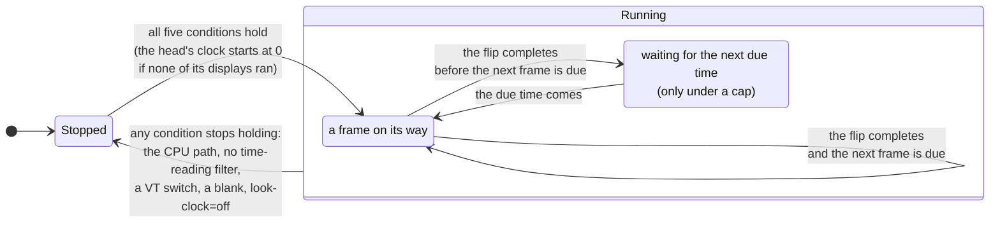

# ADR-1304: A frame clock gives the time to spatial shaders that declare they read it

## Summary

- **Decided by the maintainer (2026-11-03):** the frame clock is planned now, alongside the vtlook record, so that a spatial shader can animate: a CRT's flicker, a bar rolling down the screen.
- **Proposed by this record's agent, for the maintainer to confirm:** a spatial shader whose header declares that it reads the time gets two values: `vtTime`, the seconds since its head's clock started, wrapping every hour, and `vtFrame`, the count of frames its display has presented since then (D1, D2). A display draws on the clock only while all of these hold: its head draws on the GPU path, the look in force on it holds such a shader, the VT is vtium's, the displays are not blanked, and `look-clock` is not `off` (D3). It then draws a new frame each time its last frame reaches the screen, so at the display's refresh rate; a key, `look-clock`, caps the rate or stops the clock (D4). Time enters through one new place, the frame clock in the binary, which takes the loop's time as an argument, and the values it gives reach only present's pass, never the terminal's state (D5). While the clock runs every present is whole, and the composition still draws only what changed (D6). The CPU path never draws on the clock, and the blink timers and the animation clock stay apart from it (D7). vtium-config previews the clock live and checks a shader at given times (D8). Seven open questions remain.
- **Trades away:** A console showing an animated look no longer rests when nothing changes: the GPU redraws the whole display every refresh, the loop and the render thread wake every refresh, and a laptop's panel stays out of its self-refresh mode. The time wraps once an hour, so a shader whose cycle does not divide an hour jumps once an hour. An animation starts again from zero after a VT switch or a blank. A fading afterglow, which needs past frames, is left out.
- **One-way?** No. It is reversible now. The names of the two values and the header's line become expensive to change once people write and trade shaders that use them.
- **Probes:**
  - *Confident (always redrawing):* a look with an animated effect, such as a rolling bar, makes vtium redraw that screen at the display's refresh rate, 60 times a second on most screens, the whole time the console is on screen and not blanked, even while nothing in the terminal changes. A look without one redraws only when something changes, as today. The ways to save power are the screen blank and a key that caps or stops the animation. Is that the cost you expect?
  - *Not confident (phosphor afterglow):* a fading afterglow, where a bright letter fades out over a few frames after it changes, needs vtium to keep the previous frame for the shader to read, a second whole-screen picture in GPU memory for each display. This record leaves afterglow out and gives shaders only the time and a frame count, which is enough for flicker and rolling bars. Do you need afterglow in the first animated looks?
- **Inversion:** Between "no time in any shader", which the vtlook record holds today, and "an animation system": every look with a shader redrawn continuously, as Ghostty does with any custom shader, a history of past frames, a rate for each shader, and blink and picture animation folded into one clock. The answer is two values for the shaders that declare they read the time, drawn at the refresh rate and paced by the display's flips, with one key to cap or stop it.

## Context

ADR-1303 gives the GPU path a spatial slot, a step in the present pass that reads the upright frame around each pixel. Its D5 says that a step that reads the time needs frames drawn on a clock and a new place where time enters vtium, that the step's record names both, and that the time never reaches the screen's state. The vtlook record (the decision record, drafted alongside this one, in which a file called a vtlook chooses vtium's frame filters and sets their parameters) fills that slot with spatial filters, each a shader file that root installs, and gives them no time: its D3 and D15 leave a clock to a record of its own. This is that record.

A CRT look is the reason. A real CRT flickers at its refresh, shows a faint bar of brighter lines rolling down the picture when its refresh beats against the room's lights, and leaves an afterglow where its phosphor fades. The first two need only the time. The third needs the frames drawn before, which this record leaves out (open question 6).

vtium draws today only when something changes: the program's output, a key, the pointer, a blink, a frame of an animated picture. Two things already move on a timer. The blink timers (`crates/vtium/src/blink.rs`) flip the text's and the cursor's phases every 500 ms, and the animation clock (`crates/vtium/src/animation.rs`, ADR-1102 D3) picks the frame each animated picture shows. Both live in the binary, take the time the event loop reads at each turn, and change what a display draws, never the terminal's state. They are the precedent here.

The maintainer decided on 2026-11-03 to plan the clock now, alongside the vtlook record, against a recommendation to defer it (`considered`). The maintainer also asked for care with complexity in the GPU frame (`basis`), so this record adds two values and one key, and reuses the draw requests, the flip pacing and the frame-rate floor vtium already has.

A few words used below. A tick is the pair of values a frame gives its shaders: the time and the frame count. A clock frame is a frame vtium draws because the clock asked for it. A display draws on the clock while vtium asks it for clock frames. The head's clock is the origin both values count from.

## C notes: the C reference's flow

The C reference had no time in any shader: gltex's uniforms were textures, a clip rectangle, colors and sizes (`kmscon/src/render/gltex_atlas.frag:53-61`, `kmscon/src/render/gltex_image.frag:35-36`). It drew when something changed and when one of its two blink timers fired. The text blink timer fired every 500 ms (`kmscon/src/terminal.c:164`), and each timer flipped its phase and asked every screen for a redraw (`kmscon/src/terminal.c:715-724`, `kmscon/src/terminal.c:821-830`). It armed both when the terminal activated and disarmed them when it deactivated (`kmscon/src/terminal.c:1764-1795`). A redraw asked while the display's last flip was still in flight was kept pending, and the flip's completion drew it (`kmscon/src/terminal.c:461-480`, `kmscon/src/terminal.c:669-690`). So the C reference never queued a frame behind another and never drew faster than the display flipped. The frame clock takes that rule for its pacing: a display asks for its next clock frame when its last flip completes.

## Decision

D1 and D2 say what a shader receives and how it asks for it. D3 and D4 say when a display draws on the clock and how fast. D5 says where time enters and how it stays out of the terminal's state. D6 covers damage, D7 the CPU path and vtium's other clocks, D8 vtium-config, and D9 the work. The maintainer decided to plan the clock now; everything else is this record's agent's proposal.

### D1: what a shader receives

A spatial shader that declares it reads the time (D2) gets two uniforms in present's pass:

| Name | GLSL type | What it holds | Wraps |
|---|---|---|---|
| `vtTime` | `highp float` | The seconds from the start of the head's clock to the turn of the event loop that took this frame, worked out from whole nanoseconds and wrapped before it becomes a float | Back to 0 every 3600 seconds |
| `vtFrame` | `highp uint` | The number of frames this display has presented since the head's clock started, the first being 0 | Back to 0 after 4,294,967,295, as `uint` arithmetic does |

**Why the time wraps.** A `highp float` has a 24-bit significand. Below 4096 seconds it resolves 2^-12 s, about a quarter of a millisecond, so the time stays smooth at any refresh rate. After a day without a wrap it would resolve only 2^-7 s, 7.8 ms, half of a 60 Hz frame, and a rolling bar would stutter. An hour keeps the time below 4096 and divides evenly by many periods: a cycle of 1, 2, 3, 4, 5, 6, 8, 9, 10, 12, 15 or 16 seconds, or any frequency whose cycles in an hour are a whole number, such as 0.1 Hz or 7 Hz, runs through the wrap unbroken. A shader whose cycle does not divide an hour jumps once an hour. The wrap is a row of vtium-render's bounds table.

**Why the frame count wraps where it does.** `uint` arithmetic wraps at 2^32, so a shader that alternates on `vtFrame % 2`, or on any power of two, runs through the wrap unbroken. At 240 frames a second the count wraps after 207 days.

**The head's clock.** Each head has one clock. It starts when the first of the head's displays begins to draw on the clock while none of them does, and it stops when the last one stops (D3). Each start begins again at time 0, and each display's count begins again at frame 0. A display that joins a head whose clock runs reads the same time as the head's other displays, so mirrored displays show a rolling bar at the same place, and its own count starts at 0. A VT switch away and back, a blank and a wake, or a change of look therefore restarts every animation from zero, which looks the same as carrying on for flicker and rolling bars, and keeps the values small and every test's run starting from the same place.

**When the time is read.** The tick takes the time of the turn of the event loop that takes the frame for that display, the same time the loop already passes to its other timers. A flip event from vtium-platform carries no timestamp today, and the time between taking a frame and its flip is nearly constant, so the motion stays even without predicting when the frame will reach the screen.

**The names.** A filter parameter's uniform is `<filter>_<parameter>` in lowercase with underscores (the vtlook record's D1), so no parameter can take a name with a capital letter. `vtTime` and `vtFrame` are working names. The survey of prior art that settles the shader header's syntax (the vtlook record's D15) may choose Shadertoy's `iTime` and `iFrame` instead, which Ghostty also uses, to make shaders easier to port; either choice keeps the capital letter.

### D2: a shader declares that it reads the time

A shader file's header, which the vtlook record's D15 defines, gains one line that says the shader reads the time. Its spelling follows the header syntax the survey settles. vtium reads the header before it compiles anything, as for every other line.

vtium declares `vtTime` and `vtFrame` in present's shader only when at least one filter of the chain declares that it reads the time, and lists them then among the program's inputs, so the check every `Gl` implementation makes, that a program declares each of its inputs, covers them. A shader that uses either name without declaring it does not compile, because nothing defines the name. That is a compile error, which the vtlook record's D6 answers as it answers every failure: the head draws the built-in default look, and the error names the shader. A shader that declares the time and does not read it compiles and works, and costs a redraw every refresh for nothing; vtium-config's check says so (D8).

The declaration also lets vtium say which looks animate without a GPU: `vtium check-config`, `looks` and `look-show` mark a look that holds a time-reading shader as animated.

### D3: when a display draws on the clock

A display draws on the clock while all of these hold:

1. its head draws on the GPU path (ADR-1303 D9);
2. the look in force on that display holds at least one spatial filter whose header declares that it reads the time; a display that misses the look's requirements, or that its frame-rate floor put on the default look (the vtlook record's D7 and D16), draws the default look and does not draw on the clock;
3. the VT is vtium's and its terminals are awake, the state in which the blink timers run;
4. the displays are not blanked;
5. `look-clock` is not `off` (D4).

When any of these stops holding, the display stops drawing on the clock. It asks for no further clock frames, and the frame it last presented stays on the screen until something else draws. When the last display of a head stops, the head's clock stops. When all five hold again, the display starts again, and the head's clock starts again from zero if it had stopped (D1).

A clock frame is asked for the way a blink asks for a frame. A synchronized-output hold (mode 2026) defers it as it defers any draw, until the hold ends or `sync-timeout` ends it, and the animation pauses for that time. A frame already on its way to the display defers it until that frame's flip completes.

The figure shows one display's states. It draws no clock frames while stopped. While running, it alternates between a frame on its way and, under a cap, a wait for the next frame's due time.

### D4: how fast, and what it costs

**The rate.** A key, `look-clock`, sets how fast a display draws on the clock. It sits in vtium.conf, and a head may set it for itself in heads.conf, as the vtlook record's `look-min-fps` does. It takes three kinds of value:

| Value | What vtium does |
|---|---|
| `refresh`, the default | A display draws its next clock frame as soon as its last frame's flip completes. With one frame on its way at a time, it draws at the display's refresh rate while the GPU keeps up, and slower when the GPU cannot, never queuing a frame behind another. |
| A whole number, 1 to 1000 | The most clock frames a second. The next clock frame is due that long after the last one was taken, and then waits for the flip like any frame. A number at or above the refresh rate draws as `refresh` does. |
| `off` | No clock frames. Every present gives its shaders time 0 and frame 0, so a time-reading look draws as a still picture, and damage works as for a look that does not read the time (D6). |

Under `refresh` the flip's completion wakes the loop, so the clock arms no timer of its own. Under a number, the next due time joins the loop's wake times (`App::next_wake`), as the blink timers' do.

**The GPU's cost.** Every clock frame is a whole present: the spatial chain runs on every pixel of the display, every refresh. At 1920x1080 a chain that reads one texel for each pixel, such as scanlines and a rolling bar, reads 2.1 million texels a frame, 124 million a second at 60 Hz. With sharpen's 5 reads a pixel it is 10.4 million a frame and 622 million a second, and at 3840x2160 it is 41.5 million a frame and 2.49 billion a second. A clock frame on an idle screen composes nothing (D6), so the composition adds no cost.

**The CPU's and the power's cost.** Each clock frame also wakes the loop and the head's render thread once a refresh, for every display that draws on the clock. The GPU and the display controller never rest while such a look shows, and a laptop's panel stays out of its self-refresh mode. None of this is measured yet. The slice that builds the clock measures a clock frame's CPU time on an idle screen in tier 3's 1-vCPU guest with the render timer, and the maintainer's review on a VT observes the power. The controls are the screen blank, `dpms-timeout`, which stops the clock (D3), `look-clock`, and a look without a time-reading shader.

**The frame-rate floor and the watch.** The vtlook record's D16 applies as it stands. Its measured run, when a look loads or a display changes, gives the shaders the ticks that drawing at the display's refresh from time 0 would give, or time 0 and frame 0 under `look-clock=off`. Its watch while running times each present where the driver has timer queries; while the clock runs every present is a clock frame, so the watch sees one every refresh, and a shader that slows down at some times and not others is caught by the watch's run of 30 slow frames. The floor judges what the GPU can draw, one frame's GPU time against one second divided by the floor, never the rate `look-clock` sets, so a cap below the floor does not put a display on the default look.

### D5: where time enters, and how it stays out of the terminal's state

**One new place.** Time enters through the frame clock, a part of the binary beside the blink timers and the animation clock. The event loop already reads the monotonic clock once a turn, through the binary's injected `Clock`, and passes the time to each timer. The frame clock takes that time as an argument and reads no clock itself; the workspace's `clippy::disallowed_methods`, which denies `Instant::now` in the binary's own code outside the loop's one read, keeps it so. From the time and the flips, the frame clock decides when each display asks for a clock frame, and gives each frame it takes a tick.

**Where the tick goes.** The tick is a value of vtium-render's. The loop puts it in the job it sends the head's render thread, beside the screen's snapshot, and present sets it as the two uniforms. vtium-term and vtium-image do not depend on vtium-render, so the tick cannot reach the grid, the scrollback, the modes, the cursor, the image store or a reply: the crate graph that docs/architecture.md draws keeps it out. It changes the pixels of present's pass and nothing else.

**The determinism table.** The row "Time enters in named places only" in docs/architecture.md gains the frame clock: it is given the loop's time at each turn and decides when a display draws and what time its shaders see, never the terminal's or the image store's state. The row's check gains the frame clock's tests, which pass the times in.

**Repeatable tests.**

- The frame clock's tests drive it with given times and given events (an activation, a blank, a flip, a change of look) and check which displays ask for a frame and what tick each frame takes. They count frames and flips, never wall time.
- vtium-render's stand-in GL records each present's input values, so a test checks that a frame drew with the tick it was given.
- Tier 2 draws a time-reading shader at fixed ticks it chooses, with no clock at all.
- Tier 3 judges a time-reading look under `look-clock=off`, at time 0 and frame 0, so its screenshots repeat.
- vtium-config's check gives its run fixed ticks (D8).

### D6: damage

While a display draws on the clock, every present on it is whole, as ADR-1303 D5 says of a step that reads the time: every pixel's output may change with the time. Every clock frame presents and queues a flip, even when nothing in the terminal changed, so a clock frame is never a skipped draw, and the render timer counts it as a frame.

The composition still draws only what changed into the upright frame (ADR-1303 D3), which outlives a frame. A clock frame on an idle screen composes nothing and runs present alone over the upright frame it already holds. A clock frame takes the screen's snapshot the way any draw does; if the slice's measurement shows the snapshot to cost on an idle screen, a later change sends a clock frame without one, and until then there is one kind of job.

Under `look-clock=off` the tick never changes, so present draws only what changed, unless a filter of the chain reads other pixels than the one it writes (the vtlook record's D3).

### D7: the CPU path, and vtium's other clocks

**The CPU path.** Time-reading shaders exist only in the spatial layer, which only the GPU path draws (the vtlook record's D3). A head on the CPU path draws a look's color layer and skips its effects, so it never draws on the clock. The color layer never reads the time (the vtlook record's D2), so a look's colors stay one table on both paths.

**The blink timers stay apart.** Text blink and cursor blink change which cells show what, on both paths, in every build and with no look at all, and a key resets the cursor's phase. They are events every 500 ms, not a continuous time. The animation clock picks which frame a picture shows, also on both paths. Merging either into the frame clock would make it exist in builds and on heads with no look and no GPU path, or make blink depend on the GPU path, and blink's tests already drive its firings directly. The three share two things: the time the loop passes them, and the draw request. A draw any of them asks for while a frame is on its way joins that frame, so under `refresh` a blink's change shows in the next clock frame and adds no frame of its own.

### D8: vtium-config, the preview and the check

**The live preview.** vtium-config's preview applies a look to the live head (the vtlook record's D11), so the frame clock runs on it as on a configured look, under the head's `look-clock`, and the user sees the animation as it will run.

**The check.** vtium-config's check of a shader as the invoking user, before root installs it (the vtlook record's D15), draws its run of frames at given ticks for a shader that declares the time: 8 frames from time 0 at a 60 Hz spacing, frames 0 to 7, and 8 frames ending just before the time's wrap, with the frame count ending just before its own. It times them as the frame-rate floor's measurement does, so a shader that is slow or hangs only at large values is caught before it is installed. It says when a shader declares the time and its linked program has no place for either value, which means the shader reads neither and would redraw every refresh for nothing. The report names the ticks each slow frame took.

### D9: the work

One slice builds the clock. It follows the vtlook record's slice for the spatial layer and the shader format, and can run beside its slice for the frame-rate floor. It builds: the header's line and the two uniforms, declared only when the chain needs them; the frame clock in the binary with D3's conditions and D4's pacing; the `look-clock` key in vtium.conf's key table and heads.conf; D6's damage rule; the marks of an animated look in `vtium check-config` and vtium-config; vtium-config's check at given ticks; the tests of D5 and Verification; and one shader as the first worked example, `roll`, a band of slightly brighter rows rolling down the screen, which reads only the pixel it writes and so shows the clock without any other cost. Its parameters follow the vtlook record's D1 kinds, and the slice sets them.

## What the other records change to fit

ADR-1303 is accepted and names "that step's record" and "its own record" where this record belongs. When this record is accepted, these passages change, each with a dated note:

- **D1's table,** the spatial row: "and the time for a step that reads it" names this record's two values (D1).
- **D5:** "that step's record names both" names this record: the frame clock (D3, D4) and its row in the determinism table (D5).
- **D6:** "the whole buffer at age 0 or when a spatial step asks for it" adds "or while the display draws on the frame clock" (D6).
- **Consequences, Negative:** "A spatial step that reads the time brings a frame clock and a new place where time enters, which its own record must justify" names this record.

The vtlook record is not yet accepted, so its author can fold these in before it is, without notes:

- **D3, "No time":** a spatial filter whose header declares that it reads the time gets this record's two values, and no other filter gets either. "Its parameters are its only uniforms" adds the two values for such a filter.
- **D3's damage paragraph:** "A spatial filter that reads only the pixel it writes, such as scanlines, leaves damage tracking as it is" adds "and does not read the time, or while the clock is `off`".
- **D15:** the header's list of what it states gains "whether the shader reads the time"; the paragraph "**Time.**" and open question 5 point at this record.
- **D16:** the measured run gives the shaders the ticks of D4; the watch sees a present every refresh while the clock runs.
- **D11:** `looks` and `look-show` mark an animated look, and the check runs at given ticks (D8).
- **The Summary's proposal** that a spatial filter "never reads the time" names this record's exception.
- **D7's table:** `min-fps` is unchanged, and the key table gains `look-clock` beside `look-min-fps`.

Outside the records, the slice changes: docs/architecture.md's determinism row; vtium.conf's key table, its example and docs/config.md, which gain `look-clock`; ADR-1401 D3's list of a head's keys and the head file's template, which gain `look-clock`; vtium-render's bounds table, which gains the time's wrap; and docs/looks.md, which gains a time-reading shader among its examples.

## Where vtium departs from the C reference

The C reference had no time in any shader, so the frame clock goes past it rather than departing from a behaviour it had. vtium keeps the C reference's pacing rule: a frame asked while the last is on its way waits for that frame's flip, and no frame queues behind another.

## Verification

- **The clock starts and stops on D3's conditions.** The frame clock's tests, given times and events: a head with a time-reading look asks for a frame at each flip under `refresh` and none on a look without one, over a thousand flips; activation starts the head's clock at time 0 and frame 0; deactivation, a blank, the head's move to the CPU path, the display's fall to the default look, and `look-clock=off` each stop it, and the next start begins again at 0. A planted clock that keeps running while blanked fails.
- **The pacing.** Under `refresh` a display never has two frames on its way; under `look-clock=30` on a 60 Hz display, no clock frame is asked before its due time, and over 60 refreshes of given times the display draws 30 clock frames; a number above the refresh rate draws as `refresh`.
- **The values.** `vtTime` from whole nanoseconds is exact at the wrap: 3599.999 s gives 3599.999 and 3600 s gives 0, and after 24 hours and 0.5 seconds it is 0.5 exactly. A planted clock that converts to float before wrapping fails the 24-hour case. `vtFrame` after 2^32 − 1 is 0. Two mirrored displays of one head, one joining a minute later, show the same time in the same turn.
- **The time stays out of the terminal's state.** The binary's test feeds one stream to a head with a time-reading look under two different schedules of given times, and compares the screen's text, the scrollback, the modes and the replies, which are the same.
- **The declaration.** On the stand-in GL, present's program lists `vtTime` and `vtFrame` among its inputs only when a filter of the chain declares the time, and a head with no such filter has present's sources and inputs of a build without the clock. Under llvmpipe in tier 2, a shader that uses `vtTime` without declaring it fails to compile, and the head draws the default look with an error naming the shader.
- **Damage.** On the stand-in GL, every present while the clock runs is whole and queued, an idle screen included, and composes nothing when nothing changed; under `look-clock=off` a present draws only what changed. A planted clock frame that skips an unchanged screen as a draw with no change fails, since the display would stop animating.
- **Tier 2** draws `roll` at fixed ticks, time 0 at frame 0, 0.5 s at frame 30, and 3599.9 s at frame 2^32 − 1, and compares the GPU path's drawing under llvmpipe with tier 2's own Rust version of `roll`'s formula at the same ticks, within ADR-1303's tolerance. A planted `roll` that reads the time in milliseconds fails.
- **Tier 3** gains, in its GL variant once that variant passes, one screen with `roll` under `look-clock=off`, compared within the tolerance with vtium's own golden, which stays provisional until the maintainer reviews it.
- **vtium-config's check** draws its run at the ticks of D8, and a stand-in shader that is slow only past 3000 seconds fails it.

## Open questions

1. **What a shader receives.** *Recommendation:* both values: `vtTime`, a `highp float` of seconds that wraps every hour, and `vtFrame`, a `uint` count of presents that wraps at 2^32. *Defence:* the time drives motion at a real speed whatever the refresh rate, such as a bar crossing the screen in eight seconds, while the count drives effects tied to frames, such as a flicker on alternate frames, and each costs one uniform. The hourly wrap keeps the time at a quarter-millisecond precision, where an unwrapped float has lost half a 60 Hz frame within a day.
2. **When time is zero.** *Recommendation:* each head has one clock, which starts at zero each time it starts running: at a look's start, after a VT switch back, after a wake from a blank. *Defence:* it keeps the values small and every test starting from the same place, and mirrored displays share it so they show the same phase. The cost is that an animation restarts after a VT switch, which looks the same as carrying on for flicker and rolling bars.
3. **The rate, and who sets it.** *Recommendation:* the display's refresh, paced by its flips, with `look-clock` (`refresh`, a number of frames a second, or `off`) in vtium.conf and per head in heads.conf. *Defence:* pacing by flips draws as fast as the display shows and never queues frames, as the C reference paced its blink, and the administrator, who pays for the power, holds the one control. A rate in the look's `[requires]` would not fit, since a requirement decides whether a look applies to a display, not how it draws, and `off` also gives tier 3 repeatable screenshots.
4. **A synchronized-output hold pauses the clock.** *Recommendation:* yes: a clock frame is deferred by a mode 2026 hold like any draw. *Defence:* it needs no new kind of frame, a hold lasts a program's frame, usually milliseconds, and `sync-timeout` bounds it. Presenting the held frame with new ticks would need a present-only job just for holds.
5. **The blink timers and the animation clock stay apart.** *Recommendation:* yes, sharing only the loop's time and the draw request. *Defence:* blink and picture animation work on both paths, in every build and with no look, and a key resets the cursor's blink, while the frame clock exists only for a look's shaders on the GPU path. A draw any of them asks for joins a frame already on its way, so they never draw twice in one refresh.
6. **A fading afterglow.** *Recommendation:* leave it out of this record; a later record adds a history of past frames if a look needs it. *Defence:* an afterglow reads the frames drawn before, as libretro's `OriginalHistory` and `PassFeedback` give, which costs a second whole-screen texture a display, about 8 MB at 1920x1080, and makes each frame depend on the frames before it, so a test must drive a sequence of frames instead of one tick. Flicker and rolling bars, the effects asked for first, need neither.
7. **A shader declares that it reads the time.** *Recommendation:* yes, in its header, and a shader that uses the values without declaring them fails to compile, which drops the head to the default look. *Defence:* vtium then knows before it compiles anything which looks animate, so `vtium check-config` and vtium-config can say so without a GPU, and a look with no time-reading shader never redraws on a clock. Ghostty animates every custom shader whenever its terminal is focused, which costs a redraw every refresh for shaders that never read the time.

## Consequences

### Positive

- A spatial shader can animate: a CRT's flicker, a rolling bar, any effect that moves with time, written and traded as shader files like any other spatial filter.
- Only looks that declare a time-reading shader draw on a clock. Every other look, and the CPU path, draw only on change, as before.
- Time enters in one more named place, which takes the time as an argument and cannot reach the terminal's state, so the determinism rules and their checks hold.
- The pacing reuses the draw requests and the one-frame-on-its-way rule vtium already has, and adds no timer under the default.
- One key caps the rate or stops the clock, for power, and its `off` also makes tier 3's screenshots of a time-reading look repeatable.
- vtium-config's check catches a shader that is slow or hangs only at large times, before root installs it.

### Negative

- A console showing an animated look never rests: the GPU redraws the whole display every refresh, the loop and the render thread wake every refresh, and a laptop's panel stays out of self-refresh. The cost is not measured yet.
- Every present is whole while the clock runs, so a heavy spatial chain costs its full price every refresh, not only when the screen changes; the frame-rate floor is what keeps it from making the display unusable.
- The time wraps once an hour, and a shader whose cycle does not divide an hour jumps once an hour.
- An animation restarts from zero after a VT switch, a blank or a change of look.
- A synchronized-output hold pauses the animation for as long as it lasts.
- A fading afterglow is not possible with this record alone.

### Neutral

- The vtlook record's spatial contract gains one exception, the declared time; its color layer stays timeless.
- The names of the two values wait on the same survey of prior art as the rest of the shader header.
- ADR-1303's D1, D5, D6 and Negative consequences change to name this record.

## Alternatives Considered

- **Animate every look with a spatial filter whenever the console shows,** as Ghostty's `custom-shader-animation` does by default for any custom shader. Not taken: most filters, such as scanlines and sharpen, never change with time, and redrawing them every refresh would cost power for nothing.
- **Detect a time-reading shader by looking for the names in its source, or by asking the compiled program whether it uses them.** Not taken: a text search is fooled by comments and macros, and a compiled program's answer comes only after compiling on a GPU, while the vtlook record's design states everything vtium needs in the header before it compiles anything. The check of D8 uses the compiled program's answer only to warn.
- **An unwrapped time.** Not taken: a `highp float` loses precision as the time grows, to 7.8 ms after a day, half a 60 Hz frame, and a shader cannot repair it.
- **Time as whole milliseconds in a `uint`.** Not taken: a shader would turn it into a float to use it and meet the same precision loss, and every shader would repeat that conversion.
- **A clock that keeps running across VT switches and blanks, counting from vtium's start.** Not taken: the time would grow toward the wrap on every long run, tests would need to set an origin, and nothing on the screen shows the difference for the effects in view.
- **A fixed timer at a set rate, such as 60 times a second, instead of pacing by flips.** Not taken: it draws frames the display cannot show on a slower display, queues behind a slow GPU, and beats against the refresh on a faster one. Pacing by flips needs no timer and follows each display's own rate.
- **The present time predicted from the flip's timestamp.** Not taken for now: vtium-platform's flip event carries no timestamp, and the loop's time at the turn that takes the frame is close enough for even motion. It can be added later without changing what a shader receives.
- **One clock for blink, picture animation and shaders.** Not taken: D7 gives the reasons.
- **A history of past frames for an afterglow.** Not taken in this record: open question 6.
