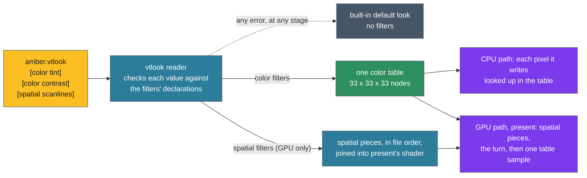

# ADR-1304: vtium's frame filters are built in, and a vtlook file chooses them and sets their parameters

## Summary

- **Decided by the maintainer (2026-11-03):** vtium hard-codes no filter's settings. A filter is a step that fills ADR-1303's color slot or spatial slot, which this record calls the color layer and the spatial layer. The layers are that fixed pair, and the filters inside each layer are a known set built into vtium; no filter code is installed from outside. Each filter declares its parameters once, in one standard form, and configuration chooses filters and sets their parameters, much as a shader declares its inputs and a program sets them. Each layer has a minimum contract that a filter must meet to run in it. The configuration lives in a file called a vtlook (a look file), as a frit (a font set file) holds a font set, and a vtlook is tied to no profile. When no look is named, a head takes a default look built into vtium, as it takes a built-in font when no frit is named. The default look holds no filters, so with no configuration vtium compiles no filter shader piece, builds no table and does no filter work on the CPU. Any error in a head's filters, in any layer and at any stage, drops that head to the built-in default look: in the maintainer's words, "any layer that is invalid fails the whole filter stack". The error says where it failed, the same in vtium's log, in `vtium check-config` and in vtium-config. vtium-config manages vtlooks as it manages frits: it lists, shows, creates, edits, previews on the live console, assigns and removes them.
- **Proposed by this record's agent, for the maintainer to confirm:** A filter's declaration gives each parameter's name, kind, range, default and a line of help, and that one declaration drives `vtium check-config`, vtium-config's display and editing, the GPU path's shader inputs and the CPU path's function arguments (D1). A color filter maps each pixel's color using that color alone, and vtium merges the whole color layer into one table of 33 by 33 by 33 colors, which the CPU path looks each pixel up in and the GPU path samples as a texture: one lookup a pixel however many color filters run (D2). A spatial filter is one piece of GLSL in vtium-render, on the GPU path only, which declares how far it reads and how many reads it makes, under caps, and never reads the time (D3). A vtlook is `/etc/vtium/looks/NAME.vtlook`, owned by root, with one section per filter, run in file order; the built-in default is named `default` and is written from a template that vtium-config uses to start a new look (D4). A head chooses a look with `look =` in heads.conf, and `look=` in vtium.conf sets the default for heads that name none (D5). The fallback lasts until vtium next reads its configuration or the head's look changes, never retried on a timer, and never moves the head off the GPU path (D6). Where a look with filters is in force, vtium draws the pointer in the frame instead of on the display's cursor plane, and a 1-bit display ignores the look (D7). The first filters are gamma, contrast, tint, color-blind and cube, which reads a `.cube` table file, in the color layer, and scanlines and sharpen in the spatial layer (D8, D9). The filters sit behind a cargo feature, `filters`, which the minspec build leaves off (D10). vtium-config previews a look live through a sequence of vtium's own (D11). The work comes in six slices, vtium-config's its own (D13). Eight open questions remain.
- **Trades away:** An effect vtium does not build cannot be added by a file. A color filter is drawn through a table, which is straight between its nodes, so a curve that bends hard near black loses detail there: a gamma of 2.0 is off by up to 12 levels among the darkest 7 levels of 256. The CPU path pays a lookup for each pixel it redraws, 28 ns for a pixel of a new color on a fast desktop and 1.4 ns along a run of one color. Spatial filters need the GPU path, which `hwaccel` leaves off by default. A head with filters in force gives up the hardware pointer. One bad filter turns off every filter of the head until the configuration is read again. The live preview adds an escape sequence of vtium's own.
- **One-way?** No. Everything is behind a cargo feature, and the vtlook files are the only data it stores. The vtlook format and the preview sequence become expensive to change once people write files and tools send the sequence; the file's `version = 1` line leaves room for the first.
- **Probes:**
  - *Not confident (the arrow):* when a head shows a look, vtium draws the mouse arrow into the picture itself instead of using the display's hardware pointer, so the look's colors and effects reach the arrow too: an amber look makes the arrow amber. The cost is that each move of the mouse redraws the arrow's old and new places, and with an effect such as sharpening, the whole screen. Is that what you want, or should the hardware arrow stay and simply not take the look?
  - *Confident (a failing filter):* if one filter in a look cannot be used, because of a bad value, a missing `.cube` file or a shader the graphics driver refuses, vtium switches off that filter's whole layer, all the color filters or all the effects, and writes one line to the log. You never see half a color correction. Is that the behaviour you meant? (Answered 2026-11-03: any invalid layer fails the whole filter stack, and the head drops to the built-in default look; see `considered`.)
- **Inversion:** Between "no filters", the C reference's gltex, whose shaders were compiled from source built into the program with no color or effect stage, and "user shaders", any GLSL file a user installs, run in the present pass, as video players and emulators allow. The answer is a fixed menu of built-in filters, chosen and set by a file of data, with a color table file as the one outside input, and never code.

## Context

ADR-1303 gives the GPU path a fixed pipeline of five slots and reserves two of them, color and spatial, holding no-ops until a later record defines what fills them; the CPU path reserves the color slot too. The skeleton built for that record (`crates/vtium-render/src/gpu/pipeline.rs`) already joins a color piece and a spatial piece of GLSL into present's fragment shader under `#ifdef`, between its head and its `main`, and asks the spatial piece for its reach, how many pixels from the pixel it writes it reads. Both pieces are empty today.

The maintainer decided on 2026-11-03 what fills the slots, in points this record writes down as decided: no filter's settings are hard-coded; the layers are fixed and their filters are a known built-in set; each layer has a minimum contract; the configuration lives in a vtlook file; a built-in default look, with no filters, stands where no look is named and wherever a look fails; an error says where it failed; and vtium-config manages vtlooks. An earlier comment on the frame shader's issue spoke of a specification "that vtium loads at run time in one standard way, much as a shader is loaded". The later points settle what that means: what vtium loads at run time is the vtlook, a file of data that names built-in filters and sets their parameters, and each filter's definition is its declaration, compiled into vtium.

The maintainer asked for care with complexity in the GPU frame. This record keeps each layer to one mechanism, the color layer always one table and the spatial layer always one chain of pieces in the present pass that already exists, and gives every failure one outcome, the default look.

A filter is a built-in step of the color or spatial layer. A filter's declaration is the constant in vtium's code that names the filter, its layer and its parameters. A look is the set of filters a vtlook chooses, with their parameter values; the built-in default look is the look a head takes when it names none or its own fails. A look is in force on a display when it holds at least one filter there. The filter stack is all of a head's filters, both layers together.

## C notes: the C reference's flow

gltex compiled its two shader programs, one for glyph atlases and one for pictures, from GLSL embedded in the binary, putting a precision line before each fragment shader (`kmscon/src/render/gltex.c:450-537`). Nothing after its draws changed a pixel's color or read its neighbours, and no user file reached a shader. bbulk, the CPU renderer, had no such stage either. The only colors a user set were the palette's, through the `palette` key and the `palette-*` keys (`kmscon/src/config.c:1427-1436`). The C reference had no filters to be a floor for, so every filter here goes past it.

## Decision

D1 to D3 define a filter and the contract of each layer. D4 and D5 say where a look lives, what the built-in default look is, and how a head chooses a look. D6 says what happens when anything fails and what the error reports. D7 covers the pointer and 1-bit displays. D8 and D9 name the first filters. D10 places the code, D11 sets out what vtium-config does, D12 states the build with no look, and D13 the work. Where a section holds the maintainer's decisions, it opens with them; the rest of the record is this record's agent's proposal.



The figure follows one vtlook from left to right. The reader checks every value against the declarations. The color filters become one table, which both paths read. The spatial filters become pieces of present's shader, on the GPU path only, and run before the turn and the table, as ADR-1303 D1 orders the slots. The dashed arrow is the one fallback: an error at any stage, reading, checking, building the table, compiling or drawing, puts the head on the built-in default look, which runs nothing.

### D1: a filter and its declaration

**Decided by the maintainer (2026-11-03):** vtium hard-codes no filter's settings. Each filter declares its parameters once, in one standard form, and configuration sets them. The layers are the color layer and the spatial layer, and the filters in each are a known set built into vtium. No filter code is installed from outside. Each layer has a minimum contract (D2, D3).

**Proposed:** a filter's declaration is one constant in vtium-render (D10), which gives:

- the filter's name, lowercase letters, digits and `-`, unique within its layer;
- its layer, color or spatial;
- a line of help;
- each parameter's name, kind, range or list of choices, default and a line of help. A parameter may have no default, and a look must then set it.

A spatial filter's declaration also gives its reach and its reads (D3).

| Kind | Written in a vtlook as | Example | Range | On the GPU path |
|---|---|---|---|---|
| number | a decimal, with an optional sign and at most four digits after the point | `1.15` | a minimum and a maximum, inclusive | `float` |
| integer | a whole number | `3` | a minimum and a maximum, inclusive | `int` |
| color | `r,g,b`, each 0 to 255, as vtium.conf's palette and notice colors take it | `255,176,0` | none | `vec3`, each channel divided by 255 |
| choice | one word from the declared list | `deuteranopia` | the list | `int`, the word's place in the list |
| on/off | `yes` or `no`, as heads.conf's `isolated` takes it | `yes` | none | `bool` |
| file | a file's name in the looks directory, with its suffix and no path | `panel.cube` | the suffixes the filter reads | none: only the `cube` color filter takes one (D9) |

The one declaration drives four readers:

- **The vtlook reader** in vtium-settings checks each value against its kind and range. `vtium check-config` and vtium-config run the same reader, so a file checked before it is installed gets the verdict it gets at start.
- **vtium-config** shows each parameter with its kind, range, default and help, and edits it with a control fit for its kind: a number in its range, a color, one of the choices.
- **The GPU path** gives each parameter of a spatial filter to its piece as a uniform named `<filter>_<parameter>`, with `-` written as `_`, of the type the table above names. The pipeline lists the uniforms as the program's inputs, so the check every `Gl` implementation makes, that a program declares each of its inputs (`crates/vtium-render/README.md`, the GPU path), refuses a piece whose uniforms do not match its declaration.
- **The CPU work** of a color filter takes the parameters as typed Rust values when it builds the table (D2), on both paths.

### D2: the color layer, one table

**Proposed.** The color layer's contract: a color filter maps each pixel's color to a new color using only that color. It reads no other pixel, not the pixel's place, not the cell the pixel belongs to and not the time. In vtium's code a color filter is a function from one color to another, given its parameters, over colors whose channels run from 0 to 1. Its one job is to give the color it maps each color to, so that vtium can turn the layer into a table.

vtium merges the whole layer into one table, a lattice of 33 steps in each of red, green and blue: 35,937 nodes. The node at (r, g, b) holds the output of the layer's filters, applied in file order, for the color (r/32, g/32, b/32), each filter's output clamped to 0 to 1 before the next takes it. Each node holds three half-precision floats. The CPU path and the GPU path read the same table, so the number of color filters changes the time it takes to build the table and nothing else: each pixel costs one lookup.

**Building it.** The table is built on the CPU, once for each head, when the look is read and again when it changes. It is built from IEEE 754's correctly rounded operations, which give the same bits on every machine, and from power, exponential and logarithm functions written in Rust, never the platform's maths library, whose last bits differ between machines. A test pins the bytes of each filter's table at its defaults and at one setting that is not its default, and CI's `arm-native` job runs it, so the CPU path's goldens hold on ARM as on x86.

**On the CPU path,** the slot sits where ADR-1303 D4 puts it, on the renderer's last write before the depth reduction. The path keeps the table's values as 32-bit floats, 421 KiB for each head. For each pixel it finds the eight nodes around the pixel's color and blends them trilinearly in 32-bit floats, with no fused multiply-add, and rounds each channel to 8 bits as floor(x × 255 + 0.5). It remembers the last color it looked up and the result, so a run of one color costs one lookup. Measured on a fast desktop, a lookup costs 28 ns a pixel over random colors, 59 ms for a 1920x1080 frame of them, and 1.4 ns a pixel over runs of 8 to 80 equal pixels, 2.8 ms a frame (`basis`). A terminal's screen lies between the two, mostly runs of a background color broken by the edges of glyphs, and the CPU path looks up only the pixels it redraws. The slice that builds the layer measures a full redraw of tier 3's screens in its 1-vCPU guest and reports it.

**On the GPU path,** present uploads the same half floats as a 3D texture in RGBA16F, 280 KiB for each head, which OpenGL ES 3.0 lets the GPU filter linearly. Present's color step samples it once, with linear filtering, at (c × 32 + 0.5) / 33 in each channel, after the spatial step and the turn (ADR-1303 D6), and leaves alpha as it is. The GPU blends the eight nodes itself, with weights of fewer bits than the CPU path's floats, which the specification leaves to the GPU; for the starting filters that moves a channel by under a tenth of a level. GL then writes the result into the display's 8-bit buffer as one of the two nearest levels, preferring the nearer. So a pixel lands at most one level from the CPU path's, which is ADR-1303 D1's tolerance. If the slice that builds the layer measures a share of differing pixels past ADR-1303's, it reports that to the maintainer and does not raise the share itself, as ADR-1303 D1 asks.

**Why 33 a side.** A table of 33 a side is the size `.cube` files most often hold (D9), the identity table returns all 16,777,216 colors unchanged on the CPU path at 17, 33 and 65 a side alike, and 33 keeps the table under half a megabyte. Between its nodes the table is a straight line, so a filter that bends hard near black is approximated in the first step of 8 levels. Measured against the exact curve, a gamma of 1.2 stays within one level everywhere, and a gamma of 2.0 is off by up to 12 levels, at input 2, with 7 of the 256 levels off by more than one. At 65 a side the worst is 8 levels, for tables of 2.1 MiB on the GPU and 3.1 MiB on the CPU; at 17 it is 16 levels (`basis`). The size is a constant in vtium-render's bounds table.

A change of the look's color filters rebuilds the table. The CPU path then draws its frame whole, since it colors pixels as it writes them, and forgets the color it remembered; the GPU path presents whole.

### D3: the spatial layer, one chain of pieces in present

**Proposed.** A spatial filter is one piece of GLSL in vtium-render, joined into present's fragment shader between its head and its `main` (ADR-1303 D6). It runs on the GPU path only, as ADR-1303 D5 decides. The spatial layer's contract:

- **What it reads.** A spatial filter writes one pixel of the upright frame from the frame's pixels within its reach of that pixel, the pixel's place in the upright frame, and its own parameters. Its parameters are its only uniforms.
- **No time.** The pipeline gives a spatial filter no clock. A filter that needs one, such as an animated effect, needs frames drawn on a clock and a new place where time enters (docs/architecture.md, Determinism), so it is outside this contract and needs a record of its own (ADR-1303 D5).
- **A declared cost.** The declaration gives the filter's reach and its reads: how many pixels away from the pixel it writes it reads, and how many texels it reads for each pixel it writes. The reach may depend on the parameters and on the frame's size, and vtium works it out for each display when it sets that display's pipeline up.
- **Caps.** The layer's whole chain reads at most 25 texels for each pixel and reaches at most 256 pixels, two rows of vtium-render's bounds table. ADR-1303 D3 tiles a frame past the GPU's largest texture with an overlap equal to the reach, and asks that the reach stay under half a tile. OpenGL ES 3.0's smallest largest texture is 2048 pixels, and a reach of 256 leaves such a tile 1536 pixels of its own.

Within the layer, filters run in file order, inside present's one pass. vtium joins each piece after defining a macro, `SPATIAL_IN(at)`, through which the piece reads its input at a place. For the first filter `SPATIAL_IN` reads the upright frame's texel, a place past the tile's edge taking the nearest pixel at that edge; the tile's overlap holds the neighbours past an inner edge (ADR-1303 D3). For each later filter, `SPATIAL_IN` is the filter before it. A chain's reach is therefore the sum of its filters' reaches, and its reads the product of theirs: scanlines then sharpen reach 1 pixel and read 5 texels. A look names each filter at most once, so no two pieces declare the same uniform.

A spatial filter that reads only the pixel it writes, such as scanlines, leaves damage tracking as it is: present still draws only what changed. A filter that reads any other pixel makes every present a whole one (ADR-1303 D5). A change of the look's spatial filters changes the reach, so the upright frame is made anew and drawn whole (ADR-1303 D3), and present's shader is compiled again (ADR-1303 D6).

The CPU path has no spatial layer. This record proposes that a head on the CPU path whose look holds spatial filters draws the color layer, skips the spatial one, and logs that once for the head, naming the look; it treats the skip as the path's design and not as an error (open question 8). `vtium check-config` says the same when `hwaccel` is off or the build has no `gpu` feature.

### D4: the vtlook file, and the built-in default look

**Decided by the maintainer (2026-11-03):** the pipeline's configuration lives in a file called a vtlook, as a frit holds a font set. When no look is named, a head takes a default look built into vtium, which needs no profile, as a head takes a built-in font when no frit is named. The default look holds no filters, so it runs nothing. A vtlook is tied to no profile.

**Proposed, the file:** a vtlook is a file `NAME.vtlook` in `/etc/vtium/looks`, the directory vtium was built with. A name follows the rule for a head's name, 1 to 64 characters of `A-Z a-z 0-9 . _ + -`. vtium reads a vtlook, and a `.cube` file it names, only when root owns the file and neither its group nor others can write it or a directory above it, the rule vtium applies to heads.conf (ADR-1401 D7). vtium never writes either. vtium's console process reads the file itself, as it reads heads.conf.

The file uses heads.conf's syntax: a `#` starts a comment, `key = value` lines, and sections in brackets.

```ini
# /etc/vtium/looks/amber.vtlook: an amber phosphor with scanlines.
version = 1

[color tint]
color = 255,176,0
amount = 1.0

[color contrast]
contrast = 1.15
brightness = 0.0

[spatial scanlines]
period = 3
strength = 0.3
```

`version = 1` comes before the first section. Each section is `[LAYER FILTER]`: the layer, `color` or `spatial`, and the name of a filter in that layer. Its lines set that filter's parameters. A parameter the section leaves out takes its declared default, and vtium-config writes every parameter out, so a file it writes states each value it uses. Within a layer the filters run in the order of their sections. The layers run in the pipeline's order, the spatial filters and then the color filters (ADR-1303 D1), wherever their sections sit in the file. A look names a filter at most once. A file holds at most 64 KiB and 32 sections, rows of vtium-settings's bounds table. Anything else the reader cannot accept is an error, and every error has the one outcome D6 gives.

**Proposed, the built-in default look:** its name is `default`, which no file may take: vtium refuses a file named `default.vtlook` as an error (D6), so the look every failure falls back to is always the built-in one and can never fail itself. Its text is a template, `crates/vtium-settings/templates/default.vtlook`, compiled into vtium, as vtium's compiled-in head configuration is parsed from heads.conf's template (ADR-1401 D6). The template holds `version = 1` and, commented out, a section for every filter the declarations name with every parameter at its default and its help as a comment, so a file written from it changes nothing until a section is uncommented. The template is generated from the declarations, and a check fails when the committed file differs from what they give, as the key table's check fails when docs/config.md or the example vtium.conf differs (docs/architecture.md). vtium-config writes the template out as the start of a new look (D11). vtium's log and vtium-config's listing name the default look `default (built in)`, as vtium-config lists the built-in fonts with the state `built in`.

**A look is tied to no profile.** A head names its look, and a profile names a frit; neither names the other's. A look can therefore serve heads of any profile, and a profile's file, once profiles have files (ADR-1401 D3), holds no look.

### D5: how a head chooses its look

**Proposed** (open question 1): a head chooses a look with `look = NAME` in its section of heads.conf, beside `profile =`. `look=NAME` in vtium.conf sets the look of every head that names none. With neither set, a head takes the built-in default look. `look = default` in a head gives that head the built-in default whatever vtium.conf says. Every display of a head takes the head's look, but for a 1-bit display (D7). ADR-1401 D3's list of a head's keys gains `look`, and vtium.conf's key table gains `look`. Both keys are read in every build, so one configuration serves every build (D10). A name with no file is an error (D6).

vtium reads the look when it starts, and again when it rereads its configuration, which ADR-1401's reload does once it is built. A change to the color filters rebuilds the table (D2). A change to the spatial filters changes the reach, makes the upright frame anew and compiles present's shader again (D3).

### D6: when anything fails, and what the error says

**Decided by the maintainer (2026-11-03):** any error in the filtering pipeline drops the head to the built-in default look, for that head: "any layer that is invalid fails the whole filter stack". One invalid layer, or one invalid filter in any layer, puts the head on the default look, and no layer runs on its own while another has failed. That covers a look that fails to load or check, a filter that fails to build its table or compile, and a GL error the GPU path traces to a filter's step. The error carries enough detail to say where it failed, the same in vtium's log line, in `vtium check-config` and in vtium-config.

**Proposed, the stages that can fail:**

| Stage | What fails there |
|---|---|
| reading | the vtlook or a `.cube` file it names cannot be opened, fails the ownership rule, passes its bounds, has a line that is neither a section nor `key = value`, lacks `version = 1`, or is named `default`; a name with no file |
| checking | an unknown layer or filter, a filter named twice, an unknown parameter, a value outside its kind or range, a parameter with no default left unset, a malformed `.cube` file, and a spatial chain whose reach or reads pass a cap at the size of one of the head's displays (D3) |
| building the color table | the table cannot be built, such as for want of memory |
| compiling the shader | the driver refuses present's shader with the look's pieces joined |
| drawing | a GL error that the GPU path traces to a filter's step: an error raised by the upload of the color table, or by present's draw while the look's pieces are in it, other than the kinds ADR-1303 D9 always treats as serious |

**Proposed, what the error report holds:** one report for each error, built once in vtium-settings and written the same way in all three places:

- the look's name, its file and the line, or the `.cube` file and its line where that file is at fault;
- the layer;
- the filter by name and by its place in the layer, such as the second color filter;
- where a value is at fault, the parameter, the value it got, and the kind or range it needed;
- the stage, from the table above;
- the underlying message carried verbatim: the reader's parse error, the driver's compile log or the GL error's name.

An example, as vtium's log writes it:

```text
look amber (/etc/vtium/looks/amber.vtlook:14): spatial filter 1 of 1, scanlines: checking: period = 12, needs an integer from 2 to 8; 1 more error; head console draws the default look (built in)
```

`vtium check-config` and vtium-config list every error, each report whole. vtium's log line at run time names the first error and says how many more there are, and is written once each time vtium reads the look or sets a display up, never once a frame. A driver's compile log can run to many lines; in the log line its line breaks are written as `\n` and it is cut at 4 KiB, a row of vtium-render's bounds table, with the cut marked.

**Proposed, how long the fallback lasts:** the head stays on the default look until vtium next reads its configuration or the head's look changes, through a reload once ADR-1401 builds it, vtium-config's live preview (D11) or the end of that preview. vtium never retries a failed look on a timer, as ADR-1303 D9 never retries within a run. A reread that meets the same error falls back again and logs it again.

**Proposed, how it meets ADR-1303 D9:** a filter's failure is never the GPU path's failure, so it never moves the head to the CPU path. A refused compile puts the head on the default look, and present is compiled again without filter pieces; only if that compile fails does D9 count a failed set-up. A GL error traced to a filter's step drops that frame, as D9 drops a frame for one GL error, puts the head on the default look, and draws the next frame whole; it does not count toward D9's errors in two frames running. If GL errors go on under the default look, they are the GPU path's, and D9 sorts them. An out-of-memory error from the driver and a lost context stay D9's whatever the look, since after either nothing the context holds can be trusted. `vtium check-config` reports every error of the reading and checking stages before a file is installed, with the report above; building the table and compiling need the head's own GPU or its run, so they are reported at run time and by vtium-config's preview (D11).

### D7: the pointer, and 1-bit displays

**Proposed.** On a display where a look with filters is in force, vtium draws the pointer in the frame, as it does with `soft-cursor`, and sets no cursor plane up. So both layers reach the arrow: a tint colors it, sharpening sharpens it, and a filter that bends the picture bends the arrow with the cell it selects (ADR-1303 D5). When the head goes back to the default look, through a change or a failure, the cursor plane comes back. A pointer moved over a look then costs what `soft-cursor` costs: the composition draws the arrow's old and new areas. Under a spatial filter that reads its neighbours, every present is whole, so every move presents the whole display.

A display drawn at 1 bit, by `display-depth=1` or by `auto` on a 1-bit panel, ignores the look: both layers hold their no-ops there, and vtium logs that once, naming the display and the look (open question 5). This is the display's design, not an error, so the head's other displays keep the look. On a 1-bit display vtium lights each cell by its colors and cuts each pixel's coverage at half (`crates/vtium-render/src/mono.rs`), and a filter between the composition and that cut could carry a whole screen across it: a tint that darkens white below the cut of 128 would blank every lit pixel. A gray panel, `gray4` or `gray16`, is drawn as color, so it takes the look. On every other display the order ADR-1303 D6 sets holds: the spatial step, the turn, the color step, then the depth reduction.

### D8: the first filters

**Proposed.** The first slices build these filters. A filter's defaults are what someone who writes only its section header most likely wants; where that is no change, as for gamma, the default is no change.

| Filter | Layer | Parameters: kind, range, default | What it does |
|---|---|---|---|
| `gamma` | color | `gamma`: number, 0.5 to 2.0, 1.0 | Raises each channel to the power 1 / `gamma`. Above 1 it lightens the middle tones, and below 1 it darkens them. |
| `contrast` | color | `contrast`: number, 0 to 2, 1.0; `brightness`: number, -0.5 to 0.5, 0 | Multiplies each channel's distance from middle gray by `contrast`, then adds `brightness`. |
| `tint` | color | `color`: color, 255,176,0; `amount`: number, 0 to 1, 1.0 | Mixes each pixel, by `amount`, toward its gray times `color`, the gray being BT.601's luma as mono.rs takes it: at 1 the screen is a single-color phosphor, amber by default. |
| `color-blind` | color | `kind`: choice of `protanopia`, `deuteranopia` or `tritanopia`, `deuteranopia`; `mode`: choice of `simulate` or `correct`, `correct`; `amount`: number, 0 to 1, 1.0 | `simulate` shows how a viewer with that color vision deficiency sees the screen, through Machado, Oliveira and Fernandes's matrices applied in linear light (`basis`). `correct` takes the difference between the screen and that simulation, which such a viewer cannot see, and moves it into channels they can. `amount` mixes the result with the input. |
| `cube` | color | `file`: file, no default | Maps each color through a `.cube` table (D9). |
| `scanlines` | spatial | `period`: integer, 2 to 8, 3; `strength`: number, 0 to 1, 0.3 | Darkens the last row of every `period` rows of the upright frame by `strength`, so the lines run along the text whichever way the display is turned. Reach 0, reads 1. |
| `sharpen` | spatial | `amount`: number, 0 to 2, 0.5 | Adds `amount` times the difference between a pixel and the mean of its four nearest neighbours. Reach 1, reads 5. |

Curvature, which bends the picture as a CRT's glass did, is the next spatial filter (open question 6). It fits the contract without a change to this record: its reach grows with its strength and the display's size, and it reads 4 texels a pixel to blend between them.

### D9: the `cube` filter, a color table from a file

**Proposed** (open question 3). The `cube` filter maps each color through a table read from a file in the format Adobe's Cube LUT Specification 1.0 defines, which color grading and calibration tools write. The file is data: numbers in a fixed grammar, never code. vtium reads `LUT_3D_SIZE` from 2 to 65 and `LUT_1D_SIZE` from 2 to 4096, `TITLE`, and `DOMAIN_MIN` and `DOMAIN_MAX` only at their defaults of 0 and 1. Another domain, a keyword it does not know, a value that is not a finite number and a count of data lines that does not match the size are each an error of the checking stage (D6), and vtium clamps values outside 0 to 1. A file holds at most 16 MiB, enough for 65 cubed lines.

The file is `NAME.cube` in the looks directory, named by the filter's `file` parameter with no path, under the same ownership rule as a vtlook (D4). Root installs it there, by hand or through vtium-config's `apply` (D11). vtium's console process parses it when it reads the look, as it parses heads.conf. The grammar is a few keywords and lines of three numbers, which vtium's own reader takes strictly and within the bounds above, so no decoder of outside formats enters the console, which ADR-1200 D6 keeps fonts' decoders out of.

The filter's function is the file's own table, blended trilinearly for a 3D table and linearly in each channel for a 1D one. The merged table samples it at its 33 nodes (D2), so a file of 33 a side passes into it unchanged, and a larger file is resampled to 33.

### D10: where the code lives, and the `filters` feature

**Proposed** (open question 4).

- **vtium-render**, behind a new feature `filters`, holds the filters: `src/filter/`, one module for each filter with its declaration and its work, a color filter's function or a spatial filter's piece, reach and reads. The spatial pieces' GLSL sits in `src/gpu/glsl/filter/` and builds only with `gpu` as well. `src/filter/mod.rs` holds the one list of the filters that exist, the merge into the table and the CPU path's lookup. A filter is one module, its declaration beside the code it declares.
- **vtium-settings**, behind its own `filters` feature, depends on vtium-render's `filters` for the declarations, constants only, as it takes constants from vtium-font and vtium-term. It holds the vtlook reader, the `.cube` reader, the error report and the default look's template. The `look` key of vtium.conf and of heads.conf, and the default look, are in every build.
- **The binary's** `filters` feature turns both on. It is not among the default features, so the minspec build carries no filter code. vtium-config builds with `filters` always, since it manages looks for any console.
- **A build without `filters`** that meets a `look` other than `default` logs once for each head that it has no filters and that the head draws the default look, and draws as with no look. `vtium check-config` warns the same, as it warns of `hwaccel` in a build without `gpu`. This is the build's design and not an error of the look.

The pipeline's skeleton fits this as it stands. Its `Color` gains one step, the table's sample, with the table's texture as its input. Its `Spatial` becomes the look's chain of pieces, whose `reach` is the sum of theirs and whose `presents_whole` is true when any piece reads beyond its own pixel. docs/architecture.md's tree gains the arrow from vtium-settings to vtium-render, marked constants only and behind `filters`.

### D11: vtium-config manages vtlooks

**Decided by the maintainer (2026-11-03):** vtium-config is expanded to manage vtlooks.

**Proposed, what managing means,** following what vtium-config does for frits (`crates/vtium-config/README.md`, ADR-1201). Each action is a command a script can run and an action of the TUI, as every font action is; the command names below are this record's proposal.

- **List.** `looks` lists the installed looks and the built-in default, one line each, tab-separated: the name; its state, `reads`, `built in`, or `does not read:` and the first error's report; and the heads and vtium.conf lines that name it.
- **Show.** `look-show NAME` prints a look's filters, layer by layer in their order, with each parameter's value, kind, range, default and help from the declarations, and marks a value left at its default.
- **Create.** `look-new NAME` writes the default look's template (D4) under a new name; `--from FILE` installs a vtlook written elsewhere.
- **Edit.** `look-set NAME LAYER FILTER [PARAM=VALUE...]` adds a filter, at the end of its layer or at a place `--at N` gives, or sets its parameters; `look-unset NAME LAYER FILTER [PARAM...]` removes a filter, or returns parameters to their defaults; `look-move NAME LAYER FILTER N` moves a filter within its layer, since order changes the result. Each edit is checked with the same reader `vtium check-config` runs, and refused with the error report of D6 before anything is drafted.
- **Preview.** At a vtium console, the TUI shows each edit on the console it runs on before it is saved, through a sequence of vtium's own (below); `look-preview NAME|FILE` does the same from a script, until the user presses a key.
- **Assign.** `look-use NAME --head HEAD` changes a head's `look =` line through the one head-file writer, as vtium-config assigns a head's profile (ADR-1201); `look-use NAME` with no head changes vtium.conf's `look=` through its line editor.
- **Remove.** `remove-look NAME` removes `NAME.vtlook`, keeping it as `NAME.vtlook.bak` as `remove-frit` keeps a frit, and refuses `default`, a name with no file, and a look that a head's `look =` line or vtium.conf's `look=` names, as `remove-frit` refuses a frit in use; `apply` refuses the same removals in any draft.
- **Save.** Every change becomes a draft and reaches `/etc/vtium` through `sudo vtium-config apply`, which checks each vtlook and `.cube` file with the console's readers on root's copies of the bytes it then writes, as it checks frits, and installs them before the head file and vtium.conf that name them.

**The TUI's looks view** lists the looks as the fonts view lists frits. Choosing one opens it: its two layers, each filter in order with its parameters, each parameter's value beside its kind, range and default, and its help on the line below. Keys add a filter from the declared list, remove one, move one within its layer, and edit a value with the control its kind takes; each change is checked, and an error shows its report in place and is not previewed. The view also chooses each head's look and vtium.conf's default, beside each head's profile. Leaving without saving returns the console to the look it had when the TUI started.

**Proposed, the live preview** (open question 7). vtium-config sends the look's whole text to the console it runs on in an OSC sequence of vtium's own, one whose number no other terminal uses, which the slice that builds it picks and records as a row of ADR-1000. The console checks the text with the same reader, applies it to the head that the sending console belongs to, and answers with `ok` or with the first error's report and the count of the rest. A preview that fails at any stage puts the head on the default look, as any failure does (D6). A second sequence ends the preview and returns the head to its configured look, and vtium returns it there too when the session that sent the preview ends, as it returns a console's font (ADR-1201 D11). A key, `allow-look-ops`, turns the sequences off; it is on by default, as `allow-font-ops` is. In a terminal that is not vtium, and in a build without `filters`, vtium-config sends nothing and says that the preview is not available there.

### D12: with no look

**Decided by the maintainer (2026-11-03):** at the simplest end there are no shaders and no CPU filters at all. With no configuration, vtium compiles no filter shader piece, builds no table and does no filter work on the CPU.

**Proposed, how vtium meets it:** a head on the built-in default look, by choice, by default or by a failure, reads no vtlook file, builds no table, joins no filter piece into present's shader and adds nothing to the CPU path's write chain; the chain decides whether it holds a color step once, when it is set up, never for each pixel. The frame is then the frame of a build without filters, which the stand-in GL's test of present's sources and calls checks (Verification). A build without `filters` draws every head on the default look.

### D13: the work, in slices

**Proposed.** Each slice builds and tests on its own, in this order; the steering session sets the final order.

1. **The reader and the default look.** The declaration types and the empty list of filters in vtium-render; the vtlook reader, the error report and the default look's template and its check in vtium-settings; the `look` keys of vtium.conf and heads.conf; `vtium check-config`; the fallback to the default look and its log line in the binary.
2. **The color layer.** The merged table and the CPU path's lookup, the GPU path's color step, the pointer drawn in the frame, 1-bit displays ignoring the look, and the filters gamma, contrast, tint and color-blind. Its GPU half waits for ADR-1303's composition and present (ADR-1303 D11, part 3).
3. **The `cube` filter** and its reader.
4. **The spatial layer.** The chain in present, the caps, scanlines and sharpen, the fallback on a refused compile and on a GL error traced to a filter's step. It waits for ADR-1303's turn and tiles (ADR-1303 D11, parts 3 and 4).
5. **vtium-config manages vtlooks.** Every command and the TUI's view of D11, and the preview sequence on both sides: the console's handling of it in vtium-term and the binary, its ADR-1000 row, and `allow-look-ops`. It needs slice 1, and slices 2 to 4 for what it previews.
6. **Tier 3's screens with a look** (Verification), the GL variant's once ADR-1303 D11's part 7 passes.

## What ADR-1303 changes to fit

ADR-1303 is accepted, and names this record as "the frame shader's record" throughout. This record does not edit it. When this record is accepted, these passages of ADR-1303 change, each with a dated note:

- **Context, second paragraph:** "The frame shader's record, which waits on this one, defines what fills the color and spatial slots" names ADR-1304.
- **D1's table:** the color slot's inputs become one pixel's color and the color table (ADR-1304 D2); the spatial slot's "and the time for a step that reads it" says that no filter of ADR-1304's contract reads the time, and that a step that does needs a record of its own.
- **D3:** "the spatial step's reach ... which the frame shader's record states for each step" and "the frame shader's record bounds each step's reach below that" point at ADR-1304 D3: a chain's reach is the sum of its filters', at most 256 pixels.
- **D4:** "The frame shader's record defines what fills the color and spatial slots" names ADR-1304. The one-table proposal is decided in ADR-1304 D2, and "the frame shader's record decides whether a step that cannot be a table may exist" is answered there: none may, subject to its open question 2.
- **D5:** "the frame shader's record defines what fills it" names ADR-1304 D3, and "the frame shader's record decides whether a spatial step takes the pointer off the cursor plane" is answered by ADR-1304 D7: any look with filters in force takes the pointer off the cursor plane, a color-only look included.
- **D6:** on a 1-bit display both slots hold their no-ops (ADR-1304 D7).
- **D9:** a filter's failure is not the GPU path's (ADR-1304 D6). A refused compile with a look's pieces joined puts the head on the default look and compiles present again without them, and only a failure without them counts as a failed set-up; a GL error traced to a filter's step drops one frame and the look, and does not count toward errors in two frames running.
- **D11** and **Consequences, Neutral:** "against the frame shader's record" and "The frame shader's record fills slots 3 and 4 against this one" name ADR-1304.

Outside ADR-1303, the slices that build the filters change: ADR-1401 D3's list of a head's keys, which gains `look`; ADR-1201, whose list of what vtium-config manages gains vtlooks; ADR-1000, which gains a row for the preview sequence; the head file's template (`crates/vtium-settings/templates/heads.conf`), vtium.conf's key table and its example; docs/config.md; docs/architecture.md's crate tree (D10); crates/vtium-config/README.md; and the bounds tables of vtium-render and vtium-settings.

## Where vtium departs from the C reference

The C reference had no filters, so each item goes past it rather than departing from a behaviour it had.

- **A color layer on both paths and a spatial layer on the GPU path,** chosen and set by a vtlook file and managed by vtium-config; gltex and bbulk drew nothing after their draws.
- **The pointer drawn in the frame where a look with filters is in force.** The C reference put the pointer on the cursor plane unless `soft-cursor` was on (`kmscon/src/terminal.c:1269-1270`); vtium does the same where no look with filters is in force.
- **An escape sequence of vtium's own** for vtium-config's live preview of a look.

## Verification

- **The table is exact where it should be.** A table built from filters at settings that change nothing, gamma at 1.0, contrast at 1.0 with brightness 0, gives every one of the 16,777,216 colors back unchanged on the CPU path. For two filters that do not commute, tint then contrast, the table matches the chain applied in file order at every node, and a planted merge that applies them in reverse order fails.
- **The table's bytes are the same on every machine.** A test pins the digest of each filter's table at its defaults and at one setting that is not its default; `arm-native` runs it. A table built with the platform's `powf` is the defect it guards against.
- **The CPU path's remembered color is forgotten with its table.** A planted lookup that keeps the remembered color across a change of look draws the old color and fails.
- **Every error falls back to the default look, and says where.** vtium-settings's tests give each error of D6's reading and checking stages and check that the head's look becomes `default (built in)`, that no layer of the failed look runs, and that the report names the file and line, the layer, the filter and its place, the parameter, its value and what it needed, the stage and the message; with three errors, `check-config` lists all three and the log line names the first and "2 more". A planted reader that drops only the failing layer fails. On the stand-in GL, a refused compile puts the head on the default look, compiles present once more without filter pieces, keeps the head on the GPU path and logs the driver's message; a GL error raised by present's draw with a look's pieces drops one frame, puts the head on the default look, and does not count toward D9's two frames, so a second error under the default look in the next frame leaves the head on the GPU path; a chain past a cap at one display's size puts the whole head on the default look.
- **The fallback lasts until the configuration changes.** After a fallback, a test advances the head through many frames and checks that the failed look is not read again; a reread of a fixed file brings it back.
- **The default look is built in and cannot be overridden.** A file named `default.vtlook` is an error and the built-in default stands; the committed template matches what the declarations give, and a planted declaration whose parameter the template lacks fails that check; a head with no `look` anywhere draws exactly as a build without `filters`.
- **No look costs nothing.** On the stand-in GL, a head on the default look has present's sources and calls of a build without `filters`, and the CPU path's write chain holds no color step.
- **The GPU path is wired to the declarations.** On the stand-in GL, a color look joins one color piece and one 3D texture input; a spatial chain's pieces are joined in file order through `SPATIAL_IN`, and its uniforms are its declared parameters, so a planted piece missing one fails the ledger's check.
- **vtium-config manages looks with the console's checks.** Run as the binary in a temporary directory standing in for `/etc/vtium`, as its frit commands are tested: `looks` lists the installed looks and `default (built in)`; `look-new` writes the template; `look-set` refuses a value out of range with D6's report and drafts nothing; `look-move` changes the order and the drafted file; `remove-look` refuses `default` and a look a head names; `apply` installs a look and refuses one that fails the reader. On a real pty answered by vtium-term's terminal, as `set` is tested, a preview sends the sequence, the console's answer is shown, and leaving without saving sends the end of the preview.
- **Tier 2 judges each filter.** A screen of the 16 colors, the 256-color cube, a gray ramp, antialiased text, a picture and the arrow is drawn with each filter at its defaults and at one setting that is not, and with the two-filter chain above. The CPU path is compared exactly with vtium's own goldens, which stay provisional until the maintainer reviews them. The GPU path under llvmpipe is compared with the CPU path's drawing within ADR-1303's tolerance for color filters. For spatial filters, which the CPU path does not draw, tier 2's own code applies each filter's formula, written again in Rust, to the CPU path's drawing, and the GPU path is compared with that within the tolerance; a planted sharpen that reads the wrong neighbour fails it.
- **The reach holds across tiles.** With the largest texture set small for the test, a frame of two tiles under sharpen matches the same frame in one tile within the tolerance, and a planted sharpen that declares a reach of 0 fails at the seam.
- **The pointer takes the look.** With a look with filters in force, no cursor plane is set up and the arrow passes through the table: under the default tint the arrow's white is amber. On the default look the cursor plane returns.
- **A 1-bit display ignores the look.** A 1-bit display with a look draws the same bytes as with none, logs one line, and the head's other displays keep the look.
- **Tier 3** gains one screen with a look in each variant: the 2D variant with a color look, compared exactly with vtium's own golden, and the GL variant with a color and a spatial look, within the tolerance, once the GL variant passes (ADR-1303 D11, part 7).
- **The minspec build has no filters.** A minspec build with `look=` set draws as on the default look and logs one line.

## Open questions

1. **Where a head's look is chosen.** *Recommendation:* `look = NAME` for each head in heads.conf, a default `look=` in vtium.conf for heads that name none, the built-in default where neither is set, and `look = default` to give one head the built-in default. *Defence:* a head already carries its own choices beside `profile =` (ADR-1401 D3), and a head's displays are often different panels, which want different corrections. A look in its own file can serve several heads and is swapped by one line; filter keys written straight into vtium.conf and heads.conf would repeat a panel's correction in each head that wants it, and mix up to a dozen keys for each filter into the files that place devices.
2. **Every color filter is a table.** *Recommendation:* yes, so a filter that cannot be a table does not exist in the color layer. *Defence:* one table gives one lookup a pixel on both paths however many filters run, and both paths read the same bytes, which keeps the GPU path within ADR-1303's one level; the identity table returns all 16,777,216 colors unchanged (D2, `basis`). The cost is the table's approximation near black, up to 12 levels at a gamma of 2.0 among the darkest 7 levels, and that a step needing anything but the pixel's own color, such as dithering, is not a color filter.
3. **A `cube` filter that reads a `.cube` file.** *Recommendation:* yes, from `/etc/vtium/looks/NAME.cube`, owned by root and installed by root, by hand or through vtium-config's `apply`, sizes 2 to 65 (D9). *Defence:* it lets a correction measured by a calibration tool reach the panel without adding any way to run code, since the file is three numbers a line in a grammar Adobe published, which vtium parses strictly and within bounds. A file larger than 33 a side is resampled into the merged table, which loses detail between its nodes.
4. **Filters behind a cargo feature that the minspec build leaves off.** *Recommendation:* yes, `filters` (D10). *Defence:* the minspec build is judged by its size, and the filter code, the readers of vtlooks and `.cube` files, the table and its lookup, does nothing for a board with no look; the `look` key and the default look stay in every build, so one configuration serves every build. The cost is that a minspec board corrects its panel's color only in a larger build.
5. **A 1-bit display ignores the look.** *Recommendation:* yes, as the display's design and not an error, so the head's other displays keep the look (D7). *Defence:* vtium lights a 1-bit display's pixels by each cell's colors and cuts coverage at half (`crates/vtium-render/src/mono.rs`), and a filter before the cut can carry the whole screen across it, as a tint that darkens white below 128 blanks every lit pixel. Gray panels, drawn as color, take the look.
6. **Curvature in the first set of filters.** *Recommendation:* later, after scanlines and sharpen. *Defence:* curvature is the one filter whose reach grows with the display, a bend of 5 per cent of a 3840-pixel width reading 192 pixels away, and the one that blends between pixels, so it tests the reach cap and the tolerance hardest. It fits D3's contract unchanged, so adding it needs no new decision.
7. **How the live preview reaches the console.** *Recommendation:* an OSC sequence of vtium's own that carries the look's whole text, checked by the console with the same reader, applied to the sender's head until the tool ends it or the session ends, behind `allow-look-ops`, on by default (D11). *Defence:* a preview of a look not yet saved must carry its text, since the console reads only root's files, so a sequence that names an installed look, as OSC 50 names a frit, cannot preview an edit. A program in the session can then change how the head looks until its session ends, which it can already do as far with colors through SGR and OSC 4, and the reader and D3's caps bound what it can ask for.
8. **The spatial layer on the CPU path.** *Recommendation:* not an error: a head on the CPU path draws the look's color layer, skips the spatial layer, and logs that once (D3). *Defence:* ADR-1303 D5 puts the spatial slot on the GPU path alone by design, and `hwaccel` is off by default, so treating the skip as a failure would drop every look with an effect to the default look on most machines, color correction included. The look itself is valid, and `vtium check-config` already warns where `hwaccel` is off. If the maintainer reads "fails the whole filter stack" as covering this case too, the head instead draws the default look on the CPU path.

## Consequences

### Positive

- A panel's color, a viewer's color vision and a taste for an amber phosphor are each a vtlook, with no build of vtium's own, and a look is shared between heads by name.
- The color layer works on the CPU path, so a board with no GPU corrects color too.
- One declaration feeds the reader, `check-config`, vtium-config and both paths, so a parameter cannot mean one thing in the file and another on the screen.
- However many color filters a look holds, each pixel costs one lookup.
- With no look, and after any failure, the frame and its cost are those of a build without filters.
- Every failure has one outcome, the built-in default look, which cannot itself fail, and one report that says where it happened.
- A user edits a look in vtium-config and sees it on the console before saving.

### Negative

- An effect vtium does not build cannot be added by a file; each new filter is a change to vtium.
- The table approximates a curve that bends hard near black: a gamma of 2.0 is off by up to 12 levels among the darkest 7 levels of 256.
- The CPU path's color layer costs a lookup for each pixel it redraws, up to 59 ms for a 1920x1080 frame of all-different colors on a fast desktop; a terminal's screen of mostly runs costs a few milliseconds there, and by estimate several times that on an ARM board, which the slice that builds the layer measures.
- Spatial filters need the GPU path, which `hwaccel` leaves off by default, and the CPU path skips them.
- One bad value turns off every filter of the head, color correction included, until the configuration is read again.
- A head with filters in force draws its pointer in the frame, so pointer moves cost redraws, and whole presents under a spatial filter that reads neighbours.
- vtium-settings depends on vtium-render under `filters`, for the declarations.
- The preview sequence is a new escape sequence of vtium's own, which a program in the session can send.
- The GPU path keeps a 280 KiB table for each head with a color look, and the CPU path 421 KiB.

### Neutral

- A `.cube` file larger than 33 a side is resampled.
- ADR-1303's references to the frame shader's record point here once this record is accepted (What ADR-1303 changes to fit).
- ADR-1401 D3's head keys gain `look`, and ADR-1201's list of what vtium-config manages gains vtlooks.
- A look takes effect at vtium's next start until ADR-1401's reload is built, apart from vtium-config's preview.

## Alternatives Considered

- **Shaders installed as files,** GLSL a user writes and vtium compiles into present, as video players and emulators allow. Rejected by the maintainer (2026-11-03): no filter code is installed from outside. A file of code compiled by the console is a new way to run a user's code in a root process's GPU context, and its cost and its reading of the time could not be bounded by a declaration vtium checks.
- **Turning off only the failing layer, or only the failing filter.** Rejected by the maintainer (2026-11-03): "any layer that is invalid fails the whole filter stack". Part of a look can look worse than none, and the one outcome keeps every failure the same to read and to test.
- **A default look that a file may override,** as a heads.conf file replaces the compiled-in configuration. Not taken: the default look is where every failure lands, so it must be the one look that cannot fail; a machine-wide look is vtium.conf's `look=`.
- **A look named by a profile.** Rejected by the maintainer (2026-11-03): a vtlook is tied to no profile, and a head names its look.
- **Each color filter as its own GLSL function and its own Rust function,** run in turn for every pixel. Not taken (open question 2): two implementations of each filter to keep in step, a cost that grows with each filter, and the two paths' arithmetic parting by more than a table's.
- **A table of 65 a side.** Not taken: it lowers the worst error at a gamma of 2.0 from 12 levels to 8, for a table of 2.1 MiB on the GPU and 3.1 MiB on the CPU against 280 KiB and 421 KiB (`basis`).
- **A curve for each channel before the table,** 256 entries a channel, as color pipelines put a shaper before a 3D table. Not taken: it removes the error near black for filters that act on each channel alone, at the cost of a second table and a rule for which filters fold into it; the error it removes lies in the darkest 3 per cent of levels.
- **A pass for each filter.** Not taken, as ADR-1303 did not take it: a pass reads and writes the whole frame, and the chain in present's one pass costs only the reads it declares.
- **The hardware pointer kept for a color-only look, its picture run through the table.** Not taken: two rules where one does, and the arrow would still miss the spatial filters.
- **The filters' declarations in vtium-settings and their work in vtium-render, matched by name.** Not taken: each filter would live in two crates, held in step by a test; with the declaration beside its code, a filter is one module, and vtium-settings takes the declarations as it takes vtium-font's constants.
- **A look for each display,** set by the head file's rules. Not taken now: a head is the unit configuration chooses, and a mirrored head's displays show one screen. A later record can add a display's own look.
- **Filters on a 1-bit display, before the cut.** Not taken (open question 5).
- **A preview drawn as a picture,** the look's table applied to a sample and shown through kitty graphics as vtium-config shows a frit's sizes. Not taken: the maintainer asked for the look previewed on the console itself, and a picture shows no spatial filter, since vtium-config draws without a GPU.
- **A preview sequence that names an installed look,** as OSC 50 names a frit. Not taken (open question 7): it cannot show an edit before it is saved.
- **Spatial filters on the CPU path.** Not taken: ADR-1303 D5 keeps the spatial slot on the GPU path, and a neighbour-reading filter over every redrawn pixel on the CPU would cost several times the color layer's lookup.
