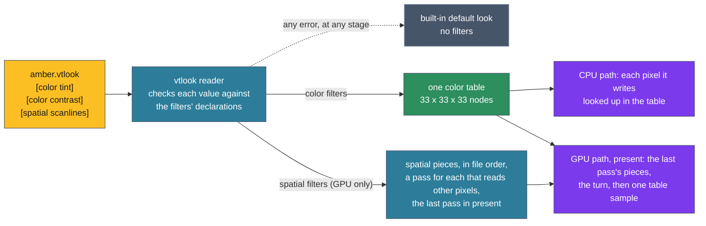

# ADR-1304: vtium's frame filters are built in, and a vtlook file chooses them and sets their parameters

## Summary

- **Decided by the maintainer (2026-11-03):** vtium hard-codes no filter's settings. A filter is a step that fills ADR-1303's color slot or spatial slot, which this record calls the color layer and the spatial layer. The layers are that fixed pair. A color filter is built into vtium's code, and a spatial filter is a shader file in one standard format, vtium's own and a user's alike, which root installs under the ownership rule vtium applies to its other files, so that effects are open to inspection and trade (D15); this revises the maintainer's earlier decision that no filter code is installed from outside. A display whose filter stack runs below a frame-rate floor, a `[requires]` key, draws `default` on its own (D16). Each filter declares its parameters once, in one standard form, and configuration chooses filters and sets their parameters, much as a shader declares its inputs and a program sets them. Each layer has a minimum contract that a filter must meet to run in it. The configuration lives in a file called a vtlook (a look file), as a frit (a font set file) holds a font set, and a vtlook is tied to no profile. When no look is named, a head takes a default look built into vtium, named `default`, as it takes a built-in font when no frit is named; it is a pure passthrough vtlook, which changes no pixel, and no file may take its name. The default look holds no filters, so with no configuration vtium compiles no filter shader piece, builds no table and does no filter work on the CPU. Any error in a head's filters, in any layer and at any stage, drops that head to the built-in default look: in the maintainer's words, "any layer that is invalid fails the whole filter stack". The error says where it failed, the same in vtium's log, in `vtium check-config` and in vtium-config. vtium-config manages vtlooks as it manages frits: it lists, shows, creates, edits, previews on the live console, assigns and removes them. When a head's look holds any filter, vtium draws the mouse arrow into the picture, off the display's cursor plane, so the arrow passes through every filter; on the default look the arrow stays on the cursor plane where the display has one. In a second round the maintainer decided that a head chooses its look in heads.conf, else vtium.conf, else the built-in `default` (D5); that every color filter is one table, all merged into one (D2); that a head on the CPU path draws the color layer and skips the effects, without counting that as a failure (D3); and that vtium-config previews a look through a terminal message carrying its text, which the tool's end, the session's end or a terminal reset undoes (D11). In a third round the maintainer decided that a `cube` filter reads root-installed `.cube` files (D9); that the filters sit behind a `filters` build feature, off in minspec (D10); that curvature follows scanlines and sharpen in a slice of its own (D8, D13); and that a 1-bit display applies a look like any other, a vtlook instead declaring display requirements, a minimum color depth, a resolution, a minimum density and the GPU path, which a display that misses them answers by drawing `default` on its own, not as an error (D7).
- **Proposed by this record's agent, for the maintainer to confirm:** A filter's declaration gives each parameter's name, kind, range, default and a line of help, and that one declaration drives `vtium check-config`, vtium-config's display and editing, the GPU path's shader inputs and the CPU path's function arguments (D1). A color filter maps each pixel's color using that color alone; the CPU path looks each pixel up in the merged table and the GPU path samples it as a texture, one lookup a pixel however many color filters run (D2). A spatial filter is one piece of GLSL read from its shader file, which vtium-render joins into its pipeline on the GPU path only; the filter declares how far it reads and how many reads it makes, under caps, and reads the time or its own previous frame only when its header declares it, as ADR-1305 decides (D3). A vtlook is `/etc/vtium/looks/NAME.vtlook`, owned by root, with one section per filter, run in file order; the built-in default's text is a template that vtium-config uses to start a new look (D4). The fallback lasts until vtium next reads its configuration or the head's look changes, never retried on a timer, and never moves the head off the GPU path (D6). A vtlook states its display requirements in one `[requires]` section, and vtium checks each display against them when it joins a head and at each mode change (D7). The first filters are gamma, contrast, tint, color-blind and cube, which reads a `.cube` table file, in the color layer, and scanlines and sharpen in the spatial layer (D8, D9). The filters sit behind a cargo feature, `filters`, which the minspec build leaves off (D10). The preview's terminal message is an OSC sequence of vtium's own, answered with `ok` or the first error (D11). vtium's own spatial filters ship as `/usr/share/vtium/shaders/NAME.vtshader`, an administrator's in `/etc/vtium/shaders`, which wins on the same name, and a look names either as `[spatial NAME]`; vtium-config checks a shader as the invoking user before root installs it (D15). The floor is the display's refresh rate unless vtium.conf's `look-min-fps` says otherwise, and vtium measures each display's stack over 8 frames when a look loads or a display changes (D16). The work comes in nine slices (D13). No open question remains.
- **Trades away:** A shader is code vtium can check only so far: it cannot prove a shader keeps to its declared reach or ends, and a shader that hangs the GPU can reset the whole device, which costs the head the GPU path until vtium restarts and can disturb other sessions on the card. The frame-rate floor makes what vtium draws depend on the machine's speed, for filters alone. A color filter is drawn through a table, which is straight between its nodes, so a curve that bends hard near black loses detail there: a gamma of 2.0 is off by up to 12 levels among the darkest 7 levels of 256. The CPU path pays a lookup for each pixel it redraws, 28 ns for a pixel of a new color on a fast desktop and 1.4 ns along a run of one color. Spatial filters need the GPU path, which `hwaccel` leaves off by default. A head whose look holds filters gives up the hardware pointer, and each move of the mouse redraws the arrow's old and new places, or the whole screen under a spatial filter that reads neighbours. One bad filter turns off every filter of the head until the configuration is read again. The live preview adds an escape sequence of vtium's own.
- **One-way?** No. Everything is behind a cargo feature, and the vtlook files are the only data it stores. The vtlook format and the preview sequence become expensive to change once people write files and tools send the sequence; the file's `version = 1` line leaves room for the first.
- **Probes:**
  - *Not confident (the arrow):* when a head shows a look, vtium draws the mouse arrow into the picture itself instead of using the display's hardware pointer, so the look's colors and effects reach the arrow too: an amber look makes the arrow amber. The cost is that each move of the mouse redraws the arrow's old and new places, and with an effect such as sharpening, the whole screen. Is that what you want, or should the hardware arrow stay and simply not take the look? (Answered 2026-11-03: the arrow is in the filter pass; see `considered`.)
  - *Confident (a failing filter):* if one filter in a look cannot be used, because of a bad value, a missing `.cube` file or a shader the graphics driver refuses, vtium switches off that filter's whole layer, all the color filters or all the effects, and writes one line to the log. You never see half a color correction. Is that the behaviour you meant? (Answered 2026-11-03: any invalid layer fails the whole filter stack, and the head drops to the built-in default look; see `considered`.)
  - *Not confident (smooth read count):* the GPU now blends a smooth read. The measurement prices that at about one plain read: bloom takes 4.5 ms with it and 5.6 ms with plain reads. A smooth read still counts as 4 reads against the cap of 25, as you decided on 2026-11-16, so crt with smooth reads (32) is refused. Should a smooth read count as 1 read? Lean: yes, because the count stands for cost, and the reach clamp, not the count, keeps the blend's pixels in bounds. Against: 4 names every pixel the blend touches (D18). (Answered 2026-11-18: a smooth read counts as 1 read; see `considered`.)
  - *Not confident (cap for each pass):* crt then bloom now runs as two passes, which read 8 and 25. Should the cap of 25 reads hold each pass, or the whole chain's 33? Lean: each pass, because passes add their costs instead of multiplying them, and the frame-rate floor measures the whole chain on the real display. Against: a chain of many cheap passes then meets the cap however long it grows, and only the floor stops it. Until you answer, the cap holds the whole chain (D3). (Answered 2026-11-18: the cap holds each pass; see `considered`.)
  - *Not confident (Ghostty's decode):* a shader written for Ghostty works in linear light, and the GPU decodes sRGB before it blends only when it reads an sRGB texture. Should vtium give such a shader an sRGB copy of its input, which costs one more pass and up to 31.6 MiB at 3840×2160? The other way decodes after the GPU's blend, which costs no memory but blends edges darker than Ghostty does. Lean: the sRGB copy, so the shaders look as their authors drew them, once the harness has timed both ways (D20). (Answered 2026-11-18: the sRGB copy, timed by the harness against the decode after the blend before slice 11 is built; see `considered`.)
  - *Not confident (the floor's shape):* added 2026-11-19 for D21, which is proposed. Under the amber tint, a blue letter turns almost black, because blue is the darkest of the colors. You decided to plan a brightness floor. Should the floor be a setting of the tint, which lifts every dark color above black while black and the full amber stay as they are? Lean: yes, because only the tint knows each color's brightness before it turns it amber, so it can lift dark colors without changing the amber or clipping it. Against: a filter of its own, which sets the darkest and brightest output colors, works after any filter and suits the creative uses you mentioned, but it lifts the black background as much as the blue, so on its own it does not make the blue easier to read (D21). (Answered 2026-11-19, and again 2026-11-24: a setting of the tint; see `considered`.)
- **Inversion:** Between "no filters", the C reference's gltex, whose shaders were compiled from source built into the program with no color or effect stage, and "any shader anywhere", any GLSL a user points at, run in any stage, as video players and emulators allow. The answer is built-in filters in both layers, with the spatial layer also open to shader files root installs and the color layer to `.cube` tables, each held to a declared contract and chosen by a file of data.

> Note 2026-11-17: four sections join this record for shaders written for Ghostty, from the maintainer's decisions of 2026-11-16 (`basis`). D17 states where a shader's pixel lies and what color it holds: the upright frame counted from its top left, a pixel's place its center, and encoded sRGB color. D18 adds the smooth read, which counts as 4 reads, and makes the cap of 25 reads a starting value. D19 adds the cursor input behind `#pragma vtium cursor`. D20 lets a shader file whose header says `#pragma vtium dialect ghostty` keep Ghostty's names. The parts of each that the maintainer has not decided are proposed and wait for the maintainer's reading. None of the four changes what slice 1 builds (D13).

> Note 2026-11-18: the maintainer decided three things after the shader measurement (`considered`). D16's run of 8 frames is timed with `glFinish` on every driver. D18's smooth read uses the GPU's linear filtering, and its clamp keeps the blend inside the reach. A filter that reads pixels other than its own runs as a pass of its own and draws into an RGBA8 intermediate frame (D3). That changes slice 4 (D13), the color between pieces (D17) and a chain in Ghostty's dialect (D20). Three questions followed, in the probes above: how a smooth read counts, whether the cap holds each pass, and where Ghostty's dialect decodes to linear light. The maintainer answered all three on the same day, each as the probe leaned.

> Edited 2026-11-22: the second bullet called a spatial filter "one piece of GLSL in vtium-render, on the GPU path only, which declares how far it reads and how many reads it makes". D10 and D15 put every spatial filter in a `.vtshader` file that vtium reads at run time, and say that vtium-render holds no spatial filter's GLSL, only its own pipeline's. The bullet now says where the piece comes from. Its meaning is otherwise unchanged.

> Note 2026-11-19: the maintainer decided three things after looking at the amber and deuteranopia looks (`basis`). vtium plans a brightness floor, which D21 proposes as a setting of `tint`, with the probe above. vtium ships preset vtlooks beside the template, and vtium-config's Effects tab lists the built-in vtlook first, as "No filter" (D4's note). The maintainer also decided that a palette is a resource of its own, apart from the filters, which ADR-1205 D10 proposes. D2's note places the palette before the filters.

> Note 2026-11-24: the maintainer decided seven things about shaders written for Ghostty (`considered`). A Ghostty shader loads as its author wrote it, as a `.glsl` file with no header, and vtium translates it at every load, with no cache of translations. vtium virtualizes the shader's environment, not its code: the translation puts vtium's prelude and a `main()` around the author's code, and only the GPU driver's compiler parses the shader. What vtium does not support is ignored, and each thing ignored is a line of a translation report, which is how support grows. A shader in Ghostty's dialect is never refused for its read count, and the frame-rate floor decides. How desktop GL syntax reaches the GPU waited on research, and two spikes have measured it. D20 proposes their answer. Where the GPU offers desktop OpenGL, vtium compiles the shader as desktop GLSL in a second, desktop OpenGL context. On a GPU that offers OpenGL ES alone, naga translates it in the checker's process. The GPU driver caches the compiled shader, in a folder that systemd gives the service or that vtium makes where systemd is absent. The shader pages people read cover all of this, and D20 holds their outline. D20 sets these out and marks the parts the maintainer has not decided as proposed.

> Note 2026-11-25: the maintainer read D20, as amended on 2026-11-24, and accepted it on this date (`considered`). The parts of D20 that the note above calls proposed now decide what they say, and D20's own note of this date lists them.

## Context

ADR-1303 gives the GPU path a fixed pipeline of five slots and reserves two of them, color and spatial, holding no-ops until a later record defines what fills them; the CPU path reserves the color slot too. The skeleton built for that record (`crates/vtium-render/src/gpu/pipeline.rs`) already joins a color piece and a spatial piece of GLSL into present's fragment shader under `#ifdef`, between its head and its `main`, and asks the spatial piece for its reach, how many pixels from the pixel it writes it reads. Both pieces are empty today.

The maintainer decided on 2026-11-03 what fills the slots, in points this record writes down as decided: no filter's settings are hard-coded; the layers are fixed and their filters are built in, the spatial filters shader files root installs (a later decision, D15); each layer has a minimum contract; the configuration lives in a vtlook file; a built-in default look, with no filters, stands where no look is named and wherever a look fails; an error says where it failed; and vtium-config manages vtlooks. An earlier comment on the frame shader's issue spoke of a specification "that vtium loads at run time in one standard way, much as a shader is loaded". The later points settle what that means: what vtium loads at run time is the vtlook, a file of data that names filters and sets their parameters, and each filter's definition is its declaration, compiled into vtium for a color filter and read from its shader file's header for a spatial filter (D15).

The maintainer asked for care with complexity in the GPU frame. This record keeps each layer to one mechanism, the color layer always one table and the spatial layer always one chain of pieces in the present pass that already exists, and gives every failure one outcome, the default look.

> Note 2026-11-18: the spatial layer's chain now runs in passes, one for each filter that reads pixels other than its own, and ends in present (D3). A chain of filters that read only their own pixel still runs in present alone.

A filter is a built-in step of the color or spatial layer. A filter's declaration is the constant in vtium's code that names the filter, its layer and its parameters. A look is the set of filters a vtlook chooses, with their parameter values; the built-in default look is the look a head takes when it names none or its own fails. A look is in force on a display when it holds at least one filter there. The filter stack is all of a head's filters, both layers together.

## C notes: the C reference's flow

gltex compiled its two shader programs, one for glyph atlases and one for pictures, from GLSL embedded in the binary, putting a precision line before each fragment shader (`kmscon/src/render/gltex.c:450-537`). Nothing after its draws changed a pixel's color or read its neighbours, and no user file reached a shader. bbulk, the CPU renderer, had no such stage either. The only colors a user set were the palette's, through the `palette` key and the `palette-*` keys (`kmscon/src/config.c:1427-1436`). The C reference had no filters to be a floor for, so every filter here goes past it.

## Decision

D1 to D3 define a filter and the contract of each layer. D4 and D5 say where a look lives, what the built-in default look is, and how a head chooses a look. D6 says what happens when anything fails and what the error reports. D7 covers the pointer and a look's display requirements. D8 and D9 name the first filters. D10 places the code, D11 sets out what vtium-config does, D12 states the build with no look, D13 the work, D14 the file formats by example, D15 the shader files, and D16 the frame-rate floor. Where a section holds the maintainer's decisions, it opens with them; the rest of the record is this record's agent's proposal.



> Edited 2026-11-18: the spatial chain runs in passes (D3). The figure's spatial box read "spatial pieces, in file order, joined into present's shader", and its present box "GPU path, present: spatial pieces, the turn, then one table sample".

The figure follows one vtlook from left to right. The reader checks every value against the declarations. The color filters become one table, which both paths read. The spatial filters become pieces of present's shader, on the GPU path only, and run before the turn and the table, as ADR-1303 D1 orders the slots. The dashed arrow is the one fallback: an error at any stage, reading, checking, building the table, compiling or drawing, puts the head on the built-in default look, which runs nothing.

### D1: a filter and its declaration

**Decided by the maintainer (2026-11-03):** vtium hard-codes no filter's settings. Each filter declares its parameters once, in one standard form, and configuration sets them. The layers are the color layer and the spatial layer. A color filter is built into vtium's code, and a spatial filter is a shader file in one standard format, vtium's own and a user's alike, which root installs (D15). Each layer has a minimum contract (D2, D3).

> Edited 2026-11-03: the maintainer revised decision 2, so that shaders can be shared and installed, root installing them with the permissions that protect vtium's other files (`considered`). It read: "The layers are the color layer and the spatial layer, and the filters in each are a known set built into vtium. No filter code is installed from outside."

**Proposed:** a color filter's declaration is one constant in vtium-render (D10), and a spatial filter's is its shader file's header (D15); either gives:

- the filter's name, lowercase letters, digits and `-`, unique within its layer;
- its layer, color or spatial;
- a line of help;
- each parameter's name, kind, range or list of choices, default and a line of help. A parameter may have no default, and a look must then set it.

A spatial filter's declaration also gives its reach and its reads (D3).

| Kind | Written in a vtlook as | Example | Range | On the GPU path |
|---|---|---|---|---|
| number | a decimal, with an optional sign and at most four digits after the point | `1.15` | a minimum and a maximum, inclusive | `float` |
| integer | a whole number | `3` | a minimum and a maximum, inclusive | `int` |
| color | `r,g,b`, each 0 to 255, as vtium.conf's palette and notice colors take it | `255,176,0` | none | `vec3`, each channel divided by 255 |
| choice | one word from the declared list | `deuteranopia` | the list | `int`, the word's place in the list |
| on/off | `yes` or `no`, as heads.conf's `isolated` takes it | `yes` | none | `bool` |
| file | a file's name in the looks directory, with its suffix and no path | `panel.cube` | the suffixes the filter reads | none: only the `cube` color filter takes one (D9) |

The one declaration drives four readers:

- **The vtlook reader** in vtium-settings checks each value against its kind and range. `vtium check-config` and vtium-config run the same reader, so a file checked before it is installed gets the verdict it gets at start.
- **vtium-config** shows each parameter with its kind, range, default and help, and edits it with a control fit for its kind: a number in its range, a color, one of the choices.
- **The GPU path** gives each parameter of a spatial filter to its piece as a uniform named `<filter>_<parameter>`, with `-` written as `_`, of the type the table above names. The pipeline lists the uniforms as the program's inputs, so the check every `Gl` implementation makes, that a program declares each of its inputs (`crates/vtium-render/README.md`, the GPU path), refuses a piece whose uniforms do not match its declaration.
- **The CPU work** of a color filter takes the parameters as typed Rust values when it builds the table (D2), on both paths.

### D2: the color layer, one table

**Decided by the maintainer (2026-11-03):** every color filter is a table, 33 a side, and a look's color filters are merged into one table.

**Proposed, the rest.** The color layer's contract: a color filter maps each pixel's color to a new color using only that color. It reads no other pixel, not the pixel's place, not the cell the pixel belongs to and not the time. In vtium's code a color filter is a function from one color to another, given its parameters, over colors whose channels run from 0 to 1. Its one job is to give the color it maps each color to, so that vtium can turn the layer into a table.

vtium merges the whole layer into one table, a lattice of 33 steps in each of red, green and blue: 35,937 nodes. The node at (r, g, b) holds the output of the layer's filters, applied in file order, for the color (r/32, g/32, b/32), each filter's output clamped to 0 to 1 before the next takes it. Each node holds three half-precision floats. The CPU path and the GPU path read the same table, so the number of color filters changes the time it takes to build the table and nothing else: each pixel costs one lookup.

**Building it.** The table is built on the CPU, once for each head, when the look is read and again when it changes. It is built from IEEE 754's correctly rounded operations, which give the same bits on every machine, and from power, exponential and logarithm functions written in Rust, never the platform's maths library, whose last bits differ between machines. A test pins the bytes of each filter's table at its defaults and at one setting that is not its default, and CI's `arm-native` job runs it, so the CPU path's goldens hold on ARM as on x86.

**On the CPU path,** the slot sits where ADR-1303 D4 puts it, on the renderer's last write before the depth reduction. The path keeps the table's values as 32-bit floats, 421 KiB for each head. For each pixel it finds the eight nodes around the pixel's color and blends them trilinearly in 32-bit floats, with no fused multiply-add, and rounds each channel to 8 bits as floor(x × 255 + 0.5). It remembers the last color it looked up and the result, so a run of one color costs one lookup. Measured on a fast desktop, a lookup costs 28 ns a pixel over random colors, 59 ms for a 1920x1080 frame of them, and 1.4 ns a pixel over runs of 8 to 80 equal pixels, 2.8 ms a frame (`basis`). A terminal's screen lies between the two, mostly runs of a background color broken by the edges of glyphs, and the CPU path looks up only the pixels it redraws. The slice that builds the layer measures a full redraw of tier 3's screens in its 1-vCPU guest and reports it.

**On the GPU path,** present uploads the same half floats as a 3D texture in RGBA16F, 280 KiB for each head, which OpenGL ES 3.0 lets the GPU filter linearly. Present's color step samples it once, with linear filtering, at (c × 32 + 0.5) / 33 in each channel, after the spatial step and the turn (ADR-1303 D6), and leaves alpha as it is. The GPU blends the eight nodes itself, with weights of fewer bits than the CPU path's floats, which the specification leaves to the GPU; for the starting filters that moves a channel by under a tenth of a level. GL then writes the result into the display's 8-bit buffer as one of the two nearest levels, preferring the nearer. So a pixel lands at most one level from the CPU path's, which is ADR-1303 D1's tolerance. If the slice that builds the layer measures a share of differing pixels past ADR-1303's, it reports that to the maintainer and does not raise the share itself, as ADR-1303 D1 asks.

**Why 33 a side.** A table of 33 a side is the size `.cube` files most often hold (D9), the identity table returns all 16,777,216 colors unchanged on the CPU path at 17, 33 and 65 a side alike, and 33 keeps the table under half a megabyte. Between its nodes the table is a straight line, so a filter that bends hard near black is approximated in the first step of 8 levels. Measured against the exact curve, a gamma of 1.2 stays within one level everywhere, and a gamma of 2.0 is off by up to 12 levels, at input 2, with 7 of the 256 levels off by more than one. At 65 a side the worst is 8 levels, for tables of 2.1 MiB on the GPU and 3.1 MiB on the CPU; at 17 it is 16 levels (`basis`). The size is a constant in vtium-render's bounds table.

A change of the look's color filters rebuilds the table. The CPU path then draws its frame whole, since it colors pixels as it writes them, and forgets the color it remembered; the GPU path presents whole.

> Note 2026-11-19: the maintainer decided on this date that a palette, which sets the terminal's colors, is a resource of its own, apart from the filters. ADR-1205 D10 proposes how a look picks one. The palette acts before this layer: vtium resolves each cell through the palette as it draws the frame, and the color layer then maps the finished picture's colors. The table never changes the colors that programs see or that OSC 4 reports, and a palette adds no step to the table.

### D3: the spatial layer, a chain of pieces that ends in present

**Proposed.** A spatial filter is one piece of GLSL read from its shader file (D15). vtium joins it into the fragment shader of the pass it runs in, between the shader's head and its `main`. That pass is present (ADR-1303 D6), or a pass before present, which a chain draws when more than one of its filters reads pixels other than its own (the passes, below). It runs on the GPU path only, as ADR-1303 D5 decides. The spatial layer's contract:

- **What it reads.** A spatial filter writes one pixel of the upright frame from the frame's pixels within its reach of that pixel, the pixel's place in the upright frame, and its own parameters. Its parameters are its only uniforms, but for the two lines below.
- **Time and the previous frame, only when declared.** ADR-1305, the frame clock, decides how time reaches a filter. A spatial filter whose header holds `#pragma vtium time` gets its two values, `vtTime` and `vtFrame`; a filter whose header holds `#pragma vtium feedback` gets `SPATIAL_PREV()`, its own output one frame back at the pixel it writes; no other filter gets either. A look holds at most one feedback shader.
- **A declared cost.** The declaration gives the filter's reach and its reads: how many pixels away from the pixel it writes it reads, and how many texels it reads for each pixel it writes. The reach may depend on the parameters and on the frame's size, and vtium works it out for each display when it sets that display's pipeline up.
- **Caps.** Each pass of the layer's chain reads at most 25 texels for each pixel, and the whole chain reaches at most 256 pixels, two rows of vtium-render's bounds table. A smooth read, which the GPU blends from four pixels, counts as 1 read (D18). The cap on reads is a starting value, which the maintainer revisits once real shaders have run on vtium; the cap on reach is a hard limit (D18). ADR-1303 D3 tiles a frame past the GPU's largest texture, with neighbouring tiles overlapping by twice the reach, and asks that the reach stay under half a tile. OpenGL ES 3.0's smallest largest texture is 2048 pixels, and a reach of 256 leaves such a tile 1536 pixels of its own.

> Edited 2026-11-17: the maintainer decided on 2026-11-16 that a smooth read counts as 4 plain reads and that the cap of 25 reads is a starting value: "we can be flexible on the 25 read cap. we can't define what hasn't been experienced yet." (`basis`). D18 sets both out. The bullet read the same without its second and third sentences.

> Edited 2026-11-18: the maintainer decided on this date that a smooth read counts as 1 read and that the cap of 25 reads holds each pass (`considered`). The bullet began "The layer's whole chain reads at most 25 texels for each pixel and reaches at most 256 pixels", and its second sentence read "A smooth read, which blends four pixels, counts as 4 reads (D18)."

> Edited 2026-11-22: the bullet's fifth sentence said that ADR-1303 D3 tiles the frame "with an overlap equal to the reach". ADR-1303 D3 has overlapped tiles by twice the reach since its edit of 2026-11-03, because a tile owns its pixels only up to the middle of each overlap. The bullet's figure of 1536 pixels of a 2048-pixel tile at a reach of 256 already follows from twice the reach, so only the wording changes.

> Note 2026-11-24: the maintainer decided on this date that a shader in Ghostty's dialect is never refused for its read count (`considered`), so the cap of 25 reads holds the passes of vtium's own dialect alone. A Ghostty shader that vtium translates reaches the whole frame (D20). The cap of 256 pixels on the reach exists for tiles, so it does not refuse that reach, and a display whose upright frame needs more than one tile draws the built-in vtlook instead, as D20 says.

Within the layer, filters run in file order, in one pass or several (the passes, below). Before each piece vtium writes a prelude, which defines what the piece reads. It defines `vtTime` and `vtFrame` when a filter of the chain holds the time line, and `SPATIAL_PREV()` before the feedback shader's piece alone, reading that tile's history at the pixel being written, or the shader's own input while the history is empty (ADR-1305 D2); `SPATIAL_PREV()` takes no place, so no shader can read the history anywhere else, and one that writes an argument fails to compile. Under a feedback look, the feedback shader always ends its pass, as ADR-1305 D2 decides. That pass writes the tile's history in place of an intermediate frame, and the next pass reads the history as its input. The prelude also defines a macro, `SPATIAL_IN(at)`, through which the piece reads its input at a place. For the first filter of a pass, `SPATIAL_IN` reads a texel of the pass's input. That input is the upright frame for the first pass, and the frame drawn by the pass before for each later pass. A place past the tile's edge takes the nearest pixel at that edge, and the tile's overlap holds the neighbours past an inner edge (ADR-1303 D3). For each later filter of the same pass, `SPATIAL_IN` is the filter before it. `SPATIAL_SIZE` gives the frame's size, `SPATIAL_TURN` the display's turn in degrees and `SPATIAL_PANEL(at)` the panel's own pixel for a place (D15). `SPATIAL_IN` clamps each place it is asked for to within the piece's declared reach of the pixel being written (D15), so each pass's reach applies to its own input. A chain's reach is the sum of its filters' reaches. The reads of one pass are the product of its filters' reads, and a chain's reads are the sum of its passes' reads. Scanlines then sharpen share one pass, reach 1 pixel and read 5 texels; crt then bloom run in two passes and read 8 and then 25. A look names each filter at most once, so no two pieces declare the same uniform.

**Decided by the maintainer (2026-11-18):** a spatial filter that reads any pixel other than the one it writes runs as a pass of its own, as Ghostty runs its shaders. The pass draws into an intermediate frame, which the next filter reads. Filters that read only their own pixel still share one pass. One shared pass costs about nine times as much as two. On the Radeon 610M at 1920×1080, crt then bloom takes 78 ms in one pass and 8.6 ms in two. On the RX 7900 XTX at 3840×2160 the one pass takes 5.0 to 74 ms, and the two passes take under 3 ms (`basis`). The cost is an intermediate frame while such a chain is in force.

**Proposed, the passes.** vtium starts a new pass at each filter that reads other pixels, unless it is the first such filter of the chain. A filter that reads only its own pixel joins the pass of the filter before it, and one at the start of the chain joins the first pass. The feedback shader also ends its pass, as the paragraph above says. A chain without a feedback shader therefore has one pass for each filter that reads other pixels, and at least one. The last pass is present's own, which then turns the frame and runs the color step (ADR-1303 D6). Each pass before it runs once for each tile and draws into an intermediate frame. Scanlines then sharpen is one pass, because scanlines reads only its own pixel. In crt then bloom, crt draws into an intermediate frame, and bloom reads that frame in present. The frame-rate floor measures every pass (D16), so a display that cannot carry a chain's passes draws `default`.

**Proposed, the intermediate frame.** The intermediate frame is RGBA8, the format of the upright frame (ADR-1303 D1) and of the feedback history (ADR-1305 D2). A pass then reads its input as the first pass reads the upright frame. OpenGL ES 3.0 requires RGBA8 to be color-renderable and texture-filterable, which the smooth read needs (D18). RGBA16F, the color table's format (D2), is a texture-only format in OpenGL ES 3.0, so a pass could draw into it only through an extension (`basis`). Between two passes the color is therefore rounded to 8 bits, and each filter reads what it would read if the filter before it had drawn the frame. A pass in Ghostty's dialect encodes its output before writing it (D20), so the bytes always hold encoded color and dark tones keep their levels. A chain of two passes needs one intermediate frame for each display that draws it. A longer chain needs two, which its passes write in turn. Each has the size of the display's upright frame: 7.9 MiB at 1920×1080 and 31.6 MiB, about 33 MB, at 3840×2160. vtium makes them only while such a chain is in force. They sit outside the glyph and picture budgets, with a row of their own in vtium-render's bounds table, as the history has (ADR-1305 D2). A chain whose filters read only their own pixel needs none. An intermediate frame that a pass in Ghostty's dialect reads is SRGB8_ALPHA8 instead, of the same size, so the GPU decodes it before it blends (D20). When that pass comes first in the chain, the copy D20 makes of the upright frame adds one such frame.

> Edited 2026-11-18: the maintainer decided on this date that Ghostty's dialect reads an SRGB8_ALPHA8 copy of its input (D20, `considered`). The paragraph ended "A chain whose filters read only their own pixel needs none."

**Proposed, damage and tiles.** A chain of two or more passes holds a filter that reads other pixels, so every present under it is whole (the next paragraph). Each pass before present draws its whole intermediate frame on every present, and no pass keeps its output from one present to the next. The intermediate frame is tiled as the upright frame, with the same tiles and overlaps, as the history is (ADR-1303 D3). Each pass draws a tile from the same tile of its input. A pass's output is correct only farther than its reach from a tile's inner edge, and the next pass reads up to its own reach into that border. The overlap therefore stays twice the chain's reach, the sum of every pass's reach, and the cap of 256 pixels still holds that sum. The cap of 25 reads holds each pass's reads, as the maintainer decided on 2026-11-18 (`considered`). The chain's reads, the sum of its passes' reads, are reported beside the measured rate (D18), and the frame-rate floor measures the whole chain (D16).

> Edited 2026-11-18: the maintainer answered this paragraph's open question the same day. Its last sentence read "The cap of 25 reads holds the chain's reads, the sum of its passes' reads, until the maintainer says whether it holds each pass instead (Summary)."

A spatial filter that reads only the pixel it writes, such as scanlines, and reads neither the time nor its previous frame, or does so while the clock is `off` (ADR-1305 D4), leaves damage tracking as it is: present still draws only what changed. A filter that reads any other pixel makes every present a whole one (ADR-1303 D5). A change of the look's spatial filters changes the reach, so the upright frame is made anew and drawn whole (ADR-1303 D3), and present's shader and each pass's shader are compiled again (ADR-1303 D6).

> Edited 2026-11-18: the maintainer decided that a filter that reads other pixels runs as a pass of its own (`considered`), and this section now says how the chain splits into passes. The heading read "D3: the spatial layer, one chain of pieces in present". The first paragraph said a piece is "joined into present's fragment shader between its head and its `main` (ADR-1303 D6)". The paragraph on the chain began "Within the layer, filters run in file order, inside present's one pass." That paragraph also said "Under a feedback look, the filters up to and including the feedback shader run in a draw of their own for each tile before present, writing the tile's history, and the pieces after it read that history through `SPATIAL_IN` in present (ADR-1305 D2).", "For the first filter `SPATIAL_IN` reads the upright frame's texel" and "For each later filter, `SPATIAL_IN` is the filter before it.", and it ended "A chain's reach is therefore the sum of its filters' reaches, and its reads the product of theirs: scanlines then sharpen reach 1 pixel and read 5 texels." The paragraph below said "present's shader is compiled again".

The spatial layer fills the slot that ADR-1310, the record of smooth scrolling, calls the screen slot. ADR-1310 adds a row slot inside the composition, which moves the grid's rows by pixels while the text slides, and the screen slot composes over the row slot's output. A spatial filter therefore reads the upright frame after the row slot has placed the rows, so a CRT look curves the sliding text with everything else.

> Note 2026-11-24: the paragraph above is new on this date. ADR-1310, the record of smooth scrolling, brings it with its acceptance on this date, in its section "What the other records change to fit". The rest of this record is unchanged.

The CPU path has no spatial layer. **Decided by the maintainer (2026-11-03):** a head on the CPU path whose look holds spatial filters draws the look's color layer, skips the spatial layer, and logs that once for the head, naming the look. The skip is the path's design and not a failure, so D6's fallback does not apply to it. `vtium check-config` warns when a look a head uses holds spatial filters and `hwaccel` is off or the build has no `gpu` feature. The maintainer left the door open to revisiting this if a cheap, compatible effect turns up. A spatial effect cheap enough for the CPU path, such as scanlines, which reads only the pixel it writes, could later run there too, in a change of its own.

> Note 2026-11-17: D17 to D20 add to this section without changing what it says. A piece also reads the frame through `SPATIAL_SMOOTH(at)`, which blends four pixels and counts as 4 reads (D18); `at` and the pixel it names follow D17's convention, and the colors are encoded unless the piece converts them. A filter whose header holds `#pragma vtium cursor` gets the cursor's uniforms besides its parameters, and a present after any change of the cursor is whole for it (D19). A filter in Ghostty's dialect gets Ghostty's names through the prelude (D20).

> Note 2026-11-24: the note above says that a smooth read "counts as 4 reads (D18)". Since 2026-11-18 a smooth read counts as 1 read, as D18 decides and this section's caps bullet says.

### D4: the vtlook file, and the built-in default look

**Decided by the maintainer (2026-11-03):** the pipeline's configuration lives in a file called a vtlook, as a frit holds a font set. When no look is named, a head takes a default look built into vtium, which needs no profile, as a head takes a built-in font when no frit is named. The default look holds no filters, so it runs nothing. A vtlook is tied to no profile.

**Proposed, the file:** a vtlook is a file `NAME.vtlook` in `/etc/vtium/looks`, the directory vtium was built with. A name follows the rule for a head's name, 1 to 64 characters of `A-Z a-z 0-9 . _ + -`. vtium reads a vtlook, and a `.cube` file it names, only when root owns the file and neither its group nor others can write it or a directory above it, the rule vtium applies to vtium.conf (ADR-1401 D10, ADR-1403 D3). vtium never writes either. vtium's console process reads the file itself, as it reads vtium.conf.

The file uses the syntax of vtium.conf's sections (ADR-1403 D4): a `#` starts a comment, `key = value` lines, and sections in brackets.

> Edited 2026-11-05: ADR-1403 moved the head file into vtium.conf's sections (ADR-1403 D3, D4), so a vtlook takes vtium.conf's trust check and its sections' syntax. The text named "the rule vtium applies to heads.conf (ADR-1401 D7)", "as it reads heads.conf", and "The file uses heads.conf's syntax".

```ini
# /etc/vtium/looks/amber.vtlook: an amber phosphor with scanlines.
version = 1

[color tint]
color = 255,176,0
amount = 1.0

[color contrast]
contrast = 1.15
brightness = 0.0

[spatial scanlines]
period = 3
strength = 0.3
```

`version = 1` comes before the first section. One section may be `[requires]`, the look's display requirements (D7). Each other section is `[LAYER FILTER]`, a spatial filter's name being its shader file's (D15): the layer, `color` or `spatial`, and the name of a filter in that layer. Its lines set that filter's parameters. A parameter the section leaves out takes its declared default, and vtium-config writes every parameter out, so a file it writes states each value it uses. Within a layer the filters run in the order of their sections. The layers run in the pipeline's order, the spatial filters and then the color filters (ADR-1303 D1), wherever their sections sit in the file. A look names a filter at most once. A file holds at most 64 KiB and 32 sections, rows of vtium-settings's bounds table. Anything else the reader cannot accept is an error, and every error has the one outcome D6 gives.

**Decided by the maintainer (2026-11-03):** the built-in look is named `default`, and its description says it is a pure passthrough vtlook, which changes no pixel. `look = default` names it, and a `look` left unset means the same. A user's file cannot take the name `default`.

**Proposed, the built-in default look:** vtium refuses a file named `default.vtlook` as an error (D6), so the look every failure falls back to is always the built-in one and can never fail itself. Its text is a template, `crates/vtium-settings/templates/default.vtlook`, compiled into vtium, as vtium's compiled-in head configuration is parsed from heads.conf's template (ADR-1401 D6). The template holds `version = 1`; a live `[requires]` section with every requirement key at `any` (D7); and, commented out, a section for every filter the declarations name with every parameter at its default and its help as a comment. A file written from it changes nothing until a filter's section is uncommented or a requirement set. The template is generated from the declarations, and a check fails when the committed file differs from what they give, as the key table's check fails when docs/config.md or the example vtium.conf differs (docs/architecture.md). vtium-config writes the template out as the start of a new look (D11). vtium-config's listing names the default look `default (built in)`, as vtium-config lists the built-in fonts with the state `built in`, and vtium's log calls it the built-in vtlook. Its description, "a pure passthrough vtlook, which changes no pixel", shows in three places: on its line of vtium-config's `vtlooks` listing and in `vtlook-show default`; in vtium-config's `--help` for the look commands and beside it in the TUI's looks view; and in the comment that heads the template, so a file written from it says what it started as.

> Edited 2026-11-18: the name `default` always chooses the built-in vtlook, so vtium never opens a file named `default.vtlook`, and the refusal above has its place in `vtium check-config`, which reports such a file in the looks folder as an error of the reading stage. vtium's log names the built-in vtlook "the built-in vtlook" (D6), and vtium-config's listing keeps `default (built in)`. This paragraph read "vtium's log and vtium-config's listing name the default look `default (built in)`".

> Note 2026-11-19: the maintainer decided two things about the vtlooks people start from (`basis`). First, vtium ships preset vtlooks beside the template, to copy and change: amber, green and white phosphor, and a correction for each of protanopia, deuteranopia and tritanopia. Second, no filter is the obvious first choice. vtium-config's Effects tab lists the built-in vtlook `default`, which changes no pixel, first, as "No filter", and a new look starts with it chosen. This record's agent proposes the rest, for the maintainer to read. The package installs the presets in `/usr/share/vtium/looks`, and a vtlook in `/etc/vtium/looks` wins over a preset of the same name, as a local shader wins over a packaged one (D15). The presets are named `amber`, `green`, `white`, `protanopia`, `deuteranopia` and `tritanopia`. Each phosphor is one `[color tint]` section, and each correction is one `[color color-blind]` section in `correct` mode. The amber preset holds the tint's default color, 255,176,0. The slice that writes the green and white presets picks their colors, and the maintainer judges them on the picture page. If the maintainer accepts D21's floor, the phosphor presets carry a floor that the maintainer chooses by eye. The Effects tab lists the presets after "No filter", then the administrator's vtlooks.

> Note 2026-11-19: the maintainer accepted the three proposals above on this date (`considered`). The package installs the presets in `/usr/share/vtium/looks`. A vtlook of the same name in `/etc/vtium/looks` takes the preset's place, and a copy with an error is reported and draws the built-in vtlook, not the preset. Each preset is one section, with one exception: `amber` keeps the tint and the contrast of 1.15 of the accepted tier 2 golden `look-amber`, so that golden goes on judging the preset.

**A vtlook is tied to no frit.** A head names a look section of vtium.conf, and the look section names both its frit, with `font-name`, and its vtlook, with `vtlook =` (ADR-1403 D1, D5). A vtlook names no frit and a frit names no vtlook, so one vtlook can serve looks with any frit.

> Edited 2026-11-05: the maintainer decided that a vtlook is named by a look section of vtium.conf: `[look NAME]` holds the frit, the size and `vtlook = FILE`, and a head names its look (`considered`; ADR-1403 D1, D5). This changes D4's "A look is tied to no profile" and D5's head `look =` naming a vtlook directly: a head's `look =` names a look section, and the section names the vtlook. D4's file format, the default look and its template are unchanged.

### D5: how a head chooses its look

**Decided by the maintainer (2026-11-03):** a vtlook is chosen for each head, and in vtium.conf for every head. Since ADR-1403 a head chooses it through its look section: the look's `vtlook =` wins; else vtium.conf's top-level `vtlook`; else the built-in `default`.

**Proposed, the rest:** a head names its look section with `look = NAME` in its `[head NAME]` section of vtium.conf, and the look section names its vtlook with `vtlook = NAME` (ADR-1403 D1, D5). `vtlook=NAME` at vtium.conf's top level sets the vtlook of every look that names none, as the top level's keys are the defaults every look inherits (ADR-1403 D5). With neither set, a head takes the built-in default vtlook, the same one `vtlook = default` names. `vtlook = default` in a look section gives the heads that name it the built-in default whatever the top level says, and `vtlook=default` at the top level states the built-in default for every look; no other name, such as `none`, is needed. Every display of a head takes the vtlook of the head's look, but for a display that does not meet the vtlook's requirements, which draws `default` (D7). vtium.conf's key table gains `vtlook`, set at the top level and in a look section. The key is read in every build, so one configuration serves every build (D10). A name with no file is an error (D6).

> Edited 2026-11-05: the steering session made the flat default a top-level `vtlook` key, which a look section's `vtlook =` overrides, and fitted D4's last paragraph and D5 to ADR-1403's look sections (ADR-1403 D1, D5). D4's paragraph was headed "A look is tied to no profile" and read "A head names its look, and a profile names a frit; neither names the other's. A look can therefore serve heads of any profile, and a profile's file, once profiles have files (ADR-1401 D3), holds no look." D5's decided line read "A head's `look =` in heads.conf wins; else vtium.conf's `look=`; else the built-in `default`.", and the rest had a head choose a vtlook with `look = NAME` in heads.conf beside `profile =`, a top-level `look=` key, and gave ADR-1401 D3's head keys and the key table each a `look` key. The earlier text is in git at e53919ea.

vtium reads the look when it starts, and again when it rereads its configuration, which ADR-1401's reload does once it is built. A change to the color filters rebuilds the table (D2). A change to the spatial filters changes the reach, makes the upright frame anew and compiles present's shader again (D3).

### D6: when anything fails, and what the error says

**Decided by the maintainer (2026-11-03):** any error in the filtering pipeline drops the head to the built-in default look, for that head: "any layer that is invalid fails the whole filter stack". One invalid layer, or one invalid filter in any layer, puts the head on the default look, and no layer runs on its own while another has failed. That covers a look that fails to load or check, a filter that fails to build its table or compile, and a GL error the GPU path traces to a filter's step. The error carries enough detail to say where it failed, the same in vtium's log line, in `vtium check-config` and in vtium-config.

**Proposed, the stages that can fail:**

| Stage | What fails there |
|---|---|
| reading | the vtlook or a `.cube` file it names cannot be opened, fails the ownership rule, passes its bounds, has a line that is neither a section nor `key = value`, lacks `version = 1`, or is named `default`; a name with no file |
| checking | an unknown layer or filter, a filter named twice, an unknown parameter, a value outside its kind or range, a parameter with no default left unset, a malformed `.cube` file, a malformed `[requires]` section (D7), a spatial chain whose reach or reads pass a cap at the size of one of the head's displays (D3), and a look naming two feedback shaders, whose report names both (ADR-1305 D2) |
| building the color table | the table cannot be built, such as for want of memory |
| compiling the shader | the driver refuses present's shader with the look's pieces joined |
| drawing | a GL error that the GPU path traces to a filter's step: an error raised by the upload of the color table, or by present's draw while the look's pieces are in it, other than the kinds ADR-1303 D9 always treats as serious |

**Proposed, what the error report holds:** one report for each error, built once in vtium-settings and written the same way in all three places:

- the look's name, its file and the line, or the `.cube` file and its line where that file is at fault;
- the layer, or `requires` where the requirements section is at fault;
- the filter by name and by its place in the layer, such as the second color filter;
- where a value is at fault, the parameter, the value it got, and the kind or range it needed;
- the stage, from the table above;
- the underlying message carried verbatim: the reader's parse error, the driver's compile log or the GL error's name.

An example, as vtium's log writes it:

```text
vtlook amber (/etc/vtium/looks/amber.vtlook:14): spatial filter 1 of 1, scanlines: checking: period = 12, needs an integer from 2 to 8; 1 more error; head console draws the built-in vtlook instead
```

`vtium check-config` and vtium-config list every error, each report whole. vtium's log line at run time names the first error and says how many more there are, and is written once each time vtium reads the look or sets a display up, never once a frame. A driver's compile log can run to many lines; in the log line its line breaks are written as `\n` and it is cut at 4 KiB, a row of vtium-render's bounds table, with the cut marked.

> Edited 2026-11-18: the code review of the vtlook reader found that the log lines this record gave as examples opened with the word look, which since ADR-1403 names a section of vtium.conf, and closed on a phrase that read awkwardly. Every log line in this record now opens with `vtlook NAME (FILE:LINE)`, as vtium writes it, and closes with "head console draws the built-in vtlook instead"; the per-display lines of D7 and D16 open with `vtlook NAME:` and say "draws the built-in vtlook". These lines opened with `look NAME (` or `look NAME:` and said "draws the default look (built in)". The same review bounded what a check lists: `vtium check-config` lists the first 64 errors of each vtlook, `ERRORS_MAX` of vtium-settings's bounds table, and counts the rest, as it does for vtium.conf, and each piece of the file a report quotes is cut at `QUOTE_MAX` characters and has its control and formatting characters escaped. The reader's messages about the file as a whole, such as a missing file or one too large, are whole sentences, while a message about a line keeps the "found X, needs Y" shape these examples show.

> Note 2026-11-24: the maintainer's decisions of this date change three things here for a shader in Ghostty's dialect (D20, `considered`). vtium counts no reads for such a shader, so the checking stage never refuses it for its reads. What vtium does not support in the shader is never an error: each such thing is a line of the translation report, and the look runs. A refused compile names the line of the author's `.glsl` file where vtium compiles the shader as desktop GLSL. On a GPU that offers OpenGL ES alone, it names a line of naga's translation (D20). In both, the error says that a `.glsl` file must define `mainImage` and that `vtium-config shader-import` ports a libretro shader.

**Proposed, how long the fallback lasts:** the head stays on the default look until vtium next reads its configuration or the head's look changes, through a reload once ADR-1401 builds it, vtium-config's live preview (D11) or the end of that preview. vtium never retries a failed look on a timer, as ADR-1303 D9 never retries within a run. A reread that meets the same error falls back again and logs it again.

**Proposed, how it meets ADR-1303 D9:** a filter's failure is never the GPU path's failure, so it never moves the head to the CPU path. A refused compile puts the head on the default look, and present is compiled again without filter pieces; only if that compile fails does D9 count a failed set-up. A GL error traced to a filter's step drops that frame, as D9 drops a frame for one GL error, puts the head on the default look, and draws the next frame whole; it does not count toward D9's errors in two frames running. If GL errors go on under the default look, they are the GPU path's, and D9 sorts them. An out-of-memory error from the driver and a lost context stay D9's whatever the look, since after either nothing the context holds can be trusted. `vtium check-config` reports every error of the reading and checking stages before a file is installed, with the report above; building the table and compiling need the head's own GPU or its run, so they are reported at run time and by vtium-config's preview (D11).

### D7: the pointer, and a look's display requirements

**Decided by the maintainer (2026-11-03):** the mouse arrow is in the filter pass. When a head's look holds any filter, vtium draws the arrow into the picture, off the display's cursor plane, so it passes through every filter as the rest of the picture does. With the built-in default look, which holds none, the arrow stays on the cursor plane where the display has one.

**Proposed, how:** vtium draws the arrow as it does with `soft-cursor`, in the composition, and sets no cursor plane up on that head's displays. So a tint colors the arrow, sharpening sharpens it, and a filter that bends the picture bends the arrow with the cell it selects (ADR-1303 D5). When the head goes back to the default look, through a change or a failure, the cursor plane comes back on each display that has one.

**The cost, estimated from the arrow's size and D2's measurements, not yet measured in vtium:** the arrow is one cell tall and about 11/18 of that wide (`crates/vtium-render/src/arrow.rs`), so in 8x16 cells it covers at most 4 cells, 512 pixels. Each move redraws the arrow's old and new places, at most about 1,000 pixels, which on the CPU path costs at most about 30 µs of color lookups on the desktop D2 measured, and on the GPU path a present of those two small areas. Under a spatial filter that reads its neighbours, such as sharpen, every present is whole (ADR-1303 D5), so every move presents the whole display: at 1920x1080 with sharpen's 5 reads a pixel, 10.4 million texel reads a move. The hardware cursor plane cost no redraw at all. The slice that builds the color layer measures both on tier 3's guest and reports them.

**Decided by the maintainer (2026-11-03):** a 1-bit display applies a look like any other, because someone can write a filter that works on a one-bit panel. A vtlook may declare display requirements of four kinds: a minimum color depth, a resolution, a minimum pixel density, and the GPU path. A look with no requirement applies everywhere, 1-bit panels included. When one of a head's displays does not meet the look's requirements, that display alone draws `default`, the head's other displays keep the look, and one log line names the display and the requirement it does not meet. That is not an error: the whole-stack rule of D6 stays for looks that are invalid.

**Decided by the maintainer (2026-11-03),** answering their own question of whether the requirements should be declarative: every `[requires]` key takes an explicit value, and `any` means no constraint. A key left out means `any`. The default look's template and every look vtium-config writes list each requirement key, at `any` unless it is set, and vtium-config shows and edits each key as a value. `gpu` takes `any`, `yes` (the GPU path only) or `no` (the CPU path only).

**Decided by the maintainer (2026-11-03):** the requirement keys are named as minimums and maximums. Every measured requirement is a pair of keys, a minimum and a maximum, each taking `any` or a value: `min-depth` and `max-depth`, `min-size` and `max-size`, `min-dpi` and `max-dpi`. `gpu` stays one key.

**Proposed, the requirement lines.** A vtlook holds them in one `[requires]` section, which vtium-config writes straight after `version = 1`, every key written out. `any` is a reserved word that every key accepts.

```ini
[requires]
min-depth = 24
max-depth = any
min-size = 1280x720
max-size = any
min-dpi = 110
max-dpi = any
min-fps = refresh
gpu = yes
```

| Key | Value | Met when |
|---|---|---|
| `min-depth`, `max-depth` | `any`, `1`, `8`, `16` or `24`; `32` reads as `24` | the display's depth is at least `min-depth` and at most `max-depth`, in the order 1 bit, 8-bit gray, 16-bit color, 24-bit color. vtium takes a display's depth from what it draws: 1 for a display drawn at 1 bit, by `display-depth=1` or by `auto` on a 1-bit panel; 8 for a gray panel, `display-depth=gray4` or `gray16`, which vtium draws as color and the panel converts; otherwise the bits a pixel of the display's buffer holds, 16 for a 16-bit framebuffer and 24 for 24-bit and 32-bit buffers, which DRM's buffers are. |
| `min-size`, `max-size` | `any` or `WxH` | the display's mode is at least `min-size` and at most `max-size` on each side, in the mode's own pixels as the `mode=` key writes them, not turned. `max-size` keeps a heavy spatial look off a display where every present reads tens of millions of texels. |
| `min-dpi`, `max-dpi` | `any` or a whole number, 1 to 1000 | the display's density is at least `min-dpi` and at most `max-dpi`: the density vtium sizes fonts with, `display-dpi` where it is set, else measured from the physical size the display reports in its EDID, else the 96 vtium assumes. |
| `min-fps` | `any`, `refresh` or a whole number, 1 to 1000 | the look's filter stack, measured at the display's size, runs at least this many frames a second; `refresh` is the display's refresh rate from its mode. The machine-wide floor, vtium.conf's `look-min-fps`, applies too, and the higher of the two counts; `any` in a look adds no demand of its own (D16). On a head drawn on the CPU path it counts as met. |
| `gpu` | `any`, `yes` or `no` | `any`: either path, the CPU path drawing the color layer and skipping the effects (D3). `yes`: the head draws on the GPU path; on a head drawn on the CPU path every display draws `default`, which lets a look's author choose that strictness over D3's skip. `no`: the head draws on the CPU path; on a head drawn on the GPU path every display draws `default`. |

A malformed `[requires]` section is an error of the checking stage, with D6's one outcome: an unknown key, a key twice, a value that is neither `any` nor of the key's kind and range, `refresh` being of `min-fps`'s kind, a pair whose minimum exceeds its maximum, on either side for the sizes, or a second `[requires]` section. Its report names `requires` in place of a layer, the key, the value it got and what it needed, which always begins with `any`, as in "min-depth = 12, needs any, 1, 8, 16 or 24"; for a pair out of order it names both keys and both values, as in "min-size = 1920x1080 exceeds max-size = 1280x800", and `vtium check-config` reports it before the file is installed.

vtium checks each display against the requirements when it reads the look, when the display joins the head, and at each change of the display's mode or depth, as ADR-1303 D9 checks a display against the GPU's limits; it checks `gpu` when the head's path is chosen or changes. A display that meets the requirements again takes the look back, with no reread. A display drawing `default` has no color step and no spatial step, and keeps its arrow on its cursor plane where it has one, while the head's other displays draw the look. Its log line reads, for example: `vtlook amber: display DP-1 (1280x800, 1 bit) draws the built-in vtlook: requires min-depth 24`.

On a display that meets the requirements, a 1-bit panel included, the order ADR-1303 D6 sets holds: the spatial step, the turn, the color step, then the depth reduction. On a 1-bit display vtium lights each cell by its colors and cuts each pixel's coverage at half (`crates/vtium-render/src/mono.rs`), so a look's filters run before that cut; a filter that darkens white below the cut of 128 blanks every lit pixel there, and a look's author who does not mean the look for such panels writes `min-depth = 8` or more.

### D8: the first filters

**Proposed.** The first slices build these filters. A filter's defaults are what someone who writes only its section header most likely wants; where that is no change, as for gamma, the default is no change.

| Filter | Layer | Parameters: kind, range, default | What it does |
|---|---|---|---|
| `gamma` | color | `gamma`: number, 0.5 to 2.0, 1.0 | Raises each channel to the power 1 / `gamma`. Above 1 it lightens the middle tones, and below 1 it darkens them. |
| `contrast` | color | `contrast`: number, 0 to 2, 1.0; `brightness`: number, -0.5 to 0.5, 0 | Multiplies each channel's distance from middle gray by `contrast`, then adds `brightness`. |
| `tint` | color | `color`: color, 255,176,0; `amount`: number, 0 to 1, 1.0 | Mixes each pixel, by `amount`, toward its gray times `color`, the gray being BT.601's luma as mono.rs takes it: at 1 the screen is a single-color phosphor, amber by default. |
| `color-blind` | color | `kind`: choice of `protanopia`, `deuteranopia` or `tritanopia`, `deuteranopia`; `mode`: choice of `simulate` or `correct`, `correct`; `amount`: number, 0 to 1, 1.0 | `simulate` shows how a viewer with that color vision deficiency sees the screen, through Machado, Oliveira and Fernandes's matrices applied in linear light (`basis`). `correct` takes the difference between the screen and that simulation, which such a viewer cannot see, and moves it into channels they can. `amount` mixes the result with the input. |
| `cube` | color | `file`: file, no default | Maps each color through a `.cube` table (D9). |
| `scanlines` | spatial | `period`: integer, 2 to 8, 3; `strength`: number, 0 to 1, 0.3 | Darkens the last row of every `period` rows of the upright frame by `strength`, so the lines run along the text whichever way the display is turned. Reach 0, reads 1. |
| `mask` | spatial | `kind`: choice of `grille`, `grille-lite`, `slot` or `shadow`, `grille`; `strength`: number, 0 to 1, 0.3; `size`: integer, 1 to 4, 1 | Multiplies the picture by a CRT's phosphor pattern, an aperture grille, a slot mask or a shadow mask, tiled on the panel's own pixels through `SPATIAL_PANEL` (D15). From hunterk's public-domain masks and the mask of Lottes's CRTS (Unlicense). Reach 0, reads 1. |
| `crt` | spatial | `pitch-x`: integer, 1 to 8, 1; `pitch-y`: integer, 1 to 8, 3; and CRTS's own, among them its mask, scanline thinness, curvature and a Trinitron-style cylindrical warp as on/off | A port of Timothy Lottes's CRTS (Unlicense): beam scanlines, its 8-tap horizontal filter, a phosphor mask and a warp, with no time. It treats each `pitch-x` by `pitch-y` block as one beam texel, the convention D15 proposes. Its warp can be the curvature this section names. Reads 8; its reach, about three `pitch-x` across and two `pitch-y` down plus the warp's largest shift, is the port's to state, which `shader-check` tests. It is also the porting guide's worked example (D15). |
| `sharpen` | spatial | `amount`: number, 0 to 2, 0.5 | Adds `amount` times the difference between a pixel and the mean of its four nearest neighbours. Reach 1, reads 5. |

> Note 2026-11-19: D21 proposes a `floor` parameter for `tint`, a number from 0 to 1 that is 0 by default and changes nothing then. A floor above 0 lifts every gray above black before the tint applies its color, so a dark color such as blue stays visible under a single-color phosphor.

scanlines, sharpen, mask and crt ship as shader files in `/usr/share/vtium/shaders/`, the format's first examples (D15). Bloom is not among the first filters. A bloom shader that reads other pixels runs in a pass of its own (D3), and the surveyed bloom fits there with 25 plain reads, at the cap (D18). A bloom split across several shader files still does not fit, such as a blur in two passes followed by an add of light. A pass reads only what the pass before it drew, and the add needs the frame itself.

> Edited 2026-11-18: D3 now runs each filter that reads other pixels as a pass of its own, by the maintainer's decision of this date (`considered`). The paragraph read "Bloom waits for a record that allows more than one pass: one pass under the cap of 25 reads cannot hold it."

Curvature, which bends the picture as a CRT's glass did, is the next spatial filter, after scanlines and sharpen, in a slice of its own (D13), as the maintainer decided on 2026-11-03. It fits the contract without a change to this record: its reach grows with its strength and the display's size, and it reads 4 texels a pixel to blend between them. crt's cylindrical warp is a candidate for it.

### D9: the `cube` filter, a color table from a file

**Decided by the maintainer (2026-11-03):** a `cube` filter reads root-installed `.cube` files beside the looks, 2 to 65 a side, resampled into the merged table past 33.

**Proposed, the details.** The `cube` filter is the color layer's way to trade a correction, as a shader file is the spatial layer's (D15). It maps each color through a table read from a file in the format Adobe's Cube LUT Specification 1.0 defines, which color grading and calibration tools write. The file is data: numbers in a fixed grammar, never code. vtium reads `LUT_3D_SIZE` from 2 to 65, `TITLE`, and `DOMAIN_MIN` and `DOMAIN_MAX` only at their defaults of 0 and 1; D14 states the grammar with examples. It also reads a 1D table, `LUT_1D_SIZE` from 2 to 4096, the maintainer decided on 2026-11-03. Another domain, a keyword it does not know, a value that is not a finite number and a count of data lines that does not match the size are each an error of the checking stage (D6), and vtium clamps values outside 0 to 1. A file holds at most 16 MiB, enough for 65 cubed lines or 4096 lines of a 1D table.

The file is `NAME.cube` in the looks directory, named by the filter's `file` parameter with no path, under the same ownership rule as a vtlook (D4). Root installs it there, by hand or through vtium-config's `apply DIR` (D11). vtium's console process parses it when it reads the look, as it parses heads.conf. The grammar is a few keywords and lines of three numbers, which vtium's own reader takes strictly and within the bounds above, so no decoder of outside formats enters the console, which ADR-1200 D6 keeps fonts' decoders out of.

The filter's function is the file's own table: a 3D table blended trilinearly, and a 1D table blended linearly along each channel on its own, so a 1D table is a curve for each channel. The merged table samples it at its 33 nodes (D2), so a file of 33 a side passes into it unchanged, and a larger file is resampled to 33.

### D10: where the code lives, and the `filters` feature

**Decided by the maintainer (2026-11-03):** the filters sit behind a `filters` build feature, off in the minspec build. A minspec build reads `look =` and logs once that it has no filters.

**Proposed, the details:**

- **vtium-render**, behind a new feature `filters`, holds the color filters: `src/filter/`, one module for each color filter with its declaration beside its function. `src/filter/mod.rs` holds the one list of the color filters, the merge into the table and the CPU path's lookup, and, with `gpu`, the joining of shader files' functions into present (D3, D15).
- **vtium-settings**, behind its own `filters` feature, depends on vtium-render's `filters` for the declarations, constants only, as it takes constants from vtium-font and vtium-term. It holds the vtlook reader, the `.cube` reader, the error report and the default look's template. The `look` key of vtium.conf and of heads.conf, and the default look, are in every build.
- **Shader files** need `filters` and `gpu`. vtium-settings reads a shader file's header with the format's reader, and vtium-render joins its source into present; vtium-render holds no spatial filter's GLSL, only its own pipeline's. The package installs `/usr/share/vtium/shaders/` in a build with `filters` and `gpu`, and the minspec build installs none (D15).
- **The binary's** `filters` feature turns both on. It is not among the default features, so the minspec build carries no filter code. vtium-config builds with `filters` always, since it manages looks for any console.
- **A build without `filters`** that meets a `look` other than `default` logs once for each head that it has no filters and that the head draws the default look, and draws as with no look. `vtium check-config` warns the same, as it warns of `hwaccel` in a build without `gpu`. This is the build's design and not an error of the look.

The pipeline's skeleton fits this as it stands. Its `Color` gains one step, the table's sample, with the table's texture as its input. Its `Spatial` becomes the look's chain of pieces, whose `reach` is the sum of theirs and whose `presents_whole` is true when any piece reads beyond its own pixel. docs/architecture.md's tree gains the arrow from vtium-settings to vtium-render, marked constants only and behind `filters`.

### D11: vtium-config manages vtlooks

> Edited 2026-11-05: the maintainer renamed this decision's commands with the word vtlook, as `vtlooks`, `vtlook-new`, `vtlook-set` and `remove-vtlook`, since a look is now a look section of vtium.conf (`considered`; ADR-1403 D1). They read `looks`, `look-new`, `look-set`, `remove-look` and so on. Assign and Remove act through look sections, and the Save bullet is Install (ADR-1403 D7): Assign read "`look-use NAME --head HEAD` changes a head's `look =` line", Remove refused "a look that a head's `look =` line or vtium.conf's `look=` names", and Save read "Every change becomes a draft and reaches `/etc/vtium` through `sudo vtium-config apply`". vtium-config's Looks view replaces the looks view below (ADR-1201 D3), and a vtlook file stays refused for removal while a look section names it.

**Decided by the maintainer (2026-11-03):** vtium-config is expanded to manage vtlooks.

**Proposed, what managing means,** following what vtium-config does for frits (`crates/vtium-config/README.md`, ADR-1201). Each action is a command a script can run and an action of the TUI, as every font action is; the command names below are this record's proposal.

- **List.** `vtlooks` lists the installed looks and the built-in default, one line each, tab-separated: the name; its state, `reads`, `built in`, or `does not read:` and the first error's report; and the heads and vtium.conf lines that name it.
- **Show.** `vtlook-show NAME` prints a look's filters, layer by layer in their order, with each parameter's value, kind, range, default and help from the declarations, and marks a value left at its default. It then lists each display vtium-config can see on this machine, with its head, depth, mode size and density, and says whether the look applies there or which requirement the display does not meet, worked out by the console's own rules from vtium.conf's `display-depth` and `display-dpi`, `hwaccel`, and each display's mode and EDID read through vtium-platform. A card it cannot open is named and left out. The TUI shows the same list beside the look, and `vtlooks` gives each look's count of displays it applies to.
- **Create.** `vtlook-new NAME` writes the default look's template (D4) under a new name; `--from FILE` installs a vtlook written elsewhere.
- **Edit.** `vtlook-set NAME LAYER FILTER [PARAM=VALUE...]` adds a filter, at the end of its layer or at a place `--at N` gives, or sets its parameters; `vtlook-unset NAME LAYER FILTER [PARAM...]` removes a filter, or returns parameters to their defaults; `vtlook-move NAME LAYER FILTER N` moves a filter within its layer, since order changes the result; `vtlook-require NAME KEY VALUE` sets one of the eight requirement keys, `min-depth`, `max-depth`, `min-size`, `max-size`, `min-dpi`, `max-dpi`, `min-fps` or `gpu`, to a value, `any` included, and refuses a minimum above its maximum with D6's report. `vtlook-show` prints every requirement key with its value, and the TUI edits each as a value with `any` among its choices. Each edit is checked with the same reader `vtium check-config` runs, and refused with the error report of D6 before anything is drafted.
- **Preview.** At a vtium console, the TUI shows each edit on the console it runs on before it is saved, through a sequence of vtium's own (below); `vtlook-preview NAME|FILE` does the same from a script, until the user presses a key.
- **Assign.** `vtlook-use NAME --look LOOK` sets the `vtlook =` line of the look section LOOK through the section writer (ADR-1403 D8); a head takes the vtlook through the look it names, which the Flow view assigns.
- **Remove.** `remove-vtlook NAME` removes `NAME.vtlook`, keeping it as `NAME.vtlook.bak` as `remove-frit` keeps a frit, and refuses `default`, a name with no file, and a vtlook that a look section's `vtlook =` line names, as `remove-frit` refuses a frit in use; `apply DIR` refuses the same removals in any draft.
- **Animated looks.** `vtlooks` and `vtlook-show` mark a look that holds a shader reading the time or its previous frame as animated, and name a look with an afterglow; `shader-check` runs a time-reading shader at given ticks and a feedback shader's frames in sequence (ADR-1305 D8).
- **Shaders.** `shaders` lists the shaders in `/etc/vtium/shaders` and `/usr/share/vtium/shaders`, marking a packaged one that a local one of the same name hides; `shader-show NAME` prints a shader's header and its source; `shader-copy NAME` drafts a copy of a packaged shader into `/etc/vtium/shaders` to be customised; `shader-check FILE` lints and tests a shader as the invoking user (D15), and `check FILE` runs the same for a `*.vtshader` file; `shader-install FILE` drafts a shader for `apply DIR` once that check passes; `remove-shader NAME` refuses a packaged shader and a shader a look names, as `remove-vtlook` refuses a look in use. `vtlook-table NAME` prints a look's merged color table as a `.cube` file (D15). The TUI lists shaders when a filter is added to a look, and its preview reports each display's measured rate against its floor.
- **Install.** Every change goes into the draft of ADR-1403 D8 and reaches `/etc/vtium` through Install, whose privileged step, `sudo vtium-config apply DIR`, checks each vtlook, `.cube` file and shader with the console's readers on root's copies of the bytes it then writes, as it checks frits, and installs them before the head file and vtium.conf that name them.

**The TUI's looks view** lists the looks as the fonts view lists frits. Choosing one opens it: its two layers, each filter in order with its parameters, each parameter's value beside its kind, range and default, and its help on the line below. Keys add a filter from the declared list, remove one, move one within its layer, and edit a value with the control its kind takes; each change is checked, and an error shows its report in place and is not previewed. The view also chooses each head's look and vtium.conf's default, beside each head's profile. Leaving without saving returns the console to the look it had when the TUI started.

**Decided by the maintainer (2026-11-03):** vtium-config previews a look by a terminal message that carries the look's text, on by default behind `allow-look-ops`. The tool ending the preview, the session ending, or a terminal reset (RIS) restores the head's real look.

**Proposed, the live preview's details:** vtium-config sends the look's whole text to the console it runs on in an OSC sequence of vtium's own, one whose number no other terminal uses, which the slice that builds it picks and records as a row of ADR-1000. The console checks the text with the same reader, applies it to the head that the sending console belongs to, and answers with `ok`, naming any display that draws `default` and the requirement it does not meet, or with the first error's report and the count of the rest. A preview that fails at any stage puts the head on the default look, as any failure does (D6). A second sequence ends the preview and returns the head to its configured look, and vtium returns it there too when the session that sent the preview ends, as it returns a console's font (ADR-1201 D11), and when that console receives a terminal reset, RIS (`ESC c`), so a tool that dies mid-preview leaves nothing behind once the user runs `reset`. A key, `allow-look-ops`, turns the sequences off; it is on by default, as `allow-font-ops` is. In a terminal that is not vtium, and in a build without `filters`, vtium-config sends nothing and says that the preview is not available there.

> Note 2026-11-04: the maintainer decided that vtium-config's Looks view manages each look, its filters, color and effects included, and that a head picks its look from the look column of the Flow view (`considered`, 2026-11-04; ADR-1201 D3, ADR-1403 D7). The Looks view edits vtlooks. In that view a look is one object, a profile, with its frit and size, together with a vtlook, and until this record's filters are built the view shows the filters as not yet available. This note changes none of this record's decisions. These points of this record meet the Looks view and are open for the maintainer:
> 1. Resolved 2026-11-05: a look section names its vtlook with `vtlook =` (D4's note).
> 2. Resolved 2026-11-05: a head names one look, which names the vtlook.
> 3. Resolved 2026-11-05: D11's commands take the word vtlook, as `vtlooks`, `vtlook-new`, `vtlook-set` and `remove-vtlook`, so the word look means only a look section of vtium.conf (the maintainer, 2026-11-05).
> 4. Resolved 2026-11-05, as leaned. D11's Remove refuses a vtlook file that a look names, while ADR-1403 deletes a look section after a question that names its heads. Lean: both stand, since they now act on different objects: a look section is deleted with its heads moved to the default look, and a vtlook file stays refused while a look section names it.
> 5. Resolved 2026-11-05, as leaned. D11's looks view chooses each head's look beside its profile and returns the console to its look when the user leaves without saving. Lean: ADR-1201 D3's Looks view takes its place: a head's look is chosen in the Flow view, every change is written to the draft at once, and a live preview still ends, returning the head to its configured look, when the user leaves the editor.

> Note 2026-11-18: ADR-1205, accepted on this date, changes this decision. vtium-config manages the color maps and shaders on an Effects tab of their own, next to the Fonts tab and with the same controls (ADR-1205 D1). The Effects tab finds them in this record's folders, shows each one's trust mark, activates or deactivates each, and previews an effect as a picture of the console (ADR-1205 D3, D8). The Looks tab then assembles a look's effects from the active ones (ADR-1205 D6). A resource can be activated only from a root-owned folder on a filesystem that stays mounted, and a symbolic link fails that rule (ADR-1205 D4). A `.cube` file or a shader that a vtlook names and that is not active counts as a file that does not exist, which D6's reading stage reports. The folders this record gives `.cube` files and shaders do not change.

### D12: with no look

**Decided by the maintainer (2026-11-03):** at the simplest end there are no shaders and no CPU filters at all. With no configuration, vtium compiles no filter shader piece, builds no table and does no filter work on the CPU.

**Proposed, how vtium meets it:** a head on the built-in default look, by choice, by default or by a failure, reads no vtlook file, builds no table, joins no filter piece into present's shader and adds nothing to the CPU path's write chain; the chain decides whether it holds a color step once, when it is set up, never for each pixel. The frame is then the frame of a build without filters, which the stand-in GL's test of present's sources and calls checks (Verification). A build without `filters` draws every head on the default look.

### D13: the work, in slices

**Proposed.** Each slice builds and tests on its own, in this order; the steering session sets the final order.

1. **The reader and the default look.** The declaration types and the empty list of filters in vtium-render; the vtlook reader with its `[requires]` section, the error report and the default look's template and its check in vtium-settings; the `look` keys of vtium.conf and heads.conf; `vtium check-config`; the fallback to the default look and its log line in the binary.
2. **The color layer.** The merged table and the CPU path's lookup, the GPU path's color step, the pointer drawn in the frame, each display checked against the look's requirements, and the filters gamma, contrast, tint and color-blind. Its GPU half waits for ADR-1303's composition and present (ADR-1303 D11, part 3).
3. **The `cube` filter** and its reader.
4. **The spatial layer and the shader format,** after the prior-art survey settles the header's syntax: the format and its reader, `/usr/share/vtium/shaders/` and the package's install of it, `[spatial NAME]`, the chain and its passes (D3), with the intermediate frames, their tiles and their bounds row, the caps, scanlines and sharpen as shader files, the fallback on a refused compile and on a GL error traced to a filter's step. It waits for ADR-1303's turn and tiles (ADR-1303 D11, parts 3 and 4).
5. **Curvature,** its own slice after slice 4 (D8).
6. **Local shaders and the frame-rate floor** (D15, D16): `/etc/vtium/shaders/` and its precedence, the user-side check, `min-fps` and `look-min-fps`, the measured run timed with `glFinish`, the watch while running, and `check-config`'s compile and measurement.
7. **vtium-config manages vtlooks.** Every command and the TUI's view of D11, and the preview sequence on both sides: the console's handling of it in vtium-term and the binary, its ADR-1000 row, and `allow-look-ops`. It needs slice 1, and slices 2 to 6 for what it previews and the shaders it manages.
8. **Porting,** `vtium-config shader-import` and the porting guide in docs/looks.md (D15), after slice 7.
9. **Tier 3's screens with a look** (Verification), the GL variant's once ADR-1303 D11's part 7 passes.

10. **The coordinates, the smooth read and the cursor input** (D17, D18, D19), after slice 4: the prelude's flip and its two color functions, `SPATIAL_SMOOTH` through the GPU's filter with its clamp, its count and the divergence report of its tests (D18), the cursor line and its uniforms, the cursor's damage rule, and the cap's figure beside the measured rate. The measurement of D18 runs before slice 4 finishes.
11. **Ghostty's dialect** (D20), after slice 10 and beside slice 6: the `.glsl` file and its lookup beside `.vtshader`, the translation in vtium-settings that the console and `shader-import` share, the reading of the linked program's active uniforms for the time and cursor lines and for the report, the translation report with the compiler's errors and warnings, its log line and `shader-check`'s printing of the report, the tuned `.vtshader` that overrides a translation, the dialect line, the prelude's names and their color conversion, with the SRGB8_ALPHA8 copy of its input (D20), once the timing harness has timed that copy against the decode after the blend, a pass of its own for each shader in the dialect, with no count and no cap, the reach of the whole frame on a frame of one tile, the second, desktop OpenGL context with its EGLImage handoff and naga's translation in the checker's process on a GPU that offers OpenGL ES alone, crt and vhs as committed test files with their reports pinned in tier 2, the reports of the 37 surveyed shaders and the command that compares them, the driver's cache folder with systemd and without it, and the shader pages people read (D20).

> Edited 2026-11-17: slices 10 and 11 build D17 to D20, which the maintainer's decisions of 2026-11-16 add (`basis`). The list ended at slice 9.

> Edited 2026-11-18: the maintainer's decisions of this date change four slices (`considered`). Slice 4 grows: it builds the chain's passes and their intermediate frames, where it built one chain in present. A chain of filters that read only their own pixel stays one pass. Slice 6 times the run of 8 frames with `glFinish` alone (D16). Slice 10 builds the smooth read on the GPU's filter, with tier 2's bound on its divergence and the timing harness's report of it (D18), and slice 11 builds the SRGB8_ALPHA8 copy of a Ghostty shader's input that the maintainer chose (D20). Slice 4 read "the chain in present, the caps,", slice 6 "the measured run, the watch", slice 10 "`SPATIAL_SMOOTH` and its count," and slice 11 "the prelude's names and their color conversion,". The maintainer's answers of the same day settled slice 11's decode.

> Edited 2026-11-24: the maintainer's decisions of this date add to slice 11 (`considered`). It read "**Ghostty's dialect** (D20), after slice 10 and beside slice 6: the dialect line, the prelude's names and their color conversion, with the SRGB8_ALPHA8 copy of its input (D20), once the timing harness has timed that copy against the decode after the blend, the checker's counts and its refusal of the names vtium does not give, crt and vhs as committed test files, and `shader-import`'s drafting of a Ghostty header once slice 8 has built the command."

The user documentation of the formats is a new page, docs/looks.md, beside docs/heads.md, since docs/config.md is generated from the key table and holds no hand-written section. It carries every example of D14 and the default look's template, each in a fenced block whose info string names what it holds: `vtlook` for a vtlook that must read cleanly, `vtlook-error` for a malformed one followed by a `text` block of the errors it must give, and `cube` for a `.cube` file. A test in vtium-settings reads docs/looks.md, runs each block through the real readers, and fails when a `vtlook` or `cube` block does not read cleanly or a `vtlook-error` block gives other errors than the ones shown; a second test checks that the template block is the template vtium compiles in. A doc example that stops parsing therefore fails the gates. Slice 1 writes the page and both tests; each later slice adds the examples of what it builds, slice 3 the `.cube` examples.

### D14: the file formats, by example

**Requested by the maintainer (2026-11-03):** the formats are "documented with spec examples".

**Proposed.** This section states the vtlook and `.cube` formats by complete examples. The user documentation carries the same examples, and a test reads each of them with vtium's real readers (D13).

#### A vtlook, in full

This look names every part a vtlook has: the version, a `[requires]` section with all eight keys, two spatial filters and three color filters, one of them a `cube` filter.

```ini
# /etc/vtium/looks/film.vtlook: a calibrated panel with a warm, sharp CRT look.
version = 1

[requires]
min-depth = 16
max-depth = any
min-size = 1280x720
max-size = 3840x2160
min-dpi = any
max-dpi = any
min-fps = refresh
gpu = any

[spatial scanlines]
period = 3
strength = 0.25

[spatial sharpen]
amount = 0.4

[color cube]
file = panel.cube

[color gamma]
gamma = 1.1

[color contrast]
contrast = 1.1
brightness = 0.0
```

vtium reads it as follows. The look applies to a display drawn at 16 bits a pixel or more whose mode is from 1280x720 up to 3840x2160 on each side, and whose filter stack keeps up with its refresh rate; a 1-bit panel, a gray panel, or a display outside those sizes draws `default`, and the head's other displays keep the look. On the GPU path, present runs scanlines, then sharpen over the result, then turns the frame, then looks each pixel up in one table made from the panel's `.cube` correction, then the gamma, then the contrast, in that order. On the CPU path, `gpu = any` lets the head draw the same table and skip the two spatial filters (D3).

#### A vtlook, at its smallest

```ini
version = 1

[color gamma]
gamma = 1.2
```

A look with no `[requires]` section applies to every display, a 1-bit panel included, as if each requirement key were `any`. Each parameter a section leaves out takes its declared default.

#### The default look's template

vtium-config writes the template out, as `vtlook-new` does for a new look, from the declarations (D4). Every line that would change a pixel is commented out, so the file as written is a passthrough like `default` itself; `vtlook-new` writes the same text with the name it is given in the first line.

```ini
# default.vtlook: a pure passthrough vtlook, which changes no pixel.
# vtium's built-in look: a head that names no look draws it. To make a look
# of your own, copy this file under another name, uncomment the sections you
# want and set their values. Within a layer, filters run in the order of
# their sections.
version = 1

# Display requirements. A display that misses one draws the default look;
# the head's other displays keep this look. any is no constraint.
[requires]
min-depth = any     # any, 1, 8, 16 or 24 (32 reads as 24): bits a pixel
max-depth = any
min-size = any      # any, or WxH: the mode's own pixels
max-size = any
min-dpi = any       # any, or 1 to 1000: the density fonts are sized at
max-dpi = any
min-fps = any       # any, refresh or 1 to 1000: the frame rate to keep
gpu = any           # any; yes for the GPU path only; no for the CPU path only

# Spatial filters run on the GPU path only, before the turn. Each is a shader
# file, in /etc/vtium/shaders or the packaged /usr/share/vtium/shaders.

# [spatial scanlines]
# Darkens the last row of every period rows of the picture.
# period = 3        # integer, 2 to 8: rows from one line to the next
# strength = 0.3    # number, 0 to 1: how much each line darkens

# [spatial sharpen]
# Sharpens edges against the four nearest pixels.
# amount = 0.5      # number, 0 to 2: how strongly

# Color filters run on both paths, merged into one table, after the turn.

# [color gamma]
# Raises each channel to the power 1 / gamma.
# gamma = 1.0       # number, 0.5 to 2.0: above 1 lightens the middle tones

# [color contrast]
# Scales each channel's distance from middle gray, then shifts it.
# contrast = 1.0    # number, 0 to 2
# brightness = 0.0  # number, -0.5 to 0.5

# [color tint]
# Turns the screen toward one color, as a single-color phosphor.
# color = 255,176,0 # color, r,g,b: the phosphor's color
# amount = 1.0      # number, 0 to 1: how far toward it

# [color color-blind]
# Simulates a color vision deficiency, or corrects for it.
# kind = deuteranopia  # protanopia, deuteranopia or tritanopia
# mode = correct       # simulate or correct
# amount = 1.0         # number, 0 to 1: how much of the result to show

# [color cube]
# Maps each color through a .cube table in this directory.
# file =               # file: a NAME.cube in /etc/vtium/looks, no path
```

The template's `[requires]` section is live, at `any` on every key, so a file written from it states each requirement. The `cube` filter's `file` has no default, which is why its line is empty: a look that uncomments the section must set it.

#### A `.cube` file

vtium reads Adobe's Cube LUT Specification 1.0 (`basis`), a 3D table or a 1D table. The grammar vtium accepts:

- The file is text, at most 16 MiB, in lines that end in LF or CRLF.
- A line whose first character that is not a blank is `#` is a comment. A blank line is skipped.
- Keyword lines come first, each keyword at most once and in any order: `TITLE "text"`, optional; exactly one of `LUT_3D_SIZE N`, with N from 2 to 65, and `LUT_1D_SIZE N`, with N from 2 to 4096; `DOMAIN_MIN 0 0 0` and `DOMAIN_MAX 1 1 1`, optional, and only at those values.
- Then come the data lines: N × N × N of them for a 3D table, and N for a 1D table, each three numbers, red, green and blue, separated by blanks. A number is a decimal with an optional sign and an optional exponent, such as `0.5`, `-0.01` or `1e-3`.
- In a 3D table the data lines run with red changing fastest, then green, then blue: the line at index r + N × g + N × N × b holds the output for the input color (r, g, b) / (N − 1). In a 1D table line i holds the outputs of red, green and blue for an input of i / (N − 1) in each channel on its own.
- A value below 0 or above 1 is clamped to that range.

The identity table at its smallest, N = 2, maps each corner of the color cube to itself:

```text
# identity.cube: every color to itself.
TITLE "identity"
LUT_3D_SIZE 2
0 0 0
1 0 0
0 1 0
1 1 0
0 0 1
1 0 1
0 1 1
1 1 1
```

A warm table keeps red, lowers green by 5 per cent and blue by 15 per cent. Only the corners with green or blue at 1 change:

```text
# warm.cube: white becomes 1, 0.95, 0.85.
TITLE "warm"
LUT_3D_SIZE 2
0 0 0
1 0 0
0 0.95 0
1 0.95 0
0 0 0.85
1 0 0.85
0 0.95 0.85
1 0.95 0.85
```

Blending between these corners scales each channel by a constant, so the merged table of 33 a side (D2) takes it exactly: a mid gray of 0.5 becomes 0.5, 0.475 and 0.425.

A 1D table holds one curve for each channel. This one, of 5 points, darkens the middle tones of every channel alike, a gamma of 0.8 sampled at 0, 0.25, 0.5, 0.75 and 1:

```text
# darken.cube: each channel through the same curve.
TITLE "darken"
LUT_1D_SIZE 5
0 0 0
0.1768 0.1768 0.1768
0.4204 0.4204 0.4204
0.6986 0.6986 0.6986
1 1 1
```

vtium blends between the curve's points along each channel and samples the result at the merged table's 33 nodes, so a 1D table costs nothing more on either path than a 3D one.

vtium refuses a `.cube` file at the checking stage, with D6's report naming the `.cube` file and its line, what it found, and what it needed. Each example is the log line vtium writes for the look `film` above when its `panel.cube` has that fault:

| Fault | The report |
|---|---|
| A keyword vtium does not read | `vtlook film (/etc/vtium/looks/panel.cube:3): color filter 1 of 3, cube: checking: found LUT_3D_INPUT_RANGE, needs TITLE, LUT_3D_SIZE, LUT_1D_SIZE, DOMAIN_MIN or DOMAIN_MAX; head console draws the built-in vtlook instead` |
| A size out of range | `vtlook film (/etc/vtium/looks/panel.cube:2): color filter 1 of 3, cube: checking: found LUT_3D_SIZE 129, needs 2 to 65; head console draws the built-in vtlook instead` |
| A 1D size out of range | `vtlook film (/etc/vtium/looks/panel.cube:2): color filter 1 of 3, cube: checking: found LUT_1D_SIZE 8192, needs 2 to 4096; head console draws the built-in vtlook instead` |
| Both sizes in one file | `vtlook film (/etc/vtium/looks/panel.cube:3): color filter 1 of 3, cube: checking: found LUT_1D_SIZE after LUT_3D_SIZE, needs one of the two; head console draws the built-in vtlook instead` |
| A number vtium cannot read | `vtlook film (/etc/vtium/looks/panel.cube:17): color filter 1 of 3, cube: checking: found "0.5,0.2,0.1", needs three numbers separated by blanks; head console draws the built-in vtlook instead` |
| The wrong count of data lines | `vtlook film (/etc/vtium/looks/panel.cube:8195): color filter 1 of 3, cube: checking: found 8192 data lines, needs 35937, LUT_3D_SIZE 33 cubed; head console draws the built-in vtlook instead` |
| A domain other than 0 to 1 | `vtlook film (/etc/vtium/looks/panel.cube:4): color filter 1 of 3, cube: checking: found DOMAIN_MAX 1 1 1.2, needs DOMAIN_MAX 1 1 1; head console draws the built-in vtlook instead` |

For the wrong count, the line is the last line of the file. A file vtium may not read at all, for its owner, its mode or its size, fails at the reading stage, with the same report.

#### A shader file

A `.vtshader` file is GLSL ES 3.00 with a header of pragma lines (D15). The grammar vtium accepts:

- The file is text, at most 256 KiB, a row of vtium-settings's bounds table, in lines that end in LF or CRLF.
- The header is every line before the first line of code. In it, besides blank lines and `//` comments, each line is a `#pragma vtium` line or libretro's `#pragma parameter` line. A `#pragma vtium` line after the first line of code is refused.
- `#pragma vtium shader 1` is the header's first pragma line, and required.
- `#pragma vtium help "TEXT"`, at most once. `#pragma vtium license ID`, at most once, an SPDX identifier; a shader with none is shown as of unknown license, and a shader vtium packages must name one compatible with MIT.
- `#pragma vtium reach EXPR`, required: whole numbers, the parameters' names, `width` and `height`, with `+ - * /`, parentheses, `min(a, b)` and `max(a, b)`, giving whole pixels, rounded up.
- `#pragma vtium reads N`, required: a whole number from 1 to D3's cap of 25.
- `#pragma vtium requires KEY VALUE`, any number, each a key and value of D7.
- `#pragma vtium param NAME KIND RANGE DEFAULT "HELP"`, any number. NAME is lowercase letters, digits and `-`, unique in the file. KIND and RANGE are `number MIN MAX`, `integer MIN MAX`, `color`, `choice A,B,C` or `on/off`. DEFAULT lies in the range or the list, is `r,g,b` for a color and `yes` or `no` for on/off, or is `-` for none.
- `#pragma parameter ID "LABEL" DEFAULT MIN MAX [STEP]`, libretro's line as written, is a `number` parameter named ID in lower case with `_` written `-`, LABEL as its help.
- `#pragma vtium time` and `#pragma vtium feedback`, each at most once and with no argument: the shader reads the time, or its previous frame (ADR-1305). A repeat or an argument is refused with a report naming the line.
- A quoted string may hold `\"` and `\\`, and no line break.
- The code defines `vec4 apply(vec2 at)`. It reads the frame only through `SPATIAL_IN(at)`, may use `SPATIAL_SIZE`, `SPATIAL_TURN` and `SPATIAL_PANEL(at)`, and `vtTime`, `vtFrame` or `SPATIAL_PREV()` when its header holds the line that gives them, and names each parameter by its bare name, `-` written `_`. A choice reads as an `int`, its word's place in the list; on/off as a `bool`; a color as a `vec3`.

> Edited 2026-11-17: D17 to D20 add to this grammar. `#pragma vtium cursor` appears at most once with no argument (D19), and `#pragma vtium dialect ghostty` at most once, `ghostty` being the one value it takes (D20); the words a report lists as what a `#pragma vtium` line may hold gain `cursor` and `dialect`. The code may also read through `SPATIAL_SMOOTH(at)` (D18), use `vtToLinear` and `vtToEncoded` (D17), and use the cursor's names when its header holds the cursor line (D19). A shader in Ghostty's dialect defines `mainImage` in place of `apply` and reads through Ghostty's names (D20). The grammar read as above, without these lines.

> Note 2026-11-24: a Ghostty shader is a `.glsl` file with no header (D20). In a tuned `.vtshader` file in Ghostty's dialect, `#pragma vtium reads` may be left out. When present it may pass 25, and vtium reports it beside the measured rate and holds the shader to nothing, since vtium counts no reads in that dialect. Such a file holds no `#pragma vtium time` or `#pragma vtium cursor` line, because the linked program's active uniforms decide both (D20), and either line there is a header error that names the line.

The packaged `mask` shader, whole:

```glsl
// mask.vtshader: CRT phosphor masks tiled on the panel's own pixels.
// From hunterk's subpixel_masks.h (public domain) and Timothy Lottes's CRTS (Unlicense).
#pragma vtium shader 1
#pragma vtium help "Multiplies the picture by a CRT phosphor pattern."
#pragma vtium license Unlicense
#pragma vtium reach 0
#pragma vtium reads 1
#pragma vtium requires min-depth 16
#pragma vtium param kind choice grille,grille-lite,slot,shadow grille "The phosphor layout."
#pragma vtium param strength number 0 1 0.3 "How dark the gaps between phosphors are."
#pragma vtium param size integer 1 4 1 "Display pixels for each phosphor stripe."

vec4 apply(vec2 at) {
    vec4 c = SPATIAL_IN(at);
    // The panel's own pixel, so the stripes follow its subpixel columns
    // whichever way the display is turned.
    ivec2 p = ivec2(SPATIAL_PANEL(at)) / size;
    vec3 m = vec3(1.0 - strength);
    int column = p.x % 3;
    if (kind == 0 || kind == 1) {
        // grille and grille-lite: red, green and blue stripes.
        m[column] = 1.0;
        if (kind == 1) m = mix(m, vec3(1.0), 0.5);
    } else if (kind == 2) {
        // slot: the stripes broken every fourth row, offset in each triad.
        int shift = ((p.x / 3) % 2) * 2;
        if ((p.y + shift) % 4 != 0) m[column] = 1.0;
    } else {
        // shadow: triads staggered from row to row.
        m[(p.x + p.y * 2) % 3] = 1.0;
    }
    return vec4(c.rgb * m, c.a);
}
```

It reads one pixel, the one it writes, so its reach is 0 and damage tracking holds (D3). It asks for a display of 16 bits a pixel or more, since a mask on a gray or 1-bit panel only darkens it.

vtium refuses a shader file at the checking stage, with D6's report naming the file and its line, what it found and what it needed. Each example is the log line vtium writes for a look `crt` whose first spatial filter is `mask`, when `mask.vtshader` has that fault:

| Fault | The report |
|---|---|
| No version line | `vtlook crt (/etc/vtium/shaders/mask.vtshader:3): spatial filter 1 of 1, mask: checking: found #pragma vtium help before #pragma vtium shader 1, needs #pragma vtium shader 1 first; head console draws the built-in vtlook instead` |
| A keyword vtium does not read | `vtlook crt (/etc/vtium/shaders/mask.vtshader:6): spatial filter 1 of 1, mask: checking: found #pragma vtium blend, needs shader, help, license, reach, reads, requires, param, time or feedback; head console draws the built-in vtlook instead` |
| A default outside its range | `vtlook crt (/etc/vtium/shaders/mask.vtshader:10): spatial filter 1 of 1, mask: checking: found param strength number 0 1 1.5, needs a default from 0 to 1; head console draws the built-in vtlook instead` |
| No reach | `vtlook crt (/etc/vtium/shaders/mask.vtshader:11): spatial filter 1 of 1, mask: checking: found the header's end with no #pragma vtium reach, needs a reach; head console draws the built-in vtlook instead` |
| A reach naming no parameter | `vtlook crt (/etc/vtium/shaders/mask.vtshader:6): spatial filter 1 of 1, mask: checking: found reach 2 * pitch, needs parameters, width or height in a reach, and pitch is none of them; head console draws the built-in vtlook instead` |
| Reads past what the code does | `vtlook crt (/etc/vtium/shaders/mask.vtshader:14): spatial filter 1 of 1, mask: checking: found 3 calls to SPATIAL_IN, needs at most the declared reads, 1; head console draws the built-in vtlook instead` |
| A loop with no constant bound | `vtlook crt (/etc/vtium/shaders/mask.vtshader:18): spatial filter 1 of 1, mask: checking: found a for loop bounded by size, needs a constant bound; head console draws the built-in vtlook instead` |
| No `apply` function | `vtlook crt (/etc/vtium/shaders/mask.vtshader:12): spatial filter 1 of 1, mask: checking: found no vec4 apply(vec2 at), needs one; head console draws the built-in vtlook instead` |

A fault the driver's compiler finds is reported at the compiling stage with the driver's log carried word for word (D6).

#### A shader that reads the time, and one that reads its previous frame

ADR-1305, the frame clock, gives a spatial shader two more header lines, each at most once and with no argument: `#pragma vtium time`, which gives it `vtTime`, the seconds of the head's clock, and `vtFrame`, the display's frame count; and `#pragma vtium feedback`, which gives it `SPATIAL_PREV()`, its own output from the previous frame at the pixel it writes. These names are reserved: a parameter's name is lowercase (above), so none can take `vtTime` or `vtFrame`, and none can take `SPATIAL_PREV`. `SPATIAL_PREV()` takes no place and is not counted among the reads, which count reads of the frame through `SPATIAL_IN`. A look holds at most one feedback shader.

A bar that rolls down the screen, as on a CRT out of sync, reads the time:

```glsl
// roll.vtshader: a faint bright bar rolling down the screen.
#pragma vtium shader 1
#pragma vtium help "A faint bright bar that rolls down the screen."
#pragma vtium license MIT
#pragma vtium reach 0
#pragma vtium reads 1
#pragma vtium time
#pragma vtium param period number 2 60 8 "Seconds for the bar to cross the screen."
#pragma vtium param height number 0.02 0.5 0.1 "The bar's height, as a share of the screen."
#pragma vtium param strength number 0 0.5 0.06 "How much the bar brightens."

vec4 apply(vec2 at) {
    vec4 c = SPATIAL_IN(at);
    float bar = fract(vtTime / period);
    float d = abs(at.y / SPATIAL_SIZE.y - bar);
    d = min(d, 1.0 - d);
    float lift = strength * smoothstep(height, 0.0, d);
    return vec4(min(c.rgb + lift, 1.0), c.a);
}
```

Its default period of 8 seconds divides the hour at which ADR-1305 wraps the time, so the bar runs through the wrap unbroken.

ADR-1305's slices ship `roll` and `glow` and set their final parameters; these show the header lines.

A phosphor's afterglow reads its previous frame:

```glsl
// glow.vtshader: lit pixels fade out over a few frames.
#pragma vtium shader 1
#pragma vtium help "Lit pixels fade out slowly, as a phosphor's afterglow."
#pragma vtium license MIT
#pragma vtium reach 0
#pragma vtium reads 1
#pragma vtium feedback
#pragma vtium param decay number 0 0.95 0.6 "How much of the last frame's light remains each frame."

vec4 apply(vec2 at) {
    vec4 c = SPATIAL_IN(at);
    vec4 prev = SPATIAL_PREV();
    // Subtract a little as well, so an 8-bit history cannot stall above black.
    vec3 faded = max(prev.rgb * decay - 1.0 / 255.0, 0.0);
    return vec4(max(c.rgb, faded), c.a);
}
```

The faults these lines bring, with the report each gives. A use without its line is an error of the compiling stage, because nothing defines the name, and its report carries the driver's message word for word, here as Mesa writes it; a repeat, an argument and a second feedback shader are errors of the checking stage:

| Fault | The report |
|---|---|
| `vtTime` used without `#pragma vtium time` | ``vtlook crt (/etc/vtium/shaders/roll.vtshader:14): spatial filter 1 of 1, roll: compiling: 0:14(22): error: `vtTime' undeclared; head console draws the built-in vtlook instead`` |
| `SPATIAL_PREV()` used without `#pragma vtium feedback` | `vtlook crt (/etc/vtium/shaders/glow.vtshader:12): spatial filter 1 of 1, glow: compiling: 0:12(17): error: no function with name 'SPATIAL_PREV'; head console draws the built-in vtlook instead` |
| `#pragma vtium time` with an argument | `vtlook crt (/etc/vtium/shaders/roll.vtshader:7): spatial filter 1 of 1, roll: checking: found #pragma vtium time 2, needs #pragma vtium time with no argument; head console draws the built-in vtlook instead` |
| A look naming two feedback shaders | `vtlook ghost (/etc/vtium/looks/ghost.vtlook:9): spatial filters 1 and 2, glow and trail: checking: found two shaders that read their previous frame, needs at most one; head console draws the built-in vtlook instead` |

#### Malformed vtlooks and their errors

The log line at run time names the first error and how many more there are; `vtium check-config` and vtium-config print every error, one a line, in the same fields without the closing clause about the head.

A value out of range:

```ini
# /etc/vtium/looks/crt.vtlook
version = 1

[spatial scanlines]
period = 12
```

```text
vtlook crt (/etc/vtium/looks/crt.vtlook:5): spatial filter 1 of 1, scanlines: checking: period = 12, needs an integer from 2 to 8; head console draws the built-in vtlook instead
```

A missing version and a filter vtium does not have, two errors:

```ini
# /etc/vtium/looks/old.vtlook
[color sepia]
amount = 0.5
```

```text
vtlook old (/etc/vtium/looks/old.vtlook:2): reading: found [color sepia] before version = 1, needs version = 1 first; 1 more error; head console draws the built-in vtlook instead
```

`vtium check-config` prints both:

```text
/etc/vtium/looks/old.vtlook:2: reading: found [color sepia] before version = 1, needs version = 1 first
/etc/vtium/looks/old.vtlook:2: color filter 1 of 1, sepia: checking: found sepia, needs gamma, contrast, tint, color-blind or cube
```

A pair of requirements out of order:

```ini
# /etc/vtium/looks/big.vtlook
version = 1

[requires]
min-size = 1920x1080
max-size = 1280x800

[color gamma]
gamma = 1.2
```

```text
vtlook big (/etc/vtium/looks/big.vtlook:5): requires: checking: min-size = 1920x1080 exceeds max-size = 1280x800; head console draws the built-in vtlook instead
```

### D15: spatial filters are shader files

**Decided by the maintainer (2026-11-03),** revising decision 2: shaders can be shared and installed, root installing them with the permissions that protect vtium's other files, so that people can in time write the filters they want. The maintainer wants the filters outside vtium's code, in a standard format that users can customize and whose work they can inspect. A spatial filter is a shader file in one standard format, vtium's own and a user's alike, and root installs each one under the ownership rule vtium applies to frits and heads.conf: root owns the file, and neither its group nor others can write it or a directory above it. A shader file that fails the rule is a reading-stage error (D6).

**Decided by the maintainer (2026-11-03):** where the files live. vtium's own spatial filters, scanlines and sharpen now and curvature later, are not GLSL strings inside the binary. The package installs them as `/usr/share/vtium/shaders/NAME.vtshader`, owned by root and readable by anyone, so anyone can read what each one does. An administrator's own shaders, written or traded, go in `/etc/vtium/shaders/NAME.vtshader` under the same rule. A look names any spatial filter as `[spatial NAME]`, and vtium looks NAME up in `/etc/vtium/shaders` first and in `/usr/share/vtium/shaders` second, so a local file of the same name wins over the packaged one, as a local configuration wins over a packaged one. vtium-config shows a shader's header and source, and copies a packaged shader to `/etc/vtium/shaders` to be customised (D11). Where no shader files are installed, as in the minspec build, which installs none, or with the data directory missing, vtium logs once that it has no spatial filters; a look that names one fails at the reading stage, naming the missing file, and the head draws `default`, while a look of color filters alone draws as usual.

> Note 2026-11-24: a Ghostty shader is installed as the author's `NAME.glsl`, under the same rule. In each folder vtium looks for `NAME.vtshader` before `NAME.glsl`. As it loads a `.glsl` file, vtium puts its prelude and a `main()` around the author's code and parses nothing itself (D20). The console starts no checker for a shader in Ghostty's dialect, apart from a GPU that offers OpenGL ES alone. There naga translates the shader in the checker's process (D20).

**Proposed, what stays in code.** The GLSL of vtium-render's own pipeline, the composition, present and the cell shader of ADR-1300 D6, stays in vtium-render: it is the pipeline that filters run in, not a filter. The color layer stays tables, the maintainer decided on 2026-11-03: shader files fill the spatial layer alone. A spatial shader may change colors as it likes; it runs where every spatial filter runs, on the GPU path, before the color table in present, so on a head drawn on the CPU path it is skipped like any effect (D3). The color layer's filters' arithmetic, gamma, contrast, tint and color-blind, is vtium's code, which each filter's declaration documents. To keep the color layer as open to inspection as the shaders, `vtlook-table NAME` in vtium-config prints a look's merged color table as a `.cube` file (D14's format), which shows exactly what the color layer does to every color and can itself be traded as a `cube` filter's file.

**Decided by the maintainer (2026-11-03):** the format is GLSL ES 3.00 with a header of `#pragma vtium` lines, libretro's `#pragma parameter` accepted as written as a number parameter, and the filter's name taken from its file's name. D14 states the grammar, with the packaged `mask` shader whole and the reports for each fault.

**Proposed, the details.** The survey of prior art (`basis`) found no system that declares a shader's cost: libretro's `#pragma parameter` lines carry floats only, libplacebo's `//!PARAM` blocks are typed but a syntax of their own, and Ghostty and Windows Terminal declare no parameters at all. A `.vtshader` file is GLSL ES 3.00 whose header is `#pragma vtium` lines. GLSL ES 3.00 ignores a pragma it does not recognise (its specification, section 3.5), so the file stays valid GLSL that any editor or validator reads, and libretro's own lines can stand in it unchanged. What each line means:


- `#pragma vtium shader 1` is the format's version, the header's first line.
- The filter's name is the file's name: `mask.vtshader` is `[spatial mask]` in a look, so the name is stated once.
- `#pragma vtium help "..."` is the line of help vtium-config shows.
- `#pragma vtium license ID` names the file's license by its SPDX identifier, which vtium-config shows. A shader vtium packages carries a license compatible with vtium's own MIT license, such as MIT, BSD, Unlicense or CC0; a user may install a shader under any license on their own machine.
- `#pragma vtium param NAME KIND RANGE DEFAULT "help"` declares a parameter in D1's kinds: `number MIN MAX`, `integer MIN MAX`, `color` with a default of `r,g,b`, `choice a,b,c`, and `on/off` with a default of `yes` or `no`. A default of `-` means none, and a look must then set the parameter (D1).
- `#pragma parameter ID "Label" DEFAULT MIN MAX [STEP]`, libretro's line as it is written, is accepted and means a `number` parameter from MIN to MAX with that default and the label as its help. Its vtlook key is ID in lower case with `_` written `-`, and its step is a hint for vtium-config's editor.
- `#pragma vtium reach EXPR` gives the reach in pixels, an expression of whole numbers, the parameters' names, `width` and `height`, with `+ - * /`, `min` and `max`, so a reach that grows with a parameter or the frame's size says so (D3). `#pragma vtium reads N` gives the reads a pixel.
- `#pragma vtium requires KEY VALUE`, one line for each key of D7 the shader needs, joins a look's `[requires]`, the stricter value winning.
- `#pragma vtium time` and `#pragma vtium feedback` say whether the shader reads the time and whether it reads its previous frame (ADR-1305, D14).
- The code defines `vec4 apply(vec2 at)`, where `at` is the place in the upright frame, in pixels. It reads through `SPATIAL_IN(at)`, which returns the pixel that holds the place, with no filtering, so a shader that blends between pixels reads each one and counts them; `SPATIAL_SIZE` is the frame's size. Before each piece vtium defines `apply` as `<name>_apply` and each parameter's name as its uniform, `<name>_<parameter>` (D1), and undefines them after it, so authors and ported code use bare names and two pieces never collide.

> Note 2026-11-17: `at` is a pixel's center, counted from the upright frame's top left (D17). Besides `SPATIAL_IN`, which still reads with no filtering, a shader may read through `SPATIAL_SMOOTH(at)`, a blend of four pixels that counts as 4 reads (D18).

> Note 2026-11-24: the note above says that a smooth read "counts as 4 reads". Since 2026-11-18 a smooth read counts as 1 read, as D18 decides.

The packaged scanlines and sharpen are the format's first worked examples, with mask and crt (D8). libplacebo's typed `//!PARAM` blocks are the alternative considered (Alternatives).

**Decided by the maintainer (2026-11-03),** on enforcing what a shader declares: the enforcement is worth trying. The analysis of a shader stays out of the console's draw loop and out of its memory.

**Proposed, enforcing the reach and the reads.** No system the survey read enforces what a shader declares. vtium can enforce two of the three limits it could not prove:

- **Reach, by clamping.** `SPATIAL_IN` is the only way a piece reads the frame, so vtium clamps the place each call asks for to within the declared reach of the pixel being written. The clamp is part of the prelude vtium puts before each piece, the same `#define`s that name its uniforms, so it needs no parser and adds only a clamp to each read. A shader that reaches further reads the nearest pixel within its reach instead, the same pixel in every tile, so it draws a wrong effect but never a seam, and `shader-check`'s reach estimate tells its author.
- **Reads, by counting.** A checker reads the shader's source with a GLSL front end, counts the calls to `SPATIAL_IN` through every function the piece calls, multiplies each by the bound of every loop around it, and refuses a loop whose bound is not a constant and a count above the declared reads, as checking-stage errors (D6). It also refuses a read of the frame that bypasses `SPATIAL_IN`, and a texture or buffer the shader declares itself. GLSL ES forbids recursion, so the count is exact.

**Proposed, where the counting runs.** The counting runs once for each shader, in a short-lived process of its own, never in the console's draw loop and never resident in the console's memory. vtium-config runs it in `shader-check`, in `check` and before `shader-install` drafts a shader, as the invoking user. The console asks for it when it loads a look that names a shader: it starts the checker, hands it the shader file's bytes on a pipe, takes its verdict, a pass or the error reports of D6, and lets the process exit. A checker that does not answer within a bound of vtium's bounds table, crashes, or cannot be started is a checking-stage error under the whole-stack rule, and the head draws `default`. This record leans to the checker being vtium-config's own binary, run as a command of its own, `vtium-config shader-scan`, started exactly as the console starts the glyph helper (ADR-1200 D15): from the program file the console opened at start, as `nobody`, with no-new-privileges and the helper's memory and CPU limits, holding only its pipes. It adds no program to the install tree and no sandbox code, the parser's memory is the checker's for the few milliseconds it runs, and the console stays free of a GLSL parser. A new `vtium-shader-check` program would be smaller to audit but a second sandboxed program to install and start; running it inside the glyph helper's long-lived process would keep the parser resident there for no gain.

**The front end.** A spike tested naga's GLSL reader against `.vtshader` files (`basis`). naga 30.0.1, under MIT or Apache-2.0, builds at vtium's minimum Rust version, and reads a shader's body unchanged once the checker writes a prelude of its own for analysis alone: `#version 450`, the frame as a texture read with `texelFetch`, the parameters in one uniform block, `SPATIAL_IN` and `SPATIAL_PANEL` as functions, so each read is a call that carries its line, and a `main` that calls `apply`. The checker blanks the `#pragma` lines, keeping the line numbers, since naga's preprocessor refuses their quoted strings. naga's GLSL reader takes only versions 440, 450 and 460, never ES 3.00, so the GPU driver's compile of the real file stays the authority on whether the shader is valid GLSL ES 3.00; naga only counts. Its intermediate form counts the reads exactly through the call graph and refuses recursion, and it recognises a loop with a constant bound in the shape the GLSL ES 1.00 specification's Appendix A sets out, refusing every other shape, so what it accepts it accepts soundly. It also lets the checker refuse two more faults: a read of the frame that does not go through `SPATIAL_IN`, and a texture or buffer the shader declares itself. It costs 18 crates, about 1.7 MB of vtium-config's binary, about 1 MB of memory and about 1 ms a shader, in the checker alone.

This record leans to naga, on four conditions: vtium pins its version exactly; it enables naga's WGSL reader as well until naga's fix for building the GLSL reader alone ships; a corpus of loop shapes is a test that reruns at each upgrade, so a change in how naga lowers a loop cannot loosen the count unseen; and a construct naga cannot read, such as `matrixCompMult`, gives a report that says the analyser could not read it, which is a checking-stage error distinct from a fault in the shader, so an author knows to write it another way. naga stays out of the console's binary, in `vtium-config shader-scan` alone. The choice of library is the shader slice's (D13). The fallback is a scanner written for vtium, of 600 to 900 lines by the spike's estimate, which reads the one `apply` function and the functions it calls; it is weaker than naga on macros, overloaded functions and types.

So the record's earlier "cannot prove" narrows. vtium enforces the reach and the reads. With every loop bounded by a constant and no recursion, a shader always ends, but a constant bound can still be large: the time a shader takes is guarded by the measured floor (D16) and the watch while running, and a hang by ADR-1303 D9, not by a proof.

**Proposed, the resolution model,** a convention for shader authors that the maintainer left as this record proposes it. A libretro CRT shader expects a game frame of 240 to 480 lines that it scales up; given the display's own resolution, every display row becomes a scanline and the effect fades to a faint darkening. A shader written for vtium may work at the display's resolution, as scanlines and mask do. For a shader that models a coarser beam, as crt does, the convention is a pair of parameters, `pitch-x` and `pitch-y`, the display pixels that make one emulated source texel across and down: the shader treats each block of that size as one texel and reads the pixel at its centre. Its reach is then about its largest texel offset plus one, times the pitch on each axis, and a shader that relied on bilinear filtering between texels reads four pixels for each such read.

**Decided by the maintainer (2026-11-03):** shaders get the turn as an input, `SPATIAL_TURN`, so a mask aligns to the physical panel; everything else stays as designed. A phosphor mask must line up with the panel's physical subpixel columns, and D3 runs spatial filters on the upright frame, before the turn, so on a display turned 90 or 270 degrees a mask drawn in upright coordinates would land across the panel's stripes and show color fringes.

**Proposed, how.** `SPATIAL_TURN` is the display's turn in degrees, 0, 90, 180 or 270, and `SPATIAL_PANEL(at)` maps a place in the upright frame to the panel's own pixel, by the same turn present applies (ADR-1303 D6). The packaged `mask` tiles its pattern on `SPATIAL_PANEL(at)`, so its stripes follow the panel's subpixel columns whichever way the display is turned (D14). The packaged `crt` does the same for its mask alone; its scanlines and its warp stay in upright coordinates, so the scanlines run along the text's rows on a turned display as on an upright one. A shader that ignores both draws as if every display were upright.

**Proposed, porting.** A later slice adds `vtium-config shader-import FILE`, with a porting guide in docs/looks.md, which turns a single-pass libretro shader into a `.vtshader`. It keeps the license and author comment word for word and records the license; keeps each `#pragma parameter` line, narrowing a 0-to-1 range of step 1 to on/off and integral bounds of step 1 to an integer; drops `#version`, the compatibility and precision macros, the vertex stage's declarations, RetroArch's uniforms and the duplicate `#else` defaults, warning where they differ from the pragma's; moves vertex-stage arithmetic that depends only on uniforms into the function; rewrites `main` into `apply`, its texture reads, `gl_FragCoord`, `OutputSize` and the source sizes through `SPATIAL_IN`, `SPATIAL_SIZE` and the pitch pair; counts the reads, four for each read the preset filters linearly; and leaves `reach` for the porter, a placeholder that `vtium check-config` refuses until it is filled. It refuses what no converter can port: multi-pass presets, lookup textures, frame history and feedback, `FrameCount` used in code until the clock's record lands, HDR output, and GLSL 4.50 features that GLSL ES 3.00 lacks. It ends by running `shader-check` on the result.

> Note 2026-11-24: for a Ghostty shader, `shader-import` writes a `.vtshader` file through the translation that the console uses at each load: a header of `shader 1`, `dialect ghostty` and a reach of the whole frame, then the author's code unchanged. The porter can make the reach smaller (D20).

**Proposed, the trust model.** The maintainer's reasoning is that root already owns the display's hardware devices. Root installs a shader as it installs a frit or chooses `font-helper`, the program the console starts. A shader gains nothing its installer lacks. It runs on the GPU with no file, system-call or network access, reads only the textures vtium binds to present, the upright frame, and its own parameters, and writes only the pixels present asks of it. A shader crafted to attack the GPU driver is out of scope: in the maintainer's judgement, a crafted shader that root installed means the system is already compromised, since its installer already controls the machine.

**Decided by the maintainer (2026-11-03), on what vtium can and cannot check:** the limits are accepted and documented, and vtium-config lints a shader and may also test it briefly in user space. vtium checks the header against the format, the look's values against the header's parameters, that the source compiles and links with the rest of present, and that the function's uniforms are the parameters the header names. It measures what a look's stack costs (D16). Without the checks proposed below, it could not prove that a shader reads only within its declared reach, or that it ends, and a shader that read past its reach would show seams where the upright frame's tiles meet (ADR-1303 D3). This record proposes enforcing the reach and the reads ("enforcing the reach and the reads", below), which narrows those limits to one: how long a shader takes, which the floor guards (D16).

**Proposed, `vtium-config shader-check FILE`.** An honest shader can still be faulty: it can crash a driver's shader compiler, fail to link, read past its declared reach, or hang the GPU. `vtium-config shader-check FILE` lints and tests a shader as the invoking user, with no special access, before root installs it. Each step catches one kind of fault:

1. **Lint the header.** It parses the header and checks it against the format: the name, each parameter's kind, range and default, the reach and reads within D3's caps, and the `[requires]` keys. This catches a header vtium would refuse at the checking stage.
2. **Compile and link.** It compiles the function and links it into present's program, on the user's render node, or, when no render node opens, on Mesa's llvmpipe through EGL's surfaceless platform, so the check runs on any machine with Mesa. This catches a syntax error, a uniform that does not match the header, and a compiler that crashes, which then crashes the user's tool and not the console.
3. **Draw and time.** It draws a run of frames of a test pattern off-screen, at a size the user gives or 1920x1080, and reports the measured rate as D16 measures it, so the user sees the cost before install. It ends the run if a frame has not completed after a bounded number of frames' time, a row of vtium-config's bounds table, and reports the shader as hanging.
4. **Estimate the reach (proposed).** It draws one frame of single lit pixels on black, spaced well apart, and measures how far from each one the output changes. A spread wider than the declared reach is a warning, since such a shader would show seams where the upright frame's tiles meet. The estimate can miss a shader whose reach depends on the picture, so it warns and never passes a shader on its own.

The same steps run inside `vtium-config check FILE` for a `*.vtshader` file and before `shader-install` drafts one. `vtium check-config` runs steps 1 and 2 where it runs as an account other than root, and step 1 alone otherwise. The check is for reliability, not security: it catches honest mistakes before they reach a running console.

> Note 2026-11-24: `shader-check` also takes a `.glsl` file in Ghostty's dialect. It translates the file, compiles and links it at step 2, and prints the translation report from the linked program's active uniforms and the compiler's log. Step 1 has no header to lint, and holds no reads to the cap. `shader-check` may also show a count of reads for information, from its checker (D20).

**Decided by the maintainer (2026-11-03),** overruling this record's recommendation of no clock for now: "Plan the clock now". ADR-1305 decides the frame clock: when a display draws on a timer, the two values a shader that declares `#pragma vtium time` receives, and the previous frame a shader that declares `#pragma vtium feedback` reads. A shader file's header therefore also states whether the shader reads the time and whether it reads its previous frame (D14).

### D16: a look's cost, measured against a frame-rate floor

**Decided by the maintainer (2026-11-03):** a cheap measurement fails a look's filter stack when it runs below a frame-rate floor, and the floor is one more requirement a look declares. The frame-rate floor is a `[requires]` key, `min-fps` (D7), judged for each display like the other requirements: a display whose filter stack misses the floor draws `default` alone, the head's other displays keep the look, and one log line names the display, the measured rate and the floor. It is not an error.

The maintainer frames the check as one more guard against a failing display. The check exists to keep the display working. A stack that misses its floor simply stops on that display, which draws `default`, and nothing else is disturbed: not the head's other displays, not the head's path, not the terminal.

**Proposed, the floor.** `min-fps` takes `any`, `refresh`, the display's own refresh rate from its mode, or a whole number of frames a second, 1 to 1000. A machine-wide floor, `look-min-fps` in vtium.conf, which a head may set for itself in heads.conf, always applies; its default is `refresh`, and it takes the same values. A look's `min-fps` can only raise the floor, and `any` in a look adds no demand of its own, so no look can turn the cost check off; only the administrator's `look-min-fps = any` does. The floor a display meets is the higher of the two.

**Proposed, the measurement.** When a head loads a look, at each change of a display's mode or of the head's displays, and in vtium-config's preview, vtium draws a run of 8 frames, a row of vtium-render's bounds table, off-screen at the display's own size, over the frame the head shows. Each frame holds every pass of the look's spatial chain (D3) and the display's present with the look's pieces. vtium times each frame on the CPU's clock, between a `glFinish` before the frame and a `glFinish` after it, on every driver. The measured rate is one second over the median frame's time. A shader that reads the time gets the ticks that drawing at the display's refresh from time 0 would give, and a feedback look runs its frames in sequence from an empty history (ADR-1305 D4). The run's cost is bounded: at 3840x2160 with sharpen, 8 frames read about 330 million texels, a few tens of milliseconds on a desktop GPU, once for each change. The log line reads, for example:

```text
vtlook film: display DP-1 (3840x2160) draws the built-in vtlook: measuring: measured 41 fps at 3840x2160, needs 60 (refresh)
```

**Decided by the maintainer (2026-11-18):** the run of 8 frames is timed with `glFinish` around each frame on every driver, and never with GL timer queries. llvmpipe offers timer queries, but its query reported 8.7 ms for a frame that `glFinish` timed at 57.5 ms. A look that misses its floor would pass there (`basis`). On the two GPUs measured, the two methods agreed within 0.25 ms.

> Edited 2026-11-18: the maintainer decided that the run is timed with `glFinish` on every driver (`considered`), and the spatial chain now runs in passes (D3). The paragraph read "a run of 8 frames, a row of vtium-render's bounds table, of the display's whole present with the look's pieces, off-screen at the display's own size, over the frame the head shows. It times each frame on the GPU, through GL timer queries where the driver has `EXT_disjoint_timer_query`, and otherwise through `glFinish` around each frame."

**Decided by the maintainer (2026-11-03):** the watch while running. Where the driver has timer queries, vtium also times each frame's present while the look runs, at the cost of one query a frame. A run of 30 frames running over the floor's budget, half a second at 60 Hz, puts that display on `default` the same way, which catches a shader that is cheap on the measured frame and slow on a busier one. One slow frame does nothing. Without timer queries there is no watch, since `glFinish` every frame would stall the pipeline. While a display draws on the frame clock, the watch sees a present every refresh (ADR-1305).

> Note 2026-11-18: the watch keeps the timer queries decided above, while the run of 8 frames now uses `glFinish` alone. llvmpipe's queries report a fraction of a heavy frame's time (`basis`), so on llvmpipe the watch catches only a frame that runs several times over its budget. The run of 8 frames still holds the floor there each time a look loads or a display changes. Under a chain of several passes, the watch times every pass of the frame.

> Note 2026-11-24: the maintainer decided on this date that a look in Ghostty's dialect that cannot keep the display's rate falls back with an error naming the shader (`considered`). The fallback is the one above, for the display alone. When the chain holds a shader in Ghostty's dialect, the log line also names each such shader (D20), for example:
>
> ```text
> vtlook film: display DP-1 (3840x2160) draws the built-in vtlook: measuring: measured 41 fps at 3840x2160, needs 60 (refresh); shaders in Ghostty's dialect: bloom (/etc/vtium/shaders/bloom.glsl)
> ```

**Proposed, the rest.** A display put on `default` by the floor stays there until vtium next reads its configuration, the head's look changes, or the display's mode changes, never retried on a timer, as for every failure (D6). The CPU path's color layer is not measured: its cost is one table lookup a pixel, bounded and measured once in this record (D2), and on a head drawn on the CPU path `min-fps` counts as met.

**Determinism.** This is the one place where the machine's speed decides what vtium draws: the same look draws on one machine and falls to `default` on a slower one. It decides only whether a display's filters run, never the terminal's state, which docs/architecture.md's "Time enters in named places only" lists among the places time enters. Tests drive it through the stand-in GL with timings they give, never real ones. `vtium check-config`, where it reaches a GPU, and vtium-config's preview report the measured rate before a look is installed, and the log line says plainly that a display missed its floor and by how much.

**Consequence.** The run's `glFinish` stalls the pipeline only for its 8 frames, which come once for each change.

**Verification.** A test on the stand-in GL offers timer queries whose times disagree with its clock, and the measured rate follows the clock.

> Edited 2026-11-19: the code review of wave 3 found this test and the sentence on the stall, now under Consequence, as the last two sentences of the maintainer's decision of 2026-11-18, above. The agent that recorded the decision added both, and the maintainer decided neither, so they moved here.

### D17: where a shader's pixel lies, and what color it holds

> Added 2026-11-17: no record stated where the frame's origin lies, whether a place names a pixel's corner or its center, or whether a shader reads linear light or encoded color. Shaders written for Ghostty, which D20 admits, assume answers that differ from vtium's own, so this section states vtium's answers before either dialect is built. This section is proposed and waits for the maintainer's reading.

**Proposed, the places.** A shader of vtium's own dialect works in pixels of the upright frame (ADR-1303 D3), counted from the frame's top left corner, x growing to the right and y growing down. vtium-render counts every rectangle it places the same way: the grid's rows, the cursor and the pointer. A pixel's place is its center, so the pixel in column 3 of row 5 lies at (3.5, 5.5). `apply` receives the center of the pixel it writes, `SPATIAL_IN(at)` returns the pixel whose square holds `at`, the one at floor(at), and `SPATIAL_PANEL(at)` gives the panel's pixel by the same rule. `SPATIAL_SIZE` is the upright frame's width and height in pixels.

Two reasons decide this. A shader that works on the text's rows, such as scanlines laid on each row of cells, then counts rows the way the grid does, with no flip. And a read one pixel away, `SPATIAL_IN(at + vec2(1.0, 0.0))`, lands on the neighbour's center, so no rounding at a pixel's edge decides which pixel a read returns. OpenGL's own window coordinates start at the bottom left, with a pixel's center at half a pixel (`basis`). vtium's prelude converts `gl_FragCoord` once, so no shader writes the flip. The packaged `mask` already takes its column and row from `ivec2(SPATIAL_PANEL(at))`, which this convention keeps correct.

**Proposed, the color.** A shader of vtium's own dialect reads and writes encoded color: each channel runs from 0 to 1, the byte the upright frame holds divided by 255, in the sRGB encoding the display shows. That is what the frame holds. The CPU path blends in sRGB everywhere except for partly transparent picture pixels (ADR-1300 D7), and the GPU path uses no sRGB texture, so that it draws the CPU path's bytes. The color table after the spatial step takes encoded color too (D2).

A shader that needs linear light, such as a bloom that adds light, converts with the sRGB standard's functions (`basis`). The prelude defines them as `vtToLinear(vec3)` and `vtToEncoded(vec3)`, so every shader converts the same way. Between two pieces of one chain the color stays a float at the shader's precision and never becomes a byte, so converting at each end of a piece loses only the float's own precision. A parameter's name is lowercase (D14), so neither function's name can meet one.

> Note 2026-11-18: since a filter that reads other pixels runs as a pass of its own (D3), the color stays a float only between two pieces of one pass. Between two passes it becomes a byte of an RGBA8 intermediate frame, encoded, so a shader that converts to linear light converts back before its pass writes.

**Verification.** On the stand-in GL and under llvmpipe in tier 2: a shader that writes `at.y / SPATIAL_SIZE.y` as gray draws black at the top row and near white at the bottom, and a planted prelude that leaves `gl_FragCoord` unflipped fails; a shader that returns `SPATIAL_IN(at + vec2(1.0, 0.0))` moves the picture left by exactly one pixel, with no pixel blended; `vtToEncoded(vtToLinear(c))` gives back each of the 256 levels of a channel exactly once it is written to the 8-bit buffer.

### D18: the smooth read, and a read cap that starts at 25

**Decided by the maintainer (2026-11-16):** a shader may read the frame with linear filtering, as Ghostty's shaders do, so curved CRT screens, bloom and color fringes look as their authors drew them. A smooth read counts as 4 plain reads. The cap of 25 reads is a starting value to revisit once real shaders have run on vtium: in the maintainer's words, "we can be flexible on the 25 read cap. we can't define what hasn't been experienced yet." The guard that stays is the frame-rate floor, measured on the real display (D16). Running each filter as a pass of its own, as Ghostty does, waits until a shader worth having needs it; today a chain shares one pass, so chained filters multiply their reads (D3).

> Note 2026-11-18: the maintainer decided on this date that a smooth read counts as 1 read, in place of the 4 above, and that the cap of 25 reads holds each pass (`considered`). The count bullet below and D3's caps set both out.

> Edited 2026-11-18: the maintainer decided on this date that a filter that reads other pixels runs as a pass of its own (D3, `considered`). The paragraph's last sentence read "Running each filter as a pass of its own, as Ghostty does, waits until a shader worth having needs it; today a chain shares one pass, so chained filters multiply their reads (D3)."

**Decided by the maintainer (2026-11-18):** a spatial filter that reads pixels other than its own runs as a pass of its own, as Ghostty runs its shaders (D3).

> Edited 2026-11-19: the code review of wave 3 found that the paragraph decided on 2026-11-16 carried this decision of 2026-11-18 as its last sentence, which dated it two days early. That paragraph ends again as it did on 2026-11-16, and this decision has the paragraph above. From 2026-11-18 to this edit, the paragraph of 2026-11-16 ended "A filter that reads other pixels runs as a pass of its own, as Ghostty runs its shaders (D3)."

**Decided by the maintainer (2026-11-18):** `SPATIAL_SMOOTH` uses the GPU's own linear filtering: vtium samples the piece's input texture with GL_LINEAR instead of blending four plain reads in the shader. The shader's blend costs about twice the GPU's filter: bloom takes 11.2 ms with it and 4.5 ms with the GPU's filter on the Radeon 610M at 1920×1080 (`basis`). This trades away pixels that match on every driver. OpenGL ES leaves the precision of a texture's linear filtering to the GPU, so a smooth read's pixels may differ between drivers by more than ADR-1303's tolerance. Tier 2 runs on llvmpipe alone, so its goldens stay stable, and the maintainer judges a real GPU's smooth reads by eye. The cap on reads stays the maintainer's to set.

**Proposed, the smooth read.** `SPATIAL_SMOOTH(at)` returns the piece's input at a place, blended from the four pixels whose centers surround the place and weighted by its distance from each, as GL_LINEAR filtering blends them. A place at a pixel's center returns that pixel. vtium sets the input texture's filter to GL_LINEAR and its wrap to GL_CLAMP_TO_EDGE, so a blend at a tile's edge takes the edge pixel, as `SPATIAL_IN` does. `SPATIAL_IN` reads the same texture through `texelFetch`, which ignores the filter, so one texture serves both reads. Three things follow:

- **The reach clamp keeps the whole blend inside the reach.** The GPU blends the pixels on either side of the place, so a blend can touch the pixel one beyond the pixel whose square holds the place. vtium therefore clamps a smooth read's place, along each axis, to within the reach less half a pixel of the written pixel's center. Every pixel the GPU reads, at any weight its precision gives, then lies within the reach. At the clamp's edge the read is the even mix of the last two pixels within the reach. A smooth read therefore never returns the outermost pixel of the reach alone, while `SPATIAL_IN` still does. Under a reach of 0 the clamp leaves only the pixel's center, where a blend returns that pixel. The prelude then reads the pixel with `texelFetch`, so no driver's weights reach a neighbour.
- **The checker counts each call of `SPATIAL_SMOOTH` as one read,** as the maintainer decided on 2026-11-18 (`considered`). The measurement prices the GPU's blend at about one plain read: bloom takes 4.5 ms with it and 5.6 ms with plain reads on the Radeon 610M at 1920×1080 (`basis`). The reach clamp, not the count, keeps the blend's pixels inside the reach.
- **The weights are the GPU's.** A smooth read's pixels may differ between drivers, as the decision above accepts. Tier 2 compares them on llvmpipe, and a real GPU's smooth reads are judged by eye.

A shader of vtium's own dialect blends encoded color, because the GPU filters an RGBA8 texture as its bytes are stored. D20 says how a shader in Ghostty's dialect reads linear light.

> Edited 2026-11-18: the maintainer decided that the smooth read uses the GPU's linear filtering (`considered`). The paragraph above the list said "The frame at a place" for "The piece's input at a place", "returns that pixel unchanged", and "vtium's prelude writes the smooth read as four plain reads through `SPATIAL_IN`'s clamp, blended in the shader, and leaves the frame's texture at nearest filtering. Three things follow from that choice:". The list read "The reach clamp holds every pixel the blend touches. A place beyond the declared reach moves to the reach's edge, as for `SPATIAL_IN`, and there the blend gives any pixel past the reach a weight of 0.", "The checker counts each call of `SPATIAL_SMOOTH` as four reads, exactly what the shader declares." and "The weights are the shader's 32-bit floats. OpenGL ES leaves the precision of a texture's own linear filtering to the GPU, so a blend the GPU did itself could differ between drivers by more than ADR-1303's tolerance." The last paragraph read "A shader of vtium's own dialect blends encoded color, as GL_LINEAR on an RGBA8 texture would. A shader in Ghostty's dialect blends in linear light (D20)."

> Edited 2026-11-18: the maintainer answered the count the same day (`considered`). The second bullet read "The checker counts each call of `SPATIAL_SMOOTH` as four reads, as the maintainer decided on 2026-11-16." and ended "Whether a smooth read counts as 1 instead is the maintainer's call (Summary)."

**Proposed, the cap.** The cap stays a row of vtium-render's bounds table at 25 reads, and a chain past it is still refused at the checking stage (D6), until the measurement below gives the maintainer numbers to set it from. At 25, the shaders surveyed for Ghostty's dialect (`basis`) fit as follows: negative (1), vhs (5), crt with plain reads (8) and bloom with plain reads (25) fit; crt with smooth reads (32), bloom with smooth reads (97), glow-rgbsplit-twitchy (27), in-game-crt (31) and smoke-and-ghost (40 to 46) do not. Read counts predict cost poorly: neighbouring reads mostly come from the GPU's texture cache, and a shader that reads one pixel but runs a 64-step raymarch for it can cost more than bloom (`basis`). So the declared reads also become a figure that vtium reports beside the measured rate, in `vtium check-config`, in `vtium-config shader-check` and in the floor's log line (D16). The declared reads still prove that every loop ends (D15). The reach cap of 256 pixels stays a hard limit, because it comes from tiling and not from cost: ADR-1303 D3 keeps the reach under half a tile, and OpenGL ES 3.0's smallest largest texture is 2048 pixels.

> Note 2026-11-18: with a smooth read counted as 1 read and the cap holding each pass (`considered`), crt with smooth reads (8) and bloom with smooth reads (25) fit, and crt then bloom fits as two passes. glow-rgbsplit-twitchy (27), in-game-crt (31) and smoke-and-ghost (40 to 46) still do not fit at the counts the survey gives.

> Note 2026-11-24: the maintainer decided on this date that a shader in Ghostty's dialect is never refused for its read count, while vtium's own dialect keeps the cap (`considered`). glow-rgbsplit-twitchy, in-game-crt and smoke-and-ghost, which pass the cap, therefore load in Ghostty's dialect, and the frame-rate floor decides whether a display can carry them (D16, D20). The cap's figures above hold vtium's own dialect. vtium counts no reads in Ghostty's dialect, so nothing proves that such a shader's loops end, and the floor, the watch while running and ADR-1303 D9 guard its time.

**Proposed, measuring first.** Before slice 4 finishes (D13), a small harness times real shaders: an OpenGL ES 3.0 program on a render node, through EGL's surfaceless platform, that draws ported shaders off-screen and takes no DRM master. llvmpipe gives a lower bound, limited by the CPU, and real numbers come from the maintainer's desktop GPU, a laptop's integrated GPU and an ARM board's GPU. For each shader the harness records its reads, its rough arithmetic for each pixel, its milliseconds a frame at 1920×1080 and 3840×2160, its rate against the display's refresh, nearest reads against smooth reads, and a two-filter chain against the same filters run alone. The shaders run from cheap to expensive: negative; tft and dither; cubes, galaxy, fireworks-rockets, just-snow and inside-the-matrix; drunkard and glitchy; vhs; crt; bloom; glow-rgbsplit-twitchy; in-game-crt; smoke-and-ghost; and crt then bloom, 200 reads in one pass. The maintainer sets the cap from these numbers, and that change edits this section with a dated note.

> Note 2026-11-18: the measurement has run on the maintainer's desktop, and its figures are in `basis`. The cap stays at 25 until the maintainer sets it from them. The harness is `tools/shader-timing`, which `make shader-timing` runs. It draws each shader off-screen over a terminal-like frame, through EGL with no surface, and takes the median frame, timed with `glFinish` before and after the draws. crt and vhs run as their files. The other surveyed shaders carry no license that vtium's tree can hold, so the harness runs stand-ins written with the same reads and the same loops. The GPUs are an AMD Radeon RX 7900 XTX and the integrated Radeon 610M of the desktop's Ryzen 9 9950X3D, both on Mesa 26.2.7's radeonsi driver, and llvmpipe. The Radeon 610M is the GPU of AMD's low-cost Ryzen 7020 laptop chips, so it stands in for a laptop's. No ARM board has run the harness yet. Six things follow from the figures:
>
> - **Arithmetic costs more than reads.** On the Radeon 610M at 1920×1080, every shader that mostly reads stays under 6 ms with plain reads, up to smoke-and-ghost's 46 reads a pixel. The shaders that read one pixel and compute a scene take 12 to 33 ms, and two of them miss a 60 Hz floor. A cap on reads therefore says little about whether a look meets its floor.
> - **The smooth read costs about twice a plain read.** Bloom takes 5.6 ms with plain reads, 11.2 ms with the smooth read written as four plain reads, and 4.5 ms with the GPU's own linear filter. Counting a smooth read as 4 reads overstates its cost by about half.
> - **Linear light costs the most.** Decoding each of the four pixels from sRGB, as Ghostty's dialect does, multiplies the smooth read's cost by three to seven on the Radeon 610M: bloom takes 32 ms and smoke-and-ghost 53 ms at 1920×1080.
> - **A chain in one pass multiplies its cost.** crt then bloom in one pass takes 78 ms on the Radeon 610M at 1920×1080 with plain reads, and 414 ms with smooth reads. As two passes the same chain takes 8.6 and 15.3 ms. On the RX 7900 XTX at 3840×2160 the one pass takes 5.0, 26 and 74 ms with plain reads, smooth reads and linear light, and two passes take under 3 ms.
> - **The floor rejects what the GPU cannot carry.** On the RX 7900 XTX every shader alone meets a 60 Hz floor at 3840×2160 in every read mode, the slowest taking 3.5 ms. On the Radeon 610M at 3840×2160, crt, in-game-crt and smoke-and-ghost meet it with plain reads, while bloom takes 22 ms and misses it. D16's run of 8 frames then costs up to 1.7 s on that GPU, for smoke-and-ghost in linear light.
> - **llvmpipe's timer queries undercount.** llvmpipe offers `GL_EXT_disjoint_timer_query`, but its query reported 8.7 ms for a frame that `glFinish` timed at 57.5 ms. D16's measurement, which uses the queries wherever the driver offers them, would pass a look on llvmpipe that misses its floor. On both GPUs the query and `glFinish` agreed within 0.25 ms.
>
> For slice 4, the chain in one pass is where the cost lies, more than the cap on reads. A chain of two filters with 8 and 25 plain reads already costs nine times its two passes. The figures also price the two proposals of this section that slices 10 and 11 build: the smooth read written in the shader, and the decode to linear light for Ghostty's dialect.

**Verification.** Under llvmpipe in tier 2, a shader that returns `SPATIAL_SMOOTH(at + vec2(0.5, 0.0))` draws each pixel as the even mix of itself and its right neighbour, within ADR-1303's tolerance of tier 2's own Rust version of the blend. A planted prelude that leaves the input at nearest filtering fails that comparison. A smooth read at a pixel's center returns the pixel exactly. A piece that declares a reach of 1 and asks for a smooth read 1.25 pixels to the right draws the even mix of each pixel and its right neighbour. A planted clamp at the full reach returns the neighbour alone and fails. The same piece asking 3 pixels away stays within its reach, and its two-tile frame matches its one-tile frame. A piece that declares a reach of 0 and asks for a smooth read half a pixel away returns each pixel exactly. On the stand-in GL, a pass whose pieces call `SPATIAL_SMOOTH` sets its input texture to GL_LINEAR. The checker counts 2 calls of `SPATIAL_SMOOTH` as 2 reads and refuses them under a declared 1. No golden judges a real GPU's smooth reads: the maintainer judges them by eye on the VT tour.

**Verification, the divergence of the GPU's filter.** The maintainer asked that tests keep track of how far the GPU's filter strays: "I think it still would be good to run tests on the smooth read just so we can keep track of divergence in tests" (`considered`). vtium keeps a reference blend, tier 2's Rust version of the four-pixel blend, which weighs the four pixels in 32-bit floats and rounds once to a byte. Each test of the smooth read draws a set of places through `SPATIAL_SMOOTH` and through the reference, and records the divergence: the largest and the mean difference in each channel, in levels of 255. The record names the driver and the GPU, from `GL_VENDOR`, `GL_RENDERER` and `GL_VERSION`.

- **Tier 2, on llvmpipe, checks a bound.** The comparison fails when any channel differs by more than 1 level, and tier 2's report lists the figures. The bound is ADR-1303's own figure for a filter's weights: there each place where the GPU path may part from the CPU path, a filter's weights in floating point among them, moves a channel by at most one level when its arithmetic is right. A wrong weight or a misplaced pixel moves it by far more. ADR-1303 judges the rest of the GPU path exactly because tier 2 measures no difference there, and the GPU's filter is the one step whose weights the GPU sets by design. The share of pixels that differ by 1 level is recorded and not bounded, because every pixel of a smooth read is a blend. A planted reference that weighs the wrong neighbour fails the check.
- **The timing harness reports each real GPU's divergence.** `make shader-timing DEVICE=...` writes each driver's divergence beside its timings, in the same results file, so the figures can be compared across machines. A divergence above 1 level in any channel is flagged in the report for the maintainer's eyes, and the run does not fail. The harness gains this report in slice 10, which builds the smooth read (D13), or earlier as a small change to the tool.

> Edited 2026-11-18: the maintainer asked on this date that tests keep track of the GPU filter's divergence (`considered`). The Verification paragraph above is unchanged, and this paragraph is new.

> Edited 2026-11-18: the smooth read uses the GPU's filter, and its clamp holds the blend inside the reach. The count follows the maintainer's answer of the same day, a smooth read counting as 1 read; the paragraph counted 2 calls as 8 reads, refused under a declared 7. The paragraph read "Under llvmpipe in tier 2, a shader that returns `SPATIAL_SMOOTH(at + vec2(0.5, 0.0))` draws each pixel as the even mix of itself and its right neighbour, within ADR-1303's tolerance of tier 2's own Rust version of the blend; a smooth read at a pixel's center returns the pixel exactly. A piece that declares a reach of 1 and asks for a smooth read 3 pixels away reads within its reach, and its two-tile frame matches its one-tile frame. The checker counts 2 calls of `SPATIAL_SMOOTH` as 8 reads, and refuses them under a declared 7."

### D19: the cursor input

**Decided by the maintainer (2026-11-16):** a shader that declares `#pragma vtium cursor` gets the cursor's rectangle now and before, its color and style, whether it shows, and the time it last changed. The renderer already draws the cursor, so it knows these values without new data from the terminal. This lets the cursor effects of the surveyed collection run: trails, smears and glows (`basis`).

**Proposed, the values.** A shader whose header holds the cursor line gets these uniforms, and no other shader does:

| Name | GLSL type | What it holds |
|---|---|---|
| `vtCursor` | `vec4` | The rectangle the cursor's shape covers as the composition draws it, in the upright frame's pixels (D17): x and y its top left corner, z and w its width and height. A block covers its cell, or both cells of a wide character; a bar or an underline covers its strip |
| `vtCursorBefore` | `vec4` | The same rectangle as it was before the cursor's last change |
| `vtCursorColor` | `vec4` | The color the cursor is drawn in, encoded (D17), with an alpha of 1 |
| `vtCursorColorBefore` | `vec4` | The same color as it was before the last change |
| `vtCursorStyle` | `int` | 0 for a block, 1 for a hollow block, 2 for a bar, 3 for an underline |
| `vtCursorStyleBefore` | `int` | The same style as it was before the last change |
| `vtCursorShown` | `bool` | Whether the composition draws the cursor in this frame: false while a program hides it (DECTCEM), in the off phase of its blink, and while the view shows the scrollback with the cursor's row out of sight |
| `vtCursorChanged` | `highp float` | The value of `vtTime` (ADR-1305 D1) when the cursor last changed; declared only when the header holds the time line as well |

The styles are numbered as Ghostty numbers them (`basis`), so Ghostty's dialect passes them through unchanged (D20). A change is a move to another cell, a new style or a new color. The blink is not a change, so a blinking cursor never restarts a trail. Each time the head's clock starts (ADR-1305 D1), the values before are set to the values now and `vtCursorChanged` to 0, so an effect never replays a move made while the display drew nothing. Each display gets the rectangle in its own upright frame, and the displays of one head share the time of the change, as they share the clock.

**Proposed, damage and the clock.** A shader that reads the cursor can change any pixel when the cursor changes, so each present after a change of any of these values is a whole one, as for a filter that reads pixels other than its own (D3). The cursor line alone does not make a display draw on the clock. An effect that moves after a change, such as a trail that fades, also declares the time line and then draws on the clock like any shader that reads the time (ADR-1305 D3). Ghostty also redraws continuously while a custom shader is set, by default (`basis`). A clock that runs only for a bounded time after each cursor change would let an idle console rest; that waits for the measurements of D18 and for the maintainer.

**Proposed, the header line.** `#pragma vtium cursor` appears at most once and takes no argument, as the time and feedback lines do, and a repeat or an argument is a header error that names the line. Each name the line gives holds a capital letter, so no parameter can take one (D14). A shader that uses one without the line does not compile, because nothing defines the name, and D6 answers that as any compile error. That is the rule ADR-1305 D2 sets for the time and the previous frame.

**Verification.** On the stand-in GL, present's program lists the cursor's uniforms among its inputs only when a filter of the chain holds the cursor line, and a shader that uses `vtCursor` without the line fails to compile, so the head draws the default look with an error naming the shader. A cursor that moves under a look with a cursor shader makes the next present whole, and a planted present that draws only the changed cells fails. A cursor that blinks leaves `vtCursorBefore` and `vtCursorChanged` as they were. After a VT switch away and back, `vtCursorBefore` equals `vtCursor`. Tier 2 draws a test shader of vtium's own, a glow that fades over half a second around the cursor's last place, at fixed ticks after a move, against tier 2's Rust version of its formula.

### D20: shaders written in Ghostty's dialect

> Accepted 2026-11-25: the maintainer read the amendment of 2026-11-24 on a reading page and accepted it on this date (`considered`). Each paragraph of D20 marked proposed now decides what it says: among them the translation, the translation report, desktop GL syntax compiled in a second, desktop OpenGL context or through naga, and the cache folder. The notes of 2026-11-17 and 2026-11-24 elsewhere in this record that call these parts proposed tell their history. The question on `iFocus` stays open, so `iFocus` reads 1, as the table says, until the maintainer answers it.

**Decided by the maintainer (2026-11-16):** the spatial slot runs Ghostty's custom shaders with as little change as possible. A shader file whose header says `#pragma vtium dialect ghostty` gets Ghostty's names from vtium. `mainImage` is wrapped as the filter's function, and `iChannel0` reads the frame. `iResolution`, `iTime`, `iTimeDelta` and `iFrame` map onto vtium's values, and the inputs Ghostty leaves at 0 are 0. The file must still be GLSL ES 3.00, because the GPU path is OpenGL ES 3.0 so that it runs on small hardware. 11 of the 37 surveyed shaders need small fixes for that: int literals, `{}` initializers and one `mod()` overload. Root installs a Ghostty shader as any shader file (D15): the shader goes into `/etc/vtium/shaders`, copied there by root or by vtium-config. A shader runs in the console's own process, and one that hangs the GPU can disturb every session on the card.

**Decided by the maintainer (2026-11-24):** a Ghostty shader loads without modification, as its author wrote it. What the shader uses that vtium does not support is ignored, "at the risk of breaking the shader", in the maintainer's words (`considered`). vtium translates the shader as it loads the file. Translation takes milliseconds a shader, so vtium translates at every load and keeps no cache of translations.

> Note 2026-11-24: the decision above revises the one of 2026-11-16 in two places. A Ghostty shader needs no header of `#pragma vtium` lines, and nobody changes its code to GLSL ES 3.00 by hand. The renderer still draws in an OpenGL ES 3.0 context, and D20 proposes below how desktop GL syntax reaches the GPU, from two spikes (`basis`). The rest of the decision of 2026-11-16 stands.

**Decided by the maintainer (2026-11-24), after reading this amendment on a reading page:** vtium virtualizes a Ghostty shader's environment, not its code. vtium gives the shader every name Ghostty gives it and never interprets the shader's code itself, so no parser written by hand reads a Ghostty shader in vtium's own process (`considered`). The amendment's first draft read the code itself: it searched the text for the time and cursor names, for `mainImage` and for the uniforms vtium does not give, counted the reads, and rewrote known patterns of desktop GL syntax. The paragraphs below replace each of these.

**Proposed, why the environment and not the code.** A Ghostty shader is code that vtium did not write, so vtium leaves its parsing to the GPU driver's compiler. That compiler is the only parser of a Ghostty shader in vtium's process, and every shader reaches it anyway. The compiler also knows the language exactly, its preprocessor included. A search of the text can only guess: to a search, a name inside a branch that the preprocessor removes looks the same as a name the shader reads.

**Proposed, the file.** A Ghostty shader is `NAME.glsl`, the author's file unchanged, which root installs in `/etc/vtium/shaders` under the file rule of D15. A look names it as `[spatial NAME]`, as it names any shader. The file needs no header, and vtium takes its dialect from its name: a `.glsl` file is in Ghostty's dialect. In each shader folder vtium looks for `NAME.vtshader` first and `NAME.glsl` second, and `/etc/vtium/shaders` still comes before `/usr/share/vtium/shaders` (D15).

**Proposed, the translation.** The translation joins strings and parses nothing. When a look loads a Ghostty shader, vtium puts a prelude before the author's file, then a `#line 1` directive, then the author's code untouched, then a `main()` that calls `mainImage`. The GPU driver's compiler parses the whole text. The prelude declares each uniform Ghostty defines (the table below) as a real uniform, the `CURSORSTYLE_` names as constants, and `iChannel0` as a sampler of the pass's input, read as the table says. Before each draw vtium sets each name it supports to its value. vtium leaves each name it does not support at 0, the value OpenGL ES gives every uniform when it links the program. The prelude's own code reads none of the time and cursor names, so only the author's code can make them active (below). The `#line 1` directive makes a compile error name the line of the `.glsl` file. The shader reaches the whole frame, as `reach max(width, height)` would say, so it can read any pixel, as it can in Ghostty. It runs as a pass of its own, as Ghostty runs it (D3, D18).

A `.glsl` file without `mainImage`, such as a libretro shader, fails to compile, because the `main()` calls a function that the file does not define. vtium does not search the text for `mainImage` first. When a `.glsl` file fails to compile, vtium's error ends by saying that the file must define Ghostty's `mainImage`, and that `vtium-config shader-import` ports a libretro shader (D15).

Joining the strings takes well under a millisecond, and the driver's compile is the rest, which the driver's cache keeps (below). On a GPU that offers OpenGL ES alone, naga's translation adds the start of the checker's process and about 0.5 ms a shader, 1.9 ms at most (`basis`). One translation, in vtium-settings beside the shader header reader, serves both the console's load and `vtium-config shader-import`, so the two cannot disagree. `shader-import` writes a `.vtshader` file that a porter can tune: a header of `shader 1`, `dialect ghostty` and `reach max(width, height)`, then the author's code unchanged.

**Proposed, a tuned override.** Root may put `NAME.vtshader` beside `NAME.glsl` in the same folder, for example one that `shader-import` drafted and a porter tuned with a smaller reach. vtium then loads root's file in place of the `.glsl`. Such a file holds `#pragma vtium dialect ghostty` and gets the same environment: vtium puts the same prelude and `main()` around the code that follows its header, with Ghostty's names and no cap on reads. `#pragma vtium dialect` appears at most once and takes one value, `ghostty`. A header without it is in vtium's own dialect, and another value is a header error that names the line.

> Edited 2026-11-24: the maintainer decided on this date that a Ghostty shader loads as its author wrote it (`considered`). The paragraphs above, from "the file" to "a tuned override", replace one, which read "**Proposed, the file.** A Ghostty shader becomes `NAME.vtshader`: the author's code unchanged, with a header of `#pragma vtium` lines before it. The header holds `shader 1`, `dialect ghostty`, the reach and the reads, the license where the author states one, and the time and cursor lines where the code reads what they give. `#pragma vtium dialect` appears at most once and takes one value, `ghostty`. A header without it is in vtium's own dialect, and another value is a header error that names the line. vtium-config's `shader-import` (D15) recognises a Ghostty shader by its `mainImage`. The command drafts the header, counts the reads and adds the time and cursor lines the code needs, and leaves the reach for the porter, as for a libretro shader."

**Proposed, the reach on a tiled frame.** D3's cap of 256 pixels on the reach exists because tiles overlap by twice the reach (ADR-1303 D3). A frame that fits one tile has no overlap, so a reach of the whole frame costs nothing there, and the cap does not refuse a translated shader. A display whose upright frame needs more than one tile cannot run such a reach. That display draws the built-in vtlook, as for a requirement it misses (D7), and the head's other displays keep the look. The log line names the shader and says that a tuned `.vtshader` with a smaller reach can run there. A tile is as large as the GPU's largest texture, which OpenGL ES 3.0 lets be as small as 2048 pixels.

**Proposed, what the linked program says the shader uses.** The rule of ADR-1305 D2 holds in both dialects: a shader declares what it reads. In Ghostty's dialect the linked program makes the declaration. After linking, vtium reads the program's active uniforms, which OpenGL ES 3.0 lists through `glGetProgramiv` with `GL_ACTIVE_UNIFORMS` and through `glGetActiveUniform`. The display draws on the clock, as under the time line, only when `iTime`, `iTimeDelta`, `iFrame` or `iTimeCursorChange` is active. The cursor's damage rule applies, as under the cursor line, only when one of the cursor's names is active (D19). A name inside a branch that the preprocessor removes is not active, so it costs nothing. The same list gives the translation report its lines for the uniforms (below).

The OpenGL ES 3.0 specification lets a driver count a uniform as active when the compiler and linker cannot tell whether the program reads it. A uniform the program does read is always active. So a driver can be wrong only toward "used", and a false "used" costs redraws on the clock or an over-cautious line of the report, never a wrong picture. A tuned `.vtshader` in Ghostty's dialect holds no time or cursor line, because the linked program decides. Such a line in its header is a header error that names the line.

> Edited 2026-11-24: in Ghostty's dialect the linked program's active uniforms now decide the time and cursor lines (`considered`). The two paragraphs above replace one, which read "A Ghostty shader that uses `iTime`, `iTimeDelta`, `iFrame` or `iTimeCursorChange` holds `#pragma vtium time`, and one that uses the cursor's names holds `#pragma vtium cursor`. Without the line, the names are undefined and the shader does not compile."

**Proposed, active uniforms on a shader with undefined behaviour.** The second spike compared each driver's active uniforms with the names the code reads (`basis`). In 36 of the 37 surveyed shaders, every driver lists exactly the names the code reads, and no driver lists a name the code never reads. sparks-from-fire adds to a `vec2` that it never sets, so its result is undefined. llvmpipe and iris then remove the code built on that value, and `iTime` with it, while radeonsi and NVIDIA keep `iTime`. For such a shader, the report's uniform lines and whether the display draws on the clock can differ between drivers. A driver that drops `iTime` draws a picture that does not depend on the time, so the cost is a stopped animation, not a fault. The pinned reports are taken under llvmpipe in tier 2, so one driver decides them (below).

**Proposed, the names.** vtium's prelude gives each of Ghostty's names from vtium's own values. Ghostty's coordinates start at the bottom left (`basis`), so the prelude flips every place it hands over, and the shader's code stays as written:

| Ghostty's name | What vtium gives |
|---|---|
| `mainImage(out vec4 fragColor, in vec2 fragCoord)` | The filter's function. vtium's `apply(at)` calls it with `fragCoord` set to (at.x, height − at.y), the same pixel's center in Ghostty's coordinates, and returns `fragColor` encoded (D17) |
| `iChannel0` | The filter's input: the frame, or the previous filter's output. `texture(iChannel0, uv)` and `texture2D` are a smooth read (D18) at (uv.x × width, (1 − uv.y) × height); `textureLod(iChannel0, uv, lod)` is the same smooth read at the same place, with the level ignored, since vtium's frame has one level; `texelFetch(iChannel0, p, 0)` is a plain read of the pixel (p.x, height − 1 − p.y); `textureSize(iChannel0, 0)` is the frame's size. Each read returns linear light, and goes through the reach clamp |
| `iResolution` | (width, height, 1.0) of the upright frame |
| `iTime` | `vtTime` (ADR-1305 D1) |
| `iTimeDelta` | `vtTimeDelta` (ADR-1305 D1) |
| `iFrame` | `int(vtFrame)`, which keeps the count's bits, so the value turns negative after 2^31 frames, 103 days at 240 frames a second |
| `iCurrentCursor`, `iPreviousCursor` | `vtCursor` and `vtCursorBefore` (D19) in Ghostty's coordinates: x the left edge, y the top edge counted from the bottom, z and w the width and height, so that `.xy` is the "-X, +Y corner" Ghostty's documentation names |
| `iCurrentCursorColor`, `iPreviousCursorColor` | `vtCursorColor` and `vtCursorColorBefore`, in linear light |
| `iCurrentCursorStyle`, `iPreviousCursorStyle` and the `CURSORSTYLE_` names | `vtCursorStyle` and `vtCursorStyleBefore`. `CURSORSTYLE_BLOCK`, `CURSORSTYLE_BLOCK_HOLLOW`, `CURSORSTYLE_BAR` and `CURSORSTYLE_UNDERLINE` are 0 to 3, and `CURSORSTYLE_LOCK` is 4, which vtium never gives |
| `iCursorVisible` | 1 while `vtCursorShown` holds, else 0 |
| `iTimeCursorChange` | `vtCursorChanged` |
| `iFocus`, `iTimeFocus` | 1 and 0. A console draws only while its VT is shown and its displays are vtium's, so the shader always runs with the focus, held since the head's clock started |
| `iMouse`, `iDate`, `iFrameRate`, `iChannelTime`, `iChannelResolution`, `iSampleRate` | 0, as Ghostty leaves them |
| `iPalette`, `iBackgroundColor`, `iForegroundColor`, `iCursorColor`, `iCursorText`, `iSelectionForegroundColor`, `iSelectionBackgroundColor` | 0. vtium does not support these yet, so each one that the linked program lists as active is a line of the translation report (below). The renderer holds the palette for every frame, so giving the real values is a small later step, and the reports show which shaders want them |

> Edited 2026-11-24: the maintainer decided on this date that what vtium does not support is ignored, not refused (`considered`). The last row's second cell read "Not given. The checker refuses a shader that names one at the checking stage, and the report names the uniform. The renderer holds the palette for every frame, so giving them is a small later step, which waits until a shader worth having needs them".

A shader in Ghostty's dialect runs in a pass of its own, so its program holds no other piece, and Ghostty's names never meet another piece's names. How the prelude turns `texture(iChannel0, …)` into a smooth read, whether by a macro or by an overload, is the slice's choice, held to GLSL ES 3.00's rules on built-in functions. vtium never changes the author's text to do it. The first spike found that glitchy reads the frame through `textureLod`, at lines 106 to 108 (`basis`). The frame vtium gives has no smaller levels, so the level changes nothing. A later shader may show that the level matters, for example a blur that reads a smaller level. vtium then gives a pass in Ghostty's dialect an input with mipmap levels, which `glGenerateMipmap` builds for each frame, once the timing harness has priced that build. When `vtium-config shader-check` shows a count of reads for information (below), the checker counts each `texture`, `texture2D`, `textureLod` and `texelFetch` read of `iChannel0` as 1, as it counts `SPATIAL_SMOOTH` and `SPATIAL_IN`. A sampler other than `iChannel0` that the shader declares, and a uniform of its own, are ignored. vtium binds each such sampler that the program lists as active to a texture unit that holds no texture, so each read of it returns black, (0, 0, 0, 1), as OpenGL ES 3.0 defines for an incomplete texture. A uniform of its own keeps the 0 that OpenGL ES gives every uniform when it links the program. Each one is a line of the translation report. D15's refusal of a texture or buffer the shader declares itself still holds vtium's own dialect.

> Edited 2026-11-18: the maintainer decided on this date that a smooth read counts as 1 read (`considered`). The sentence read "The checker counts each `texture` and `texture2D` read of `iChannel0` as 4 and each `texelFetch` as 1,".

> Edited 2026-11-24: the maintainer decided on this date that what vtium does not support is ignored, and that vtium virtualizes a Ghostty shader's environment, not its code (`considered`). The paragraph began "The prelude wraps each name as D15 wraps a parameter's: defined before the piece and undefined after it, so two Ghostty shaders in one chain never collide." Its list of the ways to make a smooth read ended "by an overload or by rewriting the source before the compile". Its last sentence began "The checker counts each" and ended "and refuses any other sampler the shader declares." The sentence on the author's text and the sentences after the count are new.

**Proposed, the translation report.** The translation report lists what vtium ignores or stubs in a Ghostty shader, and what went wrong in its compile. Its lines come from two places, and neither of them is vtium reading the code. The first is the linked program's active uniforms. Each active uniform that Ghostty gives a value and vtium leaves at 0, each uniform of the shader's own, and each active sampler other than `iChannel0` is a line. A name that Ghostty itself leaves at 0, such as `iMouse`, is not. The second is the compiler's log: each error and each warning the driver gives is a line, with the line of the `.glsl` file that the `#line 1` directive gives it. A line names the file, what the thing is (a uniform, a sampler, a compiler error or a compiler warning), and what vtium does with it. The lines read, for example:

```text
example.glsl: uniform iBackgroundColor: vtium does not provide it, so it reads as 0
example.glsl: uniform glowAmount: the shader's own uniform, which vtium does not set, so it reads as 0
example.glsl: sampler iChannel1: vtium provides only iChannel0, so each read of it returns black
example.glsl:27: compiler warning: the driver's message, as the driver gives it
```

A uniform's line names no line of the file, because OpenGL ES reports a uniform by its name alone. Each time vtium loads such a shader, it logs a short form of the report once: the shader, and how many lines the report holds of each kind. The look keeps running, since a stubbed name or a warning is not an error. `vtium-config shader-check FILE` prints the whole report, as the invoking user, before root installs the file. A shader that fails to compile falls back as D6 says. The error names the shader and the line of its `.glsl` file, or on a GPU that offers OpenGL ES alone a line of naga's translation (below). It ends with the hint on `mainImage` and `shader-import` (above). A failed compile links no program, so its report holds the compiler's lines alone.

```text
vtlook film (/etc/vtium/looks/film.vtlook:9): spatial filter 1 of 1, example (/etc/vtium/shaders/example.glsl): loaded in Ghostty's dialect, 4 lines in its report: 2 uniforms set to 0, 1 sampler that reads black, 1 compiler warning; vtium-config shader-check lists them
```

**Decided by the maintainer (2026-11-24):** the report is how support grows: "a bug report stating that a glsl shader for ghostty x doesn't work on vtium becomes an exercise in looking at all the ignored things and adding feature support for it" (`considered`). A bug report about a Ghostty shader attaches the shader's translation report, and adding support for what the report lists removes those lines.

**Proposed, the reports as a test.** The translation reports of the surveyed shaders are pinned, so new support shrinks them in a reviewed commit, and a regression that brings a line back fails. The pinned reports come from linking each shader under llvmpipe in tier 2, because the lines depend on the driver: another driver may count other uniforms as active and give other warnings. vtium's tree may hold only two of the 37 files, crt and vhs, because only their licenses allow it. tools/shader-timing/shaders holds those two and 14 stand-ins, which keep their originals' reads and loops and none of their code, so a stand-in's report says nothing about its original. A tier 2 test therefore pins the reports of crt and of vhs as its author wrote it, before the one int literal that tools/shader-timing changes. The reports of all 37 files are committed as text, which names each file, uniform and compiler message and quotes no code. A command of tools/shader-timing links a local copy of the collection under llvmpipe, at the commit `basis` names, and compares the result with those reports. It reads the shaders from that copy and never commits them.

**Decided by the maintainer (2026-11-24):** a shader in Ghostty's dialect is never refused for its read count. The frame-rate floor decides (D16): a look that cannot keep the display's rate falls back with an error naming the shader. vtium's own dialect keeps the cap of 25 reads (D18) (`considered`).

**Proposed, no count of reads.** vtium counts no reads for a shader in Ghostty's dialect, because nothing depends on the count: the floor decides (D16). The console starts no checker for such a shader. `vtium-config shader-check` may show a count for information, which its checker makes as it makes any count (D15), and says where it cannot make one, as for a loop whose bound is not a constant. Without a count, nothing proves that a Ghostty shader's loops end. The floor's measured run and the watch while running guard the shader's time (D16), and ADR-1303 D9 guards a hang. The floor's fallback stays as D16 decides: the display that misses its floor draws the built-in vtlook, and the head's other displays keep the look. When the chain holds a shader in Ghostty's dialect, the floor's log line also names each such shader.

**Decided by the maintainer (2026-11-24):** desktop GL syntax waits on research. A short spike runs all 37 surveyed shaders through both ways and reports which compile and look right, and this record then names the winner (`considered`).

**Proposed, desktop GL syntax compiled as desktop GLSL.** Ghostty compiles a shader as desktop GLSL (`basis`). 11 of the 37 surveyed shaders use syntax that GLSL ES 3.00 refuses: int literals where a float is needed, `{}` initializers and one `mod()` overload. So where the GPU offers desktop OpenGL, vtium compiles a Ghostty shader as desktop GLSL too. It does so in a second, desktop OpenGL core context beside the renderer's OpenGL ES 3.0 context, and only while a look holds a Ghostty shader. The renderer draws everything else in its ES context as before. In a context of OpenGL 4.3 or later, the prelude starts with `#version 430 core`, the version Ghostty's own preamble uses. A 4.2 context takes `#version 420 core`, and a 3.3 context with `GL_ARB_shading_language_420pack` takes `#version 330 core` with that extension enabled. vtium reads the version from the context the driver gives it. A GPU whose desktop OpenGL meets none of these counts as a GPU that offers OpenGL ES alone (below).

**Proposed, the handoff between the two contexts.** The ES context composes the frame, the desktop context draws the Ghostty shader, and the ES context presents the result. The two contexts exchange the frame and the result as EGLImages of the renderer's own textures, so no pixel is copied between them. Each context makes an EGL fence when it hands over, and the other waits on that fence with `eglWaitSync` before it reads. vtium makes each EGLImage while the ES context is current, because NVIDIA refuses to make one from the texture of a context that is not current. The handoff needs `EGL_KHR_gl_texture_2D_image`, `EGL_KHR_fence_sync`, `EGL_KHR_wait_sync` and, in the desktop context, `GL_OES_EGL_image`. A GPU that lacks one of them counts as a GPU that offers OpenGL ES alone. The second spike handed over RGBA8 textures, so the slice checks that the SRGB8_ALPHA8 copy of the input (below) decodes the same through an EGLImage.

**Proposed, what the second context costs.** The second spike measured this way on six drivers: radeonsi on two AMD GPUs, llvmpipe at two Mesa versions, iris on an Intel GPU, and NVIDIA 620.73.04 (`basis`). All 37 surveyed shaders compile, link and draw unmodified on each of them, against 26 of the 37 in an OpenGL ES 3.0 context (27 on NVIDIA). Ten shaders drew byte-identical pictures in both kinds of context on every driver, so the desktop compile changes which shaders run, not how they look. At 1920×1080, a frame's round trip through the second context costs up to 0.19 ms more on NVIDIA. On the AMD and Intel GPUs it costs at most 0.05 ms more, and on llvmpipe nothing measurable. The second context takes 2.5 to 3.6 MB of process memory on the GPUs and 11.8 MB on llvmpipe. It takes 2 to 19 MiB of GPU memory where the driver reports it, which NVIDIA's driver does not. The prelude ends with `#line 1`, so every driver's compile errors name the author's own lines.

**Proposed, on a GPU that offers OpenGL ES alone.** There vtium translates the shader to GLSL ES 3.00 through naga, a GLSL compiler written in Rust, which the checker already uses (D15). naga runs in the checker's sandboxed process, never in the console's. The first spike saw naga panic on one surveyed shader, tft, with an index out of bounds (`basis`), so naga runs where a crash costs only that check. A crash or a refusal there is a failed load, which falls back as D6 says. The checker hands the translated source back, and the console compiles it in the renderer's ES context. naga needs a prelude of its own, which reads desktop GLSL 4.50. naga refuses a combined `sampler2D` uniform, so this prelude declares `iChannel0` as a texture and a sampler apart and combines them at each read. naga also refuses a function declared before the helpers that it calls, so this prelude declares no prototype and puts `main()` after the author's code.

This path loses two things that the desktop compile keeps. The translation is a new program, with its own line numbers and none of the author's comments or macro names. So a compile error names a line of naga's output, not the author's. naga also applies desktop GL's implicit conversions silently, so the report cannot list them. A construct that naga refuses, such as `return 0;` in a function that returns a float, or an array of arrays, is a line of the report and a failed load. naga gives every local a value of 0, so sparks-from-fire draws the same on every driver on this path. naga writes the uniforms into one structure, in which `iPalette` alone holds 256 vectors, above the 224 that OpenGL ES 3.0 guarantees a fragment shader. Mesa drops the members that a program does not read, and the slice checks whether a driver that keeps them still links the program.

Neither path puts a parser written by hand in the console's process. The spikes also ruled out three other ways, which the Alternatives list. The first spike timed a cold compile and a warm one, the second from the driver's cache (below).

**Decided by the maintainer (2026-11-24):** the compiled shader is cached by the GPU driver, in a folder that systemd gives the service, and vtium also supports systems without systemd: "I think systemd caching is great, but we should consider systems that don't have systemd" (`considered`).

**Proposed, root stores the source and the driver caches the compile.** Root stores only shader sources, the `.glsl` and `.vtshader` files of D15. vtium stores no compiled GPU programs. A saved program binary is tied to one build of one driver, and loading it hands the driver bytes that the driver did not write at that moment, so a stored binary is untrusted input to the driver. The driver's own shader cache does that work instead. Mesa, for example, keys its disk cache by the driver's build, so an updated driver never reads an old entry. vtium joins the same source for the same look and display at each start, so the driver finds the compile it cached at the start before.

**Proposed, the cache folder.** The drawing process must be able to write the cache folder. Once the privilege split runs the drawer as the account `vtium` (ADR-1400 D4), it cannot write a folder that root owns.

- **With systemd,** the unit sets `CacheDirectory=vtium`, and systemd makes `/var/cache/vtium` as it starts the service. The unit runs vtium as root, so the folder belongs to root.
- **Without systemd,** as under OpenRC or runit with elogind, vtium's root process makes `/var/cache/vtium` at start, owned by root and of mode 0755.
- **In both,** the root process makes the folder `gpu` inside it, opened without following a symbolic link, owned by the account that draws and of mode 0700. A `gpu` that is a symbolic link, or that is not a folder, is not used. When the account that draws changes, the root process empties `gpu` and then gives it to the new account, so no process reads an entry that another account wrote.
- **The driver's setting.** A vtium started as root always sets the driver's cache folder for the drawing process, through each driver's own variable. That is `MESA_SHADER_CACHE_DIR` for Mesa, and `__GL_SHADER_DISK_CACHE_PATH` for NVIDIA, which ignores Mesa's variable. With nothing set, Mesa writes into the home folder that the account's passwd entry names, which is `/root/.cache` for root (`basis`). vtium sets both variables in the drawing process's environment before that process loads the driver, and the broker passes them at the drawer's exec. vtium never passes them, or systemd's `CACHE_DIRECTORY`, to the sessions it starts, so the programs in a session keep their own caches.
- **A folder the drawer can write.** A cache folder that root fills in advance and makes read-only is useless: Mesa then turns its whole cache off and reads none of the entries (`basis`). Mesa on such a folder, and NVIDIA on any folder it cannot write, fail without a message and compile every shader at each start. So the drawing process checks that it can write `gpu` before it loads the driver. When it cannot, vtium logs that once and turns the cache off, as the next bullet says.
- **Where the folder cannot be made,** vtium turns the driver's disk cache off (`MESA_SHADER_CACHE_DISABLE` for Mesa, `__GL_SHADER_DISK_CACHE=0` for NVIDIA) and logs that once. Shaders then compile at each start.
- **A vtium started without root,** as tests and a run by hand start it, makes no folder and leaves the driver's cache as its environment sets it.

Before the privilege split lands, vtium runs as root in one process, and `gpu` belongs to root. The first start after the split lands empties `gpu` and gives it to `vtium`, as the third bullet says. The cache matters most on llvmpipe and on small GPUs. The first spike timed each of the 37 surveyed shaders' compile, link and first draw, from an empty cache and from a warm one (`basis`). llvmpipe on the maintainer's laptop took a median of 91 ms cold, 1.25 s for the slowest shader, and 1.7 ms warm. The RX 7900 XTX took a median of 4.5 ms cold and 0.31 ms warm. The cache holds about 2.5 to 2.8 MiB for the 37 shaders on Mesa and 0.65 MiB on NVIDIA. A driver with no cache of its own pays the cold cost at each start. When the slice that builds the cache folder lands, docs/systemd.md gains a touchpoint for it, in its form with systemd, without systemd, and with elogind.

**Decided by the maintainer (2026-11-24):** the shader pages people read cover these things, the compile cache with and without systemd among them, and this record holds an outline of the pages (`considered`).

**Proposed, the shader pages.** D14 puts the formats in docs/looks.md. The slices that build Ghostty's dialect and the cache folder write these pages with the build:

1. **Installing a Ghostty shader:** where the `.glsl` file goes, `/etc/vtium/shaders`, and the file rule it must meet (D15).
2. **Using it in a look:** `[spatial NAME]`, where NAME is the file's name without `.glsl`.
3. **Checking it:** `vtium-config shader-check FILE`, and how to read the translation report line by line.
4. **Reporting a shader that does not work:** what to attach, which is the shader or a link to it, its translation report, vtium's log line, and the GPU and its driver.
5. **Tuning it:** a `.vtshader` beside the `.glsl`, drafted by `vtium-config shader-import`, and the reach a porter can make smaller.
6. **The frame-rate floor:** what a fallback looks like on the screen and in the log, and `look-min-fps`.
7. **The compile cache:** where it lives with systemd and without it, how to clear it, and what a driver without a cache of its own costs.

**Proposed, the color.** Ghostty on Linux blends in linear light by default, and its documentation says that custom shaders "will receive colors in the configured space" (`basis`). So a Ghostty shader's arithmetic assumes linear light. In Ghostty's dialect each read of `iChannel0` returns linear light, decoded as the next paragraph says, and the prelude encodes `fragColor` with `vtToEncoded` (D17) before its pass writes it. A bloom then adds light as its author saw it, and a chain that mixes the two dialects passes encoded color between its pieces and its passes.

**Proposed, where the decode happens.** The smooth read blends on the GPU (D18), so the shader cannot decode the four pixels before the GPU blends them. OpenGL ES 3.0 decodes sRGB to linear light as part of filtering only for a texture whose internal format is an sRGB one, such as SRGB8_ALPHA8. The specification asks implementations to decode each pixel before filtering, and allows them to decode after it (`basis`). The upright frame is RGBA8, which the GPU never decodes, and OpenGL ES 3.0 gives no way to read an RGBA8 texture as sRGB. Two ways remain, and the maintainer chose the first on 2026-11-18:

- **An sRGB input, decoded before the blend.** A pass in Ghostty's dialect reads an SRGB8_ALPHA8 intermediate frame. The pass before it writes linear light there, and the GPU encodes that light as it writes (`basis`). When the Ghostty shader's pass comes first in the chain, a draw of its own copies the upright frame into that format first. That costs one more pass and one more frame, 31.6 MiB at 3840×2160, and a driver may still decode after the blend. The blend is then the one Ghostty's authors saw, and the shader spends nothing on the decode.
- **The blend decoded after.** The pass reads its RGBA8 input through the GPU's filter and decodes the blended color with `vtToLinear`. This costs one decode a read and no memory. The GPU then blends encoded color, so an edge between a bright and a dark pixel blends darker than it does in Ghostty.

Either way, a plain read through `texelFetch` returns one pixel in linear light. Section 3.8.16 places the decode within filtering, which `texelFetch` skips. The slice therefore checks on each driver whether `texelFetch` of an sRGB input comes back decoded, and decodes in the shader where it does not. The measurement priced the decode written in the shader at three to seven times the smooth read's cost on the Radeon 610M (D18's note). The harness times both ways before slice 11 is built.

**Decided by the maintainer (2026-11-18):** a shader in Ghostty's dialect reads an SRGB8_ALPHA8 copy of its input, so the GPU decodes before it blends. The timing harness times that copy against the decode after the blend before slice 11 is built.

> Edited 2026-11-18: the smooth read blends on the GPU (D18), so the decode can no longer come before the blend in the shader. The paragraph above said "each read of `iChannel0` decodes the pixels it reads to linear light with `vtToLinear` (D17), a smooth read blending the four decoded pixels, and the prelude encodes `fragColor` with `vtToEncoded` before the next filter reads it", "passes encoded color between its pieces", and ended "The conversion costs a few operations a read and no memory."

**Proposed, a chain.** Ghostty runs each shader as a pass of its own, each reading the previous one's output from its texture. vtium runs each filter that reads other pixels as a pass of its own too (D3). A later Ghostty shader's `iChannel0` then reads the earlier filter's output from an intermediate frame, and the chain's reads add instead of multiplying. A shader in Ghostty's dialect always runs as a pass of its own, negative included. Its `iChannel0` is a sampler of the pass's input, and its program then holds Ghostty's names alone, so the active uniforms that vtium reads belong to that shader. A translated shader reaches the whole frame, so every present under it is whole (D3). A tuned `.vtshader` that declares a reach of 0 still runs as a pass of its own, and a present under it covers only the damage, as for any filter that reads only its own pixel. The checker's count states the reads of the passes in vtium's own dialect, and the cap holds those passes alone.

> Edited 2026-11-18: the maintainer decided that a filter that reads other pixels runs as a pass of its own (D3, `considered`). The paragraph read "vtium's chain shares one pass (D3), so each read of `iChannel0` in a later shader runs the earlier shader again at that place, and the reads multiply. The checker's count states the product, and a chain past the cap is refused as any chain is."

> Edited 2026-11-24: a Ghostty shader now runs as a pass of its own with a reach of the whole frame, and the maintainer decided that Ghostty's dialect has no cap on reads (`considered`). The paragraph's last two sentences read "A Ghostty shader that reads only its own pixel, such as negative, shares the pass of the filter before it. The checker's count states the chain's reads, and a chain past the cap is refused as any chain is."

**Test cases.** These shaders test the floor across a range of reads a pixel: negative (1), vhs (5), crt (8), bloom (25), in-game-crt (31) and smoke-and-ghost (about 46). cubes, a 64-step raymarch, tests heavy arithmetic, and cursor_blaze tests the cursor input. Only crt (Unlicense) and vhs (MIT) carry licenses that let vtium's tree hold them as test files. The others are measured on the maintainer's machines and not committed.

**Verification.** crt and vhs, as their authors wrote them, translate and compile under llvmpipe, vhs both as desktop GLSL in the second context and through naga in the checker's process. Under llvmpipe in tier 2: a Ghostty shader that writes `fragCoord.y / iResolution.y` as gray draws black at the bottom and matches a vtium shader that writes `1 − at.y / SPATIAL_SIZE.y`; a Ghostty shader that returns `texture(iChannel0, fragCoord / iResolution.xy)` gives back the frame exactly, the decode and encode included; vhs and crt match tier 2's Rust versions of their formulas within ADR-1303's tolerance. Also under llvmpipe, a `.glsl` shader that reads `iPalette` loads, reads 0 there, and its report holds one line naming `iPalette`. On the stand-in GL: `iCurrentCursor.y` for a cursor whose top edge is at row 0 of a 1080-pixel frame is 1080; a planted prelude that hands over `iChannel0` reads in encoded color fails the frame-identity case on a gray ramp.

> Edited 2026-11-24: a Ghostty shader now loads as its author wrote it (`considered`). The paragraph began "The ported crt and vhs read cleanly and compile under llvmpipe.", said "the ported vhs and crt", and said "a shader that names `iPalette` is refused at the checking stage with a report naming `iPalette`; one that uses `iTime` without the time line fails to compile;".

**Verification, the translation.** These tests check what the decisions of 2026-11-24 add:

- The console's load of crt and vhs as `.glsl` files, and its load of the `.vtshader` files that `vtium-config shader-import` drafts from them, hand the compiler the same source, apart from the number in the `#line` directive. A planted second translation in either fails the comparison.
- `NAME.vtshader` beside `NAME.glsl` loads in place of the translation, and removing it brings the translation back. A planted lookup that prefers `.glsl` fails.
- A `.glsl` file without `mainImage` fails to compile, and the error names `vtium-config shader-import`.
- A compile error in a `.glsl` shader names the line of the `.glsl` file, and a planted translation without the `#line` directive names the wrong line and fails.
- Under llvmpipe, a shader that names `iTime` only inside a branch that the preprocessor removes does not draw on the clock. A planted search of the text for the time names makes it draw on the clock, and the test fails.
- Under llvmpipe, an unsupported uniform that the shader really reads, such as `iBackgroundColor`, reads 0 and is a line of the report. A sampler `iChannel1` that the shader reads returns black and is a line of the report, and a planted binding that leaves `iChannel1` on the unit of `iChannel0` fails.
- A tuned `.vtshader` in Ghostty's dialect whose header holds `#pragma vtium time` is a header error that names the line.
- A Ghostty shader with more than 25 reads of `iChannel0` loads, and the console starts no checker for it: a stand-in checker that fails the test when started is never started. A shader of vtium's own dialect with the same reads is refused at the checking stage. On the stand-in GL with given timings, a chain that holds the Ghostty shader and misses its floor draws the built-in vtlook on that display alone, with a log line that names the shader.
- On the stand-in GL, a translated shader runs on a display whose upright frame fits one tile. With the largest texture set small for the test, a second display whose frame needs two tiles draws the built-in vtlook alone, with a log line that names the shader.
- The pinned reports of crt and vhs match under llvmpipe in tier 2, and a planted translation that stops listing an active uniform it sets to 0 fails.
- Under llvmpipe, which offers a 4.6 core context, vhs draws through the second context and its EGLImage handoff, and matches its picture from naga's path and tier 2's Rust version of its formula. A planted handoff that presents the ES context's frame texture in place of the result fails. While no look holds a Ghostty shader, vtium creates no second context.
- With desktop OpenGL hidden for the test, a Ghostty shader takes naga's path. A stand-in checker that panics leaves the console running, and that display draws the built-in vtlook, with a log line that names the shader.
- A shader that reads the frame through `textureLod` at a level above 0 draws as its `texture` read does.
- In a temporary directory standing in for `/var/cache`, the root process makes `gpu` owned by the account that draws, of mode 0700. A `gpu` that is a symbolic link is not used. A change of the account that draws empties `gpu`. The drawer's environment holds both `MESA_SHADER_CACHE_DIR` and `__GL_SHADER_DISK_CACHE_PATH`, and the environment of a session holds neither of them nor `CACHE_DIRECTORY`. A `gpu` that the drawing process cannot write gives one log line and turns the cache off, and a planted check that only tests that `gpu` exists fails.

### D21: a brightness floor for the tint

> Accepted 2026-11-19: the maintainer read this section and accepted it on this date, with the floor as a setting of `tint` that is off by default (`considered`). The notes of this date elsewhere in this record that call D21 proposed tell its history; D21 now decides what it says, and ADR-1205 D10, which D2's note names, is accepted too.

> Note 2026-11-24: the maintainer answered the Summary's probe on the floor's shape a second time, on a reading page of this record's changes of 2026-11-22: "A setting of the tint" (`considered`). The answer matches what this section has decided since 2026-11-19: the floor is the `floor` parameter of the `tint` filter, 0 by default, which changes nothing. This section's text is unchanged. The probe in the Summary now says that it was answered, as the record's other answered probes do.

**Decided by the maintainer (2026-11-19):** vtium plans a brightness floor, so that a dark color stays visible under a single-color tint. The maintainer added that "it may have other creative uses in the future" (`basis`).

**The problem.** `tint` maps each color to its gray times the phosphor's color, the gray being BT.601's luma (D8). Blue weighs least in that luma, so under the default amber the legacy palette's blue, (0, 0, 238), becomes about (27, 19, 0), which is hard to see on a black background. Its red, (205, 0, 0), becomes about (62, 43, 0). The tint is faithful: a single-color phosphor shows a color's brightness and nothing else, and blue is dark.

**Two shapes.**

- **A `floor` parameter on `tint`:** a number from 0 to 1, by default 0, which changes nothing. Before the tint multiplies the gray by its color, it lifts every gray above black to `floor + gray × (1 − floor)`, and black stays black. At a floor of 0.3, the legacy blue becomes about (95, 66, 0) and the red about (120, 83, 0), so the two stay apart and in the same order. A full gray of 1 keeps the phosphor's full color, and a bright color moves only a little: legacy's light gray, (229, 229, 229), goes from about (229, 158, 0) to (237, 163, 0). The tint's hue never changes, and no channel is clipped.
- **A `levels` filter of its own:** an output black and an output white, each a color, by default 0,0,0 and 255,255,255. It maps each channel from 0 to 1 onto the range from the black to the white, after whichever filters come before it. It composes with any filter, and it has creative uses: `white = 200,200,200` dims the brightest pixels for night work, a warm `black` tints the shadows, and a lifted black gives a CRT's faint glow. It does not fix the vanishing blue on its own, though. A linear map lifts the background as much as the blue: after amber with `black = 40,28,0`, the legacy blue lands at about (63, 45, 0) on a background of (40, 28, 0), closer to the background than before.

**Lean: the `floor` parameter on `tint`.** It fixes the case the maintainer saw, it keeps the order of the dark colors, and it leaves the phosphor's full color alone. The tint knows each pixel's gray before it applies its color, so the floor can lift the gray without touching the hue. A filter after the tint sees only the colored result, so to lift it, the filter would either scale the color, which clips a bright channel, or mix it toward white, which changes the phosphor's hue. `levels` stays a candidate for the creative uses and is planned when one is asked for. Against the lean: the floor serves the tint alone, so a dark blue under a color-blind correction or in a dark palette without a tint gets no floor.

**What both shapes share.** Either one is a color filter's work, so it joins the merged color table (D2), costs nothing for each pixel, and changes only the time it takes to build the table. Its default changes nothing, so the accepted goldens of the amber and deuteranopia looks keep their pixels. A test pins the table's bytes at the default and at one other setting, as D2 asks of every color filter.

**The limit both share.** A color filter sees one color at a time (D2), so it cannot tell a background from text. The floor keeps only exact black, and a black background is the legacy palette's and the console's own. A palette whose background is a dark gray rises with its dark text. Tokyo Night's background, (26, 27, 38), would become about (96, 66, 0) at a floor of 0.3, as bright as the legacy blue. A look that tints such a palette leaves the floor at 0. Between black and the table's first step, 8 levels up, the table blends from black to the floor, so a color within 8 levels of black in every channel is lifted only in part.

**The work.** The floor is a small slice after slice 2: the parameter in the tint's declaration, its table test, vtium-config's control, the template's line and docs/looks.md's row, and a tier 2 case of the amber look with a floor, recorded as provisional for the maintainer's eye.

## What ADR-1303 changes to fit

ADR-1303 is accepted, and names this record as "the frame shader's record" throughout. This record does not edit it. When this record is accepted, these passages of ADR-1303 change, each with a dated note:

- **Context, second paragraph:** "The frame shader's record, which waits on this one, defines what fills the color and spatial slots" names ADR-1304.
- **D1's table:** the color slot's inputs become one pixel's color and the color table (ADR-1304 D2); the spatial slot's "and the time for a step that reads it" says that no filter of ADR-1304's contract reads the time, and that a step that does needs a record of its own.
- **D3:** "the spatial step's reach ... which the frame shader's record states for each step" and "the frame shader's record bounds each step's reach below that" point at ADR-1304 D3: a chain's reach is the sum of its filters', at most 256 pixels.
- **D4:** "The frame shader's record defines what fills the color and spatial slots" names ADR-1304. The one-table proposal is decided in ADR-1304 D2, and "the frame shader's record decides whether a step that cannot be a table may exist" is answered there: none may, by the maintainer's decision.
- **D5:** "the frame shader's record defines what fills it" names ADR-1304 D3, and "the frame shader's record decides whether a spatial step takes the pointer off the cursor plane" is answered by ADR-1304 D7: any look with filters in force takes the pointer off the cursor plane, a color-only look included.
- **D6:** on a display that does not meet a look's requirements both slots hold their no-ops, and a 1-bit display that meets them takes the look before the depth reduction (ADR-1304 D7).
- **D9:** a filter's failure is not the GPU path's (ADR-1304 D6). A refused compile with a look's pieces joined puts the head on the default look and compiles present again without them, and only a failure without them counts as a failed set-up; a GL error traced to a filter's step drops one frame and the look, and does not count toward errors in two frames running.
- **D11** and **Consequences, Neutral:** "against the frame shader's record" and "The frame shader's record fills slots 3 and 4 against this one" name ADR-1304.

> Note 2026-11-18: the passes of D3 touch three more passages of ADR-1303, which change with a dated note of their own. D3 tiles each intermediate frame as the upright frame, as it tiles the feedback history. D5's "chained in one pass under a declared reach and reads" becomes a chain that runs in passes. D6's "the one pass a frame that a slot adds" gains the passes before present that a chain with filters reading other pixels draws.

Outside ADR-1303, the slices that build the filters change: ADR-1401 D3's list of a head's keys, which gains `look` and `look-min-fps`, and `look-clock` from ADR-1305; docs/architecture.md's determinism table, whose "Time enters in named places only" row gains the frame-rate floor (D16); the install tree and its packaging, which gain `/usr/share/vtium/shaders/` in a build with `filters` and `gpu`; ADR-1201, whose list of what vtium-config manages gains vtlooks; ADR-1000, which gains a row for the preview sequence; the head file's template (`crates/vtium-settings/templates/heads.conf`), vtium.conf's key table, which gains `look` and `look-min-fps`, and `look-clock` beside them from ADR-1305, and its example; docs/config.md; docs/architecture.md's crate tree (D10); crates/vtium-config/README.md; and the bounds tables of vtium-render and vtium-settings.

## Where vtium departs from the C reference

The C reference had no filters, so each item goes past it rather than departing from a behaviour it had.

- **A color layer on both paths and a spatial layer on the GPU path,** chosen and set by a vtlook file and managed by vtium-config; gltex and bbulk drew nothing after their draws.
- **The pointer drawn in the frame where a look with filters is in force.** The C reference put the pointer on the cursor plane unless `soft-cursor` was on (`kmscon/src/terminal.c:1269-1270`); vtium does the same where no look with filters is in force.
- **An escape sequence of vtium's own** for vtium-config's live preview of a look.

## Verification

- **The table is exact where it should be.** A table built from filters at settings that change nothing, gamma at 1.0, contrast at 1.0 with brightness 0, gives every one of the 16,777,216 colors back unchanged on the CPU path. For two filters that do not commute, tint then contrast, the table matches the chain applied in file order at every node, and a planted merge that applies them in reverse order fails.
- **The table's bytes are the same on every machine.** A test pins the digest of each filter's table at its defaults and at one setting that is not its default; `arm-native` runs it. A table built with the platform's `powf` is the defect it guards against.
- **The CPU path's remembered color is forgotten with its table.** A planted lookup that keeps the remembered color across a change of look draws the old color and fails.
- **Every error falls back to the default look, and says where.** vtium-settings's tests give each error of D6's reading and checking stages and check that the head's look becomes `default (built in)`, that no layer of the failed look runs, and that the report names the file and line, the layer, the filter and its place, the parameter, its value and what it needed, the stage and the message; with three errors, `check-config` lists all three and the log line names the first and "2 more". A planted reader that drops only the failing layer fails. On the stand-in GL, a refused compile puts the head on the default look, compiles present once more without filter pieces, keeps the head on the GPU path and logs the driver's message; a GL error raised by present's draw with a look's pieces drops one frame, puts the head on the default look, and does not count toward D9's two frames, so a second error under the default look in the next frame leaves the head on the GPU path; a chain past a cap at one display's size puts the whole head on the default look.
- **The fallback lasts until the configuration changes.** After a fallback, a test advances the head through many frames and checks that the failed look is not read again; a reread of a fixed file brings it back.
- **The default look is built in and cannot be overridden.** A file named `default.vtlook` is an error and the built-in default stands; the committed template matches what the declarations give, and a planted declaration whose parameter the template lacks fails that check; a head with no `look` anywhere draws exactly as a build without `filters`.
- **No look costs nothing.** On the stand-in GL, a head on the default look has present's sources and calls of a build without `filters`, and the CPU path's write chain holds no color step.
- **The GPU path is wired to the declarations.** On the stand-in GL, a color look joins one color piece and one 3D texture input; a spatial chain's pieces are joined in file order through `SPATIAL_IN`, and its uniforms are its declared parameters, so a planted piece missing one fails the ledger's check.
- **vtium-config manages looks with the console's checks.** Run as the binary in a temporary directory standing in for `/etc/vtium`, as its frit commands are tested: `vtlooks` lists the installed looks and `default (built in)`; `vtlook-new` writes the template; `vtlook-set` refuses a value out of range with D6's report and drafts nothing; `vtlook-move` changes the order and the drafted file; `remove-vtlook` refuses `default` and a look a head names; `apply DIR` installs a look and refuses one that fails the reader. On a real pty answered by vtium-term's terminal, as `set` is tested, a preview sends the sequence, the console's answer is shown, and leaving without saving sends the end of the preview; a RIS from the previewing console, and the end of its session, each return the head to its configured look, and a planted console that keeps the preview after RIS fails.
- **Tier 2 judges each filter.** A screen of the 16 colors, the 256-color cube, a gray ramp, antialiased text, a picture and the arrow is drawn with each filter at its defaults and at one setting that is not, and with the two-filter chain above. The CPU path is compared exactly with vtium's own goldens, which stay provisional until the maintainer reviews them. The GPU path under llvmpipe is compared with the CPU path's drawing within ADR-1303's tolerance for color filters. For spatial filters, which the CPU path does not draw, tier 2's own code applies each filter's formula, written again in Rust, to the CPU path's drawing, and the GPU path is compared with that within the tolerance; a planted sharpen that reads the wrong neighbour fails it.
- **The reach holds across tiles.** With the largest texture set small for the test, a frame of two tiles under sharpen matches the same frame in one tile within the tolerance, and a planted sharpen that declares a reach of 0 fails at the seam.
- **The pointer takes the look.** With a look with filters in force, no cursor plane is set up and the arrow passes through the table: under the default tint the arrow's white is amber. On the default look the cursor plane returns.
- **Each display meets the look's requirements or draws `default` alone.** A 1-bit display under a look with no requirements takes the look: under the default tint its bytes differ from a display with none. A head with a 1-bit display and a color display under a look with `min-depth = 24` draws `default` on the 1-bit display alone, with one log line naming it and `min-depth 24`, and the look on the other; a planted check that drops the whole head fails. A mode change into `min-size` brings the look back with no reread, and one past `max-size` takes it away; a display above `max-depth` or `max-dpi` draws `default` in the same way. On a head drawn on the CPU path, a look with `gpu = yes` draws `default` on every display, and the same look without the key draws its color layer. A look with every key at `any`, and a look with no `[requires]` section, apply to the same displays. On a head drawn on the GPU path, a look with `gpu = no` draws `default` on every display. A malformed `[requires]` section, such as `min-depth = 12`, `gpu = maybe` or `min-size = 1920x1080` with `max-size = 1280x800`, drops the head to `default` with a report naming `requires`, the key, the value and what it needed beginning with `any`, both keys for a pair out of order, and `vtium check-config` reports it. The default look's template and every file vtium-config writes hold all eight keys, and the template check fails on a planted template missing one.
- **Tier 3** gains one screen with a look in each variant: the 2D variant with a color look, compared exactly with vtium's own golden, and the GL variant with a color and a spatial look, within the tolerance, once the GL variant passes (ADR-1303 D11, part 7).
- **Shader files are held to the file rule and their header.** A `.vtshader` file that a non-root account owns, or that its group can write, is a reading-stage error and the head draws `default`; a header whose parameters do not match the function's uniforms is a checking-stage error; a local shader hides a packaged one of the same name, and removing it brings the packaged one back; with no shader directory, a look naming a spatial filter fails at the reading stage while a color-only look draws, and vtium logs the missing directory once; on the stand-in GL a refused compile drops the head to `default` and keeps it on the GPU path (D6); and a preview message has no form that carries shader source. `vtium-config shader-check`, given a stand-in that never completes a frame, ends the run after its bound and reports the shader as hanging; with no render node it compiles on llvmpipe; a test shader that reads 3 pixels away while declaring a reach of 1 draws the warning of step 4, and one that keeps to its reach does not. A shader that reads past its declared reach is not caught by any check, which tier 2's two-tile test shows as a seam, recorded as the known limit of D15.
- **The frame-rate floor decides each display alone.** On the stand-in GL with given timings: a stack measured at 41 fps on a 60 Hz display under `refresh` draws `default` on that display alone, with the log line of D16, while a 30 Hz display of the same head keeps the look; a look's `min-fps = 30` does not lower a `look-min-fps` of 60, and a look's `min-fps = 90` raises it; `look-min-fps = any` with a look's `any` measures nothing; with timer queries, 30 frames over budget in a row put the display on `default` and 29 do not; without them, no frame is timed while running. The measurement draws off-screen and changes no pixel the display shows. A head drawn on the CPU path measures nothing.
- **Reach and reads are enforced.** On the stand-in GL and under llvmpipe: a piece that declares a reach of 1 and asks `SPATIAL_IN` for a place 3 pixels away reads the pixel 1 away, and its two-tile frame matches its one-tile frame, with no seam; a piece with a `for` loop bounded by a uniform is refused at the checking stage, and so is one whose counted reads, 3 calls in a loop of 4, pass its declared 8; a libretro `#pragma parameter BLURSCALEX "Blur" 0.30 0.0 1.0 0.05` line reads as the number parameter `blurscalex`; on a display turned 90 degrees, `mask` draws its stripes on the panel's own columns, and a planted mask that ignores `SPATIAL_TURN` fails tier 2's comparison with the CPU-side reference.
- **1D tables read as curves.** The `darken.cube` of D14 gives the same merged table as a `gamma` filter at 0.8 within the curve's own sampling, a file with both `LUT_1D_SIZE` and `LUT_3D_SIZE` is refused with the report of D14, and `LUT_1D_SIZE 8192` is refused.
- **The minspec build has no filters.** A minspec build with `look=` set draws as on the default look and logs one line.

## Open questions

None remain. The maintainer answered every open question of the drafts on 2026-11-03, and each answer is written into the decision it settles: where a head's look is chosen (D5), every color filter a table (D2), the `cube` filter and its 1D tables (D9, D14), the `filters` feature (D10), 1-bit displays and display requirements (D7), curvature (D8, D13), the live preview (D11), the spatial layer on the CPU path (D3), the layer shaders fill, where they live, what vtium checks, the clock, the shader format and the turn as an input (D14, D15), and the watch while running (D16) (`considered`). The resolution model of a shader that models a coarse beam, `pitch-x` and `pitch-y`, is a convention for shader authors that this record proposes and the maintainer left as proposed (D15).

> Note 2026-11-17: D17 to D20 hold parts this record proposes and the maintainer has not yet read: D17 entire, the details of the smooth read and of the cursor's values, and D20's table of names. Two of those choices are open for the maintainer. First, whether `iFocus` is always 1, as D20 proposes, or follows the focus-in and focus-out vtium reports to programs. Second, whether the palette and the theme colors Ghostty gives (`iPalette` and the rest) are refused until a shader needs them, as D20 proposes, or given from the start.

> Note 2026-11-18: the maintainer's decisions of this date leave three questions open, which the Summary's probes ask with this record's leans. They are whether a smooth read counts as 1 read, whether the cap of 25 reads holds each pass, and whether Ghostty's dialect reads an sRGB copy of its input. The maintainer answered all three on the same day, each as leaned (`considered`).

> Note 2026-11-24: the maintainer's decisions of this date opened one question again, on how desktop GL syntax reaches the GPU, and had it wait on research (`considered`). Two spikes have run, and D20 proposes their answer for the maintainer to decide. Where the GPU offers desktop OpenGL, a second, desktop OpenGL context compiles the shader, and elsewhere naga translates it in the checker's process. One question is new. A Ghostty shader may hang the GPU in the second context, and the driver then resets the GPU. The second spike could not test whether that reset takes the renderer's OpenGL ES context with it. Until a test on a machine that can risk a GPU reset answers it, ADR-1303 D9's guard is what holds: a lost context moves the head to the CPU path. This record proposes that vtium treats a lost second context as a lost context of the head, so the guard covers both. The second question of the note of 2026-11-17 is answered: the palette and the theme colors read as 0, and each one that a shader's linked program lists as active is a line of its translation report (D20). The first, on `iFocus`, stays open.

> Note 2026-11-25: the maintainer accepted D20 on this date (`considered`). How desktop GL syntax reaches the GPU is now decided as D20 says. The question on a GPU reset in the second context stays open until a test on a machine that can risk a reset answers it, and ADR-1303 D9's guard holds until then. The question on `iFocus` stays open too.

## Consequences

### Positive

- A panel's color, a viewer's color vision and a taste for an amber phosphor are each a vtlook, with no build of vtium's own, and a look is shared between heads by name.
- The color layer works on the CPU path, so a board with no GPU corrects color too.
- One declaration feeds the reader, `check-config`, vtium-config and both paths, so a parameter cannot mean one thing in the file and another on the screen.
- However many color filters a look holds, each pixel costs one lookup.
- With no look, and after any failure, the frame and its cost are those of a build without filters.
- Every failure has one outcome, the built-in default look, which cannot itself fail, and one report that says where it happened.
- A user edits a look in vtium-config and sees it on the console before saving.
- Every spatial effect, vtium's own included, is a file anyone can read; people can write, trade and install effects without a build of vtium, in the format vtium's own use, and `vtlook-table` shows what the color layer does to every color.
- A display never runs a look slower than its floor, the display's refresh rate by default, and a slow shader costs that display its look, not its frames.

### Negative

- A color filter vtium does not build cannot be added except as a `.cube` table.
- vtium cannot prove a shader keeps to its declared reach or ends: an overrun shows seams on tiled displays. A shader that hangs the GPU can make the driver reset the whole device, which can disturb other sessions on the same card, a desktop on another VT among them, as well as the vtium head, which recovers through ADR-1303 D9 and draws on the CPU path until restart. Mitigation: vtium-config compiles, runs and times a shader as the invoking user on a render node before root installs it, ending the run after a bounded wait, so the fault meets the person installing it rather than a running console (D15).
- The same look can draw on one machine and fall to `default` on a slower one: the floor makes the machine's speed decide whether a display's filters run (D16).
- Each look load and display change costs a run of 8 measured frames, and the watch one timer query a frame.
- The table approximates a curve that bends hard near black: a gamma of 2.0 is off by up to 12 levels among the darkest 7 levels of 256.
- The CPU path's color layer costs a lookup for each pixel it redraws, up to 59 ms for a 1920x1080 frame of all-different colors on a fast desktop; a terminal's screen of mostly runs costs a few milliseconds there, and by estimate several times that on an ARM board, which the slice that builds the layer measures.
- Spatial filters need the GPU path, which `hwaccel` leaves off by default, and the CPU path skips them.
- A look with no `min-depth` requirement runs on a 1-bit panel, where a filter can carry the whole screen across the cut; its author guards against that with `min-depth`.
- One bad value turns off every filter of the head, color correction included, until the configuration is read again.
- A head with filters in force draws its pointer in the frame, so pointer moves cost redraws, and whole presents under a spatial filter that reads neighbours.
- vtium-settings depends on vtium-render under `filters`, for the declarations.
- The preview sequence is a new escape sequence of vtium's own, which a program in the session can send.
- The GPU path keeps a 280 KiB table for each head with a color look, and the CPU path 421 KiB.
- A chain with two or more passes keeps one or two intermediate frames for each display that draws it, 31.6 MiB each at 3840×2160. Every present under such a chain draws each pass whole (D3).
- A smooth read's pixels may differ between drivers, so a real GPU's are judged by eye and not against a golden (D18).

> Edited 2026-11-18: the last two items follow the maintainer's decisions of this date (`considered`). The list ended with the table's size.

### Neutral

- A `.cube` file larger than 33 a side is resampled.
- ADR-1303's references to the frame shader's record point here once this record is accepted (What ADR-1303 changes to fit).
- ADR-1401 D3's head keys gain `look`, and ADR-1201's list of what vtium-config manages gains vtlooks.
- A look takes effect at vtium's next start until ADR-1401's reload is built, apart from vtium-config's preview.

> Note 2026-11-19: D21, proposed on this date, would add these consequences. A dark color stays visible under a single-color tint, and the tint keeps its phosphor's full color. The floor reaches only the tint, so a dark color under another filter gets no floor, and a palette whose background is a dark gray rises with its dark text. The presets give a person a working phosphor or correction to start from, and "No filter" stays the first choice.

> Note 2026-11-24: the decisions on Ghostty's dialect of this date (D20) add these consequences. A Ghostty shader runs from its author's file, and its translation report turns a bug report into a list of work. A shader that uses what vtium ignores may draw wrongly with no error, so its report and the log's short form are the only signs. vtium reads no shader code itself, so what a shader uses comes from the driver: a driver that counts an unread uniform as active makes a display draw on the clock for nothing, or adds a line to the report. Only the frame-rate floor guards a Ghostty shader's cost, so D16's run of 8 frames can take more than a second on a slow GPU. Every translated shader runs as a pass of its own, and every present under it is whole, so a chain of them keeps intermediate frames (D3). A display whose upright frame needs more than one tile cannot run a translated shader. vtium writes one folder outside `/run`, the driver's cache under `/var/cache/vtium`. Where the GPU offers desktop OpenGL and a look holds a Ghostty shader, vtium-render keeps a second, desktop OpenGL context beside its OpenGL ES 3.0 one. On the drivers measured, that context takes 2.5 to 11.8 MB of process memory and adds at most 0.19 ms to a frame. On a GPU that offers OpenGL ES alone, a Ghostty shader's compile errors name lines of naga's translation, and the report cannot list the conversions naga makes. vtium run as root always sets the driver's cache folder for the drawer, so no driver writes into root's home folder.

## Alternatives Considered

- **Only built-in filters, no installed code.** The maintainer's first decision, revised by the maintainer (2026-11-03) so that people can in time write the filters they want. Spatial filters are shader files root installs, vtium's own included (D15).

> Edited 2026-11-03: this alternative read "Shaders installed as files, GLSL a user writes and vtium compiles into present. Rejected by the maintainer (2026-11-03): no filter code is installed from outside.", with the reason that its cost and its reading of the time could not be bounded by a declaration vtium checks. D15 bounds the time by giving no clock, and states what it cannot bound.
- **libplacebo's typed `//!PARAM` blocks for the shader header.** Not taken, the maintainer choosing `#pragma` lines (D15): typed and tidy, but a syntax of their own, which would make libretro's `#pragma parameter` lines a second form to convert; `#pragma` lines keep one syntax with libretro's as a member of it.
- **libretro's multi-pass presets, lookup textures and frame history.** Not taken: the spatial layer is one pass that binds only the frame (D3), so a multi-pass shader such as crt-royale, and bloom, wait for a record that allows passes.
- **Color shaders.** Rejected by the maintainer (2026-11-03): "Effects only". The CPU path cannot run them, and `.cube` files trade color corrections as data; a spatial shader may still change colors on the GPU path.
- **vtium's own spatial filters as GLSL strings in the binary.** Rejected by the maintainer (2026-11-03), who wants the filters outside the code, where users can customize and inspect them.
- **A fixed frame-rate check outside the requirements,** failing the whole head's stack. Replaced by the maintainer (2026-11-03) with a requirement the look declares, so it is judged for each display.
- **Shader source carried in the preview message.** Not taken: any program in the session could then run code of its choosing in the root process's GPU context; the message names only shaders root installed (D15).
- **Turning off only the failing layer, or only the failing filter.** Rejected by the maintainer (2026-11-03): "any layer that is invalid fails the whole filter stack". Part of a look can look worse than none, and the one outcome keeps every failure the same to read and to test.
- **A default look that a file may override,** as a heads.conf file replaces the compiled-in configuration. Not taken: the default look is where every failure lands, so it must be the one look that cannot fail; a machine-wide look is vtium.conf's `look=`.
- **A look named by a profile.** Rejected by the maintainer (2026-11-03): a vtlook is tied to no profile, and a head names its look.
- **Each color filter as its own GLSL function and its own Rust function,** run in turn for every pixel. Rejected by the maintainer (2026-11-03), who decided that every color filter is a table (D2): two implementations of each filter to keep in step, a cost that grows with each filter, and the two paths' arithmetic parting by more than a table's.
- **A table of 65 a side.** Not taken: it lowers the worst error at a gamma of 2.0 from 12 levels to 8, for a table of 2.1 MiB on the GPU and 3.1 MiB on the CPU against 280 KiB and 421 KiB (`basis`).
- **A curve for each channel before the table,** 256 entries a channel, as color pipelines put a shaper before a 3D table. Not taken: it removes the error near black for filters that act on each channel alone, at the cost of a second table and a rule for which filters fold into it; the error it removes lies in the darkest 3 per cent of levels.
- **A pass for each filter.** Not taken, as ADR-1303 did not take it: a pass reads and writes the whole frame, and the chain in present's one pass costs only the reads it declares.

> Edited 2026-11-18: taken in part by the maintainer (2026-11-18): a filter that reads pixels other than its own runs as a pass of its own (D3). One shared pass costs about nine times as much as two. Filters that read only their own pixel still share a pass. libretro's multi-pass presets, above, stay not taken: one shader file is still one piece of one pass.
- **The hardware arrow kept under a look, missing the filters.** Rejected by the maintainer (2026-11-03): the arrow is in the filter pass.
- **The hardware pointer kept for a color-only look, its picture run through the table.** Not taken: two rules where one does, and the arrow would still miss the spatial filters.
- **The filters' declarations in vtium-settings and their work in vtium-render, matched by name.** Not taken: each filter would live in two crates, held in step by a test; with the declaration beside its code, a filter is one module, and vtium-settings takes the declarations as it takes vtium-font's constants.
- **A look for each display,** set by the head file's rules. Not taken now: a head is the unit configuration chooses, and a mirrored head's displays show one screen. A later record can add a display's own look.
- **A 1-bit display ignoring every look.** Rejected by the maintainer (2026-11-03), who has a 1-bit display apply a look like any other; a look's `min-depth` requirement keeps it off such panels when its author wants that.
- **Requirements for each filter rather than for the look.** Not taken: a display would then show part of a look, which the whole-stack rule exists to prevent.
- **A preview drawn as a picture,** the look's table applied to a sample and shown through kitty graphics as vtium-config shows a frit's sizes. Not taken: the maintainer asked for the look previewed on the console itself, and a picture shows no spatial filter, since vtium-config draws without a GPU.
- **A preview sequence that names an installed look,** as OSC 50 names a frit. Not taken (D11): it cannot show an edit before it is saved.
- **A look with effects failing whole on the CPU path,** the head drawing the default look there. Rejected by the maintainer (2026-11-03), who has the CPU path draw the color layer and skip the effects.
- **Spatial filters on the CPU path.** Not taken for now, and open to revisiting with a cheap effect, as the maintainer said: ADR-1303 D5 keeps the spatial slot on the GPU path, and a neighbour-reading filter over every redrawn pixel on the CPU would cost several times the color layer's lookup.

> Note 2026-11-19: the three alternatives below belong to D21, which is proposed.

> Note 2026-11-24: the nine alternatives below belong to D20's decisions of this date (`considered`). The last three are the ways to reach the GPU with desktop GL syntax that the two spikes ruled out (`basis`).

- **A header that root adds to a Ghostty shader before it loads.** The record's proposal of 2026-11-16, replaced: the maintainer wants a Ghostty shader to load as its author wrote it.
- **Refusing a Ghostty shader that uses a name vtium does not give,** such as `iPalette`. The record's proposal of 2026-11-16, replaced: the maintainer decided that what vtium does not support is ignored, at the risk of breaking the shader, and the translation report lists it.
- **A cache of translations.** Not taken: a translation takes at most a few milliseconds, and a cache would be one more file for root to keep and to trust.
- **Compiled program binaries that vtium stores,** through `glProgramBinary`. Not taken: a binary is tied to one build of one driver and is untrusted input to the driver, and the driver's own cache already keys its entries by the driver's build.
- **Reading the shader's code in vtium's process,** as the first draft of this amendment did: a search of the text for the time and cursor names, for `mainImage` and for the uniforms vtium does not give, and a rewrite of known patterns of desktop GL syntax. Rejected by the maintainer, who asked whether the draft interpreted what it should not. A search guesses at a language the GPU compiler knows exactly, and a parser written by hand would read untrusted code in vtium's process.
- **A count of reads for Ghostty's dialect,** reported beside the measured rate. Not taken: with no cap, nothing depends on the count, and the floor decides. `shader-check` may still show one for information.
- **A rewrite of known patterns of desktop GL syntax,** such as writing `2` as `2.0` beside a float. Not taken: the rewrite interprets the shader's code. The first spike also found that a rule which converted an int variable can guess its type wrong: it took drunkard's `vec2 i` for the loop variable `int i`. The shader still compiled, and 92,824 of its 256,000 pixels changed with no error.
- **Sharing objects between the ES context and the desktop context,** so that both use the same texture names. Not taken: NVIDIA refuses a context that shares objects with a context of another API, with `EGL_BAD_CONTEXT`. EGLImages work on every driver measured.
- **One desktop OpenGL core context for the whole renderer.** Not taken, although vtium's GLSL ES 3.00 programs run unchanged in a 4.6 core context. A core context lacks `GL_OES_EGL_sync`, which crates/vtium-platform/src/gpu/context.rs checks before it uses fences. It also lacks `GL_EXT_robustness`, one of the two robustness extensions that file checks, although it has the other, `GL_KHR_robustness`. The renderer would also run in two kinds of context, depending on the look, for a saving of at most 0.19 ms a frame.

- **A `levels` filter that sets the output black and white,** in place of the floor. Not taken for the floor: it lifts the background as much as a dark color, so on its own it does not make the dark color easier to read. It stays a candidate filter for creative uses, such as dimming the brightest pixels at night.
- **A floor as a filter of its own, after the tint.** Not taken: such a filter sees only the colored result, so to lift a dark color it either scales the color, which clips a bright channel, or mixes it toward white, which changes the phosphor's hue.
- **Lift only the colors the palette names as dark,** such as color 4. Not taken: a color filter sees one color at a time and knows nothing of the palette, and a program can draw any 24-bit color.
