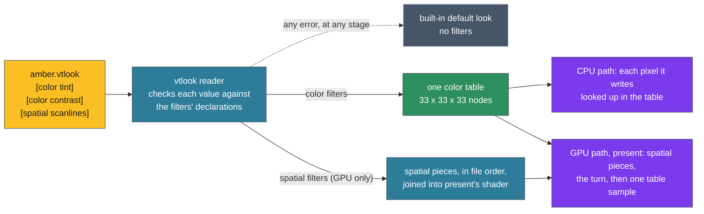

# ADR-1304: vtium's frame filters are built in, and a vtlook file chooses them and sets their parameters

## Summary

- **Decided by the maintainer (2026-11-03):** vtium hard-codes no filter's settings. A filter is a step that fills ADR-1303's color slot or spatial slot, which this record calls the color layer and the spatial layer. The layers are that fixed pair. A color filter is built into vtium's code, and a spatial filter is a shader file in one standard format, vtium's own and a user's alike, which root installs under the ownership rule vtium applies to its other files, so that effects are open to inspection and trade (D15); this revises the maintainer's earlier decision that no filter code is installed from outside. A display whose filter stack runs below a frame-rate floor, a `[requires]` key, draws `default` on its own (D16). Each filter declares its parameters once, in one standard form, and configuration chooses filters and sets their parameters, much as a shader declares its inputs and a program sets them. Each layer has a minimum contract that a filter must meet to run in it. The configuration lives in a file called a vtlook (a look file), as a frit (a font set file) holds a font set, and a vtlook is tied to no profile. When no look is named, a head takes a default look built into vtium, named `default`, as it takes a built-in font when no frit is named; it is a pure passthrough vtlook, which changes no pixel, and no file may take its name. The default look holds no filters, so with no configuration vtium compiles no filter shader piece, builds no table and does no filter work on the CPU. Any error in a head's filters, in any layer and at any stage, drops that head to the built-in default look: in the maintainer's words, "any layer that is invalid fails the whole filter stack". The error says where it failed, the same in vtium's log, in `vtium check-config` and in vtium-config. vtium-config manages vtlooks as it manages frits: it lists, shows, creates, edits, previews on the live console, assigns and removes them. When a head's look holds any filter, vtium draws the mouse arrow into the picture, off the display's cursor plane, so the arrow passes through every filter; on the default look the arrow stays on the cursor plane where the display has one. In a second round the maintainer decided that a head chooses its look in heads.conf, else vtium.conf, else the built-in `default` (D5); that every color filter is one table, all merged into one (D2); that a head on the CPU path draws the color layer and skips the effects, without counting that as a failure (D3); and that vtium-config previews a look through a terminal message carrying its text, which the tool's end, the session's end or a terminal reset undoes (D11). In a third round the maintainer decided that a `cube` filter reads root-installed `.cube` files (D9); that the filters sit behind a `filters` build feature, off in minspec (D10); that curvature follows scanlines and sharpen in a slice of its own (D8, D13); and that a 1-bit display applies a look like any other, a vtlook instead declaring display requirements, a minimum color depth, a resolution, a minimum density and the GPU path, which a display that misses them answers by drawing `default` on its own, not as an error (D7).
- **Proposed by this record's agent, for the maintainer to confirm:** A filter's declaration gives each parameter's name, kind, range, default and a line of help, and that one declaration drives `vtium check-config`, vtium-config's display and editing, the GPU path's shader inputs and the CPU path's function arguments (D1). A color filter maps each pixel's color using that color alone; the CPU path looks each pixel up in the merged table and the GPU path samples it as a texture, one lookup a pixel however many color filters run (D2). A spatial filter is one piece of GLSL in vtium-render, on the GPU path only, which declares how far it reads and how many reads it makes, under caps, and never reads the time (D3). A vtlook is `/etc/vtium/looks/NAME.vtlook`, owned by root, with one section per filter, run in file order; the built-in default's text is a template that vtium-config uses to start a new look (D4). The fallback lasts until vtium next reads its configuration or the head's look changes, never retried on a timer, and never moves the head off the GPU path (D6). A vtlook states its display requirements in one `[requires]` section, and vtium checks each display against them when it joins a head and at each mode change (D7). The first filters are gamma, contrast, tint, color-blind and cube, which reads a `.cube` table file, in the color layer, and scanlines and sharpen in the spatial layer (D8, D9). The filters sit behind a cargo feature, `filters`, which the minspec build leaves off (D10). The preview's terminal message is an OSC sequence of vtium's own, answered with `ok` or the first error (D11). vtium's own spatial filters ship as `/usr/share/vtium/shaders/NAME.vtshader`, an administrator's in `/etc/vtium/shaders`, which wins on the same name, and a look names either as `[spatial NAME]`; vtium-config checks a shader as the invoking user before root installs it (D15). The floor is the display's refresh rate unless vtium.conf's `look-min-fps` says otherwise, and vtium measures each display's stack over 8 frames when a look loads or a display changes (D16). The work comes in nine slices (D13). No open question remains.
- **Trades away:** A shader is code vtium can check only so far: it cannot prove a shader keeps to its declared reach or ends, and a shader that hangs the GPU can reset the whole device, which costs the head the GPU path until vtium restarts and can disturb other sessions on the card. The frame-rate floor makes what vtium draws depend on the machine's speed, for filters alone. A color filter is drawn through a table, which is straight between its nodes, so a curve that bends hard near black loses detail there: a gamma of 2.0 is off by up to 12 levels among the darkest 7 levels of 256. The CPU path pays a lookup for each pixel it redraws, 28 ns for a pixel of a new color on a fast desktop and 1.4 ns along a run of one color. Spatial filters need the GPU path, which `hwaccel` leaves off by default. A head whose look holds filters gives up the hardware pointer, and each move of the mouse redraws the arrow's old and new places, or the whole screen under a spatial filter that reads neighbours. One bad filter turns off every filter of the head until the configuration is read again. The live preview adds an escape sequence of vtium's own.
- **One-way?** No. Everything is behind a cargo feature, and the vtlook files are the only data it stores. The vtlook format and the preview sequence become expensive to change once people write files and tools send the sequence; the file's `version = 1` line leaves room for the first.
- **Probes:**
  - *Not confident (the arrow):* when a head shows a look, vtium draws the mouse arrow into the picture itself instead of using the display's hardware pointer, so the look's colors and effects reach the arrow too: an amber look makes the arrow amber. The cost is that each move of the mouse redraws the arrow's old and new places, and with an effect such as sharpening, the whole screen. Is that what you want, or should the hardware arrow stay and simply not take the look? (Answered 2026-11-03: the arrow is in the filter pass; see `considered`.)
  - *Confident (a failing filter):* if one filter in a look cannot be used, because of a bad value, a missing `.cube` file or a shader the graphics driver refuses, vtium switches off that filter's whole layer, all the color filters or all the effects, and writes one line to the log. You never see half a color correction. Is that the behaviour you meant? (Answered 2026-11-03: any invalid layer fails the whole filter stack, and the head drops to the built-in default look; see `considered`.)
- **Inversion:** Between "no filters", the C reference's gltex, whose shaders were compiled from source built into the program with no color or effect stage, and "any shader anywhere", any GLSL a user points at, run in any stage, as video players and emulators allow. The answer is built-in filters in both layers, with the spatial layer also open to shader files root installs and the color layer to `.cube` tables, each held to a declared contract and chosen by a file of data.

## Context

ADR-1303 gives the GPU path a fixed pipeline of five slots and reserves two of them, color and spatial, holding no-ops until a later record defines what fills them; the CPU path reserves the color slot too. The skeleton built for that record (`crates/vtium-render/src/gpu/pipeline.rs`) already joins a color piece and a spatial piece of GLSL into present's fragment shader under `#ifdef`, between its head and its `main`, and asks the spatial piece for its reach, how many pixels from the pixel it writes it reads. Both pieces are empty today.

The maintainer decided on 2026-11-03 what fills the slots, in points this record writes down as decided: no filter's settings are hard-coded; the layers are fixed and their filters are built in, the spatial filters shader files root installs (a later decision, D15); each layer has a minimum contract; the configuration lives in a vtlook file; a built-in default look, with no filters, stands where no look is named and wherever a look fails; an error says where it failed; and vtium-config manages vtlooks. An earlier comment on the frame shader's issue spoke of a specification "that vtium loads at run time in one standard way, much as a shader is loaded". The later points settle what that means: what vtium loads at run time is the vtlook, a file of data that names filters and sets their parameters, and each filter's definition is its declaration, compiled into vtium for a color filter and read from its shader file's header for a spatial filter (D15).

The maintainer asked for care with complexity in the GPU frame. This record keeps each layer to one mechanism, the color layer always one table and the spatial layer always one chain of pieces in the present pass that already exists, and gives every failure one outcome, the default look.

A filter is a built-in step of the color or spatial layer. A filter's declaration is the constant in vtium's code that names the filter, its layer and its parameters. A look is the set of filters a vtlook chooses, with their parameter values; the built-in default look is the look a head takes when it names none or its own fails. A look is in force on a display when it holds at least one filter there. The filter stack is all of a head's filters, both layers together.

## C notes: the C reference's flow

gltex compiled its two shader programs, one for glyph atlases and one for pictures, from GLSL embedded in the binary, putting a precision line before each fragment shader (`kmscon/src/render/gltex.c:450-537`). Nothing after its draws changed a pixel's color or read its neighbours, and no user file reached a shader. bbulk, the CPU renderer, had no such stage either. The only colors a user set were the palette's, through the `palette` key and the `palette-*` keys (`kmscon/src/config.c:1427-1436`). The C reference had no filters to be a floor for, so every filter here goes past it.

## Decision

D1 to D3 define a filter and the contract of each layer. D4 and D5 say where a look lives, what the built-in default look is, and how a head chooses a look. D6 says what happens when anything fails and what the error reports. D7 covers the pointer and a look's display requirements. D8 and D9 name the first filters. D10 places the code, D11 sets out what vtium-config does, D12 states the build with no look, D13 the work, D14 the file formats by example, D15 the shader files, and D16 the frame-rate floor. Where a section holds the maintainer's decisions, it opens with them; the rest of the record is this record's agent's proposal.



The figure follows one vtlook from left to right. The reader checks every value against the declarations. The color filters become one table, which both paths read. The spatial filters become pieces of present's shader, on the GPU path only, and run before the turn and the table, as ADR-1303 D1 orders the slots. The dashed arrow is the one fallback: an error at any stage, reading, checking, building the table, compiling or drawing, puts the head on the built-in default look, which runs nothing.

### D1: a filter and its declaration

**Decided by the maintainer (2026-11-03):** vtium hard-codes no filter's settings. Each filter declares its parameters once, in one standard form, and configuration sets them. The layers are the color layer and the spatial layer. A color filter is built into vtium's code, and a spatial filter is a shader file in one standard format, vtium's own and a user's alike, which root installs (D15). Each layer has a minimum contract (D2, D3).

> Edited 2026-11-03: the maintainer revised decision 2, "I think it would be worthwhile to be able to trade/use shaders around (they are installed as root with permissions that protect them, just as our other files are)" (`considered`). It read: "The layers are the color layer and the spatial layer, and the filters in each are a known set built into vtium. No filter code is installed from outside."

**Proposed:** a color filter's declaration is one constant in vtium-render (D10), and a spatial filter's is its shader file's header (D15); either gives:

- the filter's name, lowercase letters, digits and `-`, unique within its layer;
- its layer, color or spatial;
- a line of help;
- each parameter's name, kind, range or list of choices, default and a line of help. A parameter may have no default, and a look must then set it.

A spatial filter's declaration also gives its reach and its reads (D3).

| Kind | Written in a vtlook as | Example | Range | On the GPU path |
|---|---|---|---|---|
| number | a decimal, with an optional sign and at most four digits after the point | `1.15` | a minimum and a maximum, inclusive | `float` |
| integer | a whole number | `3` | a minimum and a maximum, inclusive | `int` |
| color | `r,g,b`, each 0 to 255, as vtium.conf's palette and notice colors take it | `255,176,0` | none | `vec3`, each channel divided by 255 |
| choice | one word from the declared list | `deuteranopia` | the list | `int`, the word's place in the list |
| on/off | `yes` or `no`, as heads.conf's `isolated` takes it | `yes` | none | `bool` |
| file | a file's name in the looks directory, with its suffix and no path | `panel.cube` | the suffixes the filter reads | none: only the `cube` color filter takes one (D9) |

The one declaration drives four readers:

- **The vtlook reader** in vtium-settings checks each value against its kind and range. `vtium check-config` and vtium-config run the same reader, so a file checked before it is installed gets the verdict it gets at start.
- **vtium-config** shows each parameter with its kind, range, default and help, and edits it with a control fit for its kind: a number in its range, a color, one of the choices.
- **The GPU path** gives each parameter of a spatial filter to its piece as a uniform named `<filter>_<parameter>`, with `-` written as `_`, of the type the table above names. The pipeline lists the uniforms as the program's inputs, so the check every `Gl` implementation makes, that a program declares each of its inputs (`crates/vtium-render/README.md`, the GPU path), refuses a piece whose uniforms do not match its declaration.
- **The CPU work** of a color filter takes the parameters as typed Rust values when it builds the table (D2), on both paths.

### D2: the color layer, one table

**Decided by the maintainer (2026-11-03):** every color filter is a table, 33 a side, and a look's color filters are merged into one table.

**Proposed, the rest.** The color layer's contract: a color filter maps each pixel's color to a new color using only that color. It reads no other pixel, not the pixel's place, not the cell the pixel belongs to and not the time. In vtium's code a color filter is a function from one color to another, given its parameters, over colors whose channels run from 0 to 1. Its one job is to give the color it maps each color to, so that vtium can turn the layer into a table.

vtium merges the whole layer into one table, a lattice of 33 steps in each of red, green and blue: 35,937 nodes. The node at (r, g, b) holds the output of the layer's filters, applied in file order, for the color (r/32, g/32, b/32), each filter's output clamped to 0 to 1 before the next takes it. Each node holds three half-precision floats. The CPU path and the GPU path read the same table, so the number of color filters changes the time it takes to build the table and nothing else: each pixel costs one lookup.

**Building it.** The table is built on the CPU, once for each head, when the look is read and again when it changes. It is built from IEEE 754's correctly rounded operations, which give the same bits on every machine, and from power, exponential and logarithm functions written in Rust, never the platform's maths library, whose last bits differ between machines. A test pins the bytes of each filter's table at its defaults and at one setting that is not its default, and CI's `arm-native` job runs it, so the CPU path's goldens hold on ARM as on x86.

**On the CPU path,** the slot sits where ADR-1303 D4 puts it, on the renderer's last write before the depth reduction. The path keeps the table's values as 32-bit floats, 421 KiB for each head. For each pixel it finds the eight nodes around the pixel's color and blends them trilinearly in 32-bit floats, with no fused multiply-add, and rounds each channel to 8 bits as floor(x × 255 + 0.5). It remembers the last color it looked up and the result, so a run of one color costs one lookup. Measured on a fast desktop, a lookup costs 28 ns a pixel over random colors, 59 ms for a 1920x1080 frame of them, and 1.4 ns a pixel over runs of 8 to 80 equal pixels, 2.8 ms a frame (`basis`). A terminal's screen lies between the two, mostly runs of a background color broken by the edges of glyphs, and the CPU path looks up only the pixels it redraws. The slice that builds the layer measures a full redraw of tier 3's screens in its 1-vCPU guest and reports it.

**On the GPU path,** present uploads the same half floats as a 3D texture in RGBA16F, 280 KiB for each head, which OpenGL ES 3.0 lets the GPU filter linearly. Present's color step samples it once, with linear filtering, at (c × 32 + 0.5) / 33 in each channel, after the spatial step and the turn (ADR-1303 D6), and leaves alpha as it is. The GPU blends the eight nodes itself, with weights of fewer bits than the CPU path's floats, which the specification leaves to the GPU; for the starting filters that moves a channel by under a tenth of a level. GL then writes the result into the display's 8-bit buffer as one of the two nearest levels, preferring the nearer. So a pixel lands at most one level from the CPU path's, which is ADR-1303 D1's tolerance. If the slice that builds the layer measures a share of differing pixels past ADR-1303's, it reports that to the maintainer and does not raise the share itself, as ADR-1303 D1 asks.

**Why 33 a side.** A table of 33 a side is the size `.cube` files most often hold (D9), the identity table returns all 16,777,216 colors unchanged on the CPU path at 17, 33 and 65 a side alike, and 33 keeps the table under half a megabyte. Between its nodes the table is a straight line, so a filter that bends hard near black is approximated in the first step of 8 levels. Measured against the exact curve, a gamma of 1.2 stays within one level everywhere, and a gamma of 2.0 is off by up to 12 levels, at input 2, with 7 of the 256 levels off by more than one. At 65 a side the worst is 8 levels, for tables of 2.1 MiB on the GPU and 3.1 MiB on the CPU; at 17 it is 16 levels (`basis`). The size is a constant in vtium-render's bounds table.

A change of the look's color filters rebuilds the table. The CPU path then draws its frame whole, since it colors pixels as it writes them, and forgets the color it remembered; the GPU path presents whole.

### D3: the spatial layer, one chain of pieces in present

**Proposed.** A spatial filter is one piece of GLSL read from its shader file (D15), joined into present's fragment shader between its head and its `main` (ADR-1303 D6). It runs on the GPU path only, as ADR-1303 D5 decides. The spatial layer's contract:

- **What it reads.** A spatial filter writes one pixel of the upright frame from the frame's pixels within its reach of that pixel, the pixel's place in the upright frame, and its own parameters. Its parameters are its only uniforms.
- **No time.** The pipeline gives a spatial filter no clock. A filter that needs one, such as an animated effect, needs frames drawn on a clock and a new place where time enters (docs/architecture.md, Determinism), so it is outside this contract until the record that adds a frame clock, now being drafted, decides how time reaches a filter (ADR-1303 D5, D15).
- **A declared cost.** The declaration gives the filter's reach and its reads: how many pixels away from the pixel it writes it reads, and how many texels it reads for each pixel it writes. The reach may depend on the parameters and on the frame's size, and vtium works it out for each display when it sets that display's pipeline up.
- **Caps.** The layer's whole chain reads at most 25 texels for each pixel and reaches at most 256 pixels, two rows of vtium-render's bounds table. ADR-1303 D3 tiles a frame past the GPU's largest texture with an overlap equal to the reach, and asks that the reach stay under half a tile. OpenGL ES 3.0's smallest largest texture is 2048 pixels, and a reach of 256 leaves such a tile 1536 pixels of its own.

Within the layer, filters run in file order, inside present's one pass. vtium joins each piece after defining a macro, `SPATIAL_IN(at)`, through which the piece reads its input at a place. For the first filter `SPATIAL_IN` reads the upright frame's texel, a place past the tile's edge taking the nearest pixel at that edge; the tile's overlap holds the neighbours past an inner edge (ADR-1303 D3). For each later filter, `SPATIAL_IN` is the filter before it. `SPATIAL_SIZE` gives the frame's size, `SPATIAL_TURN` the display's turn in degrees and `SPATIAL_PANEL(at)` the panel's own pixel for a place (D15). `SPATIAL_IN` clamps each place it is asked for to within the piece's declared reach of the pixel being written (D15). A chain's reach is therefore the sum of its filters' reaches, and its reads the product of theirs: scanlines then sharpen reach 1 pixel and read 5 texels. A look names each filter at most once, so no two pieces declare the same uniform.

A spatial filter that reads only the pixel it writes, such as scanlines, leaves damage tracking as it is: present still draws only what changed. A filter that reads any other pixel makes every present a whole one (ADR-1303 D5). A change of the look's spatial filters changes the reach, so the upright frame is made anew and drawn whole (ADR-1303 D3), and present's shader is compiled again (ADR-1303 D6).

The CPU path has no spatial layer. **Decided by the maintainer (2026-11-03):** "color yes, skip effects". A head on the CPU path whose look holds spatial filters draws the look's color layer, skips the spatial layer, and logs that once for the head, naming the look. The skip is the path's design and not a failure, so D6's fallback does not apply to it. `vtium check-config` warns when a look a head uses holds spatial filters and `hwaccel` is off or the build has no `gpu` feature. The maintainer left the door open: "we can always revisit this later (maybe there's a cheap compatible trick)". A spatial effect cheap enough for the CPU path, such as scanlines, which reads only the pixel it writes, could later run there too, in a change of its own.

### D4: the vtlook file, and the built-in default look

**Decided by the maintainer (2026-11-03):** the pipeline's configuration lives in a file called a vtlook, as a frit holds a font set. When no look is named, a head takes a default look built into vtium, which needs no profile, as a head takes a built-in font when no frit is named. The default look holds no filters, so it runs nothing. A vtlook is tied to no profile.

**Proposed, the file:** a vtlook is a file `NAME.vtlook` in `/etc/vtium/looks`, the directory vtium was built with. A name follows the rule for a head's name, 1 to 64 characters of `A-Z a-z 0-9 . _ + -`. vtium reads a vtlook, and a `.cube` file it names, only when root owns the file and neither its group nor others can write it or a directory above it, the rule vtium applies to heads.conf (ADR-1401 D7). vtium never writes either. vtium's console process reads the file itself, as it reads heads.conf.

The file uses heads.conf's syntax: a `#` starts a comment, `key = value` lines, and sections in brackets.

```ini
# /etc/vtium/looks/amber.vtlook: an amber phosphor with scanlines.
version = 1

[color tint]
color = 255,176,0
amount = 1.0

[color contrast]
contrast = 1.15
brightness = 0.0

[spatial scanlines]
period = 3
strength = 0.3
```

`version = 1` comes before the first section. One section may be `[requires]`, the look's display requirements (D7). Each other section is `[LAYER FILTER]`, a spatial filter's name being its shader file's (D15): the layer, `color` or `spatial`, and the name of a filter in that layer. Its lines set that filter's parameters. A parameter the section leaves out takes its declared default, and vtium-config writes every parameter out, so a file it writes states each value it uses. Within a layer the filters run in the order of their sections. The layers run in the pipeline's order, the spatial filters and then the color filters (ADR-1303 D1), wherever their sections sit in the file. A look names a filter at most once. A file holds at most 64 KiB and 32 sections, rows of vtium-settings's bounds table. Anything else the reader cannot accept is an error, and every error has the one outcome D6 gives.

**Decided by the maintainer (2026-11-03):** the built-in look is named `default`, and its description says it is a pure passthrough vtlook, which changes no pixel. `look = default` names it, and a `look` left unset means the same. A user's file cannot take the name `default`.

**Proposed, the built-in default look:** vtium refuses a file named `default.vtlook` as an error (D6), so the look every failure falls back to is always the built-in one and can never fail itself. Its text is a template, `crates/vtium-settings/templates/default.vtlook`, compiled into vtium, as vtium's compiled-in head configuration is parsed from heads.conf's template (ADR-1401 D6). The template holds `version = 1`; a live `[requires]` section with every requirement key at `any` (D7); and, commented out, a section for every filter the declarations name with every parameter at its default and its help as a comment. A file written from it changes nothing until a filter's section is uncommented or a requirement set. The template is generated from the declarations, and a check fails when the committed file differs from what they give, as the key table's check fails when docs/config.md or the example vtium.conf differs (docs/architecture.md). vtium-config writes the template out as the start of a new look (D11). vtium's log and vtium-config's listing name the default look `default (built in)`, as vtium-config lists the built-in fonts with the state `built in`. Its description, "a pure passthrough vtlook, which changes no pixel", shows in three places: on its line of vtium-config's `looks` listing and in `look-show default`; in vtium-config's `--help` for the look commands and beside it in the TUI's looks view; and in the comment that heads the template, so a file written from it says what it started as.

**A look is tied to no profile.** A head names its look, and a profile names a frit; neither names the other's. A look can therefore serve heads of any profile, and a profile's file, once profiles have files (ADR-1401 D3), holds no look.

### D5: how a head chooses its look

**Decided by the maintainer (2026-11-03):** "perhead + vtium.conf. this way it's composable up to per path". A head's `look =` in heads.conf wins; else vtium.conf's `look=`; else the built-in `default`.

**Proposed, the rest:** a head chooses a look with `look = NAME` in its section of heads.conf, beside `profile =`. `look=NAME` in vtium.conf sets the look of every head that names none. With neither set, a head takes the built-in default look, the same look `look = default` names. `look = default` in a head gives that head the built-in default whatever vtium.conf says, and `look=default` in vtium.conf states the built-in default for every head; no other name, such as `none`, is needed. Every display of a head takes the head's look, but for a display that does not meet the look's requirements, which draws `default` (D7). ADR-1401 D3's list of a head's keys gains `look`, and vtium.conf's key table gains `look`. Both keys are read in every build, so one configuration serves every build (D10). A name with no file is an error (D6).

vtium reads the look when it starts, and again when it rereads its configuration, which ADR-1401's reload does once it is built. A change to the color filters rebuilds the table (D2). A change to the spatial filters changes the reach, makes the upright frame anew and compiles present's shader again (D3).

### D6: when anything fails, and what the error says

**Decided by the maintainer (2026-11-03):** any error in the filtering pipeline drops the head to the built-in default look, for that head: "any layer that is invalid fails the whole filter stack". One invalid layer, or one invalid filter in any layer, puts the head on the default look, and no layer runs on its own while another has failed. That covers a look that fails to load or check, a filter that fails to build its table or compile, and a GL error the GPU path traces to a filter's step. The error carries enough detail to say where it failed, the same in vtium's log line, in `vtium check-config` and in vtium-config.

**Proposed, the stages that can fail:**

| Stage | What fails there |
|---|---|
| reading | the vtlook or a `.cube` file it names cannot be opened, fails the ownership rule, passes its bounds, has a line that is neither a section nor `key = value`, lacks `version = 1`, or is named `default`; a name with no file |
| checking | an unknown layer or filter, a filter named twice, an unknown parameter, a value outside its kind or range, a parameter with no default left unset, a malformed `.cube` file, a malformed `[requires]` section (D7), and a spatial chain whose reach or reads pass a cap at the size of one of the head's displays (D3) |
| building the color table | the table cannot be built, such as for want of memory |
| compiling the shader | the driver refuses present's shader with the look's pieces joined |
| drawing | a GL error that the GPU path traces to a filter's step: an error raised by the upload of the color table, or by present's draw while the look's pieces are in it, other than the kinds ADR-1303 D9 always treats as serious |

**Proposed, what the error report holds:** one report for each error, built once in vtium-settings and written the same way in all three places:

- the look's name, its file and the line, or the `.cube` file and its line where that file is at fault;
- the layer, or `requires` where the requirements section is at fault;
- the filter by name and by its place in the layer, such as the second color filter;
- where a value is at fault, the parameter, the value it got, and the kind or range it needed;
- the stage, from the table above;
- the underlying message carried verbatim: the reader's parse error, the driver's compile log or the GL error's name.

An example, as vtium's log writes it:

```text
look amber (/etc/vtium/looks/amber.vtlook:14): spatial filter 1 of 1, scanlines: checking: period = 12, needs an integer from 2 to 8; 1 more error; head console draws the default look (built in)
```

`vtium check-config` and vtium-config list every error, each report whole. vtium's log line at run time names the first error and says how many more there are, and is written once each time vtium reads the look or sets a display up, never once a frame. A driver's compile log can run to many lines; in the log line its line breaks are written as `\n` and it is cut at 4 KiB, a row of vtium-render's bounds table, with the cut marked.

**Proposed, how long the fallback lasts:** the head stays on the default look until vtium next reads its configuration or the head's look changes, through a reload once ADR-1401 builds it, vtium-config's live preview (D11) or the end of that preview. vtium never retries a failed look on a timer, as ADR-1303 D9 never retries within a run. A reread that meets the same error falls back again and logs it again.

**Proposed, how it meets ADR-1303 D9:** a filter's failure is never the GPU path's failure, so it never moves the head to the CPU path. A refused compile puts the head on the default look, and present is compiled again without filter pieces; only if that compile fails does D9 count a failed set-up. A GL error traced to a filter's step drops that frame, as D9 drops a frame for one GL error, puts the head on the default look, and draws the next frame whole; it does not count toward D9's errors in two frames running. If GL errors go on under the default look, they are the GPU path's, and D9 sorts them. An out-of-memory error from the driver and a lost context stay D9's whatever the look, since after either nothing the context holds can be trusted. `vtium check-config` reports every error of the reading and checking stages before a file is installed, with the report above; building the table and compiling need the head's own GPU or its run, so they are reported at run time and by vtium-config's preview (D11).

### D7: the pointer, and a look's display requirements

**Decided by the maintainer (2026-11-03):** the mouse arrow is in the filter pass. When a head's look holds any filter, vtium draws the arrow into the picture, off the display's cursor plane, so it passes through every filter as the rest of the picture does. With the built-in default look, which holds none, the arrow stays on the cursor plane where the display has one.

**Proposed, how:** vtium draws the arrow as it does with `soft-cursor`, in the composition, and sets no cursor plane up on that head's displays. So a tint colors the arrow, sharpening sharpens it, and a filter that bends the picture bends the arrow with the cell it selects (ADR-1303 D5). When the head goes back to the default look, through a change or a failure, the cursor plane comes back on each display that has one.

**The cost, estimated from the arrow's size and D2's measurements, not yet measured in vtium:** the arrow is one cell tall and about 11/18 of that wide (`crates/vtium-render/src/arrow.rs`), so in 8x16 cells it covers at most 4 cells, 512 pixels. Each move redraws the arrow's old and new places, at most about 1,000 pixels, which on the CPU path costs at most about 30 µs of color lookups on the desktop D2 measured, and on the GPU path a present of those two small areas. Under a spatial filter that reads its neighbours, such as sharpen, every present is whole (ADR-1303 D5), so every move presents the whole display: at 1920x1080 with sharpen's 5 reads a pixel, 10.4 million texel reads a move. The hardware cursor plane cost no redraw at all. The slice that builds the color layer measures both on tier 3's guest and reports them.

**Decided by the maintainer (2026-11-03):** a 1-bit display applies a look like any other: "apply it anyway, if only because someone could theoretically create a filter that works on a one bit panel ... perhaps the .vtlook has a display requirement (must be mininum of x) (how many bpp, resolution etc)". A vtlook may declare display requirements of four kinds: a minimum color depth, a resolution, a minimum pixel density, and the GPU path. A look with no requirement applies everywhere, 1-bit panels included. When one of a head's displays does not meet the look's requirements, that display alone draws `default`, the head's other displays keep the look, and one log line names the display and the requirement it does not meet. That is not an error: the whole-stack rule of D6 stays for looks that are invalid.

**Decided by the maintainer (2026-11-03),** answering their own question, "should requires be declarative (like an 'any' in place of 'yes' or 'no')": every `[requires]` key takes an explicit value, and `any` means no constraint. A key left out means `any`. The default look's template and every look vtium-config writes list each requirement key, at `any` unless it is set, and vtium-config shows and edits each key as a value. `gpu` takes `any`, `yes` (the GPU path only) or `no` (the CPU path only).

**Decided by the maintainer (2026-11-03):** "let's use 'min-size' and 'max-size' 'min-depth' etc". Every measured requirement is a pair of keys, a minimum and a maximum, each taking `any` or a value: `min-depth` and `max-depth`, `min-size` and `max-size`, `min-dpi` and `max-dpi`. `gpu` stays one key.

**Proposed, the requirement lines.** A vtlook holds them in one `[requires]` section, which vtium-config writes straight after `version = 1`, every key written out. `any` is a reserved word that every key accepts.

```ini
[requires]
min-depth = 24
max-depth = any
min-size = 1280x720
max-size = any
min-dpi = 110
max-dpi = any
min-fps = refresh
gpu = yes
```

| Key | Value | Met when |
|---|---|---|
| `min-depth`, `max-depth` | `any`, `1`, `8`, `16` or `24`; `32` reads as `24` | the display's depth is at least `min-depth` and at most `max-depth`, in the order 1 bit, 8-bit gray, 16-bit color, 24-bit color. vtium takes a display's depth from what it draws: 1 for a display drawn at 1 bit, by `display-depth=1` or by `auto` on a 1-bit panel; 8 for a gray panel, `display-depth=gray4` or `gray16`, which vtium draws as color and the panel converts; otherwise the bits a pixel of the display's buffer holds, 16 for a 16-bit framebuffer and 24 for 24-bit and 32-bit buffers, which DRM's buffers are. |
| `min-size`, `max-size` | `any` or `WxH` | the display's mode is at least `min-size` and at most `max-size` on each side, in the mode's own pixels as the `mode=` key writes them, not turned. `max-size` keeps a heavy spatial look off a display where every present reads tens of millions of texels. |
| `min-dpi`, `max-dpi` | `any` or a whole number, 1 to 1000 | the display's density is at least `min-dpi` and at most `max-dpi`: the density vtium sizes fonts with, `display-dpi` where it is set, else measured from the physical size the display reports in its EDID, else the 96 vtium assumes. |
| `min-fps` | `any`, `refresh` or a whole number, 1 to 1000 | the look's filter stack, measured at the display's size, runs at least this many frames a second; `refresh` is the display's refresh rate from its mode. The machine-wide floor, vtium.conf's `look-min-fps`, applies too, and the higher of the two counts; `any` in a look adds no demand of its own (D16). On a head drawn on the CPU path it counts as met. |
| `gpu` | `any`, `yes` or `no` | `any`: either path, the CPU path drawing the color layer and skipping the effects (D3). `yes`: the head draws on the GPU path; on a head drawn on the CPU path every display draws `default`, which lets a look's author choose that strictness over D3's skip. `no`: the head draws on the CPU path; on a head drawn on the GPU path every display draws `default`. |

A malformed `[requires]` section is an error of the checking stage, with D6's one outcome: an unknown key, a key twice, a value that is neither `any` nor of the key's kind and range, `refresh` being of `min-fps`'s kind, a pair whose minimum exceeds its maximum, on either side for the sizes, or a second `[requires]` section. Its report names `requires` in place of a layer, the key, the value it got and what it needed, which always begins with `any`, as in "min-depth = 12, needs any, 1, 8, 16 or 24"; for a pair out of order it names both keys and both values, as in "min-size = 1920x1080 exceeds max-size = 1280x800", and `vtium check-config` reports it before the file is installed.

vtium checks each display against the requirements when it reads the look, when the display joins the head, and at each change of the display's mode or depth, as ADR-1303 D9 checks a display against the GPU's limits; it checks `gpu` when the head's path is chosen or changes. A display that meets the requirements again takes the look back, with no reread. A display drawing `default` has no color step and no spatial step, and keeps its arrow on its cursor plane where it has one, while the head's other displays draw the look. Its log line reads, for example: `look amber: display DP-1 (1280x800, 1 bit) draws the default look (built in): requires min-depth 24`.

On a display that meets the requirements, a 1-bit panel included, the order ADR-1303 D6 sets holds: the spatial step, the turn, the color step, then the depth reduction. On a 1-bit display vtium lights each cell by its colors and cuts each pixel's coverage at half (`crates/vtium-render/src/mono.rs`), so a look's filters run before that cut; a filter that darkens white below the cut of 128 blanks every lit pixel there, and a look's author who does not mean the look for such panels writes `min-depth = 8` or more.

### D8: the first filters

**Proposed.** The first slices build these filters. A filter's defaults are what someone who writes only its section header most likely wants; where that is no change, as for gamma, the default is no change.

| Filter | Layer | Parameters: kind, range, default | What it does |
|---|---|---|---|
| `gamma` | color | `gamma`: number, 0.5 to 2.0, 1.0 | Raises each channel to the power 1 / `gamma`. Above 1 it lightens the middle tones, and below 1 it darkens them. |
| `contrast` | color | `contrast`: number, 0 to 2, 1.0; `brightness`: number, -0.5 to 0.5, 0 | Multiplies each channel's distance from middle gray by `contrast`, then adds `brightness`. |
| `tint` | color | `color`: color, 255,176,0; `amount`: number, 0 to 1, 1.0 | Mixes each pixel, by `amount`, toward its gray times `color`, the gray being BT.601's luma as mono.rs takes it: at 1 the screen is a single-color phosphor, amber by default. |
| `color-blind` | color | `kind`: choice of `protanopia`, `deuteranopia` or `tritanopia`, `deuteranopia`; `mode`: choice of `simulate` or `correct`, `correct`; `amount`: number, 0 to 1, 1.0 | `simulate` shows how a viewer with that color vision deficiency sees the screen, through Machado, Oliveira and Fernandes's matrices applied in linear light (`basis`). `correct` takes the difference between the screen and that simulation, which such a viewer cannot see, and moves it into channels they can. `amount` mixes the result with the input. |
| `cube` | color | `file`: file, no default | Maps each color through a `.cube` table (D9). |
| `scanlines` | spatial | `period`: integer, 2 to 8, 3; `strength`: number, 0 to 1, 0.3 | Darkens the last row of every `period` rows of the upright frame by `strength`, so the lines run along the text whichever way the display is turned. Reach 0, reads 1. |
| `mask` | spatial | `kind`: choice of `grille`, `grille-lite`, `slot` or `shadow`, `grille`; `strength`: number, 0 to 1, 0.3; `size`: integer, 1 to 4, 1 | Multiplies the picture by a CRT's phosphor pattern, an aperture grille, a slot mask or a shadow mask, tiled on the panel's own pixels through `SPATIAL_PANEL` (D15). From hunterk's public-domain masks and the mask of Lottes's CRTS (Unlicense). Reach 0, reads 1. |
| `crt` | spatial | `pitch-x`: integer, 1 to 8, 1; `pitch-y`: integer, 1 to 8, 3; and CRTS's own, among them its mask, scanline thinness, curvature and a Trinitron-style cylindrical warp as on/off | A port of Timothy Lottes's CRTS (Unlicense): beam scanlines, its 8-tap horizontal filter, a phosphor mask and a warp, with no time. It treats each `pitch-x` by `pitch-y` block as one beam texel, the convention D15 proposes. Its warp can be the curvature this section names. Reads 8; its reach, about three `pitch-x` across and two `pitch-y` down plus the warp's largest shift, is the port's to state, which `shader-check` tests. It is also the porting guide's worked example (D15). |
| `sharpen` | spatial | `amount`: number, 0 to 2, 0.5 | Adds `amount` times the difference between a pixel and the mean of its four nearest neighbours. Reach 1, reads 5. |

scanlines, sharpen, mask and crt ship as shader files in `/usr/share/vtium/shaders/`, the format's first examples (D15). Bloom waits for a record that allows more than one pass: one pass under the cap of 25 reads cannot hold it. Curvature, which bends the picture as a CRT's glass did, is the next spatial filter, after scanlines and sharpen, in a slice of its own (D13), as the maintainer decided on 2026-11-03. It fits the contract without a change to this record: its reach grows with its strength and the display's size, and it reads 4 texels a pixel to blend between them. crt's cylindrical warp is a candidate for it.

### D9: the `cube` filter, a color table from a file

**Decided by the maintainer (2026-11-03):** a `cube` filter reads root-installed `.cube` files beside the looks, 2 to 65 a side, resampled into the merged table past 33.

**Proposed, the details.** The `cube` filter is the color layer's way to trade a correction, as a shader file is the spatial layer's (D15). It maps each color through a table read from a file in the format Adobe's Cube LUT Specification 1.0 defines, which color grading and calibration tools write. The file is data: numbers in a fixed grammar, never code. vtium reads `LUT_3D_SIZE` from 2 to 65, `TITLE`, and `DOMAIN_MIN` and `DOMAIN_MAX` only at their defaults of 0 and 1; D14 states the grammar with examples. It also reads a 1D table, `LUT_1D_SIZE` from 2 to 4096, the maintainer decided on 2026-11-03. Another domain, a keyword it does not know, a value that is not a finite number and a count of data lines that does not match the size are each an error of the checking stage (D6), and vtium clamps values outside 0 to 1. A file holds at most 16 MiB, enough for 65 cubed lines or 4096 lines of a 1D table.

The file is `NAME.cube` in the looks directory, named by the filter's `file` parameter with no path, under the same ownership rule as a vtlook (D4). Root installs it there, by hand or through vtium-config's `apply` (D11). vtium's console process parses it when it reads the look, as it parses heads.conf. The grammar is a few keywords and lines of three numbers, which vtium's own reader takes strictly and within the bounds above, so no decoder of outside formats enters the console, which ADR-1200 D6 keeps fonts' decoders out of.

The filter's function is the file's own table: a 3D table blended trilinearly, and a 1D table blended linearly along each channel on its own, so a 1D table is a curve for each channel. The merged table samples it at its 33 nodes (D2), so a file of 33 a side passes into it unchanged, and a larger file is resampled to 33.

### D10: where the code lives, and the `filters` feature

**Decided by the maintainer (2026-11-03):** the filters sit behind a `filters` build feature, off in the minspec build. A minspec build reads `look =` and logs once that it has no filters.

**Proposed, the details:**

- **vtium-render**, behind a new feature `filters`, holds the color filters: `src/filter/`, one module for each color filter with its declaration beside its function. `src/filter/mod.rs` holds the one list of the color filters, the merge into the table and the CPU path's lookup, and, with `gpu`, the joining of shader files' functions into present (D3, D15).
- **vtium-settings**, behind its own `filters` feature, depends on vtium-render's `filters` for the declarations, constants only, as it takes constants from vtium-font and vtium-term. It holds the vtlook reader, the `.cube` reader, the error report and the default look's template. The `look` key of vtium.conf and of heads.conf, and the default look, are in every build.
- **Shader files** need `filters` and `gpu`. vtium-settings reads a shader file's header with the format's reader, and vtium-render joins its source into present; vtium-render holds no spatial filter's GLSL, only its own pipeline's. The package installs `/usr/share/vtium/shaders/` in a build with `filters` and `gpu`, and the minspec build installs none (D15).
- **The binary's** `filters` feature turns both on. It is not among the default features, so the minspec build carries no filter code. vtium-config builds with `filters` always, since it manages looks for any console.
- **A build without `filters`** that meets a `look` other than `default` logs once for each head that it has no filters and that the head draws the default look, and draws as with no look. `vtium check-config` warns the same, as it warns of `hwaccel` in a build without `gpu`. This is the build's design and not an error of the look.

The pipeline's skeleton fits this as it stands. Its `Color` gains one step, the table's sample, with the table's texture as its input. Its `Spatial` becomes the look's chain of pieces, whose `reach` is the sum of theirs and whose `presents_whole` is true when any piece reads beyond its own pixel. docs/architecture.md's tree gains the arrow from vtium-settings to vtium-render, marked constants only and behind `filters`.

### D11: vtium-config manages vtlooks

**Decided by the maintainer (2026-11-03):** vtium-config is expanded to manage vtlooks.

**Proposed, what managing means,** following what vtium-config does for frits (`crates/vtium-config/README.md`, ADR-1201). Each action is a command a script can run and an action of the TUI, as every font action is; the command names below are this record's proposal.

- **List.** `looks` lists the installed looks and the built-in default, one line each, tab-separated: the name; its state, `reads`, `built in`, or `does not read:` and the first error's report; and the heads and vtium.conf lines that name it.
- **Show.** `look-show NAME` prints a look's filters, layer by layer in their order, with each parameter's value, kind, range, default and help from the declarations, and marks a value left at its default. It then lists each display vtium-config can see on this machine, with its head, depth, mode size and density, and says whether the look applies there or which requirement the display does not meet, worked out by the console's own rules from vtium.conf's `display-depth` and `display-dpi`, `hwaccel`, and each display's mode and EDID read through vtium-platform. A card it cannot open is named and left out. The TUI shows the same list beside the look, and `looks` gives each look's count of displays it applies to.
- **Create.** `look-new NAME` writes the default look's template (D4) under a new name; `--from FILE` installs a vtlook written elsewhere.
- **Edit.** `look-set NAME LAYER FILTER [PARAM=VALUE...]` adds a filter, at the end of its layer or at a place `--at N` gives, or sets its parameters; `look-unset NAME LAYER FILTER [PARAM...]` removes a filter, or returns parameters to their defaults; `look-move NAME LAYER FILTER N` moves a filter within its layer, since order changes the result; `look-require NAME KEY VALUE` sets one of the eight requirement keys, `min-depth`, `max-depth`, `min-size`, `max-size`, `min-dpi`, `max-dpi`, `min-fps` or `gpu`, to a value, `any` included, and refuses a minimum above its maximum with D6's report. `look-show` prints every requirement key with its value, and the TUI edits each as a value with `any` among its choices. Each edit is checked with the same reader `vtium check-config` runs, and refused with the error report of D6 before anything is drafted.
- **Preview.** At a vtium console, the TUI shows each edit on the console it runs on before it is saved, through a sequence of vtium's own (below); `look-preview NAME|FILE` does the same from a script, until the user presses a key.
- **Assign.** `look-use NAME --head HEAD` changes a head's `look =` line through the one head-file writer, as vtium-config assigns a head's profile (ADR-1201); `look-use NAME` with no head changes vtium.conf's `look=` through its line editor.
- **Remove.** `remove-look NAME` removes `NAME.vtlook`, keeping it as `NAME.vtlook.bak` as `remove-frit` keeps a frit, and refuses `default`, a name with no file, and a look that a head's `look =` line or vtium.conf's `look=` names, as `remove-frit` refuses a frit in use; `apply` refuses the same removals in any draft.
- **Shaders.** `shaders` lists the shaders in `/etc/vtium/shaders` and `/usr/share/vtium/shaders`, marking a packaged one that a local one of the same name hides; `shader-show NAME` prints a shader's header and its source; `shader-copy NAME` drafts a copy of a packaged shader into `/etc/vtium/shaders` to be customised; `shader-check FILE` lints and tests a shader as the invoking user (D15), and `check FILE` runs the same for a `*.vtshader` file; `shader-install FILE` drafts a shader for `apply` once that check passes; `remove-shader NAME` refuses a packaged shader and a shader a look names, as `remove-look` refuses a look in use. `look-table NAME` prints a look's merged color table as a `.cube` file (D15). The TUI lists shaders when a filter is added to a look, and its preview reports each display's measured rate against its floor.
- **Save.** Every change becomes a draft and reaches `/etc/vtium` through `sudo vtium-config apply`, which checks each vtlook, `.cube` file and shader with the console's readers on root's copies of the bytes it then writes, as it checks frits, and installs them before the head file and vtium.conf that name them.

**The TUI's looks view** lists the looks as the fonts view lists frits. Choosing one opens it: its two layers, each filter in order with its parameters, each parameter's value beside its kind, range and default, and its help on the line below. Keys add a filter from the declared list, remove one, move one within its layer, and edit a value with the control its kind takes; each change is checked, and an error shows its report in place and is not previewed. The view also chooses each head's look and vtium.conf's default, beside each head's profile. Leaving without saving returns the console to the look it had when the TUI started.

**Decided by the maintainer (2026-11-03):** vtium-config previews a look by a terminal message that carries the look's text, on by default behind `allow-look-ops`. The tool ending the preview, the session ending, or a terminal reset (RIS) restores the head's real look.

**Proposed, the live preview's details:** vtium-config sends the look's whole text to the console it runs on in an OSC sequence of vtium's own, one whose number no other terminal uses, which the slice that builds it picks and records as a row of ADR-1000. The console checks the text with the same reader, applies it to the head that the sending console belongs to, and answers with `ok`, naming any display that draws `default` and the requirement it does not meet, or with the first error's report and the count of the rest. A preview that fails at any stage puts the head on the default look, as any failure does (D6). A second sequence ends the preview and returns the head to its configured look, and vtium returns it there too when the session that sent the preview ends, as it returns a console's font (ADR-1201 D11), and when that console receives a terminal reset, RIS (`ESC c`), so a tool that dies mid-preview leaves nothing behind once the user runs `reset`. A key, `allow-look-ops`, turns the sequences off; it is on by default, as `allow-font-ops` is. In a terminal that is not vtium, and in a build without `filters`, vtium-config sends nothing and says that the preview is not available there.

### D12: with no look

**Decided by the maintainer (2026-11-03):** at the simplest end there are no shaders and no CPU filters at all. With no configuration, vtium compiles no filter shader piece, builds no table and does no filter work on the CPU.

**Proposed, how vtium meets it:** a head on the built-in default look, by choice, by default or by a failure, reads no vtlook file, builds no table, joins no filter piece into present's shader and adds nothing to the CPU path's write chain; the chain decides whether it holds a color step once, when it is set up, never for each pixel. The frame is then the frame of a build without filters, which the stand-in GL's test of present's sources and calls checks (Verification). A build without `filters` draws every head on the default look.

### D13: the work, in slices

**Proposed.** Each slice builds and tests on its own, in this order; the steering session sets the final order.

1. **The reader and the default look.** The declaration types and the empty list of filters in vtium-render; the vtlook reader with its `[requires]` section, the error report and the default look's template and its check in vtium-settings; the `look` keys of vtium.conf and heads.conf; `vtium check-config`; the fallback to the default look and its log line in the binary.
2. **The color layer.** The merged table and the CPU path's lookup, the GPU path's color step, the pointer drawn in the frame, each display checked against the look's requirements, and the filters gamma, contrast, tint and color-blind. Its GPU half waits for ADR-1303's composition and present (ADR-1303 D11, part 3).
3. **The `cube` filter** and its reader.
4. **The spatial layer and the shader format,** after the prior-art survey settles the header's syntax: the format and its reader, `/usr/share/vtium/shaders/` and the package's install of it, `[spatial NAME]`, the chain in present, the caps, scanlines and sharpen as shader files, the fallback on a refused compile and on a GL error traced to a filter's step. It waits for ADR-1303's turn and tiles (ADR-1303 D11, parts 3 and 4).
5. **Curvature,** its own slice after slice 4 (D8).
6. **Local shaders and the frame-rate floor** (D15, D16): `/etc/vtium/shaders/` and its precedence, the user-side check, `min-fps` and `look-min-fps`, the measured run, the watch while running, and `check-config`'s compile and measurement.
7. **vtium-config manages vtlooks.** Every command and the TUI's view of D11, and the preview sequence on both sides: the console's handling of it in vtium-term and the binary, its ADR-1000 row, and `allow-look-ops`. It needs slice 1, and slices 2 to 6 for what it previews and the shaders it manages.
8. **Porting,** `vtium-config shader-import` and the porting guide in docs/looks.md (D15), after slice 7.
9. **Tier 3's screens with a look** (Verification), the GL variant's once ADR-1303 D11's part 7 passes.

The user documentation of the formats is a new page, docs/looks.md, beside docs/heads.md, since docs/config.md is generated from the key table and holds no hand-written section. It carries every example of D14 and the default look's template, each in a fenced block whose info string names what it holds: `vtlook` for a vtlook that must read cleanly, `vtlook-error` for a malformed one followed by a `text` block of the errors it must give, and `cube` for a `.cube` file. A test in vtium-settings reads docs/looks.md, runs each block through the real readers, and fails when a `vtlook` or `cube` block does not read cleanly or a `vtlook-error` block gives other errors than the ones shown; a second test checks that the template block is the template vtium compiles in. A doc example that stops parsing therefore fails the gates. Slice 1 writes the page and both tests; each later slice adds the examples of what it builds, slice 3 the `.cube` examples.

### D14: the file formats, by example

**Requested by the maintainer (2026-11-03):** the formats are "documented with spec examples".

**Proposed.** This section states the vtlook and `.cube` formats by complete examples. The user documentation carries the same examples, and a test reads each of them with vtium's real readers (D13).

#### A vtlook, in full

This look names every part a vtlook has: the version, a `[requires]` section with all eight keys, two spatial filters and three color filters, one of them a `cube` filter.

```ini
# /etc/vtium/looks/film.vtlook: a calibrated panel with a warm, sharp CRT look.
version = 1

[requires]
min-depth = 16
max-depth = any
min-size = 1280x720
max-size = 3840x2160
min-dpi = any
max-dpi = any
min-fps = refresh
gpu = any

[spatial scanlines]
period = 3
strength = 0.25

[spatial sharpen]
amount = 0.4

[color cube]
file = panel.cube

[color gamma]
gamma = 1.1

[color contrast]
contrast = 1.1
brightness = 0.0
```

vtium reads it as follows. The look applies to a display drawn at 16 bits a pixel or more whose mode is from 1280x720 up to 3840x2160 on each side, and whose filter stack keeps up with its refresh rate; a 1-bit panel, a gray panel, or a display outside those sizes draws `default`, and the head's other displays keep the look. On the GPU path, present runs scanlines, then sharpen over the result, then turns the frame, then looks each pixel up in one table made from the panel's `.cube` correction, then the gamma, then the contrast, in that order. On the CPU path, `gpu = any` lets the head draw the same table and skip the two spatial filters (D3).

#### A vtlook, at its smallest

```ini
version = 1

[color gamma]
gamma = 1.2
```

A look with no `[requires]` section applies to every display, a 1-bit panel included, as if each requirement key were `any`. Each parameter a section leaves out takes its declared default.

#### The default look's template

vtium-config writes the template out, as `look-new` does for a new look, from the declarations (D4). Every line that would change a pixel is commented out, so the file as written is a passthrough like `default` itself; `look-new` writes the same text with the name it is given in the first line.

```ini
# default.vtlook: a pure passthrough vtlook, which changes no pixel.
# vtium's built-in look: a head that names no look draws it. To make a look
# of your own, copy this file under another name, uncomment the sections you
# want and set their values. Within a layer, filters run in the order of
# their sections.
version = 1

# Display requirements. A display that misses one draws the default look;
# the head's other displays keep this look. any is no constraint.
[requires]
min-depth = any     # any, 1, 8, 16 or 24 (32 reads as 24): bits a pixel
max-depth = any
min-size = any      # any, or WxH: the mode's own pixels
max-size = any
min-dpi = any       # any, or 1 to 1000: the density fonts are sized at
max-dpi = any
min-fps = any       # any, refresh or 1 to 1000: frames a second the filters must keep
gpu = any           # any; yes for the GPU path only; no for the CPU path only

# Spatial filters run on the GPU path only, before the turn. Each is a shader
# file, in /etc/vtium/shaders or the packaged /usr/share/vtium/shaders.

# [spatial scanlines]
# Darkens the last row of every period rows of the picture.
# period = 3        # integer, 2 to 8: rows from one line to the next
# strength = 0.3    # number, 0 to 1: how much each line darkens

# [spatial sharpen]
# Sharpens edges against the four nearest pixels.
# amount = 0.5      # number, 0 to 2: how strongly

# Color filters run on both paths, merged into one table, after the turn.

# [color gamma]
# Raises each channel to the power 1 / gamma.
# gamma = 1.0       # number, 0.5 to 2.0: above 1 lightens the middle tones

# [color contrast]
# Scales each channel's distance from middle gray, then shifts it.
# contrast = 1.0    # number, 0 to 2
# brightness = 0.0  # number, -0.5 to 0.5

# [color tint]
# Turns the screen toward one color, as a single-color phosphor.
# color = 255,176,0 # color, r,g,b: the phosphor's color
# amount = 1.0      # number, 0 to 1: how far toward it

# [color color-blind]
# Simulates a color vision deficiency, or corrects for it.
# kind = deuteranopia  # protanopia, deuteranopia or tritanopia
# mode = correct       # simulate or correct
# amount = 1.0         # number, 0 to 1: how much of the result to show

# [color cube]
# Maps each color through a .cube table in this directory.
# file =               # file: a NAME.cube in /etc/vtium/looks, no path
```

The template's `[requires]` section is live, at `any` on every key, so a file written from it states each requirement. The `cube` filter's `file` has no default, which is why its line is empty: a look that uncomments the section must set it.

#### A `.cube` file

vtium reads Adobe's Cube LUT Specification 1.0 (`basis`), a 3D table or a 1D table. The grammar vtium accepts:

- The file is text, at most 16 MiB, in lines that end in LF or CRLF.
- A line whose first character that is not a blank is `#` is a comment. A blank line is skipped.
- Keyword lines come first, each keyword at most once and in any order: `TITLE "text"`, optional; exactly one of `LUT_3D_SIZE N`, with N from 2 to 65, and `LUT_1D_SIZE N`, with N from 2 to 4096; `DOMAIN_MIN 0 0 0` and `DOMAIN_MAX 1 1 1`, optional, and only at those values.
- Then come the data lines: N × N × N of them for a 3D table, and N for a 1D table, each three numbers, red, green and blue, separated by blanks. A number is a decimal with an optional sign and an optional exponent, such as `0.5`, `-0.01` or `1e-3`.
- In a 3D table the data lines run with red changing fastest, then green, then blue: the line at index r + N × g + N × N × b holds the output for the input color (r, g, b) / (N − 1). In a 1D table line i holds the outputs of red, green and blue for an input of i / (N − 1) in each channel on its own.
- A value below 0 or above 1 is clamped to that range.

The identity table at its smallest, N = 2, maps each corner of the color cube to itself:

```text
# identity.cube: every color to itself.
TITLE "identity"
LUT_3D_SIZE 2
0 0 0
1 0 0
0 1 0
1 1 0
0 0 1
1 0 1
0 1 1
1 1 1
```

A warm table keeps red, lowers green by 5 per cent and blue by 15 per cent. Only the corners with green or blue at 1 change:

```text
# warm.cube: white becomes 1, 0.95, 0.85.
TITLE "warm"
LUT_3D_SIZE 2
0 0 0
1 0 0
0 0.95 0
1 0.95 0
0 0 0.85
1 0 0.85
0 0.95 0.85
1 0.95 0.85
```

Blending between these corners scales each channel by a constant, so the merged table of 33 a side (D2) takes it exactly: a mid gray of 0.5 becomes 0.5, 0.475 and 0.425.

A 1D table holds one curve for each channel. This one, of 5 points, darkens the middle tones of every channel alike, a gamma of 0.8 sampled at 0, 0.25, 0.5, 0.75 and 1:

```text
# darken.cube: each channel through the same curve.
TITLE "darken"
LUT_1D_SIZE 5
0 0 0
0.1768 0.1768 0.1768
0.4204 0.4204 0.4204
0.6986 0.6986 0.6986
1 1 1
```

vtium blends between the curve's points along each channel and samples the result at the merged table's 33 nodes, so a 1D table costs nothing more on either path than a 3D one.

vtium refuses a `.cube` file at the checking stage, with D6's report naming the `.cube` file and its line, what it found, and what it needed. Each example is the log line vtium writes for the look `film` above when its `panel.cube` has that fault:

| Fault | The report |
|---|---|
| A keyword vtium does not read | `look film (/etc/vtium/looks/panel.cube:3): color filter 1 of 3, cube: checking: found LUT_3D_INPUT_RANGE, needs TITLE, LUT_3D_SIZE, LUT_1D_SIZE, DOMAIN_MIN or DOMAIN_MAX; head console draws the default look (built in)` |
| A size out of range | `look film (/etc/vtium/looks/panel.cube:2): color filter 1 of 3, cube: checking: found LUT_3D_SIZE 129, needs 2 to 65; head console draws the default look (built in)` |
| A 1D size out of range | `look film (/etc/vtium/looks/panel.cube:2): color filter 1 of 3, cube: checking: found LUT_1D_SIZE 8192, needs 2 to 4096; head console draws the default look (built in)` |
| Both sizes in one file | `look film (/etc/vtium/looks/panel.cube:3): color filter 1 of 3, cube: checking: found LUT_1D_SIZE after LUT_3D_SIZE, needs one of the two; head console draws the default look (built in)` |
| A number vtium cannot read | `look film (/etc/vtium/looks/panel.cube:17): color filter 1 of 3, cube: checking: found "0.5,0.2,0.1", needs three numbers separated by blanks; head console draws the default look (built in)` |
| The wrong count of data lines | `look film (/etc/vtium/looks/panel.cube:8195): color filter 1 of 3, cube: checking: found 8192 data lines, needs 35937, LUT_3D_SIZE 33 cubed; head console draws the default look (built in)` |
| A domain other than 0 to 1 | `look film (/etc/vtium/looks/panel.cube:4): color filter 1 of 3, cube: checking: found DOMAIN_MAX 1 1 1.2, needs DOMAIN_MAX 1 1 1; head console draws the default look (built in)` |

For the wrong count, the line is the last line of the file. A file vtium may not read at all, for its owner, its mode or its size, fails at the reading stage, with the same report.

#### A shader file

A `.vtshader` file is GLSL ES 3.00 with a header of pragma lines (D15). The grammar vtium accepts:

- The file is text, at most 256 KiB, a row of vtium-settings's bounds table, in lines that end in LF or CRLF.
- The header is every line before the first line of code. In it, besides blank lines and `//` comments, each line is a `#pragma vtium` line or libretro's `#pragma parameter` line. A `#pragma vtium` line after the first line of code is refused.
- `#pragma vtium shader 1` is the header's first pragma line, and required.
- `#pragma vtium help "TEXT"`, at most once. `#pragma vtium license ID`, at most once, an SPDX identifier; a shader with none is shown as of unknown license, and a shader vtium packages must name one compatible with MIT.
- `#pragma vtium reach EXPR`, required: whole numbers, the parameters' names, `width` and `height`, with `+ - * /`, parentheses, `min(a, b)` and `max(a, b)`, giving whole pixels, rounded up.
- `#pragma vtium reads N`, required: a whole number from 1 to D3's cap of 25.
- `#pragma vtium requires KEY VALUE`, any number, each a key and value of D7.
- `#pragma vtium param NAME KIND RANGE DEFAULT "HELP"`, any number. NAME is lowercase letters, digits and `-`, unique in the file. KIND and RANGE are `number MIN MAX`, `integer MIN MAX`, `color`, `choice A,B,C` or `on/off`. DEFAULT lies in the range or the list, is `r,g,b` for a color and `yes` or `no` for on/off, or is `-` for none.
- `#pragma parameter ID "LABEL" DEFAULT MIN MAX [STEP]`, libretro's line as written, is a `number` parameter named ID in lower case with `_` written `-`, LABEL as its help.
- A quoted string may hold `\"` and `\\`, and no line break.
- The code defines `vec4 apply(vec2 at)`. It reads the frame only through `SPATIAL_IN(at)`, may use `SPATIAL_SIZE`, `SPATIAL_TURN` and `SPATIAL_PANEL(at)`, and names each parameter by its bare name, `-` written `_`. A choice reads as an `int`, its word's place in the list; on/off as a `bool`; a color as a `vec3`.

The packaged `mask` shader, whole:

```glsl
// mask.vtshader: CRT phosphor masks tiled on the panel's own pixels.
// From hunterk's subpixel_masks.h (public domain) and Timothy Lottes's CRTS (Unlicense).
#pragma vtium shader 1
#pragma vtium help "Multiplies the picture by a CRT phosphor pattern."
#pragma vtium license Unlicense
#pragma vtium reach 0
#pragma vtium reads 1
#pragma vtium requires min-depth 16
#pragma vtium param kind choice grille,grille-lite,slot,shadow grille "The phosphor layout."
#pragma vtium param strength number 0 1 0.3 "How dark the gaps between phosphors are."
#pragma vtium param size integer 1 4 1 "Display pixels for each phosphor stripe."

vec4 apply(vec2 at) {
    vec4 c = SPATIAL_IN(at);
    // The panel's own pixel, so the stripes follow its subpixel columns
    // whichever way the display is turned.
    ivec2 p = ivec2(SPATIAL_PANEL(at)) / size;
    vec3 m = vec3(1.0 - strength);
    int column = p.x % 3;
    if (kind == 0 || kind == 1) {
        // grille and grille-lite: red, green and blue stripes.
        m[column] = 1.0;
        if (kind == 1) m = mix(m, vec3(1.0), 0.5);
    } else if (kind == 2) {
        // slot: the stripes broken every fourth row, offset in each triad.
        int shift = ((p.x / 3) % 2) * 2;
        if ((p.y + shift) % 4 != 0) m[column] = 1.0;
    } else {
        // shadow: triads staggered from row to row.
        m[(p.x + p.y * 2) % 3] = 1.0;
    }
    return vec4(c.rgb * m, c.a);
}
```

It reads one pixel, the one it writes, so its reach is 0 and damage tracking holds (D3). It asks for a display of 16 bits a pixel or more, since a mask on a gray or 1-bit panel only darkens it.

vtium refuses a shader file at the checking stage, with D6's report naming the file and its line, what it found and what it needed. Each example is the log line vtium writes for a look `crt` whose first spatial filter is `mask`, when `mask.vtshader` has that fault:

| Fault | The report |
|---|---|
| No version line | `look crt (/etc/vtium/shaders/mask.vtshader:3): spatial filter 1 of 1, mask: checking: found #pragma vtium help before #pragma vtium shader 1, needs #pragma vtium shader 1 first; head console draws the default look (built in)` |
| A keyword vtium does not read | `look crt (/etc/vtium/shaders/mask.vtshader:6): spatial filter 1 of 1, mask: checking: found #pragma vtium blend, needs shader, help, license, reach, reads, requires or param; head console draws the default look (built in)` |
| A default outside its range | `look crt (/etc/vtium/shaders/mask.vtshader:10): spatial filter 1 of 1, mask: checking: found param strength number 0 1 1.5, needs a default from 0 to 1; head console draws the default look (built in)` |
| No reach | `look crt (/etc/vtium/shaders/mask.vtshader:11): spatial filter 1 of 1, mask: checking: found the header's end with no #pragma vtium reach, needs a reach; head console draws the default look (built in)` |
| A reach naming no parameter | `look crt (/etc/vtium/shaders/mask.vtshader:6): spatial filter 1 of 1, mask: checking: found reach 2 * pitch, needs parameters, width or height in a reach, and pitch is none of them; head console draws the default look (built in)` |
| Reads past what the code does | `look crt (/etc/vtium/shaders/mask.vtshader:14): spatial filter 1 of 1, mask: checking: found 3 calls to SPATIAL_IN, needs at most the declared reads, 1; head console draws the default look (built in)` |
| A loop with no constant bound | `look crt (/etc/vtium/shaders/mask.vtshader:18): spatial filter 1 of 1, mask: checking: found a for loop bounded by size, needs a constant bound; head console draws the default look (built in)` |
| No `apply` function | `look crt (/etc/vtium/shaders/mask.vtshader:12): spatial filter 1 of 1, mask: checking: found no vec4 apply(vec2 at), needs one; head console draws the default look (built in)` |

A fault the driver's compiler finds is reported at the compiling stage with the driver's log carried word for word (D6).

#### Malformed vtlooks and their errors

The log line at run time names the first error and how many more there are; `vtium check-config` and vtium-config print every error, one a line, in the same fields without the closing clause about the head.

A value out of range:

```ini
# /etc/vtium/looks/crt.vtlook
version = 1

[spatial scanlines]
period = 12
```

```text
look crt (/etc/vtium/looks/crt.vtlook:5): spatial filter 1 of 1, scanlines: checking: period = 12, needs an integer from 2 to 8; head console draws the default look (built in)
```

A missing version and a filter vtium does not have, two errors:

```ini
# /etc/vtium/looks/old.vtlook
[color sepia]
amount = 0.5
```

```text
look old (/etc/vtium/looks/old.vtlook:2): reading: found [color sepia] before version = 1, needs version = 1 first; 1 more error; head console draws the default look (built in)
```

`vtium check-config` prints both:

```text
/etc/vtium/looks/old.vtlook:2: reading: found [color sepia] before version = 1, needs version = 1 first
/etc/vtium/looks/old.vtlook:2: color filter 1 of 1, sepia: checking: found sepia, needs gamma, contrast, tint, color-blind or cube
```

A pair of requirements out of order:

```ini
# /etc/vtium/looks/big.vtlook
version = 1

[requires]
min-size = 1920x1080
max-size = 1280x800

[color gamma]
gamma = 1.2
```

```text
look big (/etc/vtium/looks/big.vtlook:5): requires: checking: min-size = 1920x1080 exceeds max-size = 1280x800; head console draws the default look (built in)
```

### D15: spatial filters are shader files

**Decided by the maintainer (2026-11-03),** revising decision 2: "I think it would be worthwhile to be able to trade/use shaders around (they are installed as root with permissions that protect them, just as our other files are)", following "we want people to eventually compile/author what they want for use". The intent, in the maintainer's words: "mostly I want to externalize them, so they're not buried in code. using a standardized format would allow customization and keep inspection of what they do in the open". A spatial filter is a shader file in one standard format, vtium's own and a user's alike, and root installs each one under the ownership rule vtium applies to frits and heads.conf: root owns the file, and neither its group nor others can write it or a directory above it. A shader file that fails the rule is a reading-stage error (D6).

**Decided by the maintainer (2026-11-03):** where the files live. vtium's own spatial filters, scanlines and sharpen now and curvature later, are not GLSL strings inside the binary. The package installs them as `/usr/share/vtium/shaders/NAME.vtshader`, owned by root and readable by anyone, so anyone can read what each one does. An administrator's own shaders, written or traded, go in `/etc/vtium/shaders/NAME.vtshader` under the same rule. A look names any spatial filter as `[spatial NAME]`, and vtium looks NAME up in `/etc/vtium/shaders` first and in `/usr/share/vtium/shaders` second, so a local file of the same name wins over the packaged one, as a local configuration wins over a packaged one. vtium-config shows a shader's header and source, and copies a packaged shader to `/etc/vtium/shaders` to be customised (D11). Where no shader files are installed, as in the minspec build, which installs none, or with the data directory missing, vtium logs once that it has no spatial filters; a look that names one fails at the reading stage, naming the missing file, and the head draws `default`, while a look of color filters alone draws as usual.

**Proposed, what stays in code.** The GLSL of vtium-render's own pipeline, the composition, present and the cell shader of ADR-1300 D6, stays in vtium-render: it is the pipeline that filters run in, not a filter. The color layer stays tables, the maintainer decided on 2026-11-03, "Effects only. Someone could still write a color altering shader if they'd like": shader files fill the spatial layer alone. A spatial shader may change colors as it likes; it runs where every spatial filter runs, on the GPU path, before the color table in present, so on a head drawn on the CPU path it is skipped like any effect (D3). The color layer's filters' arithmetic, gamma, contrast, tint and color-blind, is vtium's code, which each filter's declaration documents. To keep the color layer as open to inspection as the shaders, `look-table NAME` in vtium-config prints a look's merged color table as a `.cube` file (D14's format), which shows exactly what the color layer does to every color and can itself be traded as a `cube` filter's file.

**Decided by the maintainer (2026-11-03):** the format is GLSL ES 3.00 with a header of `#pragma vtium` lines, libretro's `#pragma parameter` accepted as written as a number parameter, and the filter's name taken from its file's name. D14 states the grammar, with the packaged `mask` shader whole and the reports for each fault.

**Proposed, the details.** The survey of prior art (`basis`) found no system that declares a shader's cost: libretro's `#pragma parameter` lines carry floats only, libplacebo's `//!PARAM` blocks are typed but a syntax of their own, and Ghostty and Windows Terminal declare no parameters at all. A `.vtshader` file is GLSL ES 3.00 whose header is `#pragma vtium` lines. GLSL ES 3.00 ignores a pragma it does not recognise (its specification, section 3.5), so the file stays valid GLSL that any editor or validator reads, and libretro's own lines can stand in it unchanged. What each line means:


- `#pragma vtium shader 1` is the format's version, the header's first line.
- The filter's name is the file's name: `mask.vtshader` is `[spatial mask]` in a look, so the name is stated once.
- `#pragma vtium help "..."` is the line of help vtium-config shows.
- `#pragma vtium license ID` names the file's license by its SPDX identifier, which vtium-config shows. A shader vtium packages carries a license compatible with vtium's own MIT license, such as MIT, BSD, Unlicense or CC0; a user may install a shader under any license on their own machine.
- `#pragma vtium param NAME KIND RANGE DEFAULT "help"` declares a parameter in D1's kinds: `number MIN MAX`, `integer MIN MAX`, `color` with a default of `r,g,b`, `choice a,b,c`, and `on/off` with a default of `yes` or `no`. A default of `-` means none, and a look must then set the parameter (D1).
- `#pragma parameter ID "Label" DEFAULT MIN MAX [STEP]`, libretro's line as it is written, is accepted and means a `number` parameter from MIN to MAX with that default and the label as its help. Its vtlook key is ID in lower case with `_` written `-`, and its step is a hint for vtium-config's editor.
- `#pragma vtium reach EXPR` gives the reach in pixels, an expression of whole numbers, the parameters' names, `width` and `height`, with `+ - * /`, `min` and `max`, so a reach that grows with a parameter or the frame's size says so (D3). `#pragma vtium reads N` gives the reads a pixel.
- `#pragma vtium requires KEY VALUE`, one line for each key of D7 the shader needs, joins a look's `[requires]`, the stricter value winning.
- The code defines `vec4 apply(vec2 at)`, where `at` is the place in the upright frame, in pixels. It reads through `SPATIAL_IN(at)`, which returns the pixel that holds the place, with no filtering, so a shader that blends between pixels reads each one and counts them; `SPATIAL_SIZE` is the frame's size. Before each piece vtium defines `apply` as `<name>_apply` and each parameter's name as its uniform, `<name>_<parameter>` (D1), and undefines them after it, so authors and ported code use bare names and two pieces never collide.

The packaged scanlines and sharpen are the format's first worked examples, with mask and crt (D8). libplacebo's typed `//!PARAM` blocks are the alternative considered (Alternatives).

**Decided by the maintainer (2026-11-03),** on enforcing what a shader declares: "Let's check it out. It sounds like a good use and can stay outside of vtiums loop (memory)". The analysis of a shader stays out of the console's draw loop and out of its memory.

**Proposed, enforcing the reach and the reads.** No system the survey read enforces what a shader declares. vtium can enforce two of the three limits it could not prove:

- **Reach, by clamping.** `SPATIAL_IN` is the only way a piece reads the frame, so vtium clamps the place each call asks for to within the declared reach of the pixel being written. The clamp is part of the prelude vtium puts before each piece, the same `#define`s that name its uniforms, so it needs no parser and adds only a clamp to each read. A shader that reaches further reads the nearest pixel within its reach instead, the same pixel in every tile, so it draws a wrong effect but never a seam, and `shader-check`'s reach estimate tells its author.
- **Reads, by counting.** A checker reads the shader's source with a GLSL front end, counts the calls to `SPATIAL_IN` through every function the piece calls, multiplies each by the bound of every loop around it, and refuses a loop whose bound is not a constant and a count above the declared reads, as checking-stage errors (D6). GLSL ES forbids recursion, so the count is exact.

**Proposed, where the counting runs.** The counting runs once for each shader, in a short-lived process of its own, never in the console's draw loop and never resident in the console's memory. vtium-config runs it in `shader-check`, in `check` and before `shader-install` drafts a shader, as the invoking user. The console asks for it when it loads a look that names a shader: it starts the checker, hands it the shader file's bytes on a pipe, takes its verdict, a pass or the error reports of D6, and lets the process exit. A checker that does not answer within a bound of vtium's bounds table, crashes, or cannot be started is a checking-stage error under the whole-stack rule, and the head draws `default`. This record leans to the checker being vtium-config's own binary, run as a command of its own, `vtium-config shader-scan`, started exactly as the console starts the glyph helper (ADR-1200 D15): from the program file the console opened at start, as `nobody`, with no-new-privileges and the helper's memory and CPU limits, holding only its pipes. It adds no program to the install tree and no sandbox code, the parser's memory is the checker's for the few milliseconds it runs, and the console stays free of a GLSL parser. A new `vtium-shader-check` program would be smaller to audit but a second sandboxed program to install and start; running it inside the glyph helper's long-lived process would keep the parser resident there for no gain.

**The front end.** A spike is testing naga's GLSL reader: whether it parses GLSL ES 3.00 as `.vtshader` files write it, whether it builds at vtium's minimum Rust version, what it adds to vtium-config's size, and a prototype of the counting on `mask.vtshader`. The choice of library is the shader slice's (D13). If naga does not fit, the fallback is a small scan written for vtium that reads the one `apply` function and the functions it calls: `.vtshader` code is a single file with no includes, so finding the calls to `SPATIAL_IN` and the `for` loops around them needs a tokenizer and brace matching, not a full GLSL parser.

So the record's earlier "cannot prove" narrows. vtium enforces the reach and the reads. With every loop bounded by a constant and no recursion, a shader always ends, but a constant bound can still be large: the time a shader takes is guarded by the measured floor (D16) and the watch while running, and a hang by ADR-1303 D9, not by a proof.

**Proposed, the resolution model,** a convention for shader authors that the maintainer left as this record proposes it. A libretro CRT shader expects a game frame of 240 to 480 lines that it scales up; given the display's own resolution, every display row becomes a scanline and the effect fades to a faint darkening. A shader written for vtium may work at the display's resolution, as scanlines and mask do. For a shader that models a coarser beam, as crt does, the convention is a pair of parameters, `pitch-x` and `pitch-y`, the display pixels that make one emulated source texel across and down: the shader treats each block of that size as one texel and reads the pixel at its centre. Its reach is then about its largest texel offset plus one, times the pitch on each axis, and a shader that relied on bilinear filtering between texels reads four pixels for each such read.

**Decided by the maintainer (2026-11-03):** shaders get the turn as an input, `SPATIAL_TURN`, so a mask aligns to the physical panel; everything else stays as designed. A phosphor mask must line up with the panel's physical subpixel columns, and D3 runs spatial filters on the upright frame, before the turn, so on a display turned 90 or 270 degrees a mask drawn in upright coordinates would land across the panel's stripes and show color fringes.

**Proposed, how.** `SPATIAL_TURN` is the display's turn in degrees, 0, 90, 180 or 270, and `SPATIAL_PANEL(at)` maps a place in the upright frame to the panel's own pixel, by the same turn present applies (ADR-1303 D6). The packaged `mask` tiles its pattern on `SPATIAL_PANEL(at)`, so its stripes follow the panel's subpixel columns whichever way the display is turned (D14). The packaged `crt` does the same for its mask alone; its scanlines and its warp stay in upright coordinates, so the scanlines run along the text's rows on a turned display as on an upright one. A shader that ignores both draws as if every display were upright.

**Proposed, porting.** A later slice adds `vtium-config shader-import FILE`, with a porting guide in docs/looks.md, which turns a single-pass libretro shader into a `.vtshader`. It keeps the license and author comment word for word and records the license; keeps each `#pragma parameter` line, narrowing a 0-to-1 range of step 1 to on/off and integral bounds of step 1 to an integer; drops `#version`, the compatibility and precision macros, the vertex stage's declarations, RetroArch's uniforms and the duplicate `#else` defaults, warning where they differ from the pragma's; moves vertex-stage arithmetic that depends only on uniforms into the function; rewrites `main` into `apply`, its texture reads, `gl_FragCoord`, `OutputSize` and the source sizes through `SPATIAL_IN`, `SPATIAL_SIZE` and the pitch pair; counts the reads, four for each read the preset filters linearly; and leaves `reach` for the porter, a placeholder that `vtium check-config` refuses until it is filled. It refuses what no converter can port: multi-pass presets, lookup textures, frame history and feedback, `FrameCount` used in code until the clock's record lands, HDR output, and GLSL 4.50 features that GLSL ES 3.00 lacks. It ends by running `shader-check` on the result.

**Proposed, the trust model.** The maintainer's reasoning: "I believe this is an ok approach because root already owns the hardware devices for the display?". Root installs a shader as it installs a frit or chooses `font-helper`, the program the console starts. A shader gains nothing its installer lacks. It runs on the GPU with no file, system-call or network access, reads only the textures vtium binds to present, the upright frame, and its own parameters, and writes only the pixels present asks of it. A shader crafted to attack the GPU driver is out of scope: in the maintainer's words, "a crafted shader installed by root means the system is pwned already, imo", since its installer already controls the machine.

**Decided by the maintainer (2026-11-03),** "Accept and document limits. Vtium-config can lint a shader too, or possibly even minimally test it in user space?": what vtium can and cannot check. vtium checks the header against the format, the look's values against the header's parameters, that the source compiles and links with the rest of present, and that the function's uniforms are the parameters the header names. It measures what a look's stack costs (D16). Without the checks proposed below, it could not prove that a shader reads only within its declared reach, or that it ends, and a shader that read past its reach would show seams where the upright frame's tiles meet (ADR-1303 D3). This record proposes enforcing the reach and the reads ("enforcing the reach and the reads", below), which narrows those limits to one: how long a shader takes, which the floor guards (D16).

**Proposed, `vtium-config shader-check FILE`.** An honest shader can still be faulty: it can crash a driver's shader compiler, fail to link, read past its declared reach, or hang the GPU. `vtium-config shader-check FILE` lints and tests a shader as the invoking user, with no special access, before root installs it. Each step catches one kind of fault:

1. **Lint the header.** It parses the header and checks it against the format: the name, each parameter's kind, range and default, the reach and reads within D3's caps, and the `[requires]` keys. This catches a header vtium would refuse at the checking stage.
2. **Compile and link.** It compiles the function and links it into present's program, on the user's render node, or, when no render node opens, on Mesa's llvmpipe through EGL's surfaceless platform, so the check runs on any machine with Mesa. This catches a syntax error, a uniform that does not match the header, and a compiler that crashes, which then crashes the user's tool and not the console.
3. **Draw and time.** It draws a run of frames of a test pattern off-screen, at a size the user gives or 1920x1080, and reports the measured rate as D16 measures it, so the user sees the cost before install. It ends the run if a frame has not completed after a bounded number of frames' time, a row of vtium-config's bounds table, and reports the shader as hanging.
4. **Estimate the reach (proposed).** It draws one frame of single lit pixels on black, spaced well apart, and measures how far from each one the output changes. A spread wider than the declared reach is a warning, since such a shader would show seams where the upright frame's tiles meet. The estimate can miss a shader whose reach depends on the picture, so it warns and never passes a shader on its own.

The same steps run inside `vtium-config check FILE` for a `*.vtshader` file and before `shader-install` drafts one. `vtium check-config` runs steps 1 and 2 where it runs as an account other than root, and step 1 alone otherwise. The check is for reliability, not security: it catches honest mistakes before they reach a running console.

**Decided by the maintainer (2026-11-03),** overruling this record's recommendation of no clock for now: "Plan the clock now". A separate record, being drafted now, decides a frame clock: how vtium draws frames on a timer and how time reaches a filter. A shader that reads the time waits on that record. Until it lands, no spatial filter gets a time input (D3), and that rule ends when the clock record decides otherwise.

### D16: a look's cost, measured against a frame-rate floor

**Decided by the maintainer (2026-11-03):** "perhaps we could have a low cost evaluation loop for the shader - below a threshhold of fps for the filter stack, we fail the entire stack", refined to "that could be another requirements option". The frame-rate floor is a `[requires]` key, `min-fps` (D7), judged for each display like the other requirements: a display whose filter stack misses the floor draws `default` alone, the head's other displays keep the look, and one log line names the display, the measured rate and the floor. It is not an error.

The maintainer's framing: "this is another guard to prevent the display from failing. the filter stack would just exit if it flunks out on perf". The check exists to keep the display working. A stack that misses its floor simply stops on that display, which draws `default`, and nothing else is disturbed: not the head's other displays, not the head's path, not the terminal.

**Proposed, the floor.** `min-fps` takes `any`, `refresh`, the display's own refresh rate from its mode, or a whole number of frames a second, 1 to 1000. A machine-wide floor, `look-min-fps` in vtium.conf, which a head may set for itself in heads.conf, always applies; its default is `refresh`, and it takes the same values. A look's `min-fps` can only raise the floor, and `any` in a look adds no demand of its own, so no look can turn the cost check off; only the administrator's `look-min-fps = any` does. The floor a display meets is the higher of the two.

**Proposed, the measurement.** When a head loads a look, at each change of a display's mode or of the head's displays, and in vtium-config's preview, vtium draws a run of 8 frames, a row of vtium-render's bounds table, of the display's whole present with the look's pieces, off-screen at the display's own size, over the frame the head shows. It times each frame on the GPU, through GL timer queries where the driver has `EXT_disjoint_timer_query`, and otherwise through `glFinish` around each frame. The measured rate is one second over the median frame's time. The run's cost is bounded: at 3840x2160 with sharpen, 8 frames read about 330 million texels, a few tens of milliseconds on a desktop GPU, once for each change. The log line reads, for example:

```text
look film: display DP-1 (3840x2160) draws the default look (built in): measuring: measured 41 fps at 3840x2160, needs 60 (refresh)
```

**Decided by the maintainer (2026-11-03):** the watch while running. Where the driver has timer queries, vtium also times each frame's present while the look runs, at the cost of one query a frame. A run of 30 frames running over the floor's budget, half a second at 60 Hz, puts that display on `default` the same way, which catches a shader that is cheap on the measured frame and slow on a busier one. One slow frame does nothing. Without timer queries there is no watch, since `glFinish` every frame would stall the pipeline.

**Proposed, the rest.** A display put on `default` by the floor stays there until vtium next reads its configuration, the head's look changes, or the display's mode changes, never retried on a timer, as for every failure (D6). The CPU path's color layer is not measured: its cost is one table lookup a pixel, bounded and measured once in this record (D2), and on a head drawn on the CPU path `min-fps` counts as met.

**Determinism.** This is the one place where the machine's speed decides what vtium draws: the same look draws on one machine and falls to `default` on a slower one. It decides only whether a display's filters run, never the terminal's state, which docs/architecture.md's "Time enters in named places only" lists among the places time enters. Tests drive it through the stand-in GL with timings they give, never real ones. `vtium check-config`, where it reaches a GPU, and vtium-config's preview report the measured rate before a look is installed, and the log line says plainly that a display missed its floor and by how much.

## What ADR-1303 changes to fit

ADR-1303 is accepted, and names this record as "the frame shader's record" throughout. This record does not edit it. When this record is accepted, these passages of ADR-1303 change, each with a dated note:

- **Context, second paragraph:** "The frame shader's record, which waits on this one, defines what fills the color and spatial slots" names ADR-1304.
- **D1's table:** the color slot's inputs become one pixel's color and the color table (ADR-1304 D2); the spatial slot's "and the time for a step that reads it" says that no filter of ADR-1304's contract reads the time, and that a step that does needs a record of its own.
- **D3:** "the spatial step's reach ... which the frame shader's record states for each step" and "the frame shader's record bounds each step's reach below that" point at ADR-1304 D3: a chain's reach is the sum of its filters', at most 256 pixels.
- **D4:** "The frame shader's record defines what fills the color and spatial slots" names ADR-1304. The one-table proposal is decided in ADR-1304 D2, and "the frame shader's record decides whether a step that cannot be a table may exist" is answered there: none may, by the maintainer's decision.
- **D5:** "the frame shader's record defines what fills it" names ADR-1304 D3, and "the frame shader's record decides whether a spatial step takes the pointer off the cursor plane" is answered by ADR-1304 D7: any look with filters in force takes the pointer off the cursor plane, a color-only look included.
- **D6:** on a display that does not meet a look's requirements both slots hold their no-ops, and a 1-bit display that meets them takes the look before the depth reduction (ADR-1304 D7).
- **D9:** a filter's failure is not the GPU path's (ADR-1304 D6). A refused compile with a look's pieces joined puts the head on the default look and compiles present again without them, and only a failure without them counts as a failed set-up; a GL error traced to a filter's step drops one frame and the look, and does not count toward errors in two frames running.
- **D11** and **Consequences, Neutral:** "against the frame shader's record" and "The frame shader's record fills slots 3 and 4 against this one" name ADR-1304.

Outside ADR-1303, the slices that build the filters change: ADR-1401 D3's list of a head's keys, which gains `look` and `look-min-fps`; docs/architecture.md's determinism table, whose "Time enters in named places only" row gains the frame-rate floor (D16); the install tree and its packaging, which gain `/usr/share/vtium/shaders/` in a build with `filters` and `gpu`; ADR-1201, whose list of what vtium-config manages gains vtlooks; ADR-1000, which gains a row for the preview sequence; the head file's template (`crates/vtium-settings/templates/heads.conf`), vtium.conf's key table, which gains `look` and `look-min-fps`, and its example; docs/config.md; docs/architecture.md's crate tree (D10); crates/vtium-config/README.md; and the bounds tables of vtium-render and vtium-settings.

## Where vtium departs from the C reference

The C reference had no filters, so each item goes past it rather than departing from a behaviour it had.

- **A color layer on both paths and a spatial layer on the GPU path,** chosen and set by a vtlook file and managed by vtium-config; gltex and bbulk drew nothing after their draws.
- **The pointer drawn in the frame where a look with filters is in force.** The C reference put the pointer on the cursor plane unless `soft-cursor` was on (`kmscon/src/terminal.c:1269-1270`); vtium does the same where no look with filters is in force.
- **An escape sequence of vtium's own** for vtium-config's live preview of a look.

## Verification

- **The table is exact where it should be.** A table built from filters at settings that change nothing, gamma at 1.0, contrast at 1.0 with brightness 0, gives every one of the 16,777,216 colors back unchanged on the CPU path. For two filters that do not commute, tint then contrast, the table matches the chain applied in file order at every node, and a planted merge that applies them in reverse order fails.
- **The table's bytes are the same on every machine.** A test pins the digest of each filter's table at its defaults and at one setting that is not its default; `arm-native` runs it. A table built with the platform's `powf` is the defect it guards against.
- **The CPU path's remembered color is forgotten with its table.** A planted lookup that keeps the remembered color across a change of look draws the old color and fails.
- **Every error falls back to the default look, and says where.** vtium-settings's tests give each error of D6's reading and checking stages and check that the head's look becomes `default (built in)`, that no layer of the failed look runs, and that the report names the file and line, the layer, the filter and its place, the parameter, its value and what it needed, the stage and the message; with three errors, `check-config` lists all three and the log line names the first and "2 more". A planted reader that drops only the failing layer fails. On the stand-in GL, a refused compile puts the head on the default look, compiles present once more without filter pieces, keeps the head on the GPU path and logs the driver's message; a GL error raised by present's draw with a look's pieces drops one frame, puts the head on the default look, and does not count toward D9's two frames, so a second error under the default look in the next frame leaves the head on the GPU path; a chain past a cap at one display's size puts the whole head on the default look.
- **The fallback lasts until the configuration changes.** After a fallback, a test advances the head through many frames and checks that the failed look is not read again; a reread of a fixed file brings it back.
- **The default look is built in and cannot be overridden.** A file named `default.vtlook` is an error and the built-in default stands; the committed template matches what the declarations give, and a planted declaration whose parameter the template lacks fails that check; a head with no `look` anywhere draws exactly as a build without `filters`.
- **No look costs nothing.** On the stand-in GL, a head on the default look has present's sources and calls of a build without `filters`, and the CPU path's write chain holds no color step.
- **The GPU path is wired to the declarations.** On the stand-in GL, a color look joins one color piece and one 3D texture input; a spatial chain's pieces are joined in file order through `SPATIAL_IN`, and its uniforms are its declared parameters, so a planted piece missing one fails the ledger's check.
- **vtium-config manages looks with the console's checks.** Run as the binary in a temporary directory standing in for `/etc/vtium`, as its frit commands are tested: `looks` lists the installed looks and `default (built in)`; `look-new` writes the template; `look-set` refuses a value out of range with D6's report and drafts nothing; `look-move` changes the order and the drafted file; `remove-look` refuses `default` and a look a head names; `apply` installs a look and refuses one that fails the reader. On a real pty answered by vtium-term's terminal, as `set` is tested, a preview sends the sequence, the console's answer is shown, and leaving without saving sends the end of the preview; a RIS from the previewing console, and the end of its session, each return the head to its configured look, and a planted console that keeps the preview after RIS fails.
- **Tier 2 judges each filter.** A screen of the 16 colors, the 256-color cube, a gray ramp, antialiased text, a picture and the arrow is drawn with each filter at its defaults and at one setting that is not, and with the two-filter chain above. The CPU path is compared exactly with vtium's own goldens, which stay provisional until the maintainer reviews them. The GPU path under llvmpipe is compared with the CPU path's drawing within ADR-1303's tolerance for color filters. For spatial filters, which the CPU path does not draw, tier 2's own code applies each filter's formula, written again in Rust, to the CPU path's drawing, and the GPU path is compared with that within the tolerance; a planted sharpen that reads the wrong neighbour fails it.
- **The reach holds across tiles.** With the largest texture set small for the test, a frame of two tiles under sharpen matches the same frame in one tile within the tolerance, and a planted sharpen that declares a reach of 0 fails at the seam.
- **The pointer takes the look.** With a look with filters in force, no cursor plane is set up and the arrow passes through the table: under the default tint the arrow's white is amber. On the default look the cursor plane returns.
- **Each display meets the look's requirements or draws `default` alone.** A 1-bit display under a look with no requirements takes the look: under the default tint its bytes differ from a display with none. A head with a 1-bit display and a color display under a look with `min-depth = 24` draws `default` on the 1-bit display alone, with one log line naming it and `min-depth 24`, and the look on the other; a planted check that drops the whole head fails. A mode change into `min-size` brings the look back with no reread, and one past `max-size` takes it away; a display above `max-depth` or `max-dpi` draws `default` in the same way. On a head drawn on the CPU path, a look with `gpu = yes` draws `default` on every display, and the same look without the key draws its color layer. A look with every key at `any`, and a look with no `[requires]` section, apply to the same displays. On a head drawn on the GPU path, a look with `gpu = no` draws `default` on every display. A malformed `[requires]` section, such as `min-depth = 12`, `gpu = maybe` or `min-size = 1920x1080` with `max-size = 1280x800`, drops the head to `default` with a report naming `requires`, the key, the value and what it needed beginning with `any`, both keys for a pair out of order, and `vtium check-config` reports it. The default look's template and every file vtium-config writes hold all eight keys, and the template check fails on a planted template missing one.
- **Tier 3** gains one screen with a look in each variant: the 2D variant with a color look, compared exactly with vtium's own golden, and the GL variant with a color and a spatial look, within the tolerance, once the GL variant passes (ADR-1303 D11, part 7).
- **Shader files are held to the file rule and their header.** A `.vtshader` file that a non-root account owns, or that its group can write, is a reading-stage error and the head draws `default`; a header whose parameters do not match the function's uniforms is a checking-stage error; a local shader hides a packaged one of the same name, and removing it brings the packaged one back; with no shader directory, a look naming a spatial filter fails at the reading stage while a color-only look draws, and vtium logs the missing directory once; on the stand-in GL a refused compile drops the head to `default` and keeps it on the GPU path (D6); and a preview message has no form that carries shader source. `vtium-config shader-check`, given a stand-in that never completes a frame, ends the run after its bound and reports the shader as hanging; with no render node it compiles on llvmpipe; a test shader that reads 3 pixels away while declaring a reach of 1 draws the warning of step 4, and one that keeps to its reach does not. A shader that reads past its declared reach is not caught by any check, which tier 2's two-tile test shows as a seam, recorded as the known limit of D15.
- **The frame-rate floor decides each display alone.** On the stand-in GL with given timings: a stack measured at 41 fps on a 60 Hz display under `refresh` draws `default` on that display alone, with the log line of D16, while a 30 Hz display of the same head keeps the look; a look's `min-fps = 30` does not lower a `look-min-fps` of 60, and a look's `min-fps = 90` raises it; `look-min-fps = any` with a look's `any` measures nothing; with timer queries, 30 frames over budget in a row put the display on `default` and 29 do not; without them, no frame is timed while running. The measurement draws off-screen and changes no pixel the display shows. A head drawn on the CPU path measures nothing.
- **Reach and reads are enforced.** On the stand-in GL and under llvmpipe: a piece that declares a reach of 1 and asks `SPATIAL_IN` for a place 3 pixels away reads the pixel 1 away, and its two-tile frame matches its one-tile frame, with no seam; a piece with a `for` loop bounded by a uniform is refused at the checking stage, and so is one whose counted reads, 3 calls in a loop of 4, pass its declared 8; a libretro `#pragma parameter BLURSCALEX "Blur" 0.30 0.0 1.0 0.05` line reads as the number parameter `blurscalex`; on a display turned 90 degrees, `mask` draws its stripes on the panel's own columns, and a planted mask that ignores `SPATIAL_TURN` fails tier 2's comparison with the CPU-side reference.
- **1D tables read as curves.** The `darken.cube` of D14 gives the same merged table as a `gamma` filter at 0.8 within the curve's own sampling, a file with both `LUT_1D_SIZE` and `LUT_3D_SIZE` is refused with the report of D14, and `LUT_1D_SIZE 8192` is refused.
- **The minspec build has no filters.** A minspec build with `look=` set draws as on the default look and logs one line.

## Open questions

None remain. The maintainer answered every open question of the drafts on 2026-11-03, and each answer is written into the decision it settles: where a head's look is chosen (D5), every color filter a table (D2), the `cube` filter and its 1D tables (D9, D14), the `filters` feature (D10), 1-bit displays and display requirements (D7), curvature (D8, D13), the live preview (D11), the spatial layer on the CPU path (D3), the layer shaders fill, where they live, what vtium checks, the clock, the shader format and the turn as an input (D14, D15), and the watch while running (D16) (`considered`). The resolution model of a shader that models a coarse beam, `pitch-x` and `pitch-y`, is a convention for shader authors that this record proposes and the maintainer left as proposed (D15).

## Consequences

### Positive

- A panel's color, a viewer's color vision and a taste for an amber phosphor are each a vtlook, with no build of vtium's own, and a look is shared between heads by name.
- The color layer works on the CPU path, so a board with no GPU corrects color too.
- One declaration feeds the reader, `check-config`, vtium-config and both paths, so a parameter cannot mean one thing in the file and another on the screen.
- However many color filters a look holds, each pixel costs one lookup.
- With no look, and after any failure, the frame and its cost are those of a build without filters.
- Every failure has one outcome, the built-in default look, which cannot itself fail, and one report that says where it happened.
- A user edits a look in vtium-config and sees it on the console before saving.
- Every spatial effect, vtium's own included, is a file anyone can read; people can write, trade and install effects without a build of vtium, in the format vtium's own use, and `look-table` shows what the color layer does to every color.
- A display never runs a look slower than its floor, the display's refresh rate by default, and a slow shader costs that display its look, not its frames.

### Negative

- A color filter vtium does not build cannot be added except as a `.cube` table.
- vtium cannot prove a shader keeps to its declared reach or ends: an overrun shows seams on tiled displays. A shader that hangs the GPU can make the driver reset the whole device, which can disturb other sessions on the same card, a desktop on another VT among them, as well as the vtium head, which recovers through ADR-1303 D9 and draws on the CPU path until restart. Mitigation: vtium-config compiles, runs and times a shader as the invoking user on a render node before root installs it, ending the run after a bounded wait, so the fault meets the person installing it rather than a running console (D15).
- The same look can draw on one machine and fall to `default` on a slower one: the floor makes the machine's speed decide whether a display's filters run (D16).
- Each look load and display change costs a run of 8 measured frames, and the watch one timer query a frame.
- The table approximates a curve that bends hard near black: a gamma of 2.0 is off by up to 12 levels among the darkest 7 levels of 256.
- The CPU path's color layer costs a lookup for each pixel it redraws, up to 59 ms for a 1920x1080 frame of all-different colors on a fast desktop; a terminal's screen of mostly runs costs a few milliseconds there, and by estimate several times that on an ARM board, which the slice that builds the layer measures.
- Spatial filters need the GPU path, which `hwaccel` leaves off by default, and the CPU path skips them.
- A look with no `min-depth` requirement runs on a 1-bit panel, where a filter can carry the whole screen across the cut; its author guards against that with `min-depth`.
- One bad value turns off every filter of the head, color correction included, until the configuration is read again.
- A head with filters in force draws its pointer in the frame, so pointer moves cost redraws, and whole presents under a spatial filter that reads neighbours.
- vtium-settings depends on vtium-render under `filters`, for the declarations.
- The preview sequence is a new escape sequence of vtium's own, which a program in the session can send.
- The GPU path keeps a 280 KiB table for each head with a color look, and the CPU path 421 KiB.

### Neutral

- A `.cube` file larger than 33 a side is resampled.
- ADR-1303's references to the frame shader's record point here once this record is accepted (What ADR-1303 changes to fit).
- ADR-1401 D3's head keys gain `look`, and ADR-1201's list of what vtium-config manages gains vtlooks.
- A look takes effect at vtium's next start until ADR-1401's reload is built, apart from vtium-config's preview.

## Alternatives Considered

- **Only built-in filters, no installed code.** The maintainer's first decision, revised by the maintainer (2026-11-03): "we want people to eventually compile/author what they want for use". Spatial filters are shader files root installs, vtium's own included (D15).

> Edited 2026-11-03: this alternative read "Shaders installed as files, GLSL a user writes and vtium compiles into present. Rejected by the maintainer (2026-11-03): no filter code is installed from outside.", with the reason that its cost and its reading of the time could not be bounded by a declaration vtium checks. D15 bounds the time by giving no clock, and states what it cannot bound.
- **libplacebo's typed `//!PARAM` blocks for the shader header.** Not taken, the maintainer choosing `#pragma` lines (D15): typed and tidy, but a syntax of their own, which would make libretro's `#pragma parameter` lines a second form to convert; `#pragma` lines keep one syntax with libretro's as a member of it.
- **libretro's multi-pass presets, lookup textures and frame history.** Not taken: the spatial layer is one pass that binds only the frame (D3), so a multi-pass shader such as crt-royale, and bloom, wait for a record that allows passes.
- **Color shaders.** Rejected by the maintainer (2026-11-03): "Effects only". The CPU path cannot run them, and `.cube` files trade color corrections as data; a spatial shader may still change colors on the GPU path.
- **vtium's own spatial filters as GLSL strings in the binary.** Rejected by the maintainer (2026-11-03): "mostly I want to externalize them, so they're not buried in code".
- **A fixed frame-rate check outside the requirements,** failing the whole head's stack. Replaced by the maintainer (2026-11-03): "that could be another requirements option", so it is judged for each display.
- **Shader source carried in the preview message.** Not taken: any program in the session could then run code of its choosing in the root process's GPU context; the message names only shaders root installed (D15).
- **Turning off only the failing layer, or only the failing filter.** Rejected by the maintainer (2026-11-03): "any layer that is invalid fails the whole filter stack". Part of a look can look worse than none, and the one outcome keeps every failure the same to read and to test.
- **A default look that a file may override,** as a heads.conf file replaces the compiled-in configuration. Not taken: the default look is where every failure lands, so it must be the one look that cannot fail; a machine-wide look is vtium.conf's `look=`.
- **A look named by a profile.** Rejected by the maintainer (2026-11-03): a vtlook is tied to no profile, and a head names its look.
- **Each color filter as its own GLSL function and its own Rust function,** run in turn for every pixel. Rejected by the maintainer (2026-11-03), who decided that every color filter is a table (D2): two implementations of each filter to keep in step, a cost that grows with each filter, and the two paths' arithmetic parting by more than a table's.
- **A table of 65 a side.** Not taken: it lowers the worst error at a gamma of 2.0 from 12 levels to 8, for a table of 2.1 MiB on the GPU and 3.1 MiB on the CPU against 280 KiB and 421 KiB (`basis`).
- **A curve for each channel before the table,** 256 entries a channel, as color pipelines put a shaper before a 3D table. Not taken: it removes the error near black for filters that act on each channel alone, at the cost of a second table and a rule for which filters fold into it; the error it removes lies in the darkest 3 per cent of levels.
- **A pass for each filter.** Not taken, as ADR-1303 did not take it: a pass reads and writes the whole frame, and the chain in present's one pass costs only the reads it declares.
- **The hardware arrow kept under a look, missing the filters.** Rejected by the maintainer (2026-11-03): the arrow is in the filter pass.
- **The hardware pointer kept for a color-only look, its picture run through the table.** Not taken: two rules where one does, and the arrow would still miss the spatial filters.
- **The filters' declarations in vtium-settings and their work in vtium-render, matched by name.** Not taken: each filter would live in two crates, held in step by a test; with the declaration beside its code, a filter is one module, and vtium-settings takes the declarations as it takes vtium-font's constants.
- **A look for each display,** set by the head file's rules. Not taken now: a head is the unit configuration chooses, and a mirrored head's displays show one screen. A later record can add a display's own look.
- **A 1-bit display ignoring every look.** Rejected by the maintainer (2026-11-03): "apply it anyway"; a look's `min-depth` requirement keeps it off such panels when its author wants that.
- **Requirements for each filter rather than for the look.** Not taken: a display would then show part of a look, which the whole-stack rule exists to prevent.
- **A preview drawn as a picture,** the look's table applied to a sample and shown through kitty graphics as vtium-config shows a frit's sizes. Not taken: the maintainer asked for the look previewed on the console itself, and a picture shows no spatial filter, since vtium-config draws without a GPU.
- **A preview sequence that names an installed look,** as OSC 50 names a frit. Not taken (D11): it cannot show an edit before it is saved.
- **A look with effects failing whole on the CPU path,** the head drawing the default look there. Rejected by the maintainer (2026-11-03): "color yes, skip effects".
- **Spatial filters on the CPU path.** Not taken for now, and open to revisiting with a cheap effect, as the maintainer said: ADR-1303 D5 keeps the spatial slot on the GPU path, and a neighbour-reading filter over every redrawn pixel on the CPU would cost several times the color layer's lookup.
