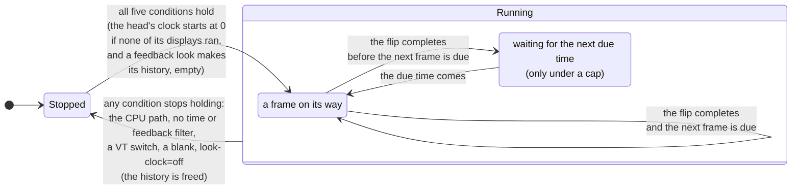

# ADR-1305: A frame clock gives the time to spatial shaders that declare they read it

## Summary

- **Decided by the maintainer (2026-11-03):** the frame clock is planned now, alongside ADR-1304, so that a spatial shader can animate: a CRT's flicker, a bar rolling down the screen, a phosphor's afterglow. A spatial shader whose header declares that it reads the time gets two values: `vtTime`, the seconds since its head's clock started, wrapping every hour, and `vtFrame`, the count of frames its display has presented since then (D1). Each head's clock starts again at zero each time it starts running (D1). A shader must declare in its header what it reads, the time and its previous frame alike, and a shader that uses either without declaring it does not compile (D2). A shader may read its own output from the previous frame, and vtium spends memory on that only for a shader that declares it (D2). A display draws at its refresh rate, paced by its flips, and the key `look-clock`, set to `refresh`, a number of frames a second or `off`, in vtium.conf and for each head in heads.conf, caps the rate or stops the clock (D4). A synchronized-output hold pauses the clock like any draw (D3), and the blink timers and the animation clock stay apart from the frame clock (D7). The header lines are `#pragma vtium time` and `#pragma vtium feedback` (D2). `SPATIAL_PREV()` reads only the pixel being written, one frame back, and a look holds at most one feedback shader (D2). The history is two RGBA8 textures the size of the display, held in the upright frame's tiles where it has more than one, made only while a feedback look draws, outside the glyph and picture budgets with a bounds row of its own, freed whenever the effect stops, and an out-of-memory error while making it is handled as ADR-1303 D9 handles any; an empty history reads as the current frame (D2).
- **Proposed by this record's agent, for the maintainer to confirm:** the history written by a draw of its own for each tile before present, which present then reads (D2). A display draws on the clock only while all of these hold: its head draws on the GPU path, the look in force on it holds a shader that reads the time or its previous frame, the VT is vtium's, the displays are not blanked, and `look-clock` is not `off` (D3). Time enters through one new place, the frame clock in the binary, which takes the loop's time as an argument, and the values it gives reach only present's pass, never the terminal's state (D5). While the clock runs every present is whole, and the composition still draws only what changed (D6). The CPU path never draws on the clock (D7). vtium-config previews the clock live and checks a shader at given times (D8). No open question remains.
- **Trades away:** A console showing an animated look no longer rests when nothing changes: the GPU redraws the whole display every refresh, the loop and the render thread wake every refresh, and a laptop's panel stays out of its self-refresh mode. A look with an afterglow also holds two more textures the size of the upright frame for each display, and draws one more pass a frame. The time wraps once an hour, so a shader whose cycle does not divide an hour jumps once an hour. An animation and its afterglow start again from nothing after a VT switch, a blank, a mode change or a turn. A shader can read only its own pixel of the previous frame, so a smear that spreads sideways over time is left out.
- **One-way?** No. It is reversible now. The names of the two values, `SPATIAL_PREV()` and the header's two lines become expensive to change once people write and trade shaders that use them.
- **Probes:**
  - *Confident (always redrawing):* a look with an animated effect, such as a rolling bar, makes vtium redraw that screen at the display's refresh rate, 60 times a second on most screens, the whole time the console is on screen and not blanked, even while nothing in the terminal changes. A look without one redraws only when something changes, as today. The ways to save power are the screen blank and a key that caps or stops the animation. Is that the cost you expect? (Answered 2026-11-03: refresh by default, paced by flips, with `look-clock`; see `considered`.)
  - *Not confident (phosphor afterglow):* a fading afterglow, where a bright letter fades out over a few frames after it changes, needs vtium to keep the previous frame for the shader to read, a second whole-screen picture in GPU memory for each display. This record leaves afterglow out and gives shaders only the time and a frame count, which is enough for flicker and rolling bars. Do you need afterglow in the first animated looks? (Answered 2026-11-03: include it, using memory only for a shader that declares it; see `considered` and D2.)
- **Inversion:** Between "no time in any shader", which ADR-1304 holds today, and "an animation system": every look with a shader redrawn continuously, as Ghostty does with any custom shader, any number of past frames read anywhere, a rate for each shader, and blink and picture animation folded into one clock. The answer is the time, a frame count and a shader's own previous output at its own pixel, each only for the shaders that declare them, drawn at the refresh rate and paced by the display's flips, with one key to cap or stop it.

## Context

ADR-1303 gives the GPU path a spatial slot, a step in the present pass that reads the upright frame around each pixel. Its D5 says that a step that reads the time needs frames drawn on a clock and a new place where time enters vtium, that the step's record names both, and that the time never reaches the screen's state. ADR-1304 (the decision record in which a file called a vtlook chooses vtium's frame filters and sets their parameters) fills that slot with spatial filters, each a shader file that root installs, and gives them no time: its D3 and D15 leave a clock to a record of its own. This is that record.

A CRT look is the reason. A real CRT flickers at its refresh, shows a faint bar of brighter lines rolling down the picture when its refresh beats against the room's lights, and leaves an afterglow where its phosphor fades. The first two need only the time. The third needs what the screen showed before, which a shader gets here as its own output from the previous frame.

vtium draws today only when something changes: the program's output, a key, the pointer, a blink, a frame of an animated picture. Two things already move on a timer. The blink timers (`crates/vtium/src/blink.rs`) flip the text's and the cursor's phases every 500 ms, and the animation clock (`crates/vtium/src/animation.rs`, ADR-1102 D3) picks the frame each animated picture shows. Both live in the binary, take the time the event loop reads at each turn, and change what a display draws, never the terminal's state. They are the precedent here.

The maintainer decided on 2026-11-03 to plan the clock now, alongside ADR-1304, against a recommendation to defer it, and answered this record's questions the same day (`considered`). The maintainer also asked for care with complexity in the GPU frame (`basis`), so this record adds two values, one input and one key, and reuses the draw requests, the flip pacing and the frame-rate floor vtium already has.

A few words used below. A tick is the pair of values a frame gives its shaders: the time and the frame count. A clock frame is a frame vtium draws because the clock asked for it. A display draws on the clock while vtium asks it for clock frames. The head's clock is the origin both values count from. A feedback shader is a spatial shader that reads its own output from the previous frame, and its history is the pair of textures that hold that output.

## C notes: the C reference's flow

The C reference had no time in any shader: gltex's uniforms were textures, a clip rectangle, colors and sizes (`kmscon/src/render/gltex_atlas.frag:53-61`, `kmscon/src/render/gltex_image.frag:35-36`). It drew when something changed and when one of its two blink timers fired. The text blink timer fired every 500 ms (`kmscon/src/terminal.c:164`), and each timer flipped its phase and asked every screen for a redraw (`kmscon/src/terminal.c:715-724`, `kmscon/src/terminal.c:821-830`). It armed both when the terminal activated and disarmed them when it deactivated (`kmscon/src/terminal.c:1764-1795`). A redraw asked while the display's last flip was still in flight was kept pending, and the flip's completion drew it (`kmscon/src/terminal.c:461-480`, `kmscon/src/terminal.c:669-690`). So the C reference never queued a frame behind another and never drew faster than the display flipped. The frame clock takes that rule for its pacing: a display asks for its next clock frame when its last flip completes. The C reference kept no earlier frame for any shader to read.

## Decision

D1 and D2 say what a shader receives and how it asks for it, the previous frame included. D3 and D4 say when a display draws on the clock and how fast. D5 says where time enters and how it stays out of the terminal's state. D6 covers damage, D7 the CPU path and vtium's other clocks, D8 vtium-config, and D9 the work. Each section says which parts the maintainer decided; the rest is this record's agent's proposal.

### D1: what a shader receives

**Decided by the maintainer (2026-11-03):** the two values below, their wraps, and one clock for each head that starts at zero each time it starts.

A spatial shader that declares it reads the time (D2) gets two uniforms in present's pass:

| Name | GLSL type | What it holds | Wraps |
|---|---|---|---|
| `vtTime` | `highp float` | The seconds from the start of the head's clock to the turn of the event loop that took this frame, worked out from whole nanoseconds and wrapped before it becomes a float | Back to 0 every 3600 seconds |
| `vtFrame` | `highp uint` | The number of frames this display has presented since the head's clock started, the first being 0 | Back to 0 after 4,294,967,295, as `uint` arithmetic does |

**Why the time wraps.** A `highp float` has a 24-bit significand. Below 4096 seconds it resolves 2^-12 s, about a quarter of a millisecond, so the time stays smooth at any refresh rate. After a day without a wrap it would resolve only 2^-7 s, 7.8 ms, half of a 60 Hz frame, and a rolling bar would stutter. An hour keeps the time below 4096 and divides evenly by many periods: a cycle of 1, 2, 3, 4, 5, 6, 8, 9, 10, 12, 15 or 16 seconds, or any frequency whose cycles in an hour are a whole number, such as 0.1 Hz or 7 Hz, runs through the wrap unbroken. A shader whose cycle does not divide an hour jumps once an hour. The wrap is a row of vtium-render's bounds table.

**Why the frame count wraps where it does.** `uint` arithmetic wraps at 2^32, so a shader that alternates on `vtFrame % 2`, or on any power of two, runs through the wrap unbroken. At 240 frames a second the count wraps after 207 days.

**The head's clock.** Each head has one clock. It starts when the first of the head's displays begins to draw on the clock while none of them does, and it stops when the last one stops (D3). Each start begins again at time 0, and each display's count begins again at frame 0. A display that joins a head whose clock runs reads the same time as the head's other displays, so mirrored displays show a rolling bar at the same place, and its own count starts at 0. A VT switch away and back, a blank and a wake, or a change of look therefore restarts every animation from zero, which looks the same as carrying on for flicker and rolling bars, and keeps the values small and every test's run starting from the same place.

**When the time is read.** The tick takes the time of the turn of the event loop that takes the frame for that display, the same time the loop already passes to its other timers. A flip event from vtium-platform carries no timestamp today, and the time between taking a frame and its flip is nearly constant, so the motion stays even without predicting when the frame will reach the screen.

**The names.** ADR-1304 D14 names a parameter in a shader by its bare name in lowercase, `-` written `_`, so no parameter can take a name with a capital letter, and `vtTime` and `vtFrame` cannot meet one.

### D2: a shader declares what it reads, and the previous frame

**Decided by the maintainer (2026-11-03):** the two header lines below; `SPATIAL_PREV()` reading only the pixel being written, one frame back; at most one feedback shader a look; the history's memory, budget and life as written below; and an empty history that reads as the current frame. A shader must declare in its header that it reads the time, and must declare that it reads its previous frame: "Must declare, and must declare previous frame.buffer too". A shader that uses either without declaring it does not compile, and the head draws the built-in default look. A shader may read its previous frame, and vtium spends memory on it only for a shader that declares it: "I think we include it, can we do it in a way that it only consumes memory if it's declared as a buffer?"

**The two header lines.** A shader file's header, which ADR-1304 D15 defines, may hold two lines, each at most once:

```glsl
#pragma vtium time
#pragma vtium feedback
```

The first says the shader reads the time; the second says it reads its own previous output. They are `#pragma vtium` lines like the rest of the header ADR-1304 D14 defines, lines a GLSL compiler ignores and vtium's header reader finds. vtium reads the header before it compiles anything, as for every other line.

**What each line gives.** vtium declares `vtTime` and `vtFrame` in present's shader only when a filter of the chain holds the time line, and defines the macro `SPATIAL_PREV()` only for the filter that holds the feedback line. It lists the uniforms and the history among the program's inputs then, so the check every `Gl` implementation makes, that a program declares each of its inputs, covers them. A shader that uses any of these names without its line does not compile, because nothing defines the name. That is a compile error, which ADR-1304 D6 answers as it answers every failure: the head draws the built-in default look, and the error names the shader. A shader that declares a line and does not use what it gives compiles and works, and costs a redraw every refresh for nothing; vtium-config's check says so (D8).

The declarations also let vtium say which looks animate without a GPU: `vtium check-config`, `looks` and `look-show` mark a look that holds a shader with either line as animated, and name a look with an afterglow.

#### The previous frame

**What `SPATIAL_PREV()` reads.** It returns the shader's own output from the previous frame at the pixel the shader writes, as libretro's `PassFeedback` gives a pass its own previous output. It takes no place, so it cannot read any other pixel. One frame of history is enough for an afterglow such as `max(current, previous × decay)`: each frame's output carries every frame before it, so a lit pixel fades over as many frames as the decay allows. Reading several frames back, as libretro's `OriginalHistory` does, or reading the history at neighbouring pixels, as a glow that spreads would, needs a record of its own.

**One feedback shader a look.** A look holds at most one shader with the feedback line, and a look that names two is an error of ADR-1304 D6's checking stage, reported before anything compiles. Filters before it in the chain feed it through `SPATIAL_IN` as usual, and its output is both what the next filter reads and what the history keeps.

**Where vtium keeps it: in tiles, as the upright frame.** The maintainer asked how the history is read when the upright frame is tiled (`considered`). The history is tiled exactly as the upright frame is (ADR-1303 D3): one history for each tile, the tile's size, in the tile's upright coordinates. The display's buffers cannot hold it, because they are turned for the display and swapped with each flip.

**How it is written.** Before present, vtium draws each tile's history in a draw of its own: for each pixel of the tile, the filters up to and including the feedback shader run in order, those before it reading the tile's upright frame through `SPATIAL_IN` and the feedback shader also reading the tile's history from the previous frame at that pixel, and the draw writes the feedback shader's output into the tile's history. Present then reads that history in place of the upright frame as the input of the filters after the feedback shader, and turns and colors as before (ADR-1303 D6). The history cannot be a second output of present's own draw: a draw writes all its outputs at the same position, which in present is the display's pixel, turned and counted across the whole display, while a tile's history is upright and starts at its tile's corner. So a feedback look costs one more draw for each tile, every frame, and no other look does.

**Why tiles cannot seam.** The feedback shader reads its history only at the pixel it writes, so every read of the history lands in the same tile at the same place. The filters before it read the tile's upright frame within their reach, and the filters after it read the tile's history within theirs; a tile's overlap of twice the chain's reach, owned to its middle (ADR-1303 D3), holds both. A tile's history is wrong only in the outer band of its overlap, where the filters before the feedback shader met the tile's edge, and no pixel the tile owns reads that band, now or in a later frame. A history read at neighbouring pixels would let that error spread inward by one reach every frame, and two tiles would drift apart along their seam over time; that is why `SPATIAL_PREV()` takes no place.

**Two textures a tile.** GL ES 3.0 leaves undefined a draw that reads a texture it also writes, so each tile's history is two textures, one read and one written, which swap after each frame. Each is RGBA with 8 bits a channel, as the display's buffer is, so a decay that only multiplies can stall a few levels above black, and an afterglow shader subtracts a little as well.

**What it costs.** Two textures for each tile, each the tile's size: 15.8 MiB at 1920x1080 in one tile, 63.3 MiB at 3840x2160 in one tile, and a little more where tiles overlap. Each frame adds one draw for each tile, which reads and writes each pixel once more besides the filters' own reads: at 1920x1080 and 60 Hz, 124 million reads and 124 million writes a second.

**When it exists.** vtium makes a display's history when the display starts to draw on the clock (D3) under a look whose chain holds a feedback shader, and frees it whenever the display stops: at a VT release, with the glyph and picture textures the GPU path frees then; at a blank; when the head's look changes, the display falls to the default look or the head moves to the CPU path; and when `look-clock` is `off`. A mode change or a turn of the display frees it and makes it again for the new tiles. A display under any other look, and every display under `look-clock=off`, holds no history at all.

**An empty history.** A new history is empty, and on the first frame drawn from it `SPATIAL_PREV()` returns the shader's own input at that pixel, as if the screen had already shown this frame. vtium tells the history's draw that the history is empty through one input it sets on that frame. The history starts empty after a mode change, a turn, a switch back to the VT, a wake from a blank and a change of look, so the screen after each of these looks as it would after a steady wait, with no flash of black and no afterglow from a picture that was never shown. Under `look-clock=off`, where no history exists, `SPATIAL_PREV()` returns the shader's own input on every frame, so a feedback look draws one fixed picture.

**Feedback needs the clock.** A frame that reads the frame before depends on every frame since the history was made, so it means something only if frames come at a steady rate and each present is whole. A feedback shader therefore makes its display draw on the clock (D3), whether or not it also holds the time line; without the time line it gets the clock's frames but not `vtTime` and `vtFrame`.

**Its budget.** The history is counted in no cache budget, like the upright frame, whose memory ADR-1303 states as a cost of the GPU path, and like the scratch texture, which ADR-1303 D2 counts in no budget: its size is fixed by the display, and it holds nothing vtium could drop and draw again later. Counting it against ADR-1100 D5's bound for pictures would push pictures out to make room for an effect, and ADR-1300's budgets bound glyphs. The ceiling for each display that the GPU path's texture collection keeps bounds the glyph pools, not the history. A row of vtium-render's bounds table states the history's bound: two textures for each tile of the upright frame, each the tile's size. An out-of-memory error from the driver while vtium makes the history is ADR-1303 D9's out-of-memory case like any other, since the GL's state is undefined after it, and the head moves to the CPU path.

### D3: when a display draws on the clock

**Decided by the maintainer (2026-11-03):** a synchronized-output hold pauses the clock like any draw.

A display draws on the clock while all of these hold:

1. its head draws on the GPU path (ADR-1303 D9);
2. the look in force on that display holds at least one spatial filter whose header declares that it reads the time or its previous frame; a display that misses the look's requirements, or that its frame-rate floor put on the default look (ADR-1304 D7 and D16), draws the default look and does not draw on the clock;
3. the VT is vtium's and its terminals are awake, the state in which the blink timers run;
4. the displays are not blanked;
5. `look-clock` is not `off` (D4).

When any of these stops holding, the display stops drawing on the clock. It asks for no further clock frames, frees its history if it has one (D2), and the frame it last presented stays on the screen until something else draws. When the last display of a head stops, the head's clock stops. When all five hold again, the display starts again, with an empty history, and the head's clock starts again from zero if it had stopped (D1).

A clock frame is asked for the way a blink asks for a frame. A synchronized-output hold (mode 2026) defers it as it defers any draw, until the hold ends or `sync-timeout` ends it, and the animation pauses for that time. A frame already on its way to the display defers it until that frame's flip completes.

The figure shows one display's states. It draws no clock frames while stopped. While running, it alternates between a frame on its way and, under a cap, a wait for the next frame's due time.



### D4: how fast, and what it costs

**Decided by the maintainer (2026-11-03):** the display's refresh by default, paced by its flips, and the key `look-clock`, set to `refresh`, a number or `off`, in vtium.conf and for each head in heads.conf.

**The rate.** `look-clock` sets how fast a display draws on the clock. It sits in vtium.conf, and a head may set it for itself in heads.conf, as ADR-1304's `look-min-fps` does. It takes three kinds of value:

| Value | What vtium does |
|---|---|
| `refresh`, the default | A display draws its next clock frame as soon as its last frame's flip completes. With one frame on its way at a time, it draws at the display's refresh rate while the GPU keeps up, and slower when the GPU cannot, never queuing a frame behind another. |
| A whole number, 1 to 1000 | The most clock frames a second. The next clock frame is due that long after the last one was taken, and then waits for the flip like any frame. A number at or above the refresh rate draws as `refresh` does. |
| `off` | No clock frames and no history. Every present gives its shaders time 0 and frame 0, and `SPATIAL_PREV()` returns the shader's own input, so a time-reading or feedback look draws as a still picture, and damage works as for a look that reads neither (D6). |

Under `refresh` the flip's completion wakes the loop, so the clock arms no timer of its own. Under a number, the next due time joins the loop's wake times (`App::next_wake`), as the blink timers' do. Under a cap, a feedback shader's afterglow fades over the same number of frames and so over more time, since it counts frames.

**The GPU's cost.** Every clock frame is a whole present: the spatial chain runs on every pixel of the display, every refresh. At 1920x1080 a chain that reads one texel for each pixel, such as scanlines and a rolling bar, reads 2.1 million texels a frame, 124 million a second at 60 Hz. With sharpen's 5 reads a pixel it is 10.4 million a frame and 622 million a second, and at 3840x2160 it is 41.5 million a frame and 2.49 billion a second. A feedback shader adds one draw for each tile, one read and one write a pixel, and its history's memory (D2). A clock frame on an idle screen composes nothing (D6), so the composition adds no cost.

**The CPU's and the power's cost.** Each clock frame also wakes the loop and the head's render thread once a refresh, for every display that draws on the clock. The GPU and the display controller never rest while such a look shows, and a laptop's panel stays out of its self-refresh mode. None of this is measured yet. The slice that builds the clock measures a clock frame's CPU time on an idle screen in tier 3's 1-vCPU guest with the render timer, and the maintainer's review on a VT observes the power. The controls are the screen blank, `dpms-timeout`, which stops the clock (D3), `look-clock`, and a look without a time-reading or feedback shader.

**The frame-rate floor and the watch.** ADR-1304 D16 applies as it stands. Its measured run, when a look loads or a display changes, gives the shaders the ticks that drawing at the display's refresh from time 0 would give, or time 0 and frame 0 under `look-clock=off`. For a feedback look the run makes a history, starts it empty and draws its 8 frames in sequence, so the measured cost includes the history's read and write, and it frees the history if the display misses its floor. The watch while running times each present where the driver has timer queries; while the clock runs every present is a clock frame, so the watch sees one every refresh, and a shader that slows down at some times and not others is caught by the watch's run of 30 slow frames. The floor judges what the GPU can draw, one frame's GPU time against one second divided by the floor, never the rate `look-clock` sets, so a cap below the floor does not put a display on the default look.

### D5: where time enters, and how it stays out of the terminal's state

**One new place.** Time enters through the frame clock, a part of the binary beside the blink timers and the animation clock. The event loop already reads the monotonic clock once a turn, through the binary's injected `Clock`, and passes the time to each timer. The frame clock takes that time as an argument and reads no clock itself; the workspace's `clippy::disallowed_methods`, which denies `Instant::now` in the binary's own code outside the loop's one read, keeps it so. From the time and the flips, the frame clock decides when each display asks for a clock frame, and gives each frame it takes a tick.

**Where the tick and the history go.** The tick is a value of vtium-render's. The loop puts it in the job it sends the head's render thread, beside the screen's snapshot, and present sets it as the two uniforms. The history lives in the GPU path's textures and is read and written only by present's pass. vtium-term and vtium-image do not depend on vtium-render, so neither the tick nor the history can reach the grid, the scrollback, the modes, the cursor, the image store or a reply: the crate graph that docs/architecture.md draws keeps them out. They change the pixels of present's pass and nothing else.

**The determinism table.** The row "Time enters in named places only" in docs/architecture.md gains the frame clock: it is given the loop's time at each turn and decides when a display draws and what time its shaders see, never the terminal's or the image store's state. The row's check gains the frame clock's tests, which pass the times in.

**Repeatable tests.**

- The frame clock's tests drive it with given times and given events (an activation, a blank, a flip, a change of look) and check which displays ask for a frame and what tick each frame takes. They count frames and flips, never wall time.
- vtium-render's stand-in GL records each present's input values and which history texture it read and wrote, so a test checks that a frame drew with the tick and the history it was given.
- A feedback shader's frames depend on the frames before, so its tests drive a sequence of frames at given ticks from an empty history and check each frame of the sequence.
- Tier 2 draws a time-reading shader at fixed ticks, and a feedback shader through a fixed sequence of frames, with no clock at all.
- Tier 3 judges a time-reading or feedback look under `look-clock=off`, at time 0 and frame 0 with no history, so its screenshots repeat.
- vtium-config's check gives its run fixed ticks (D8).

### D6: damage

While a display draws on the clock, every present on it is whole, as ADR-1303 D5 says of a step that reads the time: every pixel's output may change with the time, and a feedback shader must write every pixel of its history each frame. Every clock frame presents and queues a flip, even when nothing in the terminal changed, so a clock frame is never a skipped draw, and the render timer counts it as a frame.

The composition still draws only what changed into the upright frame (ADR-1303 D3), which outlives a frame. A clock frame on an idle screen composes nothing and runs present alone over the upright frame it already holds. A clock frame takes the screen's snapshot the way any draw does; if the slice's measurement shows the snapshot to cost on an idle screen, a later change sends a clock frame without one, and until then there is one kind of job.

Under `look-clock=off` the tick never changes and there is no history, so present draws only what changed, unless a filter of the chain reads other pixels than the one it writes (ADR-1304 D3).

### D7: the CPU path, and vtium's other clocks

**Decided by the maintainer (2026-11-03):** the blink timers and the animation clock stay apart from the frame clock.

**The CPU path.** Time-reading and feedback shaders exist only in the spatial layer, which only the GPU path draws (ADR-1304 D3). A head on the CPU path draws a look's color layer and skips its effects, so it never draws on the clock and never holds a history. The color layer never reads the time or a previous frame (ADR-1304 D2), so a look's colors stay one table on both paths.

**The blink timers stay apart.** Text blink and cursor blink change which cells show what, on both paths, in every build and with no look at all, and a key resets the cursor's phase. They are events every 500 ms, not a continuous time. The animation clock picks which frame a picture shows, also on both paths. Merging either into the frame clock would make it exist in builds and on heads with no look and no GPU path, or make blink depend on the GPU path, and blink's tests already drive its firings directly. The three share two things: the time the loop passes them, and the draw request. A draw any of them asks for while a frame is on its way joins that frame, so under `refresh` a blink's change shows in the next clock frame and adds no frame of its own.

### D8: vtium-config, the preview and the check

**The live preview.** vtium-config's preview applies a look to the live head (ADR-1304 D11), so the frame clock runs on it as on a configured look, under the head's `look-clock`, with its history where the look holds a feedback shader, and the user sees the animation as it will run.

**The check.** vtium-config's check of a shader as the invoking user, before root installs it (ADR-1304 D15), draws its run of frames at given ticks for a shader with either header line: 8 frames from time 0 at a 60 Hz spacing, frames 0 to 7, and 8 frames ending just before the time's wrap, with the frame count ending just before its own. For a feedback shader each run of 8 starts from an empty history and draws in sequence. It times them as the frame-rate floor's measurement does, so a shader that is slow or hangs only at large values is caught before it is installed. It says when a shader declares a line and its linked program has no place for what that line gives, which means the shader reads none of it and would redraw every refresh for nothing. The report names the ticks each slow frame took.

### D9: the work

One slice builds the clock, in two parts. It follows ADR-1304's slice for the spatial layer and the shader format, and can run beside its slice for the frame-rate floor.

1. **The clock.** The `#pragma vtium time` line and the two uniforms, declared only when the chain needs them; the frame clock in the binary with D3's conditions and D4's pacing; the `look-clock` key in vtium.conf's key table and heads.conf; D6's damage rule; the marks of an animated look in `vtium check-config` and vtium-config; vtium-config's check at given ticks; the tests of D5 and Verification; and one shader as the first worked example, `roll`, a band of slightly brighter rows rolling down the screen, which reads only the pixel it writes and so shows the clock without any other cost.
2. **The previous frame.** The `#pragma vtium feedback` line, `SPATIAL_PREV()`, the one-a-look check, the history's two textures a tile with their life, swap and clearing, the draw that writes them before present and present's reading of them, the history's row of the bounds table, the floor's measured run with a history, and one shader as the second worked example, `glow`, an afterglow in which a lit pixel fades over a few frames once its cell changes.

The parameters of `roll` and `glow` follow ADR-1304 D1's kinds, and the slice sets them.

## What the other records change to fit

ADR-1303 is accepted and names "that step's record" and "its own record" where this record belongs. When this record is accepted, these passages change, each with a dated note:

- **D1's table,** the spatial row: "and the time for a step that reads it" names this record's two values (D1) and adds "and its own previous output, for a step that declares it" (D2).
- **D2,** where it counts the scratch texture in no budget: a display under a feedback look also holds its history, two textures for each tile, counted in no budget either (D2).
- **D3:** the history is tiled as the upright frame, with the same tiles and overlaps, and its reads stay at the pixel being written, so the overlap of twice the reach serves it unchanged (D2).
- **D5:** "that step's record names both" names this record: the frame clock (D3, D4) and its row in the determinism table (D5).
- **D6:** "the whole buffer at age 0 or when a spatial step asks for it" adds "or while the display draws on the frame clock" (D6), and, under a feedback look, a draw for each tile before present writes the history, and present reads it as the input of the filters after the feedback shader (D2). That draw is the one pass a frame a slot adds, and only while a feedback shader is in force, which D1's "an empty slot adds no pass" still allows.
- **D9,** with the dated amendment the GPU path's texture collection adds beside its mode-change rule: a VT release frees a display's history with its glyph and picture textures, and a mode change or a turn frees it and makes it anew for the new tiles, empty (D2).
- **Trades away** and **Consequences, Negative:** "A spatial step that reads the time brings a frame clock and a new place where time enters, which its own record must justify" names this record, and the GPU path's memory for each display gains the history under a feedback look.

ADR-1304 is not yet accepted, so its author can fold these in before it is, without notes:

- **D3, "No time":** a spatial filter whose header holds `#pragma vtium time` gets this record's two values, and a filter whose header holds `#pragma vtium feedback` gets `SPATIAL_PREV()`; no other filter gets either. "Its parameters are its only uniforms" adds these for such a filter. A look holds at most one feedback shader.
- **D3, the prelude** (the part of present's shader that vtium writes before each filter's piece, where it defines `SPATIAL_IN`): it defines `vtTime` and `vtFrame` when a filter of the chain holds the time line, and the macro `SPATIAL_PREV()` before the feedback shader's piece alone, reading that tile's history at the pixel being written. The macro takes no place, so no shader can read the history anywhere else, and no scan of the shader's source is needed to refuse one that tries; a shader that writes `SPATIAL_PREV(at)` or any other argument fails to compile, which D6 answers as any compile error.
- **D3, the feedback draw:** under a feedback look, the filters up to and including the feedback shader run in a draw of their own for each tile, before present, and present's piece for the filters after it reads that tile's history through `SPATIAL_IN`.
- **D3's damage paragraph:** "A spatial filter that reads only the pixel it writes, such as scanlines, leaves damage tracking as it is" adds "and reads neither the time nor its previous frame, or while the clock is `off`".
- **D6:** the checking stage gains a look that names two feedback shaders, and its report names both.
- **D14, the file formats by example,** gains these notes on the shader header's grammar:
  - a full shader file whose header holds `#pragma vtium time` and `#pragma vtium feedback` beside its name, help, parameters, reach and reads, with `roll` and `glow` as the worked examples;
  - each of the two lines may appear at most once in a header, takes no argument, and a repeat or an argument is a header error with a report naming the line;
  - the names the lines reserve, `vtTime`, `vtFrame` and `SPATIAL_PREV()`, which no parameter's name can take, since D14's grammar makes every parameter's name lowercase;
  - malformed examples with the errors they give: a shader that uses `vtTime` without the time line, and one that uses `SPATIAL_PREV()` without the feedback line, each refused at compile with the driver's message and the shader's name; a look naming two feedback shaders, refused at the checking stage;
  - the words a `#pragma vtium` line may hold, which D14's report lists as shader, help, license, reach, reads, requires or param, gain `time` and `feedback`.
- **D15:** the header's list of what it states gains "whether the shader reads the time, and whether it reads its previous frame"; the paragraph "**Time.**" and open question 5 point at this record.
- **D16:** the measured run gives the shaders the ticks of D4, and for a feedback look runs its frames in sequence from an empty history; the watch sees a present every refresh while the clock runs.
- **D11:** `looks` and `look-show` mark an animated look and a look with an afterglow, and the check runs at given ticks and in sequence for a feedback shader (D8).
- **The Summary's proposal** that a spatial filter "never reads the time" names this record's two exceptions.
- **D7's table:** `min-fps` is unchanged, and the key table gains `look-clock` beside `look-min-fps`.

Outside the records, the slice changes: docs/architecture.md's determinism row; vtium.conf's key table, its example and docs/config.md, which gain `look-clock`; ADR-1401 D3's list of a head's keys and the head file's template, which gain `look-clock`; vtium-render's bounds table, which gains the time's wrap and the history's bound; and docs/looks.md, which gains `roll` and `glow` among its examples.

## Where vtium departs from the C reference

The C reference had no time and no earlier frame in any shader, so the frame clock and the history go past it rather than departing from a behaviour it had. vtium keeps the C reference's pacing rule: a frame asked while the last is on its way waits for that frame's flip, and no frame queues behind another.

## Verification

- **The clock starts and stops on D3's conditions.** The frame clock's tests, given times and events: a head with a time-reading look asks for a frame at each flip under `refresh` and none on a look without one, over a thousand flips; a look whose only such filter declares feedback asks for frames the same way; activation starts the head's clock at time 0 and frame 0; deactivation, a blank, the head's move to the CPU path, the display's fall to the default look, and `look-clock=off` each stop it, and the next start begins again at 0. A planted clock that keeps running while blanked fails.
- **The pacing.** Under `refresh` a display never has two frames on its way; under `look-clock=30` on a 60 Hz display, no clock frame is asked before its due time, and over 60 refreshes of given times the display draws 30 clock frames; a number above the refresh rate draws as `refresh`.
- **The values.** `vtTime` from whole nanoseconds is exact at the wrap: 3599.999 s gives 3599.999 and 3600 s gives 0, and after 24 hours and 0.5 seconds it is 0.5 exactly. A planted clock that converts to float before wrapping fails the 24-hour case. `vtFrame` after 2^32 − 1 is 0. Two mirrored displays of one head, one joining a minute later, show the same time in the same turn.
- **The time and the history stay out of the terminal's state.** The binary's test feeds one stream to a head with a time-reading feedback look under two different schedules of given times, and compares the screen's text, the scrollback, the modes and the replies, which are the same.
- **The declarations.** On the stand-in GL, present's program lists `vtTime` and `vtFrame` among its inputs only when a filter of the chain holds the time line, and the history only when one holds the feedback line; a head with neither has present's sources and inputs of a build without the clock. Under llvmpipe in tier 2, a shader that uses `vtTime` without the time line, and one that uses `SPATIAL_PREV()` without the feedback line, each fail to compile, and the head draws the default look with an error naming the shader. A look naming two feedback shaders fails at the checking stage before anything compiles.
- **The history's life.** On the stand-in GL, which counts the textures it holds: a display makes its two history textures when it starts drawing on the clock under a feedback look and holds none under any other look or under `look-clock=off`; a VT release, a blank, a change of look and the fall to the default look free them; a mode change and a turn free them and make them at the new size. A planted history that outlives a VT release fails.
- **The history's frames.** On the stand-in GL, driven as a sequence of frames at given ticks: each frame reads the texture the frame before wrote and writes the other; the first frame after the history is made is told that the history is empty and reads the shader's own input, and so does every frame under `look-clock=off`; a frame dropped by a GL error leaves the history as the last presented frame left it. A planted draw that reads and writes the same texture, one that never swaps, and one that reads the old history after a mode change each fail.
- **The history across tiles.** With the largest texture set small for the test, a frame of two tiles under `glow` matches the same frame in one tile within the tolerance over a sequence of 60 frames, the seam included. A planted history draw that writes each tile's history from its neighbour's texture, and one that writes only the pixels a tile owns and so leaves the overlap the next filter reads unwritten, each fail at the seam.
- **Damage.** On the stand-in GL, every present while the clock runs is whole and queued, an idle screen included, and composes nothing when nothing changed; under `look-clock=off` a present draws only what changed. A planted clock frame that skips an unchanged screen as a draw with no change fails, since the display would stop animating.
- **Tier 2** draws `roll` at fixed ticks, time 0 at frame 0, 0.5 s at frame 30, and 3599.9 s at frame 2^32 − 1, and draws `glow` through a sequence of 8 frames in which a line of text shows in the first two and is gone from the third. It compares each of the GPU path's frames under llvmpipe with tier 2's own Rust version of the shader's formula, run through the same ticks and, for `glow`, the same sequence, within ADR-1303's tolerance. A planted `roll` that reads the time in milliseconds fails, and so does a planted `glow` whose first frame reads zero for its history.
- **Tier 3** gains, in its GL variant once that variant passes, one screen with `roll` and `glow` under `look-clock=off`, a fixed frame compared within the tolerance with vtium's own golden, which stays provisional until the maintainer reviews it.
- **The floor with a history.** On the stand-in GL with given timings, the floor's measured run for a feedback look makes a history, draws its 8 frames in sequence, and includes the history's cost in the rate; a display that misses its floor frees the history it made for the run.
- **vtium-config's check** draws its run at the ticks of D8, in sequence for a feedback shader, and a stand-in shader that is slow only past 3000 seconds fails it.

## Open questions

No open question remains. The maintainer answered the first draft's seven questions and the second draft's five on 2026-11-03, and asked how the history is read on a tiled upright frame (`considered`); each answer is written into the section it settles.

## Consequences

### Positive

- A spatial shader can animate and leave an afterglow: a CRT's flicker, a rolling bar, a fading phosphor, written and traded as shader files like any other spatial filter.
- Only looks that declare a time-reading or feedback shader draw on a clock, and only a look that declares feedback holds a history. Every other look, and the CPU path, draw only on change and hold nothing more, as before.
- Time enters in one more named place, which takes the time as an argument and cannot reach the terminal's state, so the determinism rules and their checks hold.
- The pacing reuses the draw requests and the one-frame-on-its-way rule vtium already has, and adds no timer under the default.
- The history is tiled as the upright frame and read only at the pixel being written, so tiled displays draw an afterglow with no seams.
- One key caps the rate or stops the clock, for power, and its `off` also frees every history and makes tier 3's screenshots of these looks repeatable.
- vtium-config's check catches a shader that is slow or hangs only at large times, before root installs it.

### Negative

- A console showing an animated look never rests: the GPU redraws the whole display every refresh, the loop and the render thread wake every refresh, and a laptop's panel stays out of self-refresh. The cost is not measured yet.
- Every present is whole while the clock runs, so a heavy spatial chain costs its full price every refresh, not only when the screen changes; the frame-rate floor is what keeps it from making the display unusable.
- A feedback look holds two textures a tile for each display, 15.8 MiB at 1920x1080 and 63.3 MiB at 3840x2160, counted in no budget, and an out-of-memory error while making them moves the head to the CPU path. It also draws one more pass a frame.
- The history keeps 8 bits a channel, so an afterglow that only multiplies stalls a few levels above black, and its author must subtract as well.
- The time wraps once an hour, and a shader whose cycle does not divide an hour jumps once an hour.
- An animation and its afterglow restart from nothing after a VT switch, a blank, a change of look, a mode change or a turn.
- A synchronized-output hold pauses the animation for as long as it lasts.
- A shader reads only its own pixel of only the previous frame, so a smear that spreads sideways over time, or an effect that needs several frames back, needs a record of its own.

### Neutral

- ADR-1304's spatial contract gains two declared exceptions, the time and the previous frame; its color layer stays timeless.
- The names of the two values, `SPATIAL_PREV()` and the two header lines join ADR-1304 D14's header grammar.
- ADR-1303's Summary, D1, D2, D3, D5, D6, D9 and Negative consequences change to name this record.

## Alternatives Considered

- **Animate every look with a spatial filter whenever the console shows,** as Ghostty's `custom-shader-animation` does by default for any custom shader. Not taken: most filters, such as scanlines and sharpen, never change with time, and redrawing them every refresh would cost power for nothing.
- **Detect a time-reading or feedback shader by looking for the names in its source, or by asking the compiled program whether it uses them.** Not taken: the maintainer decided that a shader declares both. A text search is fooled by comments and macros, and a compiled program's answer comes only after compiling on a GPU, while ADR-1304's design states everything vtium needs in the header before it compiles anything. The check of D8 uses the compiled program's answer only to warn.
- **An unwrapped time.** Not taken: a `highp float` loses precision as the time grows, to 7.8 ms after a day, half a 60 Hz frame, and a shader cannot repair it.
- **Time as whole milliseconds in a `uint`.** Not taken: a shader would turn it into a float to use it and meet the same precision loss, and every shader would repeat that conversion.
- **A clock that keeps running across VT switches and blanks, counting from vtium's start.** Not taken: the time would grow toward the wrap on every long run, tests would need to set an origin, and nothing on the screen shows the difference for the effects in view.
- **A fixed timer at a set rate, such as 60 times a second, instead of pacing by flips.** Not taken: it draws frames the display cannot show on a slower display, queues behind a slow GPU, and beats against the refresh on a faster one. Pacing by flips needs no timer and follows each display's own rate.
- **The present time predicted from the flip's timestamp.** Not taken for now: vtium-platform's flip event carries no timestamp, and the loop's time at the turn that takes the frame is close enough for even motion. It can be added later without changing what a shader receives.
- **One clock for blink, picture animation and shaders.** Not taken: the maintainer kept them apart, and D7 gives the reasons.
- **Leave the afterglow out.** The earlier draft's recommendation. Rejected by the maintainer (2026-11-03): the previous frame is included where a shader declares it.
- **`SPATIAL_PREV(at)`, with a scan of the shader's source that refuses any place but `at`.** The design relayed to this record. Not taken: a scan reads text, and another macro or a variable holding a neighbour's place passes it, while `SPATIAL_PREV()` with no argument cannot read elsewhere at all. Reading the history at neighbouring places is ruled out either way, because an error at a tile's edge would spread inward by one reach every frame.
- **The history written as a second output of present's own draw,** into each tile's history. The design relayed to this record. Not possible: a draw writes all its outputs at the same position, which in present is the display's pixel, turned and counted across the whole display, so it cannot land in a tile's upright texture that starts at the tile's corner.
- **One history at the display's size and orientation, written as a second output of present's draw,** which this record's earlier draft proposed. Not taken: it adds no pass, but a display wider or taller than the GPU's largest texture, the case tiles exist for, cannot hold it in one texture, and a second output cannot reach tiles; the history would also have a shape of its own beside the upright frame's tiles.
- **An empty history that reads zero,** from a clear, as the tiled design relayed to this record had it. Rejected by the maintainer (2026-11-03): an empty history reads as the current frame. Zero needs no input telling the draw that the history is empty, but a shader that blends its history with the current pixel would fade in from black after every mode change, turn, VT switch or change of look.
- **One history texture a tile, read and written in the same draw,** as relayed. Not taken: GL ES 3.0 leaves reading a texture that the pass also writes undefined, and the extensions that allow it are not on every GPU vtium targets.
- **A history at 16 bits a channel,** so a dimming that only multiplies reaches black. Not taken: GL ES 3.0 cannot draw into a 16-bit float texture without an extension, and 8 bits match what the display shows.
- **A clock-free history, kept only while frames come from changes.** Not taken: a partial present would leave the history stale outside the changed rectangles, and the afterglow would stop wherever the screen stopped changing.
