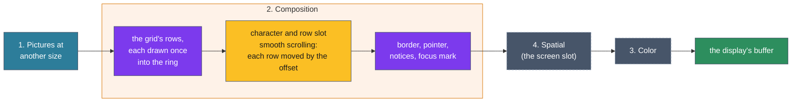

# ADR-1310: Smooth scrolling slides the text by pixels through a character and row slot under the screen slot

## Summary

- **Decided by the maintainer (2026-11-16):** vtium keeps a few rows above and below the screen drawn, the overscan, so that it can offer smooth scrolling: the text moves by pixels over a few frames instead of jumping a row at a time. The slide only lags the output by a bounded delay before it speeds up. The slide has a minimum speed, and when the output comes faster than the slide can show, the slide clamps to moving whole rows, one or several a frame, to keep up. The record also has to work out how the slide's frames line up with the loop's events. The effects pipeline gains a slot that works on characters and rows, beside the slot that works on the whole screen's texture, and the screen slot composes on top of it. Each slot states what it requires on the GPU path and on the CPU path, as the existing slots do, and vtium offers an effect only where its requirements hold. Every part sits behind a cargo feature, so the minspec build compiles none of it and keeps its memory and size figures.
- **Decided by the maintainer (2026-11-17),** answering this record's five questions (`considered`): both the scrollback and new output slide, the scrollback first (D1); 4 overscan rows on each side, fixed (D2); vtium.conf sets each console's state at start and DECSCLM is respected after, as with the cursor's style (D8); smooth scrolling is off by default, and a burst of more than a screen of output skips the slide (D3, D7); and both paths slide, with the CPU path's cost measured first and its half shipped only if that cost is acceptable (D4, D6).
- **Decided by the maintainer (2026-11-24),** answering this record's three probes (`considered`): during a slide only the grid's text, its cursor and its pictures move, while the mouse arrow, the border and vtium's notices stay where they are (D4); the maximum delay starts at 200 ms, and the VT review tunes it (D3, D7); and if the copy of the frame in system memory wins the faster-scroll work's measurement, smooth scrolling's CPU ring grows out of that copy instead of adding a second one (D6).
- **Proposed by this record's agent, for the maintainer to confirm:** the overscan rows as a request on the frame snapshot, and an id for each row that moves with it (D2); the pacing as three rules on the distance the picture lags behind (D3); the character and row slot inside the composition, after the grid's cells and before the border, the pointer and the notices (D4); a ring of drawn rows on the GPU path (D5) and on the CPU path (D6); the feature `smooth-scroll` and four keys (D7); and the work in six slices (D9).
- **Proposed by this record's agent (2026-11-24), for the maintainer to confirm,** from the maintainer's words of that day on scrolling without a copy of the frame (`considered`): a pan over a tall buffer, and rows drawn ahead (D6). Where the driver allows it, the CPU path keeps its ring of drawn rows in a display buffer taller than the screen. A scroll then changes which part of the buffer the display shows, and no pixel moves (D6). While the view scrolls through the scrollback, vtium draws rows ahead in the scroll's direction, more the faster it scrolls. Those rows ask the font helper for their glyphs before they come into sight. Pictures and double-size lines are drawn ahead like any other row. The faster-scroll work measures this pan against the two ways of moving rows already planned, and the maintainer picks from its numbers (D6, D9).
- **Decided by the maintainer (2026-11-25),** from the faster-scroll work's numbers and the questions its gap-check raised (`considered`): the CPU path pans over a tall buffer and copies where the driver refuses the pan, behind the cargo feature `scroll-pan` and the key `scroll-draw`, which vtium.conf sets at its top level and for each head (D6). The scroll record counts moves in both directions, the view's moves through the scrollback included (D2). Under `scroll-pan`, vtium draws rows beyond the screen on both sides, the scroll's direction first, with or without smooth scrolling (D2, D6). A row's second copy in the tall buffer is drawn only when a window can reach it, and the alternate screen keeps the window at rest (D6). At rest, the grid's last row touches the screen's bottom edge, and the spare pixel lines above the first row show the bottom of the row above it (D10).

  > Note 2026-11-25: this bullet is new on this date.
- **Trades away:** A console that slides redraws the grid's area every frame of a slide, where it now redraws only the rows that changed, and keeps a ring of drawn rows, about the grid's own size again, for each display. The picture can lag the program's output by up to the bounded delay. On the CPU path every frame of a slide copies the whole grid's area into the display's buffer through the color table, which small hardware may not afford. Where the CPU path pans a tall buffer instead (D6, proposed), each of the display's buffers takes up to three times a screen's memory, 23.7 MiB at 1920×1080. Tests of the slide's frames run on given times, so the slide adds a place where time decides what a display shows.

  > Note 2026-11-24: the sentence on the tall buffer is new on this date, with D6's proposal of a pan over a tall buffer (`considered`, the maintainer's words of 2026-11-24 on scrolling without a copy of the frame).
- **One-way?** No. Everything is behind a cargo feature and a key, and a build or a console without them scrolls by whole rows as today. The keys' names and DECSCLM's meaning become expensive to change once people set them.
- **Probes:**
  - *Confident (what moves):* while the text slides, the mouse arrow, the border around the text and vtium's notices stay where they are; only the text, its cursor and its pictures move. Is that what you want? (Answered 2026-11-24: only the text moves; see `considered`.)
  - *Not confident (falling behind):* when a program prints faster than the slide can show, the slide lets the picture fall up to a fifth of a second behind before it gives up and jumps by whole rows to catch up. Is a fifth of a second the right bound, or should it be shorter? (Answered 2026-11-24: 200 ms to start, tuned at the VT review; see `considered`.)
  - *Not confident (reading back the display's buffer):* the faster-scroll work moves rows that are already drawn, so that a scroll on a slow CPU draws only the new line. It can move them inside the display's buffer, which costs no memory but reads memory the kernel often maps write-combined, slow to read, and D6 says vtium never reads that buffer back. Or it can keep a copy of the frame in system memory, 7.9 MiB at 1920×1080, and move the rows there. You decided on 2026-11-22 that the faster-scroll work measures both in tier 3 first and that you pick from its numbers (`considered`, "Measure first"). If the copy wins, should smooth scrolling's CPU ring of D6 grow out of that copy, rather than add a second one? (Answered 2026-11-24: yes, the two share one copy; see `considered`.)
  - *Not confident (rows drawn ahead):* while you scroll back through the scrollback, vtium draws rows ahead of the view, more the faster you scroll. The text, its glyphs and its pictures are then ready when they come into sight. This proposal keeps room for one more screen of rows, split between the two sides by the scroll's direction. At 1920×1080 each of the display's buffers is then three screens tall, 23.7 MiB, against 7.9 MiB today, and a machine with little memory keeps fewer rows. Is one more screen the right room, or should vtium keep less?
- **Inversion:** Between "scroll by whole rows", which vtium does today and which never lags, and "an animation system", where every scroll eases over a fixed time whatever the output does. The answer slides by pixels while output is slow enough to show, falls back to whole rows when it is not, and never lets the picture fall further behind than one bound.

## Context

vtium scrolls by whole rows today: each frame shows the grid at a row boundary. When a program prints a line at the bottom of the screen, every row moves up by one row's height between one frame and the next. When a person scrolls back with the wheel or Shift+PageUp, the view jumps by lines or by a page.

Smooth scrolling moves the text by pixels over a few frames instead. To slide the picture by a fraction of a row, the renderer needs the rows just outside the screen already drawn, because part of a row past the screen's edge comes into sight. Those rows are the overscan. For output that scrolls the screen up, the rows that come into sight during the slide are the ones that have just left the top of the screen. For a scroll back through the scrollback, they are the rows below the view.

The renderer works from a frame snapshot today: the visible lines, their damage, the palette, the cursor, the selection and the pictures (`Snapshot`, crates/vtium/src/term.rs). Damage is kept by screen position, so a scroll marks every row that moved, and moving the view through the scrollback marks everything (crates/vtium-term/src/damage.rs). A slide that redrew every moved row on every frame would cost a whole redraw of the grid each frame, so this record gives each row an id that moves with it, and keeps the rows already drawn.

ADR-1303 gives the GPU path a fixed pipeline of five slots: pictures at another size, composition, color, spatial and present. ADR-1304 fills the color and spatial slots from a vtlook, and ADR-1305 gives spatial shaders the time. The spatial slot works on the whole upright frame, the off-screen picture of the whole display; the maintainer calls it the screen slot. The maintainer asked on 2026-11-16 for a second kind of slot that works on characters and rows, under the screen slot, with smooth scrolling's row offset as its first effect.

A few words used below. The lag is the distance, in pixels, between where the picture shows the text and where the terminal's newest frame puts it. A slide is the time during which the lag is not zero. A row's height is the cell's height in pixels; a double-height line occupies two rows. The overscan is K rows, the rows the renderer keeps drawn beyond each side of the screen that needs them.

## C notes: the C reference's flow

The C reference scrolled by whole rows and drew no rows beyond the screen, so smooth scrolling goes past it rather than departing from a behaviour it had.

## Decision

D1 says which scrolls slide. D2 sets out the overscan rows and the rows' ids, and D3 the pacing. D4 defines the character and row slot, and D5 and D6 what it needs on the GPU path and on the CPU path. D7 names the feature and the keys, D8 covers DECSCLM, D9 lists the work, and D10 places the grid on the screen. Where a section holds the maintainer's decisions, it opens with them; the rest is this record's agent's proposal.

The figure shows the GPU path's slots from left to right, with the new slot inside the composition. The grid's rows are drawn once each into a ring of rows. The character and row slot then places the grid's area into the upright frame, each row moved by the slide's offset. The border, the pointer and the notices are drawn over it and never move. The screen slot, ADR-1303's spatial slot, works on that finished frame, and the color step comes last, as ADR-1303 D1 orders them.

### D1: which scrolls slide

**Decided by the maintainer (2026-11-17):** both kinds of scroll below slide, and the scrollback's slide is built first (`considered`). **Proposed, the details.** Two kinds of scroll slide:

- **The view through the scrollback,** moved by the wheel, by Shift+PageUp and Shift+PageDown, and by the `key-scroll-up` and `key-scroll-down` keys. The lag starts at the distance the view moves, and the picture slides toward the new view.
- **New output that scrolls the whole main screen,** so that rows leave the top of the screen and enter the scrollback: a line feed on the bottom row, or a scroll up (SU) while the margins are the whole screen. The lag grows by a row's height for each row that leaves.

Under any answer, every other change jumps, as today, and ends any slide in progress with the lag at zero: a scroll inside margins narrower than the screen, a scroll on the alternate screen, an insert or delete of lines, a scroll down, a screen clear, a resize, a switch between screens, a reset, and the end of a view through the scrollback by a key the program receives. These change rows in place, or move rows that leave no scrollback, so the rows the slide would bring into sight no longer exist.

### D2: the overscan rows, and an id for each row

**Decided by the maintainer (2026-11-16):** vtium keeps a few rows above and below what the screen shows. **Proposed, the rest.**

**The snapshot asks for them.** The frame snapshot captures up to K rows beyond the screen on each side, as well as the screen's rows. Each captured row carries its position: negative above the screen, 0 up to the last row on the screen, and the screen's row count and up below it. Rows beyond the screen exist only where there is content. Nothing lies above the first line of the scrollback, and nothing lies below the screen while the view shows the newest output, which is the usual case. The snapshot reports how many rows it captured on each side, and the renderer never moves the picture toward a side with fewer rows than the lag needs. A change of K redraws everything once. **Decided by the maintainer (2026-11-17):** K is 4 rows on each side, fixed (`considered`). On the CPU path under `scroll-pan`, the snapshot also captures the rows that D6 draws ahead and behind, past the K rows.

> Note 2026-11-25: the maintainer asked for rows drawn on both sides of the screen, "draw ahead and if there's time, draw behind" (`considered`). The paragraph's last sentence read: "On the CPU path, the snapshot also captures the rows that D6 draws ahead, past the K rows, on the side the view scrolls toward."

> Note 2026-11-24: the paragraph's last sentence is new on this date, with D6's proposal of rows drawn ahead (`considered`, the maintainer's words of 2026-11-24 on scrolling without a copy of the frame). K and the rest of the paragraph are unchanged.

**What a row beyond the screen carries.** The same as a row on the screen: its cells and styles, its damage, its selection, its line size and the pictures placed on it. The cursor is reported only on the screen's rows, so a cursor never shows in a row the slide is moving out of sight unless the terminal put it there.

**A scroll record in every build.** In every build, the minspec build included, vtium-term records how far the screen's rows moved, as a signed count of rows, and which of the moved rows also changed in place. The count goes up when the whole main screen scrolls up, by a line feed on the bottom row or a scroll up (SU) while the margins are the whole screen. It also goes up when the view moves through the scrollback toward newer output. The count goes down when the whole main screen scrolls down, by a reverse index (RI) on the top row or a scroll down (SD) while the margins are the whole screen, and when the view moves back through the scrollback. Each display reads the count since its own buffer's age, so vtium-term keeps a small log of fixed size that holds the count at each of the renderer's last checkpoints. A scroll that the record cannot state as one move of every row marks every row it touches, as today: a scroll inside margins narrower than the screen, any scroll on the alternate screen, any scroll while a selection is shown, and any scroll while the link's overlay row or the labels of link hints are shown, since those stay at places on the screen. A line feed while the view is scrolled back marks everything. A move of the view while a selection or those labels are shown, or one that rewraps lines as the view reaches them, marks everything instead of counting rows, and a request to move the view that does not move it marks nothing. An insert or delete of lines (IL, DL) on the top row with the whole screen as margins is not counted, and marks its rows as today. The log holds 32 entries, the bound `SCROLL_LOG`, and gains an entry only at a checkpoint where the count changed; a display older than the log reads every moved row as marked. The work that makes a scroll cheap on a slow CPU, the faster-scroll work for short, builds this record first. With it the CPU path moves the rows it already drew and draws only the new line and the changed cells. The record adds to the damage and replaces none of it. A part of the renderer that ignores the record still sees every moved row marked, as today, so the GPU path's composition stays correct unchanged.

> Note 2026-11-25: the maintainer decided that the record counts moves in both directions (`considered`, "we need to count both directions scroll forward and back"). The paragraph's first sentence read: "In every build, the minspec build included, vtium-term records how many rows the whole screen moved up since the renderer's last checkpoint, and which of the moved rows also changed in place." The sentences from "The count goes up" to "while a selection is shown" are new. The faster-scroll work's gap-check found that each display keeps its own buffer ages, so one count since one checkpoint cannot serve two displays, and it listed the scrolls that a single count cannot describe.

> Note 2026-11-25 (later): the scroll record's build settled cases this paragraph did not name. The overlay row and the link hints' labels fall back like a selection, a line feed while the view is scrolled back marks everything, a view move with a selection or the labels shown or one that rewraps marks everything, a view request that does not move marks nothing where it used to mark everything, IL and DL on the top row are not counted, and the log's size is the bound `SCROLL_LOG`, 32 entries. The paragraph's sentence on the scrolls the record cannot state read: "A scroll that the record cannot state as one move of every row marks every row it touches, as today: a scroll inside margins narrower than the screen, any scroll on the alternate screen, and any scroll while a selection is shown."

**An id that moves with the row.** Each captured row has an id that moves with it. A scroll by one row keeps every row's id, so the renderer keeps the pixels it already drew for that row and draws only the row that came into the capture. An id ends when its row leaves the capture or the scrollback, or when the row changes in place, for example under a scroll inside margins; an id is never reused. vtium-term gives the ids, and captures rows beyond the screen, only in a build with `smooth-scroll` or `scroll-pan` (D6, D7). Both build on the scroll record: a row's id moves by the count of rows the record gives. Under `scroll-pan`, with or without smooth scrolling, the snapshot captures the rows on both sides of the screen that D6 draws ahead and behind. The minspec build has neither feature. It keeps the scroll record and damage by screen position, and has no ids and no rows beyond the screen.

> Note 2026-11-25: the maintainer asked for rows drawn ahead and behind under `scroll-pan`, whether or not smooth scrolling is on (`considered`, "draw ahead and if there's time, draw behind"). The paragraph's last three sentences read: "vtium-term gives the ids, and captures the overscan rows, only behind the feature of D7. Both build on the scroll record: a row's id moves by the count of rows the record gives. A build without the feature keeps the scroll record and damage by screen position, and has no ids and no rows beyond the screen."

> Note 2026-11-22: the maintainer decided on 2026-11-22 that the scroll record exists in every build and that the faster-scroll work builds it first, with the ids and the overscan rows behind `smooth-scroll` (`considered`, "Fix, then a reading page"). The paragraph "A scroll record in every build" is new, and the last three sentences of "An id that moves with the row" replace these two: "vtium-term gives the ids behind the feature of D7. A build without it keeps damage by screen position, as today, and marks every moved row." The faster-scroll work needs the renderer to know, in the minspec build it is for, that the whole screen moved up n rows, so the old second sentence would be false once that work lands.

**The offset is the renderer's.** The slide's offset, from 0 up to but not including a row's height, is state the binary keeps for each display, never the terminal's. The binary reads it in the same turn of the loop that takes the snapshot, so the two describe one moment. The number of whole rows the picture still lags goes into which rows the snapshot's window shows; the fraction is the offset.

### D3: pacing

**Decided by the maintainer (2026-11-16):** the slide only lags by a certain amount before it speeds up, and the slide has a minimum speed. Past a clamp, the slide moves whole rows, one or several a frame, to keep up with what the program prints. The record works out the event timing.

**Proposed, three rules.** At each frame of a slide, vtium takes the time t since the display's previous frame and the lag d, and moves the picture by a step s, in pixels. At the first frame of a slide, the display may not have drawn for a long while, so t is then the display's refresh period, which its mode gives.

1. **Speed.** s = d × t / c, where c is the catch-up time, `smooth-scroll-catch-up`. So a lag closes in about c. s is at least v × t, where v is the minimum speed, `smooth-scroll-min-speed`, in rows a second times a row's height, so the last pixels of a slide do not crawl. s is at most d, so the picture never moves past the text.
2. **Whole rows when the output outruns the frames.** Let w be the lag that output and the person's scrolling added during the last catch-up time c. The lag then grows by about w × t / c a frame. When that pace is a row's height or more, the program prints a row a frame or faster, and vtium moves the picture by all the whole rows of d instead of by s. The text then moves by whole rows, one or several a frame, as vtium scrolls today. The fraction of a row left over waits, and slides under rule 1 once the output slows.
3. **The bounded delay.** When the picture shows a state of the terminal that is older than the maximum delay, `smooth-scroll-max-delay`, or when d exceeds the K rows of overscan, vtium moves the picture at once by all the whole rows of d. Less than one row is then left to slide. So the picture is never more than the maximum delay, or K rows, behind the program's output. **Decided by the maintainer (2026-11-24):** the maximum delay starts at 200 ms, a fifth of a second, and the VT review tunes it (`considered`).

   > Note 2026-11-24: the last sentence of rule 3 is new on this date, from the maintainer's answer to the Summary's probe on falling behind (`considered`, "200 ms, tune at review"). Before it, the 200 ms default stood only in D7's list of keys, as this record's proposal.

Rules 2 and 3 move the picture the same way, by all the whole rows of d, and differ in what starts them. Rule 2 follows how fast the lag grows, and rule 3 bounds how large or how old the lag is. Rule 3 keeps the lag at most K rows, so with the defaults rule 1's step reaches a row only when t is c / K, 20 ms, or longer. At 50 frames a second and faster, rule 2 is therefore the rule that moves the text by whole rows.

For example, take a 60 Hz display, rows 20 pixels high, c at 80 ms, v at 20 rows a second and the maximum delay at 200 ms. A single new line slides over 3 frames, 50 ms, at the minimum speed. A burst of three lines slides too, because it adds three rows in one frame and its pace, about 0.6 of a row a frame, stays under a row. Twenty lines a second slide continuously, each frame moving about 7 pixels, and the picture runs about 80 ms behind. A hundred and twenty lines a second add 2 rows a frame, so rule 2 moves the text by 2 rows a frame, as vtium scrolls today. Three hundred lines a second move it by 5 rows a frame, which is more than K, so rule 3 would move it the same way. Between 50 and 60 lines a second the lag reaches K rows before its pace reaches a row a frame, so rule 3 jumps the text now and then; the VT review tunes the defaults there. A `cat` of a large file fills more than K rows between two frames, and the text jumps.

> Note 2026-11-22: rule 2, the first paragraph's last sentence, and the example's sentences about bursts and fast output change on this date, as the maintainer asked (`considered`, "Fix, then a reading page"). Rule 2 read: "**Whole rows past one row a frame.** When s is a row's height or more, vtium rounds s down to whole rows. A slide faster than a row a frame then moves the text by whole rows, one or several a frame, exactly as vtium scrolls today, and the fraction left over waits for the slower frames at the end." With the defaults at 60 Hz that rule never fired: rule 3 keeps d at most K rows, so rule 1's step is at most 4 × 16.7 / 80, 0.83 of a row. The example's sentence "Three hundred lines a second exceed a row a frame, so the text moves by 5 rows a frame, as it does today." described what rule 3 did. The maintainer's words of 2026-11-16 ask for whole rows "to keep up with characters drawn to screen", so rule 2 now starts from the pace of the output, which can reach a row a frame at any refresh rate. Rule 1's step is no longer rounded down when it reaches a row, which happens only below 50 frames a second. The first frame's t is new as well: with t as the time since the display's previous frame, a slide that starts after a pause took a step of the whole lag and did not slide at all.

**Decided by the maintainer (2026-11-17):** a burst of more than a screen of output skips the slide (`considered`). **Proposed, how.** When more rows than the screen holds arrive between two frames of a display, vtium shows the newest frame at once with the lag at zero, before rule 1 runs, so a large `cat` never waits on the slide.

**Proposed, the event timing.** A display slides only while its head draws the console that slides, the VT is vtium's and the displays are not blanked; a VT switch, a blank or a resize ends the slide with the lag at zero.

- **Pacing by flips.** While the lag is not zero, a display asks for its next frame when its last flip completes, the rule ADR-1305 D4 sets for the frame clock. vtium never queues a frame behind another and never draws faster than the display flips. The time of each frame is the time of the loop's turn that takes it, as for the frame clock. A display that already draws on the frame clock under an animated look adds the offset to the frames it draws anyway.
- **The person's scroll.** A wheel step or a key that moves the view adds to the lag in its own direction. A scroll back during an output slide moves the view away from the output, so the output's lag is dropped and the view's lag starts. A key the program receives returns the view to the newest output, which jumps.
- **Synchronized output (DEC mode 2026).** While a program holds updates, the newest frame the display may show is the one the hold kept. A slide in progress finishes toward that frame, and no output slide starts until the hold ends or `sync-timeout` ends it. A slide the person drives through the scrollback does not wait for the hold: vtium draws the scrollback as it is, because the person asked to see it.

**Proposed, where time enters.** The offset depends on the loop's time, so smooth scrolling adds a row to docs/architecture.md's table of the places where time enters. The time decides only what a display shows, never the terminal's state. The binary's tests drive the pacing with given times and count frames, never wall time.

### D4: the character and row slot

**Decided by the maintainer (2026-11-16):** the effects pipeline gains a slot that works on characters and rows, beside the slot that works on the whole screen's texture. An effect for characters or rows is written apart from a whole-screen effect, and the screen slot composes on top of the character and row slot's output. Each slot states its requirements on the GPU path and on the CPU path. Smooth scrolling's row offset is the first effect in the new slot. In the maintainer's direction of 2026-11-14, an effect need not work on both paths: it declares what it requires, and vtium offers it only where its requirements hold.

**Decided by the maintainer (2026-11-24):** only the grid's area slides: its text, its cursor and the pictures on its rows. The mouse arrow, the border around the text and vtium's notices stay where they are (`considered`).

> Note 2026-11-24: the paragraph above is new on this date, from the maintainer's answer to the Summary's probe on what moves (`considered`, "Yes, only text moves"). The paragraph below proposed it before, as where the slot sits.

**Proposed, where it sits.** The character and row slot sits inside ADR-1303's composition, after the grid's cells are drawn and before the border, the pointer, the notices and the focus mark. What the slot moves is therefore the grid's text, its cursor and the pictures on its rows. The border is drawn around the grid's area after the slot, the pointer and the notices over it, so none of them moves. The slot's output is the grid's area of the upright frame, which the screen slot then reads with everything else, as ADR-1303 D5 decides. This record calls it the row slot for short.

**Proposed, its contract.** An effect in the row slot works on the grid: for each row, the row's id, its place on the screen and its line size; for each cell, its column, its row and its width. An effect may move a row by a vertical offset in pixels, and it may keep state that accumulates along a row or from frame to frame. An effect never reads the drawn pixels of other rows or of the frame around it; that is the screen slot's work. Smooth scrolling uses one value, the same vertical offset for every row of the grid. A later record decides what else may fill the slot, and whether a vtlook can choose effects for it as it chooses spatial filters (ADR-1304).

**Proposed, requirements.** Each effect in the row slot states whether it runs on the GPU path, the CPU path or both, as ADR-1304 D7's `[requires]` keys state a look's requirements. **Decided by the maintainer (2026-11-17):** smooth scrolling states both paths, with the CPU path's cost measured first, and the CPU path's half ships only if that cost is acceptable (D6, `considered`). A head whose path an effect does not support draws without the effect and logs that once, as ADR-1304 D3 does for a spatial filter on the CPU path. An empty row slot adds no pass and no copy, as ADR-1303 D1 asks of every slot.

**Pictures, double-size lines and sized runs.** Every row of the grid moves by the same offset, so a picture anchored to its line (ADR-1100) slides with its rows, and a double-height pair or a run of cells drawn as one scaled glyph (ADR-1308) slides as one block.

### D5: the row slot on the GPU path

**Proposed.** While smooth scrolling is on for a display, the composition draws the grid's rows into a ring: a texture as wide as the grid, holding the screen's rows and K rows beyond each side, in which each row is drawn once, under its id. A scroll by one row rotates the ring's start and draws only the row that came into the capture. A row that changes in place is drawn again. A block that crosses the ring's end, such as a picture or a double-height pair, is drawn in two parts. The ring follows the upright frame's tiling (ADR-1303 D3), so a grid wider than the GPU's largest texture keeps the tiles the upright frame has.

At each frame the row slot draws the grid's area of the upright frame from the ring, at the slide's offset, cut to the grid's rectangle: one textured quad for each tile, plus one more where the visible window crosses the ring's end. The composition then draws the border, the pointer and the notices as ADR-1303 D3 says. With no slide in progress the slot redraws only the grid's damaged rectangles from the ring.

**Damage.** During a slide the grid's whole area changes at every frame, so present draws that area whole. The rows themselves are drawn into the ring only when they are new or changed.

**Memory.** The ring holds about the grid's own pixels again, plus 2K rows: about 9.1 MiB at 1920×1080 and 33.9 MiB at 3840×2160, with 4 rows of 20 pixels on each side. The ring is made when smooth scrolling turns on for the display, freed when it turns off, at a VT release and at a blank, and made again at a resize, a font change or a turn. An out-of-memory error while making it is ADR-1303 D9's out-of-memory case.

### D6: the row slot on the CPU path

**Decided by the maintainer (2026-11-17):** the CPU path slides too, once its cost is measured, and its half ships only if the maintainer finds that cost acceptable (`considered`). **Proposed, the rest.** The CPU path composes each pixel already turned into the display's buffer (ADR-1300 D5). For a slide, the path keeps the same ring of drawn rows, upright, in system memory, and at each frame of a slide copies the grid's visible window from the ring into the display's buffer, turned. The copy passes through the color table and the depth reduction as every pixel the path writes does (ADR-1303 D4). vtium never reads back from the display's buffer, because the kernel often maps such buffers write-combined, so a read from one is slow.

> Note 2026-11-22: the faster-scroll work meets this rule. To move rows already drawn, that work either moves them inside the display's buffer, which reads the buffer back, or keeps a copy of the frame in system memory, 7.9 MiB at 1920×1080, which is this section's ring under another name. The maintainer decided on 2026-11-22 that the faster-scroll work measures both in tier 3's guest and reports, and that the maintainer picks from the numbers (`considered`, "Measure first"). The rule above stands until then, and the Summary asks the maintainer about it as a probe. A pick of the first way bends the rule for the scroll record's row move in every build. A pick of the second makes that copy the ring this section's CPU half starts from.

> Note 2026-11-24: the maintainer answered the Summary's probe on reading back the display's buffer (`considered`, "Yes, share one copy"). If the copy in system memory wins the faster-scroll work's measurement and the maintainer picks it, smooth scrolling's CPU ring grows out of that copy and adds no second one. Until the maintainer picks from the numbers, the rule that vtium never reads back from the display's buffer stands as written above.

**Cost.** Each frame of a slide writes the grid's whole area: 7.9 MiB a frame at 1920×1080, about 475 MiB a second at 60 Hz, and a color table lookup for each pixel under a look with color filters. That is cheap on a desktop and may not be on small ARM hardware. Before the CPU path's half is built, the faster-scroll work measures this copy against the two other ways of moving rows, as "The measurement" below says. A head whose CPU path cannot keep the display's refresh draws the slide at the rate it reaches, since rule 3 of D3 bounds the lag in time and not in frames.

**Proposed (2026-11-24): a pan over a tall buffer, where the driver allows it.** The CPU path can keep the ring of drawn rows in the display's own buffer, made taller than the screen, instead of in system memory. The display shows a window of that buffer as high as the screen, and a scroll moves the window instead of the pixels. vtium sets where the window starts through the plane's source rectangle (`SRC_Y`) in an atomic commit, and flips; on fbdev it pans the display with `FBIOPAN_DISPLAY`. No pixel moves, and each frame draws only the rows that are new or changed. On a display turned on its side, a row of text is a column of the buffer. There the buffer is wider than the screen, and the pan moves the starting column (`SRC_X`). The Linux framebuffer console, fbcon, scrolled this way in its pan and wrap modes.

**The ring inside the buffer.** The ring holds the screen's rows and a number of spare rows, which "Drawing ahead" sizes. The buffer is one screen taller than the ring, so that a window starting anywhere in the ring stays one block. Each row that lies in the ring's first screen-height has a second copy one ring's height lower, so a window that starts anywhere in the ring ends inside the buffer and shows its rows in order. vtium draws a row's copies by where the window is heading. A frame that does not scroll writes only the copy its window shows, and marks the other copy stale. A scroll up, toward the ring's end, writes each row's first copy together with its second, and a scroll down, toward the ring's start, writes each row's second copy together with its first, so the frame that crosses the ring's end or start never has to draw the whole screen at once. Each slot records, for each of the display's buffers, whether each of its copies is stale, and vtium draws a stale copy just before it shows a window that reaches it. A buffer the ring does not remember has every copy stale. When the count the scroll record states differs from the scroll the renderer is told, the window rests and the frame is drawn whole, so a wrong count costs a redraw and never shows a wrong picture. A frame that drew nothing of its own but that the display presents for a notice drawn over it counts as a frame, so the stale marks stay with the buffers the display really shows. A still screen that rewrites its cells in place, such as `top` or a full-screen program, then writes what `redraw` writes, and not each row twice. With no spare rows the buffer is twice the screen's height, 15.8 MiB at 1920×1080, which is 7.9 MiB more than today. Each of the display's buffers holds the whole ring. A display that flips between two buffers therefore holds these figures twice, and draws each new row into both, as it draws damage into each buffer today.

**The window at rest.** A frame drawn whole moves the window to the ring's start at no cost, since it draws every row anyway: a switch between the main and the alternate screen, a clear, a resize, and a jump past the rows the ring holds. A window at the ring's start never crosses the ring's end, so it needs no second copies. On the alternate screen the window stays there. The record marks every row that a scroll on the alternate screen moves (D2), so `less` and `vim` scroll there by drawing the rows again, as vtium has so far. The rows beyond the screen are vtium's own state, which no terminal sequence can address, so where the window sits changes nothing a program can see.

> Note 2026-11-25: the maintainer agreed that a row's second copy is drawn only when a window can reach it, and that the alternate screen keeps the window at rest (`considered`, "agree. the outside screen rows aren't addressable by any terminal call other than internally from vtium to maintain it's buffer state"). The paragraph above read, from its third sentence: "vtium draws each row that lies in the ring's first screen-height twice: at its place, and again one ring's height lower. A window that starts anywhere in the ring then ends inside the buffer and shows its rows in order." The paragraph "The window at rest" is new. The faster-scroll work's gap-check found that with every second copy drawn, a still screen that rewrites its cells writes about twice the bytes `redraw` writes.

> Note 2026-11-25 (later): the build of the ring settled how the copies are drawn. On a screen rewritten in place, the first design still wrote the first copy whenever the window showed a second copy, about 1.5 times what `redraw` writes, and a long scroll down drew 2,067,488 pixels in the frame that crossed the ring's start at 1366×768. The paragraph "The ring inside the buffer" now says which copies each kind of frame writes, what a mismatched count does, and how a notice over an unchanged frame is counted. Its sentences on the stale copies read: "vtium draws a row's second copy only when a window that can reach it is about to be shown, which is a window that starts within a screen's height of the ring's end. Each slot records, for each of the display's buffers, whether its second copy is stale, and vtium draws the stale copies just before it shows a window that reaches them." At 1366×768 with 8×16 cells, a one-line scroll then writes about 85,000 pixels in either direction against 1,044,480 for `redraw`, and a screen rewritten in place writes what `redraw` writes.

**Where the driver allows it.** On DRM, vtium makes the tall buffer and tries the pan with a test-only atomic commit at the window's last position when it sets up the display. When the test fails, vtium makes buffers the screen's size and copies. The buffer cannot be taller than the largest framebuffer the driver reports (`max_height` in DRM's mode resources, or `max_width` on a turned display), often 8,192 or 16,384 rows. Where the driver refuses the buffer or the pan, vtium keeps the copy of this section's first paragraph, which ADR-1401 D2 allows in a build with `scroll-pan`. A card that has only the legacy calls, without atomic commits, cannot move the source rectangle without a modeset, so vtium copies there. On fbdev vtium copies as well. Its pan with `FBIOPAN_DISPLAY` waits for a tier 3 machine that drives fbdev and proves the pan. A display on the GPU path keeps buffers the screen's size and draws a scroll the `redraw` way, whatever `scroll-draw` says, because its composition already keeps the frame in GPU memory (ADR-1303 D3). In a build without `smooth-scroll`, the pan serves the faster-scroll work's scroll by whole rows, and vtium still draws rows ahead and behind into the spare rows ("Drawing ahead", below). The pan and the copy sit behind a cargo feature of their own, `scroll-pan`, which the minspec build leaves out, so the minspec build scrolls by whole rows exactly as vtium has so far and its memory figures do not move. A key, `scroll-draw`, chooses how a head's displays draw a scroll. vtium.conf sets it at its top level and in each head's section, because the tall buffer belongs to the display and not to a console (ADR-1401 D3). `auto`, the default, pans where the driver allows it and copies where it does not; `pan` and `copy` ask for one way; `redraw` draws the rows that changed, as vtium has so far. A build without `scroll-pan` draws every scroll the `redraw` way. Where `pan` is asked for and the driver refuses the pan, vtium logs that once and copies. The minspec build compiles none of the pan or the copy, so only the scroll record can move its figures, and the faster-scroll work reports that move (D7).

> Note 2026-11-25: the maintainer answered the faster-scroll work's gap-check questions on fbdev, on where `scroll-draw` is set, and on drawing rows ahead without smooth scrolling (`considered`). Of fbdev the maintainer said "not sure, other than what I know: we are using KMS|DRM for the display surface, and fbdev if not occupied we can drive too", which the steering session reads as: fbdev copies, and its pan waits for a machine that proves it. Of `scroll-draw` at the top level and for each head the maintainer said "agree". The paragraph read: "On fbdev, it asks for a virtual height that large and checks that the driver can pan." for the sentences on fbdev; "In a build without `smooth-scroll`, a pan that the maintainer picks serves the faster-scroll work's scroll by whole rows, with no spare rows."; "A vtium.conf key, `scroll-draw`, chooses for each console how a scroll is drawn:"; and "The faster-scroll work reports what the taller buffer adds to the minspec build's figures, as D7 asks of the scroll record." The sentences on the failed test, `max_width`, ADR-1401 D2, the legacy calls, the GPU path and a refused `pan` are new, from the gap-check's reading of vtium-platform: it found no largest framebuffer size in the card's resources, no window position in a swap, a GPU path that copies its frame into the token's buffer, and legacy calls that move no source rectangle.

**What stays still during a pan.** The pan moves everything the display shows from the buffer, but D4 keeps the border, the mouse arrow and vtium's notices where they are. The border's left and right parts are one color in every row of the ring, so they look still as the window moves. The spare pixel lines, left when the screen's height is not a whole number of rows, lie above the grid's first row (D10) and are part of the ring. They show the bottom of the row above the screen, which the ring keeps drawn, so a window never shows a bar of the border's color while a row exists on that side. Where no row exists above the screen, on a console with no scrollback yet and on the alternate screen, the ring's slot above the first row holds the border's color. The ring also keeps the row below the screen drawn whenever one exists, as while the view is scrolled back, so a row on each side is ready to move into sight. vtium draws the notices and an arrow drawn in software again over each new window, at their places on the screen. The notices and the arrow cover drawn rows there, and vtium draws those rows again when a later window shows them. An arrow on the display's cursor plane does not move with the pan and costs nothing.

> Note 2026-11-25: the maintainer asked for a drawn row on each side of the screen in place of a strip of the border's color (`considered`, "I'd rather we draw an extra row that is ready to move … on top and bottom actually, so we never have bars"), and chose where the spare pixel lines lie at rest (`considered`, "Text flush to bottom", D10). The paragraph read, from its third sentence: "vtium draws the border's top strip, the notices and an arrow drawn in software again over each new window, at their places on the screen. The strip under the grid's last full row, the pixel rows left when the screen's height is not a whole number of rows, is part of the ring and is never drawn over a window. While the view is scrolled back, it shows the top of the next row down, as the top of the screen shows the bottom of a row in part during a slide. The ring keeps one row of the border's color directly after the newest row, drawn ahead like any row, so a window at rest on the newest output shows the border there. They cover drawn rows there, …". The faster-scroll work's gap-check found that the grid was centred, so the screen had a strip above the grid as well as below it, and the paragraph spoke only of the one below. With the grid flush to the bottom, a window at rest ends at the grid's last row, so the ring needs no row of the border's color after the newest row. The maintainer's pick of 2026-11-25 for the strip while the view is scrolled back, "Show the next row", now holds during a slide only: while the text moves by pixels, the bottom of the screen shows the top of the next row.

**Drawing ahead, scaled by speed.** While the view scrolls through the scrollback, vtium draws rows ahead of it, in the scroll's direction, into the ring's spare rows. The number of rows ahead is about the scroll's speed, in rows a second, times the time to draw one row plus one frame, plus K rows of margin. vtium measures the speed over the last catch-up time c, as rule 2 of D3 measures how fast the lag grows, and takes the time to draw a row from the rows it drew last. A build without `smooth-scroll` has no key for c and uses its default, 80 ms, and K is 4 rows in every build. At least K rows stay drawn on the other side, the overscan of D2, so a scroll that turns back does not stall. Each turn of the loop draws the screen's new rows first, then the rows ahead, nearest first. vtium draws the rows behind, nearest first, only in a turn that has no row ahead left to draw, because it cannot know whether the person scrolls on or turns back. Time decides only which rows are drawn early, never what a frame shows.

> Note 2026-11-25: the maintainer asked for rows drawn behind as well as ahead, "draw ahead and if there's time, draw behind. we never know if the user is going to scroll up or down." (`considered`). The sentence on the rows behind is new, and so is the sentence on c and K in a build without `smooth-scroll`, where the faster-scroll work's gap-check found that both were figures of smooth scrolling alone.

The spare rows cap the rows ahead, and the driver's largest framebuffer caps the spare rows. This record proposes one screen of spare rows, split between the two sides by the scroll's direction, and half on each side while the view rests. At 1920×1080 the buffer is then 3,240 pixel rows, 23.7 MiB at 4 bytes a pixel. The spare rows shrink with the machine's memory, as the glyph store's limit does, and the maintainer sets the figures from the measurement's numbers. Rows drawn ahead fill the spare rows whichever way the ring reaches the screen, by the pan or by the copy.

D3's rules hold as they are. When drawing cannot keep up and the lag passes K rows or the maximum delay, rule 3 still moves the picture by whole rows. A jump that lands inside the rows drawn ahead costs one pan, and one that lands past them shows rows drawn on the spot. Drawing ahead works only on rows that exist, which are the scrollback's. A program's new output does not exist before the program prints it, so vtium draws each new row as it arrives. There the gain is that the pan replaces the copy.

**Glyphs and pictures come early.** A row drawn ahead asks the font helper for the glyphs it lacks before the row is shown. vtium sends the screen's asks first, then those of the rows drawn ahead, nearest first. A row drawn ahead marks its glyphs as used in the glyph store, as the screen's rows do, and the screen's rows mark theirs last. A full store makes room by dropping the glyphs used least recently. The glyphs of the rows farthest ahead therefore leave first, and those of rows about to scroll in outlast them. A row drawn before its glyphs arrive shows the built-in font's glyph in their place, the placeholder the screen shows while a glyph is on its way. vtium draws the row again when the glyphs land, and finds it in the ring by its id (D2). A glyph's ink can reach one row up and down, and each row is composed from the glyphs of three rows (ADR-1306). The snapshot therefore captures one row past the farthest row drawn ahead.

Pictures sent with sixel, the kitty graphics protocol or iTerm2's inline images are decoded when the program sends them, by the console or the image helper. Each placement travels with its line (ADR-1100). A row drawn ahead therefore composes its pictures from the image store, as the screen's rows do, and waits on nothing. A kitty animation's frame changes under the animation clock (ADR-1102). On each of an animation's frames, vtium draws again every row drawn ahead that holds the animation, as it does for the screen's rows. Alternatives Considered says why the animation is not a layer over the ring.

**Double-size lines.** A line of DECDWL or DECDHL is a row of pixels like any other, drawn with its double-size glyphs. A row drawn ahead asks for those glyphs as the screen does. vtium-term keeps each half of a double-height pair as a line of its own, so the ring holds each half as a row. Where the screen's edge falls between the two lines of a pair, the screen shows the half on its side alone, as when vtium scrolls by whole rows. A double-width glyph takes twice the store of a normal one, and a double-height glyph four times. A screen of double-size lines therefore fills the glyph store sooner, and the rows farthest ahead lose their glyphs first.

**What the pan leaves out.** A scroll region (DECSTBM) smaller than the whole screen moves only some rows, and one window cannot show that. There vtium copies, or shows the fixed part on a second plane where the display has one. The GPU path already scrolls from a texture (D5) and does not change. A look's spatial filter reads neighbouring pixels, and it runs only on the GPU path (ADR-1304 D3). A color filter is applied as each row is drawn into the ring, and a change of the look's color table draws the ring again whole.

**The measurement.** Before the CPU path's half is built, the faster-scroll work measures three ways of moving rows, at a slow, a medium and a fast scroll back. The three are this section's copy from a ring in system memory, the move of rows within the display's buffer, and the pan with rows drawn ahead by speed. The work measures in tier 3's 1-vCPU guest and on the maintainer's test laptop, padnoir, whose Intel GPU runs on the i915 driver. It reports each way's frame times and memory, and the maintainer picks from the numbers, as the maintainer decided on 2026-11-22 (`considered`, "Measure first"). If the pan wins, the tall buffer is the ring, and vtium keeps no copy in system memory. Verification lists the checks the work shows.

> Note 2026-11-24: the paragraphs from "Proposed (2026-11-24): a pan over a tall buffer" to "The measurement" are new on this date. They take up the maintainer's words of that day on scrolling without a copy of the frame (`considered`), which ask for "boring old stable scanline flipping for performance" and for more rows drawn ahead the faster the view scrolls. This record's agent proposes them for the maintainer to confirm, and the maintainer sets the spare rows' figures. The copy of this section's first paragraph stays the way vtium takes where the driver refuses the pan. The Cost paragraph's fourth sentence read: "Before the CPU path's half is built, the work measures a slide of tier 3's screens in its 1-vCPU guest and on an ARM board, and reports the frame times to the maintainer."

> Note 2026-11-25: the maintainer picked the way to scroll from the faster-scroll work's numbers (`considered`, "Pan, copy fallback"). The CPU path pans over a tall buffer with rows drawn ahead, and keeps the copy of this section's first paragraph where the driver refuses the tall buffer or the pan, as on fbdev without `FBIOPAN_DISPLAY`. The move of rows within the display's buffer is dropped, so the rule that vtium never reads back from the display's buffer stands. On padnoir's i915 at 1920×1080, a frame at 1 to 8 pixel rows a step cost about 0.2 to 0.4 ms for the pan with rows drawn ahead, 2.2 to 2.4 ms for the copy and 8.4 ms for a redraw, and the move took 13 to 23 ms because it reads write-combined memory back. With two or three buffers every way looked clean to the maintainer. With one buffer, only the pan with rows drawn ahead did, apart from the strip under the grid. The maintainer also chose what that strip shows while the view is scrolled back (`considered`, "Show the next row"), which this note's edit of "What stays still during a pan" records. That paragraph's fourth sentence read: "vtium draws the border's top and bottom strips, the notices and an arrow drawn in software again over each new window, at their places on the screen." One screen of spare rows stays as proposed. Asked how the pan for whole-row scrolls is switched off, the maintainer chose a key and a feature (`considered`, "Key and feature"), "this way minspec builds don't get the smooth code at all, and we use the per row scrolling which has been vtium so far". The paragraph "Where the driver allows it" gained the three sentences after its sentence on a build without `smooth-scroll`, which name the feature `scroll-pan` and the key `scroll-draw`. The tool, its results and the maintainer's answers on what each run looked like are in `tools/scroll-timing/`.

### D7: the feature and the keys

**Decided by the maintainer (2026-11-16):** smooth scrolling and the row slot sit behind cargo features, and the minspec build compiles none of them, so its memory and size figures do not move. **Proposed, the rest.**

- **The feature.** One cargo feature, `smooth-scroll`, turns on the rows' ids and the overscan in vtium-term and the snapshot, the pacing in the binary, and the row slot with its ring in vtium-render. The GPU half needs `gpu` as well. The scroll record of D2 is not behind the feature: every build has it, and the faster-scroll work builds it. A build without `smooth-scroll` scrolls by whole rows as today, keeps the scroll record and damage by screen position, and answers DECSCLM as today (D8). `make arm-memory` and tier 3's size records judge the minspec build unchanged by smooth scrolling. Any change the scroll record makes to those figures belongs to the faster-scroll work, which reports it. The feature `scroll-pan` of D6 turns on the rows' ids and the rows beyond the screen as well, with the pan and the copy. On the CPU path a slide needs `scroll-pan` too, since the pan and the copy are the CPU path's ways to show rows already drawn.

  > Note 2026-11-25: the bullet's last two sentences are new on this date, with the maintainer's answer that rows are drawn ahead and behind under `scroll-pan` (D2, D6, `considered`).

  > Note 2026-11-22: the sentences about the scroll record are new on this date, with D2's scroll record (`considered`, "Fix, then a reading page"). The bullet's fourth sentence read: "A build without `smooth-scroll` scrolls by whole rows as today, keeps damage by screen position and answers DECSCLM as today (D8)." Its last sentence read: "`make arm-memory` and tier 3's size records judge the minspec build unchanged."
- **The keys,** in vtium.conf, and for each head in heads.conf:
  - `smooth-scroll`, `on` or `off`, default `off`, as the maintainer decided on 2026-11-17 (`considered`);
  - `smooth-scroll-catch-up`, the catch-up time c, in milliseconds, 20 to 500, default 80;
  - `smooth-scroll-min-speed`, the minimum speed v, in rows a second, 1 to 200, default 20;
  - `smooth-scroll-max-delay`, the maximum delay, in milliseconds, 50 to 1,000, default 200;
  - `scroll-draw`, `auto`, `pan`, `copy` or `redraw`, default `auto`, under `scroll-pan` (D6). The key table is the same in every build, so a build without `scroll-pan` accepts the key, draws every scroll the `redraw` way, and logs once when the key asks for `pan` or `copy`.

  > Note 2026-11-25: the item on `scroll-draw` is new on this date, from the maintainer's answers on the feature and the key and on where the key is set (`considered`, "Key and feature" and "agree").

  The defaults are starting values, which the VT review tunes. The maintainer chose the maximum delay's 200 ms on 2026-11-24 on those terms (D3, `considered`).

  > Note 2026-11-24: the second sentence is new on this date, from the maintainer's answer to the Summary's probe on falling behind (`considered`, "200 ms, tune at review").
- **The overscan.** K is a row of vtium-render's bounds table, 4, not a key, as the maintainer decided on 2026-11-17 (D2).

### D8: DECSCLM

**Decided by the maintainer (2026-11-17):** vtium.conf sets the start, and DECSCLM is respected after, as with the cursor's style (`considered`). **Proposed, the details.** ADR-1000's row `DEC-4`, DECSCLM, is ignored today, with the note "a console has no smooth scroll to switch". Once smooth scrolling exists, DECSCLM has something to switch: set (CSI ? 4 h) asks for smooth scroll and reset (CSI ? 4 l) asks for jump scroll (ctlseqs). vtium.conf's and heads.conf's `smooth-scroll` set each console's state at start, DECSCLM changes it for that console afterwards, and RIS returns it to the configured state, as for the cursor's style. DECRQM answers the console's state, 1 when it slides and 2 when it jumps. In a build without `smooth-scroll`, the row stays as it is, and DECRQM answers as today.

When this record is accepted, `DEC-4` moves from ignored to planned, with the issue for smooth scrolling and the layer `top`. Its status becomes supported when the slice that builds DECSCLM lands with its test (D9).

> Note 2026-11-24: `DEC-4` does not move to planned when this record is accepted. The row stays ignored until slice 6 of D9, the slice that builds DECSCLM, and that slice moves it straight to supported. ADR-1000 keeps every planned mode out of vtium's mode table, and DECRQM answers a mode outside the table 0. A planned `DEC-4` would therefore change DECRQM's answer from 4, permanently reset, to 0 before smooth scrolling exists. That breaks this section's rule that a build without `smooth-scroll` answers DECRQM as today. The steering session decided this on 2026-11-24, when it found that the paragraph above and that rule disagree.

### D9: the work

**Proposed.** Each slice builds and tests on its own, in this order:

1. **The rows' ids and the overscan,** in vtium-term and the snapshot, behind `smooth-scroll`, with no visible change: the ids, their end, the capture of K rows on each side with its counts, and the tests of D2. The slice starts once the faster-scroll work has built D2's scroll record, and builds the ids on it.
2. **The pacing,** in the binary: the lag, D3's three rules, the flip pacing, the person's scroll, the hold, the keys of D7, and the tests of D3 on given times.
3. **The row slot on the GPU path:** the ring, the slot's draw at the offset, the damage rule and the ring's life (D5), with tier 2's frames of a slide.
4. **The measurement of the CPU path** (D6): the faster-scroll work measures the copy, the move within the display's buffer and the pan, and reports to the maintainer before slice 5.
5. **The row slot on the CPU path,** once the maintainer finds slice 4's measured cost acceptable, in the way the maintainer picks from those numbers, with the rows drawn ahead.
6. **DECSCLM** (D8): the mode's handling, its DECRQM answer and ADR-1000's row.

> Note 2026-11-24: slices 4 and 5 change with D6's proposal of a pan and rows drawn ahead (`considered`, the maintainer's words of 2026-11-24 on scrolling without a copy of the frame). They read: "4. **The measurement of the CPU path** (D6), reported to the maintainer before slice 5." and "5. **The row slot on the CPU path,** once the maintainer finds slice 4's measured cost acceptable."

### D10: where the grid sits on the screen

**Decided by the maintainer (2026-11-25):** at rest, the grid's last row touches the bottom edge of the screen. The spare pixel lines, left when the screen's height is not a whole number of rows, lie above the grid's first row. They show the bottom of the row above it: the scrollback's newest row, or the row above the view while the view is scrolled back. Where no row exists above the first row, as on a console with no scrollback yet, they show the border's color (`considered`, "Text flush to bottom"). Every pixel golden moves by the spare lines and goes to the maintainer once. **Proposed, the rest.**

- **Every build.** The grid sits flush to the bottom in every build, the minspec build included. A build without `scroll-pan` keeps no row beyond the screen (D2), so its spare lines always show the border's color. In a build with `scroll-pan`, every way of drawing a scroll shows the same pixels, so `redraw` and the GPU path draw the bottom of the row above into the spare lines, as the pan and the copy do. The alternate screen has no scrollback, so its spare lines show the border's color.
- **Across the rows.** The spare columns, left when the screen's width is not a whole number of cells, stay split between the left and the right edges, with an odd margin's spare pixel on the right, as vtium places them today.
- **A turned display.** The bottom is the text's bottom. On a display turned on its side, the grid's last row touches the display's edge below the text, and the spare lines lie along the edge above the text's first row. Along the other axis the grid stays centred in the display's own pixels, with an odd margin's spare pixel on the right or the bottom, which the GPU path matches (ADR-1303 D3).
- **Joined displays.** A head that joins its displays into one larger terminal keeps ADR-1404 D3's rule, which puts each display's spare lines at the head's outer edges, away from the seam. The top display of a stacked head already has its grid flush to its bottom edge, at the seam.
- **Why the bottom.** The newest output, the prompt and the cursor sit on the grid's last rows, and rows leave the screen at the top as they scroll into the scrollback. Text flush to the bottom keeps the newest row against the screen's edge, and the spare lines above show the bottom of the history that the person reads upward. A window at rest on the newest output then ends at the grid's last row, so the pan needs no row of the border's color below it (D6).
- **The goldens move.** Wherever the screen's height leaves spare lines, every pixel golden of tier 2, tier 3 and the specimens moves down by the half of the spare lines that lay below the grid, and also shows the bottom of the row above in a build with `scroll-pan`. The redrawn goldens are a commit of their own, which the maintainer reviews once, as ADR-1503 D10 decides for every pixel golden.

> Note 2026-11-25: this section is new on this date, from the maintainer's answer on where the spare pixel lines lie at rest (`considered`, "Text flush to bottom"). No record decided where the grid sits. The CPU path centred it in the display's own pixels, and ADR-1303 D3 stated that placement as the CPU path's, for the GPU path to match. This record holds the decision because the spare lines show rows that this record's scroll record and ring keep, and the answer came from the pan's design. ADR-1303 D3's sentence changes to fit, as the list below says. A build without `scroll-pan` shows the border's color in the spare lines, as the steering session read the maintainer's answer for every build.

## What the other records change to fit

When this record is accepted, these passages change, each with a dated note:

- **ADR-1303 D1:** "The slots and their number never change" gains the row slot inside slot 2, the composition, with its row in the table: its inputs, the ring and the slide's offset; what it gives, the grid's area of the upright frame; its no-op, the composition as D3 describes it; the paths, both, as each effect states; and its damage, the grid's whole area during a slide.
- **ADR-1303 D3:** while smooth scrolling is on for a display, the composition draws the grid's rows into the ring, and the row slot places them into the upright frame before the border, the pointer and the notices.
- **ADR-1303 D6:** present draws the grid's whole area at every frame of a slide.
- **ADR-1304:** its spatial slot is the screen slot this record names, and composes over the row slot's output. ADR-1304's spatial filters read the frame after the row slot, so a CRT look curves the sliding text with everything else.
- **ADR-1305 D4:** a display that slides is paced by its flips as a display on the frame clock is, and a frame of a slide is not a clock frame: a shader that reads the time gets the clock's ticks only under the clock's conditions.
- **ADR-1000:** the row `DEC-4`, as D8 says.
- **ADR-1401 D2:** in a build with `scroll-pan`, a display whose scrolls are drawn by the copy keeps the copy's ring in system memory, with or without smooth scrolling. A token reports the buffer's size and the screen's size apart, and carries the window's position, which each swap sends as `SRC_Y`, or `SRC_X` on a turned display (D6).
- **ADR-1401 D3:** a head's keys gain `scroll-draw` (D6).
- **ADR-1303 D3:** the CPU path places the grid flush to the text's bottom edge and centres it only across the rows (D10).

  > Note 2026-11-25: the three items above are new on this date. Each passage they name is edited on this date, with a note.

  > Note 2026-11-24: ADR-1000's row `DEC-4` does not change when this record is accepted. The row stays ignored until slice 6 of D9 builds DECSCLM, and that slice moves it straight to supported. D8's note of this date gives the reason: a planned mode leaves vtium's mode table, so DECRQM's answer would change before the feature exists.

Outside the records, the slices change docs/architecture.md's table of where time enters, vtium.conf's key table, its example and docs/config.md, ADR-1401 D3's list of a head's keys and the head file's template, and vtium-render's bounds table. Where D6's pan is built, they also change vtium-platform's display buffers and the plane's source rectangle.

> Note 2026-11-24: the paragraph's last sentence is new on this date, with D6's proposal of a pan.

## Verification

- **The ids move with the rows.** In vtium-term's tests, a line feed on the bottom row keeps every row's id at one row higher, gives the new row a new id and ends the id of the row that left the capture; a scroll inside margins ends the ids of the region's rows; an id is never given twice in a run of a million scrolls. A planted scroll that renumbers every row fails.
- **The capture reports what exists.** A screen with no scrollback captures no row above it; a view at the newest output captures no row below it; a view three rows into the scrollback captures three rows below and K above.
- **The pacing, on given times.** The binary's tests drive the lag with given flip times: one new line at 60 Hz with the defaults finishes its slide in 3 frames, also when the display drew nothing for a second before it; a burst of three lines slides; at 20 lines a second the picture settles about the catch-up time behind and never passes the maximum delay; at 120 lines a second, once the catch-up time has passed, rule 2 moves the text by exactly 2 rows a frame and rule 3 never fires; at 300 lines a second every step is a whole number of rows; a lag older than the maximum delay jumps in the next frame, leaving less than a row; a lag past K rows jumps at once. A planted pacing without rule 3 lets the lag grow past K rows under a steady stream, and fails. A planted pacing without rule 2 lets the lag reach K rows at 120 lines a second and jump by 4 rows, and fails. A planted pacing that takes t as the time since the display's previous frame at a slide's first frame closes a new line in one frame after the pause, and fails.

> Note 2026-11-22: this bullet changes with D3's rule 2. It read, from "one new line": "one new line at 60 Hz with the defaults finishes its slide in 3 frames; at 20 lines a second the picture settles about the catch-up time behind and never passes the maximum delay; at 300 lines a second every step is a whole number of rows; …" and had no check of rule 2 or of a slide's first frame. Under the old rule 2, the check at 300 lines a second passed through rule 3, because each frame added 5 rows of lag, more than K. No test reads the wall clock.
- **Jumps end slides.** A screen clear, a resize, a switch to the alternate screen and a RIS during a slide each leave the lag at zero in the next frame.
- **The hold.** Under DEC mode 2026, an output slide in progress reaches the held frame and stops; output during the hold starts no slide until the hold ends; a person's scroll through the scrollback during the hold slides.
- **What moves and what stays.** On the stand-in GL and in tier 2 under llvmpipe, a frame in the middle of a slide shows the grid moved by the offset and cut to its rectangle, while the border, the pointer and a notice are where a frame without the slide puts them. A planted slot that moves the whole upright frame fails.
- **The ring draws each row once.** On the stand-in GL, which counts draws, a slide of ten lines draws each new row into the ring once and redraws no other row. A planted ring that redraws every row each frame fails the count.
- **Pictures and sized lines slide as one.** In tier 2, a picture anchored to a line and a double-height pair keep their place relative to the text in every frame of a slide.
- **The CPU path matches.** If the CPU path slides, tier 2 compares its frames of a slide exactly with vtium's own goldens, which stay provisional until the maintainer reviews them, and the GPU path's frames with the CPU path's within ADR-1303's tolerance.
- **DECSCLM.** With the feature, CSI ? 4 l stops the slide for that console, CSI ? 4 h starts it, DECRQM answers 2 and 1, and RIS returns the configured state. Without the feature, DECSCLM changes nothing, as today.
- **Rows drawn ahead on the CPU path.** If D6's pan or its rows drawn ahead are built, the faster-scroll work shows each of these. A fast scroll back over text whose glyphs the font helper has not drawn yet shows no placeholder glyph once the scroll stops. A glyph that a row drawn ahead asked for survives a full store until its row scrolls in. Sixel and kitty pictures in rows drawn ahead match the same rows drawn on the spot, pixel for pixel. An animated kitty picture in a row drawn ahead shows its current frame when the row comes into sight. A fast scroll over DECDWL and DECDHL lines ends on the same pixels as drawing them on the spot. That includes a double-height pair split at the top of the screen. A planted store that leaves the rows drawn ahead unmarked loses their glyphs under a full store, and fails. A planted pan that skips a row's second drawing shows a wrong row where the window crosses the ring's end, and fails.

  > Note 2026-11-24: this bullet is new on this date, with D6's proposal of a pan and rows drawn ahead (`considered`, the maintainer's words of 2026-11-24 on scrolling without a copy of the frame).
- **The scroll record.** In vtium-term's tests, a line feed on the bottom row adds one to the count. It rotates the rows' ages and the cells' ages with the rows, and leaves only the new row and the changed cells marked as changed in place. A reverse index on the top row takes one from the count. A move of the view back by a page takes the page's rows, and a move forward adds them. Two displays at different buffer ages read different counts from the log. A scroll inside margins narrower than the screen, a scroll on the alternate screen, and a scroll while a selection is shown each mark every row they touch, as today. A planted record that does not rotate the ages fails, and so does a planted log that grows without bound.
- **The pan and the copy match the redraw.** In vtium-render's tests, a frame drawn by the pan and one drawn by the copy each equal the frame drawn the `redraw` way, pixel for pixel. That holds at every start of the window, across the ring's end, at buffer ages 0 to 3, at all four turns, and with the arrow, the cursor and a picture. A planted ring that does not rotate the renderer's record of drawn cells fails. Tier 2's existing goldens judge the pan and the copy, which need no golden of their own.
- **Second copies only where a window reaches.** A still screen that rewrites its cells, with the window away from the ring's end, writes the bytes the `redraw` way writes. A window that then moves to reach the ring's end shows the stale copies drawn first. A switch to the alternate screen moves the window to the ring's start, and a scroll there draws the rows again. A planted ring that draws every second copy on every frame fails the byte count.
- **The tall buffer on DRM.** On vtium-platform's stand-in card, each swap carries the window's position into `SRC_Y`, and into `SRC_X` on a turned display. A test-only commit the card refuses leaves buffers the screen's size, and the display copies. A buffer past the card's largest framebuffer is refused before it is made. Buffer ages hold across pans. A sleep, a wake-up and a hotplug put the window back at its start. A card with only the legacy calls copies. The stand-in card refuses a source rectangle that reads past the framebuffer, and a source rectangle that moves on a card that cannot pan.
- **`scroll-draw`.** A line feed on the bottom row draws one row under `pan` and every moved row under `redraw`. A build without `scroll-pan` draws every frame as before the feature, and logs once for `pan` or `copy`. A head's `scroll-draw` wins over the top level's. A display on the GPU path draws the `redraw` way. A tier 3 variant with `scroll-pan` keeps the `s1-scroll`, `flood` and `photo-scroll` goldens.
- **fbdev copies.** On fbdev, vtium copies under `auto`, and under `pan` it logs once and copies. No tier 3 variant runs fbdev today, so the pan with `FBIOPAN_DISPLAY` is built and tested only once one does.
- **The grid at rest.** At every turn, and with screen heights that leave spare lines, the grid's last row touches the text's bottom edge, and the spare columns split as before. The spare lines show the bottom of the row above where one exists, and the border's color where none does, as on the alternate screen and in a build without `scroll-pan`. The GPU path's frames match the CPU path's within ADR-1303's tolerance.
- **The minspec build does not move,** apart from the scroll record. `make arm-memory` and tier 3's size records give the same figures before and after the work, except for the bytes the scroll record adds to each row's damage, which the work reports (D7).

  > Note 2026-11-25: the items from "The scroll record" to "The grid at rest" are new on this date, from the faster-scroll work's gap-check, which found no check for the scroll record, the copy, `scroll-draw`, the test-only commit's fallback, turned displays, the second copies, or the grid's place. The last item read: "**The minspec build does not move.** `make arm-memory` and tier 3's size records give the same figures before and after the work." D7 already gave the scroll record's move to the faster-scroll work to report.

## Open questions

One remains: the Summary's probe on rows drawn ahead, which D6's proposal of 2026-11-24 adds. The maintainer answered the five questions below on 2026-11-17, each as this record leaned (`considered`), and each answer is written into the section it settles: D1, D2, D3 and D7, D8, and D4 and D6. The questions stay below as they were put, with their leans and their cases for and against. The maintainer answered the Summary's three probes on 2026-11-24 (`considered`), and D3, D4, D6 and D7 hold the answers.

> Note 2026-11-24: the paragraph's first sentence read "None remain." before D6's proposal of a pan and rows drawn ahead added a probe.

1. **Which scrolls slide: scrolling back through the scrollback (the wheel, Shift+PageUp), new output scrolling the screen, or both?** Lean: both, with the scrollback built first. For: a slide through the scrollback is where a person's eye follows the text most closely, and it needs no pacing against a program, so it is the simpler first step; output that slides is what DECSCLM asks for, and what makes a slow log readable as it scrolls. Against: an output slide brings the pacing, the bounded delay and the hold into play, which is most of this record's risk; sliding the scrollback alone would need none of D3's rules but the first.
2. **How many overscan rows?** Lean: as many as one frame's slide can reveal, a small fixed number, which this record proposes as 4 on each side. For: the bounded delay of D3 caps the lag at K rows, so K only needs to cover the lag at the slowest frame rate, and 4 rows cost little memory. Against: a larger K lets the slide hold its pace through a burst of a few more lines before it jumps, and a K tied to the screen's height would scale with a tall portrait display.
3. **Does smooth scrolling follow DECSCLM, so a program can turn it on and off, or only vtium.conf?** Lean: vtium.conf sets the start, and DECSCLM is respected after, as with the cursor's style. For: DECSCLM is the standard switch, and a program that needs fast output, such as a pager redrawing a page, can ask for jump scroll; ADR-1000's row then becomes supported. Against: a program written for a VT100 may set smooth scroll expecting the VT100's slow pace, and a person who turned smooth scrolling off in vtium.conf may not want a program to turn it back on.
4. **Off by default, or on? And does a fast stream of output, such as `cat` of a large file, skip the slide so throughput is not lost?** Lean: off by default while the slide is new, and skip the slide when more than a screen arrives at once. For: off by default keeps vtium's behaviour unchanged for everyone until the VT review has tuned the pacing; skipping a screenful costs nothing in throughput, since the pacing never delays the terminal itself, only the picture. Against: a feature that is off is a feature few people find; and with rule 3 of D3 bounding the lag anyway, an extra skip rule adds one more threshold to test.
5. **The CPU path on small hardware: slide only on the GPU path, or on both?** Lean: both, with the CPU path's cost measured first (D6). For: most of vtium's small targets draw on the CPU, and the maintainer's direction allows an effect to declare the CPU path once its cost is known; a desktop CPU copies the grid at 60 Hz easily. Against: the copy writes the whole grid's area every frame, 475 MiB a second at 1920×1080, which may take most of a small board's memory bandwidth, and the GPU path does the same slide with one textured quad.

## Consequences

### Positive

- Text that scrolls slowly stays readable while it moves, and a scroll through the scrollback keeps the eye's place.
- The row slot gives a home to effects that work on characters and rows, apart from the whole-screen effects of ADR-1304, so each kind is written on its own and both can run at once.
- The scroll record of D2 lets the renderer of every build keep the rows it already drew across a scroll, the minspec build's CPU path included. The rows' ids extend that to the overscan rows and to the ring.

  > Note 2026-11-22: this item read: "The rows' ids let the renderer keep work it already did across a scroll, which also helps a build that does not slide once the ids exist." D7 compiles the ids only with `smooth-scroll`, so a build that does not slide never has them; what such a build gains comes from the scroll record.
- DECSCLM gains a real meaning, and a program can ask for jump scroll when it needs throughput.
- Where D6's pan and its rows drawn ahead are built, a fast scroll back on the CPU path finds its rows, their glyphs and their pictures already drawn.

  > Note 2026-11-24: this item is new on this date, with D6's proposal of a pan and rows drawn ahead.

### Negative

- A slide redraws the grid's whole area every frame and keeps a ring of rows about the grid's own size for each display.
- The picture can lag the program's output by up to the maximum delay, 200 ms by default.
- On the CPU path, a slide costs a copy of the grid's area each frame, which may be too much for small hardware. Where the pan of D6 replaces the copy, each of the display's buffers takes up to three times a screen's memory instead.

  > Note 2026-11-24: the item's second sentence is new on this date, with D6's proposal of a pan.
- Smooth scrolling adds a place where the loop's time decides what a display shows, and four keys to document and test.

### Neutral

- The minspec build compiles none of smooth scrolling, and a build without the feature scrolls by whole rows as today. The scroll record of D2, which every build has, is the faster-scroll work's.
- ADR-1303's five slots keep their numbers: the row slot sits inside slot 2.

## Alternatives Considered

- **Shift the whole upright frame at present.** Present could offset the whole frame by the slide's fraction, with no new slot. That moves the border, the pointer and the notices with the text, and a frame shifted by a fraction shows a band of the border's color at one edge. Rejected for what moves.
- **Redraw the grid at the offset every frame, with no ring.** Simpler, and it needs no ids. Each frame of a slide then draws every cell again, which the GPU path could afford and the CPU path could not, and it throws away the work of every row already drawn. Rejected for the cost on the CPU path and for the waste on both.
- **A fixed rate, as a VT100 slid at.** A fixed number of lines a second never needs a bounded delay, but it falls ever further behind any program that prints faster, which is most programs on a modern console. Rejected for throughput: the maintainer asked for a slide that speeds up and clamps.
- **Smooth scrolling as a spatial filter in a vtlook.** A shader in the screen slot could move pixels, but it sees only the finished frame: it cannot tell the text from the border or the pointer, and it has no rows beyond the screen to bring into sight. Rejected: the maintainer asked for a slot of its own that knows rows.
- **An animation as a layer over the ring.** On the CPU path, a kitty animation in the rows drawn ahead could be drawn as a layer over the ring at each of its frames. Its rows would then never be drawn again. The layer would draw the picture over what ADR-1100 D4's order puts above it: the text over a kitty picture with a negative z, the selection and the cursor. Rejected for the draw order: vtium draws again, on each frame, the rows that hold the animation (D6).

  > Note 2026-11-24: this alternative is new on this date, with D6's proposal of rows drawn ahead.
