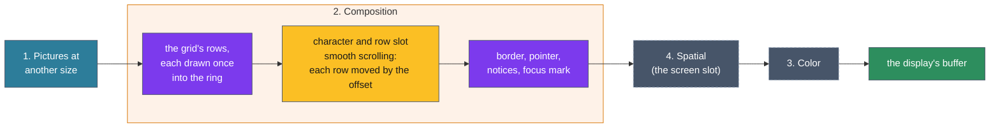

# ADR-1310: Smooth scrolling slides the text by pixels through a character and row slot under the screen slot

## Summary

- **Decided by the maintainer (2026-11-16):** vtium keeps a few rows above and below the screen drawn, the overscan, so that it can offer smooth scrolling: the text moves by pixels over a few frames instead of jumping a row at a time. The slide only lags the output by a bounded delay before it speeds up. The slide has a minimum speed, and when the output comes faster than the slide can show, the slide clamps to moving whole rows, one or several a frame, to keep up. The record also has to work out how the slide's frames line up with the loop's events. The effects pipeline gains a slot that works on characters and rows, beside the slot that works on the whole screen's texture, and the screen slot composes on top of it. Each slot states what it requires on the GPU path and on the CPU path, as the existing slots do, and vtium offers an effect only where its requirements hold. Every part sits behind a cargo feature, so the minspec build compiles none of it and keeps its memory and size figures.
- **Proposed by this record's agent, for the maintainer to confirm:** a lean on each of the five open questions, written where each applies and not decided: what slides (D1), how many overscan rows (D2), the default and a burst of output (D3, D7), DECSCLM (D8) and the CPU path (D4, D6). Beside those, the overscan rows as a request on the frame snapshot, and an id for each row that moves with it (D2); the pacing as three rules on the distance the picture lags behind (D3); the character and row slot inside the composition, after the grid's cells and before the border, the pointer and the notices (D4); a ring of drawn rows on the GPU path (D5) and on the CPU path (D6); the feature `smooth-scroll` and four keys (D7); and the work in six slices (D9).
- **Open for the maintainer:** five questions, each with a lean (Open questions): which scrolls slide, how many overscan rows, whether DECSCLM switches the slide, whether it is on by default and whether a burst of output skips it, and whether the CPU path slides.
- **Trades away:** A console that slides redraws the grid's area every frame of a slide, where it now redraws only the rows that changed, and keeps a ring of drawn rows, about the grid's own size again, for each display. The picture can lag the program's output by up to the bounded delay. On the CPU path every frame of a slide copies the whole grid's area into the display's buffer through the color table, which small hardware may not afford. Tests of the slide's frames run on given times, so the slide adds a place where time decides what a display shows.
- **One-way?** No. Everything is behind a cargo feature and a key, and a build or a console without them scrolls by whole rows as today. The keys' names and DECSCLM's meaning become expensive to change once people set them.
- **Probes:**
  - *Confident (what moves):* while the text slides, the mouse arrow, the border around the text and vtium's notices stay where they are; only the text, its cursor and its pictures move. Is that what you want?
  - *Not confident (falling behind):* when a program prints faster than the slide can show, the slide lets the picture fall up to a fifth of a second behind before it gives up and jumps by whole rows to catch up. Is a fifth of a second the right bound, or should it be shorter?
- **Inversion:** Between "scroll by whole rows", which vtium does today and which never lags, and "an animation system", where every scroll eases over a fixed time whatever the output does. The answer slides by pixels while output is slow enough to show, falls back to whole rows when it is not, and never lets the picture fall further behind than one bound.

## Context

vtium scrolls by whole rows today: each frame shows the grid at a row boundary. When a program prints a line at the bottom of the screen, every row moves up by one row's height between one frame and the next. When a person scrolls back with the wheel or Shift+PageUp, the view jumps by lines or by a page.

Smooth scrolling moves the text by pixels over a few frames instead. To slide the picture by a fraction of a row, the renderer needs the rows just outside the screen already drawn, because part of a row past the screen's edge comes into sight. Those rows are the overscan. For output that scrolls the screen up, the rows that come into sight during the slide are the ones that have just left the top of the screen. For a scroll back through the scrollback, they are the rows below the view.

The renderer works from a frame snapshot today: the visible lines, their damage, the palette, the cursor, the selection and the pictures (`Snapshot`, crates/vtium/src/term.rs). Damage is kept by screen position, so a scroll marks every row that moved, and moving the view through the scrollback marks everything (crates/vtium-term/src/damage.rs). A slide that redrew every moved row on every frame would cost a whole redraw of the grid each frame, so this record gives each row an id that moves with it, and keeps the rows already drawn.

ADR-1303 gives the GPU path a fixed pipeline of five slots: pictures at another size, composition, color, spatial and present. ADR-1304 fills the color and spatial slots from a vtlook, and ADR-1305 gives spatial shaders the time. The spatial slot works on the whole upright frame, the off-screen picture of the whole display; the maintainer calls it the screen slot. The maintainer asked on 2026-11-16 for a second kind of slot that works on characters and rows, under the screen slot, with smooth scrolling's row offset as its first effect.

A few words used below. The lag is the distance, in pixels, between where the picture shows the text and where the terminal's newest frame puts it. A slide is the time during which the lag is not zero. A row's height is the cell's height in pixels; a double-height line occupies two rows. The overscan is K rows, the rows the renderer keeps drawn beyond each side of the screen that needs them.

## C notes: the C reference's flow

The C reference scrolled by whole rows and drew no rows beyond the screen, so smooth scrolling goes past it rather than departing from a behaviour it had.

## Decision

D1 says which scrolls slide. D2 sets out the overscan rows and the rows' ids, and D3 the pacing. D4 defines the character and row slot, and D5 and D6 what it needs on the GPU path and on the CPU path. D7 names the feature and the keys, D8 covers DECSCLM, and D9 lists the work. Where a section holds the maintainer's decisions, it opens with them; the rest is this record's agent's proposal.

The figure shows the GPU path's slots from left to right, with the new slot inside the composition. The grid's rows are drawn once each into a ring of rows. The character and row slot then places the grid's area into the upright frame, each row moved by the slide's offset. The border, the pointer and the notices are drawn over it and never move. The screen slot, ADR-1303's spatial slot, works on that finished frame, and the color step comes last, as ADR-1303 D1 orders them.

### D1: which scrolls slide

**Open: question 1 of Open questions, which the maintainer answers before the build.** This section writes down this record's lean, both kinds below with the scrollback built first, so that the rest of the record has something concrete to build on; the case for and against is under Open questions. Under the lean, two kinds of scroll slide:

- **The view through the scrollback,** moved by the wheel, by Shift+PageUp and Shift+PageDown, and by the `key-scroll-up` and `key-scroll-down` keys. The lag starts at the distance the view moves, and the picture slides toward the new view.
- **New output that scrolls the whole main screen,** so that rows leave the top of the screen and enter the scrollback: a line feed on the bottom row, or a scroll up (SU) while the margins are the whole screen. The lag grows by a row's height for each row that leaves.

Under any answer, every other change jumps, as today, and ends any slide in progress with the lag at zero: a scroll inside margins narrower than the screen, a scroll on the alternate screen, an insert or delete of lines, a scroll down, a screen clear, a resize, a switch between screens, a reset, and the end of a view through the scrollback by a key the program receives. These change rows in place, or move rows that leave no scrollback, so the rows the slide would bring into sight no longer exist.

### D2: the overscan rows, and an id for each row

**Decided by the maintainer (2026-11-16):** vtium keeps a few rows above and below what the screen shows. **Proposed, the rest.**

**The snapshot asks for them.** The frame snapshot captures up to K rows beyond the screen on each side, as well as the screen's rows. Each captured row carries its position: negative above the screen, 0 up to the last row on the screen, and the screen's row count and up below it. Rows beyond the screen exist only where there is content. Nothing lies above the first line of the scrollback, and nothing lies below the screen while the view shows the newest output, which is the usual case. The snapshot reports how many rows it captured on each side, and the renderer never moves the picture toward a side with fewer rows than the lag needs. A change of K redraws everything once. K's size is open question 2; this record leans to 4 rows on each side, and the figures in D5 assume it.

**What a row beyond the screen carries.** The same as a row on the screen: its cells and styles, its damage, its selection, its line size and the pictures placed on it. The cursor is reported only on the screen's rows, so a cursor never shows in a row the slide is moving out of sight unless the terminal put it there.

**An id that moves with the row.** Each captured row has an id that moves with it. A scroll by one row keeps every row's id, so the renderer keeps the pixels it already drew for that row and draws only the row that came into the capture. An id ends when its row leaves the capture or the scrollback, or when the row changes in place, for example under a scroll inside margins; an id is never reused. vtium-term gives the ids behind the feature of D7. A build without it keeps damage by screen position, as today, and marks every moved row.

**The offset is the renderer's.** The slide's offset, from 0 up to but not including a row's height, is state the binary keeps for each display, never the terminal's. The binary reads it in the same turn of the loop that takes the snapshot, so the two describe one moment. The number of whole rows the picture still lags goes into which rows the snapshot's window shows; the fraction is the offset.

### D3: pacing

**Decided by the maintainer (2026-11-16):** the slide only lags by a certain amount before it speeds up, and the slide has a minimum speed. Past a clamp, the slide moves whole rows, one or several a frame, to keep up with what the program prints. The record works out the event timing.

**Proposed, three rules.** At each frame of a slide, vtium takes the time t since the display's previous frame and the lag d, and moves the picture by a step s, in pixels:

1. **Speed.** s = d × t / c, where c is the catch-up time, `smooth-scroll-catch-up`. So a lag closes in about c. s is at least v × t, where v is the minimum speed, `smooth-scroll-min-speed`, in rows a second times a row's height, so the last pixels of a slide do not crawl. s is at most d, so the picture never moves past the text.
2. **Whole rows past one row a frame.** When s is a row's height or more, vtium rounds s down to whole rows. A slide faster than a row a frame then moves the text by whole rows, one or several a frame, exactly as vtium scrolls today, and the fraction left over waits for the slower frames at the end.
3. **The bounded delay.** When the picture shows a state of the terminal that is older than the maximum delay, `smooth-scroll-max-delay`, or when d exceeds the K rows of overscan, vtium moves the picture at once by all the whole rows of d. Less than one row is then left to slide. So the picture is never more than the maximum delay, or K rows, behind the program's output.

For example, take a 60 Hz display, rows 20 pixels high, c at 80 ms, v at 20 rows a second and the maximum delay at 200 ms. A single new line slides over 3 frames, 50 ms, at the minimum speed. Twenty lines a second slide continuously, each frame moving about 7 pixels, and the picture runs about 80 ms behind. Three hundred lines a second exceed a row a frame, so the text moves by 5 rows a frame, as it does today. A `cat` of a large file fills more than K rows between two frames, and the text jumps. Whether a burst of more than a screen of output also skips the slide outright, and whether smooth scrolling is on by default, is open question 4; this record leans to skipping on such a burst and to off by default.

**Proposed, the event timing.** A display slides only while its head draws the console that slides, the VT is vtium's and the displays are not blanked; a VT switch, a blank or a resize ends the slide with the lag at zero.

- **Pacing by flips.** While the lag is not zero, a display asks for its next frame when its last flip completes, the rule ADR-1305 D4 sets for the frame clock. vtium never queues a frame behind another and never draws faster than the display flips. The time of each frame is the time of the loop's turn that takes it, as for the frame clock. A display that already draws on the frame clock under an animated look adds the offset to the frames it draws anyway.
- **The person's scroll.** A wheel step or a key that moves the view adds to the lag in its own direction. A scroll back during an output slide moves the view away from the output, so the output's lag is dropped and the view's lag starts. A key the program receives returns the view to the newest output, which jumps.
- **Synchronized output (DEC mode 2026).** While a program holds updates, the newest frame the display may show is the one the hold kept. A slide in progress finishes toward that frame, and no output slide starts until the hold ends or `sync-timeout` ends it. A slide the person drives through the scrollback does not wait for the hold: vtium draws the scrollback as it is, because the person asked to see it.

**Proposed, where time enters.** The offset depends on the loop's time, so smooth scrolling adds a row to docs/architecture.md's table of the places where time enters. The time decides only what a display shows, never the terminal's state. The binary's tests drive the pacing with given times and count frames, never wall time.

### D4: the character and row slot

**Decided by the maintainer (2026-11-16):** the effects pipeline gains a slot that works on characters and rows, beside the slot that works on the whole screen's texture. An effect for characters or rows is written apart from a whole-screen effect, and the screen slot composes on top of the character and row slot's output. Each slot states its requirements on the GPU path and on the CPU path. Smooth scrolling's row offset is the first effect in the new slot. In the maintainer's direction of 2026-11-14, an effect need not work on both paths: it declares what it requires, and vtium offers it only where its requirements hold.

**Proposed, where it sits.** The character and row slot sits inside ADR-1303's composition, after the grid's cells are drawn and before the border, the pointer, the notices and the focus mark. What the slot moves is therefore the grid's text, its cursor and the pictures on its rows. The border is drawn around the grid's area after the slot, the pointer and the notices over it, so none of them moves. The slot's output is the grid's area of the upright frame, which the screen slot then reads with everything else, as ADR-1303 D5 decides. This record calls it the row slot for short.

**Proposed, its contract.** An effect in the row slot works on the grid: for each row, the row's id, its place on the screen and its line size; for each cell, its column, its row and its width. An effect may move a row by a vertical offset in pixels, and it may keep state that accumulates along a row or from frame to frame. An effect never reads the drawn pixels of other rows or of the frame around it; that is the screen slot's work. Smooth scrolling uses one value, the same vertical offset for every row of the grid. A later record decides what else may fill the slot, and whether a vtlook can choose effects for it as it chooses spatial filters (ADR-1304).

**Proposed, requirements.** Each effect in the row slot states whether it runs on the GPU path, the CPU path or both, as ADR-1304 D7's `[requires]` keys state a look's requirements. Which paths smooth scrolling states is open question 5; this record leans to both, with the CPU path's cost measured first (D6). A head whose path an effect does not support draws without the effect and logs that once, as ADR-1304 D3 does for a spatial filter on the CPU path. An empty row slot adds no pass and no copy, as ADR-1303 D1 asks of every slot.

**Pictures, double-size lines and sized runs.** Every row of the grid moves by the same offset, so a picture anchored to its line (ADR-1100) slides with its rows, and a double-height pair or a run of cells drawn as one scaled glyph (ADR-1308) slides as one block.

### D5: the row slot on the GPU path

**Proposed.** While smooth scrolling is on for a display, the composition draws the grid's rows into a ring: a texture as wide as the grid, holding the screen's rows and K rows beyond each side, in which each row is drawn once, under its id. A scroll by one row rotates the ring's start and draws only the row that came into the capture. A row that changes in place is drawn again. A block that crosses the ring's end, such as a picture or a double-height pair, is drawn in two parts. The ring follows the upright frame's tiling (ADR-1303 D3), so a grid wider than the GPU's largest texture keeps the tiles the upright frame has.

At each frame the row slot draws the grid's area of the upright frame from the ring, at the slide's offset, cut to the grid's rectangle: one textured quad for each tile, plus one more where the visible window crosses the ring's end. The composition then draws the border, the pointer and the notices as ADR-1303 D3 says. With no slide in progress the slot redraws only the grid's damaged rectangles from the ring.

**Damage.** During a slide the grid's whole area changes at every frame, so present draws that area whole. The rows themselves are drawn into the ring only when they are new or changed.

**Memory.** The ring holds about the grid's own pixels again, plus 2K rows: about 9.1 MiB at 1920×1080 and 33.9 MiB at 3840×2160, with 4 rows of 20 pixels on each side. The ring is made when smooth scrolling turns on for the display, freed when it turns off, at a VT release and at a blank, and made again at a resize, a font change or a turn. An out-of-memory error while making it is ADR-1303 D9's out-of-memory case.

### D6: the row slot on the CPU path

**Open: question 5 of Open questions, which the maintainer answers before the build.** This section describes the CPU path's half as this record's lean would build it; the case for and against is under Open questions. The CPU path composes each pixel already turned into the display's buffer (ADR-1300 D5). For a slide, the path keeps the same ring of drawn rows, upright, in system memory, and at each frame of a slide copies the grid's visible window from the ring into the display's buffer, turned. The copy passes through the color table and the depth reduction as every pixel the path writes does (ADR-1303 D4). vtium never reads back from the display's buffer, because the kernel often maps such buffers write-combined, so a read from one is slow.

**Cost.** Each frame of a slide writes the grid's whole area: 7.9 MiB a frame at 1920×1080, about 475 MiB a second at 60 Hz, and a color table lookup for each pixel under a look with color filters. That is cheap on a desktop and may not be on small ARM hardware. Before the CPU path's half is built, the work measures a slide of tier 3's screens in its 1-vCPU guest and on an ARM board, and reports the frame times to the maintainer. A head whose CPU path cannot keep the display's refresh draws the slide at the rate it reaches, since rule 3 of D3 bounds the lag in time and not in frames.

### D7: the feature and the keys

**Decided by the maintainer (2026-11-16):** smooth scrolling and the row slot sit behind cargo features, and the minspec build compiles none of them, so its memory and size figures do not move. **Proposed, the rest.**

- **The feature.** One cargo feature, `smooth-scroll`, turns on the rows' ids and the overscan in vtium-term and the snapshot, the pacing in the binary, and the row slot with its ring in vtium-render. The GPU half needs `gpu` as well. A build without `smooth-scroll` scrolls by whole rows as today, keeps damage by screen position and answers DECSCLM as today (D8). `make arm-memory` and tier 3's size records judge the minspec build unchanged.
- **The keys,** in vtium.conf, and for each head in heads.conf:
  - `smooth-scroll`, `on` or `off`; its default is open question 4;
  - `smooth-scroll-catch-up`, the catch-up time c, in milliseconds, 20 to 500, default 80;
  - `smooth-scroll-min-speed`, the minimum speed v, in rows a second, 1 to 200, default 20;
  - `smooth-scroll-max-delay`, the maximum delay, in milliseconds, 50 to 1,000, default 200.

  The defaults are starting values, which the VT review tunes.
- **The overscan.** K is a row of vtium-render's bounds table, not a key; open question 2 asks for its size.

### D8: DECSCLM

**Open: question 3 of Open questions, which the maintainer answers before the build.** ADR-1000's row `DEC-4`, DECSCLM, is ignored today, with the note "a console has no smooth scroll to switch". Once smooth scrolling exists, DECSCLM has something to switch: set (CSI ? 4 h) asks for smooth scroll and reset (CSI ? 4 l) asks for jump scroll (ctlseqs). This record leans to vtium.conf's and heads.conf's `smooth-scroll` setting each console's state at start, DECSCLM changing it for that console afterwards, and RIS returning it to the configured state, as for the cursor's style. DECRQM answers the console's state, 1 when it slides and 2 when it jumps. In a build without `smooth-scroll`, the row stays as it is, and DECRQM answers as today.

When this record is accepted, `DEC-4` moves from ignored to planned, with the issue for smooth scrolling and the layer `top`. Its status becomes supported when the slice that builds DECSCLM lands with its test (D9).

### D9: the work

**Proposed.** Each slice builds and tests on its own, in this order:

1. **The rows' ids and the overscan,** in vtium-term and the snapshot, behind `smooth-scroll`, with no visible change: the ids, their end, the capture of K rows on each side with its counts, and the tests of D2.
2. **The pacing,** in the binary: the lag, D3's three rules, the flip pacing, the person's scroll, the hold, the keys of D7, and the tests of D3 on given times.
3. **The row slot on the GPU path:** the ring, the slot's draw at the offset, the damage rule and the ring's life (D5), with tier 2's frames of a slide.
4. **The measurement of the CPU path** (D6), reported to the maintainer before slice 5.
5. **The row slot on the CPU path,** if open question 5 keeps it.
6. **DECSCLM** (D8): the mode's handling, its DECRQM answer and ADR-1000's row.

## What the other records change to fit

When this record is accepted, these passages change, each with a dated note:

- **ADR-1303 D1:** "The slots and their number never change" gains the row slot inside slot 2, the composition, with its row in the table: its inputs, the ring and the slide's offset; what it gives, the grid's area of the upright frame; its no-op, the composition as D3 describes it; the paths, both, as each effect states; and its damage, the grid's whole area during a slide.
- **ADR-1303 D3:** while smooth scrolling is on for a display, the composition draws the grid's rows into the ring, and the row slot places them into the upright frame before the border, the pointer and the notices.
- **ADR-1303 D6:** present draws the grid's whole area at every frame of a slide.
- **ADR-1304:** its spatial slot is the screen slot this record names, and composes over the row slot's output. ADR-1304's spatial filters read the frame after the row slot, so a CRT look curves the sliding text with everything else.
- **ADR-1305 D4:** a display that slides is paced by its flips as a display on the frame clock is, and a frame of a slide is not a clock frame: a shader that reads the time gets the clock's ticks only under the clock's conditions.
- **ADR-1000:** the row `DEC-4`, as D8 says.

Outside the records, the slices change docs/architecture.md's table of where time enters, vtium.conf's key table, its example and docs/config.md, ADR-1401 D3's list of a head's keys and the head file's template, and vtium-render's bounds table.

## Verification

- **The ids move with the rows.** In vtium-term's tests, a line feed on the bottom row keeps every row's id at one row higher, gives the new row a new id and ends the id of the row that left the capture; a scroll inside margins ends the ids of the region's rows; an id is never given twice in a run of a million scrolls. A planted scroll that renumbers every row fails.
- **The capture reports what exists.** A screen with no scrollback captures no row above it; a view at the newest output captures no row below it; a view three rows into the scrollback captures three rows below and K above.
- **The pacing, on given times.** The binary's tests drive the lag with given flip times: one new line at 60 Hz with the defaults finishes its slide in 3 frames; at 20 lines a second the picture settles about the catch-up time behind and never passes the maximum delay; at 300 lines a second every step is a whole number of rows; a lag older than the maximum delay jumps in the next frame, leaving less than a row; a lag past K rows jumps at once. A planted pacing without rule 3 lets the lag grow past K rows under a steady stream, and fails. No test reads the wall clock.
- **Jumps end slides.** A screen clear, a resize, a switch to the alternate screen and a RIS during a slide each leave the lag at zero in the next frame.
- **The hold.** Under DEC mode 2026, an output slide in progress reaches the held frame and stops; output during the hold starts no slide until the hold ends; a person's scroll through the scrollback during the hold slides.
- **What moves and what stays.** On the stand-in GL and in tier 2 under llvmpipe, a frame in the middle of a slide shows the grid moved by the offset and cut to its rectangle, while the border, the pointer and a notice are where a frame without the slide puts them. A planted slot that moves the whole upright frame fails.
- **The ring draws each row once.** On the stand-in GL, which counts draws, a slide of ten lines draws each new row into the ring once and redraws no other row. A planted ring that redraws every row each frame fails the count.
- **Pictures and sized lines slide as one.** In tier 2, a picture anchored to a line and a double-height pair keep their place relative to the text in every frame of a slide.
- **The CPU path matches.** If the CPU path slides, tier 2 compares its frames of a slide exactly with vtium's own goldens, which stay provisional until the maintainer reviews them, and the GPU path's frames with the CPU path's within ADR-1303's tolerance.
- **DECSCLM.** With the feature, CSI ? 4 l stops the slide for that console, CSI ? 4 h starts it, DECRQM answers 2 and 1, and RIS returns the configured state. Without the feature, DECSCLM changes nothing, as today.
- **The minspec build does not move.** `make arm-memory` and tier 3's size records give the same figures before and after the work.

## Open questions

These are open for the maintainer, who answers them before the build. Each carries this record's lean and a short case for and against.

1. **Which scrolls slide: scrolling back through the scrollback (the wheel, Shift+PageUp), new output scrolling the screen, or both?** Lean: both, with the scrollback built first. For: a slide through the scrollback is where a person's eye follows the text most closely, and it needs no pacing against a program, so it is the simpler first step; output that slides is what DECSCLM asks for, and what makes a slow log readable as it scrolls. Against: an output slide brings the pacing, the bounded delay and the hold into play, which is most of this record's risk; sliding the scrollback alone would need none of D3's rules but the first.
2. **How many overscan rows?** Lean: as many as one frame's slide can reveal, a small fixed number, which this record proposes as 4 on each side. For: the bounded delay of D3 caps the lag at K rows, so K only needs to cover the lag at the slowest frame rate, and 4 rows cost little memory. Against: a larger K lets the slide hold its pace through a burst of a few more lines before it jumps, and a K tied to the screen's height would scale with a tall portrait display.
3. **Does smooth scrolling follow DECSCLM, so a program can turn it on and off, or only vtium.conf?** Lean: vtium.conf sets the start, and DECSCLM is respected after, as with the cursor's style. For: DECSCLM is the standard switch, and a program that needs fast output, such as a pager redrawing a page, can ask for jump scroll; ADR-1000's row then becomes supported. Against: a program written for a VT100 may set smooth scroll expecting the VT100's slow pace, and a person who turned smooth scrolling off in vtium.conf may not want a program to turn it back on.
4. **Off by default, or on? And does a fast stream of output, such as `cat` of a large file, skip the slide so throughput is not lost?** Lean: off by default while the slide is new, and skip the slide when more than a screen arrives at once. For: off by default keeps vtium's behaviour unchanged for everyone until the VT review has tuned the pacing; skipping a screenful costs nothing in throughput, since the pacing never delays the terminal itself, only the picture. Against: a feature that is off is a feature few people find; and with rule 3 of D3 bounding the lag anyway, an extra skip rule adds one more threshold to test.
5. **The CPU path on small hardware: slide only on the GPU path, or on both?** Lean: both, with the CPU path's cost measured first (D6). For: most of vtium's small targets draw on the CPU, and the maintainer's direction allows an effect to declare the CPU path once its cost is known; a desktop CPU copies the grid at 60 Hz easily. Against: the copy writes the whole grid's area every frame, 475 MiB a second at 1920×1080, which may take most of a small board's memory bandwidth, and the GPU path does the same slide with one textured quad.

## Consequences

### Positive

- Text that scrolls slowly stays readable while it moves, and a scroll through the scrollback keeps the eye's place.
- The row slot gives a home to effects that work on characters and rows, apart from the whole-screen effects of ADR-1304, so each kind is written on its own and both can run at once.
- The rows' ids let the renderer keep work it already did across a scroll, which also helps a build that does not slide once the ids exist.
- DECSCLM gains a real meaning, and a program can ask for jump scroll when it needs throughput.

### Negative

- A slide redraws the grid's whole area every frame and keeps a ring of rows about the grid's own size for each display.
- The picture can lag the program's output by up to the maximum delay, 200 ms by default.
- On the CPU path, a slide costs a copy of the grid's area each frame, which may be too much for small hardware.
- Smooth scrolling adds a place where the loop's time decides what a display shows, and four keys to document and test.

### Neutral

- The minspec build compiles none of it, and a build without the feature scrolls as today.
- ADR-1303's five slots keep their numbers: the row slot sits inside slot 2.

## Alternatives Considered

- **Shift the whole upright frame at present.** Present could offset the whole frame by the slide's fraction, with no new slot. That moves the border, the pointer and the notices with the text, and a frame shifted by a fraction shows a band of the border's color at one edge. Rejected for what moves.
- **Redraw the grid at the offset every frame, with no ring.** Simpler, and it needs no ids. Each frame of a slide then draws every cell again, which the GPU path could afford and the CPU path could not, and it throws away the work of every row already drawn. Rejected for the cost on the CPU path and for the waste on both.
- **A fixed rate, as a VT100 slid at.** A fixed number of lines a second never needs a bounded delay, but it falls ever further behind any program that prints faster, which is most programs on a modern console. Rejected for throughput: the maintainer asked for a slide that speeds up and clamps.
- **Smooth scrolling as a spatial filter in a vtlook.** A shader in the screen slot could move pixels, but it sees only the finished frame: it cannot tell the text from the border or the pointer, and it has no rows beyond the screen to bring into sight. Rejected: the maintainer asked for a slot of its own that knows rows.
