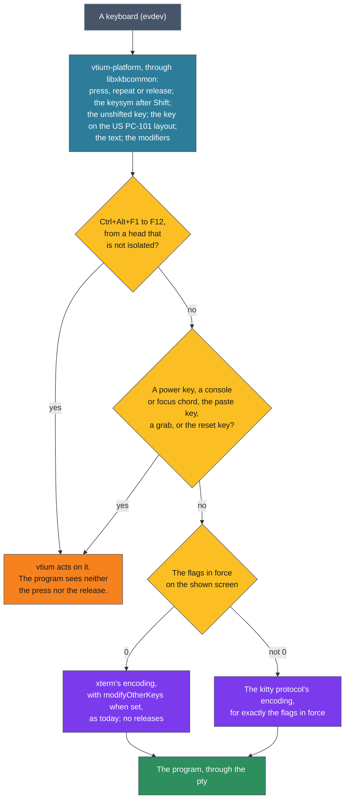

# ADR-1005: The kitty keyboard protocol: vtium-term encodes keys by a stack of flags for each screen, and vtium-platform reports key releases and each key's other forms

## Summary

- **Decided:** vtium implements the kitty keyboard protocol from its published specification. A program opts in by pushing flags with `CSI > flags u`, and until it does, every key sends exactly the bytes it sends today. vtium-term keeps the flags and encodes every key. It keeps one stack of flags for the main screen and one for the alternate screen, each holding eight levels, and a push onto a full stack drops the oldest level. RIS and DECSTR clear both stacks, a switch between the screens leaves each stack as it is, and a new session starts with none. `CSI ? u` answers the flags in force, which never include a flag vtium does not implement. While the flags in force are not 0, the protocol decides every key's bytes, and modifyOtherKeys waits until they are 0 again. vtium-platform reports releases, the key's unshifted form, its key on the US PC-101 layout, and the NumLock, Hyper and Meta modifiers. Every key vtium takes for itself today stays vtium's, press and release alike, and a program that asked for releases gets one for every press it got. The protocol is in every build, minspec included.
- **Trades away:** A program that crashes on the alternate screen leaves its flags there, and the next program that uses the alternate screen inherits them, as in kitty, foot and Alacritty. With flag 8 left set, Enter and Ctrl+C reach the shell as escape codes, so the user cannot type `reset` and needs another way out (the second probe). The host's key report grows from four values to a structure, and the replay interface's `key` command gains fields. Keys with no xterm encoding, such as F21 to F35 and the media keys, still send nothing to a program that has not opted in, where kitty would send them as `CSI u`.
- **One-way?** No. A program receives the protocol only after it asks for it, and the query tells it which flags work, so each slice can widen what vtium accepts without breaking a program. The replay interface gains fields in a minor version, and every existing golden stays.
- **Probes:**
  - *Confident (vtium's keys stay vtium's):* the keys vtium takes for itself today stay vtium's while a program uses the protocol: Ctrl+Alt+F1 to F12, the console and focus chords (Ctrl+Super with an arrow, Return or BackSpace), the power keys when they are bound, Shift+Insert to paste, Shift with Up, Down, Page Up or Page Down to scroll, Ctrl with plus or minus to zoom, Super with plus or minus to rotate, and Ctrl+Shift with Up or Down to jump between prompts on the main screen. A program never sees them, pressed or released. Is that right?
  - *Not confident (a key that undoes a stuck keyboard):* Ctrl+Shift+Delete resets the shown console the way the `reset` command does, clearing its screen, its scrollback and every keyboard mode. That way a program that dies and leaves the keyboard sending escape codes for Enter can be undone from the keyboard. kitty binds the same key to its own reset by default. The key is a new `grab-reset` key in vtium.conf, which can be unset. Lean: yes, bound by default. Should vtium take it?
- **Inversion:** The decision sits between "keys are xterm's bytes, and a program that wants to tell more keys apart has no way to ask", which is vtium today, and "every key the bytes cannot tell apart is sent as `CSI u` whether the program asked or not", which kitty's legacy mode does for keys with no legacy encoding and which fixterms proposed. vtium sends the protocol only to a program that asks, with the flags it asked for, and leaves every other program's bytes as they are.

## Context

A program running in a terminal reads keys as bytes. In xterm's encoding, which vtium sends today, many keys share bytes: Escape is the first byte of every escape sequence, Ctrl+I is Tab, Ctrl+M is Enter, and Ctrl+Shift+R is Ctrl+R. No key sends anything when it is let go, and a modifier key pressed alone sends nothing. Editors such as Neovim, Helix and Kakoune, shells such as fish and nushell, and libraries such as crossterm and notcurses use the kitty keyboard protocol to tell every key and its release apart. ADR-1000 lists the protocol as the row `input.kitty-keyboard`, planned, and the capability probe `kitty-keyboard` is listed as missing. vtium already supports xterm's modifyOtherKeys (`input.modify-other-keys`), and it ignores fixterms (`input.fixterms`), the earlier proposal the kitty protocol replaces.

The protocol is progressive. A program sets flags, and each flag adds to what the terminal reports:

| Flag | Name in the specification | What the program gets |
|---|---|---|
| 1 | Disambiguate escape codes | Escape, and keys held with Alt or Ctrl, as `CSI number ; modifiers u`, and the keypad's keys as keys of their own; Enter, Tab and Backspace keep their bytes |
| 2 | Report event types | Repeats and releases, marked in the modifiers field |
| 4 | Report alternate keys | The shifted key and the key on the US PC-101 layout, beside the key's own code |
| 8 | Report all keys as escape codes | Every key, text keys and modifier keys included, as an escape code, and no text |
| 16 | Report associated text | The text a key makes, inside its escape code |

The specification leaves several things to the terminal: how deep the stacks go, what RIS and DECSTR do to them, what a switch between screens does, and what happens when a program exits without popping. It also leaves open which keys the terminal keeps for itself. kitty's source code is GPL-licensed, and vtium never reads it (CONTRIBUTING.md). So these answers come from the specification, from kitty run as a program, from Alacritty run the same way, and from foot's source code, which is MIT-licensed (`basis`).

How the three terminals answer the open questions:

| Question | kitty 0.49.2, run | foot at 152487e, source read | Alacritty 0.17.0, run |
|---|---|---|---|
| Levels kept on each screen | 8, the oldest dropped | 8, the oldest overwritten | at least 300 |
| Flags read back after a push of 255 | 127 | 31 | 31 |
| The alternate screen's flags after leaving it and coming back | kept | kept | kept |
| DECSTR | both screens set to 0 | both screens set to 0 | no change |
| RIS | both screens set to 0 | both screens set to 0 | both screens set to 0 |

Reading vtium's input path for this record turned up a gap. vtium-term's README says the host adds NumLock to a key's modifiers for mode 1035, but the binary passes vtium-platform's modifier bits unchanged, and those have no NumLock bit, so mode 1035 never sees NumLock on (`basis`). The protocol needs the same bit, and D8 adds it.

## Decision

The figure shows the path a key takes. vtium-platform reads the key, the binary offers it to each key vtium keeps for itself in turn, and only a key that none of them takes reaches vtium-term's encoder, which reads the flags in force on the shown screen.

### D1: where the encoding lives

vtium-term encodes every key, in both encodings. It already holds the xterm encoding, modifyOtherKeys and every mode that changes a key's bytes, and the flags are terminal state that a program sets through the pty, as those modes are. Keeping the encoder in vtium-term also lets tier 1 replay a key and check its bytes with no keyboard.

vtium-platform supplies the key events, because it alone reads the keyboard and the keymap. The binary turns each platform event into vtium-term's own description of a key and decides, through the key order (D7), whether a key reaches vtium-term at all. vtium-term never depends on vtium-platform: the binary fills vtium-term's key description from the platform's event, as it fills the four values `Terminal::key` takes today.

### D2: what the host tells vtium-term about a key

`Terminal::key` takes one description of a key, in place of the four values it takes today. The description holds:

- whether the key was pressed, repeated or released;
- the keysym the key makes with the modifiers held, as today;
- the keysym the key makes with no modifier at all in the active layout, which is the unshifted key;
- the key's character on the US PC-101 layout, which is the base layout key;
- the ASCII layout's keysym, which Ctrl reads in xterm's encoding, as today;
- the text the key makes, after compose, as today;
- the modifiers held, with the effect of this event included.

vtium-term's modifier bits gain Hyper and Meta beside Shift, Lock, Ctrl, Alt, Super and NumLock. vtium-term maps them to the protocol's bits (shift 1, alt 2, ctrl 4, super 8, hyper 16, meta 32, caps_lock 64, num_lock 128) only where it encodes a key. When the flags in force are 0, vtium-term sends nothing for a release, so a host that reports releases changes nothing for a program that has not opted in.

### D3: the flag stacks

Each screen keeps its own stack of flags. The top of the main screen's stack is in force while the main screen is shown, and the top of the alternate screen's stack is in force while the alternate screen is shown. A stack holds at most eight sets of flags: the set in force and seven saved sets. The bound is a row of vtium-term's bounds table, so a stream of pushes cannot grow the terminal's memory.

- `CSI > flags u` saves the flags in force and puts `flags` in force. A push with no number puts 0 in force. When the stack already holds eight sets, the oldest saved set is dropped, as the specification requires.
- `CSI < number u` pops `number` sets, 1 when the number is left out. The newest saved set that remains comes back into force. A pop of more sets than are saved leaves the stack empty and the flags 0, as the specification says a pop that empties the stack does. `CSI < 0 u` pops nothing, as kitty 0.49.2 does.
- `CSI = flags ; mode u` changes the flags in force and saves nothing. Mode 1, or no mode, sets exactly `flags`. Mode 2 sets the bits `flags` holds and leaves the others. Mode 3 clears the bits `flags` holds and leaves the others. Any other mode changes nothing.
- A flag bit vtium does not implement is dropped as it arrives, by a push or a set alike. The specification documents five bits, 1 to 16, so vtium keeps at most 31. While the work is in slices (D13), vtium also drops the bits of each flag it does not implement yet.

The eight levels follow kitty 0.49.2 and foot, which keep eight. The specification asks the terminal to bound the stack and gives no number, and eight levels cover a program that pushes inside a program that pushed, several times over.

### D4: what resets the flags

- **RIS** sets both screens' stacks to empty and their flags to 0. RIS returns the terminal to its initial state, and kitty, foot and Alacritty all clear the flags on RIS. vtium's terminfo entry sends RIS as its reset string, so the `reset` command clears them.
- **DECSTR** does the same as RIS to both stacks. vtium's DECSTR already resets modifyOtherKeys and the other modes that change a key's bytes, and kitty and foot clear the flags on DECSTR too.
- **A switch between the screens**, by mode 47, 1047 or 1049, changes neither stack. The program on the alternate screen and the program on the main screen each keep their own flags, which is the reason the specification asks for two stacks. kitty, foot and Alacritty all keep the alternate screen's flags when a program leaves it and enters it again.
- **A program that exits without popping** leaves its flags in force on its screen, because the terminal cannot see a program inside the session end. The flags stay until a program pops or sets them, or until RIS or DECSTR, or until the session ends.
- **A new session** starts from RIS (`crates/vtium/src/head/session.rs`), so flags never pass from one session to the next.
- Each console of each head has its own terminal, so its own two stacks.

### D5: the query and the reply rule

`CSI ? u` is answered with `CSI ? flags u`, where `flags` is the flags in force on the shown screen, written as a decimal number. The reply is a number vtium re-encodes from its own state, so it keeps the reply rule (docs/architecture.md, "Determinism"). It is written under a `Query` variant of its own, so the reply rule's test sends hostile text through it with every other query.

A program finds out whether vtium supports the protocol by sending `CSI ? u` and then DA1, as the specification says. vtium answers both, the protocol's reply first. Because a flag vtium does not implement is dropped as it arrives (D3), a program that sets flags and then asks reads back exactly the flags vtium honours, as the specification's note on partial implementations asks.

### D6: which encoding a key gets, and modifyOtherKeys

- **While the flags in force are 0**, every key sends what it sends today: xterm's encoding, with modifyOtherKeys at the level a program set, and with DECCKM (mode 1), the keypad modes (DECKPAM and mode 66) and modes 1034, 1035 and 1036 as they stand. A functional key with no xterm encoding, such as F21 or a media key, sends nothing, as today. The specification allows a terminal to ignore such keys in legacy mode, and ADR-1000 ignores fixterms, whose `CSI u` encoding the protocol's legacy mode extends.
- **While the flags in force are not 0**, the specification decides every key's bytes, for exactly the flags in force. Where a flag the program set does not cover a key, the specification's own legacy section decides it, and DECCKM applies only where that section names cursor key mode. modifyOtherKeys and modes 1034, 1035 and 1036 are not consulted. The host's Backspace setting still chooses DEL or BS for Backspace's legacy byte, which the specification lets a program learn from terminfo's `kbs`.
- **modifyOtherKeys keeps its own state.** `CSI > 4 ; n m` still sets its level while the flags are not 0, and `CSI ? 4 m` still reports that level. The level takes effect again once the flags in force are 0. foot chooses between its two encodings the same way, by whether the flags in force are 0.

### D7: the keys vtium keeps for itself

The protocol changes only what reaches the encoder. The key order stays as it is: the VT's keys, then the power keys, then the console and focus chords, then the paste key, then the grabs, then DECARM, then the encoder (`crates/vtium/src/app.rs`). The reset key (D10) joins the grabs. ADR-1401 decides the VT keys, the rescue key, the chords and the isolated head, and none of them changes:

- Ctrl+Alt+F1 to F12 and the XF86Switch_VT keys switch the VT from a keyboard of a head that is not isolated. From a keyboard of an isolated head they reach the session as keys, and so the encoder.
- The rescue key, the shown VT's own Ctrl+Alt+F key, is taken before any routing.
- The console chords, Ctrl+Super with Right, Left, Return and BackSpace, are taken from every keyboard. The focus chord, Ctrl+Super with Up and Down, is taken from a roaming keyboard and reaches the session from a claimed one.
- The power keys, the paste key and the grabs are taken as today. The prompt jumps, Ctrl+Shift with Up and Down, are taken on the main screen only (ADR-1002).

A key vtium takes is vtium's for its whole life. vtium remembers which keys of each keyboard it took, and it takes their repeats and their releases as well, so a program never sees a release whose press it did not see.

A program that asked for releases gets one for every press it got. The binary remembers, for each console, the keys it delivered there and that are still held. When the console stops receiving the keyboard while such a key is held, the binary sends the console a release for each of them. That happens when the VT is switched away, when a console chord shows another console, when the focus chord moves the keyboard to another head, and when the keyboard is unplugged. vtium-term encodes these releases only while flag 2 is in force, as it does any release. The specification does not say what a terminal does with keys held when it loses the keyboard. Without this rule, a program that saw Ctrl pressed before a VT switch would believe Ctrl is still held when the VT comes back, because vtium-platform starts a fresh keyboard state when it wakes.

### D8: releases, repeats and the modifiers, from vtium-platform

- **Releases.** A keyboard reports a release for every key whose press it reported. A key whose press went into a compose sequence reports no release, because no press was reported for it. Today the platform reports presses only, and a release only stops the repeat.
- **Repeats.** vtium's own repeat timer keeps making the repeats, marked as repeats, as today. DECARM still decides whether the binary sends them on, so a program that turned repeat off with mode 8 gets no repeat events.
- **NumLock.** The platform reports NumLock among the modifiers while it is on. This also gives mode 1035 the NumLock state that vtium-term's README says the host adds.
- **Hyper and Meta.** The platform reports Hyper and Meta when the keymap gives them a modifier of their own, one that neither Alt nor Super uses. In xkeyboard-config's default keymaps, Meta shares Alt's modifier and Hyper has none, so there the platform reports Alt and Super alone, and a program never sees Meta set beside every Alt. The slice that builds this proves it against the libxkbcommon vtium links, with a keymap that gives Hyper a modifier of its own.
- **The modifier key's own event.** The platform reads a key's modifiers after xkb's state has taken the key, so pressing Ctrl reports Ctrl set and releasing it reports Ctrl clear, as the specification requires. That is how the platform builds its events today.

### D9: the unshifted key and the base layout key

- **The unshifted key** is the keysym the key makes at the first shift level of the active layout. vtium-term sends it as the key's code: Ctrl+Shift+A is sent with the code 97, `a`. When a modifier the protocol cannot encode chose the key's symbol, such as AltGr or the level-five shift, the platform reports no unshifted key, and vtium-term sends the symbol the key made. Otherwise AltGr+Q, which makes `@` on a German layout, would be sent as Q with no modifier, and a program could not tell it from Q. foot follows the same rule.
- **The base layout key** comes from a fixed table in vtium-platform, from the kernel's key code to the character the key types on the US PC-101 layout. The kernel names its key codes after their places on that keyboard, `KEY_Q` and `KEY_A` among them, so the table gives exactly the key the specification describes, whatever layout the user has configured. On a Russian layout, Ctrl+С is sent with the base layout key 99, `c`. A key the PC-101 layout lacks, such as the extra key of ISO keyboards, has no base layout key. vtium-term sends the base layout key only under flag 4, and only where it differs from the key's code.
- **The shifted key** is the keysym the key makes with the modifiers held. vtium-term sends it under flag 4 only while Shift is held, as the specification says.

### D10: a key that resets the shown console

This item waits on the second probe. It is written as the lean.

A new key in vtium.conf, `grab-reset`, bound to Ctrl+Shift+Delete by default, resets the shown console as RIS does: both flag stacks, modifyOtherKeys and every other mode return to their initial state, and the screen and the scrollback are cleared. It is a grab, matched with the other grabs, after the chords and before the encoder. A user can unset it, as every grab key can be unset. kitty binds the same key to its own reset by default (`basis`).

The key exists because a program that dies with flag 8 set leaves a shell that receives every key as an escape code, Enter and Ctrl+C included. The specification keeps Enter, Tab and Backspace as plain bytes under flags 1 and 2 so that a user can type `reset`, but flag 8 takes them too. On a desktop, the user closes the window. On the console there is no window, and the chords only lead to another console.

### D11: in every build

The protocol is in every build, minspec included, with no cargo feature. Its state is about sixteen bytes for each terminal, eight levels of one byte for each screen, and its code is the encoder and the specification's table of more than a hundred functional keys. The program that most needs to tell Escape from the start of an escape sequence, an editor, runs on a small machine as on a large one. The first slice measures how much the minspec binary grows and records it in vtium-term's README.

### D12: ADR-1000's rows and the replay interface

- `input.kitty-keyboard` moves from planned to partial when the first slice lands, and to supported when the last one does. Each change is an edit to ADR-1000's table, in the slice that earns it. The capability probe `kitty-keyboard` moves to works in the first slice, which answers `CSI ? u`.
- `input.fixterms` stays ignored, and its test `no_key_sends_fixterms_csi_u` keeps passing: with the flags at 0, no key sends `CSI u`.
- The replay interface's `key` command gains fields for the event type, the unshifted key, the base layout key and the text, and its `mods` range grows to take NumLock, Hyper and Meta. These are additions, so the interface's minor version rises and every existing golden stays as it is.

### D13: the work, in slices

Each slice is a card of its own, branched from `integration`, and lands in this order. Each names what it proves.

1. **The stacks, the query and flag 1** (vtium-term, the replay interface, ADR-1000's row). The two stacks with their bound, push, pop and set, the resets, the reply, the key description of D2 filled from what the host reports today, and flag 1. Bits 2, 4, 8 and 16 are dropped as they arrive. Proves: a program that pushes 1 gets Escape, Alt and Ctrl keys and the keypad in the forms the specification gives; the query reports 1 after a push of 31; each screen keeps its own flags across a switch; RIS and DECSTR clear both; a ninth push drops the oldest level; every existing input test passes unchanged, so the flags at 0 change no byte; modifyOtherKeys is not consulted while the flags are not 0 and works again once they are 0; the minspec binary's growth, measured.
2. **Releases, repeats and the modifiers** (vtium-platform, the vtium binary, vtium-term, the replay interface). Release events from the platform, the NumLock, Hyper and Meta modifiers, the binary's taken keys and its releases on leaving (D7), and flag 2. Proves: every press a program got is matched by exactly one release, across a VT switch, a console chord, a focus move and an unplugged keyboard; a key vtium took never reaches the program, press or release; Enter, Tab and Backspace send no release under flag 2 alone; mode 1035 sees NumLock; a keymap that gives Hyper a modifier of its own reports it, and the default keymap reports neither Hyper nor Meta.
3. **The key's other forms** (vtium-platform, vtium-term, the replay interface). The unshifted key, the base layout key table, the shifted key, and flags 4, 8 and 16. Proves: Ctrl+С on a Russian layout carries the base layout key 99; Ctrl+Shift+A is sent with the code 97 and, under flag 4, the shifted key 65; AltGr+Q on a German layout is sent as `@`; under flag 8 every key is an escape code, modifier keys and their releases included; under flag 16 the text arrives inside the code and holds no control character. With this slice `input.kitty-keyboard` is supported.
4. **The reset key**, if the maintainer answers yes (vtium-settings' key table, the vtium binary, the generated `docs/config.md` and `vtium.conf.example`). Proves: Ctrl+Shift+Delete resets the shown console and no other, under flag 8 too; an unset `grab-reset` sends the key on to the program.

A case the specification leaves unclear while a slice is built is settled by running kitty as a program, and the crate's README records what kitty did. Keys reach kitty under Xvfb through XTEST only once its window has the keyboard focus, which this record's runs did not achieve.

## Consequences

### Positive

- Editors and shells built for the protocol tell Escape from Alt, Ctrl+I from Tab, and every modifier combination apart on the console, and games and editors that need releases get them.
- A program that has not opted in sees no change at all, so every existing input test and golden keeps passing.
- The flags never outlive a session, and `reset` clears them.
- Mode 1035 gets the NumLock state it was written for.
- A Russian, Greek or other non-Latin layout keeps Ctrl shortcuts working in programs that match the base layout key.

### Negative

- `Terminal::key` changes its signature, and every caller and test that sends a key changes with it.
- The binary keeps a small record of held keys for each console and of the keys it took, and it must send releases at every point where a console stops receiving the keyboard. A missed point leaves a program believing a key is held.
- A program that leaves flag 8 set on the alternate screen leaves the next full-screen program receiving escape codes too, until a reset.
- Shift with Up and Down still scrolls the view, so an editor cannot use Shift+Up to select while vtium takes it, under the protocol as under xterm's encoding.

### Neutral

- vtium-platform's key events grow by the event type, the unshifted keysym and the base layout key, and its modifiers by three bits.
- The replay interface's minor version rises.
- The terminfo entry gains nothing: no terminfo capability describes the protocol, and a program detects it by its query.

## Alternatives Considered

- **Encode in the binary, or in vtium-platform.** Rejected: the flags are terminal state that the pty sets, and the encoder needs the modes vtium-term already holds; tier 1 could no longer check a key's bytes.
- **Clear the alternate screen's flags whenever a program enters the alternate screen.** Not taken: it would spare the next full-screen program a crashed program's flags, but kitty, foot and Alacritty all keep them, and a program that follows the specification pushes after it enters the alternate screen and pops before it leaves. The reset key (D10) answers the crash instead.
- **Keep DECSTR away from the flags, as Alacritty does.** Rejected: vtium's DECSTR resets every other mode that changes a key's bytes, and kitty and foot clear the flags on DECSTR.
- **A deeper stack, as Alacritty keeps.** Rejected: eight levels are what kitty and foot keep, and every level is memory a program's output controls.
- **Keep the newest pushes and drop the push that overflows, as vtium's color stack does with xterm.** Rejected: the specification says a push onto a full stack evicts the oldest entry.
- **Send keys with no xterm encoding as `CSI u` even with the flags at 0, as kitty does.** Rejected: a program that has not opted in might not parse them, and ADR-1000 ignores fixterms, whose encoding this is. The specification allows either.
- **Take the base layout key from the first layout the user configured, as foot does.** Rejected: a user with only a Russian layout would get a Cyrillic base layout key, and Ctrl+C shortcuts would fail in the programs the key exists for. The kernel's key codes already name the PC-101 keys.
- **Hand the grabs to the program while it uses the protocol.** Not taken: the user would lose scrolling, zooming and pasting in exactly the programs that use the protocol. The first probe checks this.
- **Watch the pty's foreground process group, and clear the flags when the shell gets the terminal back.** Rejected: no specification describes it, the terminal cannot tell a program that exited from one that was suspended, and a shell such as fish sets its own flags at each prompt.
- **Put the protocol behind a cargo feature, as right-to-left text is.** Rejected: its cost is small and measured in the first slice, and the programs that use it run on small machines too.
