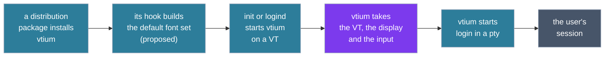
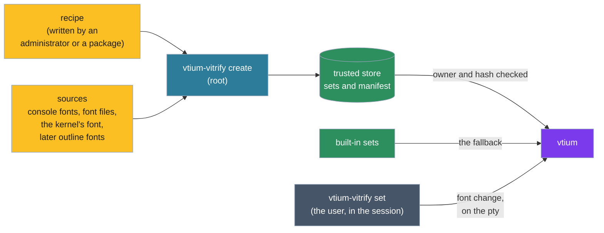

# VTium's concepts

This page introduces the ideas behind vtium: what it is, the programs it is made of, how it is installed and started, and how it is used. It explains, at the level of concepts; each section links to the decision record or document that holds the detail, and the commands and setting names live there too.

## What VTium is

vtium is a terminal for the Linux virtual console, the full-screen text terminals the kernel provides, each called a VT. It draws the terminal itself, straight to the display through the kernel's display interface (KMS/DRM, or the older fbdev framebuffer where that is all a machine has), with no display server. A program run in vtium sees a modern terminal: colors, text styles, Unicode and mouse reporting, with images to come. The features vtium supports, ignores or refuses are listed in [ADR-1000](architecture/term/ADR-1000-the-modes-and-features-vtium-supports.md).

These three screens are vtium's own drawing, made in memory by its renderer: the color palette, double-width Japanese, Chinese and Korean text, and the underline styles in their own colors.

  

vtium is written in Rust, and is inspired by kmscon and libtsm, the C terminal and terminal library it learned its behaviour from. Their code, in the maintainer's fork, is the C reference: vtium is judged against what it did, and goes further where the specifications do ([architecture.md](architecture.md#beyond-the-c-reference)).

### Small machines first

vtium is built to run on small machines first and large ones as well. Its default build, minspec, is the smallest complete console: it draws through the CPU into a plain memory buffer the display shows, uses bitmap fonts, and needs no GPU; images, outline fonts and a GPU path are features built on top of it. Its yardstick is a single-board computer with ARM cores and 512 MB of memory or less, and its smallest display is a 320x240 panel, where an 8x8 font gives a grid of 40 columns by 30 rows. The same build draws on large displays too. [architecture.md](architecture.md#the-minspec-build) sets out the machine, the display floor and what is promised at each size.

## From install to use

## The pieces

**vtium** is the console itself: one process per VT, which owns that VT, its display and its input devices, and runs a session in a pseudo-terminal (a pty, the kernel's pair of devices that lets one program act as the terminal of another). It is the only piece needed to use vtium.

**vtium-vitrify** is a separate program that prepares fonts for the console ahead of time, as [Fonts](#fonts-as-vitrified-sets) describes. It belongs to a proposed design and is not built yet.

**vtium-clipboard**, also installed as the short name `vticlip`, is an optional tool that gives scripts the console's clipboard from the command line, as `pbcopy` does on macOS. It is planned (vtium/vtium#113), outside the minspec build.

Alongside the programs, an installation carries a service unit for systemd, a terminfo entry that tells programs what vtium can do, and an example configuration listing every setting at its default.

### What runs as root, and what as the user

The figure shows vtium's pieces in two bands, those that run as root above and those that run as the user who logged in below, with the pty as the only path between them; dashed pieces are not built yet.

![Two bands. Above, running as root: the kernel's devices (the VT, the display, keyboards and pointers) joined to vtium, the console; vtium-vitrify create writing font sets into the trusted store, which gives vtium checked sets. Between the bands, the pty, joined to vtium by bytes both ways. Below, running as the user who logged in: vtium-vitrify set, shell and programs, and vtium-clipboard, each joined to the pty. vtium-vitrify create, the trusted store, vtium-vitrify set and vtium-clipboard are drawn dashed, as proposed or planned.](figures/concepts-pieces.svg)

The console runs as root for its whole life, as the C reference did. Root lets it open the VT, take the display, read the keyboards and pointers directly, and start the system's login program, which authenticates the user and starts their shell with the user's rights. [ADR-1400](architecture/platform/ADR-1400-the-privilege-and-sandbox-model.md) holds the privilege model, the image helper that decodes pictures as the session's user included.

A program in the session reaches vtium only through the bytes it writes to its terminal. vtium's replies to those bytes are built from its own state and never echo what a program sent, so text a program prints cannot type into another program reading the replies ([architecture.md](architecture.md#determinism), "No reflection").

Building font sets is root's work, because the console trusts only what root built. Switching among built sets and copying to the clipboard are the user's: the tools for both run in the session and speak to vtium through the terminal like any other program.

## Deployment

A distribution package installs vtium's programs, the service unit, the terminfo entry and the example configuration. Its install and upgrade hook builds at least the default font set; each distribution writes that hook in its own packaging, and vtium's own unit builds nothing.

On a systemd machine, vtium's unit takes the place of getty, the program that prints the login prompt on a VT: enabled, it makes logind start vtium on each VT it would have given a getty. When vtium cannot start, for example because no display appears, it exits with a failure, and the unit starts getty on that VT instead, so a user is never left at a dead screen.

vtium runs without systemd and without logind as well: an inittab line, an init script or a supervisor starts it where it started a getty, and a person can start it by hand. Each place vtium touches systemd, logind or init, and what it does without them, is listed in [systemd.md](systemd.md).

## Start-up and the VT

### Taking the VT and the display

At start vtium opens its VT and asks the kernel to let it manage switches to and from that VT itself. It then takes the display: it becomes the program allowed to set the display's mode and show frames on it. It reads the keyboards and pointers directly. vtium waits a bounded time for a display; one plugged in later joins the console, and the grid takes its size.

### The session

Once it holds the display, vtium starts the session in the pty: by default the system's login program, and otherwise a command the configuration names. When the session's command exits, vtium starts it again, as getty does after a logout. vtium serves one seat, the group of displays, keyboards and pointers that belong together; most machines have exactly one. Each VT that runs vtium runs its own vtium process with its own session.

### Switching VTs

The figure follows one switch away from vtium's VT and back: who draws on the display, where keys and pointer events go, and the session, which runs throughout.

The other VT's owner can be a desktop, a getty or another vtium.

## Fonts as vitrified sets

This section describes the design ADR-1200 proposes on vtium/vtium#3; it is not accepted or built yet. Today vtium draws GNU Unifont, compiled in, and reads PSF bitmap console fonts from a path. <!-- adr-cite-ignore: ADR-1200 is proposed on the docs/font-adr branch -->

In the design, fonts reach the console already prepared. A **vitrified set** is a font baked into one file of ready-to-draw glyph bitmaps at fixed cell sizes, with its map from Unicode characters to glyphs, its metrics and its provenance. The console only reads sets: it never decompresses a file, parses a font format or turns an outline into pixels. A set is drawn at its baked sizes and whole multiples of them.

- **Recipe:** a small text file that declares a set: its sources in order, later ones filling characters the earlier ones lack, and the choices a source needs.
- **Trusted store:** where vtium-vitrify's create command, run as root, writes the sets, with a manifest of their hashes. The console loads a set only from there, and only when its owner and its hash check out. There is no store per user.
- **Built-in sets:** Unifont, and Unscii-8 for small displays, compiled into vtium. They are the template every set follows and the fallback: a font that is not built, or a set that fails its check, draws a built-in set, and the log names the command that would build it.
- **Switching:** vtium-vitrify's set command asks the running console, through the terminal, to switch among the built sets. The configuration decides the font at the next start.

## Using VTium

### The configuration

vtium reads one configuration file, then a file for its seat over it, then its command line over both, once at start. It reads the file the C reference read, with its settings, and adds its own. [config.md](config.md) lists every setting.

### Selection and the clipboard

The console has no system clipboard: vtium holds one selection, the text the user last selected with the pointer, and pastes it into the session. A program in the session can set that selection with the standard clipboard control sequence (OSC 52), which passes through ssh, so a program on a remote machine can copy to the console. vtium-clipboard builds on the same sequence.

### Links and prompts

Programs can mark text as a link, and shells can mark their prompts. vtium shows a link's address and copies it for the user to paste, and moves the view from one prompt to the next ([ADR-1002](architecture/term/ADR-1002-links-are-copied-never-opened-and-prompt-marks-are-line-flags-the-view-jumps-between.md)).

### Keys

vtium reads the keyboard itself and passes keys to the session, apart from the keys it keeps for itself, such as those that switch VTs. The configuration can bind keys to reboot, power off or suspend the machine; each asks the system to act, so services stop cleanly ([systemd.md](systemd.md)).

### Blanking

After a period with no key or pointer event, vtium turns its displays off, and the next key or pointer event turns them on; output alone never keeps them on. A program can set the timeout or wake the screen with the Linux console's own sequences, and cannot turn the screen off at once (vtium/vtium#79).

## What VTium does not do

Some limits are deliberate, each recorded with its reason:

- **It never opens a link.** No browser or other program is ever started from the console; a link's address is only copied ([ADR-1002](architecture/term/ADR-1002-links-are-copied-never-opened-and-prompt-marks-are-line-flags-the-view-jumps-between.md)).
- **It never hands the clipboard to a program.** A program's request to read the selection gets no answer, since the answer would go to whatever reads the terminal ([ADR-1000](architecture/term/ADR-1000-the-modes-and-features-vtium-supports.md), `osc.52.read`).
- **It never repeats a window title back.** A title query gets a fixed empty title, so a title a hostile program set cannot be replayed as input ([architecture.md](architecture.md#determinism)).
- **It does not sandbox its unit.** The login session vtium starts would inherit every restriction the unit set ([ADR-1400](architecture/platform/ADR-1400-the-privilege-and-sandbox-model.md)).
