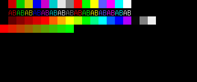
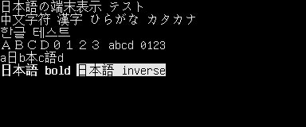
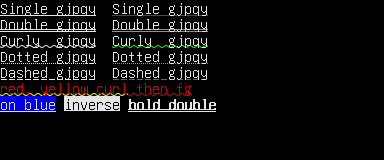
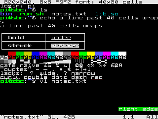
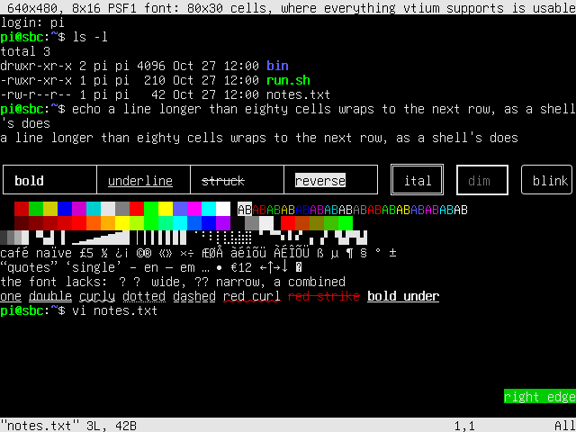
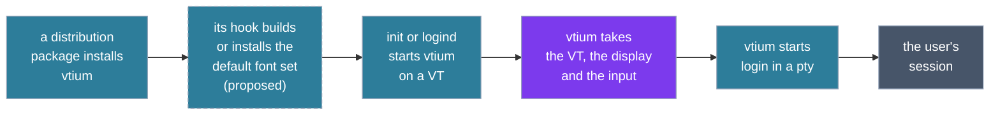
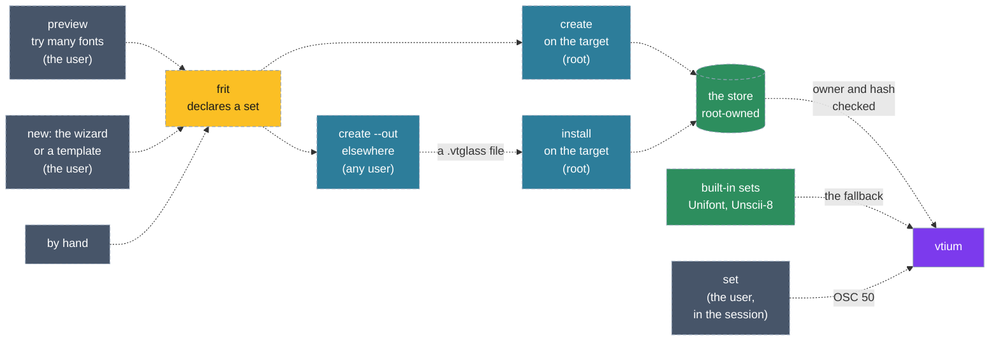

# VTium's concepts

This page introduces the ideas behind vtium: what it is, the programs it is made of and who runs each, how fonts reach it, how it is installed, started and used, and how it is judged. It explains, at the level of concepts; each section links to the decision record, issue or document that holds the detail, and the commands and setting names live there too. A piece that is not built yet is marked proposed, with the issue or record that holds it.

## What VTium is

vtium is a terminal for the Linux virtual console, the full-screen text terminals the kernel provides, each called a VT. It draws the terminal itself, straight to the display through the kernel's display interface (KMS/DRM, or the older fbdev framebuffer where that is all a machine has), with no display server. A program run in vtium sees a modern terminal: colors, text styles, Unicode and mouse reporting, with images to come. The features vtium supports, ignores or refuses are listed in [ADR-1000](architecture/term/ADR-1000-the-modes-and-features-vtium-supports.md).

These three screens are vtium's own drawing, made in memory by its renderer: the color palette, double-width Japanese, Chinese and Korean text, and the underline styles in their own colors.

  

vtium is written in Rust, and is inspired by kmscon and libtsm, the C terminal and terminal library it learned its behaviour from. Their code, in the maintainer's fork, is the C reference: vtium is judged against what it did, and goes further where the specifications do ([architecture.md](architecture.md#beyond-the-c-reference)).

### Small machines first

vtium is built to run on small machines first and large ones as well. Its default build, minspec, is the smallest complete console: it draws through the CPU into a plain memory buffer the display shows, uses bitmap fonts, and needs no GPU; images, outline fonts and a GPU path are features built on top of it. Its yardstick is a single-board computer with ARM cores and 512 MB of memory or less, and its smallest display is a 320x240 panel, where an 8x8 font gives a grid of 40 columns by 30 rows. The same build draws on large displays too. [architecture.md](architecture.md#the-minspec-build) sets out the machine, the display floor and what is promised at each size.

The same shell session at the display floor and one step up, as vtium draws it: 320x240 with an 8x8 font, 40 columns by 30 rows, and 640x480 with an 8x16 font, 80 columns by 30 rows.

## The suite

vtium is one console and a few programs and files around it. The table lists each, who runs it, and whether it is built or proposed. vtium-vitrify's design is ADR-1200, accepted on 2026-10-28 (vtium/vtium#3), with the commands later issues add.

| Piece | What it is | Run by | State | Held by |
|---|---|---|---|---|
| `vtium` | The console: one process per VT, which owns that VT, its display and its input devices, and runs the session | root, started by init or logind | built | [ADR-1400](architecture/platform/ADR-1400-the-privilege-and-sandbox-model.md), vtium/vtium#21 |
| `vtium blank`, `vtium wake` | Blank or wake a VT's displays from outside its session | root | proposed | vtium/vtium#116 |
| `vtium-vitrify preview` | Draws a sample of a font as a set would, building nothing | the user | proposed | vtium/vtium#120 |
| `vtium-vitrify new` | The guided builder, and the templates it writes and reads, which end in a frit | the user, with sudo once at the end | proposed | vtium/vtium#121 |
| `vtium-vitrify create` | Builds a set from a frit: into the store on the target, or as a portable file elsewhere | root or a package hook on the target; any user elsewhere | proposed | vtium/vtium#3 |
| `vtium-vitrify install` | Checks a portable set and adds it to the store | root or a package hook | proposed | vtium/vtium#3 |
| `vtium-vitrify list`, `verify`, `remove` | Lists the built sets, runs the console's check on them, drops one | anyone; `remove` root | proposed | vtium/vtium#3 |
| `vtium-vitrify set` | Switches the running console among built sets | the user, in the session | proposed | vtium/vtium#3 |
| `vtium-clipboard`, also `vticlip` | Copies to the console's selection from a script or a pipe | the user, in the session | proposed; copy decided, paste open | vtium/vtium#113 |
| The frits and the store | Frits that declare sets, and the built sets with a manifest of their hashes | written by root | proposed | vtium/vtium#3 |
| The built-in sets | Unifont, and Unscii-8 for small displays, compiled into vtium as the fallback and the template every set follows | inside `vtium` | Unifont and Unscii-8 built in as sets; the console draws unifont, and choosing Unscii-8 for small cells waits for set selection | vtium/vtium#3 |
| The configuration | One file, a file for the seat, and the command line | written by root, read by `vtium` | built | [config.md](config.md) |
| The unit | systemd's service for vtium on a VT, in getty's place | started by logind | built | [systemd.md](systemd.md) |
| The terminfo entry | Tells programs in the session what vtium can do | read by the session's programs | built | [crates/vtium](../crates/vtium/README.md), vtium/vtium#21 |
| The package hook | Builds or installs at least the default font set at install and upgrade | the distribution's package manager, as root | proposed | vtium/vtium#3 |

vtium is the only piece needed to use the console. vtium-vitrify and vtium-clipboard are separate binaries, so the font decoders and the rasteriser stay out of the console's binary, and neither counts against the minspec build's budget.

### From install to use

### What runs as root, and what as the user

The figure shows the suite in two bands, what runs as root above and what runs as the user who logged in below. The session reaches the console only through the pty, the kernel's pair of devices that lets one program act as the terminal of another; the font builder reaches root's side once, through sudo. Dashed pieces are proposed.

![Two bands. Above, running as root: the kernel's devices (the VT, the display, keyboards and pointers) joined to vtium, the console; vtium-vitrify create and install writing font sets into the root-owned store, which gives vtium checked sets. Between the bands, the pty, joined to vtium by bytes both ways. Below, running as the user who logged in: vtium-vitrify set, vtium-clipboard, and shell and programs, each joined to the pty; and vtium-vitrify preview, and vtium-vitrify new with its templates, the second of which hands a frit to create with sudo, once. Every vtium-vitrify piece and vtium-clipboard are drawn dashed, as proposed; the store is drawn solid, as built.](figures/concepts-pieces.svg)

The console runs as root for its whole life, as the C reference did. Root lets it open the VT, take the display, read the keyboards and pointers directly, and start the system's login program, which authenticates the user and starts their shell with the user's rights. [ADR-1400](architecture/platform/ADR-1400-the-privilege-and-sandbox-model.md) holds the privilege model, the image helper that decodes pictures as the session's user included.

A program in the session reaches vtium only through the bytes it writes to its terminal. vtium's replies to those bytes are built from its own state and never echo what a program sent, so text a program prints cannot type into another program reading the replies ([architecture.md](architecture.md#determinism), "No reflection").

Only root writes frits and sets, because the console trusts only what root built. Everything before that runs as the user: previews, the builder's questions and templates. Switching among built sets and copying to the clipboard run in the session and speak to vtium through the terminal like any other program.

## Deployment

A distribution package installs vtium's programs, the service unit, the terminfo entry and the example configuration. In the proposed font design (vtium/vtium#3), the package's install and upgrade hook builds or installs at least the default font set, and a distribution can ship prebuilt sets as packages of their own whose hook installs them; each distribution writes its hooks in its own packaging, and vtium's own unit builds nothing.

On a systemd machine, vtium's unit takes the place of getty, the program that prints the login prompt on a VT: enabled, it makes logind start vtium on each VT it would have given a getty. When vtium cannot start, for example because no display appears, it exits with a failure, and the unit starts getty on that VT instead, so a user is never left at a dead screen.

vtium runs without systemd and without logind as well: an inittab line, an init script or a supervisor starts it where it started a getty, and a person can start it by hand. Each place vtium touches systemd, logind or init, and what it does without them, is listed in [systemd.md](systemd.md).

## Start-up and the VT

### Taking the VT and the display

At start vtium opens its VT and asks the kernel to let it manage switches to and from that VT itself. It then takes the display: it becomes the program allowed to set the display's mode and show frames on it. It reads the keyboards and pointers directly. vtium waits a bounded time for a display; one plugged in later joins the console, and the grid takes its size.

### The session

Once it holds the display, vtium starts the session in the pty: by default the system's login program, and otherwise a command the configuration names. When the session's command exits, vtium starts it again, as getty does after a logout. vtium serves one seat, the group of displays, keyboards and pointers that belong together; most machines have exactly one. Each VT that runs vtium runs its own vtium process with its own session.

### Switching VTs

The figure follows one switch away from vtium's VT and back: who draws on the display, where keys and pointer events go, and the session, which runs throughout.

The other VT's owner can be a desktop, a getty or another vtium.

## Fonts as vitrified sets

This section describes the design ADR-1200 decides (accepted 2026-10-28, vtium/vtium#3), with the preview of vtium/vtium#120 and the guided builder of vtium/vtium#121. The set format, the console's reader, the store check and the built-in sets are built (vtium/vtium#124); vtium-vitrify (vtium/vtium#125) and set selection (vtium/vtium#126) are not yet, so vtium draws the built-in unifont set and reads PSF bitmap console fonts from a path.

In the design, fonts reach the console already prepared. A **vitrified set** is a font baked into one file of ready-to-draw glyph bitmaps at fixed cell sizes, with its map from Unicode characters to glyphs, its metrics and its provenance. The console only reads sets: it parses no font format and turns no outline into pixels, and a chunk a set stores deflated is inflated, with the inflate the console already carries, when that chunk is first drawn. A set is drawn at its baked sizes and whole multiples of them, and the console holds in memory only the chunks of glyphs it has drawn.

The figure follows a set from choosing a font to the console. Each command is vtium-vitrify's, and only vtium is built; the rest is proposed and drawn dashed.

### Try many, build a few

Someone choosing a font tries many and builds few. vtium-vitrify's preview command draws a sample of a font at the terminal's own cell size, with the same code a build uses, as a picture where the terminal shows pictures and as a text summary where it does not, and builds nothing. A machine then holds a few sets, each baked at a few sizes chosen for its display: per locale, a bitmap set scaled by whole factors and at most one smooth outline size (ADR-1200). On a build that isn't minspec, a size a set lacks can be drawn on demand by the sandboxed helper (vtium/vtium#123); the console itself never parses a font.

### The frit

A set is declared as a **frit**, named for the ground glass a glassmaker melts again: a small text file, `/etc/vtium/fonts/NAME.vtfrit`, naming the set's sources in order, later ones filling characters the earlier ones lack, with the sizes and fallbacks to build. Its sources can be console fonts, font files, the kernel's own font, and later outline fonts. A frit is written in one of three ways, which give the same file: by hand; by vtium-vitrify's new command, a guided builder that asks about the target display, the sizes, the coverage and the fallbacks and previews each choice; or from a template that command writes, which reads back and writes out again with nothing lost, so a script or a package can make the builder's choices without its questions. Later, vtium-vitrify may find installed fonts that match chosen profiles and build sets for them without a frit written for each (vtium/vtium#117, a direction not yet decided).

### Building and installing

The create command builds a set from its frit, in one of two ways. Built on the target, as root, the set goes straight into the machine's store, sized for its own display, a minspec board's small panel included, so a fresh install needs no other machine. Built elsewhere, by any user, `create --out` writes the set as a portable `.vtglass` file for hardware the builder cannot preview or does not have, such as an 8K desktop's large sizes built on a 320x240 machine; the install command, run as root on the target, checks the file and adds it to the store. The builder asks for sudo once, at the end, for a command it shows first, which writes the frit and runs create. At an interactive terminal the tool opens with a small banner of its name in glass, and never in a script or a pipe (vtium/vtium#112).

### Loading, the fallback and switching

The console loads a set only from the root-owned store, and only when its owner and its hash check out. There is no store per user. When the configured font names no built set, or a set fails its check, the console draws a built-in set and logs the command that would build the missing one. The built-in sets are Unifont, and Unscii-8 for small displays, compiled into vtium and trusted by construction.

vtium-vitrify's set command switches the running console among built sets through the terminal, with xterm's font control sequence (OSC 50), which vtium takes while its allow-font-ops setting is on, as it is by default. A switch changes the live console only; the configuration decides the font at the next start.

## Using VTium

### The configuration

vtium reads one configuration file, then a file for its seat over it, then its command line over both, once at start. It reads the file the C reference read, with its settings, and adds its own. [config.md](config.md) lists every setting.

### Selection and the clipboard

The console has no system clipboard: vtium holds one selection, the text the user last selected with the pointer, and pastes it into the session. A program in the session can set that selection with the standard clipboard control sequence (OSC 52), which passes through ssh, so a program on a remote machine can copy to the console.

vtium-clipboard, proposed in vtium/vtium#113, gives scripts the same copy from the command line, as `pbcopy` does on macOS: it writes its input to the selection through OSC 52 on its own terminal. How it would paste is undecided, since vtium refuses a program's request to read the selection; the choices wait for a decision record.

### Links and prompts

Programs can mark text as a link, and shells can mark their prompts. vtium shows a link's address and copies it for the user to paste, and moves the view from one prompt to the next ([ADR-1002](architecture/term/ADR-1002-links-are-copied-never-opened-and-prompt-marks-are-line-flags-the-view-jumps-between.md)).

### Keys

vtium reads the keyboard itself and passes keys to the session, apart from the keys it keeps for itself, such as those that switch VTs. The configuration can bind keys to reboot, power off or suspend the machine; each asks the system to act, so services stop cleanly ([systemd.md](systemd.md)).

### Blanking

After a period with no key press or pointer action (a move, a button or the wheel), vtium turns its displays off, and the next one turns them on; output alone never keeps them on. A program can set the timeout or wake the screen with the Linux console's own sequences, and setting the timeout wakes the screen too, as on the Linux console. A setting, on by default, lets the administrator turn that program control off, and no program can turn the screen off at once (vtium/vtium#79).

Blanking at once and waking from outside the session are proposed in vtium/vtium#116: root sends vtium a signal, or runs a vtium subcommand that finds the vtium on a given VT and signals it, so a script or a power daemon acts without writing to the session's terminal.

## How VTium is judged

vtium is judged in tiers, each with its harness in vtium's tree; [AGENTS.md](../AGENTS.md#how-vtium-is-judged) lists them with their commands.

- **Unit tests:** each crate's behaviour.
- **Tier 1, conformance:** byte streams replayed through vtium's terminal, the screen and the replies compared as text with goldens ([tools/conformance](../tools/conformance/README.md)).
- **Capability probes:** each capability vtium claims has a replay that fails without it, run by the same tool.
- **Tier 2, pixels:** the renderer draws known screens into memory, compared pixel for pixel with goldens ([tools/tier2](../tools/tier2/README.md)).
- **Tier 3, the VM:** vtium's install tree on a VT in a QEMU/KVM guest with a real display device, its screens captured and compared with goldens, with size and memory figures ([tools/tier3](../tools/tier3/README.md)).
- **The VT review:** the maintainer judges a build by eye on a real VT, guided step by step ([vt-review.md](vt-review.md)).

The goldens are the judge: a difference from one is a listed departure, a listed pending case, or a failure. Tier 1's corpus and goldens and the capability probes were made by the C reference and are copied into vtium's tree, each file with the commit it came from and its hash. Tier 2's and tier 3's goldens from the C reference are copied the same way, beside vtium's own reviewed goldens for the screens the C reference never drew, and vtium builds tier 3's guest images from its own scripts. No gate, CI job or build runs the C reference's code or reads its checkouts: the C reference is read as the reference for behaviour, and the provenance checks read a checkout, for review, when the copies change.

## What VTium does not do

Some limits are deliberate, each recorded with its reason:

- **It never opens a link.** No browser or other program is ever started from the console; a link's address is only copied ([ADR-1002](architecture/term/ADR-1002-links-are-copied-never-opened-and-prompt-marks-are-line-flags-the-view-jumps-between.md)).
- **It never hands the clipboard to a program.** A program's request to read the selection gets no answer, since the answer would go to whatever reads the terminal ([ADR-1000](architecture/term/ADR-1000-the-modes-and-features-vtium-supports.md), `osc.52.read`).
- **It never repeats a window title back.** A title query gets a fixed empty title, so a title a hostile program set cannot be replayed as input ([architecture.md](architecture.md#determinism)).
- **It does not sandbox its unit.** The login session vtium starts would inherit every restriction the unit set ([ADR-1400](architecture/platform/ADR-1400-the-privilege-and-sandbox-model.md)).
