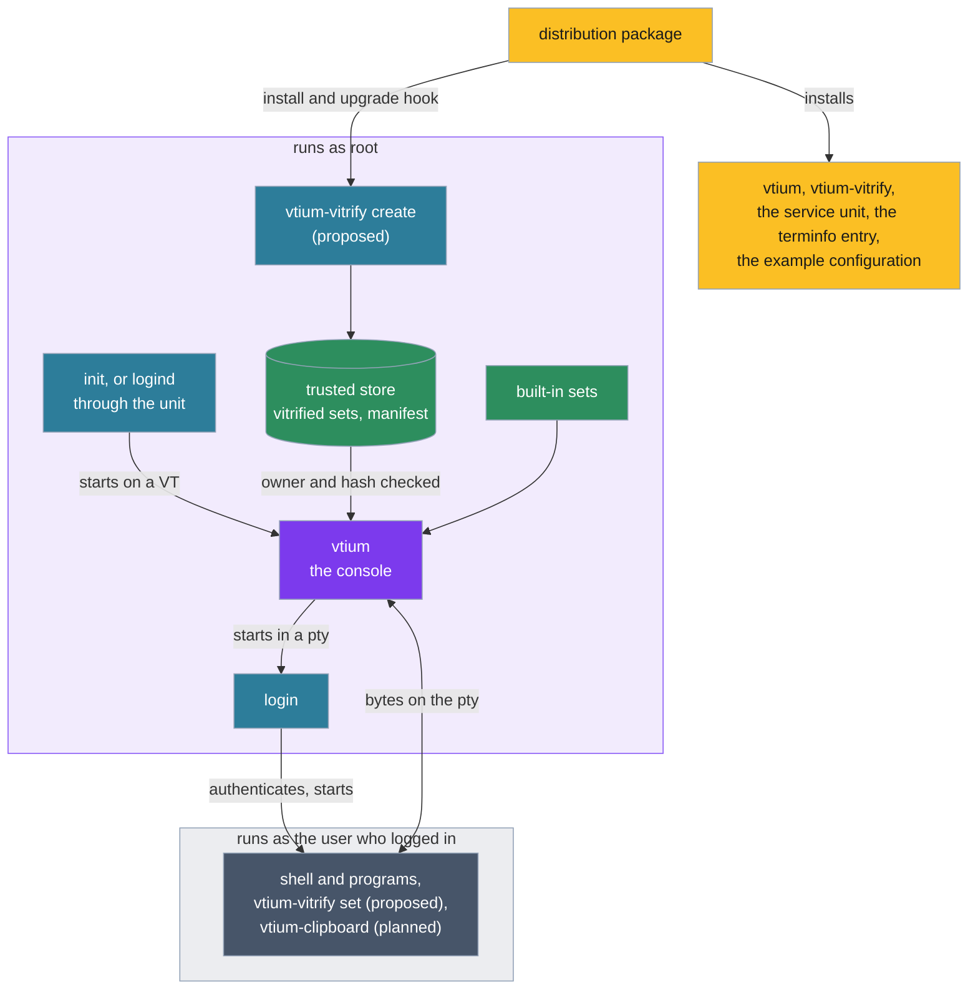

# vtium's concepts

This page introduces the ideas behind vtium: what it is, the programs it is made of, how it is installed and started, and how it is used. It explains; it does not instruct. The commands, options and setting names are still being settled, so they live in the pages this one links to, such as [config.md](config.md).

## What vtium is

vtium is a terminal for the Linux virtual console, the full-screen text terminals the kernel provides, each called a VT. It draws the terminal itself, straight to the display through the kernel's display interface (KMS/DRM, or the older fbdev framebuffer where that is all a machine has), with no display server. A program run in vtium sees a modern terminal: colors, text styles, Unicode, mouse reporting, and in time images.

vtium is written in Rust, and is inspired by kmscon and libtsm, the C terminal and terminal library it learned its behaviour from. Their code, in the maintainer's fork, is the C reference: vtium is judged against what it did, and goes further where the specifications do ([architecture.md](architecture.md#beyond-the-c-reference)).

### Small machines first

vtium is built to run on small machines first and large ones as well. Its default build, minspec, is the smallest complete console: it draws through the CPU into a plain memory buffer the display shows, uses bitmap fonts, and needs no GPU. Images, outline fonts and a GPU path are features built on top of it.

The machine minspec is judged against is a single-board computer: ARM cores of the Cortex-A53 class or older, 512 MB of memory or less, and displays as small as an SPI panel. The smallest display vtium supports is 320x240, where an 8x8 font gives a grid of 40 columns by 30 rows; there vtium starts, draws and stays correct, and a shell, line editing and vim are usable, while a program that needs 80 columns is not promised to fit. From 640x480 with an 8x16 font, 80 by 30, everything vtium supports is usable. The same binary draws on large displays too: on the maintainer's machine it runs on a 7680x2160 display.

## The flow at a glance

## The pieces

**vtium** is the console itself: one process per VT, which owns that VT, its displays and its input devices, and runs a session in a pseudo-terminal (a pty, the kernel's pair of devices that lets one program act as the terminal of another). It is the only piece needed to use vtium.

**vtium-vitrify** is a separate program that prepares fonts for the console ahead of time, as [Fonts](#fonts-as-vitrified-sets) describes. It is part of a proposed design and is not built yet.

**vtium-clipboard**, also installed as the short name `vticlip`, is an optional tool that gives scripts the console's clipboard from the command line, as `pbcopy` does on macOS (vtium/vtium#113). It is planned, and outside the minspec build.

Alongside the programs, an installation carries a service unit for systemd, a terminfo entry that tells programs what vtium can do, and an example configuration file listing every setting at its default.

### What runs as root, and what as the user

The console runs as root for its whole life, as the C reference did (ADR-1400). Root is what lets it open the VT, take the display, read the keyboards and pointers directly, and start the system's login program. It starts that program as root in the pty; the login program authenticates the user and starts their shell as that user, so everything typed into the session runs with the user's rights, not vtium's. A command the configuration names in place of the login program runs as root, so choosing one is the administrator's decision.

A program in the session reaches vtium only through the bytes it writes to its terminal, as any terminal program does. vtium's replies to those bytes are built from its own state and never echo what a program sent, so text a program prints cannot type into another program reading the replies ([architecture.md](architecture.md#determinism), "No reflection").

Building font sets is root's work, because the console trusts only what root built. Switching among the built sets, and copying to the clipboard, is the user's: the tools for both run in the session and speak to vtium through the terminal like any other program.

Decoding images will run in a helper process with the session user's rights, never root's by fallback, when images are built (vtium/vtium#31).

## Deployment

### What a package installs

A distribution package installs the vtium binary, vtium-vitrify, the service unit, the terminfo entry and the example configuration, in the layout vtium stages for packagers. Its install and upgrade hook runs vtium-vitrify to build at least the default font set; each distribution writes that hook in its own packaging. vtium's own unit builds nothing.

### With systemd

On a systemd machine, vtium's unit takes the place of getty, the program that normally prints the login prompt on a VT. Enabled, it makes logind start vtium on each VT it would have given a getty, with getty's ordering and terminal settings. vtium's log goes to stderr, which the unit sends to the journal.

When vtium cannot start, for example because no display appears in time, it exits with a failure, and the unit starts getty on that VT instead, so a user is never left at a dead screen.

### Without systemd

vtium runs without systemd and without logind: an inittab line, an init script or a supervisor starts it where it started a getty, and a person can start it by hand. Each place vtium touches systemd, logind or init, and what it does without them, is listed in [systemd.md](systemd.md), among them:

- the minspec build links neither libsystemd nor libelogind;
- the session runs the same; logind simply has no record of it;
- devices are found through udev where a udev daemon runs, and by scanning sysfs where none does, which finds them without hotplug.

## Start-up and the VT

### Taking the VT and the display

At start vtium opens its VT and asks the kernel to let it manage switches to and from that VT itself. It then takes the display: it becomes the program allowed to set the display's mode and show frames on it, and sets each connected display to its preferred mode unless the configuration names one. It reads the keyboards and pointers directly, with keyboard layouts as X11 and Wayland name them.

vtium waits a bounded time for a display, counted from when its VT is first shown, and exits with a failure if none comes. A display plugged in later, such as a USB adapter, joins the console, and the grid takes its size. A machine whose only display arrives at an unknown time can be configured to wait for it however long it takes.

### The session

Once it holds the display, vtium starts the session in a pty: by default the system's login program, with a clean environment, and otherwise a command the configuration names. When the session's command exits, vtium starts it again, as getty does after a logout; a command that keeps failing within moments is given up on after a few tries, and vtium exits. vtium can instead be configured to exit when the command does.

vtium serves one seat, the group of displays, keyboards and pointers that belong together; most machines have exactly one. Each VT that runs vtium runs its own vtium process with its own session.

### Switching VTs

When the user switches to another VT, vtium finishes the frame it is showing, gives up the display and stops reading input, and the kernel moves to the other VT, whose owner (a desktop, a getty or another vtium) takes the display. When the user switches back, vtium takes the display again, sets its modes and redraws the whole screen. The session keeps running while its VT is in the background.

## Fonts as vitrified sets

This section describes the design ADR-1200 proposes, on vtium/vtium#3; it is not accepted or built yet. <!-- adr-cite-ignore: ADR-1200 is proposed on the docs/font-adr branch -->

vtium today draws GNU Unifont, compiled into the binary, and reads PSF bitmap console fonts from a path. The design moves every font file out of the console: fonts reach it already prepared, as vitrified sets.

### The vitrified set

A vitrified set is a font baked into one file of ready-to-draw glyph bitmaps at fixed cell sizes, with its map from Unicode characters to glyphs, its metrics, which characters vtium draws from its own shapes in place of the font's (box drawing, blocks, Braille and the like), and its provenance: each source it was built from and that source's hash. The same recipe and the same sources always give the same bytes. The console only reads sets: it never decompresses a file, parses a font format or turns an outline into pixels.

A set holds only the sizes it was baked at. vtium draws it at those sizes and at whole multiples of them, so on a large display a small font is drawn two or three times its size, pixel for pixel.

### Recipes

A recipe is a small text file, written by an administrator or a package, that declares a set: its name, its sources in order, with later sources filling characters the earlier ones lack, a Unicode map for a font that has none, the sizes for an outline font, and which characters vtium draws from its own shapes. A source can be a console font named as the kbd package names it, a font file, the font the system's vconsole configuration names, the font the kernel holds for a VT right now, and later an outline font such as a Nerd Font (vtium/vtium#23).

### The trusted store

vtium-vitrify's create command runs as root. It reads each recipe and its sources and writes the finished sets into the trusted store, a directory owned by root, with a manifest listing each set and its hash. It rebuilds a set only when its recipe, a source or the set format changes. It never prompts, and lists the built sets in a form scripts can read, so packages, daemons and front ends can be built on it by others. There is no store per user: a font reaches the console only through root.

The console loads a set only from the store, and only after checking that the store and the set are owned by root, writable by no one else, and that the set's hash matches the manifest.

### The built-in sets

Two sets are compiled into vtium and trusted without a check: GNU Unifont, and Unscii-8, an 8x8 font for small displays. vtium draws Unscii-8 for cells under 16 pixels high and Unifont from 16. The built-in set is the template every vitrified set follows: it holds the same parts, compiled in.

### Choosing a set, and the fallback

The font is the one the configuration names; with none named, the one the system's vconsole configuration names; with neither, the built-in set. A name that matches no built set, or a set that fails its check, draws the built-in set, and the log names the set, the reason and the command that would build it. A machine where no package hook and no administrator has built anything therefore always has a working console.

### Switching sets from inside the console

vtium-vitrify's set command, run by the user in the session, asks vtium to switch to another built set. It writes xterm's font-change control sequence to its own terminal, so it works wherever that terminal's bytes reach vtium. vtium switches only among built sets and the built-in ones, and redraws with the new font and a grid of the new size; a path or a name that is not built leaves the font as it was. A setting, on by default as xterm's equivalent is, lets vtium ignore the sequence altogether, since any program writing to the terminal can send it. A switch lasts for the running console; the configuration decides the font at the next start.

### A direction

Later work may find the fonts installed on a machine that match chosen profiles, such as kbd's console fonts at the sizes a display needs or an installed CJK font, and build sets for them without a recipe for each (vtium/vtium#117). It is a direction, to be decided in its own record.

## Using vtium

### The configuration

vtium reads one configuration file, then a file for its seat over it, then its command line over both. It reads the file the C reference read, with the C reference's settings, and adds its own. The files are read once, at start: a change applies when vtium starts again, as at a restart of its service. A setting vtium does not know, or a value it cannot use, is reported once at start and otherwise ignored, and a check command reads the configuration as a start would and reports problems without applying anything.

The settings cover the VT and the session's command, the scrollback, blinking, the display modes and the blank timeout, the color palette, the keyboard layout and key repeat, the pointer, the power keys, the font and where box-drawing and similar characters come from, and what programs may do with the clipboard and the blank. [config.md](config.md) lists each one.

### Selection and the clipboard

The user selects text with the pointer, and letting go of the button copies it. The console has no system clipboard: vtium holds one selection, the last one copied, and pastes it into the session with a pointer button or a key, filtered of control characters, and marked as a paste for programs that ask for that. A program in the session can set that selection with the standard clipboard control sequence (OSC 52), which a setting can turn off; because the sequence passes through ssh and through multiplexers that forward it, a program on a remote machine can copy to the console's selection too.

vtium-clipboard (vtium/vtium#113) builds on the same sequence: it copies its input or a file into the selection, for pipelines and scripts. How it pastes is an open design question.

### Links and prompts

Programs can mark text as a link (OSC 8). vtium keeps each link with its text, underlines it while the pointer is over it, shows the address on request, and copies the address into the selection on a click with a modifier held, to paste wherever the user chooses. Shells that mark their prompts (OSC 133) let the user move the view from one prompt to the next and copy the output of one command (ADR-1002). This is decided and being built (vtium/vtium#40).

### Keys

vtium reads the keyboard itself and passes keys to the session, apart from the keys it keeps for itself, such as those that switch VTs and any power keys the configuration binds.

The power keys are three key combinations, for reboot, power off and suspend, none bound by default. Each asks the system to act rather than cutting power: reboot and power off go to init, so services stop and filesystems are unmounted first, and suspend goes to logind, so the programs that hold a suspend back (such as a lock screen) get their turn, or to the kernel directly where logind is absent or the build leaves logind out, as minspec does. The machine's own power button stays logind's to handle. [systemd.md](systemd.md) gives each path with and without systemd.

### Blanking

After a period with no key or pointer event, vtium turns its displays off, and the next key or pointer event turns them on. Output does not count as activity, so a clock redrawing every second never keeps the screen on by itself.

A program can command the blank with the Linux console's own sequences, the ones `setterm` writes: it can set the timeout, turn blanking off, or wake the screen. A setting, on by default as on the Linux console, lets vtium ignore them. A program cannot turn the screen off at once through the terminal, since anything printed to it, such as a file a user views, could then blank the screen. Blanking at once, and waking, from outside the session are decided as signals that only root or vtium's own user can send, with a command that finds the vtium on a VT and sends them; that is not built yet (vtium/vtium#116). The same issue holds an open question: util-linux's `setterm` writes the blank sequences only when the terminal type is the Linux console's, which vtium's sessions do not use.

## What vtium does not do

Some limits are deliberate, each recorded with its reason:

- **It never opens a link.** No browser or other program is ever started from the console; a link's address is only copied (ADR-1002).
- **It never hands the clipboard to a program.** A program's request to read the selection gets no answer, since the answer would go to whatever reads the terminal ([ADR-1000](architecture/term/ADR-1000-features.tsv), row `osc.52.read`).
- **It never repeats a window title back.** A title query gets a fixed empty title, so a title a hostile program set cannot be replayed as input ([architecture.md](architecture.md#determinism)).
- **It does not sandbox its unit.** The login session vtium starts would inherit every restriction the unit set (ADR-1400).
- **It does not ask logind for devices or VT switches.** It opens them directly as root, with or without logind; device access through libseat is a later, optional layer (vtium/vtium#34).
