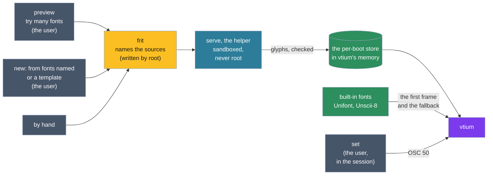

# Fonts, generated at run time

This page describes how vtium gets the glyphs it draws. The helper, the console's per-boot store, the built-in fonts, switching, preview and new are all built.

The console parses no font. A **frit** names a font's sources, and the **helper**, vtium-config's serve command in a sandbox, reads them, rasterises them and sends their glyphs at the console's cell, ready-to-draw bitmaps with their map from Unicode characters to glyphs and their metrics. The console checks each answer, holds the glyphs in memory for the boot and draws them. Nothing is prerendered, and no glyph outlives the boot.

[why-vtium.md](../why-vtium.md) tells, for a newcomer, why these font terms come from glassmaking.

The figure follows a font from choosing it to the console. Each command is vtium-config's.

## Try many, keep one

Someone choosing a font tries many and keeps one. `vtium config preview` draws a sample of each font it names as the helper would draw it, at the size its `--size` gives, else vtium.conf's font size. In a terminal that shows kitty graphics it draws the sample as a picture, and elsewhere it prints a line of text for each font. It writes nothing.

## The frit

A font is declared as a **frit**, named for the ground glass a glassmaker melts again: a small text file, `/etc/vtium/fonts/NAME.vtfrit`, naming its sources in order, later ones filling characters the earlier ones lack, and the cell it is drawn in. Its sources can be console fonts, font files, the kernel's own font, and outline fonts, color emoji among them, found among the fonts installed on the machine by their family. A frit is written in one of three ways, which give the same file. You can write it by hand. `vtium config new-frit FONT...` makes a frit of the fonts you name, in order, and `vtium config new-frit` alone at a terminal opens vtium config's full-screen tool at its new-frit view. `vtium config new-frit --template` prints a frit with each key explained, and `vtium config new-frit --from FILE` installs the frit you wrote from it, so a script or a package can make a frit without questions. Installing a frit asks for sudo once, for a command the tool shows first. `vtium-config --help about` draws the tool's name in glass. See [the glass banner issue](https://github.com/vtium/vtium/issues/112). Later, vtium-config may find installed fonts that match chosen looks without a frit written for each. That direction is not decided yet; see [the issue about matching installed fonts](https://github.com/vtium/vtium/issues/117).

## Drawing at run time

At start the built-in font draws the first frame at once, in the cell the frit states, and the frit's glyphs replace it, character by character, as the helper sends them: the characters on the screen first, and while nothing is asked, printable Latin and box drawing, then the rest of the frit's coverage. The glyphs live in a per-boot store whose limit follows the machine's memory: the helper's fill stops at it, and only an ask for the screen's characters evicts, the glyphs least recently shown first. The helper starts on the console's first need, exits when idle, and is started again after a crash a bounded number of times a boot.

## The fallback and switching

When the configured font names no frit, and no font a frit can be made from on the fly, or the helper is unavailable, the console draws the built-in fonts and logs why. The built-in fonts are Unifont, and Unscii-8 for cells under 16 pixels, compiled into vtium; they also draw each character a frit lacks.

vtium-config's set command switches the running console among the frits and the built-in fonts through the terminal, with xterm's font control sequence (OSC 50), which vtium takes while its allow-font-ops setting is on, as it is by default. A switch lasts until the session it came from ends, when its program exits, its console closes, or vtium hangs it up; vtium then returns the console to the font the configuration gives.
