```mermaid
stateDiagram-v2
    [*] --> Waiting: vtium.conf declares the head
    Waiting --> Running: its first display lights,<br>and its consoles start
    Waiting --> [*]: no display yet: it holds up<br>no exit, having nothing to run
    state Running {
        [*] --> Shown
        Shown --> Shown: Ctrl-Super-Right or Left<br>shows the next or the previous
        Shown --> Shown: a console's program exits,<br>and starts again in that console
    }
    Running --> Dark: its last display goes
    Dark --> Running: a display its rules match comes,<br>under keep or within hangup's time
    Dark --> Dark: hangup, at once or when its time runs out:<br>every pty closes, its programs get SIGHUP,<br>and each console starts again at its login
    Running --> GaveUp: a console's program exited within 2 s<br>more than 5 times running
    Running --> Ended: oneshot, once every console's program has exited
    GaveUp --> [*]: every head's sessions hang up; under open vtium exits<br>with status 1 and a getty takes the VT,<br>and under closed it holds the VT with a notice
    Ended --> [*]: only oneshot ends a head: "session ended";<br>once every head has ended, vtium exits
    classDef step fill:#2d7d9a,color:#ffffff,stroke:#94a3b8
    classDef done fill:#2d8e5e,color:#ffffff,stroke:#94a3b8
    classDef inert fill:#475569,color:#ffffff,stroke:#94a3b8
    class Waiting,Dark step
    class Shown done
    class GaveUp,Ended inert
```

# Heads: a terminal per display

This page describes how vtium drives several displays from one VT. Two parts are still to come: a reload of vtium.conf that keeps the sessions running, which [the reload issue](https://github.com/vtium/vtium/issues/86) tracks, and a trial that applies an installed configuration and reverts it unless the user confirms it, which [the trial issue](https://github.com/vtium/vtium/issues/331) tracks.

The kernel shows one VT on every display, so vtium keeps its one VT and drives every display from one process as a set of heads. A head is a terminal for one or more displays, with its own inputs, its own look and a fixed number of consoles, each a session of its own, so a small panel and a large monitor each get a grid sized for them, with a keyboard typing into each.

Sections of vtium's configuration file, `/etc/vtium/vtium.conf`, below its settings, declare the heads, the look each draws with, and an ordered list of rules, read as a firewall reads its rules: each display and each keyboard or pointer walks them from the top, and the first that matches places it in a head, roaming, which types into the active head a chord moves between heads, or out of use. A rule names a device by its port, its serial number or its monitor's identity, or more weakly by its name. The rules vtium ships put every display in one head and every keyboard, pointer and other key device, media keys included, roaming, by the input classes udev gives each device, and leave joysticks, tablets and the like closed; that is the console as it is today, and a user adds rules above them. Like a firewall, the file has a default policy for what its rules don't mention, open or closed ([below](#two-policies-open-and-closed)). A head can be isolated: its keyboards' VT-switch keys reach its session as plain keys, and no roaming keyboard ever types into it. [heads.md](../heads.md) shows the sections in their scenarios, from the default to a kiosk and several people working at once on one machine, each with a complete file under [heads/](../heads/), and [head-file.md](../head-file.md) is their reference. vtium-config draws the same configuration as a flow from the displays to the input devices, and keeps a user's changes in a draft until they install it ([Configure vtium](../configure.md)).

With no file, vtium runs its compiled-in configuration and writes nothing. When the file is broken, vtium says so on the screen and in the log and leaves the file as it is. It runs the part of the file that survives its errors, or the shipped rules when nothing survives. A file that declares `policy = closed` is the exception: when nothing of it survives, no keyboard types until someone fixes the file from outside vtium. Under the open policy, two guards keep you from being locked out, whatever the rules say. The anti-lockout guard makes a keyboard roam when it reaches no lit head. The rescue key, `Ctrl-Alt-F<n>` for the VT already on screen, makes the keyboard that pressed it roam until the next boot.

Each head is a terminal of its own. Ctrl-Super-Up and Ctrl-Super-Down make the next or the previous lit head the active head, and each head shows a mark in its top-right corner for a few seconds, filled on the active head; a keyboard a rule gives a head keeps typing into it. Ctrl-Super-Right and Ctrl-Super-Left show the next and the previous console of the head the keyboard types into. A head starts with the number of consoles its `consoles` sets, at most 4 a head and 8 in all unless the configuration raises them. Under the open policy Ctrl-Super-Return opens another just after the one shown, within those caps, and Ctrl-Super-Backspace closes the one shown, but never a head's last; under the closed policy a head keeps the consoles it started with, and neither key does anything. Under `oneshot`, vtium ends only when no head has anything left to run; a head whose display never lit has nothing to run, so it never holds the exit up. A console whose program exits starts it again in the same console. A login that keeps ending as soon as it starts, more than 5 times running on any console of any head, hangs up every head's sessions: under the open policy vtium exits with status 1, so a getty takes the VT, and under the closed policy vtium holds its VT and shows a notice. A head losing its last display does what its `when-display-lost` says: under `keep`, the default, its sessions run on unseen, the keys reaching the head still type into them, as the kernel console's do through an unplugged monitor, and a display its rules match brings them back; `hangup` hangs them up at once, as a serial line losing its carrier, and `hangup 30s` only when no such display returns within the time. A mirrored head keeps its sessions while one of its displays remains, and the active head never moves because a display left or came back. The figure follows one head's consoles.

vtiumctl writes the file for whoever prefers not to, from the console or a desktop terminal, with or without privilege: it lists every device with a rule ready to paste, asks which keyboard belongs to which display, reports what the running console did, and checks a candidate before it is installed.

## Two policies: open and closed

vtium.conf's rules decide which keyboards reach which displays, as a firewall decides which traffic passes, and like a firewall it has a default policy: `policy = open` or `policy = closed`. A file without it is open. The rules read the same under either; the policy decides what happens to an input no rule matches, to a head's `isolated` when the file leaves it unset, to the rescue key and the anti-lockout guard, and to a start with no display. A rule the file writes means what it says under either policy: in a closed file, `input MATCH -> roaming` sends whatever is plugged into that port to the active head, a head that writes `isolated = no`, which is how [kiosk-admin.conf](../heads.md#a-kiosk-with-an-operators-head) gives its admin head a spare port. A file whose rules end with `input * -> TARGET` places every input itself, so the policy's input default never applies.

**Open.** A keyboard or mouse no rule matches roams. A head is not isolated unless it says `isolated = yes`. The rescue key and the anti-lockout guard are on. Rules take rights away: "this keyboard belongs to the desk", "the panel is isolated". The question while writing one is what you must stop from reaching everything. A forgotten rule leaks: a stranger's keyboard plugged into a spare port types into someone's session. Today's console and [builtin](../head-file.md#terms), the configuration vtium runs when vtium.conf has no section, are open.

**Closed.** A keyboard or mouse no rule matches is ignored, and every head is isolated unless it says `isolated = no`. The rescue key and the anti-lockout guard are off, so no keyboard is ever moved anywhere the file did not send it. Rules grant rights: "this keyboard belongs to the kiosk", "the operator's head is not isolated". The question is what you must let in so you don't shut yourself out. A forgotten rule locks out: your own keyboard is dead. A kiosk and stations are closed files. Under closed, no failure of vtium hands its VT to the kernel's login either. A panic, the VT hanging up or a session that cannot spawn ends vtium and leaves its VT with no login, since the getty fallback of vtium's unit skips the getty under a closed policy. That fallback is vtium's alone, so the operator of a closed machine also disables any `getty@ttyN` enabled on vtium's VT, which a later `systemctl start` could still put there. Since `Ctrl-Alt-F<n>` reaches the kernel once vtium has ended, the operator also masks the gettys on the other VTs, and sets logind's `NAutoVTs=0` and `ReserveVT=0` so that logind starts no other vtium on a VT as it is switched to ([systemd.md](../systemd.md)). A login that keeps ending as soon as it starts stops every head, and vtium holds its VT with a notice. Once vtium has read `policy = closed` in a file it trusts, nothing opens anything for as long as vtium runs: no other line of the file, broken or not, and nothing that happens while it runs. Once reload is built, a running closed policy takes only a valid closed file. For anything else, a valid open file included, vtium keeps what runs and logs why. Going from closed to open takes a restart of vtium, which reads the file afresh, as a boot does. While an open policy runs, a reload applies any valid file, a closed one included.

**With no display at start.** Under open, vtium waits `display-wait`, 10 s by default, then exits, and its unit, `vtium@ttyN`, starts a getty on that VT, the kernel's own login, which any keyboard can type into. Under closed, vtium holds its VT and waits for a display however long it takes, so that getty never starts.

A display no rule matches is off under either policy. When the rules light no display, the display guard lights the boot display: in an open file it shows the first head there, and in a closed file only a notice. A valid closed file whose heads have no display lit shows `No head has a connected display.` there, the one notice a valid file shows. Keyboards a rule gives a head keep typing into it while it is unlit, as on the kernel's console, so the notice says nothing about input. A closed file with no heads is dark and silent. `vtium check-config` lists, as notes, the keyboards, mice and displays present that no rule matches and what the policy does with them; for a closed file it says prominently when no keyboard present can reach any head, before the file is installed.

## The operator's way back in

### An operator's head

A closed file gives the operator a keyboard at the machine only through a head of their own, on a display of its own, with `isolated = no` and a rule that sends their keyboard to it: [A kiosk with an operator's head](../heads.md#a-kiosk-with-an-operators-head) shows one. A machine with one display has no display to spare for such a head: its operator gets in from outside, or gives the one head `isolated = no`. `Ctrl-Alt-F2` on that head's keyboard then switches to VT 2, where a getty's password stands between a passer-by and a shell, and the head becomes the active head, which any `-> roaming` rule in the file reaches.

### Recovery from outside

A machine its vtium.conf locks out is recovered as any misconfigured Linux system is: over ssh, from a serial getty, through out-of-band management, or by booting other media and editing the file. vtium has no rescue boot of its own.
