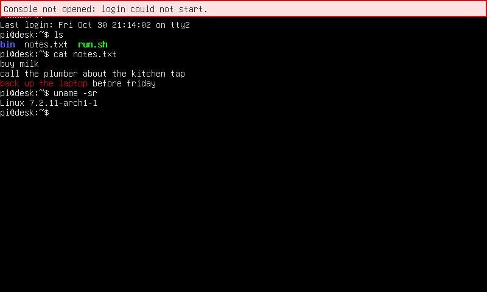

# Heads: a terminal per display

This page describes how vtium drives several displays from one VT. Two parts of it are still to come. The first is a reload of vtium.conf that keeps the sessions running. [The reload issue](https://github.com/vtium/vtium/issues/86) tracks it. The second is a trial that applies an installed configuration and goes back to the previous one unless you confirm it. [The trial issue](https://github.com/vtium/vtium/issues/331) tracks it.

The kernel shows the same VT on every display. So vtium stays on its one VT, and it drives every display from one process, as a set of heads. A head is a terminal for one or more displays. Each head has its own inputs, its own look and its own consoles. A look is the font and the font settings a head draws with, and a console is a session of its own. For example, a small panel and a large monitor can each have a head with a grid sized for that display. Each display can also have a keyboard that types into its head.

You declare the heads in sections of vtium's configuration file, `/etc/vtium/vtium.conf`. The sections come below the file's settings. They declare three things: the heads, the look each head draws with, and an ordered list of rules. vtium reads the rules the way a firewall reads its rules. It checks each display and each keyboard or pointer against the rules from the top. The first rule that matches decides where the device goes. A rule can place the device in a head, take it out of use, or make it roam. A roaming keyboard types into the active head, and a key chord moves the active head from one head to another.

A rule names a device most firmly by its port, its serial number or its monitor's identity. A rule can also name a device by its name, which identifies it less firmly.

vtium ships rules that put every display in one head. They make every keyboard, pointer and other key device roam, media keys included. They tell these devices apart by the input classes that udev gives each device. They leave joysticks, tablets and similar devices out of use. With these rules, the console behaves as it does today. You add your own rules above them.

Like a firewall, the file has a default policy for the devices its rules don't mention. The policy is open or closed. See [Two policies: open and closed](#two-policies-open-and-closed) below.

A head can be isolated. When you press a key that switches the VT on one of an isolated head's keyboards, the key reaches the head's session as a plain key. No roaming keyboard ever types into an isolated head.

[heads.md](../heads.md) shows the sections in common setups, from the default to a kiosk and to several people working at once on one machine. Each setup has a complete file under [heads/](../heads/). [head-file.md](../head-file.md) is the reference for the sections. vtium-config, vtium's configuration tool, draws the same configuration as a flow from the displays to the input devices. It keeps your changes in a draft until you install it. See [Configure vtium](../configure.md).

When there is no vtium.conf, vtium runs its compiled-in configuration, and it writes no file. When the file has errors, vtium says so on the screen and in the log, and it leaves the file as it is. vtium runs the parts of the file that have no errors. When no part is left, it runs the shipped rules instead.

A file that declares `policy = closed` is the exception. When no part of a closed file is left, no keyboard types into anything until someone fixes the file from outside vtium.

Under the open policy, two guards keep you from locking yourself out, whatever the rules say:

- The anti-lockout guard makes every keyboard roam while no keyboard at all reaches a lit head. A head is lit when at least one of its displays is on.
- The rescue key is `Ctrl-Alt-F<n>` for the VT that is already on screen. It makes the keyboard that pressed it roam until the next boot.

Each head is a terminal of its own. Ctrl-Super-Up makes the next lit head the active head, and Ctrl-Super-Down makes the previous lit head the active head. Each head then shows a mark in its top-right corner for a few seconds. The mark is filled on the active head. A keyboard that a rule gives to a head keeps typing into that head when the active head moves.

Ctrl-Super-Right shows the next console of the head that the keyboard types into, and Ctrl-Super-Left shows the previous one. A head starts with the number of consoles that its `consoles` key sets. A head can have at most 4 consoles, and all heads together at most 8, unless the configuration raises these limits. Under the open policy, Ctrl-Super-Return opens another console just after the one shown, within those limits. Ctrl-Super-Backspace closes the console shown, but it never closes a head's last console. Under the closed policy, a head keeps the consoles it started with, and neither key does anything.

With the `oneshot` setting, vtium exits only when no head has anything left to run. A head whose display never lit has nothing to run, so vtium never waits for it before it exits.

When the program in a console exits, vtium starts it again in the same console. Sometimes a login ends as soon as it starts, again and again. When that happens more than 5 times in a row, on any console of any head, vtium hangs up the sessions of every head. Under the open policy, vtium then exits with status 1, so a getty takes the VT. A getty is the program that normally shows the login prompt on a VT. Under the closed policy, vtium keeps its VT and shows a notice.

When a head loses its last display, its `when-display-lost` key decides what happens to its sessions:

- `keep`, the default: the sessions keep running, unseen. The keys that reach the head still type into them, as keys typed on the kernel's console still arrive when its monitor is unplugged. A display that the head's rules match brings the sessions back.
- `hangup`: vtium hangs the sessions up at once, as a serial line hangs up when it loses its carrier.
- `hangup 30s`: vtium hangs the sessions up only when no such display returns within that time.

A mirrored head, one shown on several displays, keeps its sessions while one of its displays remains. The active head never moves because a display left or came back. The figure follows one head's consoles.

```mermaid
stateDiagram-v2
    [*] --> Waiting: vtium.conf declares the head
    Waiting --> Running: its first display lights,<br>and its consoles start
    Waiting --> [*]: no display yet: it holds up<br>no exit, having nothing to run
    state Running {
        [*] --> Shown
        Shown --> Shown: Ctrl-Super-Right or Left<br>shows the next or the previous
        Shown --> Shown: a console's program exits,<br>and starts again in that console
    }
    Running --> Dark: its last display goes
    Dark --> Running: a display its rules match comes,<br>under keep or within hangup's time
    Dark --> Dark: hangup, at once or when its time runs out:<br>every pty closes, its programs get SIGHUP,<br>and each console starts again at its login
    Running --> GaveUp: a console's program exited within 2 s<br>more than 5 times running
    Running --> Ended: oneshot, once every console's program has exited
    GaveUp --> [*]: every head's sessions hang up; under open vtium exits<br>with status 1 and a getty takes the VT,<br>and under closed it holds the VT with a notice
    Ended --> [*]: only oneshot ends a head: "session ended";<br>once every head has ended, vtium exits
    classDef step fill:#2d7d9a,color:#ffffff,stroke:#94a3b8
    classDef done fill:#2d8e5e,color:#ffffff,stroke:#94a3b8
    classDef inert fill:#475569,color:#ffffff,stroke:#94a3b8
    class Waiting,Dark step
    class Shown done
    class GaveUp,Ended inert
```

If you prefer not to write the file by hand, vtium-config writes it for you. It runs on the console or in a desktop terminal, with or without root privileges. `vtium config flow` lists every connected display and input device, and the rule that places each one. You change your draft of the file in vtium-config's Flow view, or with `vtium config rule`, `vtium config head` and `vtium config look`. `vtium config install` checks the draft and installs it. See [Configure vtium](../configure.md).

Two features are not built yet. vtium-config cannot yet ask you to press a key to find out which keyboard belongs to which display. It also cannot yet report what the running console did with each device. See [the issue that tracks them](https://github.com/vtium/vtium/issues/367).

## When a session ends or cannot start

A head's consoles run their sessions. vtium shows a notice when a session ends for good, when a new console's session cannot start, or when sessions keep ending as soon as they start. See [Notices on the screen](../troubleshooting.md#notices-on-the-screen) for how long a notice stays.

### Session ended. It will not start again.

With the `oneshot` setting, vtium does not start a console's program again when the program exits. The console keeps its last screen, and vtium shows this notice over it. The notice stays for as long as that console is shown.

The notice's second sentence names a key that takes you elsewhere. When no other console of the head still runs, it names the roaming chord, `Ctrl-Super-Up` by default, which makes another head the active head. When another console of the head still runs, it names the console chord, `Ctrl-Super-Right` by default, which shows that console. When vtium.conf binds no key to that action, the notice names no key.

vtium exits once no head has anything left to run. To have vtium start the program again when the program exits, turn `oneshot` off. See [config.md](../config.md) for the key.

### Console not opened: login could not start.

Under the open policy, `Ctrl-Super-Return` opens another console on a head. vtium shows this notice when it cannot start the new console's session. vtium then removes the new console, and the head goes on showing the console it showed before.

vtium's log gives the reason, in a line that begins `head NAME: console N does not open:`. Fix what the line names, such as the command that the `login` key gives, then press `Ctrl-Super-Return` again.

### All screens stopped: a session kept ending as soon as it started.

vtium starts a console's program again when the program exits. An exit within 2 seconds of the program's start counts as quick. When a console's program exits quickly more than 5 times in a row, vtium hangs up the sessions of every head. Under the open policy, vtium then exits with status 1, so a getty takes the VT.

Under the closed policy, vtium shows this notice instead. vtium starts no session again, every display that a head used goes dark, and the boot display shows this notice alone. The boot display is the display that was on when vtium started, or else the first connected one. The notice stays for as long as vtium runs.

Nothing on this VT takes input. vtium delivers no key to anything, so no key switches to another VT either. Fix the command that the `login` key gives from outside this console, for example over ssh. Then restart vtium or reboot. See [Recovery from outside](#recovery-from-outside) for details.

## Two policies: open and closed

vtium.conf's rules decide which keyboards reach which displays, much as a firewall decides which traffic passes. Like a firewall, the file has a default policy: `policy = open` or `policy = closed`. A file that does not set `policy` is open.

The rules mean the same under either policy. The policy decides the rest:

- what happens to an input that no rule matches,
- whether a head is isolated when the file does not set its `isolated` key,
- whether the rescue key and the anti-lockout guard are on, and
- what vtium does when it starts with no display.

A rule in the file does what it says under either policy. For example, in a closed file the rule `input MATCH -> roaming` sends whatever is plugged into that port to the active head. In a closed file, the active head is a head that sets `isolated = no`. This is how [kiosk-admin.conf](../heads.md#a-kiosk-with-an-operators-head) gives its admin head a spare port.

When a file's rules end with `input * -> TARGET`, that last rule places every input that no earlier rule placed. The policy then never decides where an input goes.

**Open.** A keyboard or mouse that no rule matches roams. A head is not isolated unless it says `isolated = yes`. The rescue key and the anti-lockout guard are on.

Under the open policy, rules take rights away, as in "this keyboard belongs to the desk" or "the panel is isolated". So when you write a rule, you ask what you must stop from reaching everything. A forgotten rule lets input through. For example, a stranger plugs a keyboard into a spare port, and it types into someone's session.

The console as it is today is open. So is [builtin](../head-file.md#terms), the configuration vtium runs when vtium.conf has no sections.

**Closed.** vtium ignores any keyboard or mouse that no rule matches, so its input reaches no session. Every head is isolated unless it says `isolated = no`. The two guards that otherwise keep you from locking yourself out, the rescue key and the anti-lockout guard, are off. So vtium never moves a keyboard anywhere the file did not send it.

Under the closed policy, rules grant rights, as in "this keyboard belongs to the kiosk" or "the operator's head is not isolated". So when you write a rule, you ask what you must let in so that you don't shut yourself out. A forgotten rule locks you out: your own keyboard does nothing. A kiosk and a set of stations for several people are closed files.

If vtium fails under the closed policy, its VT is left with no login prompt. vtium can end because it panics, because its VT hangs up, or because it cannot start a session. After such a failure, vtium's systemd unit normally starts a getty on the VT as a fallback. Under a closed policy the fallback skips the getty, because the kernel's login prompt that a getty shows would take any keyboard.

The fallback belongs to vtium's unit alone, so the operator of a closed machine takes three more steps. See [systemd.md](../systemd.md) for details.

- The operator disables any `getty@ttyN` that is enabled on vtium's VT. A later `systemctl start` could still put that getty there.
- The operator masks the gettys on the other VTs. Once vtium has ended, the kernel acts on `Ctrl-Alt-F<n>` again, so the key could switch to one of those gettys.
- The operator sets logind's `NAutoVTs=0` and `ReserveVT=0`. Then logind starts no other vtium on a VT when someone switches to it.

When a login keeps ending as soon as it starts, vtium stops every head and keeps its VT. See [All screens stopped](#all-screens-stopped-a-session-kept-ending-as-soon-as-it-started) for details.

Once vtium has read `policy = closed` in a file it trusts, nothing opens anything for as long as vtium runs. No other line of the file opens anything, whether that line is broken or not. Nothing that happens while vtium runs opens anything either.

Reload is not built yet. Once it is, these rules apply to it:

- While a closed policy runs, vtium takes only a valid closed file. For any other file, a valid open file included, vtium keeps running what it runs and logs why.
- To go from closed to open, you restart vtium. It then reads the file afresh, as it does at boot.
- While an open policy runs, a reload applies any valid file, a closed one included.

**With no display at start.** Under the open policy, vtium waits for the time that `display-wait` sets, 10 s by default, and then exits. Its unit, `vtium@ttyN`, then starts a getty on that VT. The getty shows the kernel's own login prompt, which any keyboard can type into. Under the closed policy, vtium keeps its VT and waits for a display however long it takes, so that getty never starts.

Under either policy, vtium turns off a display that no rule matches. When the rules turn on no display at all, the display guard turns on the boot display. The boot display is the display that is on when vtium starts, or else the first connected one. See [Terms](../head-file.md#terms) for the exact order. In an open file, the boot display then shows the first head. In a closed file, it shows only a notice.

### No head has a connected display.

vtium shows this notice when a valid closed file declares heads, but none of the heads has a display that is on. For example, the kiosk's monitor is unplugged at boot, and another display is connected. The display guard then turns on the boot display, and the boot display shows this notice alone. Of the notices about vtium.conf, this is the only one that a valid file shows. A closed file with no heads leaves every display dark and shows no notice.

The notice says nothing about input, because what a keyboard does depends on its head:

- A head whose display has never been on receives no keys.
- A head whose last display went away keeps receiving keys from the keyboards that its rules give it. Its sessions run on unseen, as `when-display-lost` decides.
- The keyboards of an isolated head never switch VTs. Under the closed policy, every head is isolated unless it sets `isolated = no`.

Connect a display that a rule in vtium.conf sends to a head. When that display is on, its head shows on it, and the notice goes. `vtium check-config` checks that a connected display reaches a head, and it says what is missing when none does.

`vtium check-config` lists the keyboards, mice and displays present that no rule matches, and what the policy does with each one. It lists them as notes. For a closed file, it says prominently when no keyboard present can reach any head. You can run it before you install the file.

## The operator's way back in

### An operator's head

In a closed file, the operator can use a keyboard at the machine only through a head of their own. That head needs a display of its own, the setting `isolated = no`, and a rule that sends the operator's keyboard to it. [A kiosk with an operator's head](../heads.md#a-kiosk-with-an-operators-head) shows one.

A machine with one display has no display to spare for such a head. Its operator gets in from outside, or gives the one head `isolated = no`. Then `Ctrl-Alt-F2` on that head's keyboard switches to VT 2. There, a getty asks for a password before a passer-by can reach a shell. The head also becomes the active head, so any `-> roaming` rule in the file reaches it.

### Recovery from outside

When vtium.conf locks you out of a machine, you recover it the way you recover any misconfigured Linux system. You can log in over ssh or on a serial getty, or use out-of-band management. You can also boot other media and edit the file. vtium has no rescue boot of its own.
