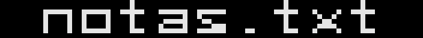
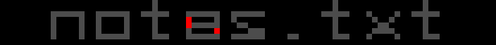
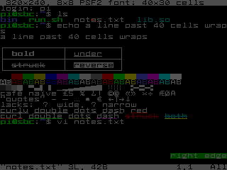

# How VTium is judged

vtium is judged in tiers, each with its harness in vtium's tree; [AGENTS.md](https://github.com/vtium/vtium/blob/main/AGENTS.md#how-vtium-is-judged) lists them with their commands.

- **Unit tests:** each crate's behaviour.
- **Tier 1, conformance:** byte streams replayed through vtium's terminal, the screen and the replies compared as text with goldens ([tools/conformance](https://github.com/vtium/vtium/blob/main/tools/conformance/README.md)).
- **Capability probes:** each capability vtium claims has a replay that fails without it, run by the same tool.
- **Tier 2, pixels:** the renderer draws known screens into memory, compared pixel for pixel with goldens ([tools/tier2](https://github.com/vtium/vtium/blob/main/tools/tier2/README.md)).
- **Tier 3, the VM:** vtium's install tree on a VT in a QEMU/KVM guest with a real display device, its screens captured and compared with goldens, with size and memory figures ([tools/tier3](https://github.com/vtium/vtium/blob/main/tools/tier3/README.md)).
- **The VT review:** the maintainer judges a build by eye on a real VT, guided step by step ([vt-review.md](../vt-review.md)).

The goldens are the judge, and each tier keeps its own in vtium's tree. A difference from one is a failure, unless the tier's list of expected differences names the case, with vtium's expected output and the reason, or lists the case as pending. A new golden stays provisional, and judges nothing, until the maintainer reviews it, and a golden changes only in a commit of its own that the maintainer reviews. vtium builds tier 3's guest images from its own scripts.

## How a pixel difference is flagged

Tier 2 compares each drawing with its golden one pixel at a time. A pixel matches only when its red, green and blue values all equal the golden's. Unless a screen has a tolerance file beside its golden, one pixel that differs fails the case. A tolerance file can allow a set number of pixels to differ by up to a set amount, and it can mask a rectangle out of the comparison. A difference within the tolerance is reported as `near`, and the case passes.

The pictures below come from one real run of tier 2. In that run, tier 2 draws the `small-320x240` screen from bytes with one letter changed on purpose, so that the shell session's `notes.txt` reads `notas.txt`. In the 8×8 font of that screen, the two letters differ in three pixels.

The first picture is the golden. It shows one row of character cells from the screen's directory listing, cropped and enlarged 8×.

The second picture is vtium's drawing of the same row with the planted change, cropped and enlarged 8× in the same way.

The third picture is the diff image that tier 2 writes for the failed case, cropped and enlarged 8× in the same way. Tier 2 dims vtium's drawing to a third of its brightness and paints each pixel that differs pure red. The three red pixels are where the `a` and the `e` differ. Where a tolerance file masks a rectangle, the diff image tints that rectangle blue.

The last picture is the whole diff image at its real size, 320×240 pixels. A person can easily miss three pixels on a whole screen, but tier 2 counts every one.

Tier 2 fails the case, so `make tier2` fails. Its output names the case in one line: `fail small-320x240: 3 pixel(s) differ, max channel delta 229`. The run writes vtium's drawing to `tools/tier2/out/actual/`, the diff image to `tools/tier2/out/diff/`, and a report to `tools/tier2/out/report.json`. The report gives each failed case's count of differing pixels, its largest difference in any one color channel, and boxes around the regions that differ. CI's tier 2 job keeps the report and the images of every pull request. The same planted change also failed `small-320x240-1bit` and `vitrified-320x240`, the two other screens drawn from the same bytes.

Tier 3 compares its screenshots with the same rules and the same verdicts. For each case that differs, it writes a full-size diff image beside the screenshot, as `target/tier3/run/VARIANT/CASE.diff.png`. It also writes a thumbnail in which each block that holds a differing pixel is red, so that a single pixel stays visible at thumbnail size. Its report is `target/tier3/report.json`.

To make these pictures again, change `notes.txt` to `notas.txt` in the `ls` line of `SMALL_40` in `tools/tier2/src/screens.rs`, run `make tier2`, and crop the images it writes as [the figures' notes](https://github.com/vtium/vtium/blob/main/docs/figures/README.md) describe.

A table in the decision records lists each mode and feature vtium supports, ignores or refuses, and [modes.md](../modes.md) lists the modes with their tests. A test that drives a row's behaviour carries the row's id in a tag, and a script checks that the tags and the tables agree, so each row shows the tests that judge it, and a row with none shows that nothing does yet.

[How vtium is built](how-vtium-is-built.md) explains why the judge comes before the code.
