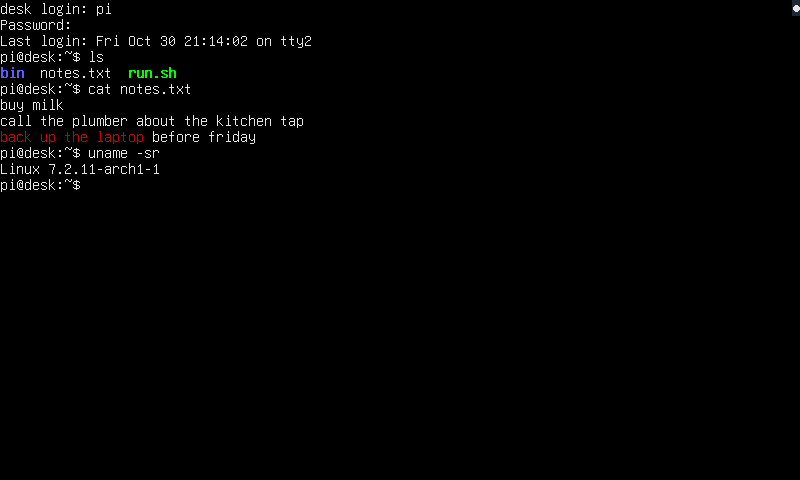
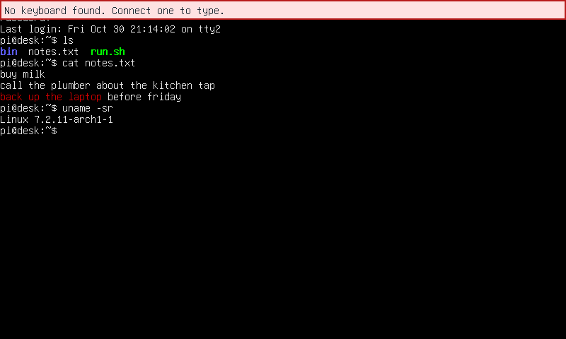

# The on-screen display and notices

vtium draws a few things of its own on top of your session. The on-screen display, or OSD, is a small sign of vtium's status. It tells you which head is active, and which console a head shows. Notices are boxes that tell you something went wrong, such as an error in vtium.conf. This page explains both, and how the `osd` setting in vtium.conf controls them.

A head is a terminal that shows on one or more displays. A console is one session within a head, with its own login, screen and scrollback. [Heads](heads.md) explains both. vtium draws the OSD and the notices apart from your session, so they never reach a program or the scrollback. See [the on-screen display issue](https://github.com/vtium/vtium/issues/169) for the work behind the OSD.

## The four levels of `osd`

The `osd` setting works like a log level. It takes one of four values: `full`, `minimal`, `off` and `silent`. Each value hides everything that the value before it hides, and more.

| Level | The status vtium draws | vtium's notices |
|---|---|---|
| `full` | a line across the top of each head, such as `● desk · console 2 of 3` | shown |
| `minimal`, the default | a dot in the top-right character cell of each head | shown |
| `off` | nothing | shown |
| `silent` | nothing | hidden, and written to vtium's log |

You set the level in `/etc/vtium/vtium.conf`, for example with the line `osd = full`. You can also start vtium with `--osd=full`. See [config.md](../config.md#on-screen-display-and-notices) for the setting and the ones next to it.

### `full`

With `full`, vtium draws a line across the top of each head. The line holds a dot, the head's name, and which of the head's consoles it shows. In the picture, the head `desk` shows the second of its three consoles. The line shows on every head with a lit display when the active head changes. It also shows on one head when that head shows another console, opens or closes one, or gets its display back.

### `minimal`

With `minimal`, vtium draws only the dot, in the head's top-right character cell. The dot shows on every head with a lit display when the active head changes. The dot says nothing about consoles, so a console switch does not show it.

### `off` and `silent`

With `off`, vtium draws no status at all. Its notices still show, because each one tells you about a problem.

With `silent`, vtium draws no status, and it hides its ordinary notices too. Choose `silent` when the people at the screen should not see the state of the system, for example on a public kiosk. vtium still writes each notice to its log, so you can read it later with `journalctl`. See [What `silent` changes](#what-silent-changes) for the details.

## The filled and hollow dots

The active head is the head that a roaming keyboard types into. A roaming keyboard is one that no rule in vtium.conf ties to a single head. The active head shows a filled dot, `●`. Every other head shows a hollow dot, `○`.

When you press Ctrl+Super+Up or Ctrl+Super+Down on a roaming keyboard, the active head moves. Each head with a lit display then shows its dot, so you can see where your typing goes. The anti-lockout guard can also move the active head, when no keyboard reaches a lit display. The dots show then too. See [Keys](../keys.md) for the keys that act on heads.

## When the OSD shows

The OSD shows for a few seconds after a change, and then it goes. The setting `osd-timeout` says how long, 3 seconds by default. With `osd-timeout = never`, the OSD stays up all the time. The time starts at the first frame that draws the OSD. A head without a display does not start the time.

The OSD does not show when a head starts and opens its consoles, because nothing changed for you then. A head that loses its last display drops the OSD it showed.

Under `full` and `minimal`, the key Ctrl+Super+Return can also show a brief line. This key opens a console. When the head already has as many consoles as it may have, the line says so, for example `No more consoles: desk has its limit of 4.` The brief line takes the place of the full line for a few seconds. Under `off` and `silent`, vtium writes this line only to its log.

## Notices

A notice is different from the status. The status tells you where you are. A notice tells you that something went wrong, and what you can do about it. For example, a notice tells you that vtium.conf has errors, or that no keyboard was found.

A notice shows in a pale red box at the top of the head. Most notices go when you press a key that reaches that head, or after 30 seconds. A head shows at most 4 notices at a time. When the OSD's line shows at the same time, the two share one box. The box then takes the notice's colors.

Notices show under `full`, `minimal` and `off`. The level `off` is for a screen where you do not want the status, but still want to hear about problems. [Troubleshooting](../troubleshooting.md#notices-on-the-screen) lists each notice and what to do about it.

## What `silent` changes

Under `osd = silent`, vtium draws less, and it does everything else as at the other levels. vtium writes each notice that it hides to its log. Here is what changes, and what stays the same:

- vtium shows no status, no brief line and none of its ordinary notices.
- The guards against lockout still act. Under the open policy, keyboards still roam when none reaches a lit display, and the rescue key still works. Only their notices are gone.
- A display that no rule places on this VT shows no notice. vtium leaves it off, and a key press or a switch back to the VT leaves it off too. At the other levels, under the open policy, such a display shows a notice that names the terminal it belongs to.
- Enter on a head's own keyboard still switches to that head's VT, where the head sets `switch-on-enter = yes`.
- The kernel's warnings and errors still show. The setting `kernel-messages` controls them.
- With `render-timer = osd`, vtium shows no frame figures on screen. With `render-timer = both`, vtium writes the figures only to its log.

vtium goes silent only when the setting is written correctly. Sometimes vtium.conf also has an `osd` line whose value vtium cannot read, such as `osd = slient`. vtium then runs as `off` instead, so it hides nothing because of a mistake. `vtium check-config` names the line. See [the issue that adds `silent`](https://github.com/vtium/vtium/issues/399) for the work behind it.

## Two screens that show at every level

In two states, vtium runs no session at all. The person at the screen then has no other way to learn why. So these two screens show in full at every level of `osd`, `silent` included.

The first is the panic screen. It shows when vtium.conf has the closed policy and its errors leave no head that can run. It also shows when vtium cannot read the policy line. The panic screen lists the first errors and names the command `vtium check-config`. Under the closed policy, vtium ignores any keyboard that no rule names.

The second is the notice that every screen stopped. Under the closed policy, a login can keep ending as soon as it starts. vtium then stops every head and shows this notice on the boot display for as long as it runs.

Under the closed policy with `silent`, the boot display stays dark for every other notice. The display guard is vtium's safeguard that lights the boot display when the rules light none. Under `silent` it lights the boot display only for these two screens. [Heads](heads.md#two-policies-open-and-closed) explains the two policies.

## Colors

Six settings set the colors. `notice-foreground`, `notice-background` and `notice-border` set a notice's colors. `osd-foreground`, `osd-background` and `osd-border` set the OSD's colors. By default a notice is dark text on pale red, and the OSD is light text on dark grey. The example configuration carries three other color schemes, for a light terminal, a dark one and color blindness. See [config.md](../config.md#other-color-schemes-for-the-notices-and-the-on-screen-display) for them.

## `focus-mark`, the older name

`focus-mark` is the older name for `osd` and `osd-timeout`. vtium still reads it, so an older vtium.conf keeps working. `auto` reads as `osd = minimal`, and `always` reads as `osd = minimal` with `osd-timeout = never`. `off` reads as `osd = off`. Where `osd` or `osd-timeout` is set too, that setting wins. No value of `focus-mark` means `silent`. vtium writes a line to its log that names the new settings when it reads `focus-mark`.
