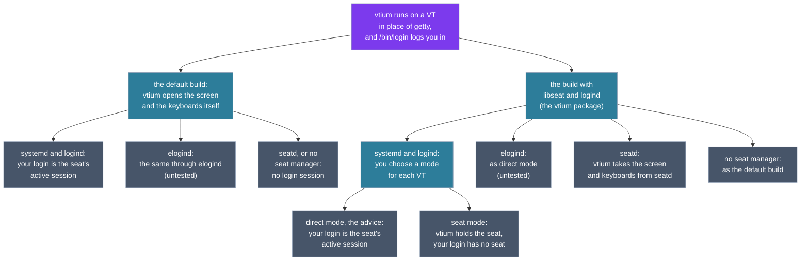

# Seats and sessions

You have probably logged in at a text console: you switch to it with Ctrl+Alt and a function key, type your name and your password, and get a shell. vtium gives you the same login prompt. Behind that prompt, two questions have different answers on different machines. The first is which program opens the screen and the keyboard. The second is which program keeps track of your login session, and so decides whether you can play sound, mount a USB stick or shut the machine down without a password.

This page answers both questions for each setup vtium runs in. It starts from what is the same on every machine. Then it follows two forks: how vtium is built, and which init system and seat manager the machine runs. On a systemd machine with the build that uses libseat and logind, a third fork is the mode you choose for each VT. The figure shows the tree, and each section below is one of its branches.



## What is the same everywhere

A Linux machine has several virtual terminals (VTs). A VT is one of the text screens you switch between with Ctrl+Alt and a function key. On most machines, a program called getty shows the login prompt on each VT. vtium takes the place of getty: it runs on a VT, draws the screen itself, and shows a login prompt there.

When you type your name, vtium runs `/bin/login`, the same program a getty runs. `login` asks for your password and starts your shell. Before it does, `login` runs PAM. [PAM](https://en.wikipedia.org/wiki/Pluggable_authentication_module), the pluggable authentication modules, is the library that checks your password and runs the steps a system adds to every login, such as registering the login with a session manager.

Each VT that runs vtium runs a vtium process of its own, with its own login. vtium runs as root, because it opens the display and the input devices.

On a systemd machine, the command `vtium console enable` gives VTs to vtium. systemd then starts vtium at boot on each of those VTs, so each one is in use from the start. This keeps a display manager, the program that shows a graphical login screen, off vtium's VTs. For example, sddm from version 0.20 puts each new desktop session on the first VT that no program holds open. vtium holds each of its VTs open from boot, so sddm takes a VT above them. On a machine with a display manager, VT 1 stays the display manager's. On a machine with another init system, your init's configuration starts vtium on a VT where it started a getty. [Install VTium](../install.md#what-the-install-does-to-your-vts) shows both.

## Seats, sessions and the programs that manage them

A few words come up in every branch of the tree.

- A **session** is one person's login, from the moment they log in until they log out. It holds every program that login starts.
- A **seat** is the set of devices one person sits at: a screen, a keyboard and a mouse, and the sound card and the USB ports that belong with them. Most machines have one seat, called `seat0`. See [systemd's page on seats](https://www.freedesktop.org/wiki/Software/systemd/multiseat/) for details.
- [**logind**](https://www.freedesktop.org/software/systemd/man/latest/systemd-logind.service.html) is the part of systemd that keeps track of sessions and seats. A seat has at most one **active session** at a time: the session on the VT that is shown. When you switch VTs, logind makes the session on the new VT the active one.
- [**elogind**](https://github.com/elogind/elogind) is logind taken out of systemd, so that machines with another init system can run it.
- [**polkit**](https://www.freedesktop.org/software/polkit/docs/latest/polkit.8.html) decides whether a program may do something that needs more rights than you have, such as shutting the machine down or mounting a USB stick. Its rules often allow an action to the active session without a password, and ask for an administrator's password from any other session. polkit asks logind which session you are in and whether that session is active.
- **uaccess** is a set of udev rules. udev is the program that sets up device files as devices appear. The uaccess rules give the active session's user access to the seat's devices, such as the sound card and removable disks, and take it away when another session becomes active.
- [**seatd**](https://git.sr.ht/~kennylevinsen/seatd) is a small seat manager. It hands the screen and the keyboard to a program that asks for them, and it handles VT switches for that program. seatd keeps no record of sessions.
- **libseat** is the library that seatd ships. A program uses it to get its devices from seatd, or from logind, without knowing which one runs.

## The first fork: how vtium is built

vtium comes in two builds that matter here.

- **The default build** opens the screen, the keyboards and the pointers itself, as root. It handles VT switches through the kernel, and it asks no seat manager for anything.
- **The build with libseat and logind** asks a seat manager for its devices through libseat when it starts. When a seat manager answers, vtium takes the graphics card, the keyboards and the pointers, and VT switching from it. When none answers, vtium opens its devices itself, as the default build does. The `vtium` package is built this way. This build also ships a second systemd unit, `vtium-seat@.service`, and the PAM file `/etc/pam.d/vtium`, which seat mode needs.

A build with libseat but without logind is meant for seatd. It ships neither the second unit nor the PAM file, and its logins work as in the default build.

## The default build

### With systemd and logind

vtium opens the screen and the keyboards itself. logind sees vtium's VT switches as the kernel reports them.

When you log in, vtium starts `login` with two variables that name the seat and the VT, `XDG_SEAT` and `XDG_VTNR`. `login` runs PAM, and PAM's `pam_systemd` module registers your login with logind on `seat0` and on vtium's VT. So logind makes your login the seat's active session while its VT is shown. polkit treats your session as active, and the uaccess rules give you the seat's devices. You get what a login at a getty gives you.

### With elogind

This works as with logind. PAM's `pam_elogind` module registers your login with elogind from the same two variables, so your login is the seat's active session while its VT is shown. No test of vtium runs under elogind yet, so this is untested. See [the elogind issue](https://github.com/vtium/vtium/issues/100).

### With seatd, or with no seat manager

The default build does not use seatd, so these two cases are the same. vtium opens the screen and the keyboards itself, and the kernel handles VT switches.

No program keeps track of sessions, so nothing registers a session for your login. `login` still logs you in, and the seat variables are only information for the programs you run. The uaccess rules give nobody devices. You reach the sound card or a disk through Unix groups such as `audio`, as on any machine without logind. polkit, where it is installed, finds no session for you, so it applies its rule for any process, which for most actions asks for an administrator's password.

## The build with libseat and logind

### With systemd and logind: two modes

On a systemd machine with logind, this build runs on each VT in one of two modes. You choose the mode for each VT with `vtium console enable`. A VT runs one mode at a time, because the two units conflict.

#### Direct mode

`vtium console enable --direct` gives the VT to `vtium@.service`. The package's install script turns on direct mode on every free VT.

In direct mode, vtium holds no logind session of its own. Because of that, vtium never asks logind for its devices in this mode. logind hands devices only to a program that controls a session. When the program asking has no session of its own, libseat picks one for it: the session of the user the program runs as, which for vtium is root. So vtium would take control of another person's session, such as a root login on another VT. seatd works differently: it hands the devices to whichever program asks, with no session needed. So if seatd runs, vtium takes the graphics card, the keyboards and the pointers, and VT switching from seatd. If seatd does not run, vtium opens its devices itself, as the default build does.

Your login works as in the default build: `pam_systemd` registers it with logind on `seat0` and on vtium's VT. Your login is the seat's active session while its VT is shown. polkit treats it as active, and the uaccess rules give you the seat's devices.

#### Seat mode

`vtium console enable --seat` gives the VT to `vtium-seat@.service`. Seat mode makes no new seat. The machine still has one seat, `seat0`, and vtium holds it, so a person who logs in gets a session with no seat. As that unit starts vtium, systemd runs the PAM file `/etc/pam.d/vtium`, and PAM registers a logind session for vtium itself. It is the kind of session a display manager's login screen opens: it asks for no password, and logind marks it as a greeter's. vtium then takes the graphics card, the keyboards and the pointers, and VT switching from logind through libseat. vtium's own session holds `seat0`.

Your login is kept off the seat on purpose. If your login registered on `seat0` with vtium's VT, logind would make your login the seat's active session. logind would then take vtium's devices away, and vtium could no longer draw or read the keyboard. So when you log in, vtium starts `login` in a systemd scope of its own, a group of processes that systemd tracks apart from vtium, and leaves out the seat variables. `pam_systemd` then gives you a logind session of your own with no seat. That session has your runtime directory, `XDG_RUNTIME_DIR`, and your user's `user@.service`, which two logins by the same user share.

Because your session has no seat, polkit treats it as inactive. Actions that polkit allows only to the active session, such as powering off, ask for a password. The uaccess rules give your session no devices either, so you have no sound card or removable disks unless your Unix groups give them to you.

When systemd cannot make the scope, vtium logs one line that says why. `login` then runs inside vtium's own session and gets no session of its own. polkit then judges your login by vtium's session, which is the seat's active session, so it allows you what it allows a login in direct mode.

See [the libseat issue](https://github.com/vtium/vtium/issues/34) for the work on seat mode.

`vtium console enable --seat` refuses, and changes nothing, when the console was built without libseat and logind, when `vtium-seat@.service` is missing or masked, when `/etc/pam.d/vtium` is missing, or when logind manages no `seat0`.

#### Moving a VT between modes

Turning a mode on needs root. To move one VT, name its number:

```
sudo vtium console enable --seat 3
sudo vtium console enable --direct 3
```

To move every VT that vtium has, use `--all`:

```
sudo vtium console enable --seat --all
sudo vtium console enable --direct --all
```

The command changes which unit systemd starts on the VT, and it disables the other mode's unit there. It starts and stops nothing. A vtium that runs on the VT now keeps running in the old mode, and a person logged in there keeps their session. The new mode takes over the next time vtium starts on that VT, which is at the next boot.

To switch a VT now, start the new mode's unit, as in `sudo systemctl start vtium-seat@tty3.service`. After `enable` for one VT, the command prints that line for you. After `enable --all`, it prints the line for VT 1 alone. Starting the new mode's unit stops the vtium of the other mode on that VT, and that ends every session on the VT. So log out there first.

VT 6 is logind's reserved VT, where logind starts a console at every switch to it. While vtium runs on VT 6 in the other mode, a command that would move VT 6 refuses and changes nothing, because the next switch to VT 6 would end that VT's sessions. It tells you how to go ahead.

#### What `vtium console enable` advises

`vtium console enable` with no mode changes nothing. It tells you what it finds on the machine: whether systemd runs, whether logind manages `seat0`, whether this vtium is built with libseat and logind, and which display manager keeps VT 1. Then it names the mode it recommends and why, and says whether seat mode can run on this machine. Last, it prints the command that turns the recommended mode on. When you name a VT, as in `vtium console enable 3`, the command is for that VT: `sudo vtium console enable --direct 3`. When you name no VT, or `--all`, the command is for every VT: `sudo vtium console enable --direct --all`. The advice leaves out `sudo` when you run it as root. Any user can ask for the advice.

It recommends direct mode on every systemd machine. Direct mode gives your login an active session on the seat, as a getty does. In seat mode, vtium gets its own devices from logind. That changes nothing you can see or use after you log in. What you do notice is that your login's session is inactive. So the advice names seat mode as a choice, with that cost.

### With elogind

`vtium console enable` works only on a machine booted with systemd, so on an elogind machine your init system starts vtium. Started that way, vtium has no session of its own. vtium then takes its devices from seatd if seatd runs, and opens them itself if it does not. When you log in, PAM's `pam_elogind` module registers your login with elogind on `seat0` and on vtium's VT, so your login is the seat's active session while its VT is shown.

If your init system opens a PAM session for vtium with the PAM file `/etc/pam.d/vtium`, vtium holds the seat through elogind, as in seat mode. Without systemd, vtium cannot make a scope for your login. It logs one line, and `login` starts inside vtium's session without the seat variables. None of this is tested under elogind yet. See [the elogind issue](https://github.com/vtium/vtium/issues/100).

### With seatd

vtium takes the graphics card, the keyboards and the pointers, and VT switching from seatd. Your login works as in the default build with seatd: no program keeps track of sessions, and your Unix groups give you your devices.

### With no seat manager

vtium finds no seat manager when it starts, so it runs on the kernel's VT exactly as the default build does.

## Choosing a setup

| Your machine | Who opens the screen and the keyboards | Who holds the seat | What your login gets |
|---|---|---|---|
| systemd and logind, default build or direct mode | vtium; in direct mode, seatd where seatd runs | your login, while its VT is shown | the seat's active session: polkit allows the active session's actions, and uaccess gives you the seat's devices |
| systemd and logind, seat mode | logind, for the screen, the keyboards and VT switching | vtium's own session | a session with no seat: polkit asks for a password, and uaccess gives you no devices |
| elogind (untested) | vtium, or seatd where seatd runs and vtium is the libseat build | your login, while its VT is shown | the seat's active session, through elogind |
| seatd | seatd, with the libseat build; vtium, with the default build | nobody | no session: your Unix groups decide your devices |
| no seat manager | vtium | nobody | no session: your Unix groups decide your devices |

On a systemd machine, keep direct mode. Choose seat mode only if you want vtium to get its devices through logind, and you accept that your logins then lose the seat's devices. `vtium console enable` with no mode tells you what it sees on your machine. [Install VTium](../install.md#direct-mode-and-seat-mode) shows how to move a VT between modes, and [systemd.md](../systemd.md) lists every place vtium touches systemd, logind and elogind.
