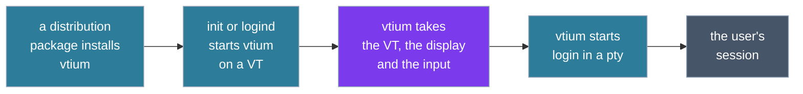

# Deployment and start-up

The figure follows vtium from the package that installs it to the user's session.

## Deployment

A distribution package installs vtium's programs, its service unit, its terminfo entry, and its example configuration. Where the package ships frits (font set files), it installs those too. Nothing is built at install time. The console generates a frit's glyphs while it runs.

On a machine that runs systemd, vtium's service unit takes the place of getty. getty is the program that shows the login prompt on a VT. When you enable vtium's unit, logind starts vtium on each VT where it would have started a getty.

Sometimes vtium cannot start, for example because no display appears. Then vtium exits with a failure, and the unit starts getty on that VT instead. That way, a user is never left at a dead screen.

vtium.conf can set a closed policy, under which vtium ignores any keyboard that no rule in vtium.conf names. Under a closed policy, the unit starts no getty when vtium fails. It starts none because a getty's login prompt on vtium's VT would accept any keyboard. See [Heads](heads.md#two-policies-open-and-closed) for details.

vtium also runs on machines without systemd or logind. There, an inittab line, an init script or a process supervisor starts vtium in the place where it started a getty. A person can also start vtium by hand. [systemd.md](../systemd.md) lists each place where vtium touches systemd, logind or init, and what vtium does without them.

## Taking the VT and the display

When vtium starts, it opens its VT. It asks the kernel to let vtium itself manage switches to and from that VT. Then vtium takes the display: it becomes the program allowed to set the display's mode and show frames on it. vtium reads the keyboards and pointers directly.

vtium waits a limited time for a display. A display plugged in later joins the console, and the grid takes its size. The grid is the columns and rows of characters on the screen.

## The session

Once vtium holds the display, it starts the session in the pty. A pty, or pseudo-terminal, is the device that connects the session's programs to vtium. By default, the session is the system's login program. The configuration can name another command instead. When the session's command exits, vtium starts it again, so a logout brings back the login prompt.

vtium serves one seat. A seat is the group of displays, keyboards and pointers that belong together, and most machines have exactly one. Each VT that runs vtium runs its own vtium process, with its own session.

## Switching VTs

The figure follows one switch away from vtium's VT and back. It shows who draws on the display, and where keys and pointer events go. It also shows the session, which keeps running the whole time.

The other VT's owner can be a desktop, a getty or another vtium.
