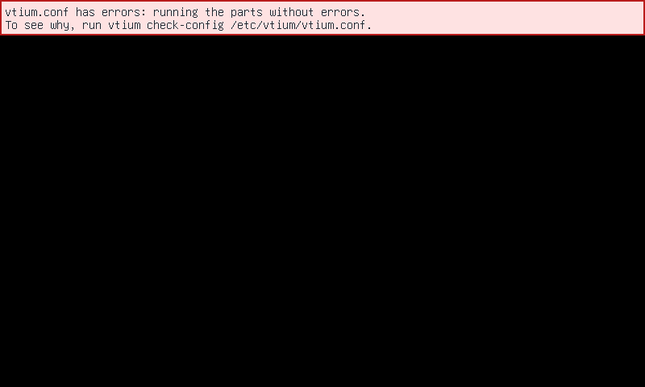
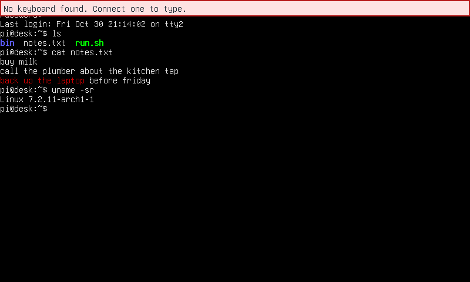

# Deployment and start-up

The figure follows vtium from the package that installs it to the user's session.

## Deployment

A distribution package installs vtium's programs, its service unit, its terminfo entry, and its example configuration. Where the package ships frits (font set files), it installs those too. Nothing is built at install time. The console generates a frit's glyphs while it runs.

On a machine that runs systemd, vtium's service unit takes the place of getty. getty is the program that shows the login prompt on a VT. When you enable vtium's unit, logind starts vtium on each VT where it would have started a getty.

Sometimes vtium cannot start, for example because no display appears. Then vtium exits with a failure, and the unit starts getty on that VT instead. That way, a user is never left at a dead screen.

vtium.conf can set a closed policy, under which vtium ignores any keyboard that no rule in vtium.conf names. Under a closed policy, the unit starts no getty when vtium fails. It starts none because a getty's login prompt on vtium's VT would accept any keyboard. See [Heads](heads.md#two-policies-open-and-closed) for details.

vtium also runs on machines without systemd or logind. There, an inittab line, an init script or a process supervisor starts vtium in the place where it started a getty. A person can also start vtium by hand. [systemd.md](../systemd.md) lists each place where vtium touches systemd, logind or init, and what vtium does without them.

## Reading vtium.conf

When vtium starts, it reads its configuration file, `/etc/vtium/vtium.conf`. When there is no file, vtium runs its built-in configuration and shows nothing. When vtium cannot use all of the file, it runs what it can, and it shows a notice. A notice is a pale red box across the top of the screen. The notice's first line says what vtium runs, and its second line says what to do next. vtium also writes each error, with its line in the file, to its log. See [Notices on the screen](../troubleshooting.md#notices-on-the-screen) for how long a notice stays.

[Invalid files](../head-file.md#invalid-files) gives the rules that decide how much of the file an error drops. The sections below describe the three notices that those rules lead to.

### vtium.conf not used: running the built-in configuration.

**Why.** vtium cannot use the file at all. That happens in three cases:

- The file fails the ownership check. For example, its group can write to it. See [Reading the sections](../head-file.md#reading-the-sections) for the check.
- vtium cannot open the file and read it as a regular file. For example, the path is a directory.
- The file's policy is open, and its errors leave no head that can run. A head is a terminal for one or more displays.

In each case, vtium runs its built-in configuration. The built-in configuration puts every display in one head, and every keyboard types into that head. So the session starts as usual, and you can log in. See [The default](flows.md#the-default-one-head-on-every-display) for details.

**What to do.** Run the command that the notice names, `vtium check-config /etc/vtium/vtium.conf`. The command prints each error with its line. Fix the file, then restart vtium or reboot, because vtium reads the file only when it starts. To go back to the file you installed before, run `vtium config history` and `vtium config restore N`, then `vtium config install`.

**How to avoid it.** Install vtium.conf with `vtium config install`. It refuses a file that fails `vtium check-config`, and it installs the file so that the file passes the ownership check. To check a file that you wrote yourself, run `vtium check-config FILE` before you install it. See [Configure vtium](../configure.md) for details.

### vtium.conf has errors: running the parts without errors.

**Why.** The file has errors, but at least one head survives them. vtium runs the heads and the rules that the errors leave. For example, a rule that names a head the file does not declare drops that rule alone.

Under the closed policy, it can happen that none of the surviving heads has a display that is on. vtium then turns on the boot display: the display that was on when vtium started, or else the first connected one. The boot display shows this notice alone, with no session behind it. The notice stays until a display that a surviving head's rule matches is connected.

**What to do.** Run `vtium check-config /etc/vtium/vtium.conf` to see each error with its line. Fix the file, then restart vtium or reboot.

**How to avoid it.** Edit the file with `vtium config edit --install`. When your editor exits, it checks the file and prints each error with its line. It installs the file only when the check passes.

### vtium.conf has errors and counts as closed: all input is off.

![vtium's panic screen on the boot display, 800×480 pixels. A pale red box fills the top two thirds of an otherwise black screen. On its left is an ASCII drawing of Tux, the Linux penguin, panicked inside a computer monitor above a keyboard. On its right is the report: "vtium.conf has errors and counts as closed: all input is off." and "No head can run because of the errors in /etc/vtium/vtium.conf, listed below." Then three errors, each starting with the file and its line: line 4 has no key named "focs", line 5's head section cannot set `font-size`, and line 7's rule sends devices to head "kisok", which the file does not declare. Then "More errors: 1", and last, "This console takes no input. For the full report, run vtium check-config /etc/vtium/vtium.conf over ssh or from other boot media."](../figures/concepts-panic.png)

This is the panic screen.

**Why.** The file is closed, and its errors leave no head that can run. A file is closed when it says `policy = closed`. A file is also closed when vtium cannot read one of its policy lines, such as `policy = opne`. See [Invalid files](../head-file.md#invalid-files) for the lines that count as policy lines.

vtium then runs nothing. It turns on the boot display and shows this screen there for as long as it runs. The screen lists the file's first three errors, each with its line, and it counts the rest. Where the screen has room, it also shows a drawing of Tux, the Linux penguin, panicked, beside the text or above it. A build with image support draws a picture in place of the ASCII drawing. The drawing says nothing that the text does not. No keyboard types into anything. vtium does not open the keyboards at all, so no key switches to another VT either.

**What to do.** Fix the file from outside this console: over ssh, on a serial console, or from other boot media with the disk mounted. `vtium check-config /etc/vtium/vtium.conf` prints every error. Over ssh, you can also put back the file you installed before, as the user who installed it: run `vtium config history` and `vtium config restore N`, then `vtium config install`. Then restart vtium, for example with `systemctl restart vtium@tty2.service`, or reboot. See [Recovery from outside](heads.md#recovery-from-outside) for details.

**How to avoid it.** vtium keeps no last good copy of a closed file, so check every change before it reaches the disk. `vtium config install` and `vtium config edit --install` install only a file that passes the check. For a file that you wrote yourself, run `vtium check-config FILE` first. Keep a way into the machine that needs no keyboard at this console, such as ssh or a serial console.

## Taking the VT and the display

When vtium starts, it opens its VT. It asks the kernel to let vtium itself manage switches to and from that VT. Then vtium takes the display: it becomes the program allowed to set the display's mode and show frames on it. vtium reads the keyboards and pointers directly.

vtium waits a limited time for a display. A display plugged in later joins the console, and the grid takes its size. The grid is the columns and rows of characters on the screen.

### No keyboard found. Connect one to type.

**Why.** vtium looks at the devices that are connected when it starts. When none of them is a keyboard, vtium shows this notice on every head. A head is a terminal that one or more displays show. The sessions start as usual.

**What to do.** Connect a keyboard. vtium places a keyboard by the rules in vtium.conf as soon as you plug it in, so you don't need to restart vtium. See [Rules and the policy](flows.md#rules-and-the-policy) for details.

**How to avoid it.** When a keyboard is connected and vtium still shows this notice, run `vtium config flow`. It lists every connected input device and the rule that places each one, so you can see whether the keyboard is there. On a machine that runs without a keyboard on purpose, such as a display-only kiosk, the notice is expected, and it goes after 30 seconds.

## The session

Once vtium holds the display, it starts the session in the pty. A pty, or pseudo-terminal, is the device that connects the session's programs to vtium. By default, the session is the system's login program. The configuration can name another command instead. When the session's command exits, vtium starts it again, so a logout brings back the login prompt.

vtium serves one seat. A seat is the group of displays, keyboards and pointers that belong together, and most machines have exactly one. Each VT that runs vtium runs its own vtium process, with its own session.

## Switching VTs

The figure follows one switch away from vtium's VT and back. It shows who draws on the display, and where keys and pointer events go. It also shows the session, which keeps running the whole time.

The other VT's owner can be a desktop, a getty or another vtium.
