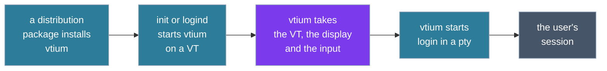

# Deployment and start-up

The figure follows vtium from the package that installs it to the user's session.

## Deployment

A distribution package installs vtium's programs, the service unit, the terminfo entry and the example configuration, and frits where it ships them. Nothing is built at install: the console generates a frit's glyphs at run time (ADR-1200).

On a systemd machine, vtium's unit takes the place of getty, the program that prints the login prompt on a VT: enabled, it makes logind start vtium on each VT it would have given a getty. When vtium cannot start, for example because no display appears, it exits with a failure, and the unit starts getty on that VT instead, so a user is never left at a dead screen. Under a head file whose policy is closed ([Heads](heads.md#two-policies-open-and-closed)) the unit starts no getty, since a getty's login on vtium's VT would take any keyboard.

vtium runs without systemd and without logind as well: an inittab line, an init script or a supervisor starts it where it started a getty, and a person can start it by hand. Each place vtium touches systemd, logind or init, and what it does without them, is listed in [systemd.md](../systemd.md).

## Taking the VT and the display

At start vtium opens its VT and asks the kernel to let it manage switches to and from that VT itself. It then takes the display: it becomes the program allowed to set the display's mode and show frames on it. It reads the keyboards and pointers directly. vtium waits a bounded time for a display; one plugged in later joins the console, and the grid takes its size.

## The session

Once it holds the display, vtium starts the session in the pty: by default the system's login program, and otherwise a command the configuration names. When the session's command exits, vtium starts it again, as getty does after a logout. vtium serves one seat, the group of displays, keyboards and pointers that belong together; most machines have exactly one. Each VT that runs vtium runs its own vtium process with its own session.

## Switching VTs

The figure follows one switch away from vtium's VT and back: who draws on the display, where keys and pointer events go, and the session, which runs throughout.

The other VT's owner can be a desktop, a getty or another vtium.
