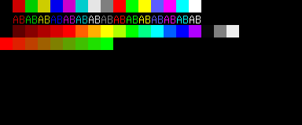
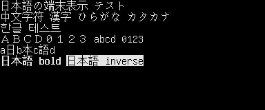
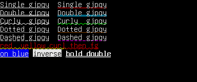
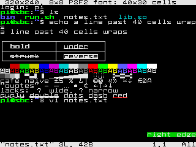
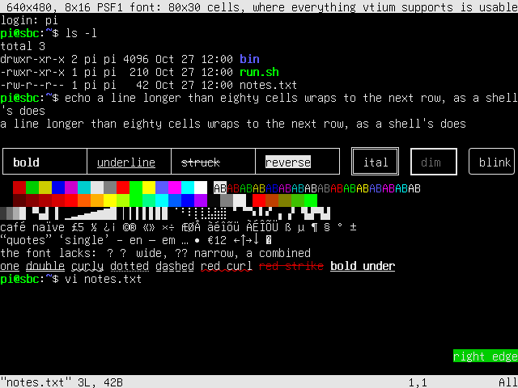

# What VTium is

vtium is a terminal for the Linux virtual console, the full-screen text terminals the kernel provides, each called a VT. It draws the terminal itself, straight to the display through the kernel's display interface (KMS/DRM, or the older fbdev framebuffer where that is all a machine has), with no display server. A program run in vtium sees a modern terminal: colors, text styles, Unicode and mouse reporting, with images to come. The features vtium supports, ignores or refuses are listed in [ADR-1000](../architecture/term/ADR-1000-the-modes-and-features-vtium-supports.md).

These three screens are vtium's own drawing, made in memory by its renderer: the color palette, double-width Japanese, Chinese and Korean text, and the underline styles in their own colors.

  

vtium is written in Rust. What it does is set by the specifications it cites and by the tables of ADR-1000, and its own tests judge it, against goldens: saved expected results that vtium's output is compared with ([How vtium is judged](how-vtium-is-judged.md)).

## Small machines first

vtium is built to run on small machines first and large ones as well. Its default build, minspec, is the smallest complete console: it draws through the CPU into a plain memory buffer the display shows, uses bitmap fonts, and needs no GPU; images, outline fonts and a GPU path are features built on top of it. Its yardstick is a single-board computer with ARM cores and 512 MB of memory or less, and its smallest display is a 320x240 panel, where an 8x8 font gives a grid of 40 columns by 30 rows. The same build draws on large displays too. [architecture.md](../architecture.md#the-minspec-build) sets out the machine, the display floor and what is promised at each size.

The same shell session at the display floor and one step up, as vtium draws it: 320x240 with an 8x8 font, 40 columns by 30 rows, and 640x480 with an 8x16 font, 80 columns by 30 rows.

