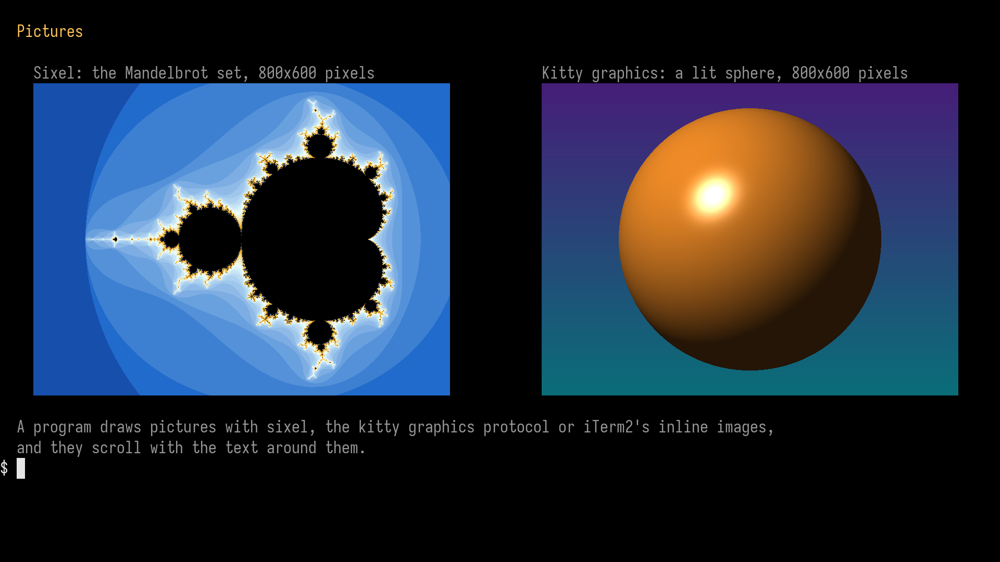

# Images

Pictures that a program prints appear right on the console, between the lines of text, and scroll with them. Image previews in a file manager or a plot from a script show up where you are working.

*[The showcase](../showcase/pictures.md) has more screens like this one.*

Three image protocols are supported: sixel, the kitty graphics protocol, and iTerm2's inline images. Kitty graphics animations play, the protocol's Unicode placeholders render, and each image is anchored to a line of text.

A separate program, the image helper, reads and decodes every image inside a sandbox, so vtium's root process never decodes an image format itself. [Security and the system](security-and-system.md#helpers-in-a-sandbox) says which user it runs as and how it is locked down.

The `vtium` and `vtium-git` packages include image support, while minspec, the smallest build, leaves it out. Protocol details are under [Images](../features.md#images).
