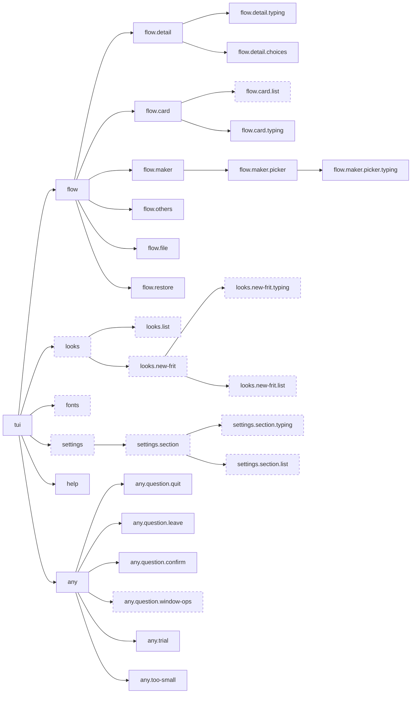

<!-- Generated from ADR-1403's interface tree and key table by the test generated_help_and_page_match_the_contract in crates/vtium-config/src/tui/contract.rs. VTIUM_CONFIG_BLESS=1 cargo test -p vtium-config --lib generated_help rewrites it. -->

# vtium-config's screens and keys

vtium-config's TUI is its full-screen view of the configuration, which `vtium config tui` opens. This page lists every screen of the TUI and what each key does there. The TUI's Help tab and its key lines come from the same two tables as this page, so they say the same. [Configure vtium](../configure.md#the-tui) explains what the TUI is for.

The diagram shows how the screens open from one another. A dashed box is a screen that vtium-config does not have yet, and its section links the issue that tracks it.

Each section below names a screen by its place in the tree, says how you open and leave it, and lists its keys. The column "Shown as" gives the word the key line shows beside the key, and a dash marks a key that the key line leaves out.

## `tui`

Vtium-config's TUI, run at a terminal of at least 80×25.

**Open it:** Vtium config with no command, at a terminal.

**Leave it:** Q quits or asks; Ctrl-C saves and quits.

| Key | Shown as | What it does |
|---|---|---|
| Help and key line | - | Show, for the place you are in, the keys that act there and what each does. |

## `flow`

The Flow view: CONFIGURATION, NEW PATH and PARTS.

**Open it:** The TUI opens here; Tab from help, Shift-Tab from looks.

**Leave it:** Tab to looks, Shift-Tab to help.

| Key | Shown as | What it does |
|---|---|---|
| q | quit | Quits vtium-config. If changes are not saved, it asks first. If new or removed font sets wait for an install, it asks whether to install them. |
| Esc | clear | Clears NEW PATH. If you were revising a path, the path leaves the configuration. |
| Tab | next view | Moves to the next view. |
| Shift-Tab | view before | Moves to the view before. |
| Ctrl-C | save and quit | Saves the changes that are not saved into the draft, puts back the console's font, and quits without asking. |
| s | save | Saves the changes that are not saved into the draft. |
| i | install | Saves, then asks whether to install the draft. |
| r | revert | Asks whether to throw away the draft's changes and copy the installed file back. |
| n | new | Asks whether to start a new configuration. |
| v | view file | Shows the draft's vtium.conf as text. |
| o | restore | Lists the files installed before, newest first, to copy one into the draft. |
| key line | - | Shows one row. Where the keys do not fit on one row, it shows them in pages, and ends with `. more` and the page number. |
| . | more | Shows the key line's next page, and the first page again after the last. Does nothing where the keys fit on one row. |
| Up | move | Moves to the box above. |
| Down | move | Moves to the box below. |
| Left | move | Moves to the box before, and on to the line before. |
| Right | move | Moves to the box after, and on to the next line. |
| Home | first | Goes to the first box. |
| End | last | Goes to the last box. |
| PgUp | scroll | Scrolls up by a window. |
| PgDn | scroll | Scrolls down by a window. |
| Space | pick | Picks the highlighted part into NEW PATH, or takes it out. |
| Enter | open | Opens the highlighted box: a part's detail, a path's card, a template's part maker, or the list of other inputs. |
| a | add path | Adds the path in NEW PATH to the configuration. |
| e | revise | Takes the highlighted path out of the configuration into NEW PATH, to change it. On a box that is not a path, it says how to choose one. |
| d | read devices | Reads the connected displays and input devices again. |
| p | preview | Shows a preview of the highlighted complete path. Today it only says that the preview is not available yet, or not in this terminal. Not built yet: see [#412](https://github.com/vtium/vtium/issues/412). |
| t | trial | Says where a font set can be tried on this console: on a path card's font set field. Where this terminal is not a vtium console, or allow-font-ops is off, it says why the trial is off. |
| Click on a view's name | - | Switches to that view. |
| Click on a box | - | Highlights the box. A second click on the highlighted box opens it. |
| Wheel up | - | Moves to the box above, as Up does. |
| Wheel down | - | Moves to the box below, as Down does. |

## `flow.detail`

A part's detail, with its label line and the choices that narrow it, or the detail of a path, the roaming inputs or Nowhere.

**Open it:** Enter on a box that is not a terminal or a template.

**Leave it:** Esc to flow; e revises the path and goes to flow.

| Key | Shown as | What it does |
|---|---|---|
| q | quit | Quits vtium-config, and asks first if changes are not saved. |
| Esc | back | Goes back, with the same item highlighted. |
| Tab | - | Does nothing until you close what is open with Esc. |
| Shift-Tab | - | Does nothing until you close what is open with Esc. |
| Ctrl-C | save and quit | Saves the changes that are not saved into the draft, puts back the console's font, and quits without asking. |
| s i r n v o | - | Do nothing until you close what is open with Esc. |
| key line | - | Shows one row. Where the keys do not fit on one row, it shows them in pages, and ends with `. more` and the page number. |
| . | more | Shows the key line's next page, and the first page again after the last. Does nothing where the keys fit on one row. |
| Up | move | Moves to the line above. |
| Down | move | Moves to the line below. |
| Enter | label | On the label line, lets you type the part's label. |
| e | revise | Takes this path out of the configuration into NEW PATH, to change it. |
| Click | - | Does nothing until you close what is open with Esc. |
| Wheel up | - | Acts as Up does in what is open. |
| Wheel down | - | Acts as Down does in what is open. |

## `flow.detail.typing`

A part's label being typed.

**Open it:** Enter on the detail's label line.

**Leave it:** Enter keeps it and Esc drops it, both to flow.detail.

| Key | Shown as | What it does |
|---|---|---|
| q | - | Types the letter q. |
| Esc | cancel | Cancels what you typed and goes back. |
| Tab | - | Does nothing while you type. |
| Shift-Tab | - | Does nothing while you type. |
| Ctrl-C | save and quit | Saves the changes that are not saved into the draft, puts back the console's font, and quits without asking. |
| Enter | keep | Keeps the value you typed. |
| Backspace | delete | Deletes the character before the cursor. |
| any letter | type | Types the letter. |
| Click | - | Does nothing while you type. |
| Wheel up, Wheel down | - | Do nothing while you type. |

## `flow.detail.choices`

A part's narrowing choices: the narrower parts the part's detail offers to pick into NEW PATH.

**Open it:** Down from the label line of a part's detail.

**Leave it:** Up from the first choice goes back to the label line; Enter picks a choice and goes to flow; Esc goes to flow.

| Key | Shown as | What it does |
|---|---|---|
| Up | move | Moves to the choice above, and from the first choice back to the label line. |
| Down | move | Moves to the choice below. |
| Home | first | Goes to the first choice. |
| End | last | Goes to the last choice. |
| PgUp | page up | Moves up by a page. |
| PgDn | page down | Moves down by a page. |
| Enter | pick | Picks the part narrowed to the highlighted choice into NEW PATH, and closes the detail. |
| q | quit | Quits vtium-config, and asks first if changes are not saved. |
| Esc | back | Goes back, with the same item highlighted. |
| Tab | - | Does nothing until you close what is open with Esc. |
| Shift-Tab | - | Does nothing until you close what is open with Esc. |
| Ctrl-C | save and quit | Saves the changes that are not saved into the draft, puts back the console's font, and quits without asking. |
| s i r n v o | - | Do nothing until you close what is open with Esc. |
| Wheel up | - | Acts as Up does in what is open. |
| Wheel down | - | Acts as Down does in what is open. |
| Click | - | Does nothing until you close what is open with Esc. |
| key line | - | Shows one row. Where the keys do not fit on one row, it shows them in pages, and ends with `. more` and the page number. |
| . | more | Shows the key line's next page, and the first page again after the last. Does nothing where the keys fit on one row. |

## `flow.card`

A path's terminal card, in CONFIGURATION or NEW PATH.

**Open it:** Enter on a terminal box.

**Leave it:** Esc to flow; e revises the path and goes to flow.

| Key | Shown as | What it does |
|---|---|---|
| q | quit | Quits vtium-config, and asks first if changes are not saved. |
| Esc | back | Goes back, with the same item highlighted. |
| Tab | - | Does nothing until you close what is open with Esc. |
| Shift-Tab | - | Does nothing until you close what is open with Esc. |
| Ctrl-C | save and quit | Saves the changes that are not saved into the draft, puts back the console's font, and quits without asking. |
| s i r n v o | - | Do nothing until you close what is open with Esc. |
| t | try live | Tries the card's font set on this console for 10 seconds. |
| Enter | choose | Shows the card's displays, devices or VTs as a list inside the card. Not built yet: see [#412](https://github.com/vtium/vtium/issues/412). |
| Enter | choose | Shows the font sets to choose from as a list. Not built yet: see [#412](https://github.com/vtium/vtium/issues/412). |
| Enter | choose | Shows the terminals this configuration defines as a list. Not built yet: see [#412](https://github.com/vtium/vtium/issues/412). |
| key line | - | Shows one row. Where the keys do not fit on one row, it shows them in pages, and ends with `. more` and the page number. |
| . | more | Shows the key line's next page, and the first page again after the last. Does nothing where the keys fit on one row. |
| Up | move | Moves to the field above. |
| Down | move | Moves to the field below. |
| Left | choose | Steps the highlighted field to its choice before. |
| Right | choose | Steps the highlighted field to its next choice. |
| Enter | set | Sets the highlighted field, or lets you type the new terminal's name. |
| e | revise this path | Takes this path out of the configuration into NEW PATH, to change it. |
| Click | - | Does nothing until you close what is open with Esc. |
| Wheel up | - | Acts as Up does in what is open. |
| Wheel down | - | Acts as Down does in what is open. |

## `flow.card.list`

The shared list, as a list box inside the card: its displays, devices, VTs, font set files or terminals.

vtium-config does not have this screen yet. See [#412](https://github.com/vtium/vtium/issues/412). Today: The card shows a set as items joined in a line, and Left and Right step a field through its choices.

**Open it:** Enter on a field of the card that holds a set of items.

**Leave it:** Enter picks and Esc closes, both to flow.card.

| Key | Shown as | What it does |
|---|---|---|
| Up | move | Moves to the item above. |
| Down | move | Moves to the item below. |
| Home | first | Goes to the first item. |
| End | last | Goes to the last item. |
| PgUp | page up | Moves up by a page. |
| PgDn | page down | Moves down by a page. |
| Enter | pick | Picks the highlighted item and closes the list. On Other…, it lets you type a value. |
| Esc | back | Closes the list without picking. |
| q | quit | Quits vtium-config, and asks first if changes are not saved. |
| Tab | - | Does nothing until you close what is open with Esc. |
| Shift-Tab | - | Does nothing until you close what is open with Esc. |
| Ctrl-C | save and quit | Saves the changes that are not saved into the draft, puts back the console's font, and quits without asking. |
| s i r n v o | - | Do nothing until you close what is open with Esc. |
| Click | - | Does nothing until you close what is open with Esc. |
| Wheel up | - | Acts as Up does in what is open. |
| Wheel down | - | Acts as Down does in what is open. |
| . | more | Shows the key line's next page, and the first page again after the last. Does nothing where the keys fit on one row. |

## `flow.card.typing`

The new terminal's name being typed.

**Open it:** Enter on the name field of the card in NEW PATH.

**Leave it:** Enter keeps it and Esc drops it, both to flow.card.

| Key | Shown as | What it does |
|---|---|---|
| q | - | Types the letter q. |
| Esc | cancel | Cancels what you typed and goes back. |
| Tab | - | Does nothing while you type. |
| Shift-Tab | - | Does nothing while you type. |
| Ctrl-C | save and quit | Saves the changes that are not saved into the draft, puts back the console's font, and quits without asking. |
| Enter | keep | Keeps the value you typed. |
| Backspace | delete | Deletes the character before the cursor. |
| any letter | type | Types the letter. |
| Click | - | Does nothing while you type. |
| Wheel up, Wheel down | - | Do nothing while you type. |

## `flow.maker`

A part maker: a template's choices, or an empty place in NEW PATH.

**Open it:** Enter on a template in PARTS or an empty place in NEW PATH.

**Leave it:** Esc to flow; Enter on a choice that makes a part goes to flow.

| Key | Shown as | What it does |
|---|---|---|
| q | quit | Quits vtium-config, and asks first if changes are not saved. |
| Esc | back | Goes back, with the same item highlighted. |
| Tab | - | Does nothing until you close what is open with Esc. |
| Shift-Tab | - | Does nothing until you close what is open with Esc. |
| Ctrl-C | save and quit | Saves the changes that are not saved into the draft, puts back the console's font, and quits without asking. |
| s i r n v o | - | Do nothing until you close what is open with Esc. |
| key line | - | Shows one row. Where the keys do not fit on one row, it shows them in pages, and ends with `. more` and the page number. |
| . | more | Shows the key line's next page, and the first page again after the last. Does nothing where the keys fit on one row. |
| Up | move | Moves to the choice above. |
| Down | move | Moves to the choice below. |
| Enter | choose | Makes the part from the highlighted choice, or opens the list of values for a choice that filters. |
| Home | first | Goes to the first line. |
| End | last | Goes to the last line. |
| PgUp | page up | Moves up by a page. |
| PgDn | page down | Moves down by a page. |
| Click | - | Does nothing until you close what is open with Esc. |
| Wheel up | - | Acts as Up does in what is open. |
| Wheel down | - | Acts as Down does in what is open. |

## `flow.maker.picker`

The filter picker: each value of a match with the devices it matches now, and Other… last.

**Open it:** Enter on a choice that filters.

**Leave it:** Esc to flow.maker; Enter on a value picks it and goes to flow.

| Key | Shown as | What it does |
|---|---|---|
| Up | move | Moves to the item above. |
| Down | move | Moves to the item below. |
| Home | first | Goes to the first item. |
| End | last | Goes to the last item. |
| PgUp | page up | Moves up by a page. |
| PgDn | page down | Moves down by a page. |
| Enter | pick | Picks the highlighted item and closes the list. On Other…, it lets you type a value. |
| Esc | back | Closes the list without picking. |
| Enter | choose | Shows the devices that each value matches as a list. Not built yet: see [#412](https://github.com/vtium/vtium/issues/412). |
| q | quit | Quits vtium-config, and asks first if changes are not saved. |
| Tab | - | Does nothing until you close what is open with Esc. |
| Shift-Tab | - | Does nothing until you close what is open with Esc. |
| Ctrl-C | save and quit | Saves the changes that are not saved into the draft, puts back the console's font, and quits without asking. |
| s i r n v o | - | Do nothing until you close what is open with Esc. |
| Click | - | Does nothing until you close what is open with Esc. |
| Wheel up | - | Acts as Up does in what is open. |
| Wheel down | - | Acts as Down does in what is open. |
| . | more | Shows the key line's next page, and the first page again after the last. Does nothing where the keys fit on one row. |

## `flow.maker.picker.typing`

A value being typed after Other….

**Open it:** Enter on Other….

**Leave it:** Enter adds the value and goes to flow; Esc drops it and goes to flow.maker.picker.

| Key | Shown as | What it does |
|---|---|---|
| q | - | Types the letter q. |
| Esc | cancel | Cancels what you typed and goes back. |
| Tab | - | Does nothing while you type. |
| Shift-Tab | - | Does nothing while you type. |
| Ctrl-C | save and quit | Saves the changes that are not saved into the draft, puts back the console's font, and quits without asking. |
| Enter | keep | Keeps the value you typed. |
| Backspace | delete | Deletes the character before the cursor. |
| any letter | type | Types the letter. |
| Click | - | Does nothing while you type. |
| Wheel up, Wheel down | - | Do nothing while you type. |

## `flow.others`

The folded list of the inputs that are neither keyboards nor pointers.

**Open it:** Enter on the box of other inputs.

**Leave it:** Esc to flow.

| Key | Shown as | What it does |
|---|---|---|
| q | quit | Quits vtium-config, and asks first if changes are not saved. |
| Esc | back | Goes back, with the same item highlighted. |
| Tab | - | Does nothing until you close what is open with Esc. |
| Shift-Tab | - | Does nothing until you close what is open with Esc. |
| Ctrl-C | save and quit | Saves the changes that are not saved into the draft, puts back the console's font, and quits without asking. |
| s i r n v o | - | Do nothing until you close what is open with Esc. |
| key line | - | Shows one row. Where the keys do not fit on one row, it shows them in pages, and ends with `. more` and the page number. |
| . | more | Shows the key line's next page, and the first page again after the last. Does nothing where the keys fit on one row. |
| Click | - | Does nothing until you close what is open with Esc. |
| Wheel up | - | Acts as Up does in what is open. |
| Wheel down | - | Acts as Down does in what is open. |

## `flow.file`

The file view: the draft's vtium.conf as text, read-only.

**Open it:** V.

**Leave it:** Esc to flow.

| Key | Shown as | What it does |
|---|---|---|
| q | quit | Quits vtium-config, and asks first if changes are not saved. Esc goes back to the configuration. |
| Esc | back | Goes back, with the same item highlighted. |
| Tab | - | Does nothing until you close what is open with Esc. |
| Shift-Tab | - | Does nothing until you close what is open with Esc. |
| Ctrl-C | save and quit | Saves the changes that are not saved into the draft, puts back the console's font, and quits without asking. |
| s | save | Saves the changes that are not saved into the draft. The file view stays open and shows the file as it now stands. |
| i | install | Saves, then asks whether to install the draft. The file view stays open. |
| key line | - | Shows one row. Where the keys do not fit on one row, it shows them in pages, and ends with `. more` and the page number. |
| . | more | Shows the key line's next page, and the first page again after the last. Does nothing where the keys fit on one row. |
| j | lines | Scrolls down by a line. |
| k | lines | Scrolls up by a line. |
| Down | lines | Scrolls down by a line. |
| Up | lines | Scrolls up by a line. |
| h | sideways | Scrolls left. |
| l | sideways | Scrolls right. |
| Left | sideways | Scrolls left. |
| Right | sideways | Scrolls right. |
| g | top | Goes to the top of the file. |
| G | bottom | Goes to the bottom of the file. |
| Home | top | Goes to the top of the file. |
| End | bottom | Goes to the bottom of the file. |
| Ctrl-D | half page | Scrolls down by half a page. |
| Ctrl-U | half page | Scrolls up by half a page. |
| PgDn | half page | Scrolls down by half a page. |
| PgUp | half page | Scrolls up by half a page. |
| Click | - | Does nothing until you close what is open with Esc. |
| Wheel up | - | Acts as Up does in what is open. |
| Wheel down | - | Acts as Down does in what is open. |

## `flow.restore`

Restore's list of the installed history, newest first.

**Open it:** O.

**Leave it:** Esc to flow; Enter asks any.question.confirm.

| Key | Shown as | What it does |
|---|---|---|
| q | quit | Quits vtium-config, and asks first if changes are not saved. Esc closes the list. |
| Esc | back | Goes back, with the same item highlighted. |
| Tab | - | Does nothing until you close what is open with Esc. |
| Shift-Tab | - | Does nothing until you close what is open with Esc. |
| Ctrl-C | save and quit | Saves the changes that are not saved into the draft, puts back the console's font, and quits without asking. |
| s i r n v o | - | Do nothing until you close what is open with Esc. |
| Up | move | Moves to the item above. |
| Down | move | Moves to the item below. |
| key line | - | Shows one row. Where the keys do not fit on one row, it shows them in pages, and ends with `. more` and the page number. |
| . | more | Shows the key line's next page, and the first page again after the last. Does nothing where the keys fit on one row. |
| Home | first | Goes to the first item. |
| End | last | Goes to the last item. |
| PgUp | page up | Moves up by a page. |
| PgDn | page down | Moves down by a page. |
| Enter | restore | Asks whether to copy the highlighted installed file into the draft. |
| Click | - | Does nothing until you close what is open with Esc. |
| Wheel up | - | Acts as Up does in what is open. |
| Wheel down | - | Acts as Down does in what is open. |

## `looks`

The Looks tab: the looks and the font sets, with one preview of a look's font set and size.

vtium-config does not have this screen yet. See [#379](https://github.com/vtium/vtium/issues/379). Today: A list of sizes whose Enter writes the top-level font-size.

**Open it:** Tab from flow, Shift-Tab from settings.

**Leave it:** Tab to settings, Shift-Tab to flow.

| Key | Shown as | What it does |
|---|---|---|
| q | quit | Quits vtium-config. If changes are not saved, it asks first. If new or removed font sets wait for an install, it asks whether to install them. |
| Esc | - | Does nothing here. |
| Tab | next view | Moves to the next view. |
| Shift-Tab | view before | Moves to the view before. |
| Ctrl-C | save and quit | Saves the changes that are not saved into the draft, puts back the console's font, and quits without asking. |
| s | save | Saves the changes that are not saved into the draft. |
| i | install | Saves, then asks whether to install the draft. |
| r | remove | Marks the highlighted font set for removal at the next install, or takes the mark back. Not built yet: see [#379](https://github.com/vtium/vtium/issues/379). |
| n | new font set | Opens the form for a new font set. Not built yet: see [#379](https://github.com/vtium/vtium/issues/379). |
| t | try live | Tries the highlighted font set on this console for 10 seconds. Not built yet: see [#379](https://github.com/vtium/vtium/issues/379). |
| Enter | choose | On a font set, chooses it for the look. On a size, tries the size on this console for 10 seconds: k keeps it, and any other key puts the size back. Not built yet: see [#379](https://github.com/vtium/vtium/issues/379). |
| p | picture \| sample | Switches the preview between the sample characters and the picture of the console. Not built yet: see [#379](https://github.com/vtium/vtium/issues/379). |
| w | resize grid | Asks whether to let programs resize the console's grid. y turns allow-window-ops on in the draft, and any other answer changes nothing. Not built yet: see [#379](https://github.com/vtium/vtium/issues/379). |
| o | - | Does nothing here. Not built yet: see [#412](https://github.com/vtium/vtium/issues/412). |
| Enter | choose | Shows the font sets to choose from as a list. Not built yet: see [#379](https://github.com/vtium/vtium/issues/379). |
| Enter | choose | Shows the font sizes as a list. Not built yet: see [#379](https://github.com/vtium/vtium/issues/379). |
| key line | - | Shows one row. Where the keys do not fit on one row, it shows them in pages, and ends with `. more` and the page number. |
| . | more | Shows the key line's next page, and the first page again after the last. Does nothing where the keys fit on one row. |
| Up | move | Moves to the item above. |
| Down | move | Moves to the item below. |
| Home | first | Goes to the first item. |
| End | last | Goes to the last item. |
| PgUp | page up | Moves up by a page. |
| PgDn | page down | Moves down by a page. |

## `looks.list`

The shared list of the font sets, or of the sizes.

vtium-config does not have this screen yet. See [#379](https://github.com/vtium/vtium/issues/379). Today: No such list.

**Open it:** Enter on the look's font set or size.

**Leave it:** Enter picks and Esc closes, both to looks.

| Key | Shown as | What it does |
|---|---|---|
| Up | move | Moves to the item above. |
| Down | move | Moves to the item below. |
| Home | first | Goes to the first item. |
| End | last | Goes to the last item. |
| PgUp | page up | Moves up by a page. |
| PgDn | page down | Moves down by a page. |
| Enter | pick | Picks the highlighted item and closes the list. On Other…, it lets you type a value. |
| Esc | back | Closes the list without picking. |
| q | quit | Quits vtium-config, and asks first if changes are not saved. |
| Tab | - | Does nothing until you close what is open with Esc. |
| Shift-Tab | - | Does nothing until you close what is open with Esc. |
| Ctrl-C | save and quit | Saves the changes that are not saved into the draft, puts back the console's font, and quits without asking. |
| s i r n v o | - | Do nothing until you close what is open with Esc. |
| . | more | Shows the key line's next page, and the first page again after the last. Does nothing where the keys fit on one row. |

## `looks.new-frit`

The form for a new font set: a text font and the layers (the views table's new-frit).

vtium-config does not have this screen yet. See [#379](https://github.com/vtium/vtium/issues/379), [#412](https://github.com/vtium/vtium/issues/412). Today: Under=fonts; o writes the top-level allow-font-ops in a vtium console with allow-font-ops off, and i installs from the last row.

**Open it:** N.

**Leave it:** Esc to looks; its last row adds the font set and goes to looks.

| Key | Shown as | What it does |
|---|---|---|
| q | quit | Quits vtium-config, and asks first if changes are not saved. |
| Esc | back | Goes back, with the same item highlighted. |
| Tab | - | Does nothing until you close what is open with Esc. |
| Shift-Tab | - | Does nothing until you close what is open with Esc. |
| Ctrl-C | save and quit | Saves the changes that are not saved into the draft, puts back the console's font, and quits without asking. |
| s i r n v o | - | Do nothing until you close what is open with Esc. |
| key line | - | Shows one row. Where the keys do not fit on one row, it shows them in pages, and ends with `. more` and the page number. |
| . | more | Shows the key line's next page, and the first page again after the last. Does nothing where the keys fit on one row. |
| Up | move | Moves to the field above. |
| Down | move | Moves to the field below. |
| Enter | add | On the last row, adds the new font set to the draft. |
| Home | first | Goes to the first row. |
| End | last | Goes to the last row. |
| PgUp | page up | Moves up by a page. |
| PgDn | page down | Moves down by a page. |
| Enter | choose | On a font field, shows the fonts and font sets found on this system as a list to pick from. You can still type a font that the list lacks. Not built yet: see [#375](https://github.com/vtium/vtium/issues/375). |

## `looks.new-frit.typing`

A field of the form being typed.

vtium-config does not have this screen yet. See [#379](https://github.com/vtium/vtium/issues/379), [#412](https://github.com/vtium/vtium/issues/412). Today: Under the Fonts tab, and Up and Down move to another field while a value is typed.

**Open it:** The form opens on its first field; Enter on a field goes to the next field.

**Leave it:** Enter on the last field goes to the form's last row, in looks.new-frit; Esc closes the form and goes to looks.

| Key | Shown as | What it does |
|---|---|---|
| q | - | Types the letter q. |
| Esc | cancel | Cancels what you typed and goes back. |
| Tab | - | Does nothing while you type. |
| Shift-Tab | - | Does nothing while you type. |
| Ctrl-C | save and quit | Saves the changes that are not saved into the draft, puts back the console's font, and quits without asking. |
| Enter | next field | Keeps the value and goes to the next field. |
| Backspace | delete | Deletes the character before the cursor. |
| any letter | type | Types the letter. |
| Up, Down, Home, End, PgUp, PgDn | - | Do nothing while you type. Enter keeps the value and goes to the next field, and Esc closes the form. |

## `looks.new-frit.list`

The shared list of the layers in the frits' directory.

vtium-config does not have this screen yet. See [#379](https://github.com/vtium/vtium/issues/379). Today: The form has three source fields and no layers.

**Open it:** Enter on the form's layer field.

**Leave it:** Enter picks and Esc closes, both to looks.new-frit.

| Key | Shown as | What it does |
|---|---|---|
| Up | move | Moves to the item above. |
| Down | move | Moves to the item below. |
| Home | first | Goes to the first item. |
| End | last | Goes to the last item. |
| PgUp | page up | Moves up by a page. |
| PgDn | page down | Moves down by a page. |
| Enter | pick | Picks the highlighted item and closes the list. On Other…, it lets you type a value. |
| Esc | back | Closes the list without picking. |
| q | quit | Quits vtium-config, and asks first if changes are not saved. |
| Tab | - | Does nothing until you close what is open with Esc. |
| Shift-Tab | - | Does nothing until you close what is open with Esc. |
| Ctrl-C | save and quit | Saves the changes that are not saved into the draft, puts back the console's font, and quits without asking. |
| s i r n v o | - | Do nothing until you close what is open with Esc. |
| . | more | Shows the key line's next page, and the first page again after the last. Does nothing where the keys fit on one row. |

## `fonts`

The Fonts tab, which goes into the Looks tab.

vtium-config does not have this screen yet. See [#379](https://github.com/vtium/vtium/issues/379). Today: A tab of its own at place 3, with n, r, t and s on its font sets.

**Open it:** Tab from looks, Shift-Tab from settings.

**Leave it:** Tab to settings, Shift-Tab to looks.

| Key | Shown as | What it does |
|---|---|---|
| q | quit | Quits vtium-config. If changes are not saved, it asks first. If new or removed font sets wait for an install, it asks whether to install them. |
| Esc | - | Does nothing here. |
| Tab | next view | Moves to the next view. |
| Shift-Tab | view before | Moves to the view before. |
| Ctrl-C | save and quit | Saves the changes that are not saved into the draft, puts back the console's font, and quits without asking. |
| s | save | Saves the changes that are not saved into the draft, in the Looks tab that the Fonts view goes into. Not built yet: see [#379](https://github.com/vtium/vtium/issues/379). |
| i | install | Saves, then asks whether to install the draft. |
| o | - | Does nothing here. Not built yet: see [#412](https://github.com/vtium/vtium/issues/412). |
| key line | - | Shows one row. Where the keys do not fit on one row, it shows them in pages, and ends with `. more` and the page number. |
| . | more | Shows the key line's next page, and the first page again after the last. Does nothing where the keys fit on one row. |
| Up | move | Moves to the item above. |
| Down | move | Moves to the item below. |
| Home | first | Goes to the first item. |
| End | last | Goes to the last item. |
| PgUp | page up | Moves up by a page. |
| PgDn | page down | Moves down by a page. |
| Enter | choose | Chooses the highlighted font set. Not built yet: see [#379](https://github.com/vtium/vtium/issues/379). |
| t | try live | Tries the highlighted font set on this console for 10 seconds. Not built yet: see [#379](https://github.com/vtium/vtium/issues/379). |
| n | new | Opens the form for a new font set. Not built yet: see [#379](https://github.com/vtium/vtium/issues/379). |
| r | remove | Marks the highlighted font set for removal at the next install, or takes the mark back. Not built yet: see [#379](https://github.com/vtium/vtium/issues/379). |

## `settings`

The Settings view: the sections of vtium.conf's keys, as the shared list.

vtium-config does not have this screen yet. See [#412](https://github.com/vtium/vtium/issues/412). Today: One flat list of every top-level key, the font keys first.

**Open it:** Tab from looks, Shift-Tab from help.

**Leave it:** Tab to help, Shift-Tab to looks.

| Key | Shown as | What it does |
|---|---|---|
| q | quit | Quits vtium-config. If changes are not saved, it asks first. If new or removed font sets wait for an install, it asks whether to install them. |
| Esc | - | Does nothing here. |
| Tab | next view | Moves to the next view. |
| Shift-Tab | view before | Moves to the view before. |
| Ctrl-C | save and quit | Saves the changes that are not saved into the draft, puts back the console's font, and quits without asking. |
| s | save | Saves the changes that are not saved into the draft. |
| i | install | Saves, then asks whether to install the draft. |
| o | - | Does nothing here. Not built yet: see [#412](https://github.com/vtium/vtium/issues/412). |
| Enter | open | Opens the highlighted section, with its keys in titled groups. Not built yet: see [#412](https://github.com/vtium/vtium/issues/412). |
| key line | - | Shows one row. Where the keys do not fit on one row, it shows them in pages, and ends with `. more` and the page number. |
| . | more | Shows the key line's next page, and the first page again after the last. Does nothing where the keys fit on one row. |
| Up | move | Moves to the item above. |
| Down | move | Moves to the item below. |
| Home | first | Goes to the first item. |
| End | last | Goes to the last item. |
| PgUp | page up | Moves up by a page. |
| PgDn | page down | Moves down by a page. |

## `settings.section`

One section: its groups as headed blocks, with their keys beneath.

vtium-config does not have this screen yet. See [#412](https://github.com/vtium/vtium/issues/412). Today: No sections.

**Open it:** Enter on a section.

**Leave it:** Esc to settings.

| Key | Shown as | What it does |
|---|---|---|
| Enter | change | Lets you type the highlighted key's value, or shows its allowed values as a list. Not built yet: see [#412](https://github.com/vtium/vtium/issues/412). |
| Esc | back | Goes back to the list of sections. Not built yet: see [#412](https://github.com/vtium/vtium/issues/412). |
| q | quit | Quits vtium-config, and asks first if changes are not saved. |
| Tab | - | Does nothing until you close what is open with Esc. |
| Shift-Tab | - | Does nothing until you close what is open with Esc. |
| Ctrl-C | save and quit | Saves the changes that are not saved into the draft, puts back the console's font, and quits without asking. |
| s i r n v o | - | Do nothing until you close what is open with Esc. |
| Enter | choose | Shows the key's allowed values as a list to pick from. Not built yet: see [#412](https://github.com/vtium/vtium/issues/412). |
| key line | - | Shows one row. Where the keys do not fit on one row, it shows them in pages, and ends with `. more` and the page number. |
| . | more | Shows the key line's next page, and the first page again after the last. Does nothing where the keys fit on one row. |
| Up | move | Moves to the key above. Not built yet: see [#412](https://github.com/vtium/vtium/issues/412). |
| Down | move | Moves to the key below. Not built yet: see [#412](https://github.com/vtium/vtium/issues/412). |

## `settings.section.typing`

A key's value being typed.

vtium-config does not have this screen yet. See [#412](https://github.com/vtium/vtium/issues/412). Today: Reached from the flat list, and Up and Down drop the value.

**Open it:** Enter on a key whose value is typed.

**Leave it:** Enter keeps it and Esc drops it, both to settings.section.

| Key | Shown as | What it does |
|---|---|---|
| q | - | Types the letter q. |
| Esc | cancel | Cancels what you typed and goes back. |
| Tab | - | Does nothing while you type. |
| Shift-Tab | - | Does nothing while you type. |
| Ctrl-C | save and quit | Saves the changes that are not saved into the draft, puts back the console's font, and quits without asking. |
| Up, Down | - | Do nothing while you type. |
| Enter | keep | Keeps the value you typed. |
| Backspace | delete | Deletes the character before the cursor. |
| any letter | type | Types the letter. |

## `settings.section.list`

The shared list of a key's allowed values.

vtium-config does not have this screen yet. See [#412](https://github.com/vtium/vtium/issues/412). Today: The allowed values show as one joined line.

**Open it:** Enter on a key with a fixed set of values.

**Leave it:** Enter picks and Esc closes, both to settings.section.

| Key | Shown as | What it does |
|---|---|---|
| Up | move | Moves to the item above. |
| Down | move | Moves to the item below. |
| Home | first | Goes to the first item. |
| End | last | Goes to the last item. |
| PgUp | page up | Moves up by a page. |
| PgDn | page down | Moves down by a page. |
| Enter | pick | Picks the highlighted item and closes the list. On Other…, it lets you type a value. |
| Esc | back | Closes the list without picking. |
| q | quit | Quits vtium-config, and asks first if changes are not saved. |
| Tab | - | Does nothing until you close what is open with Esc. |
| Shift-Tab | - | Does nothing until you close what is open with Esc. |
| Ctrl-C | save and quit | Saves the changes that are not saved into the draft, puts back the console's font, and quits without asking. |
| s i r n v o | - | Do nothing until you close what is open with Esc. |
| . | more | Shows the key line's next page, and the first page again after the last. Does nothing where the keys fit on one row. |

## `help`

The Help view: the Help and About pages.

**Open it:** Tab from settings, Shift-Tab from flow.

**Leave it:** Tab to flow, Shift-Tab to settings.

| Key | Shown as | What it does |
|---|---|---|
| q | quit | Quits vtium-config. If changes are not saved, it asks first. If new or removed font sets wait for an install, it asks whether to install them. |
| Esc | - | Does nothing here. |
| Tab | next view | Moves to the next view. |
| Shift-Tab | view before | Moves to the view before. |
| Ctrl-C | save and quit | Saves the changes that are not saved into the draft, puts back the console's font, and quits without asking. |
| s | - | Does nothing here. |
| i | - | Does nothing here. |
| o | - | Does nothing here. Not built yet: see [#412](https://github.com/vtium/vtium/issues/412). |
| key line | - | Shows one row. Where the keys do not fit on one row, it shows them in pages, and ends with `. more` and the page number. |
| . | more | Shows the key line's next page, and the first page again after the last. Does nothing where the keys fit on one row. |
| Help and key line | - | Show, for the place you are in, the keys that act there and what each does. |
| Up | scroll | Scrolls the page up by a line. |
| Down | scroll | Scrolls the page down by a line. |
| Home | top | Goes to the top of the page. |
| End | bottom | Goes to the bottom of the page. |
| PgUp | page up | Scrolls the page up by a window. |
| PgDn | page down | Scrolls the page down by a window. |
| Left | Help, About | Switches between the Help and About pages. |
| Right | Help, About | Switches between the Help and About pages. |

## `any`

What opens over any view: questions, the live trial and the screen below the minimum size.

## `any.question.quit`

The quit question: changes are not saved.

**Open it:** Q while changes are not saved.

**Leave it:** Y saves and quits; n quits without saving; Esc and Ctrl-C go back to where q was pressed.

| Key | Shown as | What it does |
|---|---|---|
| y | save and quit | Saves the changes that are not saved into the draft, then quits. |
| n | quit without saving | Quits without saving the changes that are not saved. |
| Esc | cancel | Cancels the question. Nothing changes. |
| Ctrl-C | cancel | Cancels the question, as Esc does. Nothing changes. |
| q | - | Does nothing. The question stays until you answer it or cancel it. |
| Tab | - | Does nothing. The question stays until you answer it or cancel it. |
| Shift-Tab | - | Does nothing. The question stays until you answer it or cancel it. |
| any other key | - | Does nothing. The question stays until you answer it or cancel it. |
| key line | - | Shows one row. Where the keys do not fit on one row, it shows them in pages, and ends with `. more` and the page number. |
| Click | - | Does nothing. The question stays until you answer it or cancel it. |
| Wheel up, Wheel down | - | Do nothing. The question stays until you answer it or cancel it. |

## `any.question.leave`

The leave question: new or removed font sets wait for an install.

**Open it:** Q while font set changes wait in memory.

**Leave it:** Y installs and quits; n saves the changes that are not saved and quits without installing; Esc and Ctrl-C go back.

| Key | Shown as | What it does |
|---|---|---|
| y | install and quit | Installs the draft, then quits. Install saves the changes that are not saved first. |
| n | quit without installing | Saves the changes that are not saved into the draft, then quits without installing. The new and removed font sets that wait for an install are lost. |
| i | - | Does nothing. The question stays until you answer it or cancel it. |
| l | - | Does nothing. The question stays until you answer it or cancel it. |
| Esc | cancel | Cancels the question. Nothing changes. |
| Ctrl-C | cancel | Cancels the question, as Esc does. Nothing changes. |
| q | - | Does nothing. The question stays until you answer it or cancel it. |
| Tab | - | Does nothing. The question stays until you answer it or cancel it. |
| Shift-Tab | - | Does nothing. The question stays until you answer it or cancel it. |
| any other key | - | Does nothing. The question stays until you answer it or cancel it. |
| key line | - | Shows one row. Where the keys do not fit on one row, it shows them in pages, and ends with `. more` and the page number. |
| Click | - | Does nothing. The question stays until you answer it or cancel it. |
| Wheel up, Wheel down | - | Do nothing. The question stays until you answer it or cancel it. |

## `any.question.confirm`

A question before an action: Install, Revert, Restore, New, or deleting a look.

**Open it:** I, r, n, or Enter on Restore's list.

**Leave it:** Y acts; n where offered, Esc and Ctrl-C go back without acting.

| Key | Shown as | What it does |
|---|---|---|
| y | yes | Answers yes, and vtium-config does what the question asks. |
| n | no | Answers no. Nothing changes. Where the question offers no n, n does nothing. |
| Esc | cancel | Cancels the question. Nothing changes. |
| Ctrl-C | cancel | Cancels the question, as Esc does. Nothing changes. |
| q | - | Does nothing. The question stays until you answer it or cancel it. |
| Tab | - | Does nothing. The question stays until you answer it or cancel it. |
| Shift-Tab | - | Does nothing. The question stays until you answer it or cancel it. |
| any other key | - | Does nothing. The question stays until you answer it or cancel it. |
| key line | - | Shows one row. Where the keys do not fit on one row, it shows them in pages, and ends with `. more` and the page number. |
| Click | - | Does nothing. The question stays until you answer it or cancel it. |
| Wheel up, Wheel down | - | Do nothing. The question stays until you answer it or cancel it. |

## `any.question.window-ops`

"Let programs resize the grid?"

vtium-config does not have this screen yet. See [#379](https://github.com/vtium/vtium/issues/379). Today: No such question.

**Open it:** W in looks while allow-window-ops is off.

**Leave it:** Y writes allow-window-ops = on and n, Esc and Ctrl-C write nothing, all to looks.

| Key | Shown as | What it does |
|---|---|---|
| y | yes | Answers yes, and vtium-config does what the question asks. |
| n | no | Answers no. Nothing changes. Where the question offers no n, n does nothing. |
| Esc | cancel | Cancels the question. Nothing changes. |
| Ctrl-C | cancel | Cancels the question, as Esc does. Nothing changes. |
| q | - | Does nothing. The question stays until you answer it or cancel it. |
| Tab | - | Does nothing. The question stays until you answer it or cancel it. |
| Shift-Tab | - | Does nothing. The question stays until you answer it or cancel it. |
| any other key | - | Does nothing. The question stays until you answer it or cancel it. |
| key line | - | Shows one row. Where the keys do not fit on one row, it shows them in pages, and ends with `. more` and the page number. |

## `any.trial`

The live trial's countdown: a font set or a size tried on the console.

**Open it:** T in looks or on a card's font set field; Enter on a size in looks.

**Leave it:** K keeps it; any other key or the countdown's end puts it back; both return to where the trial began.

| Key | Shown as | What it does |
|---|---|---|
| k | keep | Keeps the font or size you are trying. |
| any other key | put back | Puts back the console's font or size, and does nothing else. |
| q | - | Puts back the console's font or size, and does nothing else. |
| Esc | - | Puts back the console's font or size, and does nothing else. |
| Tab | - | Puts back the console's font or size, and does nothing else. |
| Shift-Tab | - | Puts back the console's font or size, and does nothing else. |
| Ctrl-C | save and quit | Saves the changes that are not saved into the draft, puts back the console's font, and quits without asking. |
| Click or wheel | - | Puts back the console's font or size, and does nothing else. |

## `any.too-small`

The screen below 80×25, which draws no view.

**Open it:** The terminal shrinks below 80×25, or a tried font or size leaves it so.

**Leave it:** The terminal grows back to the view; q quits or asks the quit question on one row.

| Key | Shown as | What it does |
|---|---|---|
| q | quit | Quits vtium-config. If changes are not saved, it asks first, on one row. |
| u | undo | Puts back the font and size the console had when vtium-config started. Not built yet: see [#379](https://github.com/vtium/vtium/issues/379). |
| any other key | - | Does nothing here. |
| Esc | - | Does nothing here. |
| Tab | - | Does nothing here. |
| Shift-Tab | - | Does nothing here. |
| Ctrl-C | save and quit | Saves the changes that are not saved into the draft, puts back the console's font and size, and quits without asking. |
