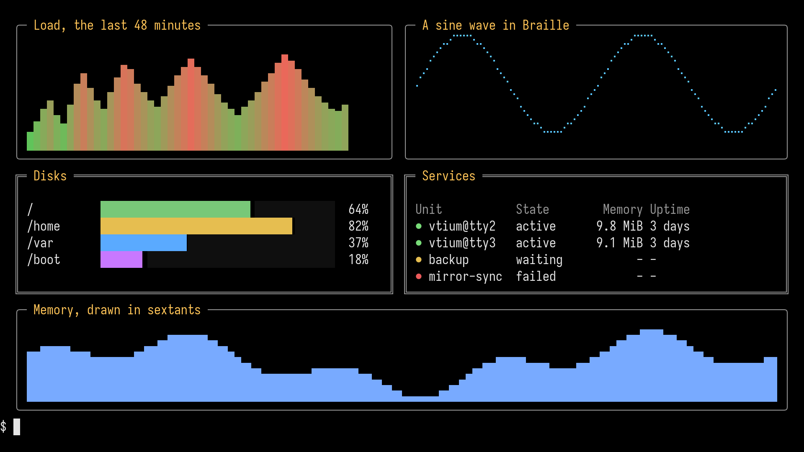
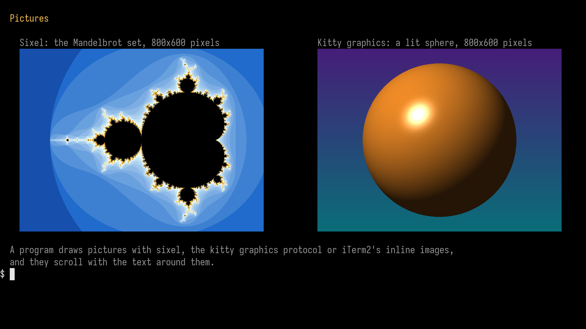

<!-- tools/tier3/showcase.sh writes this page from tier 3's showcase run. Change the scenes in tools/tier3/guest/screens/ or the figures in docs/figures/ and run it again; an edit here is lost. -->

# Showcase

These screens are vtium's own drawing on a Linux VT at 1920×1080. Tier 3, vtium's test harness in a virtual machine, ran vtium on a VT of its guest and captured each screen from the guest's display. Nothing in them is mocked up or edited. Each scene is a shell script that writes fixed bytes, so every run draws the same screen. Some categories also show how vtium behaves over time, in figures drawn by hand. The screens are made again once per wave of work and before each release. They judge nothing, and [How vtium is judged](../concepts/how-vtium-is-judged.md) explains how vtium's output is judged.

![A console screen showing a shell session in a smooth monospaced font: prompts in blue, gray and green segments, a colored listing of the vtium source tree, a git log with a branch graph and yellow commit hashes, the crates of vtium, then a row of six pictures, each with its file name under it: the Earth rising over the Moon, hexagonal tiles in teal, gold and coral, a Julia set glowing violet and orange, a rainbow plasma, a sun setting behind purple hills, and the whole Earth. Below them are three lines of greetings and thanks in English, Chinese, Japanese, Korean, Thai, Greek, Russian, Vietnamese, French and German with emoji, the first also in Hindi, Arabic and Hebrew, the Arabic and Hebrew reading right to left, and a line of words each drawn in the style it names: underline, double, curly, dotted, dashed, a red curly underline, strike, inverse and dim.](hero.png)

vtium draws a shell session on a 1920×1080 display in Iosevka Term, 28 rows of 128 columns. The prompts are powerline segments with an icon from Symbols Nerd Font Mono. Below them are a colored directory listing, a git history with its branch graph, and a gallery of six pictures in kitty graphics with their file names. Then come greetings in several scripts with emoji, and a line of text styles. The styles are straight, double, curly, dotted and dashed underlines, a curly underline in a color of its own, strike, inverse and dim. vtium's own gallery tool, tools/gallery/gallery, draws the gallery. It shows four pictures computed from a few lines of arithmetic, and two photographs NASA's astronauts took, Earthrise and the Blue Marble. The scene writes the rest of the session byte for byte, and the last prompt is the shell's own, with its cursor.

## Text and fonts

vtium draws lines of double size when a program asks for them. A title line is twice as tall and twice as wide, and a heading line is twice as wide. vtium's font helper renders each character of Iosevka Term at twice its size from the outline, so the large letters stay as smooth as the small ones. A double-width line holds 60 characters, half of a normal line's 120. Its ruler ends at the right edge, as the normal ruler under it does. Colors and every underline style follow the doubled letters.

[Every screen of text and fonts](text-and-fonts.md)

## Scripts and emoji

vtium draws the syllables of South Asian scripts whole. The upper rows show how many character cells each syllable takes, on a colored tile as wide as its cells. A syllable with a vowel sign that takes space of its own, such as Tamil கொ or Hindi का, takes two cells, as the shell's line editor counts it. Unicode splits text into clusters, the units a terminal normally gives one cell each. In the lower rows, each Kannada and Tamil conjunct, consonants joined into one shape, spans several clusters, each on a shade of its own. vtium keeps those cells and shapes the syllable once, so the joined form stretches across them. The examples include ra written under ka, ra written as a mark after ka, and five consonants stacked in one syllable. Under them is the first sentence of the Universal Declaration of Human Rights, in Tamil and in Kannada.

[Every screen and figure of scripts and emoji](scripts-and-emoji.md)

## Styles and modes

![A console screen in a smooth monospaced font: a paragraph about vtium, a short Rust function with colored keywords, strings and comments beside line numbers, words underlined in single, double, curly, dotted and dashed lines in several colors, words in italic, struck through, dim, reversed and in 24-bit color, raised and lowered small text such as E = mc² and H₂O with an underlined footnote mark and struck small text, an overlined word, and rows of arrows, mathematical symbols and typographic marks.](text.png)

vtium draws outline fonts smoothly at any size, here Iosevka Term at 30 points on a 1920×1080 display. The screen shows prose, a code listing in 24-bit color, and every underline style a program can ask for. It also shows the other text styles and the symbols of mathematics and typography. Iosevka Term has no italic face, so vtium slants the regular face for italic. Raised and lowered text (SGR 73 and 74) draws at two thirds of the size, and an underline or a strike on it follows the small glyph.

[Every screen and figure of styles and modes](styles-and-modes.md)

## Color

vtium draws every color a program can ask for: the 256 colors of xterm's palette, the 16 colors of the console's palette, and 24-bit color, here as smooth gradients. Below, vtium's named palettes, each drawn as its 16 colors; vtium.conf's palette key chooses one.

[Every screen of color](color.md)

## Lines and blocks

vtium draws box drawing, block elements, Braille and sextants itself, edge to edge in every cell. So lines join and bars stack without gaps, whatever the font. Here a script draws a dashboard with them.

[Every screen of lines and blocks](lines-and-blocks.md)

## Pictures

vtium shows pictures in the console. On the left is a sixel picture of the Mandelbrot set in 201 colors, and on the right a kitty graphics picture of a lit sphere in 24-bit color. tools/tier3/t3_showcase.py computes both from a few lines of arithmetic.

[Every screen of pictures](pictures.md)

## Input and pointer

A program changes the mouse pointer's shape with OSC 22, and vtium draws the shape itself. Here a program shows a list of links and sets the pointer to the hand that marks something to click. vtium has a picture of its own for each of ten shapes. They are the arrow, an I-beam over text, the hand, a crosshair, an hourglass, and the arrow with a small hourglass. The others are a circle with a slash, four arrows for a move, and double arrows for resizing sideways and up and down.

[Every screen and figure of input and pointer](input-and-pointer.md)

## Displays and VTs

![One head and its parts, inside vtium on one VT. On the left, a keyboard and a mouse on USB port 3.1 have solid arrows to the head desk, because a rule sends port 3.1 to desk. Below them, a roaming keyboard, which no head owns, has a dashed arrow to desk, which it types into while desk is the active head. The head desk comes from its [head desk] section. It holds a look, which is a font set and its size, and a stack of consoles. Console 1 is shown, with its own login, screen and scrollback, and consoles 2 and 3 run unseen behind it. Ctrl-Super-Right or Left shows another console. On the right, arrows go from desk to two displays, DP-1 and HDMI-A-1, because a rule sends each display to desk. Both displays show the console shown.](../figures/concepts-heads-parts.svg)

vtium drives every display of the machine from one VT, as a set of heads. A head is a terminal for one or more displays, with its own keyboards, its own look and its own consoles. Rules in vtium.conf send each display and each keyboard to a head, and vtium checks each device against the rules from the top. The first rule that matches decides where the device goes. Here one rule sends a keyboard and a mouse to the head desk, and another sends two displays to it.

[Every figure of displays and VTs](displays-and-vts.md)

## Small machines

The same console runs on a machine with 512 MB of memory and no GPU. These screens come from vtium's smallest build, minspec. They are tier 3 goldens: saved screens that vtium's tests in a virtual machine compare its output against.

vtium's minspec build draws this on a 320×240 display, the smallest vtium supports, in a tier 3 virtual machine with 1 vCPU and 512 MB of memory. The font is vtium's 8×8 PSF test font, made from Unifont's glyphs folded to half height, and the grid is 40 by 30 cells. The maintainer reviewed and accepted this screen.

[Every screen of small machines](small-machines.md)

## How these screens are made

`tools/tier3/showcase.sh` built vtium at commit `783fe28f+dirty`, whose console logged itself as vtium v0.1.0-alpha.8-645-g783fe28f-dirty. It ran tier 3's variant `showcase-1920x1080` on 2026-11-16 and wrote these pages. The variant's machine has 4 virtual CPUs, 4096 MB of memory, a virtio-vga display at 1920×1080 and Linux 7.2.11-arch1-1. It runs vtium built with the `images` and `bidi` features, drawing on its CPU renderer. The console starts in a character cell of 16×40 pixels. The shell scene, the hero, switches to a font set of its own, `showcase-shell`, with a cell of 15×38 pixels, so the hero holds 28 rows. [tools/tier3/README.md](https://github.com/vtium/vtium/blob/main/tools/tier3/README.md#the-showcase) describes the variant.

Each figure under "How it behaves" is an SVG drawn by hand and kept in `docs/figures/`. Where a claim file lies beside a figure, it names the code that each step rests on, and `docs/scripts/claims` checks that the code is still there.

Every font may be redistributed. vtium carries no font file but GNU Unifont. `t3_showcase.py` pins each other font by its address and SHA-256 and fetches it into a cache, and the run carries it into the guest.

| Font | Version | License | Used for | Source | SHA-256 of the file |
|---|---|---|---|---|---|
| Iosevka Term | 34.9.1 | SIL Open Font License 1.1 | every scene's text, and a band of the fonts scene | [the project's release on GitHub, PkgTTF-IosevkaTerm-34.9.1.zip](https://github.com/be5invis/Iosevka/releases/download/v34.9.1/PkgTTF-IosevkaTerm-34.9.1.zip) | `430ad4f56c6cd82e4c954efb6dd4b3e2b4cc2b2b1bd4f8143f3d3800096f32b4` |
| Terminus | 4.49.1 | SIL Open Font License 1.1 | the bitmap band of the fonts scene, ter-v32n (16x32 cells) | [Arch Linux's terminus-font 4.49.1-8 in the archive snapshot 2026/10/20 that tier 3 pins, which builds the PSF files from the release's BDF sources](https://archive.archlinux.org/repos/2026/10/20/extra/os/x86_64/terminus-font-4.49.1-8-any.pkg.tar.zst) | `5ce141e1d3964bb25e11345e60a221f22ab12dd1ca49bee02bbae3cb035d7e63` |
| GNU Unifont | 17.0.03, built into vtium | SIL Open Font License 1.1 (COPYING) | a band of the fonts scene, at twice its 8x16 size | vtium's own tree, crates/vtium-font/data/unifont.hex | built into vtium |
| JetBrains Mono | 2.304 | SIL Open Font License 1.1 | the second outline band of the fonts scene | [the release's file, pinned by tools/specimens/src/fonts.rs](https://github.com/JetBrains/JetBrainsMono/raw/v2.304/fonts/ttf/JetBrainsMono-Regular.ttf) | `a0bf60ef0f83c5ed4d7a75d45838548b1f6873372dfac88f71804491898d138f` |
| Noto Sans CJK SC | 2.004 | SIL Open Font License 1.1 | Chinese, Japanese and Korean, which Iosevka Term lacks | [the Noto project's release Sans2.004 on GitHub](https://github.com/notofonts/noto-cjk/raw/Sans2.004/Sans/OTF/SimplifiedChinese/NotoSansCJKsc-Regular.otf) | `2c76254f6fc379fddfce0a7e84fb5385bb135d3e399294f6eeb6680d0365b74b` |
| Noto Sans Thai | 2.002 | SIL Open Font License 1.1 | Thai, which Iosevka Term lacks | [the Noto project's release NotoSansThai-v2.002 on GitHub](https://github.com/notofonts/thai/releases/download/NotoSansThai-v2.002/NotoSansThai-v2.002.zip) | `61cf814eec46b294d6ea4401ac295d0cecd5207bd2331dcc5a15e7301d30ee44` |
| Noto Color Emoji | 2.051 | SIL Open Font License 1.1 | color emoji | [the release's file, pinned by tools/specimens/src/fonts.rs](https://github.com/googlefonts/noto-emoji/raw/v2.051/fonts/NotoColorEmoji.ttf) | `72a635cb3d2f3524c51620cdde406b217204e8a6a06c6a096ff8ed4b5fd6e27b` |
| Noto Sans Devanagari | 2.006 | SIL Open Font License 1.1 | Hindi in the scripts scene | [the Noto project's monthly release 24.9.1 on GitHub](https://github.com/notofonts/notofonts.github.io/raw/noto-monthly-release-24.9.1/fonts/NotoSansDevanagari/hinted/ttf/NotoSansDevanagari-Regular.ttf) | `306b53ecfb182a504dd8a7446093c316387d2fd8dc350d0792ed1753fe0996cd` |
| Noto Sans Bengali | 2.003 | SIL Open Font License 1.1 | Bengali in the scripts scene | [the Noto project's monthly release 24.9.1 on GitHub](https://github.com/notofonts/notofonts.github.io/raw/noto-monthly-release-24.9.1/fonts/NotoSansBengali/hinted/ttf/NotoSansBengali-Regular.ttf) | `9f8b4dd091f19b111d24ea18daae81bea8684cc67de17ea1acd797e144bf20ba` |
| Noto Sans Arabic | 2.012 | SIL Open Font License 1.1 | Arabic in the scripts scene | [the Noto project's monthly release 24.9.1 on GitHub, pinned by tools/tier2/src/fonts.rs](https://github.com/notofonts/notofonts.github.io/raw/noto-monthly-release-24.9.1/fonts/NotoSansArabic/hinted/ttf/NotoSansArabic-Regular.ttf) | `c270782ee478c685f95509e724125729e1284c82ebfbe414cc67926f29449e1d` |
| Noto Sans Hebrew | 3.001 | SIL Open Font License 1.1 | Hebrew in the scripts scene | [the Noto project's monthly release 24.9.1 on GitHub, pinned by tools/tier2/src/fonts.rs](https://github.com/notofonts/notofonts.github.io/raw/noto-monthly-release-24.9.1/fonts/NotoSansHebrew/hinted/ttf/NotoSansHebrew-Regular.ttf) | `cdefaf8efd47045f6820928eba84db5bed7557539328952b5f828315485e02ee` |
| Noto Sans Georgian | 2.005 | SIL Open Font License 1.1 | Georgian in the scripts scene | [the Noto project's monthly release 24.9.1 on GitHub](https://github.com/notofonts/notofonts.github.io/raw/noto-monthly-release-24.9.1/fonts/NotoSansGeorgian/hinted/ttf/NotoSansGeorgian-Regular.ttf) | `d3e33254b09e7bb2c5cf0f17e554b80462056c5a107097f258d495168c3a9346` |
| Noto Sans Ethiopic | 2.102 | SIL Open Font License 1.1 | Amharic in the scripts scene, in the Ethiopic script | [the Noto project's monthly release 24.9.1 on GitHub](https://github.com/notofonts/notofonts.github.io/raw/noto-monthly-release-24.9.1/fonts/NotoSansEthiopic/hinted/ttf/NotoSansEthiopic-Regular.ttf) | `f6f7fc379db9438959a2b0527e7a2cf36ea9c84626d56ec444fff37fc24c3c10` |
| Noto Sans Tamil | 2.004 | SIL Open Font License 1.1 | Tamil in the syllables scene | [the Noto project's monthly release 24.9.1 on GitHub, pinned by tools/tier2/src/fonts.rs](https://github.com/notofonts/notofonts.github.io/raw/noto-monthly-release-24.9.1/fonts/NotoSansTamil/hinted/ttf/NotoSansTamil-Regular.ttf) | `3c0a186feb3c63c7f6d63e1511dcdc144e745ae09b98e217c83f3e317974f6f9` |
| Noto Sans Kannada | 2.005 | SIL Open Font License 1.1 | Kannada in the syllables scene | [the Noto project's monthly release 24.9.1 on GitHub, pinned by tools/tier2/src/fonts.rs](https://github.com/notofonts/notofonts.github.io/raw/noto-monthly-release-24.9.1/fonts/NotoSansKannada/hinted/ttf/NotoSansKannada-Regular.ttf) | `f1a39a97a40486a345b1930169cb111098a4eaf40a88eb4303d2c0b8e7ceeeb5` |
| Symbols Nerd Font Mono | 3.4.0 | MIT | the prompt's symbols | [the release's file, pinned by tools/specimens/src/fonts.rs](https://github.com/ryanoasis/nerd-fonts/raw/v3.4.0/patched-fonts/NerdFontsSymbolsOnly/SymbolsNerdFontMono-Regular.ttf) | `f0f624d9b474bea1662cf7e862d44aebe1ae1f6c7f9cb7a0ca5d0e5ac9561c60` |

In the hero, vtium's gallery tool, `tools/gallery/gallery`, shows six pictures. `t3_showcase_gallery.py` computes `hex-tiles.png`, `julia-set.png`, `plasma.png` and `sunset-hills.png` from a few lines of arithmetic. The other two are photographs in the public domain, shrunk once to 256x160 pixels and committed in `tools/tier3/showcase-photos/`:

| File | What it shows | Author | License | Source | Made by | SHA-256 of the file |
|---|---|---|---|---|---|---|
| `earthrise.png` | Earthrise, the Earth rising over the Moon's horizon, photograph AS08-14-2383, 24 December 1968 | Bill Anders, Apollo 8, NASA | public domain, a work of NASA | [the original](https://upload.wikimedia.org/wikipedia/commons/a/a8/NASA-Apollo8-Dec24-Earthrise.jpg) ([its page](https://commons.wikimedia.org/wiki/File:NASA-Apollo8-Dec24-Earthrise.jpg)), SHA-256 `24fd2a4f833534ca6741ed96d03b028ac1d8fda2cd129ded4d208535f541d4da` | the 2400x2400 original cropped to 1760x1100 at 480,1000 and scaled to 256x160 with ImageMagick 7.1.2's Lanczos filter | `b2474765e226e3ba5d2b305d56e7a60e2ee2eca13e4bc9eb1d8f78ebf76c6438` |
| `whole-earth.png` | The Blue Marble, the whole Earth, photograph AS17-148-22727, 7 December 1972 | the crew of Apollo 17, NASA | public domain, a work of NASA | [the original](https://upload.wikimedia.org/wikipedia/commons/9/97/The_Earth_seen_from_Apollo_17.jpg) ([its page](https://commons.wikimedia.org/wiki/File:The_Earth_seen_from_Apollo_17.jpg)), SHA-256 `51049ed4e34514880bfbe39d34e2dd2c56e31f55919e7f4f0b34ef1698cb9f50` | the 3000x3002 original scaled to 160x160 with ImageMagick 7.1.2's Lanczos filter and set on black, 48 pixels each side, to 256x160 | `7bcd13a03aa710cf37f95e02895465c7de8125e57a6ab35665eb060729a7c98f` |

The small-machine screens are copies of these goldens:

| Image | Copied from | SHA-256 |
|---|---|---|
| `small/sgr.png` | [`tools/tier3/goldens/2d-640x480-psf16/sgr.png`](https://github.com/vtium/vtium/blob/main/tools/tier3/goldens/2d-640x480-psf16/sgr.png) | `f7d9f673449306ad012d2f63a86c04f82b0a264f6bea02e774c429ab343084d7` |
| `small/small-console.png` | [`tools/tier3/goldens/2d-320x240-psf8/small-console.png`](https://github.com/vtium/vtium/blob/main/tools/tier3/goldens/2d-320x240-psf8/small-console.png) | `0d5d548832339fa655c6d8b6d8759bd1f6074c737d596e66f59335165fb006fe` |
