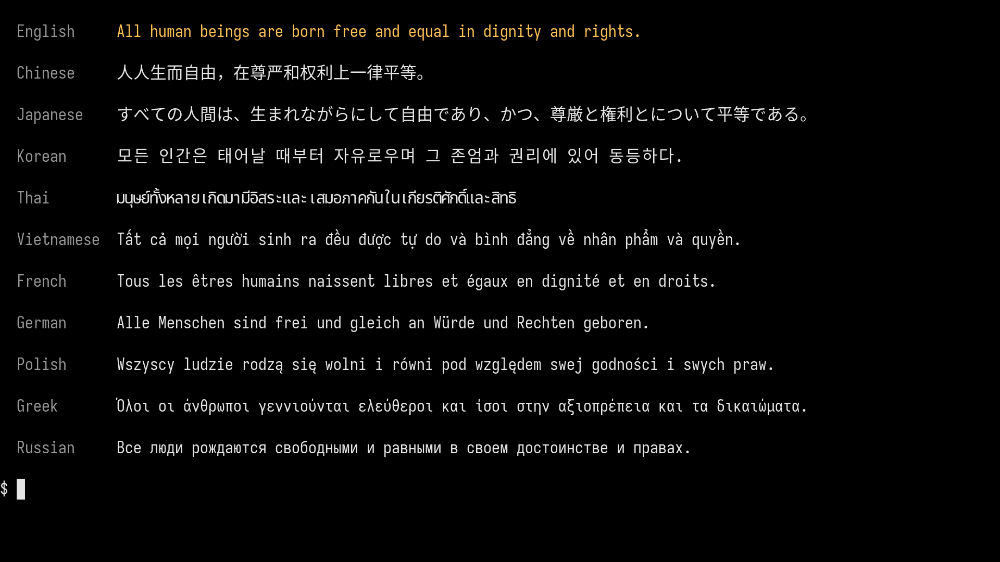
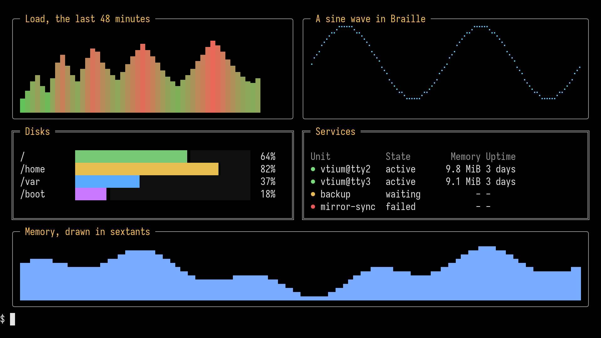
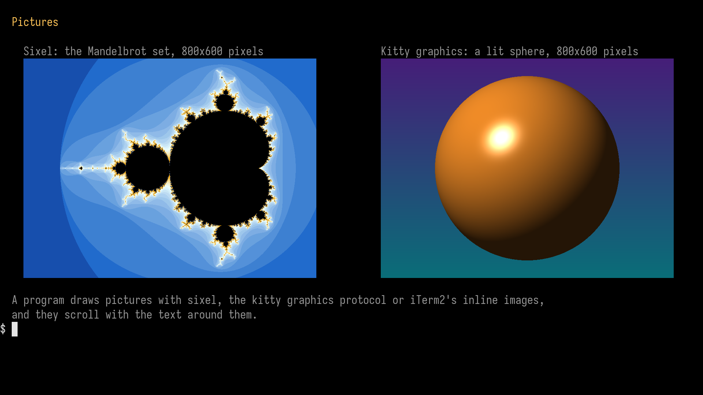

<!-- tools/tier3/showcase.sh writes this page from tier 3's showcase run. Change the scenes in tools/tier3/guest/screens/ and run it again; an edit here is lost. -->

# Showcase

These screens are vtium's own drawing on a Linux VT at 1920x1080. Tier 3, vtium's test harness in a virtual machine, ran vtium on a VT of its guest and captured each screen from the guest's display, and nothing in them is mocked up or edited. Each scene is a shell script that writes fixed bytes, so every run draws the same screen. The screens are made again for each release, and they judge nothing: [How vtium is judged](../concepts/how-vtium-is-judged.md) explains how vtium's output is judged.

## A shell session

![A console screen showing a shell session in a smooth monospaced font: prompts in blue, gray and green segments, a colored listing of the vtium source tree, a git log with a branch graph and yellow commit hashes, the crates of vtium, then a row of six pictures, each with its file name under it: the Earth rising over the Moon, hexagonal tiles in teal, gold and coral, a Julia set glowing violet and orange, a rainbow plasma, a sun setting behind purple hills, and the whole Earth. Below them are three lines of greetings and thanks in English, Chinese, Japanese, Korean, Thai, Greek, Russian, Vietnamese, French and German with emoji, and a line of words each drawn in the style it names: underline, double, curly, dotted, dashed, a red curly underline, strike, inverse and dim.](hero.png)

vtium draws a shell session on a 1920x1080 display in Iosevka Term, 28 rows of 128 columns: prompts in powerline segments with an icon from Symbols Nerd Font Mono, a colored directory listing, a git history with its branch graph, a gallery of six pictures in kitty graphics with their file names, greetings in several scripts with emoji, and a line of text styles: straight, double, curly, dotted and dashed underlines, a curly underline in a color of its own, strike, inverse and dim. vtium's own gallery tool, tools/gallery/gallery, draws the gallery: four pictures computed from a few lines of arithmetic, and two photographs NASA's astronauts took, Earthrise and the Blue Marble. The scene writes the rest of the session byte for byte, and the last prompt is the shell's own, with its cursor.

## Outline text

![A console screen in a smooth monospaced font: a paragraph about vtium, a short Rust function with colored keywords, strings and comments beside line numbers, words underlined in single, double, curly, dotted and dashed lines in several colors, words in italic, struck through, dim, reversed and in 24-bit color, raised and lowered small text such as E = mc² and H₂O with an underlined footnote mark and struck small text, an overlined word, and rows of arrows, mathematical symbols and typographic marks.](text.png)

vtium draws outline fonts smoothly at any size: Iosevka Term at 30 points on a 1920x1080 display, prose, a code listing in 24-bit color, every underline style a program can ask for, the other text styles, and the symbols of mathematics and typography. Iosevka Term has no italic face, so vtium slants the regular face for italic. Raised and lowered text (SGR 73 and 74) draws at two thirds of the size, and an underline or a strike on it follows the small glyph.

## Emoji

vtium draws color emoji from Noto Color Emoji beside the text, two cells wide, with the sequences that join several emoji into one picture: people and families joined by zero-width joiners, flags, keycaps and skin tones. An underline, a strike or an overline reaches across the whole emoji.

## Scripts

vtium draws the world's scripts: Chinese, Japanese and Korean two cells wide, Thai with its vowel and tone marks stacked above and below, and Latin, Greek and Cyrillic with their accents, each line the first sentence of the Universal Declaration of Human Rights. Devanagari joins this screen once vtium draws its vowel signs and conjuncts right, and Arabic and Hebrew once vtium orders right-to-left text.

## Color

vtium draws every color a program can ask for: the 256 colors of xterm's palette, the 16 colors of the console's palette, and 24-bit color, here as smooth gradients. Below, vtium's named palettes, each drawn as its 16 colors; vtium.conf's palette key chooses one.

## Box drawing

vtium draws box drawing, block elements, Braille and sextants itself, edge to edge in every cell, so lines join and bars stack without gaps whatever the font: here a dashboard a script draws.

## Pictures

vtium shows pictures in the console as desktop terminals do: on the left a sixel picture of the Mandelbrot set in 201 colors, on the right a kitty graphics picture of a lit sphere in 24-bit color. tools/tier3/t3_showcase.py computes both from a few lines of arithmetic.

## Fonts

vtium draws any font a frit names, bitmap or outline. These four bands are four captures of the same screen, each in one font and starting with its name and kind: Iosevka Term and JetBrains Mono are outline fonts, which vtium scales to the cell and antialiases; Terminus is a PSF console font, and GNU Unifont, which vtium carries, is drawn at twice its size, both as bitmaps of whole pixels. Each band's styles line shows italic, which vtium slants itself where a font has no italic face, in whole pixels in the two bitmap fonts; strike, a curly underline, raised and lowered text at two thirds of the size, and dim. [Choose a font](../fonts.md) shows how to choose your own.

## Small machines

The same console runs on a machine with 512 MB of memory and no GPU. These two screens are tier 3 goldens of vtium's smallest build, minspec.

vtium's minspec build draws this on a VT of tier 3's guest, which has 1 vCPU and 512 MB, on a virtio-vga display at 640x480, in vtium's 8x16 PSF test font made from Unifont's glyphs, 80 by 30 cells. It is a tier 3 golden. The font has no italic face, so vtium slants the word `italic` itself. It moves the upper rows of each letter to the right in steps of one pixel, and the lowest rows stay where they are.

The same build draws this in the same guest on a 320x240 display, the smallest vtium supports, in vtium's 8x8 PSF test font made from Unifont's glyphs folded to half height, 40 by 30 cells. It is also a tier 3 golden. The maintainer reviewed and accepted it.

## How these screens are made

`tools/tier3/showcase.sh` built vtium at commit `c21716af`, whose console logged itself as vtium v0.1.0-alpha.7-49-gc21716af, ran tier 3's variant `showcase-1920x1080` on 2026-11-12, and wrote this page. The variant's machine has 4 virtual CPUs and 4096 MB of memory, a virtio-vga display at 1920x1080 and Linux 7.2.11-arch1-1, and runs vtium built with the `images` feature, drawing on its CPU renderer. The console starts in a cell of 16x40 pixels, and the shell scene, the hero, switches to its own frit, `showcase-shell`, in a cell of 15x38 pixels, so the hero holds 28 rows. [tools/tier3/README.md](https://github.com/vtium/vtium/blob/main/tools/tier3/README.md#the-showcase) describes the variant.

Every font may be redistributed. vtium carries no font file but GNU Unifont, so `t3_showcase.py` pins each other font by its address and SHA-256 and fetches it into a cache, and the run carries it into the guest.

| Font | Version | License | Used for | Source | SHA-256 of the file |
|---|---|---|---|---|---|
| Iosevka Term | 34.9.1 | SIL Open Font License 1.1 | every scene's text, and a band of the fonts scene | [the project's release on GitHub, PkgTTF-IosevkaTerm-34.9.1.zip](https://github.com/be5invis/Iosevka/releases/download/v34.9.1/PkgTTF-IosevkaTerm-34.9.1.zip) | `430ad4f56c6cd82e4c954efb6dd4b3e2b4cc2b2b1bd4f8143f3d3800096f32b4` |
| Terminus | 4.49.1 | SIL Open Font License 1.1 | the bitmap band of the fonts scene, ter-v32n (16x32 cells) | [Arch Linux's terminus-font 4.49.1-8 in the archive snapshot 2026/10/20 that tier 3 pins, which builds the PSF files from the release's BDF sources](https://archive.archlinux.org/repos/2026/10/20/extra/os/x86_64/terminus-font-4.49.1-8-any.pkg.tar.zst) | `5ce141e1d3964bb25e11345e60a221f22ab12dd1ca49bee02bbae3cb035d7e63` |
| GNU Unifont | 17.0.03, built into vtium | SIL Open Font License 1.1 (COPYING) | a band of the fonts scene, at twice its 8x16 size | vtium's own tree, crates/vtium-font/data/unifont.hex | built into vtium |
| JetBrains Mono | 2.304 | SIL Open Font License 1.1 | the second outline band of the fonts scene | [the release's file, pinned by tools/specimens/src/fonts.rs](https://github.com/JetBrains/JetBrainsMono/raw/v2.304/fonts/ttf/JetBrainsMono-Regular.ttf) | `a0bf60ef0f83c5ed4d7a75d45838548b1f6873372dfac88f71804491898d138f` |
| Noto Sans CJK SC | 2.004 | SIL Open Font License 1.1 | Chinese, Japanese and Korean, which Iosevka Term lacks | [the Noto project's release Sans2.004 on GitHub](https://github.com/notofonts/noto-cjk/raw/Sans2.004/Sans/OTF/SimplifiedChinese/NotoSansCJKsc-Regular.otf) | `2c76254f6fc379fddfce0a7e84fb5385bb135d3e399294f6eeb6680d0365b74b` |
| Noto Sans Thai | 2.002 | SIL Open Font License 1.1 | Thai, which Iosevka Term lacks | [the Noto project's release NotoSansThai-v2.002 on GitHub](https://github.com/notofonts/thai/releases/download/NotoSansThai-v2.002/NotoSansThai-v2.002.zip) | `61cf814eec46b294d6ea4401ac295d0cecd5207bd2331dcc5a15e7301d30ee44` |
| Noto Color Emoji | 2.051 | SIL Open Font License 1.1 | color emoji | [the release's file, pinned by tools/specimens/src/fonts.rs](https://github.com/googlefonts/noto-emoji/raw/v2.051/fonts/NotoColorEmoji.ttf) | `72a635cb3d2f3524c51620cdde406b217204e8a6a06c6a096ff8ed4b5fd6e27b` |
| Symbols Nerd Font Mono | 3.4.0 | MIT | the prompt's symbols | [the release's file, pinned by tools/specimens/src/fonts.rs](https://github.com/ryanoasis/nerd-fonts/raw/v3.4.0/patched-fonts/NerdFontsSymbolsOnly/SymbolsNerdFontMono-Regular.ttf) | `f0f624d9b474bea1662cf7e862d44aebe1ae1f6c7f9cb7a0ca5d0e5ac9561c60` |

In the hero, vtium's gallery tool, `tools/gallery/gallery`, shows six pictures. `t3_showcase_gallery.py` computes `hex-tiles.png`, `julia-set.png`, `plasma.png` and `sunset-hills.png` from a few lines of arithmetic. The other two are photographs in the public domain, shrunk once to 256x160 pixels and committed in `tools/tier3/showcase-photos/`:

| File | What it shows | Author | License | Source | Made by | SHA-256 of the file |
|---|---|---|---|---|---|---|
| `earthrise.png` | Earthrise, the Earth rising over the Moon's horizon, photograph AS08-14-2383, 24 December 1968 | Bill Anders, Apollo 8, NASA | public domain, a work of NASA | [the original](https://upload.wikimedia.org/wikipedia/commons/a/a8/NASA-Apollo8-Dec24-Earthrise.jpg) ([its page](https://commons.wikimedia.org/wiki/File:NASA-Apollo8-Dec24-Earthrise.jpg)), SHA-256 `24fd2a4f833534ca6741ed96d03b028ac1d8fda2cd129ded4d208535f541d4da` | the 2400x2400 original cropped to 1760x1100 at 480,1000 and scaled to 256x160 with ImageMagick 7.1.2's Lanczos filter | `b2474765e226e3ba5d2b305d56e7a60e2ee2eca13e4bc9eb1d8f78ebf76c6438` |
| `whole-earth.png` | The Blue Marble, the whole Earth, photograph AS17-148-22727, 7 December 1972 | the crew of Apollo 17, NASA | public domain, a work of NASA | [the original](https://upload.wikimedia.org/wikipedia/commons/9/97/The_Earth_seen_from_Apollo_17.jpg) ([its page](https://commons.wikimedia.org/wiki/File:The_Earth_seen_from_Apollo_17.jpg)), SHA-256 `51049ed4e34514880bfbe39d34e2dd2c56e31f55919e7f4f0b34ef1698cb9f50` | the 3000x3002 original scaled to 160x160 with ImageMagick 7.1.2's Lanczos filter and set on black, 48 pixels each side, to 256x160 | `7bcd13a03aa710cf37f95e02895465c7de8125e57a6ab35665eb060729a7c98f` |

The small-machine screens are copies of these goldens:

| Image | Copied from | SHA-256 |
|---|---|---|
| `small/sgr.png` | [`tools/tier3/goldens/2d-640x480-psf16/sgr.png`](https://github.com/vtium/vtium/blob/main/tools/tier3/goldens/2d-640x480-psf16/sgr.png) | `f7d9f673449306ad012d2f63a86c04f82b0a264f6bea02e774c429ab343084d7` |
| `small/small-console.png` | [`tools/tier3/goldens/2d-320x240-psf8/small-console.png`](https://github.com/vtium/vtium/blob/main/tools/tier3/goldens/2d-320x240-psf8/small-console.png) | `0d5d548832339fa655c6d8b6d8759bd1f6074c737d596e66f59335165fb006fe` |
