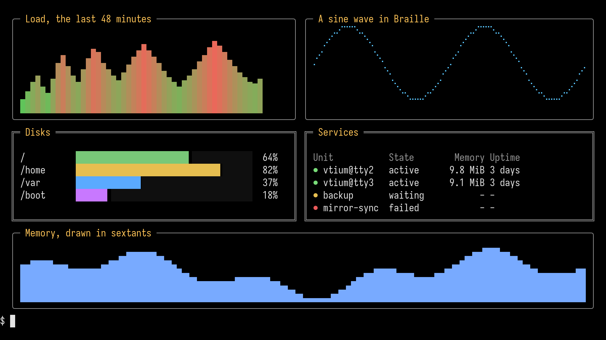

<!-- tools/tier3/showcase.sh writes this page from tier 3's showcase run. Change the scenes in tools/tier3/guest/screens/ or the figures in docs/figures/ and run it again; an edit here is lost. -->

# Lines and blocks

These screens are part of [vtium's showcase](README.md), which says how they are made.

vtium draws box drawing, block elements, Braille and sextants itself, edge to edge in every cell. So lines join and bars stack without gaps, whatever the font. Here a script draws a dashboard with them.

