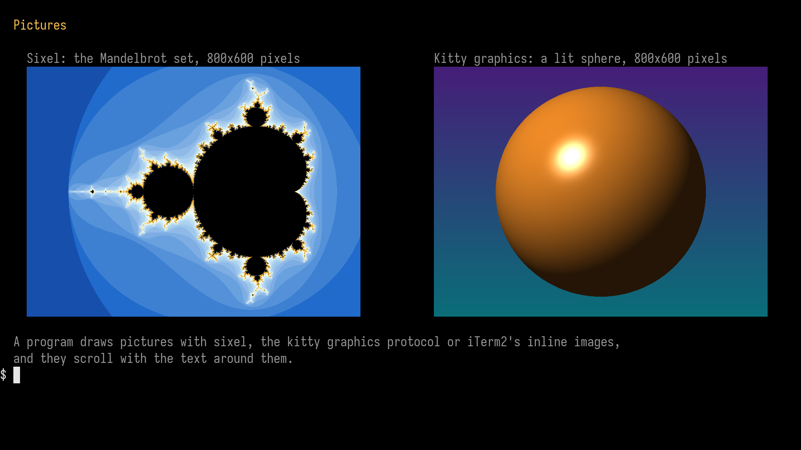

<!-- tools/tier3/showcase.sh writes this page from tier 3's showcase run. Change the scenes in tools/tier3/guest/screens/ or the figures in docs/figures/ and run it again; an edit here is lost. -->

# Pictures

These screens are part of [vtium's showcase](README.md), which says how they are made.

vtium shows pictures in the console as desktop terminals do: on the left a sixel picture of the Mandelbrot set in 201 colors, on the right a kitty graphics picture of a lit sphere in 24-bit color. tools/tier3/t3_showcase.py computes both from a few lines of arithmetic.

