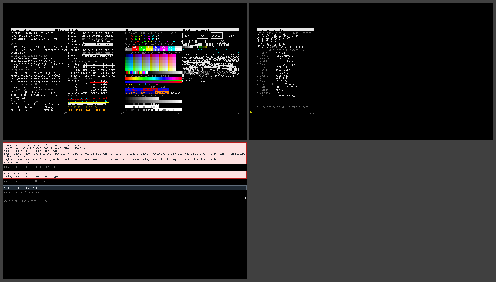

# 1366x768

A common laptop panel: 1366×768, 24-bit color, drawn in `unifont` at 8×16, 170×48 cells, the card on 2 screens and vtium's message bars on one more, shown together in the collage.



| Display | Class | Cell | Grid | Font | Screens |
|---|---|---|---|---|---|
| 1366×768, 24-bit color | order unknown | 8×16 | 170×48 | `unifont`, built in | [screen-1.png](screen-1.png), [screen-2.png](screen-2.png), [screen-3.png](screen-3.png) |

## Why this font

With `font-size=0`, vtium asks for 19 pixels here. See [the issue that sets the size `font-size=0` picks](https://github.com/vtium/vtium/issues/118). A bitmap font draws at the largest whole multiple of its own height that fits. See [the issue that steps a font through its sizes](https://github.com/vtium/vtium/issues/126). So the built-in unifont draws at 16 pixels, which gives 170×48 cells. Emoji draw as unifont's monochrome glyphs where it has one, and Nerd Font symbols draw as the missing glyph. The outline profiles draw both from the desktop font set.

## Configuration

[vtium.conf](vtium.conf):

```ini
# vtium's defaults: font-size=0 asks 19 pixels here, and unifont
# draws at 16, its largest whole multiple that fits.
font-size=0
```

The console chooses this font by itself. The screens here draw vtium-font's built-in font directly.
