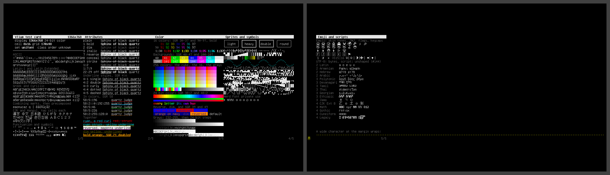

# 1366x768

A common laptop panel: 1366x768, 24-bit color, drawn in `unifont` at 8x16, 170x48 cells, the card on 2 screens, shown together in the collage.



| Display | Class | Cell | Grid | Font | Screens |
|---|---|---|---|---|---|
| 1366x768, 24-bit color | order unknown | 8x16 | 170x48 | `unifont`, built in | [screen-1.png](screen-1.png), [screen-2.png](screen-2.png) |

## Why this font

`font-size=0` asks 19 pixels here, and a bitmap set draws at the largest whole multiple of its cell that fits (ADR-1200 D9), so the built-in unifont (D7) draws at 16 pixels, 170x48 cells. 19 pixels is under 24, the smallest outline size D11 builds, so a default machine holds no outline set for this display. Emoji draw as unifont's monochrome glyphs where it has one, and Nerd Font symbols as the missing glyph; the outline profiles draw both from the desktop set.

## Configuration

[vtium.conf](vtium.conf):

```ini
# vtium's defaults: font-size=0 asks 19 pixels here, and unifont
# draws at 16, its largest whole multiple that fits (ADR-1200 D9).
font-size=0
```

The console chooses this set by itself once #126 and #118's rule land; the screens here draw vtium-font's built-in set directly.
