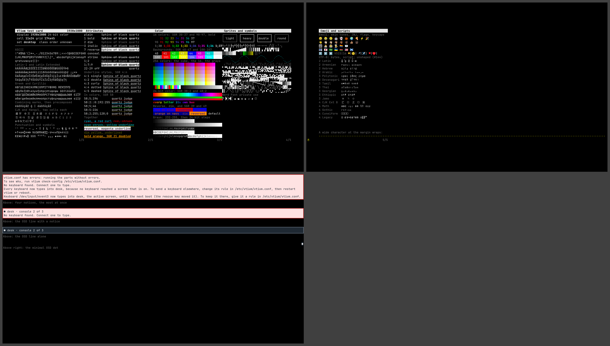

# 1920x1080

A full HD monitor: 1920×1080, 24-bit color, drawn in `desktop` at 11×24, 174×45 cells, the card on 2 screens and vtium's message bars on one more, shown together in the collage.



| Display | Class | Cell | Grid | Font | Screens |
|---|---|---|---|---|---|
| 1920×1080, 24-bit color | order unknown | 11×24 | 174×45 | `desktop`, the font set [`desktop.vtfrit`](https://github.com/vtium/vtium/blob/main/tools/specimens/frits/desktop.vtfrit) | [screen-1.png](screen-1.png), [screen-2.png](screen-2.png), [screen-3.png](screen-3.png) |

## Why this font

vtium draws an outline font only when you name a font set that lists one. This profile's vtium.conf names the desktop font set with `font-name=desktop`. The desktop font set draws text from JetBrains Mono, the private-use symbols from Symbols Nerd Font Mono and emoji from Noto Color Emoji, with the built-in unifont last for every character the others lack. vtium's font helper generates the glyphs from these fonts while vtium runs. See [the issue that generates glyphs in the font helper](https://github.com/vtium/vtium/issues/145). The font set starts at 18 points, which is 24 pixels at 96 DPI, and these profiles draw it in 24- and 32-pixel cells. Outline glyphs draw antialiased at this size. The font helper draws an emoji sequence whole, so skin tones, ZWJ sequences, flags and keycaps each draw as one emoji. Scripts that need shaping, such as Devanagari and Tamil, draw unshaped. See [the text shaping issue](https://github.com/vtium/vtium/issues/144).

## Configuration

[vtium.conf](vtium.conf):

```ini
# The desktop font set: tools/specimens/frits/desktop.vtfrit in
# /etc/vtium/fonts, its glyphs generated while vtium runs.
font-name=desktop
font-size=0
```

The console loads the font set that `font-name` names from `/etc/vtium/fonts`. See [the issue that loads the configured font set](https://github.com/vtium/vtium/issues/126). The screens here draw the glyphs that the font helper, vtium-config, generates in the profile's character cell. It generates them from the font set and from the fonts that `make specimens-fonts` fetches, each pinned by its SHA-256. `tools/specimens/README.md` describes how. Where those fonts are missing, the check skips this profile while it is provisional, and fails it once it is accepted.
