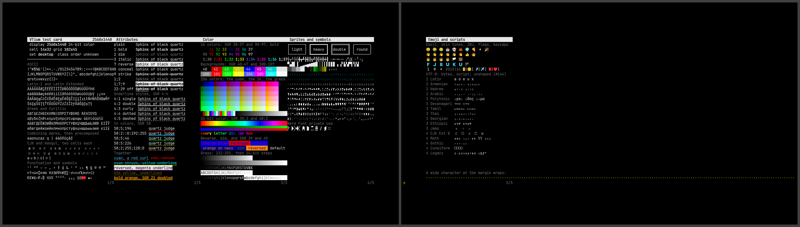

# 2560x1440

A QHD monitor: 2560x1440, 24-bit color, drawn in `desktop` at 14x32, 182x45 cells, the card on 2 screens, shown together in the collage.



| Display | Class | Cell | Grid | Font | Screens |
|---|---|---|---|---|---|
| 2560x1440, 24-bit color | order unknown | 14x32 | 182x45 | `desktop`, built from [`desktop.vtfrit`](../../../tools/specimens/frits/desktop.vtfrit) | [screen-1.png](screen-1.png), [screen-2.png](screen-2.png) |

## Why this font

ADR-1200 D11 builds one outline size for the display the package hook sees, snapped down to 24, 32 or 48 pixels, with unifont filling the outline font's gaps. The desktop set holds two of them, 24 and 32, from JetBrains Mono for text, Symbols Nerd Font Mono for the private-use symbols and Noto Color Emoji for emoji, with the built-in unifont last; `font-size=0` picks the strike, the largest whole multiple of a strike's height under the size it asks (ADR-1200 D9). Outline glyphs draw antialiased at this size. A set maps single codepoints, so ZWJ sequences, flags and keycaps draw as their parts until #144 shapes them, and the scripts that need shaping draw unshaped.

## Configuration

[vtium.conf](vtium.conf):

```ini
# The desktop set: tools/specimens/frits/desktop.vtfrit in
# /etc/vtium/fonts, built with `vtium-vitrify create desktop`. vtium
# loads a set by name from #126. font-size=0 picks the strike.
font-name=desktop
font-size=0
```

The console loads a set by name from #126. The screens here draw the set vtium-vitrify builds from the frit and the pinned fonts `make specimens-fonts` fetches (`tools/specimens/README.md`); where those fonts are absent the check skips this profile and says so.
